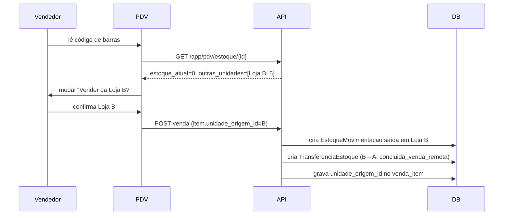

# ERP Comercial IA365 — Documentação Técnica

> SaaS ERP multi-tenant para PMEs. Admin (IA365) gerencia a plataforma; cada empresa-cliente tem múltiplas unidades com fiscal, estoque e caixa independentes. Integração 100% Focus NFe (NF-e, NFC-e, NFS-e, CC-e, manifestação do destinatário, backup XMLs).

> **29/10/2026 — DESFEITO por ordem do Dennis:** a pasta `tools/` (impacto, validar, build, deploy com portão, hook) foi removida e a rotina obrigatória de 28/10 deixou de valer. O que fica da noite de 28/10 é só o que a produção usa: `docker/prod/entrypoint.sh` (.env com aspas) e o `docker-compose.prod.yml`. Deploy volta ao de antes: `docker tag` da imagem no ar como `pre-<tema>-<data>` + build `-f docker-compose.prod.yml` + `up -d`. As seções abaixo sobre `tools/`, "portão", "canário" e 9ag ficam só como histórico.

**Última revisão:** 2026-11-20 13:50 BRT (**CADASTRO DE PRODUTO DUPLICAVA COM PREÇO 100× — corrigido EM PRODUÇÃO 20/11 13:32 BRT**: toque repetido no Salvar Produto reenviava o formulário; trava de envio único no `erp-core.js` + trava no servidor; chamados da Stilo Vinte concluídos; `main` = GitHub = produção; seção no fim). Anterior: 2026-11-17 tarde (fechamento do dia: títulos das entregas que subiram marcados EM PRODUÇÃO, maquininha — qual APK fala com qual servidor, bloco 16/11 da homologação Stone trazido da `feature/pos-stone-app`). Anterior: 2026-11-17 11:42 BRT (**TELAS REVISTAS (impeccable) EM PRODUÇÃO** — editar empresa e Integrações do admin, painel da loja online; só views; seção no fim). Anterior: 2026-11-17 (**UNIFICADA EM PRODUÇÃO 17/11 10:50 BRT** — maquininha Stone, cafeteria, grade, loja online, cobrança pelo caixa.ia365 e Open Finance, tudo desligado por padrão; site novo FORA; branch `producao-17nov`; seção no fim). Anterior: 2026-11-16 (**COBRANÇA DA PLATAFORMA VINDA DO caixa.ia365 — branch `cobranca-caixa-16nov`, juntada na homologação; NÃO em produção**: faixa no topo, tela Faturas, e-mail e sino para dono/gerente/admin/financeiro, baixa pelo banco e bloqueio; seção no fim; roteiro 86 ✅ + ponta a ponta com o caixa 25 ✅) · 2026-11-14 tarde (**BRANCH DE HOMOLOGAÇÃO `homolog-cafeteria-14nov`** = `main` 8140122 + cafeteria Fase 1 + `feature/pos-stone-app` f82330e; NÃO em produção; seção no fim) · 2026-11-14 ~09:40 BRT (**FORMAS DE PAGAMENTO CONFIGURÁVEIS — EM PRODUÇÃO 14/11 09:57 BRT, `main` = GitHub = `61d1efc`** (tela em Configurações da Loja → Formas de pagamento; produção só difere da `main` no `TransferenciaEstoqueController` de 13/11, de outra sessão) (backup `erp-backups/pre-formas-pagamento-20261114/`, foto `erp-com-app:pre-formas-pagamento-20261114`; OS convertida passa a entrar no caixa; Contas a Pagar mantém lista própria por decisão do Dennis) — Configurações → Formas de pagamento: prévia do PDV com arrastar e soltar, nome/ícone/cor/tamanho, desligar, criar forma nova que "funciona como" uma das de sempre; vale para PDV, faturar pedido, venda balcão e condição do pedido; filtros e quadros por forma da lista de Vendas, Relatório de Vendas e Produtos vendidos cruzados pela mesma regra; tabela nova `formas_pagamento` nasce vazia = botões de fábrica, nenhuma empresa muda no deploy; rodada 2 liga também caixa (resumo, fechamento, comprovante), Contas a Receber, Ordem de Serviço, regra de máquina por botão, exportação e API do Gersen — 2 migrations; seção no fim; branch `formas-pagamento-14nov`, script 102 ✅ + navegador 35 ✅ + phpunit 315 com só os 2 ❌ de sempre) · 2026-11-13 ~10:35 BRT (**relatório "Entradas e saídas do estoque"** — Relatórios → Entradas e saídas: período livre, só entradas / só saídas / tudo, tipo, loja, produto, categoria, usuário e origem; resumo por produto + movimento a movimento; Excel e PDF; seção no fim; branch `relatorio-mov-estoque-13nov`, script 71 ✅ + navegador 23 ✅, **EM PRODUÇÃO 13/11 10:35 BRT**; no mesmo dia a entrega de **transferências de 11/11** (em trânsito / concluir, imprimir, busca por código), que estava só em produção, foi trazida para o git; **`main` = GitHub = produção** (`16058d1` + docs), pushada 13/11 por ordem do Dennis) · 2026-11-11 ~10:40 BRT (**comissão pelo % do CADASTRO do funcionário** — o PDV gravava 5% fixo; vazio/0% = sem comissão; trocar vendedor recalcula; seção no fim; branch `comissao-pct-cadastro-11nov`, **EM PRODUÇÃO 10:34 BRT**; 74 pendentes da CellMaster (N S BORBA) recalculadas R$ 813,95 → R$ 64,91) · 2026-11-10 ~15:55 BRT (**desconto GERAL da venda rateado nos itens da NF-e/NFC-e** — toda nota com desconto geral era rejeitada ("Total do Desconto difere do somatorio dos itens"); seção no fim; branch `nfe-desconto-rateio-10nov`, simulação 25 ✅ (código antigo 3 ❌) + phpunit 311 com só os 2 ❌ de sempre, **EM PRODUÇÃO 15:54 BRT**; NFC-e da DK venda 448759 reemitida e **AUTORIZADA série 10 nº 9**) · 2026-11-10 ~14:30 BRT (**DK: NF-e/NFC-e de pedido com frete rejeitadas + IE "ISENTO" saindo vazia** — seção no fim; branch `nfe-ie-frete-10nov`, simulação da venda 448734 24 ✅ (código antigo reproduz as 2 rejeições) + phpunit 301 com só os 2 ❌ de sempre + 9 novos ✅, **EM PRODUÇÃO 14:54 BRT** por ordem do Dennis; NF-e da 448734 reemitida e **AUTORIZADA série 2 nº 1451**) · 2026-11-10 ~11:15 BRT (**DESPESA DE PESSOAL NO FINANCEIRO EM PRODUÇÃO 10/11 11:08 BRT — as 3 fases juntas (Contas a Pagar de pessoal, Folha de Pagamento, DRE/fluxo/centro de custo)**, ordem do Dennis "Sim, subir"; commit `6231880`, foto `erp-com-app:pre-folha-contas-pagar-20261110`; seção "Deploy das 3 fases" no fim. ⚠️ as horas "~11:45" e "~13:15" das duas entradas seguintes foram estimadas errado — as três fases foram feitas entre ~07:30 e ~11:00 BRT de 10/11) · 2026-11-10 ~13:15 BRT (**DRE com "Despesas com Pessoal" e opção por COMPETÊNCIA, fluxo de caixa com o PROGRAMADO e filtros de saída, relatório Despesas por Centro de Custo — Fase 3** — seção no fim; mesma branch `folha-contas-pagar-10nov`, script 56 ✅ + navegador 23 ✅ + phpunit 301 com só os 2 ❌ de sempre, **NÃO está em produção**) · 2026-11-10 ~11:45 BRT (**FOLHA DE PAGAMENTO — Fase 2: ficha do funcionário (salário, vale), guias e benefícios de valor digitado e a tela que LANÇA tudo no Contas a Pagar, sem duplicar** — seção no fim; mesma branch `folha-contas-pagar-10nov`, script 51 ✅ + navegador 17 ✅ + phpunit 296 com só os 2 ❌ de sempre, **NÃO está em produção** — 2 migrations) · 2026-11-10 ~10:15 BRT (**Contas a Pagar para despesa de PESSOAL — Fase 1: favorecido funcionário / imposto, plano de contas e centro de custo com vínculo, competência, recorrência de 12 meses, editar, baixa com data/valor e estorno** — seção no fim; branch `folha-contas-pagar-10nov`, script 71 ✅ + navegador 17 ✅ + phpunit 13 ✅, **NÃO está em produção** — tem migration) · 2026-11-06 ~09:50 BRT (**filtro ORIGEM (Loja / WhatsApp / Online / Histórico importado) no lugar de Tipo + Canal, na lista de Vendas e nos dois relatórios** — seção no fim; branch `vendas-origem-06nov`, 23 ✅ + relatórios 31 ✅ / 25 ✅, **EM PRODUÇÃO 06/11 09:51 BRT**) · 2026-11-06 ~09:45 BRT (**Lista de Vendas: filtro Tipo com os tipos reais (PDV/Pedido/Balcão/Importada) + filtro Canal + cartões do topo respeitam os filtros** — seção no fim; branch `vendas-filtro-tipo-06nov`, 17 ✅, **EM PRODUÇÃO 06/11 09:41 BRT**) · 2026-11-06 ~08:30 BRT (**Relatório de PRODUTOS VENDIDOS** (Relatórios → Produtos vendidos): resumo por produto + item a item, forma de pagamento rateada, filtros de loja da venda E de loja de onde saiu em pílulas — seção no fim; branch `relatorio-produtos-vendidos-06nov`, 31 ✅ + navegador 15 ✅, **EM PRODUÇÃO 06/11 08:24 BRT**) · 2026-11-06 ~08:00 BRT (**Relatório de Vendas: lojas como botões na própria barra do filtro** — o dropdown de 07:56 parecia o campo antigo; branch `relatorio-lojas-na-barra-06nov`, 25 ✅ + navegador 15 ✅, **EM PRODUÇÃO 06/11 08:05 BRT**) · 2026-11-06 ~07:50 BRT (**Relatório de Vendas com VÁRIAS lojas marcadas** (`lojas[]`, sem trocar a loja da sessão) — seção no fim; branch `relatorio-varias-lojas-06nov`, 25 ✅ + navegador 14 ✅, **EM PRODUÇÃO 06/11 07:56 BRT**) · 2026-11-04 ~18:00 BRT (**editor de etiqueta: desmarcar item na lista era desfeito pelo navegador, item selecionado por cima dos vizinhos (alça utilizável), aviso de item sobre as barras, zona de silêncio de 11 módulos no EAN do layout livre** — branch `etiqueta-editor-checkbox-barras-04nov`, 15/15 ✅, **EM PRODUÇÃO 04/11 ~18:15 BRT** por ordem do Dennis, foto `erp-com-app:pre-etiqueta-editor-20261104`) · 2026-11-04 ~17:10 BRT (**DONA DOURO: busca de produto do PDV/orçamento por código exato + palavras em qualquer ordem ("não localiza") + chave `users.pode_editar_produtos` (vendedor/caixa cadastra e edita produtos; Mirella e Manoel ligadas na migration)** — seção no fim; branch `dona-douro-pdv-busca-permissao-04nov`, 38/38 ✅, **EM PRODUÇÃO 04/11 17:2x BRT**, foto `erp-com-app:pre-dona-douro-pdv-permissao-20261104`) · 2026-11-04 ~15:40 BRT (**STILO: relatório de vendas do GERENTE por loja vinculada (UnidadeScope prendia à loja da sessão) + editor de etiqueta de formato FIXO parte do que o fixo imprime (LAYOUT_FIXOS) + layout livre imprime o nome fantasia** — seção no fim; branch `relatorio-gerente-etiqueta-04nov`, 31/31 ✅, **EM PRODUÇÃO 04/11 15:18 BRT** (18:18 UTC), foto `erp-com-app:pre-relatorio-gerente-etiqueta-20261104`) · 2026-11-03 ~10:45 BRT (**Trocar vendedor de venda finalizada (dono/gerente) EM PRODUÇÃO** — seção no fim) · 2026-11-03 ~10:00 BRT (**STILO VINTE: Credishop no PDV só para ela EM PRODUÇÃO (chave `empresas.pdv_credishop`); 18 vendas de teste apagadas; 520 produtos + estoque das 6 lojas importados do Gestão Click com o código no `codigo_barras`; nomes sem "R$ valor"; configurações fiscais intactas** — seção no fim; `main` = GitHub = produção) · 2026-10-28 21:32 BRT / 29-10 00:32 UTC (**deploy só de infra EM PRODUÇÃO — imagem `78e310290ca6`, `.env` gerado com aspas pelo entrypoint (37 chaves, 0 sem aspas), `/login` 200, "Nothing to migrate", 0 erros; produção não depende mais do `.env` copiado à mão; o `deploy.sh` morreu antes da rodada pós-deploy dele → pós-deploy rodado à mão, seção no fim**) · 2026-10-28 23:50 (**deploy só de infra PRONTO: imagem `78e310290ca6` = mesmo código da produção + entrypoint com aspas; boot antes ❌ × depois ✅ reproduzido; `deploy.sh --rotulo` + caminho rápido no portão; aguarda `sudo tools/deploy.sh integracao-28out --rotulo infra-entrypoint`** — seção no fim) · 2026-10-28 noite (**integração EM PRODUÇÃO 18:32 BRT, imagem 5771b772eba2; 502 de 4 min por `.env` sem aspas gerado pelo entrypoint → restaurado 18:36; entrypoint com aspas + canário e rollback automático no deploy.sh + caminho rápido** — seção no fim) · 2026-10-28 noite (**integração das branches da Mel `alteracoes-erp` + `edicao-preco` + `tools/` na `integracao-28out`** — 2 verbos desacentuados de volta, roteiro de 104 itens, 0 ❌ novos; seção no fim; armadilha 93) · 2026-10-28 (**ferramental da rotina obrigatória de validação em `tools/`** — `impacto.sh`, `validar/validar.sh antes|depois|pos-deploy` (phpunit completo + lint + roteiros + smoke de todas as telas × 7 perfis em ambiente descartável), `build.sh`, `deploy.sh` com portão, hook do Claude Code; baseline real da produção: phpunit 198 ✅ / 30 ❌ pré-existentes, lint 0, smoke 591 ✅ / 6 ❌ pré-existentes; seção 9ag; NÃO deployado — é ferramenta) · 2026-10-28 (**DK Med: pedido impresso em A4 + venda de pedido/balcão no caixa + loja de saída** — seção própria; migration `contas_receber.pedido_id`; armadilha 92) · 2026-10-27 noite (**DK: 1ª NF-e interestadual AUTORIZADA — venda 10319, série 2 nº 1450**; Focus série 2 próximo 1451; CFOP 6108 + consumidor_final=1 feitos à mão, depois AUTOMATIZADOS — **EM PRODUÇÃO 20:06 UTC** por tar, rollback `pre-nfe-interestadual-20261027`; seção no fim) · 2026-10-27 (**DK: Faturar pede a forma de pagamento + observações com texto pronto e caixinha "imprimir" EM PRODUÇÃO 16:29 UTC** — seção de 27/10) · 2026-10-25 (**código da `main` = produção** (último commit de código: `485e8d3`) — a `main` do GitHub voltou a ser a fonte da verdade: tudo o que está no ar está nela, e rebuild a partir dela é seguro (tem o php.ini da CVE). No dia: **orçamento com taxa de entrega e quadro "Dinheiro/PIX × Cartão Nx"** + opção **"preço cadastrado = preço do cartão"** com desconto no PIX (pedido da DK; opções nascem desligadas; DK ligada: cartão, 5% PIX, orçamento 6x) EM PRODUÇÃO 13:15 UTC; **unificação das branches pendentes** (`unificacao-25out`: php.ini CVE, fornecedor rápido, endereço Paulista, testes, parte da auditoria de mai/2026; PDV e comissão mantidos como produção; banner Asaas fora) EM PRODUÇÃO 13:38 UTC; **Nova Movimentação de Estoque busca o produto enquanto digita** EM PRODUÇÃO 14:01 UTC; armadilhas 86–91) · 2026-10-23 (**Entrada por NF-e** — XML da nota de compra (ou botão em NFes Recebidas) → conferência item a item → estoque, custo, fornecedor e contas a pagar opcionais; **EM PRODUÇÃO 23/10 ~09:40 BRT por tar** (14 arquivos + 1 migration), branch `entrada-nfe` **pushada** (`main` intocada); seção 9af) · 2026-10-22 noite (**EM PRODUÇÃO** — **escolher no PDV de qual estoque a venda sai** — opção da loja, default desligada, campo "Sai de"; quantidade de cada estoque na lista e no produto; cancelamento devolve ao estoque de origem; seção 9ae) · 2026-10-22 tarde (**EM PRODUÇÃO** — **orçamento impresso em A4 com logo, endereço da loja ou comercial e condições** — card "Impressão do Orçamento" em Configurações da Loja, migration nova; **estoque da loja** na lista e no card do produto; **foto do produto até 10 MB**; seção 9ad) · 2026-10-22 (**DK: NFC-e rejeitada saía como DANFE + Resincronizar duplicava a empresa na Focus** — **EM PRODUÇÃO 22/10 por tar**; job passa a fazer PUT quando já provisionada, PDV avisa a rejeição e o cupom sai como recibo sem valor fiscal; CSC enviado para a Focus 276343; séries 1 e 2 da DK já usadas em 2023 (rejeição 539) → série 10, vendas 9622/9624/9625/9626 reemitidas e autorizadas; seção 9ac + armadilha 84) · 2026-10-20 (**Treinamento: vídeos do ERP por perfil + acompanhamento no admin** — branch `treinamento` do Dennis (19/10) mergeada com a `main`; vídeo sem limite de tamanho, em pedaços cujo tamanho vem do php.ini em uso (15 MB hoje, 39 MB após rebuild com 40M/48M/50M), 3 tentativas por pedaço; seção própria + armadilha 83; **EM PRODUÇÃO 17:10 UTC**, rebuild `cc2a382b5e75`, rollback `pre-treinamento-20261020-container`) · 2026-10-20 (**regressão do deploy §343 corrigida** — o `routes/web.php` copiado da branch apagou as 5 rotas da InfinitePay e o show de empresa no admin dava 500; rotas repostas em produção 11:36 UTC, armadilha 82) · 2026-09-27 (**Vendedor IA: frete escolhido sumia do pedido** — o Melhor Envio devolve objeto com 1 serviço e o `cotar` lia como lista ⇒ pedido sem frete; e o endereço do agente caía na cidade da LOJA — agora cidade/UF/rua/bairro pelo CEP (ViaCEP) e a cotação devolve o endereço para o agente confirmar; branch `frete-servico-cep`) · 2026-09-25 (**cartão do Vendedor IA com dois provedores** — InfinitePay por empresa (InfiniteTag, link que aceita cartão e PIX, webhook reconfirmado em `payment_check` + checagem a cada 15 min), Asaas e InfinitePay podem ficar ligados mas o agente usa o **selecionado**, 2ª via `POST /pedidos/{id}/cartao`, `/capacidades` diz o `cartao` em uso e o app.ia365 troca intenção e treinamento sozinho; menu Integrações virou painel por empresa; branch `feat/cartao-infinitepay`; seção própria + armadilhas 80 e 81) · 2026-09-25 (**sessão: de 2 horas para 7 dias** — lojas reclamando que "o sistema desloga": `SESSION_LIFETIME=120` matava a sessão com 2 h sem clique em qualquer tela que não fosse o PDV; Dennis escolheu 7 dias de inatividade (10080 min). `docker cp .env` + `config:cache` NÃO mudou nada: o compose usa `env_file` e a chave já vivia no ambiente do processo desde 02/09 — saída foi a chave nova `SESSION_LIFETIME_MIN` em `config/session.php` + USR2 no php-fpm (opcache); provado por HTTP: `Max-Age` 7200 → 604800, TTL no Redis 604799 s; **EM PRODUÇÃO 25/09 15:40 UTC**, branch `sessao-7-dias`, não pushada; seção própria + armadilha 80) · 2026-09-24 (**cancelar venda estorna o caixa** — o cancelamento não tirava o pagamento do caixa em nenhuma forma; agora lança `estorno` na mesma forma, devolve vale e bloqueia venda com troca; caso MISS MERLINDA Matriz corrigido; EM PRODUÇÃO 24/09 19:38 UTC, não commitado; seção própria + armadilha 79) · 2026-09-22 (**etiquetas: níveis "Extra grosso" e "Máximo"** — o negrito 700 é o teto da fonte e sai cinza na térmica; agora o item tem 4 níveis de grossura e um seletor "todos os textos"; contorno `text-stroke` proporcional ao corpo; JSON antigo intocado; validado no `erp-test` com PNG headless + puppeteer; branch `etiquetas-extra-grosso`, **EM PRODUÇÃO 22/09 12:50 UTC**, não pushada; seção própria + armadilha 78) · 2026-09-11 tarde (**relatório de vendas: impresso em folha limpa + peças, formas de pagamento, vendedor e loja** — o "Imprimir" de `/app/relatorios/vendas` mandava para o papel a sidebar, o topbar, os filtros e os botões, porque a página não tinha uma regra de impressão sequer; e o relatório só dizia nº de vendas, faturamento e ticket, sem **quantas peças** saíram. Agora: cabeçalho do impresso com empresa, loja, período, filtros e quem gerou; 8 indicadores (vendas, peças, faturamento, ticket por venda, valor bruto, descontos, acréscimos de cartão/juros, trocas — com peças por venda, preço médio por peça e líquido de trocas); quadro **por forma de pagamento** (do JSON `pagamento_detalhes`, troco abatendo só o dinheiro), **por vendedor** (vendas, peças, faturamento, ticket, %) e **por loja** quando "Todas"; coluna Peças na lista; e os **Top 10 passaram a respeitar os filtros** (antes somavam a empresa inteira, canceladas inclusas, com o topo dizendo o nome da loja). Impressão A4 sem moldura, com float no lugar do flex (armadilha 76) e o admin da plataforma deixou de ver o relatório zerado (armadilha 77). Sem migration; validado no `erp-test` com 4 perfis e PDF pelo Chrome headless; seção 9z) · 2026-09-11 (**o número do caixa sumiu da tela de abertura** — o campo "Numero do Caixa" era o resto de quando a pessoa digitava o número; desde 09/09 quem escolhe é o servidor, então o campo saiu inteiro: a tela de Abrir Caixa tem **um campo só, o troco inicial**, e o número é decidido dentro da `DB::transaction` (menor livre da loja, com preferência pelo último da própria pessoa). Saíram junto o `numeroSugerido` do GET, o `numero_caixa` do `validate()` e o aviso `caixa_numero_trocado` do PDV, que virou código morto; ficaram a caixinha "Já abertos nesta loja" (decisão dele) e o número no topo do PDV, na tela de Caixas, no fechamento e no comprovante; provado no `erp-test` na loja Timon, que tinha 1, 2 e 10 presos e abriu no 3 sem campo nenhum; seção 9y) · 2026-09-09 noite (**troca no PDV: o crédito não contava no split + peça sem cupom entra no F6 + rodada 2: peça SEM venda nenhuma (botão no passo 1 do F6, `devolucoes.venda_id` NULL, migration `2026_09_09_200000`, rota `pdv/troca/sem-venda`) + rodada 3: botão **Reimprimir** no topo do PDV (dia → vendas da loja → Recibo / Cupom fiscal, 2 rotas só-leitura em `app.pdv.*`)** — na LOJA RIVERSIDE da MISS MERLINDA a operadora fez a troca (vale de R$ 105), bipou R$ 180, lançou PIX 75 e a tela respondeu "Faltam R$ 105" e não finalizou: o `confirmarPagamento` e o "Faltam" do split somavam só `pagamentos`, sem o crédito da troca, então o modal fechava com "Restam R$ 105" e a venda nunca chegou ao servidor (o log do nginx não tem POST de venda entre 13:32 e 13:38; ela saiu para Estoque por Loja, voltou e o reload apagou o crédito da memória — o vale continua ativo); agora o crédito é a primeira linha do split e entra nos dois cálculos, e a venda finaliza sozinha quando o pagamento completa; **e o F6 ganhou "Bipar peça que NÃO está nesta venda"**: entra na mesma lista pelo preço de venda de hoje, marcada "sem cupom desta venda", sem teto de quantidade e com as regras normais (sem senha de gerente — decisão do Dennis), só dentro de uma venda encontrada; `devolucao_itens.venda_item_id` virou NULL para essas linhas (migration `2026_09_09_180000`); armadilha 75; seção própria) · 2026-09-09 tarde (**a sessão do PDV caindo em silêncio** — o relato chegou como "o produto *taxa de entrega* não aparece na busca do PDV da MISS MERLINDA, depois que cancelaram uma venda que tinha ele"; o produto está certo (2.000 un. em cada loja, 18 vendas, a busca devolve 1 resultado por nome, código e EAN) e o cancelamento não causou nada — o log do nginx mostra que a **sessão morreu 22 minutos ANTES** dele, por `SESSION_LIFETIME=120` depois de 2h03 de balcão parado, e que no mesmo intervalo `vestido duas cores` e `conj emili` também não apareceram; o defeito é o **401 morrendo num `console.error`**: a resposta `{"message":"Unauthenticated."}` estourava `TypeError` no `.forEach` do `cachePrecos`, o `catch` engolia, e o PDV ficava **mudo com cara de logado** — 192 buscas assim num dia, 21% do total, em 2 máquinas; entrou (1) wrapper em `window.fetch` que trata **401/419** com overlay "Sua sessão expirou — nada do que está na tela foi gravado", cobrindo busca, código de barras, F6, vale, sangria e o POST da venda de uma vez, (2) `GET /app/pdv/ping` renovando a sessão a cada 10 min **só com a aba visível** (provado: o mtime do arquivo de sessão avança no ping) e (3) `Array.isArray` em `cachePrecos`/`showSearchResults`; sem migration; armadilhas 74 e 74b; seção própria) · 2026-09-09 (**comprovante de fechamento de caixa na térmica + número de caixa automático + o botão de fechar que faltava** — o fechamento passa a cair num comprovante 80 mm com vendas por forma de pagamento, descontos, acréscimos de cartão/juros, os movimentos da gaveta e o quadro esperado × contado × sobra/falta, com 2ª via na tela do caixa; a abertura deixa de perguntar um número que ninguém lembra — vem preenchida com o último daquela pessoa naquela loja ou o menor livre, listando quem está com cada número aberto, e número ocupado no meio do caminho **não trava mais**: abre no próximo e avisa; e `/app/caixa` ganhou o botão **Fechar** para caixas abertos, que não existia — só dava para fechar o da própria sessão, e era essa a razão mecânica dos **25 caixas presos, 9 há mais de 7 dias** (as 6 lojas da MISS MERLINDA tinham 2 ou 3 números queimados cada, o mais antigo desde 05/08); sem migration; os caixas presos **não foram fechados**, por decisão do Dennis; seção própria) · 2026-09-08 (**sincronização automática ERP → agente do app.ia365** — `GET /capacidades`, `callback_url` no ativar, observers de gateway e job de aviso HMAC; seção própria) · 2026-09-06 (**treinamento de suporte + matriz das 4 camadas** — 751 campos, 6 divergências de tamanho e 44 obrigatórios sem marca na tela; seção própria) · 2026-09-05 noite (**Venda humana pelo app.ia365 — ações no pedido pela API do agente** — o painel do CRM passa a operar o pedido inteiro sem entrar no ERP: `POST /pedidos/{id}/verificar-pagamento` (re-consulta o PIX no Sicredi agora), `POST /pedidos/{id}/confirmar-pagamento` (recebido por fora: dinheiro/maquininha/PIX manual/transferência — rascunho→confirmado com anotação de quem confirmou, `condicao_pagamento` preenchida e o mesmo despacho automático do PIX), `POST /pedidos/{id}/cancelar` (rascunho/confirmado, motivo, cobrança PIX ativa vira CANCELADA; PIX já pago exige o ERP), `POST /pedidos/{id}/entregue` (só faturado, como no ERP); `GET /pedidos` ganha `busca` (nome, telefone ou nº) e `pagamento=pendente|pago`; a resposta do pedido traz `pagamento_resumo` (situação consolidada PIX/cartão/por fora), `acoes` (o que o painel pode fazer — o servidor manda), `subtotal`, `canal`, `vendedor`, `cpf_cnpj` e endereço do cliente; `POST /pedidos` aceita `vendedor_nome` (casado com o usuário ativo da empresa — é o que separa a venda de cada atendente no Gersen); PIX que cai em pedido CANCELADO só anota (não despacha); validado no erp-test-app; seção própria) · 2026-09-05 tarde (**Melhor Envio — frete para OUTRA cidade no Vendedor IA** — o agente só sabia cotar a Uber Direct (entrega local) e a DONA DOURO tem faixas de CEP vazias, então qualquer CEP do Brasil ia para a Uber; agora: aplicativo "IA365" do Melhor Envio cadastrado UMA vez em **`/admin/integracoes`** (Client ID/Secret cifrados em `plataforma_configuracoes`, e-mail do `User-Agent`, ambiente, escopos, URL de callback para copiar), e cada empresa **autoriza a própria conta** pelo botão "Conectar Melhor Envio" do card novo da aba Integração (OAuth2, UMA URL de callback para todas — o `state` cifrado diz a empresa; tokens de 30 dias cifrados em `empresa_gateways`, renovados pelo cron `melhorenvio:renovar-tokens` às 5h); `POST /entrega/cotar` decide: CEP nas faixas da Uber ou, sem faixas, **mesma cidade da loja (ViaCEP)** → Uber como sempre; outra cidade → Melhor Envio pelas **medidas dos produtos** (`produtos.altura_cm/largura_cm/comprimento_cm` novas + peso; sem medida = pacote padrão da loja, configurável no card) devolvendo até 3 `opcoes` (PAC/SEDEX/Jadlog…) com `servico_id`, valor e `prazo_dias`; `POST /pedidos` aceita `entrega.servico_id`, embute o frete no total e grava `frete_provedor/servico/prazo` no pedido; Uber que falha cai no Melhor Envio; o despacho Uber ignora pedido do Melhor Envio (etiqueta = fase 2); validado no erp-test-app contra um Melhor Envio FALSO (OAuth, cotação, escolha de serviço, pedido, renovação); seção própria) · 2026-09-05 (**canal da venda — presencial × WhatsApp × online — no pedido de venda e na API do Gersen** — o Gersen precisa separar a conversão de balcão da conversão por WhatsApp de cada vendedor e a integração ERPIA365 (ativa para a DONA DOURO, sync de hora em hora) só conhecia `tipo` (pdv/balcao/pedido/importada), que diz de que TELA a venda nasceu e não COMO o cliente comprou; entrou `canal` em `pedidos` e `vendas` (2 colunas NULL, nada retroativo), select "Canal da venda" no pedido (create/edit/show/index, default Presencial, sem PDF porque pedido não tem impressão), pedido do Agente IA nasce `whatsapp`, PDV/balcão/OS gravam `presencial` sem mudar tela, faturar herda do pedido; `GET /vendas` devolve `canal` (venda antiga: `presencial` derivado para pdv/balcao, `null` para o resto) e `GET /canais` (novo) lista os 3 valores; o Gersen v5.203 já lê `canal` com fallback em `tipo`, então nada quebra em nenhuma ordem de deploy; validado no erp-test-app; seção própria) · 2026-09-04 noite (🔴 **o estoque da MISS MERLINDA nunca foi carregado** — a apuração do ruído da roda do mouse terminou num achado maior: a empresa tem **73 vendas, 817 ajustes manuais e ZERO entradas** de estoque, e a primeira movimentação da vida dela (20/08) já é uma venda saindo de saldo zero; a reconstrução pelo histórico foi escrita, aplicada e desfeita a pedido, e recuperou **1 produto**; a tela voltou a mostrar o saldo REAL com fração — arredondar a exibição escondeu o problema e fez parecer que o estoque tinha sumido (armadilha 68); **rodada 4, EM PRODUÇÃO 15:30**: setas ▲▼ próprias, foco seleciona a fração para substituí-la, botão "Salvar N alterações" e **célula intocada sai do POST** (`disabled`) — também corrige o 422 que `0,002` provocava no `numeric`; primeiro uso real pelo dono 3 min depois, 2 células tocadas = 2 movimentações e nada mais; o caminho para o estoque existir é o import de saldo; seção própria) · 2026-09-04 tarde (**acréscimo do cartão só sobre a parte do cartão** — quarta regra de split `por_parte`: o item para de mudar de tabela e o acréscimo vira valor de pagamento, como os juros de parcelamento já faziam; venda de R$ 300 com R$ 100 no PIX + resto no crédito a 10% cai de **R$ 330 para R$ 320**; a devolução passa a devolver o acréscimo (vale as vendas com juros também); migration `2026_09_04_140000` e **nenhuma loja migrada**; **EM PRODUÇÃO 04/09 ~13:54**; **rodada 2 na noite de 04/09**: o campo do PDV passa a mostrar o valor que passa na maquininha (R$ 99,00, não R$ 90,00) e o select de parcelas passa a simular sobre ele — antes a tela dizia "6x de R$ 16,20" numa venda que o servidor gravava a R$ 106,92; armadilha 67; seção própria) · 2026-09-04 tarde (**a roda do mouse virou ajuste de estoque** — `/app/multilojas/estoque` usava `<input type="number" step="0.001">` e o spinner responde à roda do mouse numa tabela que rola: **787 ajustes fracionários em 3 dias, 623 produtos com saldo "0,005 peça"** e um `-0,999`, todos dos 2 gerentes da MISS MERLINDA desde 02/09, quando ganharam a tela; campo virou `type="text" inputmode="numeric"` **só com inteiro** (vírgula corta o resto) + célula suja mostrada no inteiro e acertada ao salvar (rodada 2 da noite: o `pattern` travava o Salvar como o `min=0` travava antes, e saldo negativo entrou no mesmo aviso) + antídoto global de `wheel` no `erp-core.js` (foi por `docker cp` de `public/`); **EM PRODUÇÃO 04/09 ~12:59**; limpeza dos 623 **adiada por decisão do Dennis**; armadilha 66; seção própria) · 2026-09-04 tarde (**o gerente altera a tela de Configurações da Loja INTEIRA** — o card "Acesso do vendedor" era a última opção travada para ele; `podeMudarAcessoVendedor()` passa a aceitar `gerente` e o aviso âmbar do card ganha uma linha dizendo que o que ele ligar ali vale para as lojas que não são dele; 6 gerentes alcançados, sem migration, **EM PRODUÇÃO desde 04/09 ~10:14**; subseção "Rodada 2" na seção do vendedor) · 2026-09-04 (**vendedor opera somente o PDV + F3 só com os vendedores da loja — duas chaves por empresa-cliente, ambas default OFF** — o pedido chegou como "limpar o menu" e o que existia era acesso de LEITURA a faturamento e margem: fora do bloco Gestão o menu **não perguntava permissão nenhuma**, então o vendedor via 36 links, 14 davam 403 no clique e **22 abriam** — Dashboard com faturamento do mês/ticket médio/top produtos, `/app/relatorios/financeiro`, `/app/relatorios/vendas`, `/app/comissoes` e o preço de custo no cadastro de produto; agora `empresas.vendedor_apenas_pdv` (default **false**, nenhuma das 6 empresas muda no deploy) tranca o perfil `vendedor` no PDV: continua vendendo, trocando pelo F6, usando vale e abrindo/fechando o caixa, e todo o resto **redireciona para `/app/pdv`** (AJAX recebe 403 JSON); 🔑 a tranca é de **ROTA** (`RestringeVendedorAoPdv`, registrado por CLASSE no grupo `/app` para não exigir rebuild — armadilha 46), não de menu, porque os módulos `vendas`/`trocas` também cobrem `/app/vendas`, `/app/trocas` e `/app/comissoes`; o gate é uma função só (`CheckPermission::canUser()`) que o middleware E o menu consultam (armadilha 59); é por EMPRESA e não por loja porque o mesmo vendedor atende em lojas diferentes da rede; card em Configurações da Loja (dono/admin editam, gerente vê travado — a guarda é no SERVIDOR, `@disabled` não impede POST forjado) + espelho no admin; armadilha 65; **chave irmã `pdv_vendedores_da_loja`**: o select de vendedor do PDV (F3) listava TODOS os usuários ativos da empresa — `unidade_user` nunca era consultado — e a MISS MERLINDA tem 6 lojas com 4 vendedores de UMA loja cada (a N S BORBA, 3 lojas e 5 vendedores, idem); ligada, o F3 lista só quem está vinculado à loja da sessão, com 🔑 **dono e admin aparecendo sempre** (o dono da MISS MERLINDA está em 1 loja de 6 e sumiria das outras 5) e 🔑 **quem não tem vínculo nenhum aparecendo em todas** (mesmo fallback do MultilojaController); o relatório de vendas ficou de fora de propósito, porque lá o filtro de loja pode ser "Todas"; seção própria) · 2026-09-03 (**PWA — o ERP vira aplicativo instalável no computador** — o sistema era site puro: sem manifest, sem service worker e com `public/favicon.ico` de **0 bytes**, então o Chrome/Edge nem oferecia "Instalar" e não havia o que perguntar; agora o login e as telas internas convidam a instalar (atalho na área de trabalho, fixar na barra de tarefas, janela própria sem barra do navegador), com "Agora não" adiando 7 dias e o convite sumindo de vez depois de instalado; 🔑 manifest, `sw.js` e ícones são servidos por **rota** (`PwaController`), não por arquivo em `public/` — o deploy por tar não leva `public/` (armadilha 46) e um PWA lá exigiria rebuild a cada ajuste; o service worker é deliberadamente burro (rede primeiro em toda navegação, **zero HTML de `/app` ou `/admin` em cache** numa base multi-tenant, só estáticos e a casca `/offline`), o **PDV ficou de fora** por ser documento próprio e tela operacional, e existe a chave `PWA_ATIVO=false` que faz o `/sw.js` se **desregistrar** nos navegadores já instalados — rollback sem deploy de código; **EM PRODUÇÃO desde a noite de 03/09**, conferido em 04/09; armadilha 64; seção própria) · 2026-09-03 (**Trocas no PDV (F6) + vale de crédito + relatório de vendas com listas** — o ERP não tinha troca: só "Cancelar Venda" (tudo ou nada, sem mexer no caixa), as tabelas `devolucoes`/`devolucao_itens` existiam desde abril com model e **zero controller/rota/tela** (o CLAUDE.md dizia que Devoluções estava pronto), e o botão Vale do PDV era um rótulo que aceitava qualquer valor; agora o caixa aperta **F6**, acha a venda (número, cupom bipado `V{id}` ou cliente — de qualquer dia e de qualquer loja), marca o que volta e bipa o que o cliente leva: a diferença é cobrada, zera ou vira **vale com código** (`VT-XXXX-XXXX`, saldo, validade, uso parcial, código de barras no comprovante) ou dinheiro pela gaveta, conforme **Configurações da Loja → Trocas** (prazo 30 dias, sobra em vale por padrão, validade 90 dias, fora da política pede e-mail+senha de um gerente); `TrocaService` é o ponto único (estoque de volta na loja da SESSÃO, abate de crediário/boleto em aberto antes do crédito, tipo `devolucao` no caixa com sinal −1 que entra no fechamento); tela `/app/trocas` + `/app/trocas/vales`; relatório de vendas ganhou select de vendedor, autocomplete de cliente, filtro de loja, card de trocas e **deixou de somar canceladas** no faturamento; armadilhas 61-63; seção própria) · 2026-09-02 (**fornecedor no cadastro do produto, opcional** — não era campo de tela faltando: `produtos` **não tinha `fornecedor_id`**, as duas tabelas nunca se falaram; entrou na **etapa 2** do wizard ("Identificação — opcional"), ao lado do SKU, com `Sem fornecedor` por padrão, e é opcional nas 4 camadas (coluna nullable, FK `nullOnDelete` para que excluir o fornecedor não trave o produto, validação nullable, enviar vazio limpa o vínculo); 🔑 a validação é **escopada à empresa** — `exists:fornecedores,id` solto aceitaria o id de fornecedor de outro cliente do SaaS; ⚠️ `fornecedor_id` no `$fillable` do Produto, senão a chave seria descartada calada (armadilha 53); os ~2.500 produtos existentes ficam NULL; seção própria) · 2026-09-02 (**textos da OS: o limite de 500 não existia** — a Realiza Phone reportou que os Termos de garantia paravam em 500 caracteres; nas 4 camadas o campo aceitava **5.000** (coluna TEXT, `max:5000`, zero `maxlength` no HTML, sem corte na impressão) e um teste ao vivo em produção gravou 1.439 de 1.440 enviados — 📌 o que existia era uma **tela muda**: `rows="4"` e nenhum contador, então o texto rola para fora da caixa e o lojista conclui que bateu no teto (as 14 configurações de loja estavam com os 4 textos da OS NULL — ninguém nunca preencheu); ganhou contador `247 de 15.000 caracteres` lendo o MESMO número da validação, campos mais altos (garantia 4→12 linhas) e tetos ampliados (garantia e texto legal 5.000→15.000, cabeçalho e rodapé 2.000→5.000, sem migration); armadilha 60, seção própria) · 2026-09-02 (**gerente entra em Configurações da Loja e Multilojas** — o gerente não tinha `/app/multilojas/estoque` nem `/app/configuracoes`, e o bloqueio de cada uma era de natureza diferente: multiloja era `abort(403)` **hardcoded** nos 4 métodos do controller (a rota nem consultava a matriz), configurações era a matriz, e Plano de Contas / Centros de Custo eram **só o menu** — a matriz já liberava; 🔑 o módulo `configuracoes` cobria, sob o mesmo nome, a tela operacional da loja **e** o certificado A1 + token da Focus + tokens da API, então liberar o módulo inteiro teria entregado tudo calado: separado em `configuracoes` (gerente entra), `configuracoes_fiscais` e `integracoes` (admin/dono); multiloja virou módulo próprio com escopo — o gerente vê só as lojas **vinculadas** (`unidade_user`), mesmo critério do `LojaController::podeEditar`, e o POST de ajuste usa a mesma lista (POST forjado para loja alheia não grava); o menu passou a perguntar à matriz em vez de repetir a lista de perfis, o que também tirou o link de Configuração Fiscal da cara do vendedor e do caixa; armadilhas 57-59, seção própria) · 2026-09-02 (**limite de lojas por plano — a troca de plano no admin não valia** — a MISS MERLINDA não cadastrava a 4ª loja mesmo com badge `enterprise`: `empresas` tem `plano` (enum, o que o select do admin grava e as badges mostram) e `plano_id` (FK, o que `getPlanoAtivo()` lê para TODOS os limites), e **nenhuma tela altera o `plano_id` depois do onboarding** — ela seguia no Profissional (3 lojas); as lojas que existem nunca passaram pelo limite porque só a tela do CLIENTE o checa, o `Admin\UnidadeController` não (é assim que a STILO VINTE tem 8 lojas num plano de 3); destravada em produção com **plano de exceção `ativo = 0`** ("Profissional 6 Lojas", teto 6) apontado pelo `plano_id` — some de todo select porque as telas usam `Plano::ativo()` e continua valendo porque o `belongsTo` não filtra `ativo`, sem tocar no pacote de DONA DOURO e STILO VINTE e sem deploy; ⚠️ segue em aberto: o select do admin gravar `plano_id`, a N S BORBA sem `plano_id` nenhum (não cria loja pela tela dela desde que nasceu) e a própria ia365 no Básico com 4 lojas, salva só pelo `pos_pago`; armadilha 56, seção própria) · 2026-09-02 (**CPF/CNPJ opcional por empresa + juros de parcelamento por loja** — entrega da N S BORBA SERVICOS (empresa 6) que precisava entrar **sem mexer nas outras 5 empresas**: a obrigatoriedade do documento vira `empresas.exige_documento_cadastro` (default TRUE, switch no admin da plataforma porque a NF-e modelo 55 continua exigindo destinatário com CPF/CNPJ) e o parcelamento no crédito ganha a tabela `configuracoes_loja.juros_por_parcela` (nasce vazia, no formato em que a adquirente manda a dela, com o servidor refazendo a conta em `registrarVenda` e a NFC-e mandando `vOutro` — sem ele `vNF = vProd − vDesc + vOutro` não fecha e a SEFAZ rejeita); o que **vazava** para as outras lojas era o select de parcelas do PDV, que passava a mostrar o valor de cada parcela em todo mundo — agora depende de `pdv_mostrar_valor_parcelas`, **mas tabela de juros cadastrada ignora o flag desligado**, porque esconder o acréscimo de uma venda que encarece surpreende o cliente no total; merge das duas branches sem cherry-pick — o `UTC` na ponta da branch de juros era herança do merge-base, não mudança dela (armadilha 54); **rodada 2 no mesmo dia**: no teste ao vivo a tela de configuração do juros se mostrou ilegível — faltava o 1x na tabela (que mora no "Acréscimo no Crédito", em outro card), o exemplo era texto fixo e nada avisava que os dois acréscimos SOMAM numa loja que já cobra 4% no crédito; ganhou linha do 1x travada, simulador ao vivo por parcela e aviso da soma com número real; seção própria) · 2026-08-31 (**preço de atacado por cliente + módulo de Ordem de Serviço** — `produto_precos` ganha a 4ª modalidade `atacado` e `clientes.tipo_preco` decide a tabela: cliente de atacado leva o preço de atacado em QUALQUER forma de pagamento, com o servidor refazendo a conta em `registrarVenda` (senão a venda voltaria para varejo na gravação); OS ganha cadastro de cliente na própria abertura, impressão com textos e blocos por loja (7 colunas em `configuracoes_loja`, lidas da loja DONA da OS) e — o que faltava — **baixa de estoque na conversão em venda**, que até aqui deixava a peça sair da loja sem registro nenhum; `entregue`/`cancelada` viram estados finais; **fix junto**: a conversão gravava a chave `desconto`, que não existe em `vendas` nem no `$fillable`, e a venda nascia com subtotal − desconto ≠ total (armadilha 53); o merge da produção `2037c47` foi feito na branch ANTES do build para não reverter o fuso (armadilha 52); seção própria) · 2026-08-25 noite (**fuso horário: app sai de UTC para America/Sao_Paulo SEM data-fix** — o Histórico de Caixas da DONA DOURO exibia abertura "12:13" para um caixa aberto às 9:13: `config/app.php` tinha `timezone => 'UTC'` hardcoded desde o nascimento; como TODAS as 178 colunas de data são **TIMESTAMP** (epoch UTC convertido pelo fuso da SESSÃO MySQL), bastou virar o app (`APP_TIMEZONE` no .env + config env-driven) e o MySQL (`SET GLOBAL time_zone='-03:00'` + `--default-time-zone=-03:00` no compose) — o histórico INTEIRO passou a exibir hora local sozinho, zero UPDATE; o script de shift -3h chegou a ser preparado e foi DESCARTADO (teria causado correção dupla); backup prévio `pre-fuso-fix-20260825.sql.gz` mantido; crons `dailyAt` passam a valer em hora LOCAL; armadilha 51b) · 2026-08-25 noite (**entrega na CONVERSA do agente — fecha a "próxima fase" da Fase 3**: rota nova `POST /api/integracao/v1/entrega/cotar` sempre-200 response-driven; `POST /pedidos` aceita `entrega{metodo,endereço}` gravando endereço no CLIENTE + `pedidos.metodo_entrega` (migration `2026_08_25_170000`); `DespacharEntregaUberJob` respeita `retirada`; `GET /pedidos` com bloco `entrega` + rastreio Uber; template/agentes do app.ia365 sincronizados lá (§282); ver subseção na Fase 3) · 2026-08-25 tarde (**vendedor troca a foto do produto** — ação nova `foto` no módulo produtos (matriz do CheckPermission) + rota própria `POST produtos/{produto}/foto` + formulário discreto na tela do produto, visível só para quem tem a ação; vendedor NÃO ganhou `editar` — preço/fiscal seguem fora do alcance; **rodada 2**: no teste real a vendedora usou o botão Editar e tomou 403 no PUT — a tela de edição agora funciona em modo "só foto" para o perfil (campos bloqueados + salvar só da imagem no próprio update); ver seção RBAC) · 2026-08-25 (**card Uber Direct: rótulos iguais aos do painel do Uber + guarda anti-inversão** — a DONA DOURO cadastrou o "ID do usuário" no campo Client ID e vice-versa (o painel do Uber em PT chama Client ID de "ID de cliente do desenvolvedor" e Customer ID de "ID do usuário"); data-fix aplicado em produção e o card agora usa os nomes do painel, com validação que recusa UUID no Client ID e vice-versa; ⚠️ a conta Uber da DONA DOURO ainda NÃO tem o escopo `eats.deliveries` liberado — só `direct.organizations`; ver seção Fase 3) · 2026-08-20 (**fix da conferência de bobina nas etiquetas** — o bloco de JS entrou fora da tag `<script>` do push e era IMPRESSO como texto no rodapé de `/app/etiquetas`; a conta da bobina ficou 8 dias morta; armadilha 51 — e **auditoria de produção completa**: a worktree que builda a imagem está ATRÁS do container e um rebuild reverteria 3 entregas (armadilha 52), o webhook da Focus AINDA responde 419, rate limit fantasma em toda chamada à Focus e R$ 13.264/ano contratados sem fatura; seção própria) · 2026-08-14 (**Landing V2 "formato Apple" PROMOVIDA A PADRÃO** — site público redesenhado no estilo Apple/Find My é a página oficial em `/`; v1 clássica segue no ar via `/?visual=classico`; 2 fixes de mobile no mesmo dia: botão Entrar visível e overflow horizontal do `span 6` inline; seção própria) · 2026-08-13 tarde (**Agente IA v2** — busca com ordenar/preco_min/max + fallback de catálogo + JSON forçado no api/integracao + merge do admin-acesso-como + armadilha 50; seção 9f) · 2026-08-13 (**"Acessar como"** — admin da plataforma entra no sistema logado como o dono de qualquer empresa-cliente, com banner, bypass de suspensão e rastro `acesso_como_admin_id` em toda activity da sessão) · 2026-08-13 noite (**PIX Sicredi no Agente IA** — gateway por empresa em `empresa_gateways` com credenciais cifradas + cobrança automática no pedido do agente + webhook re-consultado via mTLS + cron de sincronização; piloto DONA DOURO; seção 9f) · 2026-08-13 (**Agente IA** — banco vetorial pgvector `erp-com-vector` + busca semântica multi-tenant + pedidos rascunho via API, módulo ativável por empresa no admin; consumido pelo app.ia365; seção 9f) · 2026-08-12 (**API de Integração v1 — Gersen**: primeira API externa do ERP, somente leitura, token por empresa gerado no admin; seção própria) · 2026-08-12 madrugada (**backup mensal de XMLs virou pacote LOCAL** — o `/v2/backups` da Focus não existe, armadilha 49; **DONA DOURO em `producao`** com série 2 e CSC na Focus) · 2026-08-12 noite (**editor visual de layout de etiqueta** — arrasta-e-solta com imagens e formas, branch `layout-etiquetas` DEPLOYADA em produção; armadilha 48 + lição de deploy na 26b) · 2026-08-12 (vários estoques por loja + contagem cega + bonificação que deve voltar + estilo de etiqueta "nome no topo" + conferência de bobina; armadilhas 43-47; **imagem rebuildada** e main promovida) · 2026-08-11 (formato de etiqueta cadastrável pelo lojista + fix do CRUD de categorias — `status` feminino, armadilha 42) · 2026-08-05 (filtro por loja em vendas + imports de vendas/contas a receber + import robusto + lojas mesmo CNPJ compartilham empresa Focus) · **Estado:** integração fiscal Fase 1-4 + multi-loja + regime de cobrança + auto-sync Focus + UX config fiscal + caixa por forma de pagamento (14/07) + Configurações da Loja/tabelas de preço/emissão parametrizada/adquirentes (24/07) + **Reforma Tributária NT 2025.002 (obrigatório 03/08/2026) + CNPJ alfanumérico NT 2025.001 (25/07)** + **e-mails/no-reply + cobrança direta mensal/anual com bloqueio + pode_ver_financeiro (04/08)** + **doc de alterações do Dennis (05/08)** + **etiqueta cadastrável pelo lojista em cm + fix do CRUD de categorias + auditoria de produção (11/08)** — concluídos

**Última revisão:** 2026-11-14 ~16:00 BRT (**LOJA ONLINE — 2ª rodada, NÃO em produção**: cupons de desconto, frete grátis a partir de um valor, popup com captura de e-mail e aceite, e-mails do pedido para o cliente e para a loja (ao fechar e a cada mudança de situação), redes sociais + WhatsApp flutuante, políticas de privacidade/trocas/entrega/termos com texto de partida, aviso de cookies com escolha por categoria, rastreamento Meta/Google Analytics/Google Ads/Tag Manager/TikTok que só carrega depois do aceite, 6 blocos novos no editor e movimento (skill impeccable); painel com 8 abas; +1 migration; subseção "2ª rodada" no fim) · 2026-11-14 ~14:30 BRT (**LOJA ONLINE (e-commerce) por empresa — CODADA e validada, NÃO está em produção**; branch `ecommerce-14nov`, worktree `apps/erp-ecommerce`, 1 migration; liberada pelo admin por empresa, o lojista marca produtos, escolhe 1 de 6 modelos, monta a página no editor visual e põe no ar; a compra vira PEDIDO do ERP no canal online, na loja/estoque escolhidos; PIX na tela (Sicredi ou Asaas), cartão por link e "combinar"; subdomínio e domínio do cliente; cadastro do produto ganhou "Mais fotos" e "Aparece na loja online"; script 212 ✅ + pagamentos simulados 44 ✅ + navegador 105 ✅ + phpunit 331 com só os 2 ❌ de sempre; nenhum provedor real foi chamado; seção no fim) · 2026-11-14 ~09:40 BRT (**FORMAS DE PAGAMENTO CONFIGURÁVEIS — EM PRODUÇÃO 14/11 09:57 BRT, `main` = GitHub = `61d1efc`** (tela em Configurações da Loja → Formas de pagamento; produção só difere da `main` no `TransferenciaEstoqueController` de 13/11, de outra sessão) (backup `erp-backups/pre-formas-pagamento-20261114/`, foto `erp-com-app:pre-formas-pagamento-20261114`; OS convertida passa a entrar no caixa; Contas a Pagar mantém lista própria por decisão do Dennis) — Configurações → Formas de pagamento: prévia do PDV com arrastar e soltar, nome/ícone/cor/tamanho, desligar, criar forma nova que "funciona como" uma das de sempre; vale para PDV, faturar pedido, venda balcão e condição do pedido; filtros e quadros por forma da lista de Vendas, Relatório de Vendas e Produtos vendidos cruzados pela mesma regra; tabela nova `formas_pagamento` nasce vazia = botões de fábrica, nenhuma empresa muda no deploy; rodada 2 liga também caixa (resumo, fechamento, comprovante), Contas a Receber, Ordem de Serviço, regra de máquina por botão, exportação e API do Gersen — 2 migrations; seção no fim; branch `formas-pagamento-14nov`, script 102 ✅ + navegador 35 ✅ + phpunit 315 com só os 2 ❌ de sempre) · 2026-11-13 ~10:35 BRT (**relatório "Entradas e saídas do estoque"** — Relatórios → Entradas e saídas: período livre, só entradas / só saídas / tudo, tipo, loja, produto, categoria, usuário e origem; resumo por produto + movimento a movimento; Excel e PDF; seção no fim; branch `relatorio-mov-estoque-13nov`, script 71 ✅ + navegador 23 ✅, **EM PRODUÇÃO 13/11 10:35 BRT**; no mesmo dia a entrega de **transferências de 11/11** (em trânsito / concluir, imprimir, busca por código), que estava só em produção, foi trazida para o git; **`main` = GitHub = produção** (`16058d1` + docs), pushada 13/11 por ordem do Dennis) · 2026-11-11 ~10:40 BRT (**comissão pelo % do CADASTRO do funcionário** — o PDV gravava 5% fixo; vazio/0% = sem comissão; trocar vendedor recalcula; seção no fim; branch `comissao-pct-cadastro-11nov`, **EM PRODUÇÃO 10:34 BRT**; 74 pendentes da CellMaster (N S BORBA) recalculadas R$ 813,95 → R$ 64,91) · 2026-11-10 ~15:55 BRT (**desconto GERAL da venda rateado nos itens da NF-e/NFC-e** — toda nota com desconto geral era rejeitada ("Total do Desconto difere do somatorio dos itens"); seção no fim; branch `nfe-desconto-rateio-10nov`, simulação 25 ✅ (código antigo 3 ❌) + phpunit 311 com só os 2 ❌ de sempre, **EM PRODUÇÃO 15:54 BRT**; NFC-e da DK venda 448759 reemitida e **AUTORIZADA série 10 nº 9**) · 2026-11-10 ~14:30 BRT (**DK: NF-e/NFC-e de pedido com frete rejeitadas + IE "ISENTO" saindo vazia** — seção no fim; branch `nfe-ie-frete-10nov`, simulação da venda 448734 24 ✅ (código antigo reproduz as 2 rejeições) + phpunit 301 com só os 2 ❌ de sempre + 9 novos ✅, **EM PRODUÇÃO 14:54 BRT** por ordem do Dennis; NF-e da 448734 reemitida e **AUTORIZADA série 2 nº 1451**) · 2026-11-10 ~11:15 BRT (**DESPESA DE PESSOAL NO FINANCEIRO EM PRODUÇÃO 10/11 11:08 BRT — as 3 fases juntas (Contas a Pagar de pessoal, Folha de Pagamento, DRE/fluxo/centro de custo)**, ordem do Dennis "Sim, subir"; commit `6231880`, foto `erp-com-app:pre-folha-contas-pagar-20261110`; seção "Deploy das 3 fases" no fim. ⚠️ as horas "~11:45" e "~13:15" das duas entradas seguintes foram estimadas errado — as três fases foram feitas entre ~07:30 e ~11:00 BRT de 10/11) · 2026-11-10 ~13:15 BRT (**DRE com "Despesas com Pessoal" e opção por COMPETÊNCIA, fluxo de caixa com o PROGRAMADO e filtros de saída, relatório Despesas por Centro de Custo — Fase 3** — seção no fim; mesma branch `folha-contas-pagar-10nov`, script 56 ✅ + navegador 23 ✅ + phpunit 301 com só os 2 ❌ de sempre, **NÃO está em produção**) · 2026-11-10 ~11:45 BRT (**FOLHA DE PAGAMENTO — Fase 2: ficha do funcionário (salário, vale), guias e benefícios de valor digitado e a tela que LANÇA tudo no Contas a Pagar, sem duplicar** — seção no fim; mesma branch `folha-contas-pagar-10nov`, script 51 ✅ + navegador 17 ✅ + phpunit 296 com só os 2 ❌ de sempre, **NÃO está em produção** — 2 migrations) · 2026-11-10 ~10:15 BRT (**Contas a Pagar para despesa de PESSOAL — Fase 1: favorecido funcionário / imposto, plano de contas e centro de custo com vínculo, competência, recorrência de 12 meses, editar, baixa com data/valor e estorno** — seção no fim; branch `folha-contas-pagar-10nov`, script 71 ✅ + navegador 17 ✅ + phpunit 13 ✅, **NÃO está em produção** — tem migration) · 2026-11-06 ~09:50 BRT (**filtro ORIGEM (Loja / WhatsApp / Online / Histórico importado) no lugar de Tipo + Canal, na lista de Vendas e nos dois relatórios** — seção no fim; branch `vendas-origem-06nov`, 23 ✅ + relatórios 31 ✅ / 25 ✅, **EM PRODUÇÃO 06/11 09:51 BRT**) · 2026-11-06 ~09:45 BRT (**Lista de Vendas: filtro Tipo com os tipos reais (PDV/Pedido/Balcão/Importada) + filtro Canal + cartões do topo respeitam os filtros** — seção no fim; branch `vendas-filtro-tipo-06nov`, 17 ✅, **EM PRODUÇÃO 06/11 09:41 BRT**) · 2026-11-06 ~08:30 BRT (**Relatório de PRODUTOS VENDIDOS** (Relatórios → Produtos vendidos): resumo por produto + item a item, forma de pagamento rateada, filtros de loja da venda E de loja de onde saiu em pílulas — seção no fim; branch `relatorio-produtos-vendidos-06nov`, 31 ✅ + navegador 15 ✅, **EM PRODUÇÃO 06/11 08:24 BRT**) · 2026-11-06 ~08:00 BRT (**Relatório de Vendas: lojas como botões na própria barra do filtro** — o dropdown de 07:56 parecia o campo antigo; branch `relatorio-lojas-na-barra-06nov`, 25 ✅ + navegador 15 ✅, **EM PRODUÇÃO 06/11 08:05 BRT**) · 2026-11-06 ~07:50 BRT (**Relatório de Vendas com VÁRIAS lojas marcadas** (`lojas[]`, sem trocar a loja da sessão) — seção no fim; branch `relatorio-varias-lojas-06nov`, 25 ✅ + navegador 14 ✅, **EM PRODUÇÃO 06/11 07:56 BRT**) · 2026-11-04 ~18:00 BRT (**editor de etiqueta: desmarcar item na lista era desfeito pelo navegador, item selecionado por cima dos vizinhos (alça utilizável), aviso de item sobre as barras, zona de silêncio de 11 módulos no EAN do layout livre** — branch `etiqueta-editor-checkbox-barras-04nov`, 15/15 ✅, **EM PRODUÇÃO 04/11 ~18:15 BRT** por ordem do Dennis, foto `erp-com-app:pre-etiqueta-editor-20261104`) · 2026-11-04 ~17:10 BRT (**DONA DOURO: busca de produto do PDV/orçamento por código exato + palavras em qualquer ordem ("não localiza") + chave `users.pode_editar_produtos` (vendedor/caixa cadastra e edita produtos; Mirella e Manoel ligadas na migration)** — seção no fim; branch `dona-douro-pdv-busca-permissao-04nov`, 38/38 ✅, **EM PRODUÇÃO 04/11 17:2x BRT**, foto `erp-com-app:pre-dona-douro-pdv-permissao-20261104`) · 2026-11-04 ~15:40 BRT (**STILO: relatório de vendas do GERENTE por loja vinculada (UnidadeScope prendia à loja da sessão) + editor de etiqueta de formato FIXO parte do que o fixo imprime (LAYOUT_FIXOS) + layout livre imprime o nome fantasia** — seção no fim; branch `relatorio-gerente-etiqueta-04nov`, 31/31 ✅, **EM PRODUÇÃO 04/11 15:18 BRT** (18:18 UTC), foto `erp-com-app:pre-relatorio-gerente-etiqueta-20261104`) · 2026-11-03 ~10:45 BRT (**Trocar vendedor de venda finalizada (dono/gerente) EM PRODUÇÃO** — seção no fim) · 2026-11-03 ~10:00 BRT (**STILO VINTE: Credishop no PDV só para ela EM PRODUÇÃO (chave `empresas.pdv_credishop`); 18 vendas de teste apagadas; 520 produtos + estoque das 6 lojas importados do Gestão Click com o código no `codigo_barras`; nomes sem "R$ valor"; configurações fiscais intactas** — seção no fim; `main` = GitHub = produção) · 2026-10-28 21:32 BRT / 29-10 00:32 UTC (**deploy só de infra EM PRODUÇÃO — imagem `78e310290ca6`, `.env` gerado com aspas pelo entrypoint (37 chaves, 0 sem aspas), `/login` 200, "Nothing to migrate", 0 erros; produção não depende mais do `.env` copiado à mão; o `deploy.sh` morreu antes da rodada pós-deploy dele → pós-deploy rodado à mão, seção no fim**) · 2026-10-28 23:50 (**deploy só de infra PRONTO: imagem `78e310290ca6` = mesmo código da produção + entrypoint com aspas; boot antes ❌ × depois ✅ reproduzido; `deploy.sh --rotulo` + caminho rápido no portão; aguarda `sudo tools/deploy.sh integracao-28out --rotulo infra-entrypoint`** — seção no fim) · 2026-10-28 noite (**integração EM PRODUÇÃO 18:32 BRT, imagem 5771b772eba2; 502 de 4 min por `.env` sem aspas gerado pelo entrypoint → restaurado 18:36; entrypoint com aspas + canário e rollback automático no deploy.sh + caminho rápido** — seção no fim) · 2026-10-28 noite (**integração das branches da Mel `alteracoes-erp` + `edicao-preco` + `tools/` na `integracao-28out`** — 2 verbos desacentuados de volta, roteiro de 104 itens, 0 ❌ novos; seção no fim; armadilha 93) · 2026-10-28 (**ferramental da rotina obrigatória de validação em `tools/`** — `impacto.sh`, `validar/validar.sh antes|depois|pos-deploy` (phpunit completo + lint + roteiros + smoke de todas as telas × 7 perfis em ambiente descartável), `build.sh`, `deploy.sh` com portão, hook do Claude Code; baseline real da produção: phpunit 198 ✅ / 30 ❌ pré-existentes, lint 0, smoke 591 ✅ / 6 ❌ pré-existentes; seção 9ag; NÃO deployado — é ferramenta) · 2026-10-28 (**DK Med: pedido impresso em A4 + venda de pedido/balcão no caixa + loja de saída** — seção própria; migration `contas_receber.pedido_id`; armadilha 92) · 2026-10-27 noite (**DK: 1ª NF-e interestadual AUTORIZADA — venda 10319, série 2 nº 1450**; Focus série 2 próximo 1451; CFOP 6108 + consumidor_final=1 feitos à mão, depois AUTOMATIZADOS — **EM PRODUÇÃO 20:06 UTC** por tar, rollback `pre-nfe-interestadual-20261027`; seção no fim) · 2026-10-27 (**DK: Faturar pede a forma de pagamento + observações com texto pronto e caixinha "imprimir" EM PRODUÇÃO 16:29 UTC** — seção de 27/10) · 2026-10-25 (**código da `main` = produção** (último commit de código: `485e8d3`) — a `main` do GitHub voltou a ser a fonte da verdade: tudo o que está no ar está nela, e rebuild a partir dela é seguro (tem o php.ini da CVE). No dia: **orçamento com taxa de entrega e quadro "Dinheiro/PIX × Cartão Nx"** + opção **"preço cadastrado = preço do cartão"** com desconto no PIX (pedido da DK; opções nascem desligadas; DK ligada: cartão, 5% PIX, orçamento 6x) EM PRODUÇÃO 13:15 UTC; **unificação das branches pendentes** (`unificacao-25out`: php.ini CVE, fornecedor rápido, endereço Paulista, testes, parte da auditoria de mai/2026; PDV e comissão mantidos como produção; banner Asaas fora) EM PRODUÇÃO 13:38 UTC; **Nova Movimentação de Estoque busca o produto enquanto digita** EM PRODUÇÃO 14:01 UTC; armadilhas 86–91) · 2026-10-23 (**Entrada por NF-e** — XML da nota de compra (ou botão em NFes Recebidas) → conferência item a item → estoque, custo, fornecedor e contas a pagar opcionais; **EM PRODUÇÃO 23/10 ~09:40 BRT por tar** (14 arquivos + 1 migration), branch `entrada-nfe` **pushada** (`main` intocada); seção 9af) · 2026-10-22 noite (**EM PRODUÇÃO** — **escolher no PDV de qual estoque a venda sai** — opção da loja, default desligada, campo "Sai de"; quantidade de cada estoque na lista e no produto; cancelamento devolve ao estoque de origem; seção 9ae) · 2026-10-22 tarde (**EM PRODUÇÃO** — **orçamento impresso em A4 com logo, endereço da loja ou comercial e condições** — card "Impressão do Orçamento" em Configurações da Loja, migration nova; **estoque da loja** na lista e no card do produto; **foto do produto até 10 MB**; seção 9ad) · 2026-10-22 (**DK: NFC-e rejeitada saía como DANFE + Resincronizar duplicava a empresa na Focus** — **EM PRODUÇÃO 22/10 por tar**; job passa a fazer PUT quando já provisionada, PDV avisa a rejeição e o cupom sai como recibo sem valor fiscal; CSC enviado para a Focus 276343; séries 1 e 2 da DK já usadas em 2023 (rejeição 539) → série 10, vendas 9622/9624/9625/9626 reemitidas e autorizadas; seção 9ac + armadilha 84) · 2026-10-20 (**Treinamento: vídeos do ERP por perfil + acompanhamento no admin** — branch `treinamento` do Dennis (19/10) mergeada com a `main`; vídeo sem limite de tamanho, em pedaços cujo tamanho vem do php.ini em uso (15 MB hoje, 39 MB após rebuild com 40M/48M/50M), 3 tentativas por pedaço; seção própria + armadilha 83; **EM PRODUÇÃO 17:10 UTC**, rebuild `cc2a382b5e75`, rollback `pre-treinamento-20261020-container`) · 2026-10-20 (**regressão do deploy §343 corrigida** — o `routes/web.php` copiado da branch apagou as 5 rotas da InfinitePay e o show de empresa no admin dava 500; rotas repostas em produção 11:36 UTC, armadilha 82) · 2026-09-27 (**Vendedor IA: frete escolhido sumia do pedido** — o Melhor Envio devolve objeto com 1 serviço e o `cotar` lia como lista ⇒ pedido sem frete; e o endereço do agente caía na cidade da LOJA — agora cidade/UF/rua/bairro pelo CEP (ViaCEP) e a cotação devolve o endereço para o agente confirmar; branch `frete-servico-cep`) · 2026-09-25 (**cartão do Vendedor IA com dois provedores** — InfinitePay por empresa (InfiniteTag, link que aceita cartão e PIX, webhook reconfirmado em `payment_check` + checagem a cada 15 min), Asaas e InfinitePay podem ficar ligados mas o agente usa o **selecionado**, 2ª via `POST /pedidos/{id}/cartao`, `/capacidades` diz o `cartao` em uso e o app.ia365 troca intenção e treinamento sozinho; menu Integrações virou painel por empresa; branch `feat/cartao-infinitepay`; seção própria + armadilhas 80 e 81) · 2026-09-25 (**sessão: de 2 horas para 7 dias** — lojas reclamando que "o sistema desloga": `SESSION_LIFETIME=120` matava a sessão com 2 h sem clique em qualquer tela que não fosse o PDV; Dennis escolheu 7 dias de inatividade (10080 min). `docker cp .env` + `config:cache` NÃO mudou nada: o compose usa `env_file` e a chave já vivia no ambiente do processo desde 02/09 — saída foi a chave nova `SESSION_LIFETIME_MIN` em `config/session.php` + USR2 no php-fpm (opcache); provado por HTTP: `Max-Age` 7200 → 604800, TTL no Redis 604799 s; **EM PRODUÇÃO 25/09 15:40 UTC**, branch `sessao-7-dias`, não pushada; seção própria + armadilha 80) · 2026-09-24 (**cancelar venda estorna o caixa** — o cancelamento não tirava o pagamento do caixa em nenhuma forma; agora lança `estorno` na mesma forma, devolve vale e bloqueia venda com troca; caso MISS MERLINDA Matriz corrigido; EM PRODUÇÃO 24/09 19:38 UTC, não commitado; seção própria + armadilha 79) · 2026-09-22 (**etiquetas: níveis "Extra grosso" e "Máximo"** — o negrito 700 é o teto da fonte e sai cinza na térmica; agora o item tem 4 níveis de grossura e um seletor "todos os textos"; contorno `text-stroke` proporcional ao corpo; JSON antigo intocado; validado no `erp-test` com PNG headless + puppeteer; branch `etiquetas-extra-grosso`, **EM PRODUÇÃO 22/09 12:50 UTC**, não pushada; seção própria + armadilha 78) · 2026-09-11 tarde (**relatório de vendas: impresso em folha limpa + peças, formas de pagamento, vendedor e loja** — o "Imprimir" de `/app/relatorios/vendas` mandava para o papel a sidebar, o topbar, os filtros e os botões, porque a página não tinha uma regra de impressão sequer; e o relatório só dizia nº de vendas, faturamento e ticket, sem **quantas peças** saíram. Agora: cabeçalho do impresso com empresa, loja, período, filtros e quem gerou; 8 indicadores (vendas, peças, faturamento, ticket por venda, valor bruto, descontos, acréscimos de cartão/juros, trocas — com peças por venda, preço médio por peça e líquido de trocas); quadro **por forma de pagamento** (do JSON `pagamento_detalhes`, troco abatendo só o dinheiro), **por vendedor** (vendas, peças, faturamento, ticket, %) e **por loja** quando "Todas"; coluna Peças na lista; e os **Top 10 passaram a respeitar os filtros** (antes somavam a empresa inteira, canceladas inclusas, com o topo dizendo o nome da loja). Impressão A4 sem moldura, com float no lugar do flex (armadilha 76) e o admin da plataforma deixou de ver o relatório zerado (armadilha 77). Sem migration; validado no `erp-test` com 4 perfis e PDF pelo Chrome headless; seção 9z) · 2026-09-11 (**o número do caixa sumiu da tela de abertura** — o campo "Numero do Caixa" era o resto de quando a pessoa digitava o número; desde 09/09 quem escolhe é o servidor, então o campo saiu inteiro: a tela de Abrir Caixa tem **um campo só, o troco inicial**, e o número é decidido dentro da `DB::transaction` (menor livre da loja, com preferência pelo último da própria pessoa). Saíram junto o `numeroSugerido` do GET, o `numero_caixa` do `validate()` e o aviso `caixa_numero_trocado` do PDV, que virou código morto; ficaram a caixinha "Já abertos nesta loja" (decisão dele) e o número no topo do PDV, na tela de Caixas, no fechamento e no comprovante; provado no `erp-test` na loja Timon, que tinha 1, 2 e 10 presos e abriu no 3 sem campo nenhum; seção 9y) · 2026-09-09 noite (**troca no PDV: o crédito não contava no split + peça sem cupom entra no F6 + rodada 2: peça SEM venda nenhuma (botão no passo 1 do F6, `devolucoes.venda_id` NULL, migration `2026_09_09_200000`, rota `pdv/troca/sem-venda`) + rodada 3: botão **Reimprimir** no topo do PDV (dia → vendas da loja → Recibo / Cupom fiscal, 2 rotas só-leitura em `app.pdv.*`)** — na LOJA RIVERSIDE da MISS MERLINDA a operadora fez a troca (vale de R$ 105), bipou R$ 180, lançou PIX 75 e a tela respondeu "Faltam R$ 105" e não finalizou: o `confirmarPagamento` e o "Faltam" do split somavam só `pagamentos`, sem o crédito da troca, então o modal fechava com "Restam R$ 105" e a venda nunca chegou ao servidor (o log do nginx não tem POST de venda entre 13:32 e 13:38; ela saiu para Estoque por Loja, voltou e o reload apagou o crédito da memória — o vale continua ativo); agora o crédito é a primeira linha do split e entra nos dois cálculos, e a venda finaliza sozinha quando o pagamento completa; **e o F6 ganhou "Bipar peça que NÃO está nesta venda"**: entra na mesma lista pelo preço de venda de hoje, marcada "sem cupom desta venda", sem teto de quantidade e com as regras normais (sem senha de gerente — decisão do Dennis), só dentro de uma venda encontrada; `devolucao_itens.venda_item_id` virou NULL para essas linhas (migration `2026_09_09_180000`); armadilha 75; seção própria) · 2026-09-09 tarde (**a sessão do PDV caindo em silêncio** — o relato chegou como "o produto *taxa de entrega* não aparece na busca do PDV da MISS MERLINDA, depois que cancelaram uma venda que tinha ele"; o produto está certo (2.000 un. em cada loja, 18 vendas, a busca devolve 1 resultado por nome, código e EAN) e o cancelamento não causou nada — o log do nginx mostra que a **sessão morreu 22 minutos ANTES** dele, por `SESSION_LIFETIME=120` depois de 2h03 de balcão parado, e que no mesmo intervalo `vestido duas cores` e `conj emili` também não apareceram; o defeito é o **401 morrendo num `console.error`**: a resposta `{"message":"Unauthenticated."}` estourava `TypeError` no `.forEach` do `cachePrecos`, o `catch` engolia, e o PDV ficava **mudo com cara de logado** — 192 buscas assim num dia, 21% do total, em 2 máquinas; entrou (1) wrapper em `window.fetch` que trata **401/419** com overlay "Sua sessão expirou — nada do que está na tela foi gravado", cobrindo busca, código de barras, F6, vale, sangria e o POST da venda de uma vez, (2) `GET /app/pdv/ping` renovando a sessão a cada 10 min **só com a aba visível** (provado: o mtime do arquivo de sessão avança no ping) e (3) `Array.isArray` em `cachePrecos`/`showSearchResults`; sem migration; armadilhas 74 e 74b; seção própria) · 2026-09-09 (**comprovante de fechamento de caixa na térmica + número de caixa automático + o botão de fechar que faltava** — o fechamento passa a cair num comprovante 80 mm com vendas por forma de pagamento, descontos, acréscimos de cartão/juros, os movimentos da gaveta e o quadro esperado × contado × sobra/falta, com 2ª via na tela do caixa; a abertura deixa de perguntar um número que ninguém lembra — vem preenchida com o último daquela pessoa naquela loja ou o menor livre, listando quem está com cada número aberto, e número ocupado no meio do caminho **não trava mais**: abre no próximo e avisa; e `/app/caixa` ganhou o botão **Fechar** para caixas abertos, que não existia — só dava para fechar o da própria sessão, e era essa a razão mecânica dos **25 caixas presos, 9 há mais de 7 dias** (as 6 lojas da MISS MERLINDA tinham 2 ou 3 números queimados cada, o mais antigo desde 05/08); sem migration; os caixas presos **não foram fechados**, por decisão do Dennis; seção própria) · 2026-09-08 (**sincronização automática ERP → agente do app.ia365** — `GET /capacidades`, `callback_url` no ativar, observers de gateway e job de aviso HMAC; seção própria) · 2026-09-06 (**treinamento de suporte + matriz das 4 camadas** — 751 campos, 6 divergências de tamanho e 44 obrigatórios sem marca na tela; seção própria) · 2026-09-05 noite (**Venda humana pelo app.ia365 — ações no pedido pela API do agente** — o painel do CRM passa a operar o pedido inteiro sem entrar no ERP: `POST /pedidos/{id}/verificar-pagamento` (re-consulta o PIX no Sicredi agora), `POST /pedidos/{id}/confirmar-pagamento` (recebido por fora: dinheiro/maquininha/PIX manual/transferência — rascunho→confirmado com anotação de quem confirmou, `condicao_pagamento` preenchida e o mesmo despacho automático do PIX), `POST /pedidos/{id}/cancelar` (rascunho/confirmado, motivo, cobrança PIX ativa vira CANCELADA; PIX já pago exige o ERP), `POST /pedidos/{id}/entregue` (só faturado, como no ERP); `GET /pedidos` ganha `busca` (nome, telefone ou nº) e `pagamento=pendente|pago`; a resposta do pedido traz `pagamento_resumo` (situação consolidada PIX/cartão/por fora), `acoes` (o que o painel pode fazer — o servidor manda), `subtotal`, `canal`, `vendedor`, `cpf_cnpj` e endereço do cliente; `POST /pedidos` aceita `vendedor_nome` (casado com o usuário ativo da empresa — é o que separa a venda de cada atendente no Gersen); PIX que cai em pedido CANCELADO só anota (não despacha); validado no erp-test-app; seção própria) · 2026-09-05 tarde (**Melhor Envio — frete para OUTRA cidade no Vendedor IA** — o agente só sabia cotar a Uber Direct (entrega local) e a DONA DOURO tem faixas de CEP vazias, então qualquer CEP do Brasil ia para a Uber; agora: aplicativo "IA365" do Melhor Envio cadastrado UMA vez em **`/admin/integracoes`** (Client ID/Secret cifrados em `plataforma_configuracoes`, e-mail do `User-Agent`, ambiente, escopos, URL de callback para copiar), e cada empresa **autoriza a própria conta** pelo botão "Conectar Melhor Envio" do card novo da aba Integração (OAuth2, UMA URL de callback para todas — o `state` cifrado diz a empresa; tokens de 30 dias cifrados em `empresa_gateways`, renovados pelo cron `melhorenvio:renovar-tokens` às 5h); `POST /entrega/cotar` decide: CEP nas faixas da Uber ou, sem faixas, **mesma cidade da loja (ViaCEP)** → Uber como sempre; outra cidade → Melhor Envio pelas **medidas dos produtos** (`produtos.altura_cm/largura_cm/comprimento_cm` novas + peso; sem medida = pacote padrão da loja, configurável no card) devolvendo até 3 `opcoes` (PAC/SEDEX/Jadlog…) com `servico_id`, valor e `prazo_dias`; `POST /pedidos` aceita `entrega.servico_id`, embute o frete no total e grava `frete_provedor/servico/prazo` no pedido; Uber que falha cai no Melhor Envio; o despacho Uber ignora pedido do Melhor Envio (etiqueta = fase 2); validado no erp-test-app contra um Melhor Envio FALSO (OAuth, cotação, escolha de serviço, pedido, renovação); seção própria) · 2026-09-05 (**canal da venda — presencial × WhatsApp × online — no pedido de venda e na API do Gersen** — o Gersen precisa separar a conversão de balcão da conversão por WhatsApp de cada vendedor e a integração ERPIA365 (ativa para a DONA DOURO, sync de hora em hora) só conhecia `tipo` (pdv/balcao/pedido/importada), que diz de que TELA a venda nasceu e não COMO o cliente comprou; entrou `canal` em `pedidos` e `vendas` (2 colunas NULL, nada retroativo), select "Canal da venda" no pedido (create/edit/show/index, default Presencial, sem PDF porque pedido não tem impressão), pedido do Agente IA nasce `whatsapp`, PDV/balcão/OS gravam `presencial` sem mudar tela, faturar herda do pedido; `GET /vendas` devolve `canal` (venda antiga: `presencial` derivado para pdv/balcao, `null` para o resto) e `GET /canais` (novo) lista os 3 valores; o Gersen v5.203 já lê `canal` com fallback em `tipo`, então nada quebra em nenhuma ordem de deploy; validado no erp-test-app; seção própria) · 2026-09-04 noite (🔴 **o estoque da MISS MERLINDA nunca foi carregado** — a apuração do ruído da roda do mouse terminou num achado maior: a empresa tem **73 vendas, 817 ajustes manuais e ZERO entradas** de estoque, e a primeira movimentação da vida dela (20/08) já é uma venda saindo de saldo zero; a reconstrução pelo histórico foi escrita, aplicada e desfeita a pedido, e recuperou **1 produto**; a tela voltou a mostrar o saldo REAL com fração — arredondar a exibição escondeu o problema e fez parecer que o estoque tinha sumido (armadilha 68); **rodada 4, EM PRODUÇÃO 15:30**: setas ▲▼ próprias, foco seleciona a fração para substituí-la, botão "Salvar N alterações" e **célula intocada sai do POST** (`disabled`) — também corrige o 422 que `0,002` provocava no `numeric`; primeiro uso real pelo dono 3 min depois, 2 células tocadas = 2 movimentações e nada mais; o caminho para o estoque existir é o import de saldo; seção própria) · 2026-09-04 tarde (**acréscimo do cartão só sobre a parte do cartão** — quarta regra de split `por_parte`: o item para de mudar de tabela e o acréscimo vira valor de pagamento, como os juros de parcelamento já faziam; venda de R$ 300 com R$ 100 no PIX + resto no crédito a 10% cai de **R$ 330 para R$ 320**; a devolução passa a devolver o acréscimo (vale as vendas com juros também); migration `2026_09_04_140000` e **nenhuma loja migrada**; **EM PRODUÇÃO 04/09 ~13:54**; **rodada 2 na noite de 04/09**: o campo do PDV passa a mostrar o valor que passa na maquininha (R$ 99,00, não R$ 90,00) e o select de parcelas passa a simular sobre ele — antes a tela dizia "6x de R$ 16,20" numa venda que o servidor gravava a R$ 106,92; armadilha 67; seção própria) · 2026-09-04 tarde (**a roda do mouse virou ajuste de estoque** — `/app/multilojas/estoque` usava `<input type="number" step="0.001">` e o spinner responde à roda do mouse numa tabela que rola: **787 ajustes fracionários em 3 dias, 623 produtos com saldo "0,005 peça"** e um `-0,999`, todos dos 2 gerentes da MISS MERLINDA desde 02/09, quando ganharam a tela; campo virou `type="text" inputmode="numeric"` **só com inteiro** (vírgula corta o resto) + célula suja mostrada no inteiro e acertada ao salvar (rodada 2 da noite: o `pattern` travava o Salvar como o `min=0` travava antes, e saldo negativo entrou no mesmo aviso) + antídoto global de `wheel` no `erp-core.js` (foi por `docker cp` de `public/`); **EM PRODUÇÃO 04/09 ~12:59**; limpeza dos 623 **adiada por decisão do Dennis**; armadilha 66; seção própria) · 2026-09-04 tarde (**o gerente altera a tela de Configurações da Loja INTEIRA** — o card "Acesso do vendedor" era a última opção travada para ele; `podeMudarAcessoVendedor()` passa a aceitar `gerente` e o aviso âmbar do card ganha uma linha dizendo que o que ele ligar ali vale para as lojas que não são dele; 6 gerentes alcançados, sem migration, **EM PRODUÇÃO desde 04/09 ~10:14**; subseção "Rodada 2" na seção do vendedor) · 2026-09-04 (**vendedor opera somente o PDV + F3 só com os vendedores da loja — duas chaves por empresa-cliente, ambas default OFF** — o pedido chegou como "limpar o menu" e o que existia era acesso de LEITURA a faturamento e margem: fora do bloco Gestão o menu **não perguntava permissão nenhuma**, então o vendedor via 36 links, 14 davam 403 no clique e **22 abriam** — Dashboard com faturamento do mês/ticket médio/top produtos, `/app/relatorios/financeiro`, `/app/relatorios/vendas`, `/app/comissoes` e o preço de custo no cadastro de produto; agora `empresas.vendedor_apenas_pdv` (default **false**, nenhuma das 6 empresas muda no deploy) tranca o perfil `vendedor` no PDV: continua vendendo, trocando pelo F6, usando vale e abrindo/fechando o caixa, e todo o resto **redireciona para `/app/pdv`** (AJAX recebe 403 JSON); 🔑 a tranca é de **ROTA** (`RestringeVendedorAoPdv`, registrado por CLASSE no grupo `/app` para não exigir rebuild — armadilha 46), não de menu, porque os módulos `vendas`/`trocas` também cobrem `/app/vendas`, `/app/trocas` e `/app/comissoes`; o gate é uma função só (`CheckPermission::canUser()`) que o middleware E o menu consultam (armadilha 59); é por EMPRESA e não por loja porque o mesmo vendedor atende em lojas diferentes da rede; card em Configurações da Loja (dono/admin editam, gerente vê travado — a guarda é no SERVIDOR, `@disabled` não impede POST forjado) + espelho no admin; armadilha 65; **chave irmã `pdv_vendedores_da_loja`**: o select de vendedor do PDV (F3) listava TODOS os usuários ativos da empresa — `unidade_user` nunca era consultado — e a MISS MERLINDA tem 6 lojas com 4 vendedores de UMA loja cada (a N S BORBA, 3 lojas e 5 vendedores, idem); ligada, o F3 lista só quem está vinculado à loja da sessão, com 🔑 **dono e admin aparecendo sempre** (o dono da MISS MERLINDA está em 1 loja de 6 e sumiria das outras 5) e 🔑 **quem não tem vínculo nenhum aparecendo em todas** (mesmo fallback do MultilojaController); o relatório de vendas ficou de fora de propósito, porque lá o filtro de loja pode ser "Todas"; seção própria) · 2026-09-03 (**PWA — o ERP vira aplicativo instalável no computador** — o sistema era site puro: sem manifest, sem service worker e com `public/favicon.ico` de **0 bytes**, então o Chrome/Edge nem oferecia "Instalar" e não havia o que perguntar; agora o login e as telas internas convidam a instalar (atalho na área de trabalho, fixar na barra de tarefas, janela própria sem barra do navegador), com "Agora não" adiando 7 dias e o convite sumindo de vez depois de instalado; 🔑 manifest, `sw.js` e ícones são servidos por **rota** (`PwaController`), não por arquivo em `public/` — o deploy por tar não leva `public/` (armadilha 46) e um PWA lá exigiria rebuild a cada ajuste; o service worker é deliberadamente burro (rede primeiro em toda navegação, **zero HTML de `/app` ou `/admin` em cache** numa base multi-tenant, só estáticos e a casca `/offline`), o **PDV ficou de fora** por ser documento próprio e tela operacional, e existe a chave `PWA_ATIVO=false` que faz o `/sw.js` se **desregistrar** nos navegadores já instalados — rollback sem deploy de código; **EM PRODUÇÃO desde a noite de 03/09**, conferido em 04/09; armadilha 64; seção própria) · 2026-09-03 (**Trocas no PDV (F6) + vale de crédito + relatório de vendas com listas** — o ERP não tinha troca: só "Cancelar Venda" (tudo ou nada, sem mexer no caixa), as tabelas `devolucoes`/`devolucao_itens` existiam desde abril com model e **zero controller/rota/tela** (o CLAUDE.md dizia que Devoluções estava pronto), e o botão Vale do PDV era um rótulo que aceitava qualquer valor; agora o caixa aperta **F6**, acha a venda (número, cupom bipado `V{id}` ou cliente — de qualquer dia e de qualquer loja), marca o que volta e bipa o que o cliente leva: a diferença é cobrada, zera ou vira **vale com código** (`VT-XXXX-XXXX`, saldo, validade, uso parcial, código de barras no comprovante) ou dinheiro pela gaveta, conforme **Configurações da Loja → Trocas** (prazo 30 dias, sobra em vale por padrão, validade 90 dias, fora da política pede e-mail+senha de um gerente); `TrocaService` é o ponto único (estoque de volta na loja da SESSÃO, abate de crediário/boleto em aberto antes do crédito, tipo `devolucao` no caixa com sinal −1 que entra no fechamento); tela `/app/trocas` + `/app/trocas/vales`; relatório de vendas ganhou select de vendedor, autocomplete de cliente, filtro de loja, card de trocas e **deixou de somar canceladas** no faturamento; armadilhas 61-63; seção própria) · 2026-09-02 (**fornecedor no cadastro do produto, opcional** — não era campo de tela faltando: `produtos` **não tinha `fornecedor_id`**, as duas tabelas nunca se falaram; entrou na **etapa 2** do wizard ("Identificação — opcional"), ao lado do SKU, com `Sem fornecedor` por padrão, e é opcional nas 4 camadas (coluna nullable, FK `nullOnDelete` para que excluir o fornecedor não trave o produto, validação nullable, enviar vazio limpa o vínculo); 🔑 a validação é **escopada à empresa** — `exists:fornecedores,id` solto aceitaria o id de fornecedor de outro cliente do SaaS; ⚠️ `fornecedor_id` no `$fillable` do Produto, senão a chave seria descartada calada (armadilha 53); os ~2.500 produtos existentes ficam NULL; seção própria) · 2026-09-02 (**textos da OS: o limite de 500 não existia** — a Realiza Phone reportou que os Termos de garantia paravam em 500 caracteres; nas 4 camadas o campo aceitava **5.000** (coluna TEXT, `max:5000`, zero `maxlength` no HTML, sem corte na impressão) e um teste ao vivo em produção gravou 1.439 de 1.440 enviados — 📌 o que existia era uma **tela muda**: `rows="4"` e nenhum contador, então o texto rola para fora da caixa e o lojista conclui que bateu no teto (as 14 configurações de loja estavam com os 4 textos da OS NULL — ninguém nunca preencheu); ganhou contador `247 de 15.000 caracteres` lendo o MESMO número da validação, campos mais altos (garantia 4→12 linhas) e tetos ampliados (garantia e texto legal 5.000→15.000, cabeçalho e rodapé 2.000→5.000, sem migration); armadilha 60, seção própria) · 2026-09-02 (**gerente entra em Configurações da Loja e Multilojas** — o gerente não tinha `/app/multilojas/estoque` nem `/app/configuracoes`, e o bloqueio de cada uma era de natureza diferente: multiloja era `abort(403)` **hardcoded** nos 4 métodos do controller (a rota nem consultava a matriz), configurações era a matriz, e Plano de Contas / Centros de Custo eram **só o menu** — a matriz já liberava; 🔑 o módulo `configuracoes` cobria, sob o mesmo nome, a tela operacional da loja **e** o certificado A1 + token da Focus + tokens da API, então liberar o módulo inteiro teria entregado tudo calado: separado em `configuracoes` (gerente entra), `configuracoes_fiscais` e `integracoes` (admin/dono); multiloja virou módulo próprio com escopo — o gerente vê só as lojas **vinculadas** (`unidade_user`), mesmo critério do `LojaController::podeEditar`, e o POST de ajuste usa a mesma lista (POST forjado para loja alheia não grava); o menu passou a perguntar à matriz em vez de repetir a lista de perfis, o que também tirou o link de Configuração Fiscal da cara do vendedor e do caixa; armadilhas 57-59, seção própria) · 2026-09-02 (**limite de lojas por plano — a troca de plano no admin não valia** — a MISS MERLINDA não cadastrava a 4ª loja mesmo com badge `enterprise`: `empresas` tem `plano` (enum, o que o select do admin grava e as badges mostram) e `plano_id` (FK, o que `getPlanoAtivo()` lê para TODOS os limites), e **nenhuma tela altera o `plano_id` depois do onboarding** — ela seguia no Profissional (3 lojas); as lojas que existem nunca passaram pelo limite porque só a tela do CLIENTE o checa, o `Admin\UnidadeController` não (é assim que a STILO VINTE tem 8 lojas num plano de 3); destravada em produção com **plano de exceção `ativo = 0`** ("Profissional 6 Lojas", teto 6) apontado pelo `plano_id` — some de todo select porque as telas usam `Plano::ativo()` e continua valendo porque o `belongsTo` não filtra `ativo`, sem tocar no pacote de DONA DOURO e STILO VINTE e sem deploy; ⚠️ segue em aberto: o select do admin gravar `plano_id`, a N S BORBA sem `plano_id` nenhum (não cria loja pela tela dela desde que nasceu) e a própria ia365 no Básico com 4 lojas, salva só pelo `pos_pago`; armadilha 56, seção própria) · 2026-09-02 (**CPF/CNPJ opcional por empresa + juros de parcelamento por loja** — entrega da N S BORBA SERVICOS (empresa 6) que precisava entrar **sem mexer nas outras 5 empresas**: a obrigatoriedade do documento vira `empresas.exige_documento_cadastro` (default TRUE, switch no admin da plataforma porque a NF-e modelo 55 continua exigindo destinatário com CPF/CNPJ) e o parcelamento no crédito ganha a tabela `configuracoes_loja.juros_por_parcela` (nasce vazia, no formato em que a adquirente manda a dela, com o servidor refazendo a conta em `registrarVenda` e a NFC-e mandando `vOutro` — sem ele `vNF = vProd − vDesc + vOutro` não fecha e a SEFAZ rejeita); o que **vazava** para as outras lojas era o select de parcelas do PDV, que passava a mostrar o valor de cada parcela em todo mundo — agora depende de `pdv_mostrar_valor_parcelas`, **mas tabela de juros cadastrada ignora o flag desligado**, porque esconder o acréscimo de uma venda que encarece surpreende o cliente no total; merge das duas branches sem cherry-pick — o `UTC` na ponta da branch de juros era herança do merge-base, não mudança dela (armadilha 54); **rodada 2 no mesmo dia**: no teste ao vivo a tela de configuração do juros se mostrou ilegível — faltava o 1x na tabela (que mora no "Acréscimo no Crédito", em outro card), o exemplo era texto fixo e nada avisava que os dois acréscimos SOMAM numa loja que já cobra 4% no crédito; ganhou linha do 1x travada, simulador ao vivo por parcela e aviso da soma com número real; seção própria) · 2026-08-31 (**preço de atacado por cliente + módulo de Ordem de Serviço** — `produto_precos` ganha a 4ª modalidade `atacado` e `clientes.tipo_preco` decide a tabela: cliente de atacado leva o preço de atacado em QUALQUER forma de pagamento, com o servidor refazendo a conta em `registrarVenda` (senão a venda voltaria para varejo na gravação); OS ganha cadastro de cliente na própria abertura, impressão com textos e blocos por loja (7 colunas em `configuracoes_loja`, lidas da loja DONA da OS) e — o que faltava — **baixa de estoque na conversão em venda**, que até aqui deixava a peça sair da loja sem registro nenhum; `entregue`/`cancelada` viram estados finais; **fix junto**: a conversão gravava a chave `desconto`, que não existe em `vendas` nem no `$fillable`, e a venda nascia com subtotal − desconto ≠ total (armadilha 53); o merge da produção `2037c47` foi feito na branch ANTES do build para não reverter o fuso (armadilha 52); seção própria) · 2026-08-25 noite (**fuso horário: app sai de UTC para America/Sao_Paulo SEM data-fix** — o Histórico de Caixas da DONA DOURO exibia abertura "12:13" para um caixa aberto às 9:13: `config/app.php` tinha `timezone => 'UTC'` hardcoded desde o nascimento; como TODAS as 178 colunas de data são **TIMESTAMP** (epoch UTC convertido pelo fuso da SESSÃO MySQL), bastou virar o app (`APP_TIMEZONE` no .env + config env-driven) e o MySQL (`SET GLOBAL time_zone='-03:00'` + `--default-time-zone=-03:00` no compose) — o histórico INTEIRO passou a exibir hora local sozinho, zero UPDATE; o script de shift -3h chegou a ser preparado e foi DESCARTADO (teria causado correção dupla); backup prévio `pre-fuso-fix-20260825.sql.gz` mantido; crons `dailyAt` passam a valer em hora LOCAL; armadilha 51b) · 2026-08-25 noite (**entrega na CONVERSA do agente — fecha a "próxima fase" da Fase 3**: rota nova `POST /api/integracao/v1/entrega/cotar` sempre-200 response-driven; `POST /pedidos` aceita `entrega{metodo,endereço}` gravando endereço no CLIENTE + `pedidos.metodo_entrega` (migration `2026_08_25_170000`); `DespacharEntregaUberJob` respeita `retirada`; `GET /pedidos` com bloco `entrega` + rastreio Uber; template/agentes do app.ia365 sincronizados lá (§282); ver subseção na Fase 3) · 2026-08-25 tarde (**vendedor troca a foto do produto** — ação nova `foto` no módulo produtos (matriz do CheckPermission) + rota própria `POST produtos/{produto}/foto` + formulário discreto na tela do produto, visível só para quem tem a ação; vendedor NÃO ganhou `editar` — preço/fiscal seguem fora do alcance; **rodada 2**: no teste real a vendedora usou o botão Editar e tomou 403 no PUT — a tela de edição agora funciona em modo "só foto" para o perfil (campos bloqueados + salvar só da imagem no próprio update); ver seção RBAC) · 2026-08-25 (**card Uber Direct: rótulos iguais aos do painel do Uber + guarda anti-inversão** — a DONA DOURO cadastrou o "ID do usuário" no campo Client ID e vice-versa (o painel do Uber em PT chama Client ID de "ID de cliente do desenvolvedor" e Customer ID de "ID do usuário"); data-fix aplicado em produção e o card agora usa os nomes do painel, com validação que recusa UUID no Client ID e vice-versa; ⚠️ a conta Uber da DONA DOURO ainda NÃO tem o escopo `eats.deliveries` liberado — só `direct.organizations`; ver seção Fase 3) · 2026-08-20 (**fix da conferência de bobina nas etiquetas** — o bloco de JS entrou fora da tag `<script>` do push e era IMPRESSO como texto no rodapé de `/app/etiquetas`; a conta da bobina ficou 8 dias morta; armadilha 51 — e **auditoria de produção completa**: a worktree que builda a imagem está ATRÁS do container e um rebuild reverteria 3 entregas (armadilha 52), o webhook da Focus AINDA responde 419, rate limit fantasma em toda chamada à Focus e R$ 13.264/ano contratados sem fatura; seção própria) · 2026-08-14 (**Landing V2 "formato Apple" PROMOVIDA A PADRÃO** — site público redesenhado no estilo Apple/Find My é a página oficial em `/`; v1 clássica segue no ar via `/?visual=classico`; 2 fixes de mobile no mesmo dia: botão Entrar visível e overflow horizontal do `span 6` inline; seção própria) · 2026-08-13 tarde (**Agente IA v2** — busca com ordenar/preco_min/max + fallback de catálogo + JSON forçado no api/integracao + merge do admin-acesso-como + armadilha 50; seção 9f) · 2026-08-13 (**"Acessar como"** — admin da plataforma entra no sistema logado como o dono de qualquer empresa-cliente, com banner, bypass de suspensão e rastro `acesso_como_admin_id` em toda activity da sessão) · 2026-08-13 noite (**PIX Sicredi no Agente IA** — gateway por empresa em `empresa_gateways` com credenciais cifradas + cobrança automática no pedido do agente + webhook re-consultado via mTLS + cron de sincronização; piloto DONA DOURO; seção 9f) · 2026-08-13 (**Agente IA** — banco vetorial pgvector `erp-com-vector` + busca semântica multi-tenant + pedidos rascunho via API, módulo ativável por empresa no admin; consumido pelo app.ia365; seção 9f) · 2026-08-12 (**API de Integração v1 — Gersen**: primeira API externa do ERP, somente leitura, token por empresa gerado no admin; seção própria) · 2026-08-12 madrugada (**backup mensal de XMLs virou pacote LOCAL** — o `/v2/backups` da Focus não existe, armadilha 49; **DONA DOURO em `producao`** com série 2 e CSC na Focus) · 2026-08-12 noite (**editor visual de layout de etiqueta** — arrasta-e-solta com imagens e formas, branch `layout-etiquetas` DEPLOYADA em produção; armadilha 48 + lição de deploy na 26b) · 2026-08-12 (vários estoques por loja + contagem cega + bonificação que deve voltar + estilo de etiqueta "nome no topo" + conferência de bobina; armadilhas 43-47; **imagem rebuildada** e main promovida) · 2026-08-11 (formato de etiqueta cadastrável pelo lojista + fix do CRUD de categorias — `status` feminino, armadilha 42) · 2026-08-05 (filtro por loja em vendas + imports de vendas/contas a receber + import robusto + lojas mesmo CNPJ compartilham empresa Focus) · **Estado:** integração fiscal Fase 1-4 + multi-loja + regime de cobrança + auto-sync Focus + UX config fiscal + caixa por forma de pagamento (14/07) + Configurações da Loja/tabelas de preço/emissão parametrizada/adquirentes (24/07) + **Reforma Tributária NT 2025.002 (obrigatório 03/08/2026) + CNPJ alfanumérico NT 2025.001 (25/07)** + **e-mails/no-reply + cobrança direta mensal/anual com bloqueio + pode_ver_financeiro (04/08)** + **doc de alterações do Dennis (05/08)** + **etiqueta cadastrável pelo lojista em cm + fix do CRUD de categorias + auditoria de produção (11/08)** — concluídos

---

## Sumário
1. [Stack e ambientes](#stack-e-ambientes)
2. [Multi-tenancy](#multi-tenancy)
3. [Integração fiscal Focus NFe](#integração-fiscal-focus-nfe)
4. [Multi-loja — política de estoque](#multi-loja--política-de-estoque)
5. [Regime de cobrança](#regime-de-cobrança--cortesiaparceiropós-pago-commit-a2121bf)
5b. [Configurações da Loja, tabelas de preço, emissão e caixa (Julho/2026)](#configurações-da-loja-tabelas-de-preço-emissão-e-caixa-julho2026)
6. [Schema essencial](#schema-essencial)
7. [Comandos artisan](#comandos-artisan)
8. [Crons agendados](#crons-agendados)
9. [Logins demo](#logins-demo)
9b. [Vários estoques por loja](#vários-estoques-por-loja-12082026)
9c. [Relatório de contagem cega](#relatório-de-contagem-cega-12082026)
9d. [Bonificação que deve voltar](#bonificação-que-deve-voltar--peças-em-poder-de-terceiros-12082026)
9e. [API de Integração — Gersen](#api-de-integração-gersen-12082026)
9f. [Agente IA — busca semântica + pedidos](#agente-ia--busca-semântica--pedidos-via-whatsapp-13082026)
9g. [Auditoria de produção (20/08/2026)](#auditoria-de-produção-20082026)
9h. [Preço de atacado + módulo de Ordem de Serviço (31/08/2026)](#preço-de-atacado-por-cliente--módulo-de-ordem-de-serviço-31082026)
9i. [CPF/CNPJ opcional + juros de parcelamento (02/09/2026)](#cpfcnpj-opcional-por-empresa--juros-de-parcelamento-por-loja-02092026)
9j. [Limite de lojas por plano — `plano` × `plano_id` (02/09/2026)](#limite-de-lojas-por-plano--plano--plano_id-02092026)
9k. [Gerente em Configurações da Loja e Multilojas (02/09/2026)](#gerente-entra-em-configurações-da-loja-e-multilojas-02092026)
9l. [Textos da OS: o limite que não existia (02/09/2026)](#textos-da-os-o-limite-que-não-existia-02092026)
9m. [Fornecedor no cadastro do produto (02/09/2026)](#fornecedor-no-cadastro-do-produto--opcional-02092026)
9n. [Trocas no PDV + vale de crédito + relatório (03/09/2026)](#trocas-no-pdv-f6-vale-de-crédito-e-relatório-de-vendas-com-listas-03092026)
9o. [PWA — instalar o ERP como aplicativo (03/09/2026)](#pwa--instalar-o-erp-como-aplicativo-no-computador-03092026)
9p. [Vendedor só PDV + F3 só com os vendedores da loja (04/09/2026)](#vendedor-opera-somente-o-pdv--f3-só-com-os-vendedores-da-loja-04092026)
9q. [Canal da venda: presencial × WhatsApp × online → Gersen (05/09/2026)](#canal-da-venda-presencial--whatsapp--online--gersen-05092026)
9r. [Melhor Envio: frete para outra cidade no Vendedor IA (05/09/2026)](#melhor-envio-frete-para-outra-cidade-no-vendedor-ia-05092026)
9s. [Treinamento de suporte + matriz das 4 camadas (06/09/2026)](#treinamento-de-suporte-agente-de-chamado-e-a-matriz-das-4-camadas-06092026)
9t. [Sincronização automática ERP → agente do app.ia365 (08/09/2026)](#sincronização-automática-erp--agente-do-appia365-08092026)
9u. [Comprovante de fechamento + número de caixa automático (09/09/2026)](#comprovante-de-fechamento-número-de-caixa-automático-e-o-botão-de-fechar-que-faltava-09092026)
9v. [A sessão do PDV caindo em silêncio — "o produto não aparece na busca" (09/09/2026)](#o-produto-taxa-de-entrega-não-aparece-na-busca-do-pdv--era-a-sessão-caindo-em-silêncio-09092026)
9w. [Troca no PDV: crédito no split + peça sem cupom no F6 (09/09/2026)](#troca-no-pdv-o-crédito-não-contava-no-split-e-a-peça-sem-cupom-entra-no-f6-09092026)
9x. [A descrição do produto nunca chegava ao agente (10/09/2026)](#a-descrição-do-produto-nunca-chegava-ao-agente-10092026)
9y. [O número do caixa sumiu da tela de abertura (11/09/2026)](#o-número-do-caixa-sumiu-da-tela-de-abertura-11092026)
9z. [Relatório de vendas: impresso limpo, peças, formas, vendedor e loja (11/09/2026)](#relatório-de-vendas-impresso-limpo-peças-formas-de-pagamento-vendedor-e-loja-11092026)
9aa. [Sessão: de 2 horas para 7 dias (25/09/2026)](#sessão-de-2-horas-para-7-dias-25092026--em-produção-2509-1540-utc)
9ab. [Dinheiro a menos no PDV: aviso + trava no servidor (07/10/2026)](#dinheiro-a-menos-no-pdv-o-caixa-aceitava-menos-que-o-total-sem-avisar-07102026)
9af. [Entrada por NF-e: XML da nota de compra → estoque, custo e contas a pagar (23/10/2026)](#entrada-por-nf-e-xml-da-nota-de-compra--estoque-custo-e-contas-a-pagar-23102026)
9ae. [Escolher o estoque no PDV + quantidade de cada estoque (22/10/2026)](#escolher-o-estoque-no-pdv--quantidade-de-cada-estoque-22102026)
9ad. [Orçamento impresso com logo e endereço escolhido + estoque da loja nos produtos + foto até 10 MB (22/10/2026)](#orçamento-impresso-com-logo-e-endereço-escolhido--estoque-da-loja-nos-produtos--foto-até-10-mb-22102026)
9ac. [DK: NFC-e rejeitada saía como DANFE + Resincronizar duplicava a empresa na Focus (22/10/2026)](#dk-nfc-e-rejeitada-saía-como-danfe--resincronizar-duplicava-a-empresa-na-focus-22102026)
9ag. [Ferramental da rotina obrigatória de validação — `tools/` (28/10/2026)](#ferramental-da-rotina-obrigatória-de-validação--tools-28102026)
9ah. [Relatório de Vendas: várias lojas marcadas, em pílulas na barra (06/11/2026)](#relatório-de-vendas-marcar-uma-duas-ou-quantas-lojas-quiser-06112026--branch-relatorio-varias-lojas-06nov)
9ai. [Relatório de Produtos vendidos (06/11/2026)](#relatório-de-produtos-vendidos-06112026--branch-relatorio-produtos-vendidos-06nov)
9aj. [Contas a Pagar para despesa de pessoal — Fase 1 (10/11/2026)](#contas-a-pagar-para-despesa-de-pessoal--fase-1-10112026--branch-folha-contas-pagar-10nov)
9ak. [Folha de Pagamento — Fase 2 (10/11/2026)](#folha-de-pagamento--fase-2-10112026--branch-folha-contas-pagar-10nov)
9al. [DRE com pessoal e competência, fluxo programado e despesas por centro de custo — Fase 3 (10/11/2026)](#dre-com-pessoal-e-competência-fluxo-programado-e-despesas-por-centro-de-custo--fase-3-10112026--branch-folha-contas-pagar-10nov)
9am. [Cafeteria Fase 1: tipo do produto, ficha técnica, adicionais e atalhos no PDV (30/10/2026)](#cafeteria-fase-1-tipo-do-produto-ficha-técnica-adicionais-e-atalhos-no-pdv-30102026--branch-featcafeteria-fase1-só-em-homologação)

9am. [Formas de pagamento configuráveis (14/11/2026)](#formas-de-pagamento-configuráveis-14112026--branch-formas-pagamento-14nov)
9an. [Fiado / pagamento parcelado direto com a loja (16/11/2026)](#fiado--pagamento-direto-com-a-loja-16112026--branch-fiado-direto-loja-16nov-em-produção-16112026-0710-brt)
10. [Armadilhas conhecidas](#armadilhas-conhecidas)
11. [Próximos passos](#próximos-passos)

---

## Stack e ambientes

| Camada | Tecnologia |
|---|---|
| Backend | Laravel 12, PHP 8.4 |
| Banco | MySQL 8.0 |
| Cache/Fila | Redis 7 |
| Frontend | Blade + Bootstrap 5.3 (CDN) + Chart.js + JsBarcode |
| Audit | spatie/laravel-activitylog |
| Fiscal | Focus NFe (REST v2) |
| Proxy | Caddy (host) |

### Containers em produção

Compose ativo: `docker-compose.prod.yml` (não o `.yml` padrão de dev).

| Container | Porta host | Porta interna |
|---|---|---|
| `erp-com-app` | 8091 | 80 |
| `erp-com-mysql` | 127.0.0.1:3310 | 3306 |
| `erp-com-redis` | 127.0.0.1:6381 | 6379 |

```bash
# .env não é bind-mounted em prod — usar docker cp
# ⚠️ chave que JÁ existe no ambiente do processo NÃO muda por docker cp (compose usa env_file) —
#    só chave nova entra, e depois de config:cache é preciso USR2 no master do php-fpm (armadilha 80)
docker cp .env erp-com-app:/var/www/.env
docker exec -i erp-com-app php artisan config:clear

# Aplicar código novo + migrations
tar cf - app database resources routes config | docker exec -i erp-com-app tar xf - -C /var/www/
docker exec -i erp-com-app php artisan migrate --force

# Tarefas operacionais
docker exec -i erp-com-app php artisan schedule:list
docker exec -i erp-com-app php artisan tinker
```

### Variáveis sensíveis no .env

```env
APP_URL=https://erp.ia365.com.br
APP_PORT=8091

# Focus NFe — token master (modelo revenda)
FOCUS_MASTER_TOKEN=rriUTW5kJHPHmoNBmqyIxjDnae5raCn3
FOCUS_NFE_AMBIENTE=homologacao
FOCUS_WEBHOOK_BASE_URL=${APP_URL}
```

---

## Multi-tenancy

- **`empresa_id`** em TODAS as tabelas de dados. Trait `BelongsToEmpresa` + scope `EmpresaScope` (com flag anti-recursão `static $applying`).
- **`unidade_id`** em tabelas operacionais (vendas, estoque, caixa, notas, config fiscal). Trait `BelongsToUnidade` + scope `UnidadeScope`.
- Admin/Dono enxergam todas as unidades; outros perfis ficam scoped.
- `session('unidade_id')` define a unidade ativa do usuário.

### RBAC

7 perfis (`App\Enums\Perfil`): `admin` (100), `dono` (90), `gerente` (70), `financeiro` (60), `vendedor` (50), `caixa` (40), `consulta` (10).

Middleware: `permission:modulo,acao` (default `ver`) + `plano:feature` (gating por plano).

**Ação `foto` no módulo produtos (25/08/2026):** o vendedor atualiza a imagem do produto sem
ganhar `editar` (preço/fiscal continuam fora). Rota própria `POST produtos/{produto}/foto`
(`ProdutoController::atualizarFoto`, `permission:produtos,foto`) + formulário discreto na tela do
produto, renderizado só para quem tem a ação (`CheckPermission::can()` — o helper público que as
views podem usar para esconder botão). Ao criar ação granular nova, seguir esse padrão: rota
dedicada + ação própria na matriz, nunca alargar `editar` do perfil.

**A tela de EDIÇÃO também funciona no modo "só foto" (25/08 tarde, rodada 2):** no teste real
(vendedora da DONA DOURO, produto 909) o 403 veio do caminho natural — botão Editar → salvar o
formulário completo (`PUT produtos/{id}` deriva `editar` no gate por verbo). Ajuste: o update saiu
do gate por verbo e entrou com `permission:produtos,foto` (registrado com `Route::match` ANTES do
resource, que ganhou `->except(['update'])`), e o `ProdutoController::update` bifurca — quem não
tem `editar` cai num ramo que valida/salva SOMENTE a foto e redireciona ao show; quem tem segue no
update completo. A view de edição, para o perfil só-foto: banner explicando, todos os campos
`disabled` (menos hidden — o `_token`/`_method` precisam ir), salto direto ao passo 2 (onde a foto
mora) e botão "Salvar foto" próprio injetado ao lado do input (o submit original fica no passo 3).
⚠️ Campo `disabled` NÃO é enviado no POST — é o que garante que nada além da foto chega ao servidor,
e é também por isso que os hidden ficam de fora do bloqueio.

---

## Integração fiscal Focus NFe

### Arquitetura — modelo revenda

A plataforma IA365 opera como **revenda Focus**: 1 token master (`FOCUS_MASTER_TOKEN`) cria empresas-filhas via `POST /v2/empresas`. Cada empresa-cliente recebe seus próprios tokens (homologação + produção) que são usados nas emissões.

### Auto-provisionamento (Fase 1 — commit `305a950`)

Quando admin cria uma empresa ou unidade no CRUD comum, o sistema dispara `ProvisionarEmpresaFocusJob` que:

1. `POST /v2/empresas` na Focus (ou `PUT` se já existe — idempotente)
2. Persiste `focus_empresa_id`, `focus_token_producao`, `focus_token_homologacao` em `configuracoes_fiscais`
3. Sincroniza webhooks: **1 chamada `POST /v2/hooks` por evento** (Focus NÃO aceita array em `eventos`, é `event` singular)
4. Persiste mapa evento→hook_id em `configuracoes_fiscais.focus_webhook_ids` (JSON)
5. Notifica o dono no sino quando concluído ou falha

**Eventos suportados** (`FocusEmpresaService::EVENTOS_SUPORTADOS`):
- `nfe`, `nfse`, `nfce_contingencia`, `nfe_recebida`, `nfse_recebida`, `inutilizacao`, `cte`, `mdfe`

**Página de saúde**: `/admin/empresas/{id}/saude-focus` mostra status por unidade + botão Resincronizar / Provisionar N pendentes.

### Pipeline de emissão (Fase 2 + 3 — commit `5c1ded5`)

`FiscalPayloadBuilder` (`app/Services/FocusNFe/`) centraliza a montagem do payload. Estrutura comum: emitente, destinatário, responsável técnico, itens, totais, pagamentos.

**Componentes plugados:**

| Componente | Responsabilidade |
|---|---|
| `ICMSCalculator::calcular` | ICMS-ST interestadual quando CST de ST e UF origem ≠ destino |
| `ReformaTributariaCalculator::blocoPayload` | IBS/CBS/IS por item, gated por flags em `configuracoes_fiscais` |
| `FiscalAutoConfig::defaults` | Presets CST/CFOP/alíquotas por regime tributário |
| `VendaItem::fiscal()` | Lê snapshot fiscal com fallback no produto atual |

**Pre-flight validation** (rejeita antes de chamar Focus):
- NCM ≠ `00000000`
- CFOP definido
- Destinatário NF-e com endereço completo
- Responsável técnico configurado (NT 2018/003)

### Campos do payload por tipo de nota

| Campo | NF-e | NFC-e | NFS-e |
|---|---|---|---|
| `cnpj_responsavel_tecnico` + bloco | ✅ | ✅ opcional | — |
| `local_destino` | ✅ | ✅ | — |
| `indicador_intermediario` | ✅ | — | — |
| `valor_total_tributos` (IBPT) | ✅ | ✅ | — |
| `valor_troco` | — | ✅ | — |
| ICMS-ST + FCP-ST | ✅ | ✅ | — |
| IBS / CBS / IS (Reforma) | ✅ | ✅ | ✅ (Nacional) |
| Bloco DI (importação) | ✅ | ✅ | — |
| `numero_fatura` + `duplicatas[]` | ✅ se a prazo | — | — |
| Aninhamento `prestador/tomador/servico` | — | — | ✅ |
| `codigo_municipio` IBGE 7 dígitos | — | — | ✅ |

### Snapshot fiscal (Fase 3 — commit `5c1ded5`)

Para que re-emissões e auditoria reflitam o estado fiscal no **momento da venda** (não o estado atual do produto), `VendaItemObserver` copia automaticamente os campos fiscais do produto para o item ao criar:

```
snapshot_ncm, snapshot_cest, snapshot_cfop, snapshot_cst_csosn,
snapshot_cst_pis, snapshot_cst_cofins, snapshot_cst_ipi,
snapshot_origem, snapshot_icms_aliquota, snapshot_pis_aliquota,
snapshot_cofins_aliquota, snapshot_ipi_aliquota, snapshot_unidade_medida
```

O builder consulta via `$item->fiscal('ncm')` — com fallback no produto se snapshot vazio.

### Robustez operacional (Fase 4 — commit `56b1616`)

- **Backup XMLs** (`fiscal:backup-xmls`, diário 3h): monta LOCALMENTE o pacote mensal por
  CNPJ a partir das cópias por nota (`BaixarXmlNotaJob`/`fiscal:baixar-xmls-notas`) em
  `storage/app/private/fiscal/backups/{cnpj}/{YYYY-MM}.zip` (XMLs + `manifest.json`;
  sem `--mes`, remonta mês corrente + anterior; lojas do mesmo CNPJ no mesmo zip).
  Retenção 5 anos. Download do cliente em `/app/backups-xml` (rota `download/{mes}` serve
  do nosso disco). **Não fala mais com a Focus** — ver armadilha 49.
- **Saúde de webhooks** (`fiscal:saude-webhooks`, segunda 4h): compara `focus_webhook_ids` locais vs lista remota Focus; recadastra ausentes; notifica dono.
- **Alerta certificado** (`fiscal:alertar-certificado`, diário 8h): janelas 30/15/7/1 dias antes do vencimento.
- **Dashboard fiscal** `/app/fiscal/dashboard`: NF-es por status (30d), top 5 erros, série diária 14d (Chart.js), saúde por unidade, status SEFAZ por UF.

### Auto-sincronização total com Focus (commit `b5487bd`)

Quando há `FOCUS_MASTER_TOKEN`, toda mudança na configuração fiscal propaga automaticamente para a Focus — sem precisar colar token manualmente em nenhum momento.

| Ação no ERP | O que acontece na Focus |
|---|---|
| Admin cria nova empresa | `POST /v2/empresas` + 1 `POST /v2/hooks` por evento aplicável (idempotente) |
| Marca `emite_nfse=true` na config | `PUT /v2/empresas/{id}` com `habilita_nfse=true` + recadastra hooks `nfse`/`nfse_recebida` |
| Preenche CSC NFC-e | `PUT /v2/empresas/{id}` com `csc_nfce_producao` + `id_token_nfce_producao` |
| Edita endereço/IE/IM | `PUT /v2/empresas/{id}` via `ProvisionarEmpresaFocusJob` |
| Há empresas legadas com `focus_token` colado | `php artisan fiscal:migrar-empresas-legadas` migra todas |

**Bug fixado:** webhook ID da Focus é **string alfanumérica** (ex: `Y5P0na15`), não inteiro. `(int) $data['id']` virava 0 e quebrava sincronizações silenciosamente. Corrigido para `(string)`.

### UX da config fiscal (commits `2097213` + `de8bb16`)

- **Checklist de prontidão** no topo da tela: cards por tipo de nota (NF-e/NFC-e/NFS-e) com progresso `X/Y` + lista visual de itens prontos/faltando + "Pronto para emitir!" quando 100%.
- **Badges `★ obrigatório`** nos campos críticos (CSC, ID CSC, Série, Resp.Técnico) — usuário não confunde com opcionais.
- **Texto explicativo** no card Responsável Técnico ("geralmente o dono, contador, ou TI da empresa") + botão **"Usar meus dados"** auto-preenche CNPJ empresa + nome + email do user logado em 1 clique.
- **Mensagem SEFAZ status** mais amigável quando empresa ainda não tem token ("Aguardando provisionamento" em vez de erro técnico).

### Reforma Tributária — IBS/CBS obrigatórios 03/08/2026 (NT 2025.002 v1.40) — branch `feat/reforma-agosto2026-cnpj-alfanumerico` (25/07)

**Contexto legal:** a partir de **03/08/2026** a SEFAZ **rejeita** NF-e/NFC-e do regime
normal (CRT=3 — Lucro Presumido/Real) sem os grupos IBS/CBS (UB/W03). Simples Nacional
entra em **04/01/2027**. Desde 01/07/2026 os campos já são exigidos em homologação.

**O que mudou no ERP:**

- **Envio automático**: `ReformaTributariaCalculator::paraEmissao($config, $empresa)` liga o
  bloco IBS/CBS para toda empresa `lucro_presumido`/`lucro_real`, **independente das flags**
  `ibs_ativo`/`cbs_ativo` (que agora servem para antecipar o envio no Simples). IS continua
  só por flag. Vale para NF-e, NFC-e e NFS-e nacional.
- **Alíquotas-teste 2026 corrigidas** (estavam INVERTIDAS): **CBS 0,9% + IBS 0,1%**
  (LC 214/2025; IBS integral na esfera estadual em 2026, municipal = 0). Migration
  `2026_07_25_120000` anula o par invertido persistido em `configuracoes_fiscais`.
- **Payload no formato flat da Focus** (antes eram arrays aninhados `ibs`/`cbs` que a Focus
  ignorava): item ganha `ibs_cbs_situacao_tributaria` (CST, default `000`),
  `ibs_cbs_classificacao_tributaria` (cClassTrib, default `000001`), `ibs_cbs_base_calculo`,
  `ibs_uf_aliquota/valor`, `ibs_mun_aliquota/valor`, `ibs_valor_total`, `cbs_aliquota/valor`
  (+ `is_*` se IS ativo). Totais: `ibs_cbs_base_calculo`, `ibs_uf_valor_total`,
  `ibs_mun_valor_total`, `ibs_valor_total`, `cbs_valor_total`, `is_valor_total`
  (só entram quando os itens carregam o grupo). Na NFS-e nacional os campos flat vão dentro
  de `servico` (substituiu `servico.tributos_reforma`).
- **Overrides por produto** continuam: `produtos.ibs_aliquota/cbs_aliquota/is_aliquota`,
  `cst_ibs_cbs`, `classificacao_ibs` (formulário de produto já expõe).
- **UI**: tela de Configuração Fiscal explica o envio automático + alíquotas corretas;
  tooltips de IBS/CBS atualizados; defaults dos inputs de alíquota agora em branco
  (= usa valores legais).
- **Regime tributário configurável pelo cliente (25/07)**: card "Regime tributário da
  empresa" no topo da Configuração Fiscal — **só o perfil dono** altera (outros veem
  read-only), com `data-confirm` de impacto e flash orientando o contador. Rota
  `PUT app/configuracao-fiscal/regime` → `ConfiguracaoFiscalController::atualizarRegime`.
  Trocar para Presumido/Real liga o IBS/CBS automático na nota seguinte; voltar ao Simples
  desliga (obrigação 01/2027). Validado E2E via curl (dono muda → badge "Envio automático
  ativo" → volta). ⚠️ Blade: dois `@php(...)` inline consecutivos não compilam — usar
  bloco `@php ... @endphp` (quebrou a tela em produção por minutos até o fix).
- **Varredura E2E rodada 2 (telas de detalhe, 25/07)**: 46 rotas `GET` com parâmetro
  testadas com IDs reais → 10×500 + achado grave via scanner de reflexão (rota × assinatura
  do controller): **route model binding quebrado em 13 rotas** — parâmetro da URL não casava
  com o nome da variável (`{contas_pagar}` vs `$contaPagar` etc.), o Laravel injetava model
  VAZIO em silêncio. Consequência real: **baixar/excluir contas a pagar/receber nunca
  funcionou**, editar plano de contas e ordens de serviço (show/edit/update/destroy)
  operavam num registro vazio. Fix: `->parameters([...])` nos resources
  (movimentacoes→movimentacao, contas-receber→contaReceber, contas-pagar→contaPagar,
  plano-contas→planoContas, ordens-servico→ordemServico) + rotas custom `baixar` renomeadas.
  Rotas `resource` para métodos inexistentes removidas com `->except`/`->only`
  (vendas edit/update, contas edit/update, movimentações edit/update/destroy, planos show,
  transferências edit/update, plano-contas/centros-custo show); `admin/unidades/{id}` show →
  redirect ao edit (view nunca existiu). Scanner final: ZERO bindings quebrados/métodos
  ausentes; sweep: zero 5xx nas 2 personas. ⚠️ Armadilha: em `Route::resource` SEMPRE conferir
  se o parâmetro (singular do slug) casa com o nome da variável tipada do controller —
  binding que não casa NÃO dá erro, entrega model vazio (Laravel aceita snake_case do nome
  da variável; qualquer outra diferença falha).
- **Varredura E2E 25/07 (107 rotas GET × persona dono e admin)**: 3 bugs 500 corrigidos —
  (1) `ExportController::export` quebrava com enum (`StatusVenda`) → cast `BackedEnum->value`
  (afetava `/app/export/vendas` para clientes); (2) DRE (index/porUnidade/exportar) 500 para
  admin da plataforma → guard armadilha 21; (3) `/app/fiscal/calcular-st` sem parâmetros
  dava TypeError 500 → validação (422). Sweep final: dono 0×5xx, admin 0×5xx. Metodologia:
  usuário QA temporário (removido ao final) + seleção de unidade via `POST /selecionar-unidade`.
- **UI v2 (review 25/07 tarde)**: card da Reforma na config fiscal com **status dinâmico
  por regime** — regime normal: badge verde "Envio automático ativo", alerta verde, chaves
  IBS/CBS viram badges "automático" (hidden inputs preservam o valor persistido); Simples:
  badge "obrigatório em 01/2027" + chaves para antecipar. Tiles com alíquotas em uso
  (padrão da config ou teste legal) + "impacto no cliente R$ 0,00". Cadastro de produto:
  seção Reforma agora aparece **também no regime normal** (era gated só pelas flags) e
  ganhou o campo **cClassTrib (`classificacao_ibs`)** que o controller já validava mas o
  form nunca enviava; CST/cClassTrib primeiro, alíquotas depois, placeholders com os
  defaults. Cupom não-fiscal revisado (usa dados da venda — sem impacto do vProd);
  DANFE/DANFE-NFC-e vêm prontos da Focus com o detalhamento IBS/CBS.

### CNPJ alfanumérico (NT Conjunta 2025.001 — produção desde 06/07/2026)

CNPJs novos podem ter **letras nas 12 primeiras posições** (DV continua numérico,
módulo 11 sobre `ASCII−48`). O que mudou:

- **`App\Support\Cnpj`**: `limpar()` (preserva letras, caixa alta), `limparCpfCnpj()`,
  `pareceCpf()/pareceCnpj()`, `valido()` (DV alfanumérico — validado contra o exemplo
  oficial `12.ABC.345/01DE-35`), `dv()`, `formatar()`.
- **Sweep completo**: todos os `preg_replace('/\D/')` sobre CNPJ trocados por
  `Cnpj::limpar()` (payload builder, services Focus, webhook, commands, imports, filtros).
  Webhook `resolveConfig` compara com `UPPER(...)` no SQL.
- **Validação**: rule `App\Rules\CnpjValido` aplicada em Empresa (create/update) e Unidade.
- **Máscaras JS** (`erp-core.js`): `cnpj`/`cpfCnpj` aceitam letras (qualquer letra ⇒ trata
  como CNPJ); `buscaCNPJ` pula a BrasilAPI para CNPJ alfanumérico (API só numérico).
- **⚠️ Máscaras INLINE fora do erp-core (fix 25/07 madrugada)**: 9 telas tinham máscara
  própria com `replace(/\D/g)` que apagava as letras ao digitar — clientes create/edit,
  fornecedores create/edit, admin empresas create/edit (`maskCNPJ`), admin unidades
  create/edit, pedidos create (`maskCnpj` do cadastro rápido). Todas corrigidas (12 primeiras
  posições alfanuméricas + DV numérico, caixa alta) e lookup BrasilAPI/ReceitaWS pulado
  quando há letra. Validado E2E: cliente PJ criado via POST com `12.ABC.345/01DE-35`,
  exibido e editável. **Ao criar máscara nova de CNPJ, nunca usar `\D` — copiar o padrão
  dessas telas ou usar `data-mask="cnpj"` do erp-core.**

**Estado em produção (25/07):** as 2 empresas ativas são Simples Nacional — nada muda nas
notas de hoje; a plataforma fica pronta para clientes do regime normal e para a virada do
Simples em 2027.

### O que a Focus NÃO consegue gerenciar (limite do SEFAZ)

Mesmo com auto-sync, **estes 3 itens dependem do cliente final** (a Focus é só intermediária):

1. **Certificado A1 (.pfx)**: comprado em AC (Certisign, Serasa, AC SOLUTI — ~R$200/ano). Upload direto pra Focus, não fica no servidor.
2. **CSC NFC-e + ID**: gerado no portal SEFAZ do **estado da empresa-cliente** (e-CAC → menu NFC-e → "Gerar CSC"). Único por estabelecimento.
3. **Responsável Técnico** (NT 2018/003): cada empresa preenche o próprio (decisão arquitetural deste projeto — opção B).

### Arquivos críticos da integração

```
app/Services/FocusNFe/
├── FocusNFeClient.php           # HTTP client + rate limit + per-ambiente
├── FocusEmpresaService.php      # modelo revenda + webhooks (event singular!)
├── FiscalPayloadBuilder.php     # builder central NF-e/NFC-e
├── NFeService.php               # /v2/nfe (assíncrona + polling)
├── NFCeService.php              # /v2/nfce (síncrona)
├── NFSeService.php              # /v2/nfse aninhado prestador/tomador/servico
├── NFSeNacionalService.php      # padrão nacional RFB
├── CertificadoDigitalService.php # upload A1 multipart
├── ManifestacaoService.php      # MDe destinatário
├── ReformaTributariaCalculator.php
├── SefazStatusService.php
├── BackupXmlService.php
├── NFSesRecebidasService.php
└── NFesRecebidasService.php

app/Jobs/
├── ProvisionarEmpresaFocusJob.php
├── EmitirNFeJob.php
├── EmitirNFCeJob.php
├── EmitirNFSeJob.php
├── ConsultarNotaFiscalJob.php
├── SincronizarNFesRecebidasJob.php
└── SincronizarNFSesRecebidasJob.php

app/Console/Commands/
├── BackupXmlsFiscaisCommand.php
├── VerificarSaudeWebhooksCommand.php
├── AlertarCertificadoVencendoCommand.php
└── MigrarEmpresasLegadasFocusCommand.php

app/Observers/
└── VendaItemObserver.php        # snapshot fiscal automático

app/Http/Controllers/Admin/
└── SaudeFocusController.php     # /admin/empresas/{id}/saude-focus

app/Http/Controllers/App/
└── DashboardFiscalController.php # /app/fiscal/dashboard
```

---

## Multi-loja — política de estoque

### O problema

Empresas com múltiplas lojas (`Unidade`) precisavam decidir: filial vê estoque das outras? Pode vender? Como contabilizar?

### Solução (commit `af4d4d9`)

Campo `empresas.politica_estoque_inter_unidade` (enum) com 3 modos:

| Política | Comportamento |
|---|---|
| `silos` | Cada loja só vê o próprio estoque (legado) |
| `ver_apenas` | Visualiza saldo das outras lojas, mas precisa criar Transferência com aprovação |
| `ver_e_vender` *(default)* | PDV pode vender direto de outra unidade — sistema cria `TransferenciaEstoque` automática origem→destino |

Configuração em `/admin/empresas/{id}/edit` (radio cards visuais — só aparece se empresa tem >1 unidade).

### Fluxo no PDV (política `ver_e_vender`)



### Componentes

- **`Empresa::permiteVerEstoqueOutrasUnidades()`** / **`permiteVenderEstoqueRemoto()`** — helpers booleanos
- **`EstoqueMultiUnidadeService`**:
  - `saldoPorUnidade(empresa_id, produto_id, unidade_atual)` → array ordenado (atual primeiro, depois saldo desc)
  - `outrasUnidadesComEstoque()` → filtro de outras unidades com saldo > 0
  - `registrarVendaRemota(venda, vendaItem, origem, userId)` → transaction: baixa estoque + cria transferência
- **`venda_itens.unidade_origem_id`** (FK `unidades`) — null quando venda local
- **`VendaItem::isVendaRemota()`** / **`unidadeOrigem()`** relation

### UI

- **Detalhe do produto** (`/app/produtos/{id}`): tabela "Estoque por Unidade" (só se >1 unidade) com saldo + status (OK/baixo/zerado) + indicador da unidade atual
- **Editar empresa**: 3 cards radio com descrição de cada política
- **PDV**: modal de seleção quando estoque local zerado + badge `↔ Loja X` no item da venda

### Fiscalmente

Cada `Unidade` continua sendo um CNPJ independente na Focus NFe. Empresa com 5 unidades = 5 empresas-filhas Focus = 5 certificados A1 = 5 conjuntos de webhooks. A venda remota é registrada como saída no CNPJ da origem e, fiscalmente, depende da operação:

- Modo simples (atual): venda emitida pela unidade que finalizou (CNPJ do destino) — adequado quando a empresa opera como rede com CNPJs sob mesmo grupo.
- Modo completo (futuro): emitir NF-e de transferência B→A (CFOP 5152/6152) + NF-e/NFC-e de venda A→cliente. Não implementado.

---

## Regime de cobrança — cortesia/parceiro/pós-pago (commit `a2121bf`)

Admin (IA365) pode liberar empresas-cliente do funil normal de trial+pago sem gateway de pagamento. Campo `empresas.regime_cobranca`:

| Regime | Cobra? | Limites do plano | Caso de uso |
|---|---|---|---|
| `padrao` | Sim (trial → pago) | Aplica | Cliente normal |
| `cortesia` | Não | Aplica | Amigo, beta tester, VIP |
| `parceiro` | Não | **Ignora** (tudo liberado) | Cliente-âncora, case |
| `pos_pago` | Manual fora | Aplica | Grandes contas faturadas externamente |

**Como funciona internamente:**
- `Empresa::isAssinaturaAtiva()` retorna `true` direto se `regime_cobranca` ≠ `padrao` → nunca cai em "plano expirado"
- `Empresa::limiteAtingido()` retorna `false` direto se `bypassaLimitesPlano()` (apenas parceiro)
- `CheckPlano` middleware pula feature gate quando parceiro
- `cortesia_concedida_por` registra qual admin aplicou (auditoria)

**UI:**
- `/admin/empresas/{id}/edit` — 4 radio cards visuais (só >1 unidade tem o card de multi-loja, regime de cobrança aparece sempre)
- Listagem `/admin/empresas` — badge colorido ao lado da razão social + botão `+30d` (trial extension)
- Dashboard admin — card "Cortesias / Parceiros" linkando para lista filtrada
- `Empresa::estenderTrial(N)` — extende `trial_fim` em N dias; se já tem assinatura paga, extende `assinatura_fim` em vez de regredir para trial; lança `DomainException` se empresa já é gratuita (não usa trial)

---

## Configurações da Loja, tabelas de preço, emissão e caixa (Julho/2026)

> Branch `feat/config-loja-precos-caixa` (24/07/2026). Origem: doc de melhorias do Dennis.
> **Todos os comportamentos novos nascem desligados/neutros** — loja sem registro em
> `configuracoes_loja` opera exatamente como antes.

### Central de Configurações da Loja (`/app/configuracoes`)

> Tela escrita para lojista leigo (24/07): aviso "nada muda até salvar", comportamento
> ligado×desligado por opção, exemplo numérico das 3 tabelas de preço, exemplos de split por
> combinação de formas, ordem de decisão do documento no PDV e mapa "onde isso aparece".

Tabela `configuracoes_loja` (unique `empresa_id+unidade_id`, mesma regra da config fiscal:
NUNCA `updateOrCreate`). Model `ConfiguracaoLoja::daUnidade()` devolve instância não persistida
com defaults quando a loja nunca salvou (checar `->exists` para distinguir). Parâmetros:

| Campo | Default | Efeito |
|---|---|---|
| `vendedor_responsavel_caixa` | off | vendedor do PDV vira `user_id` das MovimentacaoCaixa da venda |
| `regra_preco_split` | `cartao_maior` | split: `cartao_maior` = maior tabela entre as formas presentes; `sempre_menor`; `sempre_maior` |
| `percentual_debito` / `percentual_credito` | 0 | regra geral das tabelas de preço (acréscimo % sobre o base) |
| `max_parcelas` | 6 | parcelas do crédito no PDV + parcela exibida na etiqueta |
| `cupom_automatico_cartao` | off | venda com cartão emite NFC-e automaticamente |
| `cpf_emite_fiscal` | off | cliente informado na venda → NFC-e na hora |
| `padrao_impressao` | `recibo` | documento default nas demais vendas |

### Tabelas de preço por forma de pagamento

- Base (`produtos.preco_venda`) = tabela **Dinheiro/PIX**. Débito/crédito saem da regra geral
  (percentuais acima) com **override por produto** em `produto_precos`
  (produto_id+modalidade unique; modalidades `dinheiro_pix|debito|credito`).
- `TabelaPrecoService`: `precosDoProduto()` e `modalidadeDosPagamentos()` (venda simples segue
  a forma; split segue `regra_preco_split`). Boleto/crediário/transferência/vale usam a base.
- **PDV**: reprecifica os itens ao escolher a forma (hook em `openPagamento`, reverte se o modal
  fechar sem confirmar), badge "Tabela: Débito/Crédito" no resumo. O servidor recalcula o preço
  autoritativo em `registrarVenda` **somente quando o payload traz `tabela_precos: 1`** (abas do
  PDV abertas antes do deploy continuam funcionando com preço do cliente).
- **Cadastro de produto** (create/edit): campos "Preço no Débito/Crédito" (vazio = regra geral).
  Import/export CSV: colunas opcionais `preco_debito`/`preco_credito`.
- **Etiquetas**: quando tabela crédito > base, saem os valores secos "Cartão R$ X" +
  "PIX R$ Y" (sem parcelamento — pedido do Dennis 25/07); sem configuração a etiqueta
  fica como sempre foi (preço único).

### Emissão parametrizada

- **PDV**: seletor Auto/Recibo/Cupom Fiscal acima do FINALIZAR (escolha manual prevalece).
  Modo Auto (só quando a loja TEM registro de config): cartão+`cupom_automatico_cartao` → NFC-e;
  cliente+`cpf_emite_fiscal` → NFC-e; senão `padrao_impressao`. Sem registro → comportamento
  antigo (fiscal ativo = sempre NFC-e). Falha de NFC-e continua caindo no recibo.
- **Pedidos**: "Faturar Pedido" abre modal com **recibo / cupom fiscal (NFC-e) / nota fiscal
  (NF-e mod. 55) / nenhum**. Faturamento gera `Venda` (tipo `'pedido'`, `vendas.pedido_id`) que
  carrega o documento e aparece nos relatórios. NF-e autorizada (webhook OU polling — hook em
  `NotaFiscal::booted`) dispara `EnviarEmailNotaFiscalJob` → XML+DANFE por e-mail ao cliente
  via Focus `/v2/nfe/{ref}/email`. Rota `vendas/{venda}/recibo` imprime o cupom de qualquer venda.

### Caixa

- **Fechamento**: além do dinheiro (único que fecha gaveta), campos de conferência para
  PIX/débito/crédito e demais formas com movimento — resultado em `caixas.conferencia` JSON
  `{forma: {esperado, contado, diferenca}}`, exibido no extrato (`/app/caixa/{id}`).
- **Comprovantes**: uploads opcionais no fechamento (máquina/crédito/débito) em `caixa_anexos`
  (storage local `caixas/{id}/`, download em `/app/caixa/anexo/{anexo}` com a mesma
  visibilidade do caixa).

### Financeiro — máquinas de cartão (`/app/adquirentes`)

- `adquirente_taxas`: nome, forma (`cartao_debito|credito`), faixa de parcelas, taxa %, prazo D+N.
  `AdquirenteTaxa::paraPagamento()` escolhe a regra ativa mais específica.
- **PDV**: crédito pergunta parcelas (até `max_parcelas`). Cartão com regra cadastrada gera
  ContaReceber **pendente** por parcela (1ª em D+prazo, demais +30d cada) com `taxa_percentual`
  e `valor_liquido`; **sem regra → comportamento antigo** (conta paga à vista, valor cheio).
- Relatório `/app/adquirentes/recebiveis`: bruto × taxas × líquido por período.

### Miudezas

- Relatório de vendas: filtro **Origem** (Vendas PDV/balcão × Pedidos faturados).
- Movimentação de estoque: multi-itens no padrão visual da transferência (o `store` agora recebe
  `itens[]`; a movimentação continua 1 registro por produto).

### Ajustes do teste ao vivo do Dennis (24/07, tarde — commits `2926af0..7dc58b9`)

**PDV / emissão**
- Modal **"Qual documento imprimir?"** (Cupom Fiscal × Recibo) na finalização quando o modo Auto
  não tem regra automática decidindo; padrão da loja destacado, Enter confirma. Cartão/CPF com
  flags ligadas seguem emitindo direto, sem pergunta.
- Modal **Faturar Pedido** mostra a prontidão fiscal: opções NFC-e/NF-e desabilitadas com badge
  "indisponível" + lista do que falta (emissão ativa, certificado A1, resp. técnico, CSC,
  habilitar o tipo) + link para a Configuração Fiscal (`PedidoController::show` monta
  `$fiscalPedido`).
- Listagem `/app/notas-fiscais`: botão **Emitir NF-e (DANFE)** (→ vendas) + guia de onde cada
  tipo de nota é emitido (NF-e na venda/pedido, NFC-e no PDV, NFS-e ali).

**Produto**
- Campo único **"Preço no Cartão (Crédito e Débito)"** — grava o mesmo valor nas duas
  modalidades de `produto_precos`; preço base renomeado "Preço à vista (Dinheiro/PIX)".
  Controller ainda aceita `preco_debito`/`preco_credito` (import/integrações).
- **Máscara de dinheiro** nos preços (`data-mask="money"` em input text): formata 1.500,00 ao
  digitar e converte para decimal no submit (listener global em `initMasks`);
  `ERP.moneyToDecimal()` para cálculos (markup usa).
- **SKU sequencial automático** (`SKU-<codigo_interno>`) e **código de barras EAN-13 interno**
  (prefixo 2/in-store: `2 + empresa%1000 (3) + codigo_interno (8) + DV`) quando os campos vêm
  vazios no cadastro.
- **NCM com lista ao clicar**: novo atributo `data-autocomplete-focus` no erp-core lista
  sugestões ao focar sem digitar; endpoint NCM sem termo devolve os NCMs já usados pela empresa
  com a **nomenclatura oficial** (`FocusReferenciasService::ncmDescricao`, cache 30d, nível
  específico da hierarquia; fallback "usado em N produtos" sem cache). Digitando: busca oficial
  — Focus manda a nomenclatura em `descricao_completa` (não `descricao`).

**Pedidos**
- Autocomplete de produto/serviço lista os primeiros ao focar (search `?q=` vazio) e filtra ao
  digitar. Bugs corrigidos: URL era `app/pdv/buscar-produto` (**404 desde sempre**, engolido sem
  catch) — a rota real é `app/pdv/produto/{codigo}`; e o dropdown `position:fixed` perdia para
  as classes Bootstrap `position-absolute`/`w-100` (**!important**) — são removidas ao abrir.

**Infra/UX geral**
- `SearchController`: admin da plataforma (empresa_id null) busca pela **empresa da sessão** —
  antes clientes/produtos/fornecedores/vendedores/global voltavam vazios para o admin.
- **Paginação**: `Paginator::useBootstrapFive()` no AppServiceProvider (a view Tailwind padrão
  sem Tailwind renderizava seta SVG gigante) + traduções em `resources/lang/pt_BR/pagination.php`
  e `resources/lang/pt_BR.json` (langPath apontado para `resources/lang` — raiz é root-owned).
- Fechamento de caixa: **2 colunas no desktop** (cabe na tela) + responsivo mobile + inputs
  numéricos sem spinner.
- `erp-core.js` com **cache-busting** por `filemtime` no layout.
- Pedido **#3 é de teste** (Carla Menezes Souza, produto teste) — criado na validação, pode
  ser cancelado.

### PDV — CPF na nota + transparência da NFC-e (25/07 madrugada)

- **Campo "CPF/CNPJ na nota (opcional)"** no painel direito do PDV — o documento do
  consumidor vai no cupom fiscal **sem precisar cadastrar cliente** (`vendas.cpf_cnpj_nota`,
  migration 2026_07_25_140000). Aceita CNPJ alfanumérico; máscara própria no PDV (que não
  carrega erp-core). Vira `cpf/cnpj_destinatario` na NFC-e
  (`destinatarioNFCePayload($cliente, $cpfCnpjAvulso)` — cliente cadastrado tem prioridade),
  sai impresso no cupom não-fiscal, conta para a regra `cpf_emite_fiscal` da Config da Loja
  e é limpo a cada venda.
- **Falha de NFC-e deixou de ser silenciosa**: o modal "Venda Finalizada" mostra alerta
  amarelo com o motivo ("Cupom fiscal não emitido — saiu recibo: NCM inválido...").
  Backend devolve `nfce_erro` no JSON do PDV; `tipo_cupom` só é `fiscal` quando a nota
  realmente saiu. Diagnóstico que motivou (venda 28 do Dennis, cartão): pre-flight barrou
  por **NCM inválido no produto** e caiu no recibo sem avisar. Para o cupom fiscal sair de
  verdade ainda faltam **CSC + certificado A1** na config fiscal da unidade, e o modo
  automático por cartão exige **salvar a Configuração da Loja** (unidade Matriz não tem
  registro — modo legado: fiscal ativo → tenta NFC-e em toda venda).

### Armadilhas novas

1. `ConfiguracaoLoja::daUnidade()` retorna instância **não salva** quando a loja nunca configurou —
   usar `->exists` para diferenciar "sem config" (comportamento legado) de "configurado".
2. Repricing do PDV é gated pelo flag `tabela_precos` no payload — não remover, protege abas antigas.
3. Split no modo `cartao_maior` usa a **maior** tabela entre as formas presentes (débito+PIX →
   débito; crédito em qualquer split → crédito).
4. ContaReceber de cartão pendente tem `valor_pago = 0` e `pago_em = null` — relatórios que
   assumiam PDV = sempre pago precisam considerar isso quando houver regras de adquirente.
5. E-mail automático de NF-e só para vendas `tipo='pedido'` (hook no model NotaFiscal).
6. **Admin da plataforma não tem empresa** (`empresa_id` null): Produto e Plano ganharam guards
   (redirect com aviso) em 24/07 — commit `c160b9b`. Toda tela `/app/*` nova precisa tratar
   `auth()->user()->empresa` null, senão 500 para o admin.
7. **Classes utilitárias do Bootstrap têm `!important`** (`position-absolute`, `w-100`...) e
   vencem estilo inline via JS — remover a classe antes de posicionar por style.
8. **Dropdowns dentro de `.table-responsive` são clipados** pelo overflow — usar
   `position: fixed` ancorado no input (padrão dos pedidos) para escapar.
9. **Campos com `data-mask="money"` devem ser `type="text"`** — o submit converte
   "1.500,00" → "1500.00" automaticamente; não usar type=number com a máscara.
10. **Assets em `public/` exigem cache-busting** — o layout versiona `erp-core.js` por
    `filemtime`; JS/CSS novos sem isso ficam presos no cache do navegador do cliente.

---

## Schema essencial

### Tabelas-chave (campos relevantes)

```text
empresas
  cnpj, razao_social, nome_fantasia, regime_tributario, plano_id,
  em_trial, trial_inicio/fim, status,
  politica_estoque_inter_unidade ENUM('silos','ver_apenas','ver_e_vender'),
  regime_cobranca ENUM('padrao','cortesia','parceiro','pos_pago'),
  cortesia_motivo, cortesia_concedida_em, cortesia_revisar_em, cortesia_concedida_por,
  codigo_municipio (IBGE 7 dígitos)

unidades
  empresa_id, nome, cnpj, ie, im, endereço completo,
  codigo_municipio, status ('ativa','inativa','em_implantacao')

users
  empresa_id, perfil (enum Perfil), is_admin, comissao_percentual, status

produtos
  empresa_id, codigo_interno, descricao, preco_custo, markup, preco_venda,
  ncm, cest, cfop, cst_csosn, origem,
  icms_aliquota, icms_modalidade_bc, icms_modalidade_bc_st, mva_st,
  pis_aliquota, cst_pis,
  cofins_aliquota, cst_cofins,
  ipi_aliquota, cst_ipi,
  percentual_tributos_ibpt,
  ibs_aliquota, cbs_aliquota, is_aliquota, cst_ibs_cbs, classificacao_ibs,
  di_* (importação)

clientes
  empresa_id, tipo_pessoa, cpf_cnpj, nome_razao_social, ie, im,
  endereço completo (NULLABLE), codigo_municipio

vendas
  empresa_id, unidade_id, total, status ('concluida','cancelada','devolvida')

venda_itens
  venda_id, produto_id, servico_id, descricao, quantidade,
  preco_unitario, desconto_valor, total,
  unidade_origem_id (NULL = venda local),
  snapshot_ncm, snapshot_cest, snapshot_cfop, snapshot_cst_csosn,
  snapshot_cst_pis, snapshot_cst_cofins, snapshot_cst_ipi,
  snapshot_origem, snapshot_icms_aliquota, snapshot_pis_aliquota,
  snapshot_cofins_aliquota, snapshot_ipi_aliquota, snapshot_unidade_medida

configuracoes_fiscais
  empresa_id+unidade_id UNIQUE,
  ambiente, focus_token, focus_empresa_id,
  focus_token_producao, focus_token_homologacao,
  webhook_secret, focus_webhook_ids (JSON), webhooks_sincronizados_em,
  emissao_fiscal_ativa, emite_nfe, emite_nfce, emite_nfse,
  serie_nfe, serie_nfce, serie_nfse,
  csc_nfce, csc_id_nfce,
  nfse_item_lista_servico, nfse_codigo_tributacao, nfse_regime_especial,
  nfse_incentivador_cultural, nfse_padrao,
  certificado_validade, certificado_enviado_em, certificado_cnpj, certificado_nome,
  ibs_ativo, cbs_ativo, is_ativo, ibs_aliquota_padrao, cbs_aliquota_padrao,
  responsavel_tecnico_cnpj, responsavel_tecnico_nome,
  responsavel_tecnico_email, responsavel_tecnico_telefone

transferencias_estoque
  empresa_id, unidade_origem_id, unidade_destino_id,
  user_solicitante_id, user_aprovador_id,
  status ('pendente','aprovada','concluida','cancelada','concluida_venda_remota')

notas_fiscais
  tipo (nfe/nfce/nfse), status, focus_ref, chave_acesso, xml_url, danfe_url,
  cartas_correcao (HasMany)

cartas_correcao
  nota_fiscal_id, numero_sequencia (1-20), correcao, status, protocolo

nfes_recebidas
  chave_acesso UNIQUE, cnpj_emitente, tipo_ultima_manifestacao,
  protocolo_manifestacao
```

---

## Comandos artisan

```bash
# Migrations
docker exec -i erp-com-app php artisan migrate --force

# Limpar caches
docker exec -i erp-com-app php artisan optimize:clear

# Listar rotas
docker exec -i erp-com-app php artisan route:list | grep fiscal

# Comandos fiscais (rodar manualmente)
docker exec -i erp-com-app php artisan fiscal:backup-xmls
docker exec -i erp-com-app php artisan fiscal:backup-xmls --mes=2026-04 --apenas-download
docker exec -i erp-com-app php artisan fiscal:saude-webhooks
docker exec -i erp-com-app php artisan fiscal:alertar-certificado

# Migrar empresas legadas (que têm focus_token colado mas focus_empresa_id NULL)
docker exec -i erp-com-app php artisan fiscal:migrar-empresas-legadas --dry-run
docker exec -i erp-com-app php artisan fiscal:migrar-empresas-legadas --sync

# Filas (jobs assíncronos)
docker exec -i erp-com-app php artisan queue:work

# Scheduler (no host: cron * * * * * cd /root/erp-comercial && docker exec ...)
docker exec -i erp-com-app php artisan schedule:work
docker exec -i erp-com-app php artisan schedule:list
```

---

## Crons agendados

```text
0 */4 * * *  sincronizar-nfes-recebidas       (jobs por unidade fiscal-ativa)
0 */6 * * *  sincronizar-nfses-recebidas      (apenas unidades com NFS-e)
0 3   * * *  fiscal:backup-xmls               (backup mensal Focus)
0 4   * * 1  fiscal:saude-webhooks            (segunda — comparar local vs Focus)
0 8   * * *  fiscal:alertar-certificado       (alerta vencimento A1)
```

---

## Logins demo

| Perfil | Email | Senha |
|---|---|---|
| Admin | admin@ia365.com.br | admin123 |
| Dono | dono@demo.com | dono123 |
| Gerente | gerente@demo.com | gerente123 |
| Vendedor | vendedor@demo.com | vendedor123 |
| Caixa | caixa@demo.com | caixa123 |

> ⚠️ Em **produção** só o Admin funciona (verificado 24/07/2026) — os usuários `@demo.com`
> valem para o seed de desenvolvimento (`migrate:fresh --seed`).

---

### Planilhas (.xlsx), importação e uploads — 25/07 tarde

**Modelos de planilha agora são .xlsx de verdade** (`App\Support\Planilha`, gerador+leitor de
XLSX sem dependência externa — PhpSpreadsheet não existe no vendor e sumiria em rebuild da
imagem). O modelo antigo era um CSV com `;` que o Excel/Numbers abria em coluna única.

- `Planilha::gerar/download/ler/pareceXlsx` — escrita com strings inline, cabeçalho em negrito
  congelado, autofiltro e larguras; leitura resolve sharedStrings, inlineStr, rich text e
  células ausentes. Colunas "de código" (CPF/CNPJ, CEP, NCM, EAN, SKU...) saem **como texto** —
  se virassem número o Excel comeria o zero à esquerda e faria notação científica com o EAN.
- `/app/import/template/{tipo}` devolve .xlsx com as colunas aceitas + linhas de exemplo
  (`?formato=csv` mantém o texto puro). As linhas de exemplo são **descartadas na importação**
  (`ehLinhaDeExemplo`) — o lojista preenche embaixo e não apaga o exemplo.
- **Importação lê .xlsx nativo** (antes o arquivo era lido como texto e virava lixo, apesar de
  `mimes` já aceitar xlsx). `.xls` binário é recusado com instrução para salvar como .xlsx.
- Célula vazia vira `null` — string vazia em coluna decimal (`limite_credito`, preços) é
  erro MySQL 1366 e derrubava a linha inteira.
- Exportações (`/app/export/*`) também saem em .xlsx; `preco_debito`/`preco_credito` agora
  vêm da relação `produto_precos` (antes saíam sempre vazios).
- Upload do certificado virou **área de arrastar-e-soltar** com nome do arquivo escolhido e
  dica de usar o Buscar do seletor (o lojista não achava o .pfx na pasta cheia de downloads).
- Card NFC-e com paridade ao sistema antigo: Ambiente/Versão 4.00/Última NFC-e como campos
  informativos + mapa recolhido "onde ficou cada campo" (Token do Gestão = ID CSC).
- Front: botões viraram "Importar planilha" / "Modelo Excel"; o handler mostra o motivo real
  de 419/413/500 (antes: "Erro ao importar arquivo" para tudo).

**⚠️ Causa raiz do "não consigo importar" (500 em QUALQUER upload):** no container, o worker do
nginx roda como `www-data` mas `/var/lib/nginx` era do usuário `nginx` com 0700 — todo upload
maior que o buffer em memória morria em `open() "/var/lib/nginx/tmp/client_body/..." failed
(13: Permission denied)` **antes de chegar no PHP**. Afetava importação, certificado A1 e
anexos de caixa. Corrigido no container ativo, no `entrypoint.sh` e no `docker/prod/Dockerfile`.

### Fiscal — correções do teste ao vivo (25/07 tarde)

- **Certificado A1 nunca funcionou**: chamava `POST /v2/empresas/{cnpj}/certificado` com o token
  da empresa no host de homologação — rota inexistente, 404 → "Erro desconhecido" na tela.
  A Focus instala certificado pela **API de empresas, com token master em api.focusnfe.com.br**:
  `PUT /v2/empresas/{focus_empresa_id}` com `arquivo_certificado_base64` + `senha_certificado`.
  Agora o .pfx também é aberto localmente (openssl) antes de enviar: senha errada, arquivo
  inválido, certificado vencido e CNPJ de outro titular são barrados com mensagem clara, e a
  validade sai do próprio certificado. Erro da Focus é lido de `erros[0].mensagem`
  (a raiz traz só "Erro de validação").
- **Seletor de arquivo não mostrava o .pfx no macOS**: o `accept` com mimetype desconhecido
  esmaece o arquivo no Chrome/mac (só dava para arrastar). Removido — a validação é no servidor.
- **500 ao salvar a Configuração Fiscal**: a máscara manda `23.237.062/0001-17` (18 chars) e a
  coluna é `varchar(14)` → SQLSTATE 22001. O controller agora sanitiza resp. técnico
  (`Cnpj::limparCpfCnpj`) e telefone (dígitos) antes de gravar.
- **NFC-e rejeitada com "Erro na validação do Schema XML"** — duas causas reais:
  1. `VendaItem::fiscal()` usava `?? $fallback`, então **CFOP em branco no produto** (string
     vazia, não null) ia para o XML como `""`. Agora `''` cai no fallback (CFOP 5102 etc.).
  2. **Inscrição Estadual não cadastrada** ia como `""`. O emitente agora omite campos vazios e
     o pre-flight da NFC-e barra antes, dizendo onde cadastrar (IE e CSC/ID CSC).
- **Nota rejeitada travava a venda**: a tela só oferecia emissão quando não havia NENHUMA nota.
  Agora, se não existe nota viva (autorizada/pendente/contingência), aparecem "Emitir NFC-e
  novamente" e "Emitir NF-e" com o aviso do que houve.
- **`app(NFeService::class)` / `app(NFCeService::class)`** nos botões de emissão estouravam
  `BindingResolutionException` (armadilha 13) — trocados por `::forUnidade($config->unidade)`.
  `emitirNFCe` responde JSON para o PDV e redirect+flash para formulário.
- **Campo "Informações complementares"** (`configuracoes_fiscais.informacoes_complementares`,
  migration 2026_07_25_180000): mensagem fixa do rodapé que o lojista tinha no sistema antigo —
  entra em `informacoes_adicionais_contribuinte` na NF-e e na NFC-e, junto das observações da venda.
- **Numeração/"Última NFC-e"**: não existe campo equivalente porque **quem numera é a Focus**,
  não o ERP (o payload da NFC-e não aceita número nem série). Ao migrar de outro sistema, usar
  **série nova** ou pedir à Focus para iniciar a numeração — senão a SEFAZ rejeita por
  duplicidade. Aviso explícito no card da NFC-e.

### Cupom fiscal na térmica + cancelamento + arquivos da Focus (25/07 noite)

- **404 ao abrir cupom/XML**: a Focus devolve `caminho_danfe`/`caminho_xml` RELATIVOS ao host
  dela; o redirect jogava em erp.ia365.com.br/... Accessors `danfe_url_completa`/`xml_url_completa`
  no model resolvem para api.focusnfe.com.br (produção) ou homologacao.focusnfe.com.br pelo
  `ambiente` da NOTA. Usados nos downloads e no JSON do PDV.
- **Botão "Cupom" imprime na térmica**: NFC-e autorizada abre `vendas/{id}/recibo?print=1` —
  cupom 80mm do ERP com QR Code, chave e protocolo + `window.print()` automático. Colunas novas
  `notas_fiscais.qrcode_url` e `protocolo` (migration 2026_07_25_200000), gravadas na emissão,
  na consulta e no webhook; a view do cupom já as esperava (nunca existiam → cupom sem QR).
  Rótulos por tipo: NFC-e = "Cupom"/"Imprimir Cupom", NF-e = "DANFE", NFS-e = "PDF".
- **Tributos aproximados no cupom térmico** (Lei 12.741/2012): linha "Tributos Totais
  Incidentes" no cupom 80mm — mesmo cálculo do payload (IBPT do item via `fiscal()`,
  fallback 25%). Obrigatória no documento ao consumidor.
- **Cupom térmico 100% conforme o Manual DANFE NFC-e (NT 2020.006)**: nome completo do
  documento + "Não permite aproveitamento de crédito de ICMS", nº/série/data de emissão,
  "Via Consumidor", "Consulte pela chave de acesso em <url da SEFAZ>" (coluna nova
  `notas_fiscais.url_consulta`, vem de `url_consulta_nf` da Focus), chave em grupos de 4,
  bloco CONSUMIDOR (identificado ou "NÃO IDENTIFICADO"), QR Code, protocolo com data/hora,
  tarja "EMITIDA EM AMBIENTE DE HOMOLOGAÇÃO" quando aplicável e a linha da Lei 12.741.
  Bug junto: a view usava `numero_nota` (coluna é `numero`) — nº/série nunca saíam.
- **"Erro inesperado ao cancelar a nota"**: `resolveService()` usava `app(NF*Service)`
  (armadilha 13) — cancelar, consultar, inutilizar E carta de correção estavam quebrados
  desde sempre. Agora `::forUnidade` com a unidade da PRÓPRIA nota.
- **Cupom saía claro demais na térmica**: térmica só imprime preto puro — cinza vira chuviscado
  e Courier fino sai fraco. Corpo do cupom com `font-weight:700`, zero cinza (era #555/#888),
  fontes mínimas 9px (eram 8px), corpo 13px, separadores 2px e `color:#000 !important` no
  @media print. Vale para recibo E cupom fiscal (mesma view `cupom-nao-fiscal`).
- **Cancelar cupom**: número da nota na venda linka para a página da nota (botão Cancelar com
  justificativa). `VendaController::destroy` agora BLOQUEIA cancelar a venda com documento
  fiscal vivo e redireciona para a nota (NFC-e tem prazo curto de cancelamento na SEFAZ).
- **Etiquetas "validation.required" ao selecionar todos**: 515 produtos × 2 inputs = 1030 campos
  e o PHP corta em 1000 (`max_input_vars`) — o corte silencioso chegava como validação. Form
  agora manda 1 input por produto (`produtos[<id>]=qtd`, aceita o formato antigo),
  `max_input_vars=10000` no php.ini de produção.
- **`resources/lang/pt_BR/validation.php` criado** — o langPath repointado desligava o fallback
  do framework e TODA validação aparecia crua ("validation.required").

### Etiquetas

Novo formato **Tag Roupa 35 × 60 mm — 3 colunas** (`termica-tag-35x60`): bobina de 105 mm,
grid `repeat(3, 35mm)`, conteúdo deslocado 7 mm do topo para não cair no furo da tag,
código de barras de 13 mm e código do produto visível.

**Preços e logo (26/07):**
- Etiqueta dupla mostra valores secos — **"Cartão R$ X" em cima, "PIX R$ Y" embaixo**
  (sem "6x de"; ordem final definida pelo Dennis 26/07). Sem tabela de cartão, preço único
  como sempre. Linhas com `white-space: nowrap` (não quebram "Cartão R$ 22,00" no meio).
- **Logo da empresa no lugar do nome** quando `empresas.logo` preenchido (vale para todas
  as unidades; sem logo, cai no nome). Na impressão o logo sai em **preto sólido**
  (`filter: brightness(0)`) — dourado/colorido imprime apagado na térmica. Na tela do
  sistema o logo continua nas cores originais.
- Logo da J S COMERCIO (STILO VINTE): `storage/app/public/logos/empresa-3-v2.png`
  (volume `app_storage`, sobrevive a recreate). **Arquivo TRATADO antes de instalar** — o
  original tinha canvas 500×500 com o desenho numa faixa de 408×156 (172px de vazio em
  cima/baixo encolhiam o logo visível pra ~2mm na etiqueta) e cor rosé claro: recortado no
  conteúdo (424×172) + pintado de preto puro via PIL. ⚠️ Ao instalar logo de cliente,
  SEMPRE conferir margens vazias do canvas e cor clara — e salvar com nome novo (v2, v3...)
  para furar o cache do navegador.
- **Upload de logo no admin CORRIGIDO**: o form de empresa sempre teve o campo mas
  `store`/`update` ignoravam o arquivo — agora valida (image, 2MB), salva em `logos/` no
  disco público e apaga o anterior ao trocar.
- Zero cinza também nas etiquetas (preço PIX era #333, código #777) — térmica.

**Formato 36 × 20 mm — 2 colunas / Argox (05/08, DONA DOURO):** `termica-36x20-2col`,
página de **74 mm** (2 × 36 mm + 2 mm de espaço entre colunas), `repeat(2, 36mm)`.
Equivale ao layout **"27 – Etiqueta adesiva de produtos 2 col (com espaços) com preço"**
da Hiper Loja, sistema de origem da DONA DOURO. Conteúdo na ordem da Hiper —
descrição → código interno → código de barras (com número) → preço — obtida por
`order` no flex, já que no template padrão o código vem por último. Nome/logo da
empresa ficam ocultos (não cabem em 20 mm), barras de 7 mm.
⚠️ A Hiper escreve o tamanho como **altura × largura** ("20.00mm X 36.00mm"); aqui a
etiqueta é **36 mm de largura por 20 mm de altura** (deitada, como na prévia do sistema
antigo). Se a bobina do cliente tiver espaçamento diferente de 2 mm, só a largura da
página muda.
⚠️ **Barra de ponta a ponta (feedback do Dennis 05/08)**: o SVG do JsBarcode escala
mantendo a proporção — com o intrínseco padrão (~2,3:1) e altura CSS de 7 mm, a
ALTURA vira o limite e a barra encolhia para ~16 mm com margens dos dois lados,
dígitos ilegíveis. Fix definitivo (pós-processamento JS): `preserveAspectRatio='none'`
+ inline `width:100%` — o SVG estica para o box exato, independente da lib. Ao criar
formato térmico novo, conferir qual dimensão está limitando o SVG antes de mexer em fonte.
⚠️ **Dígitos em linha única (Hiper-style) — 36×20, 33×22 E Tag 35×60 (Dennis 05/08,
"número para fora")**: o layout EAN-13 clássico do JsBarcode (`displayValue`) desenha
o 1º dígito FORA das barras-guarda; com a barra esticada ele encostava na borda da
etiqueta. Nos três formatos o JsBarcode roda com `displayValue:false` (SVG só de
barras, `margin:10` no intrínseco ≈ 1,5 mm de quiet zone por lado após o stretch) e
os 13 dígitos saem numa **div `.barcode-digits`** própria — linha única centrada,
bold, monospace, grupos `X XXXXXX XXXXXX`. Vale também para o fallback CODE128
(mostra o código cru). Alturas de barra: 36×20 = 6 mm, 33×22 = 6,5 mm, Tag = 10 mm.
Os formatos de 1 coluna (40×25, 50×30, 60×40) seguem com o EAN-13 clássico —
mudança scoped por `in_array($formato, [...])`.
As melhorias do 33×22 e da Tag 35×60 valem para TODAS as empresas que os usam
(STILO VINTE inclusa) — OK do Dennis 05/08 ("deixa as duas prontas" / "33×22 arruma este").

### Formato de etiqueta cadastrado pelo lojista (11/08/2026)

> Branch `feat/etiqueta-formato-personalizado`. Origem: bobina **~32 × 25 mm, 3 colunas**
> (impressora **Elgin**, MISS MERLINDA) que não existia no sistema — o Dennis tentou o
> `termica-tag-35x60` (único de 3 colunas) e saiu cortado nas laterais e fora da etiqueta.

**Por que virou motor e não mais um formato fixo:** já eram 4 one-offs hardcoded em 3 semanas
(33×22, 36×20 Argox, Tag 35×60 e agora 32×25). Cliente novo com bobina diferente = código +
deploy. Agora a medida é **dado**, não CSS.

- Tabela **`etiqueta_formatos`** (`empresa_id` + `nome` unique): `largura_mm`, `altura_mm`,
  `colunas`, `espaco_mm`, `mostrar_empresa`, `ativo`. Model `EtiquetaFormato`.
- **O lojista digita em CENTÍMETROS** (é o que ele mede com a régua) e aceita vírgula —
  o controller converte para mm, que é a unidade do banco e do CSS. `espaco_cm` é a folga
  entre uma etiqueta e a vizinha; a **largura da página** = `colunas × largura + (colunas−1) × espaço`.
- **Tudo o mais é DERIVADO** em `EtiquetaFormato::layout()`: tamanhos de fonte, altura das
  barras, se cabe nome/logo (≥ 22 mm de altura) e código interno (≥ 18 mm). As fórmulas foram
  calibradas nos formatos fixos que já funcionam, então cadastrar "3,6 × 2,0 cm, 2 colunas,
  0,2 cm" sai praticamente igual ao `termica-36x20-2col`. Tudo clampado — medida absurda não
  gera etiqueta ilegível.
- ⚠️ **O preço duplo (Cartão + PIX) é limitado pela LARGURA, não pela altura**: são 2 linhas de
  ~16 caracteres ("Cartão R$ 110,00"). `fonte_preco_duplo` usa `(largura − 2) / 3,3` — foi o que
  cortou o texto na tentativa do Dennis.
- Formato personalizado entra **sempre** no tratamento de barra esticada
  (`preserveAspectRatio="none"`) + dígitos em linha única embaixo — é o que torna etiqueta
  pequena legível (mesmo padrão do 36×20 e do Tag).
- **UI**: os formatos fixos continuam exatamente como estavam. "Meus formatos" (radios) só
  aparece se a empresa cadastrou algum, e o cadastro fica num `collapse` **recolhido**
  ("Cadastrar o formato da minha bobina"). Erro de validação **reabre o painel** — senão a
  mensagem ficaria escondida dentro do bloco fechado.
- ⚠️⚠️ **A chave do formato PRECISA começar com `termica-`** (`termica-custom-<id>`, constante
  `EtiquetaFormato::PREFIXO_CHAVE`). O `print.blade` zera `min-height`, `margin`, `gap` e a
  **borda tracejada** dos formatos de bobina pelo seletor **`[class*="formato-termica"]`** —
  casamento por SUBSTRING da classe. Na 1ª versão a chave era `custom-<id>` (classe
  `formato-custom-1`), que não casava: a etiqueta herdava o `min-height: 297mm` do A4 e
  **uma linha da bobina virava uma página A4 espalhada por ~12 páginas de 25 mm**, quase todas
  em branco, com o conteúdo de UMA etiqueta partido em duas (nome+barras numa, Cartão/PIX na
  outra) e as bordas tracejadas impressas. Pego pelo Dennis em 11/08 imprimindo em PDF antes de
  gastar bobina. A regra do `.page.formato-*` custom repete `min-height: 0; margin: 0;
  overflow: hidden` de propósito, para não depender só do substring.
- ⚠️ **HTML não aceita form aninhado**: o cadastro e as exclusões são `<form>` separados,
  fora do `#formEtiquetas`, e os campos apontam para eles por `form="..."`. O `data-confirm`
  do erp-core já resolve isso porque usa `button.form` (respeita o atributo), não `closest('form')`.
- Rota `DELETE /app/etiquetas/formatos/{etiquetaFormato}` — o parâmetro casa com a variável
  tipada do controller (armadilha do route model binding).

---

## E-mails transacionais + Financeiro da plataforma + Equipe IA365 (04/08/2026)

> Branch `feat/financeiro-plataforma-emails`. Pedido do Dennis: botão de login na home,
> e-mails de cadastro/recuperação, cobrança direta (cliente paga a IA365 sem gateway,
> mensal ou anual, com bloqueio) e admins IA365 com/sem acesso a valores.

### E-mails (remetente `no-reply@iautomation.com.br`)

- SMTP: `smtp.hostinger.com:465` SSL (mesmo host de antes; remetente trocado de
  dennis.canteli@ para no-reply@ no `.env` — lembrar `docker cp` + restart).
- **`App\Mail\BoasVindasUsuario`** (fila): disparado em TODO cadastro de usuário —
  contexto `dono` (onboarding step3), `funcionario` (FuncionarioController e
  Admin\UsuarioController p/ usuário de empresa) e `equipe` (admin IA365).
  **A senha digitada no cadastro VAI no e-mail** (decisão do Dennis 04/08, revisando
  a escolha da manhã: "tem que ter a senha, senão como ele acessa") — 3º parâmetro
  do Mailable; sem senha o template mostra "definida por quem realizou o cadastro".
- **Reenviar dados de acesso**: card "Acessos do cliente" no fim de
  `/admin/empresas/{id}/edit` lista os usuários da empresa com botão
  **Reenviar acesso** (`POST empresas/{id}/reenviar-acesso`): gera **senha nova**
  (Str::random(10) — a original é hash, irrecuperável), salva e envia o
  boas-vindas com a senha. `data-confirm` avisa que a senha atual deixa de valer.
- **`App\Mail\RedefinirSenha`** (fila): link com token válido por **60 min**
  (`PasswordResetController`). ⚠️ **Brecha fechada**: antes o "reset" NÃO enviava
  e-mail — mostrava o link de troca NA TELA para qualquer um que digitasse o e-mail
  (tomada de conta trivial). Agora resposta neutra ("se o e-mail existir...").
- Templates em `resources/views/emails/` (`layout` + `boas-vindas` + `redefinir-senha`),
  inline CSS, tabela — compatível Gmail/Outlook.

### Home / landing

- **"Entrar"** no nav da landing → `/login`: **link discreto** (`.nav__login`), não botão —
  3 botões estouravam o nav em duas linhas ("ficou grotesco", Dennis 04/08). Visível no
  mobile; botões do nav com `white-space: nowrap`.
- `GET /app` redireciona para `/app/dashboard` (dava 404 seco).

### Cobrança direta (financeiro da plataforma — sem gateway)

- **Campos na `empresas`**: `cobranca_periodicidade` (mensal|anual, null = desligada),
  `cobranca_valor`, `cobranca_dia_vencimento` (mensal, 1-28),
  `cobranca_proxima_renovacao` (anual), `cobranca_geracao` (automatica|manual),
  `cobranca_bloqueio_automatico`, `cobranca_tolerancia_dias` (default 5),
  `cobranca_suspensa_em`.
- **`plataforma_faturas`**: competência (`YYYY-MM` mensal / `YYYY` anual), valor,
  vencimento, status (pendente|paga|cancelada), pago_em, forma, marcada_por.
  NÃO confundir com contas_receber (financeiro interno das empresas).
- **`plataforma:processar-cobrancas`** (diário 06h): gera fatura do ciclo (mensal:
  competência do mês; anual: 30 dias antes da renovação — só geração `automatica`),
  avisa o dono no sino (vence ≤3 dias / em atraso, dedup por não-lida) e **SUSPENDE**
  a empresa quando fatura pendente passa de vencimento+tolerância com bloqueio ligado.
- **Bloqueio TOTAL** (decisão do Dennis): middleware `suspensao` no grupo `/app` —
  todos os usuários da empresa caem em `/acesso-suspenso` (tela dark com pendências
  visíveis só para o perfil dono). Admin IA365 nunca bloqueia. Marcar a fatura como
  paga reativa na hora (anual também avança `cobranca_proxima_renovacao` +1 ano).
- **Prioridade em `isAssinaturaAtiva()`**: cobrança direta configurada > regime
  gratuito (cortesia/parceiro/pos_pago) > trial/assinatura. Ou seja: com cobrança
  direta ativa o trial deixa de contar.
- **Trial encerra ao contratar**: salvar cobrança direta zera `em_trial` (update do
  EmpresaController) e o banner "Período de avaliação" também checa
  `temCobrancaDireta()`/`ehGratuita()` — cliente com licença anual via banner de
  "4 dias restantes" (caso STILO VINTE, 04/08).
- **UI**: card "Cobrança direta" em `/admin/empresas/{id}/edit` (só admins com
  `pode_ver_financeiro`) + tela `/admin/financeiro` (cards a receber/em atraso/
  recebido/MRR, contratos, faturas com filtros, gerar fatura manual, marcar paga,
  cancelar, suspender/reativar manual).

### Equipe IA365 — `users.pode_ver_financeiro`

- Flag booleana (só faz sentido com `is_admin`); migration deu a flag aos admins
  existentes. `User::podeVerFinanceiro()` = is_admin && flag.
- Sem a flag: menu Financeiro some, card Cobrança direta some, rotas do financeiro
  dão 403 e o update da empresa ignora os campos `cobranca_*`.
- Só quem TEM a flag concede/revoga a flag de outro admin.
- **Fix de segurança no deploy**: `comercial@ebgestaoevendas.com.br` (user 3) tinha
  `is_admin=1` + `empresa_id NULL` — enxergava TODAS as empresas (o EmpresaScope só
  filtra quando `empresa_id` não é null). Rebaixado a dono da empresa 2 (EB Gestão).

### Bugfix junto

- **`fiscal:backup-xmls` falhava TODA noite desde 29/05/2026** (68 execuções, zero
  backups): `handle(BackupXmlService $service)` fazia o container resolver
  `FocusNFeClient` sem token → `BindingResolutionException` antes do handle
  (armadilha 13 na assinatura de um Command). Parâmetro removido — o método já
  instanciava o service por unidade.

### Cópia local dos XMLs por nota (04/08 tarde)

> Contexto: o XML mora na Focus (ela monta/assina/transmite; o ERP guarda chave +
> link). O pacote mensal (`fiscal:backup-xmls`) é assíncrono no ritmo da Focus.
> Pedido do Dennis: o cliente precisa de acesso fácil e cópia nossa.

- **Hook `saved` no model NotaFiscal**: nota com chave+XML (autorizada, cancelada,
  mudança de status) dispara `BaixarXmlNotaJob` (delay 15s, 4 tentativas com
  backoff 30s/2min/10min) → salva em `storage/app/private/fiscal/xmls/{empresa_id}/{chave}.xml`
  (volume `app_storage`, sobrevive a recreate).
- **`fiscal:baixar-xmls-notas`** (diário 03h30): varredura que garante a cópia de
  toda nota com chave — backfill + rede de segurança se worker/Focus falharem.
- **Download do cliente (`/app/notas-fiscais/{id}/xml`) é local-first**: serve a
  cópia do nosso disco (`Storage::download`); sem cópia, tenta baixar na hora;
  só em último caso redireciona para a Focus (comportamento antigo).
- Cópia avulsa fora do app: `/home/ubuntu/erp-backups/xmls-focus/` (3 XMLs de
  produção baixados à mão em 04/08) + dump diário do MySQL às 02h30
  (`/home/ubuntu/erp-backups/diario/`, cron do ubuntu, retenção 30 dias).

---

## Alterações do doc do Dennis (05/08/2026) — branch `fix/vendas-filtro-imports-multiloja-cnpj`

> Origem: Google Doc "AlteraesERP" (5 itens com screenshots). Contexto real: migração
> da STILO VINTE (6+ lojas em 2 CNPJs) do sistema antigo para o ERP.

### Lojas com o MESMO CNPJ compartilham a empresa Focus

**Problema:** a Focus recusa `POST /v2/empresas` para um CNPJ repetido quando
`habilita_manifestacao=true` (422 — "Não é permitido habilitar manifestação para uma
segunda empresa com o mesmo CNPJ/CPF", com typo "manisfetação" no texto real). O
provisionamento mandava a flag sempre ligada → as filiais 02 JS/03 JS/OUTLET da STILO
VINTE ficaram sem `focus_empresa_id`/tokens (não emitiam e o upload de certificado
pedia token). As PRIME 05-07 tinham o focus_id copiado na mão, mas com
`ambiente=homologacao` divergindo da matriz (producao).

**Solução (`FocusEmpresaService::criar`):**
1. `configIrmaMesmoCnpj()` — se OUTRA unidade da mesma empresa com o mesmo CNPJ efetivo
   (`unidade.cnpj ?: empresa.cnpj`, comparado via `Cnpj::limpar`) já está provisionada,
   `reutilizarEmpresaFocus()` copia focus_empresa_id + tokens + ambiente + CSC +
   metadados do certificado SEM chamar a Focus. Certificado A1, CSC e numeração são
   POR CNPJ — configura uma vez, vale para todas as lojas do CNPJ.
2. Sem irmã local: POST normal; se vier o 422 da manifestação
   (`erroManifestacaoDuplicada` — campo `habilita_manifestacao` ou "mesmo cnpj" na
   mensagem), retry único com `habilita_manifestacao=false`.
3. Tela de Configuração Fiscal mostra alerta "CNPJ compartilhado entre lojas" listando
   as irmãs (`$lojasMesmoCnpj` no `ConfiguracaoFiscalController::edit`; relação
   `unidade()` adicionada ao model ConfiguracaoFiscal).

**Data-fix aplicado em produção (empresa 3):** configs das unidades 13/14/18 receberam
focus_id 235712 + tokens/certificado da Matriz (config unidade 9); configs 15/16/17
(PRIME) alinhadas ao ambiente `producao` + metadados de certificado da 04 PRIME MATRIZ.

### Alinhamento fiscal por CNPJ + numeração contínua (05/08, 2ª rodada)

Dennis trouxe os dados do sistema antigo e confirmou mistura entre os CNPJs:

- **CSC**: as 8 configs (e a empresa Focus 235712 da JS!) estavam com o CSC da PRIME
  (`...292326`). Corrigido: JS (unidades 9/13/14/18 + Focus 235712) usa
  `23237062...443143`; PRIME mantém o dela. CSC/ID Token são por CNPJ.
- **Responsável técnico**: todas as configs apontavam o CNPJ da JS. Configs PRIME
  (10/15/16/17) agora com `responsavel_tecnico_cnpj=25105231000190`.
- **Informações complementares** da PRIME: "EMPRESA OPTANTE PELO SIMPLES NACIONAL,
  NÃO GERA DIREITO A CREDITO" (igual ao sistema antigo).
- **Numeração — COMO FUNCIONA**: quem numera NFC-e/NF-e é a Focus, por
  empresa-filha (CNPJ) + série, via `serie_*_producao`/`proximo_numero_*_producao`
  no `PUT /v2/empresas/{id}` (a UI da Focus chama de "Última NFC-e"). Na migração
  de sistema é ajuste ÚNICO: aponta o próximo número e daí a Focus incrementa
  sozinha; o ERP só registra o número que a Focus devolve. Aplicado:
  - JS 235712: série NFC-e produção 1→**2**, próximo **4564** (antigo parou em 4563).
  - PRIME 235729: série NFC-e produção 1→**2**, próximo **4892** (antigo 4891);
    NF-e próximo **8** (antigo 7, série 1).
- ⚠️ A PRIME emitiu NFC-e 1–3 na série 1 pelo ERP (25/07) antes do alinhamento:
  nº 2 e 3 canceladas; **nº 1 segue AUTORIZADA na série 1** — cancelamento já foi
  recusado pela SEFAZ em 25/07 (janela de ~30 min da NFC-e). Não é irregular manter
  série paralela; se quiser tentar de novo: página da nota → Cancelar (vai recusar
  por prazo de novo, quase certo).

### Filtro por loja em /app/vendas

- Select "Loja" (Todas + unidades ativas) **só para admin/dono** — os demais perfis já
  são travados pelo UnidadeScope. Padrão continua a loja da sessão (tela não muda).
- Cards de resumo e Exportar respeitam o filtro (`?loja=todas|<id>`; o botão Exportar
  agora propaga a query string). Badge da loja em cada linha quando "Todas".
- `VendaController::lojasParaFiltro()` valida o id contra as lojas visíveis.

### Import de vendas históricas (/app/vendas)

- `POST /app/import/vendas` (`permission:vendas,criar`) + Modelo Excel `vendas`.
- Colunas: `numero_antigo, data, cliente, cliente_cpf_cnpj, vendedor, forma_pagamento,
  valor_total, status, observacoes`. 1 linha = 1 venda com item único "Venda importada
  — sistema anterior" (produto_id null — VendaItemObserver ignora snapshot).
- Entram como **`tipo='importada'`**: SEM estoque, SEM caixa, SEM fiscal, SEM contas a
  receber. `created_at` = data da planilha (relatórios históricos funcionam); numeração
  segue a sequência da unidade (nº original vai nas observações).
- Migration `2026_08_05_100001`: enum `vendas.tipo` += `pedido` e `importada` —
  **o faturamento de pedidos gravava `tipo='pedido'` que NÃO existia no enum e
  estourava com sql_mode STRICT** (bug latente desde 24/07, zero vendas de pedido
  no banco confirmavam).

### Import de contas a receber (/app/financeiro/contas-receber)

- `POST /app/import/contas-receber` (`permission:financeiro,criar`) + modelo
  `contas_receber`: `cliente, cliente_cpf_cnpj, descricao, valor, vencimento, parcela
  (2/10), status (pendente|paga), pago_em, forma_pagamento`.
- Cliente resolvido por CPF/CNPJ e depois por nome exato; sem match a conta fica sem
  vínculo (a tela já aceita). `paga` preenche valor_pago/pago_em (default = vencimento).

### /app/plano só para o dono (05/08, 2ª rodada)

Pedido do Dennis: plano/assinatura é assunto do proprietário. `PlanoController::index`
e `comparar` redirecionam não-donos ao dashboard com aviso; menu "Meu Plano", link
"Ver planos" do banner de trial e botão "Assinar" do dashboard só renderizam para
`isDono()`. A tela `/app/plano/expirado` continua aberta a todos (é a de bloqueio).
Admin da plataforma segue com o redirect próprio (armadilha 25).

### Minhas Lojas + Minha Empresa no /app (05/08, 4ª rodada)

Pedido do Dennis ("tudo no admin fica ruim") — o cadastro sai do monopólio do admin:

- **`/app/lojas` (Minhas Lojas)** — dono cria/edita todas as lojas da empresa;
  **gerente também cadastra lojas** (fica vinculado automaticamente à que criou)
  e **edita as lojas às quais está vinculado** (pivot `unidade_user`; sem
  vínculo, vale a loja da sessão). Criação respeita `max_unidades` do plano
  (badge "limite atingido" no lugar do botão; admin continua sem limite).
  Reusa `Admin\UnidadeController::validationRules()` e dispara o MESMO
  `ProvisionarEmpresaFocusJob` — loja nova com CNPJ de irmã herda a empresa
  Focus automaticamente. Badge fiscal por loja (Pronta/Provisionando/Sem emissão).
  Excluir loja continua só no admin (aqui, inativar).
- **`/app/empresa` (Minha Empresa)** — só o dono: nome fantasia, endereço,
  contato, código IBGE e **logo** (o mesmo que sai nas etiquetas). CNPJ e razão
  social read-only (ato societário — suporte). Regime tributário segue na
  Config Fiscal.
- **Permissões**: `unidades.gerente` ganhou `editar` na matriz. Menu Gestão
  agora abre para gerente (só com Minhas Lojas; demais itens continuam
  dono/admin) — Minha Empresa e Minhas Lojas no topo do grupo.
- ⚠️ Blade: a armadilha do `@php(...)` inline mordeu DE NOVO no layout
  (500 em todo o /app até o fix) — SEMPRE bloco `@php ... @endphp`.
- Nota: STILO VINTE tem 8 lojas num plano Profissional (max 3) — criadas pelo
  admin, que ignora limite; o dono dela só cria loja nova se o plano subir.

### Vendedor no PDV sempre visível + F3 (05/08, 3ª rodada)

Pedido do Dennis: "onde eu seleciono o vendedor?". O select `vendedorSelect` JÁ
existia no PDV (venda, comissão e — com `vendedor_responsavel_caixa` ligado na
Config da Loja — o caixa vão para o selecionado), mas **só renderizava se a
empresa tivesse usuários com perfil caixa/vendedor** — a STILO VINTE só tinha o
Pedro (dono) e o campo sumia. Agora:

- Lista inclui **vendedor, caixa, gerente e dono** ativos (menos o operador
  logado, que é a opção padrão) e o select **renderiza sempre**.
- Atalho **F3** foca o select (rodapé de atalhos atualizado).
- Ao finalizar a venda o select **volta ao operador logado** — comissão não
  vaza para a venda seguinte.

### Import robusto (bug "0 de 70 linhas — 11 com erro")

Causas: linha sem CPF/CNPJ era pulada EM SILÊNCIO; cabeçalho "CPF/CNPJ" não virava
`cpf_cnpj` (Str::snake preserva `/` — coluna inteira ignorada); loop abortava na 11ª
falha; log INFO filtrado em produção. Correções em `processImport`:

- `normalizarCabecalho()` — Str::ascii + tudo que não é `[a-z0-9]` vira `_`.
- Arquivo inteiro processado (sem break); contadores `imported`/`puladas`/`erros_total`
  + até 50 mensagens linha a linha; log em `warning`.
- Front (`erp-core.js`): `ERP.importResumoModal(data)` — modal com chips
  importadas/puladas/com erro/total e a lista de ocorrências (reload ao fechar).
- **Cliente sem CPF/CNPJ agora importa** (base migrada é assim): migration
  `2026_08_05_100000` torna `clientes.cpf_cnpj` NULLABLE (unique empresa+cpf_cnpj
  aceita múltiplos NULL) e a dedup desses é por nome exato. Cadastro manual continua
  exigindo documento.
- Datas aceitam dd/mm/aaaa, aaaa-mm-dd e **serial do Excel** (célula formatada como
  data); `normalizarFormaPagamento()` mapeia "Cartão de Crédito"→`cartao_credito` etc.
- **Round 2 (import real da STILO VINTE, 05/08 tarde)**: os "11 com erro" eram
  registros SOFT-DELETADOS com o mesmo CPF (Dennis importou 04/08 e excluiu — o
  updateOrCreate não enxerga a lixeira, tentava INSERT e estourava o unique).
  `upsertComLixeira()` (clientes/produtos/fornecedores): acha inclusive trashed,
  restaura e atualiza. E a regra "mínimo 2 células" virou "linha não vazia" —
  cliente só com nome é válido. **Resultado: 70/70 clientes da planilha do Dennis
  importados (11 com CPF, 59 sem documento), zero erros.**

---

## Migração DONA DOURO (empresa 5) — Hiper Loja → ERP (05/08/2026)

> Branch `feat/etiqueta-36x20-2col-donadouro`. Cliente novo (M & R LTDA, CNPJ
> 64.169.650/0001-48, Teresina/PI, Simples Nacional): joalheria/semi-joias/bolsas
> vinda do **Hiper Loja** (`donadouro26.hiper.com.br`). Base de origem: export
> `Cadastros - produtos.xlsx` — **1.913 produtos ativos**, 2.842 unidades em estoque.

### Import de saldo de estoque (`POST /app/import/estoque`)

Não existia forma de trazer saldo na migração: o import de produtos só grava
cadastro (`estoque_minimo`), e o saldo do ERP é **derivado** da última
`estoque_movimentacoes.quantidade_posterior` da unidade — não há coluna de saldo.

- Colunas: `codigo, descricao, quantidade, custo_unitario, observacao` + Modelo Excel.
- Permissão `estoque,criar`; botão discreto (outline) na tela de Movimentações,
  ao lado do "Nova Movimentação" — a tela não muda para quem já usa.
- **Semântica é "completar até o saldo da planilha", não "somar"**: grava ENTRADA do
  delta (`planilha − saldo atual da unidade`). Rodar o mesmo arquivo duas vezes NÃO
  duplica estoque — na 2ª vez o delta é 0 e a linha entra como *pulada* no modal.
- Saldo é **por unidade** (`session('unidade_id')`) — sem loja selecionada devolve 422.
- `origem_tipo = 'importacao_saldo_inicial'` identifica a carga no histórico.
- Produto inexistente vira **erro** da linha (não silêncio): importar produtos antes.

### Conversão da base do Hiper

O export do Hiper não bate com o template `produtos`; a conversão gera 3 planilhas:

| Arquivo | Conteúdo |
|---|---|
| `1_produtos.xlsx` | 1.913 linhas no template `produtos` |
| `2_estoque.xlsx` | 1.725 produtos / 2.842 un para o import de saldo |
| `3_ncm_revisar.xlsx` | 202 NCMs corrigidos, com confiança e motivo (para o contador) |

Pontos que mordem:

- **O Hiper não exporta código de barras.** O EAN-13 interno é gerado na conversão
  com o MESMO algoritmo do `ProdutoController::store` (`2` + `empresa%1000` +
  `codigo`(8) + DV) — ⚠️ **o `ImportController` NÃO gera EAN**, só o cadastro manual;
  sem essa coluna os 1.913 produtos ficariam sem barras e a etiqueta cairia em
  CODE128 do código interno.
- **Decimais precisam sair com vírgula.** `parseNumber` remove `.` e troca `,` por `.`
  — mandar `178.00` vira **17800**.
- **202 NCMs eram lixo do Hiper** (196 com `01012900` = cavalos vivos, mais
  `0102/0105`, e 1 com `00000000` que **barra a NFC-e** no pre-flight). Corrigidos por
  regra derivada da própria base (distribuição de NCM dos 1.711 válidos): categoria
  PRATA 925 → `71131100` (93%), SEMI JOIA → `71131900` (88%), zircônia → `71179000`
  (89%), clutch → `42021220` (86%), relógio/echarpe/carteira → 100%. **86 alta / 79
  média / 37 baixa confiança** — as 116 de média/baixa saem na planilha de revisão
  (bolsa de couro × têxtil muda o NCM e a base não decide).
- Origem: `"0 - Nacional"` → `0`, `"2 - Estrangeira…"` → `2`.
- O import de produtos **não cria** categoria, marca nem fornecedor (16/11/13 na base
  de origem) — ficam de fora.
- Achados para o lojista: 3 produtos com preço de venda < custo (códigos 3759, 3430,
  3365) e 2 com estoque negativo (5146, 5029 — ficam de fora da carga).

---

### Carga de vendas históricas (28/08/2026) — a PRIMEIRA do ERP

Planilhas do Hiper (`Operacoes.xlsx` + `Vendas com itens.xlsx`, 27/02 → 24/08/2026)
carregadas em produção: **45 clientes + 87 vendas concluídas, R$ 19.169,91**, numeradas
8–94 na unidade 12 (Matriz). Foi a estreia do `/app/import/vendas` — até aqui a tela
existia desde 05/08 e **nenhuma empresa tinha uma linha com `tipo='importada'`**.

O que a carga confirmou (vale para MISS MERLINDA e STILO VINTE, que também vêm do Hiper):

- **A venda importada não tem produto.** O import grava 1 item genérico com
  `produto_id = null`, então "Produtos mais vendidos" e Curva ABC
  (`RelatorioController` 63/127, `DashboardController` 117 agrupam por `produto_id`)
  seguem cegos para o histórico. Faturamento, relatório por período e por vendedor
  funcionam normalmente. Trazer o item exigiria mexer no import — não foi feito.
- **Vendedor casa por `users.name` EXATO**: `Francisca Pâmella` ≠ `Pâmella`,
  `THAYNARA` ≠ `Thaynara Ferreira`. Sem mapear na conversão, as 87 entrariam
  todas sem vendedor. `ISABEL` não existe como usuário e `M & R LTDA` é o operador,
  não vendedor → 32 vendas ficaram sem vendedor de propósito.
- **O import NÃO cria cliente** (diferente do de clientes/produtos): rodar
  `/app/import/clientes` antes é obrigatório, senão a venda nasce órfã. Os 76
  "clientes" que já existiam são a lista de funcionárias/consignação
  (`- LOJA`, `- Ex func`) — nenhum dos 45 nomes reais batia.
- **Não é idempotente** (ao contrário do import de estoque): não há chave por
  `numero_antigo`; rodar o arquivo duas vezes duplica a carga inteira.
- ⚠️ **A hora se perde**: `parseData` faz `startOfDay()` e o `createFromFormat('d/m/Y')`
  engole o " HH:MM" como trailing data em silêncio — todas as vendas nascem 00:00.
  Aqui o horário real foi aplicado por UPDATE depois, casando `Nº original: N.`.
- Pagamento misto ("Dinheiro | Cartão de débito", 15 itens) colapsa numa forma só
  (a ordem do `match` é crédito > débito > dinheiro > pix); o texto original ficou
  nas observações. Forma vazia grava `_` se a célula vier com `-` — mandar em branco.
- Caixa não entra: os 40 fechamentos, 9 suprimentos, 2 sangrias e 9 faltas de caixa
  da `Operacoes.xlsx` não têm import e o ERP não aceita caixa retroativo.

**Sujeira do Hiper achada na conferência** (nada disso é defeito do ERP):

- Vendas **#26 (26/06, R$ 427,41)** e **#41 (03/07, R$ 224,24)**: concluídas com um
  item marcado como cancelado que o Hiper **deixou somado no total** (R$ 294,00 e
  R$ 58,90). Diferença de R$ 335,51 — **ficaram FORA da carga** até a loja dizer se a
  peça foi cobrada. Por isso 87 e não 89 vendas.
- Cancelada #143 diz 5 itens e a planilha detalha 4; #100–#108 são canceladas de
  valor zero; 14 vendas estão como "Operação não concluída" na `Operacoes` e como
  "Cancelada" na planilha de itens.
- 17 dos 136 códigos vendidos não existem em `produtos` (5317…5436 e cinco `999…`) —
  produtos criados no Hiper depois da carga de 05/08. Sem efeito nesta carga (que não
  liga produto), mas mordem se um dia o import passar a gravar item.
- 19 produtos criados à mão em 26–28/08 nasceram todos com o mesmo
  `codigo_interno` "005304".

**Rollback**: `DELETE FROM vendas WHERE empresa_id=5 AND tipo='importada'` (+ itens).
A carga não tocou estoque, caixa, contas a receber nem fiscal — conferido depois de
rodar. Dump pré-carga em `/home/ubuntu/erp-backups/donadouro-vendas-20260828/`.

---

### Estilo "nome no topo" (12/08/2026)

`etiqueta_formatos.estilo` = `padrao` | `nome_topo`. Como o formato é por
empresa, o estilo **nunca vaza para outro cliente**.

No `nome_topo` (pedido da MISS MERLINDA, replicando o BarTender que ela já
usava): nome da loja em destaque no topo, **preços pequenos à direita**, código
de barras **grande no rodapé**. A descrição do produto e o código interno saem —
não cabem, e o layout de referência também não os tem. As fontes saem de
`EtiquetaFormato::layout()`, num ramo próprio: numa etiqueta 33 × 26 mm dá nome
9,2pt (era 5,6), preço 5,6pt (era 9,4) e barras 9,4 mm (eram 6,8).

⚠️ **`EstoqueMovimentacao` sem `estoque_id` estoura** desde a migration de
12/08. Foi assim que o cancelamento de venda quebrou (`VendaController::cancelar`
ficou de fora da varredura inicial) e o `EmpresaDemoSeeder` parou de rodar.
Toda gravação deve passar por `SaldoEstoque::registrar()`. Loja nova ganha o
estoque "Principal" por `Unidade::booted()` — cobre admin, Minhas Lojas e seeder
de uma vez.

### Bobina x formato: a conta que precisa fechar (12/08/2026)

**A página que o navegador manda TEM que ter a largura do papel.** Se for maior,
a impressora encolhe, corta ou gira — e o lojista vê etiqueta torta sem
mensagem de erro nenhuma.

```
colunas × largura + (colunas − 1) × espaço  =  largura da bobina
```

**Caso MISS MERLINDA (Elgin L42PRO FULL):** o formato foi cadastrado como
3 colunas × 3,3 cm + 0,2 = **página de 10,3 cm**, mas o driver da Elgin estava
em `USER (70,0 mm × 40,0 mm)` — **bobina de 7 cm**. 3,3 cm cabem só **2 vezes**
em 7 cm (2 × 3,3 + 0,4 = 7,0). Daí a impressão saiu girada e fora de registro.

Por isso o cadastro de formato ganhou o campo **"Largura da bobina (cm)"**
(só validação, não persiste): a tela mostra a conta ao vivo enquanto se digita
— verde quando cabe, vermelho dizendo **quantas colunas cabem** quando não cabe —
e o `formatoStore` recusa o formato mais largo que a bobina.

⚠️ **Três medidas têm que bater**, não duas: a etiqueta física (régua), o tamanho
de página no **driver** da impressora (`USER` em Preferências → Configuração de
página) e o formato no ERP. O driver da MISS MERLINDA também declara
`Altura do intervalo: 3,1 mm` — esse é o vão entre as fileiras e **não** entra na
conta da largura.

⚠️ **A conferência ao vivo ficou 8 dias sem funcionar (12 → 20/08/2026)**: o bloco de JS
foi anexado DEPOIS do `</script>` que já fechava o push, então o navegador imprimia o
IIFE inteiro como TEXTO embaixo da lista de produtos e nada rodava (armadilha 51).
Ninguém viu porque não há erro no console nem no `laravel.log` — o Dennis flagrou na
tela em 20/08. Corrigido: o cadastro de formato volta a mostrar a conta em verde/vermelho
enquanto se digita, e o botão "calcular o espaço a partir da bobina" volta a responder.


## Editor visual de layout de etiqueta (12/08/2026, noite)

> Branch `layout-etiquetas`. O lojista desenha a etiqueta: arrasta nome, preços,
> barras, imagens da galeria e formas (linha/retângulo) para onde quiser.

- **`etiqueta_formatos.layout_json`** (nullable): NULL = layout automático de sempre
  (`layout()`/`layoutInicial()`); preenchido = modo livre. "Voltar ao automático" é
  UPDATE para NULL. **Nenhum formato existente muda de comportamento** — os 3 da
  MISS MERLINDA seguiram idênticos no deploy.
- **Formatos FIXOS também são editáveis** sem mexer na constante: `formato_base`
  (unique `empresa_id+formato_base`) guarda só o desenho daquele fixo para aquela
  empresa (`editorFixo` cria via `firstOrCreate` e cai no mesmo editor). Esses
  registros NÃO aparecem em "Meus formatos" (filtro `whereNull('formato_base')`)
  e NÃO são imprimíveis por si (o `gerar()` também os exclui do resolve de
  `termica-custom-N` — imprimir por eles sairia na página errada).
- **Galeria `etiqueta_imagens`** (por empresa, máx. 30, sem SVG — é XML executável):
  o item do layout guarda só o `imagem_id`; quem resolve o arquivo é o servidor,
  conferindo a empresa dona. Upload em `storage/app/public/etiquetas/{empresa_id}/`
  (disco public — exige o symlink `public/storage`, já presente no container).
  Apagar imagem da galeria remove o arquivo; item de layout que apontava para ela
  é pulado em silêncio na impressão.
- **Sanitização no `layoutUpdate`** (o JSON vem do navegador e cai num `style=`):
  whitelist de tipos (`EtiquetaFormato::CAMPOS` + `DESENHOS`), fontes e alinhamentos
  fixos, cor só `#RRGGBB`, posição/tamanho clampados na etiqueta, máx. 40 itens,
  campos do ERP não repetem (linha/moldura/imagem repetem à vontade).
- **`print.blade`**: etiqueta com layout livre vira `position:relative` + itens
  absolutos em mm (`_elemento.blade.php`); barras com `preserveAspectRatio=none`
  no box exato e dígitos como item separado (`digitos_barras`). Sem layout salvo,
  o HTML é o mesmo de antes. `print-color-adjust: exact` global — retângulo
  preenchido some no papel sem isso ("Gráficos em segundo plano" do Chrome).
- `MEDIDAS_FIXOS` documenta a medida real de cada formato fixo (nas folhas A4 a
  medida cai do grid: 2x5 = 98,5×55 mm etc.) — é o tamanho da tela de desenho.

## Bonificação que deve voltar — peças em poder de terceiros (12/08/2026)

Pedido do documento do Dennis: na movimentação de estoque, quando a saída é para
influencer, marcar que **a peça deve retornar**, com quem está e a data prevista de
volta — e enxergar isso nos relatórios.

### Como funciona

A **baixa de estoque continua sendo a bonificação normal** — nada mudou no saldo.
A tabela `estoque_comodatos` é só o controle de responsabilidade: quem está com a
peça, desde quando e até quando.

- No formulário de movimentação, o bloco **"A peça volta?"** só aparece quando o tipo
  escolhido é **Bonificação**; dentro dele, os campos só abrem ao ligar o switch.
  Nas outras movimentações a tela é idêntica à de antes.
- Campos: **com quem fica** (obrigatório), contato (@ ou telefone) e **volta em**
  (obrigatório, não aceita data no passado). Valem para todos os itens da movimentação.
- Trocar o tipo para algo que não é bonificação **desliga o switch** — não existe
  comodato órfão. O `store` também guarda contra POST torto.

### Tela `/app/estoque/comodatos` — "Em poder de terceiros"

Entrou como 3º item **dentro do grupo Estoque** do menu, que segue recolhido por
padrão (tela operacional não muda).

- Cards: aguardando retorno · atrasadas · peças fora · já voltaram.
- Filtro padrão é **"ainda fora"** — o que interessa. Linha de atrasada fica vermelha
  com "N dias de atraso".
- **Registrar retorno**: aceita devolução **parcial** (status vira `parcial`) e recusa
  quantidade maior do que falta. A entrada volta para a **unidade de onde a peça saiu**,
  não a da sessão — senão a peça reaparece na loja errada.
- **Não voltou**: encerra como `perdido` e **não devolve estoque** (a baixa da
  bonificação já refletiu a perda). Pede confirmação.
- Comodato encerrado não aceita novo lançamento.

### Aviso no sino

`NotificacaoService::gerarAlertas` ganhou o alerta `comodato_atrasado`, que leva
direto para `/app/estoque/comodatos?situacao=atrasado`.

### Schema

```
estoque_comodatos: empresa_id, unidade_id, estoque_movimentacao_id, produto_id,
  quantidade, quantidade_devolvida, responsavel, contato,
  data_saida, data_prevista_retorno, data_retorno,
  status enum('pendente','parcial','devolvido','perdido'),  -- palavras neutras de gênero
  observacoes, user_id
```

Sem `softDeletes`: é trilha de responsabilidade sobre a peça.

### Bug pré-existente corrigido junto (armadilha 43)

Ao ligar o alerta do sino descobriu-se que `gerarAlertas` consultava
`produtos.estoque` — **coluna que nunca existiu** (o saldo é derivado das
movimentações). A consulta estourava, e como o `DashboardController` chama o método
dentro de um `try/catch` que engole tudo, o alerta de **estoque baixo** e o de
**trial expirando** (que vem depois no método) **nunca dispararam em produção**.
Corrigido com a mesma derivação de saldo do `RelatorioController`; os 3 alertas
foram validados juntos.

---

## Vários estoques por loja (12/08/2026)

Pedido do documento do Dennis: **criar mais de um estoque por loja, nomear como
quiser, transferir entre eles e saber em qual estoque o produto está.**

### O que mudou por baixo

Não existe tabela de saldo: o saldo é o `quantidade_posterior` da última
movimentação. **A chave dessa cadeia passou de `(unidade, produto)` para
`(estoque, produto)`** — e o saldo da LOJA virou a soma dos estoques dela.

Toda leitura/gravação passa a ir por `App\Services\SaldoEstoque`:

| Método | Para que serve |
|---|---|
| `noEstoque($estoqueId, $produtoId)` | saldo de um estoque |
| `naUnidade($unidadeId, $produtoId)` | saldo da loja (soma dos estoques) |
| `porEstoqueDaUnidade(...)` | quebra por estoque (inclui os zerados) |
| `porProdutoDaEmpresa($empresaId)` | saldo consolidado — usado no relatório |
| `estoqueDeVenda($unidadeId)` / `estoqueDeVendaId(...)` | de onde a venda baixa |
| `registrar(...)` | grava mantendo a cadeia anterior→posterior |

Foram 10 pontos que derivavam saldo na mão (PDV, venda balcão, pedido faturado,
movimentação, transferência, multiloja, import, venda remota, relatório,
comodato). Todos passaram a chamar o serviço.

### Migration — por que o saldo não mexeu

Três migrations em sequência (`2026_08_12_110000/110100/110200`):

1. Cria `estoques` e **um "Principal" por unidade** (`is_padrao` + `permite_venda`).
2. Adiciona `estoque_movimentacoes.estoque_id` **nullable**, faz o backfill de todo
   o histórico para o Principal da unidade, **aborta se sobrar órfã** e só então
   torna a coluna obrigatória. Como todo o histórico cai no mesmo estoque, a última
   movimentação de cada par continua sendo a mesma → **nenhum saldo muda**.
3. `transferencias_estoque` ganha `estoque_origem_id`/`estoque_destino_id`, com
   backfill para o Principal de cada ponta.

Validado em base com movimentação: saldos idênticos antes e depois, zero órfãs,
e a cadeia `anterior→posterior` conferida movimentação a movimentação.

### O que o lojista vê

- **Configurações da Loja → Estoques da Loja** (`/app/configuracoes/estoques`):
  CRUD com nome livre, código, situação. **Não virou item de menu** — loja com um
  estoque só não precisa saber que isso existe.
- **Um estoque de venda por loja** (`permite_venda`): é dele que o PDV e as vendas
  baixam, e o **PDV não ganhou seletor**. Marcar outro desmarca o anterior, e o
  sistema impede deixar a loja sem estoque de venda.
- **Movimentação**: o seletor "Em qual estoque" só aparece se a loja tiver mais de
  um. Com um só, a tela é idêntica à de antes.
- **Transferência**: a loja atual passou a aparecer na lista de destino, então
  transferir salão → depósito **dentro da mesma loja** é caso legítimo. O select de
  estoque de destino é preenchido por JS conforme a loja escolhida, e só aparece se
  aquela loja tiver mais de um estoque.
- **Estoque não se exclui, inativa** — o histórico continua no extrato.

### Onde ficou o saldo de cada tela

| Tela | Mostra |
|---|---|
| PDV | saldo da **loja** (soma) — o vendedor pensa em loja; a baixa é que sai do estoque de venda |
| Relatório de estoque | saldo consolidado da empresa |
| Multilojas → Estoque por Loja | saldo por loja; o ajuste da célula cai no estoque de venda |
| Movimentações | saldo do estoque escolhido |

---

## Relatório de contagem cega (12/08/2026)

Pedido do documento do Dennis: **folha de conferência sem a quantidade, com os
campos de cada estoque e o SKU para identificar o produto.**

`/app/relatorios/estoque-cego`, ao lado dos outros relatórios no menu.

- **Colunas**: SKU · código interno · código de barras · produto · categoria ·
  unidade · **uma coluna em branco por estoque** da loja. O cabeçalho traz o
  **nome do estoque + "Qtd. contada"**, a célula tem linha pontilhada e a coluna
  ganha fundo cinza (com `print-color-adjust: exact`, senão a impressora ignora)
  — sem isso a coluna era lida como espaço sobrando, não como campo de preencher.
  Criar um estoque novo em Configurações da Loja faz a coluna aparecer sozinha.
- **Sem saldo, de propósito** — quem conta não pode ser induzido pelo número que
  o sistema espera. Verificado no teste: as células do corpo saem vazias e
  nenhum dos saldos reais aparece no HTML.
- **Filtros**: loja, categoria, busca (SKU/código/descrição) e quais estoques
  entram na folha. Há um "só produtos com saldo" para contagem cíclica — o saldo
  decide a linha entrar, mas continua fora do papel.
- **Impressão** via `@media print`: some com sidebar/topbar, `thead` repete em
  toda página (`display: table-header-group`), linha não quebra no meio, margem
  de 12 mm. O cabeçalho com data e nome do conferente só existe no papel.
- **Exportação .xlsx** por `App\Support\Planilha` (armadilha 26 — nunca CSV, o
  Excel destrói zero à esquerda de SKU/EAN). As colunas de contagem saem vazias;
  como o helper grava referência de célula explícita (`r="B2"`), célula vazia
  **não desloca coluna**.

**Não implementado (decisão a tomar):** a folha só sai. O sistema ainda **não
recebe a contagem de volta** para gerar os ajustes e o relatório de divergência
— era a pergunta em aberto do plano. Enquanto isso, a conferência é manual.

---

## API de Integração (Gersen) (12/08/2026)

Primeira API máquina-a-máquina do ERP: **somente leitura**, versionada em `/api/integracao/v1`, criada para o **Gersen** (app.gersen.com.br) importar vendas/lojas/vendedores — mesmo papel que a API do Gestão Click cumpre para outros clientes do Gersen. Branch `integracao-gersen`.

### Endpoints (todos GET, JSON)

| Rota | Devolve |
|---|---|
| `/api/integracao/v1/ping` | `{ok, versao, empresa}` — teste de credencial |
| `/api/integracao/v1/lojas` | unidades da empresa: `id, nome, cnpj, cidade, uf, ativo` (`ativo` = `status === 'ativa'`, feminino — armadilha 5) |
| `/api/integracao/v1/vendedores` | users da empresa com perfil dono/gerente/vendedor/caixa: `id, nome, email, ativo` |
| `/api/integracao/v1/situacoes` | enum `StatusVenda` com `conta_como_venda` (só `concluida`) |
| `/api/integracao/v1/canais` | **05/09/2026** — lista FIXA `presencial` / `whatsapp` / `online` (`id`, `nome`), para a tela "Canais do ERP" do Gersen nascer preenchida |
| `/api/integracao/v1/vendas?loja_id&inicio&fim&pagina` | vendas da unidade na janela (datas `Y-m-d`, inclusivas, máx 366 dias): `id, numero, data, total, vendedor_id/nome, cliente_nome, forma_pagamento, qtde_itens (soma de quantidades), situacao, tipo, canal` (**`canal` desde 05/09/2026** — ver seção 9q); 100/página + `tem_mais` |

Semântica: **a data da venda é `created_at`** (como no resto do sistema — vendas `tipo=importada` têm `created_at` retroativo de propósito). Cancelamento aparece como `situacao=cancelada` na mesma listagem — o consumidor decide o que fazer (o Gersen exclui via filtro de situações). `qtde_itens` de venda importada = 1 (item genérico).

### Autenticação e segurança

- Token **Bearer por empresa**, gerado em DOIS lugares: `/admin/empresas/{id}` → aba **Integração** (`Admin\IntegracaoTokenController`, plataforma) e **`/app/configuracoes/integracao`** (`App\IntegracaoTokenController` — item "Integrações" no menu Gestão, dono/admin via `permission:configuracoes`; pedido do Dennis 13/08). Exibido **uma única vez**; persistimos só o **sha256** (`integracao_tokens.token_hash`, model `IntegracaoToken` — **sem** `BelongsToEmpresa` de propósito, acesso máquina-a-máquina não tem sessão). Revogar = `ativo=false`, efeito imediato.
- Middleware `App\Http\Middleware\IntegracaoApiToken` registrado **por classe na rota** (alias novo exigiria `bootstrap/app.php` = rebuild da imagem, armadilha 46) + `throttle:300,1`.
- **Escopo de tenant é sempre a empresa do token**: os controllers removem `EmpresaScope`/`UnidadeScope` UM A UM (`withoutGlobalScope(X::class)`) e filtram `empresa_id` na mão — os scopes globais dependem de sessão web e uma sessão de navegador logada NÃO pode vazar para a API. O `SoftDeletingScope` fica (armadilha 38).
- `loja_id` de outra empresa responde **404 idêntico** ao inexistente (não enumera unidades alheias).

### Logs

Canal dedicado `integracao` (`config/logging.php`, daily, 30 dias → `storage/logs/integracao-AAAA-MM-DD.log`): uma linha por request (empresa, token, path, query, status, ms) e uma por tentativa com token inválido (warning, com IP). O token guarda `last_used_at`/`last_used_ip` (visíveis na aba Integração).

### Migration

`2026_08_12_190000_create_integracao_tokens_table` — cria `integracao_tokens` e o índice `vendas_unidade_created_idx` em `vendas(unidade_id, created_at)` (a API consulta por loja+período; não havia índice por data).

### Consumidor (lado Gersen)

Provider `ERPIA365` no Gersen (repo `gersen-work`, `src/lib/integrations/providers/erpia365.ts`). Tráfego não sai do servidor: o container do Gersen resolve `erp.ia365.com.br` para o gateway Docker via `extra_hosts` (hairpin NAT não funciona de dentro da LAN; o nginx do host escuta em 0.0.0.0:443 e o certificado valida normalmente). Cancelamento propagado ao Gersen só dentro da janela de re-varredura dele (`rescanDays`, padrão 7 dias) — mesma limitação do Gestão Click; extensão futura: cursor por `updated_at`.

## Agente IA — busca semântica + pedidos via WhatsApp (13/08/2026)

Módulo que transforma o ERP no "lado da loja" de um agente de IA no WhatsApp (mesma arquitetura da ChinaMix: o cérebro é o **app.ia365**, que chama estes endpoints como ferramentas). Branch `feat/agente-ia`.

### Arquitetura

```
WhatsApp → app.ia365 (agente por cliente) → /api/integracao/v1/* (Bearer da empresa)
                                             ├─ produtos/buscar → pgvector (erp-com-vector)
                                             └─ pedidos (POST)  → pedido RASCUNHO no MySQL
```

- **Banco vetorial**: container `erp-com-vector` (`pgvector/pgvector:pg16`, porta host `127.0.0.1:5462`, volume `vector_data`, conexão Laravel `vector`). É um **índice reconstruível**: guarda só `produtos_busca(produto_id, empresa_id, texto, embedding vector(1536))` + função SQL `buscar_produtos(empresa, embedding, limite, similaridade_minima)` (coseno, filtro de empresa OBRIGATÓRIO). Preço/estoque/foto são lidos do MySQL na resposta. Se o volume sumir: `php artisan agente:reindex --all`.
- **Embeddings**: OpenAI `text-embedding-3-small` (1536 dims), chave ÚNICA da plataforma (`OPENAI_API_KEY` no `.env`), texto sempre lowercase (`descricao | categoria | descricao_detalhada | codigo_interno | sku`). `App\Services\AgenteIa\EmbeddingService` (batch 100) + `IndexadorProdutos` (ponto único de escrita no índice, upsert + poda).
- **Quando os embeddings são gerados**: (1) ao ATIVAR o módulo → `IndexarEmpresaAgenteJob` indexa a empresa inteira na fila; (2) produto criado/editado/excluído → `ProdutoObserver` despacha `IndexarProdutoAgenteJob` (só para empresas com módulo ativo — quem não usa não gera custo); (3) manual: `php artisan agente:reindex {empresa|--all}`. Cada busca gera 1 embedding da consulta (~300 ms).
- **Ativação por empresa**: `/admin/empresas/{id}` → aba Integração → card "Agente IA" (`Admin\AgenteIaController`, tabela `agente_ia_configs`: ativo, vendedor_padrao_id, indexado_em, produtos_indexados, ultima_falha). Endpoints respondem **403** para empresa sem módulo ativo.

### Endpoints novos (mesmo grupo, Bearer + throttle 300/min + log canal `integracao`)

⚠️ **Todo o grupo `api/integracao/*` responde SEMPRE JSON** (middleware `ForceJsonForIntegracaoApi`
força o header `Accept`, 14/08/2026): sem ele, erro de validação em POST virava redirect 302 → o
consumidor que segue redirects (agente do app.ia365) recebia o **HTML da landing** em vez do 422 —
foi o modo de falha do CRIAR PEDIDO no teste de 13/08 (telefone vazio). Não remover o middleware.

| Rota | O quê |
|---|---|
| `POST /api/integracao/v1/produtos/buscar` | Busca **híbrida** `{consulta, limite≤10, unidade_id?, incluir_sem_estoque?, ordenar?, preco_min?, preco_max?}` — textual (LIKE, todos os termos >2 chars em descrição/códigos, similaridade 1.0) + semântica (pgvector ≥ 0.3), merge com textual na frente. Sem estoque some por padrão. Se OpenAI/vector caírem, **degrada para só textual** (não dá 500). **Preço (14/08/2026, revisão do agente):** `ordenar` ∈ `relevancia` (default) \| `preco_desc` \| `preco_asc`; `preco_min`/`preco_max` filtram por `preco_venda`. Qualquer modo de preço alarga o pool de candidatos p/ `max(limite*6, 30)` (a relevância deixa de ser o critério de corte — sem isso "o anel mais caro" ordenava só a amostra dos 5 mais similares e errava); filtro/ordenação aplicados após estoque, corte no `limite` por último. **Fallback de catálogo:** modo preço sem match textual/semântico devolve o catálogo na faixa, `fallback_catalogo:true` na resposta (o agente avisa que não é match da descrição). |
| `GET /api/integracao/v1/produtos/{id}` | Detalhe + `precos_modalidade` (produto_precos) + `estoque_por_loja` (`SaldoEstoque::naUnidade`) |
| `GET /api/integracao/v1/produtos/{id}/estoque` | Só o estoque por loja |
| `GET /api/integracao/v1/pedidos?status&telefone&pagina` | Lista pedidos da empresa (50/página) — alimenta a aba Pedidos do app.ia365 |
| `GET /api/integracao/v1/pedidos/resumo` | KPIs: contagem por status + qtd/valor 30d (cards da aba Pedidos) |
| `POST /api/integracao/v1/agente/ativar` | **Ativa o módulo** para a empresa do token + dispara a indexação (idempotente; único endpoint SEM o gate de módulo ativo). Chamado pelo wizard "Criar agente" do app.ia365 — criar o agente lá = ativar aqui, sem segundo clique no admin (§270.1, feedback do Dennis 13/08) |
| `GET /api/integracao/v1/dashboard?dias=7..90` | Dashboard padrão do cliente no app.ia365: vendas concluídas (receita/ticket médio), pedidos por status, série diária contínua, top 5 produtos por valor (venda_itens), últimos 5 pedidos, catálogo ativo |
| `GET /api/integracao/v1/pedidos/{id}` | Detalhe com itens (+ bloco `pagamento` com status da cobrança PIX, quando houver) |
| `POST /api/integracao/v1/pedidos` | Escrita principal: `{unidade_id, cliente{nome,telefone,cpf_cnpj?,email?}, itens[{produto_id,quantidade}], observacoes?, origem?}` → acha/cria o cliente pelo telefone (sufixo 8 dígitos, tolera 9º dígito; CNPJ alfanumérico preservado — armadilha 33), cria pedido **RASCUNHO** com `numero = max+1` sob lock, preço = `preco_venda` atual (agente NÃO define preço). Não movimenta estoque, não fatura, não emite fiscal. **Se a empresa tem gateway PIX ativo, a resposta já vem com `pix{txid, copia_cola, expira_em}`** (best-effort: falha no PSP não derruba o pedido). **(25/08)** Aceita `entrega{metodo: retirada\|entrega, cep?, logradouro?, numero?, complemento?, bairro?, cidade?, uf?}`: com `metodo=entrega` o endereço vira o endereço do CLIENTE (é dele que o despacho monta o dropoff; cidade/UF caem na unidade quando ausentes) e o pedido grava `metodo_entrega`; a resposta traz `entrega{metodo, automatica, mensagem}` — `automatica=true` só com gateway Uber ativo + endereço utilizável + CEP na área. |
| `POST /api/integracao/v1/pedidos/{id}/pix` | Gera/reaproveita a cobrança PIX do pedido (2ª via). Reuso só de cobrança ATIVA com copia-e-cola e não vencida (lição JL). Pedido já pago → devolve `pago: true` com data, sem nova cobrança. |
| `POST /api/integracao/v1/entrega/cotar` | **(25/08)** Cota a entrega Uber Direct ANTES de fechar o pedido: `{unidade_id, cep, logradouro?, numero?, bairro?, cidade?, uf?}` (cidade/UF caem na unidade quando ausentes — entrega local). **Sempre 200 com `disponivel` true/false** — o agente lê e se adapta (response-driven, mesmo desenho do pix/cartao_link): `entrega_desativada` (sem gateway ativo), `cep_fora_da_area`, `erro_cotacao` (falha registrada em `empresa_gateways.ultima_falha` p/ o card denunciar; sucesso limpa). **§282.1:** sucesso traz **`valor` = PREÇO ao cliente (fee Uber/100, repasse 1:1 modelo China Mix — decisão do Dennis 25/08)** + `prazo_minutos` + mensagem pronta ("R$ X, ~N min, somado ao total"). |
| `POST /api/integracao/v1/webhooks/sicredi[/pix]` | **SEM Bearer** (PSP chama; sob `api/integracao/*` só p/ herdar a isenção de CSRF sem rebuild). Payload BACEN tratado como DICA: cada txid conhecido é **re-consultado na API mTLS** antes de confirmar (pago = `CONCLUIDA` + array `pix` não-vazio). Sempre responde 200. |

### PIX Sicredi por empresa — pagamento do pedido do agente (13/08/2026)

Fase de pagamento da integração (branch `feat/pix-sicredi-agente`, base `fix/webhook-focusnfe-csrf`).
Piloto: **DONA DOURO** (empresa 5, chave PIX `64169650000148`). Cartão fica para fase futura.

```
agente cria pedido → ERP gera cobrança PIX (Sicredi API v3, mTLS por empresa)
                   → copia-e-cola volta na resposta → agente manda no WhatsApp
pagamento → webhook Sicredi (ou cron 15min) → re-consulta mTLS → pedido rascunho→confirmado
                                              (faturamento continua HUMANO)
```

- **`empresa_gateways`** (multi-tenant desde o dia 1): `provedor='sicredi_pix'`, `client_id`/`client_secret`
  **cifrados com APP_KEY** (cast `encrypted`), `chave_pix`, `cert_path`/`key_path` relativos a
  `storage/app/private/` (volume `app_storage` — sobrevive a rebuild), `expiracao_segundos` (default 86400).
  Config no admin: `/admin/empresas/{id}` aba Integração, card "PIX do Vendedor IA (Sicredi)"
  (upload cert/key, testar conexão, registrar webhook). A chave privada vai **SEM senha**.
- **`pedido_cobrancas`**: txid único (`erp{empresa}p{pedido}` + timestamp+hash, 26-35 minúsc/números —
  prefixo rastreável p/ fan-out futuro se a chave for compartilhada), status BACEN + `ERRO` local,
  `copia_cola`, `e2eid`, `pago_em`, payload da consulta.
- **`App\Services\Pix\SicrediPixService`** portado do JL-ERP (validado lá com dinheiro real), mas
  **por empresa** (credenciais do `EmpresaGateway`, cache de token por empresa; token Sicredi expira em 300s).
  `PixPedidoService` orquestra: criar/reutilizar cobrança, sincronizar (consulta) e confirmar pedido.
- **Pagamento confirma, não fatura**: pedido `rascunho→confirmado` + observação interna com txid/e2e.
  Estoque/caixa/fiscal intocados — humano fatura no ERP (desenho da fase 1 preservado).
- **Rede de segurança**: `agente:pix-sincronizar` a cada 15 min (scheduler) re-consulta cobranças ATIVAS
  e expira vencidas — pagamentos não dependem só do webhook.
- ⚠️ **Webhook Sicredi é POR CHAVE PIX (um único)** — registrar aqui sobrescreve webhook anterior da
  mesma chave em outro sistema. URL registrada: `{APP_URL}/api/integracao/v1/webhooks/sicredi`
  (Sicredi entrega em `…/sicredi/pix`; as duas rotas respondem).
- ⚠️ A rota do webhook fica **sob `api/integracao/*` de propósito**: herda a isenção de CSRF existente
  sem tocar em `bootstrap/` (armadilha 46 — bootstrap só entra com rebuild).
- **Estado 13/08/2026 (piloto FECHADO em produção)**: gateway da DONA DOURO ativo (certs no volume
  em `gateways/5/`), cobrança real de R$ 1 validada de ponta a ponta (EMV ok, 2ª via reutiliza,
  sync mTLS ok; pedido de teste cancelado), **webhook registrado no Sicredi às 05:39**
  (`erp.ia365.com.br/api/integracao/v1/webhooks/sicredi`, confirmado por GET na API) e cron
  `agente:pix-sincronizar` a cada 15 min ativo no scheduler. Lado app.ia365: template com a 5ª
  intenção + agentes existentes sincronizados + rebuild feito (§271 lá). Cartão = fase futura.
- ⚠️ **Deploy sem restart neste container: `kill -USR2 1` NÃO recarrega o opcache** — o PID 1 é o
  supervisord; o master do php-fpm é outro PID. Rito validado: tar → migrate → `artisan optimize` →
  script temporário `<?php opcache_reset();` em `public/` chamado via curl e removido. Sintoma
  clássico de opcache velho: `route:list` (CLI) enxerga a rota nova e o web devolve 404.

### Deploy (exige rebuild + restart — fora do rito USR2)

1. `.env`: bloco `VECTOR_DB_*` + `OPENAI_API_KEY` (ver `.env.example`) e `docker cp` para o container (env não é bind-mounted).
2. `docker compose -f docker-compose.prod.yml up -d vector` (sobe o pgvector ANTES do migrate).
3. Rebuild da imagem (Dockerfile ganhou `pdo_pgsql`) + recreate do app.
4. `php artisan migrate --force` (cria `agente_ia_configs` no MySQL e o schema no vector).
5. Ativar a empresa piloto no admin e conferir `produtos_indexados` na aba.

## Webhook Focus NFe destravado do CSRF (13/08/2026)

O `POST /webhooks/focusnfe` vive no `routes/web.php` (grupo `web`) e por isso passava
pelo `ValidateCsrfTokens` — a Focus POSTa sem cookie de sessão e tomava **419** em todo
disparo. Evidências: teste direto em produção retornou 419, e o `laravel.log` (janela
desde 24/04/2026) tem **zero** ocorrências de "Webhook Focus NFe recebido" (primeira
linha do `FocusNFeWebhookController::handle`), embora os gatilhos estejam cadastrados
na Focus (recadastro devolve "Já existe um gatilho para este evento, empresa e url").
Ninguém percebeu porque NFC-e é síncrona e NF-e/NFS-e eram atualizadas pelo polling do
`ConsultarNotaFiscalJob` (10 tentativas, backoff 30s→600s) — o webhook nunca foi a
fonte real dos status.

**Fix** (branch `fix/webhook-focusnfe-csrf`): `webhooks/focusnfe` adicionado ao
`validateCsrfTokens(except:)` no `bootstrap/app.php`, ao lado de `api/integracao/*`.
Exceção explícita por rota (não `webhooks/*`) para não isentar rotas futuras sem
decisão consciente. A autenticidade fica por conta da validação de assinatura própria
do controller (`webhook_secret`) — atenção: config sem `webhook_secret` aceita o POST
sem validação (o controller loga `notice`); conferir os secrets das unidades ativas.
Deploy exige **rebuild da imagem** (armadilha 46 — `bootstrap/` é baked). Validação
pós-deploy: `curl -X POST .../webhooks/focusnfe` deve sair de 419 para resposta do
controller, e "Webhook Focus NFe recebido" passa a aparecer no laravel.log.

## "Acessar como" — admin dentro do sistema do cliente (13/08/2026)

> Branch `admin-acesso-como`. Pedido do Dennis: do admin, visualizar qualquer
> cliente **como se tivesse logado como o admin dele**. Implementado como
> impersonação real (não "visão de admin") — evita a mina inteira da armadilha 25.

- **Entrar**: botão 🥸 na listagem `/admin/empresas` (btn-group) e "Acessar como
  cliente" no show da empresa → `POST /admin/empresas/{id}/acessar-como`
  (`AcessoComoController::entrar`). Só admin da plataforma; escolhe o usuário
  **ativo** de maior perfil da empresa (dono primeiro, nunca outro admin da
  plataforma; sem usuário ativo → aviso e nada acontece). Faz `Auth::login` no
  alvo, limpa `empresa_id`/`unidade_id` da sessão e cai no fluxo normal do
  cliente (seleção de unidade inclusa). A senha do cliente NÃO é tocada.
- **Sessão marca `acesso_como_admin_id`** (id do admin real). É essa chave que:
  banner âmbar fixo no topo do layout ("Acessando como {user} — {empresa} ·
  Voltar ao admin", com badge quando a empresa está suspensa); bypass do
  middleware `suspensao` (inspecionar cliente bloqueado é justamente o caso de
  uso); e **auditoria** — o listener de Activity no `AppServiceProvider` carimba
  `acesso_como_admin_id` nas properties de TODA activity criada na sessão
  impersonada, além dos eventos `acesso_como_iniciado/encerrado` (log_name
  `acesso_como`, causer = admin real).
- **Voltar**: `POST /acesso-como/voltar` (fora do grupo /admin — quem clica está
  logado como o cliente) restaura o admin e limpa a sessão. Encadear acesso-como
  é recusado; voltar sem a chave na sessão é 403.
- **Quem tem o botão**: qualquer usuário da equipe IA365 (`is_admin=1`) — não é
  exclusivo do Dennis. Para conceder a alguém: Admin → Usuários → Novo, switch
  "Acesso administrativo à plataforma" (a senha vai por e-mail, fluxo `equipe`).
  `pode_ver_financeiro` é separado e independente: admin SEM a flag acessa
  clientes normalmente, só não vê faturas/receita da plataforma — combinação
  típica para suporte.
- Validado E2E no erp-test-app (:8099): fluxo completo, 403 para não-admin,
  403 no voltar sem sessão, rastro `acesso_como_admin_id` em cliente criado
  impersonado, menu do cliente renderizado (PDV etc.) sem menu admin.
- ⚠️ O PDV e views standalone que não usam `layouts/app` não mostram o banner —
  a sessão continua marcada e auditada; só falta o aviso visual.
- ⚠️ O ambiente de teste não tem o Postgres `vector` do Agente IA: a migration
  `2026_08_13_200100` precisa ser marcada à mão em `migrations` (INSERT) para o
  entrypoint do erp-test-app não morrer em loop de boot.

## Landing V2 "formato Apple" (13/08/2026)

Redesign do **site público** (`/`, `site.landing`) no estilo Apple/Find My.
**PROMOVIDA A PADRÃO em 14/08/2026 por ordem do Dennis** ("ficou perfeito, pode
subir" + ordem explícita de merge): novo visitante vê a **v2**; a v1 clássica
continua no ar via `/?visual=classico`.

- **Entrada:** sem parâmetro → **v2 (padrão)**. `/?visual=classico` volta à v1 e
  grava `site_visual` na session; `/?visual=v2` desfaz. Lógica no
  `SiteController::index` (nenhuma rota nova).
- **View:** `resources/views/site/landing-v2.blade.php` — autossuficiente
  (CSS/JS inline, SF stack do sistema, **zero dependência externa**: sem Google
  Fonts, sem lib de gráfico). A v1 (`landing.blade.php` + `public/site/*`) está
  **intocada**.
- **Design system:** receita do JL (`/home/ubuntu/jl-frota-mockups-20260813/COMO-CONSTRUIR-VISUAL-FINDMY.md`):
  superfícies `#fff`/`#f5f5f7`, tinta `#1d1d1f`, hairlines, azul de ação `#0071e3`,
  cores semânticas iOS **só em dado** (verde ok / laranja atenção / vermelho alerta,
  versões `*D` escuras p/ texto AA), raio 18px, números tabulares, vidro
  (`backdrop-filter`) apenas na nav e no toast que flutuam sobre conteúdo real.
- **Herói = mock do painel "formato Apple"** (feedback do Dennis 14/08: título
  compacto numa linha, painel GRANDE dominando a dobra — "o produto é o herói"):
  janela iOS com sidebar de vidro,
  **anel estilo Apple Watch** (arco 240°, `pathLength=100`, texto no centro real —
  47/47 notas autorizadas), KPIs com count-up, gráfico SVG suave (bezier com
  controle no meio-x, draw-in por dasharray) e toast de vidro "NFC-e autorizada".
  **Movimento contínuo por lerp em rAF** (nunca transition em atributo por frame);
  `prefers-reduced-motion` desliga tudo e mostra o estado final.
- **Conteúdo/produto:** mesma copy, mesmas seções (hero → confiança → PDV/
  Financeiro/Multi-loja → fiscal em banda preta/bento → módulos → multi-empresa →
  planos → segurança → demo) e **mesmo formulário** (`site.demo.store`, honeypot,
  fetch AJAX com contrato idêntico ao `public/site/landing.js`).
- **Mobile (fix 14/08):** na nav responsiva só o menu de seções some — o botão
  **Entrar** permanece; ≤760px a marca perde o "· IA365" e a pílula encolhe;
  ≤420px fica só o selo "IA" (aria-label preservado).
- **Mobile (fix 2, 14/08) — overflow horizontal que quebrava a página inteira:**
  o cartão "Guarda os XML" do bento tinha `grid-column:span 6` INLINE; no mobile
  a grade vira `1fr` e o span 6 criava 5 colunas implícitas → página com ~6× a
  largura da tela (cartões lado a lado, nav deslocada). Fix: classe
  `.bcard--full{grid-column:1/-1}` (funciona em qualquer nº de colunas) +
  `overflow-x:hidden` no body como guarda. ⚠️ Lição: **nunca `grid-column:span N`
  inline** — inline atropela as media queries; usar `1/-1` p/ "linha inteira".
- **SEO:** o `noindex` da fase de prévia foi REMOVIDO na promoção (14/08) — a v2
  é a página indexável. A v1 não tem noindex próprio (só é alcançável por
  session/parâmetro; se um dia incomodar no SEO, aí sim marcar a v1).
- Branch `feat/site-v2-apple` (base = produção `3ec4217`), mergeada na `main`
  em 14/08 por ordem explícita — a main passa a conter também a pilha que já
  estava em produção (webhook-csrf, agente-ia, pix-sicredi, acesso-como,
  agente-busca-preco).

### Endereço da empresa no site (30/09/2026)

O endereço aparece em **3 arquivos**, e só neles (não há JSON-LD com `PostalAddress` neste site):

| Arquivo | Onde |
|---|---|
| `resources/views/site/landing-v2.blade.php` | bloco `.map` da seção Demonstração (iframe do Google Maps + barra "Como chegar") e coluna Contato do rodapé |
| `resources/views/site/landing.blade.php` (v1, `/?visual=classico`) | os mesmos dois lugares |
| `resources/views/emails/nova-demonstracao.blade.php` | rodapé do e-mail que avisa a equipe de um pedido de demonstração |

Endereço atual (ordem do Dennis em 30/09/2026): **Av. Paulista, 1337 · Cj. 72, 7º andar · Bela Vista · São Paulo/SP · CEP 01311-200**
(antes: Alameda Santos, 200 — 9º andar, CEP 01418-000). O mapa é o embed público do Google
(`https://www.google.com/maps?q=<endereço>&output=embed`, sem chave de API) e o link "Como chegar" usa
`maps/search/?api=1&query=`. O mesmo endereço está no portal `ia365.com.br` (`src/data.mjs` de
`/home/ubuntu/apps/site-ia365`) — trocar sempre nos dois.

Deploy: branch `site/endereco-paulista` (worktree `/home/ubuntu/apps/erp-endereco`, sobre `frete-servico-cep`
@69c13ba, que é a produção), `bash scripts/deploy-endereco.sh` (sem sudo: docker responde ao ubuntu). Como são views Blade, o script faz
`view:clear` + `view:cache` + `php -l` das views compiladas (Blade não passa em lint direto) e `opcache_reset()`
antes de conferir "/". Sem isso a view compilada em `storage/framework/views` continuaria com o endereço velho.

## Auditoria de produção (20/08/2026)

> Varredura do docs.md inteiro contra o que está rodando. Onde a realidade divergia do texto,
> vale a auditoria — não a intenção de quem escreveu.

### Estado conferido

| Item | Situação |
|---|---|
| Git | `main` == `origin/main`, árvore limpa |
| Produção × `main` | `app/`, `routes/`, `config/` **byte-idênticos** (diff arquivo a arquivo) |
| Scheduler / filas | rodando — 8 tarefas agendadas, 2 queue workers |
| Certificado TLS | `erp.ia365.com.br` válido até 06/10/2026 |
| Backup MySQL | dump diário 02h30 em `/home/ubuntu/erp-backups/diario/`, retenção 30d, em dia |
| Volume de uso | 44 vendas, 7 notas fiscais, 2.451 produtos, 151 clientes |

### ⚠️⚠️ A worktree que builda a imagem está ATRÁS do container (armadilha 52)

O `com.docker.compose.project.working_dir` do `erp-com-app` é **`/home/ubuntu/apps/erp-agente-ia`**,
não `/root/erp` — e ela está parada em `feat/agente-busca-preco-json` @`3ec4217` (13/08). Tudo o que
entrou depois (**Landing V2 promovida a padrão**, os **2 fixes de mobile** de 14/08 e o **fix das
etiquetas** de 20/08) foi por tar/`docker cp` e vive **só na camada de escrita do container**. Um
`build` + `up -d` recria o container a partir da imagem e **reverte as três entregas de uma vez** —
a worktree nem tem o arquivo `landing-v2.blade.php`, e o `SiteController` dela é o pré-V2.
**Sincronizar a worktree com a `main` antes de qualquer rebuild.**

### O webhook da Focus AINDA está bloqueado por CSRF

A seção de 13/08 descreve o fix e ele está na `main` — mas **não chegou à produção**. O
`bootstrap/app.php` dentro do container lista só `api/integracao/*`; a imagem é de **13/08 01:56**,
anterior ao commit, e o deploy por tar não leva `bootstrap/`. Provas de 20/08: `curl -X POST
/webhooks/focusnfe` devolve **419** e o `laravel.log` segue com **zero** "Webhook Focus NFe recebido".
`docker restart` NÃO resolve (bootstrap é baked na imagem). É a **única** diferença entre a `main` e
a produção — e depende do rebuild, que por sua vez depende de sincronizar a worktree acima.

### Bug: rate limit fantasma em toda chamada à Focus

`FocusNFeClient::request` faz `(int) $response->header('Rate-Limit-Remaining', -1)`, mas o
`Illuminate\Http\Client\Response::header()` aceita **um único argumento** — o default é
silenciosamente ignorado. Header ausente devolve `''` → `(int) '' === 0` → a condição
`$remaining >= 0 && $remaining < 5` é verdadeira **em toda resposta**: WARNING desde 24/04/2026
(o `laravel.log` chegou a 7,6 MB quase só disso). O mesmo vale para `$reset`, que fica 0 — no 429
real a `FocusRateLimitException` diz *"Aguarde 0s"* e não há backoff nenhum.

Consequência observada: em **17/08** (segunda, 4h) o `fiscal:saude-webhooks` morreu com 429 nas
unidades 15, 16, 17 e 18 — ou seja, **a rotina que consertaria o `focus_webhook_ids` NULL da
unidade 18 é justamente a que falha**. Fix: ler o header uma vez e tratar a ausência de forma
explícita (`$h = $response->header('Rate-Limit-Remaining'); $remaining = $h === '' ? null : (int) $h;`),
com `$reset` caindo em 60 quando vazio.

### Financeiro da plataforma: R$ 13.264/ano contratados, 1 fatura no banco

`plataforma_faturas` tem **um único registro** — MISS MERLINDA, competência 2026-08, R$ 710,
vencimento **20/08**, `pendente`. STILO VINTE (R$ 7.000 anual, renovação 21/07/2027) e DONA DOURO
(R$ 6.264 anual, renovação 05/08/2027) estão em `cobranca_geracao = manual`: o
`plataforma:processar-cobrancas` só gera anuidade 30 dias antes da renovação **e só no modo
automática** — o ciclo atual das duas simplesmente não existe. ⚠️ A STILO VINTE é a única com
`cobranca_bloqueio_automatico = 1`: gerar a fatura e deixar passar vencimento + 5 dias **suspende
as 8 lojas de uma vez**.

### Quem mais usa o sistema é quem não emite nota

- **MISS MERLINDA (empresa 4)** é a única com atividade de usuário recente (produtos, etiquetas e a
  venda 49 de 20/08). As unidades **11** e **20** (criada em 20/08) estão em `homologacao`, **sem
  CSC / ID CSC e sem certificado A1** — a venda 49 (R$ 155) tentou NFC-e e caiu em recibo, com o
  aviso de transparência do PDV funcionando como projetado. CSC e certificado são os dois itens que
  só o cliente consegue obter (portal SEFAZ do estado dele e AC).
- **DONA DOURO (empresa 5)** virou `producao` em 12/08 e **ainda não emitiu a 1ª NFC-e real**.
  Última venda: 11/08.
- Das **7 notas fiscais** do banco inteiro, **1 única está autorizada** (25/07) — o resto é
  cancelada ou rejeitada.
- Unidade **18** (STILO VINTE OUTLET, config 21): sem `focus_webhook_ids` **e sem `webhook_secret`**.
  Quando o webhook destravar, esse endpoint aceita POST sem validação (o controller só loga `notice`).

### Resíduos

18 `failed_jobs` de 25/07–04/08 (`ProvisionarEmpresaFocusJob`, resíduo do 422 de CNPJ duplicado já
resolvido); 2 tokens de integração ativos das empresas 1 e 5, órfãos do lado Gersen (a integração
sumiu de lá); `erp-test-app` + `erp-test-mysql` no ar desde 13/08; **EB GESTÃO (empresa 2)** travada
em plano expirado desde 13/07 com zero dados; branch `fix/auditoria-bugs-mai2026` é de maio e está
358 arquivos atrás da `main` — superada, podar em vez de mergear.

---

## Preço de atacado por cliente + módulo de Ordem de Serviço (31/08/2026)

Branch `alteracoes-atacado-os`. Duas frentes independentes no mesmo deploy; as duas nascem
**neutras** — quem não configurar nada continua vendo o sistema exatamente como antes.

### Preço de atacado — um segundo eixo de precificação

Até aqui o preço variava só pela **forma de pagamento** (`dinheiro_pix < debito < credito`,
seção 5b). O atacado é um eixo do **cliente**: quem está marcado como atacado leva o preço de
atacado em qualquer forma de pagamento.

- `produto_precos.modalidade` ganha o 4º valor `atacado` (migration `2026_08_28_150000`;
  `ALTER ... MODIFY COLUMN` porque é ENUM — armadilha 36).
- `clientes.tipo_preco` `enum('varejo','atacado')` default `varejo`.
- `TabelaPrecoService::modalidadeDaVenda($formas, $config, $cliente)` põe o tipo do cliente
  **na frente** da forma de pagamento; `modalidadeDosPagamentos()` continua existindo e é o
  caminho de venda sem cliente.
- **Produto sem preço de atacado cai no `preco_venda` base** — nunca num preço inventado por
  regra geral. Débito e crédito têm percentual padrão na Configuração da Loja; atacado não tem,
  e não deve ganhar: desconto de atacado é decisão comercial por produto.
- Campo "Preço Atacado" no cadastro de produto; seletor Varejo/Atacado no cadastro de cliente.
- PDV: reprecifica os itens ao escolher **e ao remover** o cliente, badge "Tabela: Atacado" e
  aviso listando os itens sem preço de atacado cadastrado.
- ⚠️ `registrarVenda` refaz o mesmo caminho no servidor — **o servidor é a autoridade do
  preço** (gate `tabela_precos` do front novo). Sem isso ele reprecificaria a venda de volta
  para varejo: o cliente veria atacado na tela e pagaria varejo na nota.

### Ordem de Serviço

- **Cliente novo na abertura da OS**: busca sem resultado oferece cadastrar com o texto
  digitado, reaproveitando o modal e a rota `clientes.quick` que a tela de Pedidos já usava.
- **Impressão configurável por loja** (migration `2026_08_28_170000`, 7 colunas em
  `configuracoes_loja`): `os_cabecalho`, `os_termos_garantia`, `os_texto_legal`, `os_rodape`
  mais os interruptores `os_mostrar_assinatura`, `os_mostrar_laudo`, `os_mostrar_valores`
  (default ligado, também no `$attributes` do model — loja que nunca abriu a tela imprime a OS
  completa). ⚠️ Os textos vêm da **loja DONA da OS**
  (`ConfiguracaoLoja::daUnidade($os->empresa_id, $os->unidade_id)`), não da unidade da sessão:
  admin imprimindo de fora veria os textos de outra loja.
- 🔴 **Converter OS em venda passa a baixar estoque.** Antes a peça aplicada saía da loja **sem
  registro nenhum** e o saldo do sistema ficava maior que o da prateleira. Usa
  `SaldoEstoque::registrar()` + `estoqueDeVendaId()`, espelho de
  `PedidoController::baixarEstoquePedido()` (armadilhas 44/47 — ponto único de gravação). A
  conversão é **barrada** se a loja não tiver estoque de venda habilitado: melhor recusar do
  que gerar venda pela metade.
- `entregue` e `cancelada` voltam a ser **estados finais**. A checagem de transição deixava o
  cancelamento passar por cima de qualquer status, e cancelar uma OS já entregue reabriria o
  estoque baixado na venda. Cancelar segue permitido nos 4 estados não-finais.
- **Fix junto (armadilha 53)**: a conversão gravava a chave `desconto` na venda — coluna que
  não existe (`vendas` tem `desconto_percentual`/`desconto_valor`) e que não está no
  `$fillable`. O Eloquent descartava em silêncio e a venda nascia com `subtotal` 100,
  `desconto_valor` 0 e `total` 90: números que não fecham no relatório e que a SEFAZ rejeita na
  emissão (vNF = vProd − vDesc, armadilha 24b). Estava assim desde que o módulo nasceu.

### Deploy

Exige **rebuild + recreate** — o entrypoint roda `migrate --force` no boot, então as duas
migrations entram sozinhas. **Backup do banco antes**: o `ALTER` do ENUM de `produto_precos` é
DDL em tabela com dados. ⚠️ A branch nasceu de `e8aa638`, **anterior aos 3 commits do fuso**; o
merge da produção `2037c47` foi feito na branch ANTES de qualquer build — sem ele o
`config/app.php` voltaria para UTC e o compose perderia o `--default-time-zone` (armadilha 52).

**Roteiro de teste ao vivo:** cliente marcado como atacado no PDV (preço muda ao selecionar e
volta ao remover) · produto sem preço de atacado cadastrado (tem que cair no preço base, com
aviso) · venda fechada com cliente de atacado (conferir o preço gravado, não só o da tela) ·
OS com peça convertida em venda (conferir a movimentação de estoque e o desconto na venda) ·
impressão da OS sem nada configurado e depois com os textos preenchidos.

---

## CPF/CNPJ opcional por empresa + juros de parcelamento por loja (02/09/2026)

Branch `entrega/borba-juros-documento` — merge de `feat/documento-opcional-duarte` e
`feat/juros-por-parcela` sobre a produção `ac46ec3`, mais o flag do PDV. Pedido da
**N S BORBA SERVICOS** (empresa 6, razão social `N DOS S L DUARTE LTDA`, 3 lojas).

O ponto da entrega é **entrar sem mudar nada para as outras 5 empresas**. As duas features
já nasciam opt-in; o que faltava era o select de parcelas do PDV, que mudava para todo mundo.

### Como cada uma se liga (e onde)

| Feature | Chave | Onde se liga | Quem liga | Escopo |
|---|---|---|---|---|
| CPF/CNPJ opcional | `empresas.exige_documento_cadastro` | `/admin/empresas/{id}/edit`, card "Cadastros" | **IA365** | empresa |
| Juros de parcelamento | `configuracoes_loja.juros_por_parcela` | Configurações da Loja | o lojista | loja |
| Valor da parcela no PDV | `configuracoes_loja.pdv_mostrar_valor_parcelas` | Configurações da Loja | o lojista | loja |

Não existe deploy de código por empresa: a base é multi-tenant, um container e um banco. O que
se controla é o **comportamento**, e as três chaves nascem no estado de hoje (`exige = TRUE`,
tabela vazia, flag `false`).

⚠️ O switch do documento fica na tela do **admin da plataforma**, de propósito: a NF-e modelo 55
exige destinatário com CPF/CNPJ, então venda para cliente sem documento não emite nota. É decisão
com consequência fiscal — a IA365 vira a pedido, o lojista não desliga sozinho.

### CPF/CNPJ opcional

- `empresas.exige_documento_cadastro` (migration `2026_09_01_120000`), default **TRUE** — toda
  empresa existente continua exigindo, nenhuma muda de comportamento.
- Olham a flag: `ClienteController` `store`/`quickStore`/`update`, `FornecedorController`
  `store`/`update`, as 4 telas de cadastro e os 2 modais (rótulo, `required` e o passo do wizard).
  O `quickStore` é o modal de cadastro rápido usado em **Pedidos e na abertura de OS**.
- `clientes.cpf_cnpj` já era nullable desde `2026_08_05_100000` (imports); `fornecedores.cpf_cnpj`
  era NOT NULL e passa a nullable.
- 🔑 **Documento em branco grava NULL, nunca string vazia.** O unique é `(empresa_id, cpf_cnpj)`:
  o MySQL aceita vários NULL, mas duas strings vazias colidem e o segundo cadastro sem documento
  levaria "já existe". É o que faz `normalizarDocumento()` antes do `validate`.
- O wizard segue barrando documento preenchido pela metade — só o **vazio** passa.
- Junto: o pre-flight da NF-e passou a conferir CPF/CNPJ do destinatário. Antes não conferia
  porque o cadastro obrigava; sem a checagem a nota sairia daqui e voltaria rejeitada pela SEFAZ
  com mensagem crua. NFC-e não é afetada (consumidor não identificado é válido).

### Juros de parcelamento

- `configuracoes_loja.juros_por_parcela` (migration `2026_08_31_120000`), JSON **nasce vazio**:
  quantidade de parcelas → acréscimo **TOTAL** em % (`{"6": 8, "12": 16}` = 6x encarece 8%). É o
  formato em que a adquirente manda a tabela dela, então o lojista copia o número e confere com o
  extrato da maquininha, sem converter taxa mensal.
- `JurosParcelamentoService`: total = valor × (1 + %), parcela = total ÷ n. Só incide em
  **cartão de crédito parcelado** — dinheiro, PIX, débito e 1x nunca levam acréscimo; num split,
  só a parte do crédito. Parcela sem linha na tabela (ou com 0) é parcela sem juros.
- ⚠️ Não confundir com `AdquirenteTaxa`: aquilo é o que a maquininha desconta da loja (custo).
  Isto é o acréscimo cobrado do cliente pelo prazo. Os dois somam quando os dois estão ligados.
- **O servidor é a autoridade**: o front manda o valor SEM juros e o nº de parcelas, e
  `registrarVenda` refaz a conta. O request traz `juros_parcelamento` — guarda de compatibilidade
  para aba do PDV aberta antes do deploy, não é feature flag.
- `Venda::outras_despesas` é acessor, não coluna: soma `juros_valor` de `pagamento_detalhes`.
- 🔑 **NFC-e manda `valor_outras_despesas` (vOutro)** quando há juros. Sem isso a conta
  `vNF = vProd − vDesc + vOutro` não fecha e a SEFAZ rejeita a venda parcelada (armadilha 24b).
  Só entra no payload `if > 0` — loja sem juros emite exatamente o mesmo XML de antes.
- Cupom não fiscal ganha a linha do acréscimo (também `if > 0`), senão o TOTAL não bate com o
  "subtotal − desconto" impresso logo acima.
- Fica registrado: a **comissão do vendedor** (5% do total) sobe junto, porque o total agora
  inclui o juros. E as parcelas só aparecem discriminadas no contas a receber quando há regra de
  adquirente cadastrada — comportamento que já era assim.

### O flag do PDV e a trava (o que faltava para não vazar)

O `atualizarParcelas()` reescrevia o texto do select **sempre**: `2x` virava
`2x de R$ 500,00 sem juros` em todas as lojas, inclusive nas que não pediram nada — contra a
regra de não mexer na tela operacional de quem não contratou o módulo.

Agora quem decide é `JurosParcelamentoService::mostrarValorParcelas()`, resolvido **no PHP** e
entregue pronto ao front (`configLoja.mostrar_valor_parcelas`), para a regra não viver em dois
lugares e divergir:

```
mostrar valor da parcela  =  pdv_mostrar_valor_parcelas  OU  loja tem tabela de juros
```

| Situação | O caixa vê |
|---|---|
| Sem juros e flag off (as outras 5 empresas) | `2x`, `3x` — **idêntico ao de sempre** |
| Flag on, sem juros | `3x de R$ 333,33 sem juros` |
| Com tabela de juros | `6x de R$ 180,00 · total R$ 1.080,00` |

🔑 **A tabela de juros IGNORA o flag desligado.** Esconder o acréscimo de uma venda que encarece
surpreende o cliente no total, no balcão — é pior do que qualquer mudança de tela. Por isso o
switch aparece **travado e ligado** na tela quando há tabela cadastrada, com o motivo escrito.

⚠️ Switch travado usa `@disabled`, e **campo `disabled` não é enviado no POST** (mesma pegadinha
da tela de produto em modo "só foto", seção RBAC): o `<input type="hidden">` do par devolve o
valor REAL salvo (`$temJuros ? (int) $mostrarParcelas : 0`), senão salvar a tela zeraria a flag
sem ninguém pedir.

### A tela de configuração do juros (rodada 2, 02/09 tarde)

No primeiro teste ao vivo o Dennis abriu a tela e travou em três coisas — todas de tela, nenhuma
de regra:

- **"não tenho o juros da parcela 1"**: a grade começa no 2x porque crédito à vista não tem juros
  *de parcelamento* — quem encarece o 1x é o `percentual_credito` ("Acréscimo no Crédito"), num
  card acima. A regra estava certa; o que faltava era dizer isso onde o lojista procura. Agora o
  **1x aparece na tabela como linha travada**, espelhando o Acréscimo no Crédito vigente e
  apontando onde se muda. O campo NÃO é editável ali: dois donos para o mesmo número seria pior
  do que a ausência dele.
- **"não ficou claro"**: o exemplo era texto fixo de R$ 1.000. Virou **simulador ao vivo** — um
  campo de valor base e, em cada parcela, `6x de R$ 187,20 · total R$ 1.123,20` recalculado a cada
  tecla. O JS espelha o `JurosParcelamentoService`; quem grava a venda continua sendo o servidor.
- **"e se devo aplicar isso"**: a dúvida real. A Realiza Phone (unidade 23) **já cobra 3% no
  débito e 4% no crédito** — e os dois acréscimos **somam**. A tela agora avisa com número
  concreto quando os dois estão ligados: *"esta loja já cobra 4% no crédito; com 8% no 6x uma
  venda de R$ 1.000 sai por R$ 1.123,20 — não por R$ 1.080,00"*, sugerindo zerar o Acréscimo no
  Crédito se a intenção era cobrar só o prazo.

Layout: de 6 caixas por linha para 2, placeholder `0` (que parecia valor preenchido) virou
`sem juros`, e só a parcela com juros ganha destaque — a grade cheia de zeros escondia o que
estava configurado de verdade. O switch ganhou **"não muda preço nenhum"**, porque "mostrar valor
da parcela" ao lado de uma tabela de juros se lê como "cobrar".

📌 Lição para tela de configuração nova: **regra correta + tela muda = o cliente não usa.** O
lojista não pergunta "qual a regra"; ele pergunta "quanto o cliente vai pagar". Quando dois
campos diferentes mexem no mesmo preço final, a tela tem que mostrar a conta somada, não explicar
a soma em prosa.

### Deploy — FEITO em 02/09/2026

**Em produção**, em duas rodadas no mesmo dia, as duas por rebuild + recreate (o entrypoint roda
`migrate --force` no boot):

| Rodada | Imagem | O que entrou | Rollback |
|---|---|---|---|
| manhã | `23cfbf966c65` | as 2 features + flag do PDV, **3 migrations** | `erp-com-app:pre-borba-20260902` |
| tarde | `f10ce803482e` | ajuste de usabilidade da tela (só view + docs, **sem migration**) | `erp-com-app:pre-juros-ux-20260902` |

Backup do banco antes da 1ª: `/home/ubuntu/erp-backups/pre-borba-juros-documento-20260902-1114.sql.gz`
(70 tabelas). Conferido depois do deploy: as 3 colunas criadas, `fornecedores.cpf_cnpj` nullable,
**as 6 empresas continuam com `exige_documento_cadastro = 1`** (o default segurou — ninguém mudou
de comportamento sozinho), fuso intacto (`America/Sao_Paulo` + MySQL `-03:00`), `.env` sobreviveu
ao recreate (armadilha 46) e o webhook da Focus segue isento de CSRF.

⚠️ A branch de juros nasceu de `e8aa638`, anterior aos commits do fuso — mas o merge preservou
tudo sozinho, sem cherry-pick (armadilha 54).

⚠️ `feat/juros-por-parcela` nasceu de `e8aa638` e sua ponta tem `config/app.php` com
`'timezone' => 'UTC'` — mas isso é herança da base compartilhada, **não** uma mudança do commit
de juros: o merge-base com a produção é `b3f6ba5` e o commit `5dda701` não toca esse arquivo nem
o `OrdemServicoController`. O merge preserva o fuso e o fix da armadilha 53 sozinho, sem
cherry-pick (armadilha 54).

**Roteiro de teste ao vivo:** PDV de loja sem juros (o select tem que continuar `2x`, `3x`) ·
tabela de juros cadastrada e venda em 6x fechada (conferir o total gravado, o cupom e, se a loja
emitir, o vOutro da NFC-e) · switch travado com juros cadastrado (salvar a tela e conferir que a
flag não zerou) · cadastro de cliente sem documento na empresa 6 e o mesmo cadastro numa das
outras (tem que continuar exigindo) · dois clientes sem documento na empresa 6 (o segundo não
pode dar "já existe").

---

## Limite de lojas por plano — `plano` × `plano_id` (02/09/2026)

A MISS MERLINDA (empresa 4) mudou de plano no admin e mesmo assim **não conseguia cadastrar a 4ª
loja**. A causa não é o limite: é que **trocar o plano na tela do admin não troca o plano que vale**.

### As duas colunas de plano

`empresas` tem dois campos e eles não conversam:

| Campo | Quem grava | Quem lê |
|---|---|---|
| `plano` — enum `basico\|profissional\|enterprise` | o select de `/admin/empresas/{id}/edit` | **só 5 badges de tela** no admin |
| `plano_id` — FK → `planos` | **só o onboarding**, na criação da empresa | **todo o gating**: `getPlanoAtivo()` → limites e features |

`EmpresaController::update` valida e grava `'plano' => ['nullable','string','max:50']` e **nunca toca
em `plano_id`**. Não existe nenhuma tela — admin ou cliente — que mude o `plano_id` depois que a
empresa nasce. O select mostra os planos reais (nome + preço mensal) e grava o **slug** no enum:
parece um seletor de plano e é um rótulo.

Resultado na MISS MERLINDA: badge `enterprise` no admin, `plano_id = 2` (Profissional, max 3), 3
lojas (a LOJA CAXIAS entrou em 02/09 12:53) → `3 >= 3` → bloqueio.

### Por que "antes deixava"

Porque as lojas que existem **não passaram por esse limite**. Só `App\LojaController`
(Minhas Lojas, tela do cliente) chama `limiteAtingido('unidades')`; o
`Admin\UnidadeController` — o cadastro que a IA365 usa — **não checa limite nenhum**. A IA365
sempre conseguiu criar; o dono nunca conseguiu pela tela dele. É por isso que a STILO VINTE tem
8 lojas num plano de 3.

### Estado das 6 empresas (conferido 02/09/2026)

| Empresa | Badge no admin | Plano que vale | Lojas | Situação |
|---|---|---|---|---|
| 1 ia365 | enterprise | **Básico (1)** | 4 | não trava só porque é `pos_pago` (`bypassaLimitesPlano`) |
| 2 EB GESTÃO | enterprise | Enterprise (999) | 1 | ok — mas trial vencido em 13/07 |
| 3 STILO VINTE | profissional | Profissional (3) | 8 | **já estourado** — 9ª loja bloqueada na tela do cliente |
| 4 MISS MERLINDA | enterprise | → **Profissional 6 Lojas (6)** | 3 | **destravada em 02/09** |
| 5 DONA DOURO | profissional | Profissional (3) | 1 | ok |
| 6 N S BORBA | enterprise | **`plano_id` NULL** | 3 | **bloqueada desde que nasceu** — sem plano, `limiteAtingido()` devolve `true` já na 1ª loja |

Os 3 planos do seed têm **todas as features ligadas** (`pdv`, `fiscal`, `multilojas`, `os`,
`contratos`, `conciliacao`, `dre`, `boletos`, `api`) — o único diferencial real entre eles hoje
são os 4 limites numéricos.

### O data-fix da MISS MERLINDA (feito em produção, 02/09)

Decisão do Dennis: **6 lojas para ela**, sem mexer no pacote de ninguém. Como o limite mora no
plano (não existe teto por empresa), a via foi um **plano de exceção**:

```sql
-- plano 4: cópia do Profissional (id 2) com max_unidades = 6 e ativo = 0
INSERT INTO planos (...) SELECT 'Profissional 6 Lojas','profissional-6-lojas', ... FROM planos WHERE id=2;
UPDATE empresas SET plano_id = 4 WHERE id = 4;
```

🔑 **`ativo = 0` é o que torna isso seguro.** Todas as telas que listam plano usam
`Plano::ativo()` — o select do admin (`create`/`edit`/`index`) e a vitrine do cliente
(`/app/plano`, `/app/plano/comparar`). Um plano inativo **não aparece em lugar nenhum**, mas
`getPlanoAtivo()` é `belongsTo` puro pelo `plano_id` e **não filtra `ativo`** — então os limites
valem normalmente. É assim que se dá exceção comercial a um cliente sem publicá-la como oferta.

⚠️ E é por isso que o plano de exceção **não pode ser `ativo = 1`**: `planos.slug` é UNIQUE e
`empresas.plano` é ENUM de 3 valores com `sql_mode` STRICT — um plano visível no select faria o
admin gravar `profissional-6-lojas` no enum e estourar `Data truncated for column 'plano'`
(armadilha 42 de novo, agora no cadastro de empresa).

Conferido depois, pelo código e não pelo SQL (`limiteAtingido('unidades')` no tinker):
MISS MERLINDA `false` (3/6, pode criar), STILO VINTE `true` (8/3, intacta), DONA DOURO `false`
(1/3, intacta). A tela do dono (Michel) mostra `Unidades 3 / 6`. Backup prévio das duas tabelas:
`/home/ubuntu/erp-backups/pre-limite-unidades-merlinda-20260902-1615.sql.gz`. **Sem deploy** —
nenhum código mudou, então o opcache não entra na história (armadilha 26b não se aplica).

⚠️ O badge do admin dela **continua dizendo `enterprise`** — o enum não foi tocado. A divergência
segue visível até o fix abaixo.

### O que ainda está quebrado

1. **Trocar plano pelo admin continua não valendo.** O select precisa gravar `plano_id` (e manter
   o enum como espelho, ou aposentá-lo). Sem isso, a próxima troca falha em silêncio igual.
2. **`Admin\UnidadeController` ignora o limite** — a IA365 cria loja além do plano sem aviso.
   Não é bug puro: é o que permite atender um cliente na hora. Mas deveria ao menos avisar.
3. **N S BORBA está sem `plano_id`** e não cria loja pela tela dela. Falta o Dennis dizer o plano.
4. **ia365 (empresa 1) está no Básico** com 4 lojas — só não trava por ser `pos_pago`. Se o
   regime mudar para `padrao`, a plataforma se auto-bloqueia.

---

## Gerente entra em Configurações da Loja e Multilojas (02/09/2026)

Pedido do Dennis: o gerente não tinha `/app/multilojas/estoque` nem `/app/configuracoes`. Liberar
os dois — e revisar o que mais fazia sentido junto.

### O bloqueio de cada tela era de natureza diferente

| Tela | O que barrava antes |
|---|---|
| `/app/multilojas/*` | **`abort(403)` hardcoded** nos 4 métodos do controller. A rota só tinha `plano:multilojas` — a matriz nem era consultada |
| `/app/configuracoes` | matriz: módulo `configuracoes` só admin/dono |
| Plano de Contas, Centros de Custo | **só o menu** — a matriz já dava `financeiro => ver` ao gerente. Menu e matriz discordavam |

### O split do módulo `configuracoes` (a parte obrigatória)

Um único módulo cobria **quatro** áreas de risco muito diferente:

| Rota | O que é | Onde foi parar |
|---|---|---|
| `/app/configuracoes` | juros, parcelas, impressão, textos da OS | `configuracoes` (gerente entra) |
| `/app/configuracoes/estoques` | salão, depósito, avaria | `configuracoes` (gerente entra) |
| `/app/configuracoes/integracao` | token da API — lê a empresa INTEIRA, fora do escopo de unidade | **`integracoes`** (admin/dono) |
| `/app/configuracao-fiscal` | certificado A1, token Focus, CSC, série, regime | **`configuracoes_fiscais`** (admin/dono) |

🔑 **Liberar `configuracoes` para o gerente sem separar teria entregado certificado digital e token
de API junto, calado.** O split não é refinamento: é o que torna a liberação possível.

Módulo novo `multilojas` (admin/dono/gerente) substitui o `abort(403)` do controller. O POST de
ajuste ganhou `permission:multilojas,editar` explícito — sem isso o verbo POST derivaria `criar`,
e ajustar saldo é edição.

### O escopo: gerente vê só as lojas VINCULADAS

`MultilojaController::unidadesVisiveis()` é o novo ponto único: admin/dono veem a empresa inteira;
os demais veem as lojas de `unidade_user`, com fallback para a loja da sessão quando não há
vínculo — **mesmo critério do `LojaController::podeEditar`**.

⚠️ O `UnidadeScope` prende os não-dono à unidade da SESSÃO (uma loja só). A tela de multiloja
quebra isso de propósito, então o recorte **tem que ser explícito** — não existe scope para
proteger essa consulta. `ajustarEstoque` usa a MESMA lista: sem isso um POST forjado gravaria em
loja fora do alcance do gerente (testado — bloqueia).

📌 **Hoje os 7 gerentes estão vinculados a TODAS as lojas de suas empresas** (2 na ia365, 2 na MISS
MERLINDA, 3 na DONA DOURO), então na prática eles enxergam tudo. Para restringir um gerente a uma
loja, é desvincular em Funcionários — o código já respeita.

### O menu passou a perguntar à matriz

Trocado o `$gestaoCompleta = in_array($perfil, ['dono','admin'])` por
`CheckPermission::can($perfil, $modulo, 'ver')`, item a item. Era a fonte da divergência: a matriz
liberava Plano de Contas ao gerente e o menu escondia. Junto: o link "Configuracao Fiscal" do menu
Fiscal **não tinha condição nenhuma** — aparecia para vendedor e caixa e dava 403 no clique; agora
respeita `configuracoes_fiscais`.

### O que o gerente NÃO ganhou (e por quê)

| Tela | Motivo |
|---|---|
| Configuração Fiscal | certificado A1 e token da Focus — errar derruba a emissão da loja; é a IA365 que configura |
| Integrações | o token lê a empresa inteira, todas as lojas, sem escopo de unidade |
| Auditoria | é o rastro pelo qual o gerente é auditado |
| Minha Empresa | dados cadastrais/fiscais da empresa — do dono |

### Validação (ambiente `erp-test-app`, cópia dos dados de produção)

Gerente: `multilojas.estoque` `index` `comparar` `configuracoes` `estoques` `plano-contas`
`centros-custo` = **200**; `integracao` `configuracao-fiscal` `auditoria` = **403**.
Vendedor e caixa = **403** em tudo que foi mexido. Dono da empresa 4 = **200** em tudo (nada
perdido). Escopo: gerente com 4 lojas vinculadas → matriz com 4 colunas; reduzido a 1 vínculo →
1 coluna. POST forjado para loja fora do vínculo → **nenhuma movimentação gravada**. Menu do
gerente: Minhas Lojas · Multilojas · Estoque por Loja · Plano de Contas · Centros de Custo ·
Configurações da Loja.

---

## Textos da OS: o limite que não existia (02/09/2026)

A Realiza Phone (empresa 6) reportou que os **Termos de garantia** estavam "limitados a 500
caracteres". Investigado nas quatro camadas, em produção:

| Camada | O que realmente havia |
|---|---|
| Banco | `configuracoes_loja.os_termos_garantia` é **TEXT** (~65 mil caracteres) |
| Validação | `nullable\|string\|max:5000` no `ConfiguracaoLojaController` |
| HTML | **zero** `maxlength` — os únicos "500" da página são `font-weight: 500` do CSS |
| Impressão | `white-space: pre-line`, sem `Str::limit`, sem altura fixa |

Teste ao vivo em produção (config 11, revertida em seguida): **1.440 caracteres enviados, 1.439
gravados** — a diferença é o `TrimStrings` comendo o espaço final. Não existia limite de 500 em
lugar nenhum do sistema.

📌 **O que existia era uma tela muda.** O campo tinha `rows="4"` e nenhum contador: o lojista
escreve um termo de garantia de assistência técnica (10, 15 linhas), o texto rola para fora da
caixa e ele conclui que bateu no teto. **Sem número na tela, o usuário inventa o número** — e o
relato chega como bug de limite, mandando procurar um `max:` que não existe.

🔎 Achado no caminho: as **14 configurações de loja tinham os 4 textos da OS `NULL`** — ninguém
nunca preencheu, incluindo as 2 lojas da empresa 6, as únicas que usam OS. O cliente desistiu na
primeira tentativa.

### O que mudou

- Contador ao lado de cada texto: `247 de 15.000 caracteres`, cinza até 90%, âmbar perto do teto,
  vermelho ao passar. Lê o limite de `data-contador`, que é o **mesmo número da validação** — os
  dois não podem divergir.
- Campos mais altos: garantia `rows` 4 → **12**, texto legal 3 → 8, cabeçalho e rodapé 2 → 4.
- Tetos ampliados, já que o assunto veio à tona: garantia e texto legal **5.000 → 15.000**;
  cabeçalho e rodapé **2.000 → 5.000**. Sem migration — a coluna sempre coube.

⚠️ O bloco de JS entrou com **tag `<script>` própria** (armadilha 51): a view já tinha um script do
simulador de juros, e JS anexado depois do `</script>` existente vira texto visível no rodapé, sem
erro em lugar nenhum.

📌 Lição, irmã da lição do juros (02/09 tarde): **"o campo aceita" não é a mesma coisa que "o
lojista sabe que aceita".** Campo de texto longo sem contador é campo que o cliente presume
pequeno. Ao criar textarea de conteúdo livre, o contador nasce junto.

---

## Fornecedor no cadastro do produto — opcional (02/09/2026)

Pedido do Dennis: poder escolher o fornecedor em `/app/produtos/create`, **sem obrigatoriedade**,
na **segunda etapa** do wizard.

Não era campo de tela faltando: **`produtos` não tinha `fornecedor_id`**. Quem comprava de quem só
existia na cabeça do lojista — as duas tabelas nunca se falaram.

### Onde o campo foi parar

Etapa 2 do wizard é "**Identificação — opcional, mas ajuda no controle do dia a dia**" (código de
barras, SKU, foto, estoque mínimo, pesos). É onde mora tudo que é dispensável, então é o lugar
certo: o campo entra ao lado do SKU, com `Sem fornecedor` selecionado por padrão.

Select simples, não autocomplete: as empresas têm de 1 a 5 fornecedores cadastrados hoje. Se
alguma passar de algumas dezenas, trocar por `data-autocomplete="/app/search/fornecedores"`, que
já existe.

### Opcional nas quatro camadas

| Camada | Como |
|---|---|
| Coluna | `nullable`, `after('categoria_id')` |
| FK | `nullOnDelete()` — excluir o fornecedor **não** apaga nem trava o produto, só solta a referência |
| Validação | `nullable` |
| Tela | `Sem fornecedor` é a opção default; enviar vazio **limpa** o vínculo (testado) |

Os ~2.500 produtos que já existem ficam com `fornecedor_id` NULL e nada muda para quem não usa o
campo.

🔑 **A validação é escopada à empresa**, ao contrário do `categoria_id` ao lado
(`nullable|exists:categorias,id`, solto): `Rule::exists('fornecedores','id')->where(empresa_id)`.
Sem isso, um POST com o id de um fornecedor de **outro cliente do SaaS** seria aceito e gravaria
vínculo cruzado entre tenants. Testado: rejeita com "O valor selecionado em fornecedor id é
inválido."

⚠️ Fornecedor usa **`razao_social`** (não `nome_razao_social` — armadilha 2) e **não tem coluna
`status`** (armadilha 3): a lista não filtra status nenhum.

⚠️ `fornecedor_id` entrou no **`$fillable` do Produto** — sem isso o `create()`/`update()`
descartaria a chave em silêncio, sem erro nenhum (armadilha 53, a mesma que quebrou a conversão
OS→venda).

Junto: a tela do produto (`show`) ganhou o badge do fornecedor, linkando para o cadastro dele —
senão o dado entraria e nunca apareceria.

### Validação (ambiente `erp-test-app`)

Campo renderiza **entre `wizardStep2` e `wizardStep3`** (confirmado por posição no HTML), com os 5
fornecedores da empresa. Gravação: **sem fornecedor → cria com NULL**; com fornecedor próprio →
grava o id; **com fornecedor de outra empresa → rejeita**. Edição: troca, **limpa** (volta a NULL)
e regrava. `show` exibe o badge.

📌 8 arquivos do repo estão **root-owned** desde a entrega de 31/08 (atacado + OS), entre eles
`ProdutoController.php`, `produtos/create.blade.php` e `produtos/edit.blade.php`: editar com o
usuário `ubuntu` dá `Permission denied`. Contorno usado: gerar o conteúdo fora e `rm` + `cp` (o
diretório é do `ubuntu`). Lista completa: `find app resources routes database -type f -user root`.

### O vínculo conferido EM PRODUÇÃO (depois do deploy)

O badge do `show` nunca tinha renderizado em produção — os 2.520 produtos estavam com
`fornecedor_id` NULL, então o caminho inteiro estava por provar. Testado com um produto real da
DONA DOURO, vinculado e **revertido para NULL** em seguida: a relação `$produto->fornecedor`
resolve, a tela do produto responde **200**, o badge sai com o nome do fornecedor, o `href` aponta
para `/app/fornecedores/10` e **seguir o link responde 200**.

⚠️ Vale conferir esse caminho sempre que um badge novo depender de `route(...)` de um recurso que
ninguém usa ainda: rota inexistente só estoura quando o primeiro registro é vinculado — em
produção, na cara do cliente (é a armadilha 26b um nível acima, a do `route()` não definido).

### Até onde o vínculo vai hoje

É **registro cadastral**: guarda e mostra. Ainda NÃO existe:

- **"Produtos deste fornecedor"** na tela do fornecedor — abrir a EQUATORIAL não mostra o que a
  loja compra dela;
- **filtro por fornecedor** na lista de produtos (a lista filtra por categoria, não por
  fornecedor);
- uso em **compras / entrada de estoque** — dar entrada não sugere nem registra o fornecedor;
- **relatórios** quebrados por fornecedor.

Os dois primeiros são só tela, sem migration, e são o que dá utilidade imediata ao campo.
Aguardando decisão do Dennis (02/09).

---

## Trocas no PDV (F6), vale de crédito e relatório de vendas com listas (03/09/2026)

Branch `feat/trocas-vale-relatorio`. Dois pedidos do Dennis: no relatório de vendas, "em vez do ID
abrir a lista"; e "no PDV não tem trocas com troco ou sem troco — isso deve estar em configurações,
e como fazer a troca mesmo que for no outro dia". Decisões dele (03/09): sobra em **vale por padrão,
dinheiro configurável por loja, gerente tem acesso à configuração**; prazo 30 dias com gerente
passando por cima; troca sem cupom fica fora; sem NF-e de devolução nesta fase; devolução abate
parcelas abertas; relatório tira canceladas e ganha filtro de loja.

### O que existia (e não era troca)

| Peça | Estado em 03/09 antes da entrega |
|---|---|
| "Cancelar Venda" | único caminho de volta: tudo ou nada, devolve estoque, cancela contas a receber, **não registra dinheiro saindo do caixa** |
| `devolucoes` + `devolucao_itens` | tabelas + models desde abril (`2026_04_10`), **zero controller, rota, tela, menu, permissão**; 0 registros. O CLAUDE.md listava "Devoluções" como pronto |
| Botão **Vale** do PDV | só rótulo: aceitava qualquer valor, sem código, saldo ou validade — 0 vendas usaram |
| `TipoMovimentacaoCaixa` | nenhuma saída além de sangria; `TipoMovimentacaoEstoque::Devolucao` já existia (usado pelo cancelamento) |
| Fiscal | NFC-e cancela em 30 min; depois, devolução formal exige NF-e finalidade 4 com nota referenciada, que o `FiscalPayloadBuilder` não monta |

### Como a troca funciona

**No PDV, F6 (botão "Troca")** — `modalTroca`, 3 passos, tudo por `PdvController`:

1. **Achar a venda**: `GET /app/pdv/troca/vendas?q=` aceita número da venda, `V{id}` (o cupom passou a
   sair com esse código em barras CODE128 no rodapé — o leitor lê direto) ou nome do cliente. Só
   vendas **concluídas**, de **qualquer loja da empresa** (`withoutGlobalScope(UnidadeScope)` + `where
   empresa_id`): o cliente pode ter comprado na outra unidade. A lista já abre com as últimas vendas.
2. **Marcar o que volta**: `GET /app/pdv/troca/venda/{id}` → `TrocaService::situacao()` — itens com
   quantidade já devolvida e disponível, **valor unitário líquido** (total do item ÷ quantidade ×
   rateio do desconto global; juros de parcelamento não são devolvidos), prazo, parcelas abertas,
   o que a política vai exigir. Por item: quantidade, "volta ao estoque?" (desmarcado = avariado, não
   entra no estoque) e, se a loja tem mais de um estoque, em qual entra. Motivo (tamanho, defeito,
   arrependimento, presente, outro + texto livre).
3. **"Trocar agora"** ou **"Só devolver"**: `POST /app/pdv/troca` → `TrocaService::registrar()`:
   - `troca` → o valor devolvido vira um **vale** na hora e o PDV o aplica como **crédito** na venda
     nova (linha "Crédito da troca" + "A pagar" no resumo). O caixa bipa o que o cliente leva. Leva
     mais caro: paga a diferença em qualquer forma. Leva o mesmo: finaliza zerado. Leva mais barato:
     a sobra **fica no vale** — ou, se a loja permite dinheiro, o `modalSobraTroca` pergunta
     "devolver em dinheiro ou deixar no vale?" na finalização (`vale_sobra_dinheiro` no payload;
     o servidor só devolve se `troca_sobra = dinheiro`). `troca_devolucao_id` liga a devolução à
     venda nova (`devolucoes.venda_nova_id`).
   - `devolucao` → cliente não leva nada agora: sobra vira vale (padrão) ou dinheiro pela gaveta
     (só se a loja ligou; exige caixa aberto NESTA loja; `MovimentacaoCaixa` tipo `devolucao`).
   - Comprovante térmico 80 mm (`trocas/comprovante.blade.php`) com o vale em código de barras;
     sai na impressão junto do cupom da venda nova ou sozinho na devolução.

**Fora do PDV**: `/app/trocas` (menu Vendas → "Trocas e Vales") lista trocas com filtros e KPIs;
`/app/trocas/nova` registra a **devolução** sem venda nova (a troca com produto é no PDV, a tela
avisa); `/app/trocas/vales` lista vales (cancelar = `trocas,editar`); `/app/trocas/{id}` mostra o
que voltou, como fechou, os usos do vale e a venda nova; botão "Trocar / Devolver" na tela da venda
+ card "Trocas e devoluções desta venda".

### O vale (`vales` + `vale_usos`)

- Código `VT-XXXX-XXXX` (alfabeto sem 0/O/1/I/L — o caixa digita o que lê; `Vale::normalizarCodigo`
  aceita minúsculas e sem traços). `valor`, `saldo`, `validade` (null = não vence), `status`
  `ativo|utilizado|expirado|cancelado`. **É da EMPRESA**, não da loja: emitido numa unidade, vale
  em qualquer outra (sem `BelongsToUnidade`, de propósito).
- **Botão Vale do PDV passou a pedir o código** (`modalVale` → `GET /app/pdv/vale/{codigo}`):
  valida empresa, status, validade e saldo; o pagamento nasce com `vale_codigo` e o valor é limitado
  ao saldo e ao restante da venda. Uso parcial permitido — o que sobra continua no vale.
- No `registrarVenda` o vale é lido com **`lockForUpdate`** (dois caixas não gastam o mesmo crédito),
  abatido por `Vale::abater()` → `vale_usos` (`tipo` `venda` ou `dinheiro`), e `pagamento_detalhes`
  guarda `vale_codigo` + `vale_saldo_restante` (o cupom imprime os dois).
- Fiscal: forma `vale` → **`05` Crédito Loja** no `FiscalPayloadBuilder` (antes caía em `99`).
- Vencimento é **preguiçoso**: `motivoIndisponivel()` compara `validade` com hoje na consulta e na
  venda; não há cron marcando `expirado` (a listagem mostra "Vencido" pelo mesmo cálculo).

### Política — Configurações da Loja → Trocas (`configuracoes_loja`)

| Campo | Default | Efeito |
|---|---|---|
| `troca_prazo_dias` | 30 | 0 = sem prazo. Passou: fora da política |
| `troca_sobra` | `vale` | `dinheiro` libera a devolução pela gaveta (o vale continua disponível) |
| `troca_vale_validade_dias` | 90 | 0 = não vence |
| `troca_senha_gerente` | true | fora do prazo **e** devolução em dinheiro pedem e-mail + senha de um gerente/dono ativo da empresa (`Hash::check`); quem já está logado como gerente/dono/admin autoriza sozinho (`aprovado_por` = ele) |

A política é lida da **unidade da sessão** (onde o cliente está), não da loja da venda. O gerente
entra na tela desde 02/09 (módulo `configuracoes`). Loja que nunca abriu a tela opera com os
defaults do `$attributes` do model — nenhuma loja mudou de comportamento no deploy.

### Regras do `TrocaService::registrar()` (ponto único)

- Venda precisa estar `concluida`; quantidade por item ≤ vendida − já devolvida (devoluções
  canceladas não contam).
- **Estoque volta para a loja da SESSÃO** (`SaldoEstoque::registrar`, tipo `devolucao`,
  `origem_tipo = Devolucao`), no estoque escolhido ou no estoque de venda dela — é onde a peça vai
  parar fisicamente. Item avariado (`retorna_estoque = false`) não gera movimentação. Serviço nunca
  volta ao estoque.
- **Parcelas abertas primeiro**: contas a receber da venda com status `pendente|vencida` e forma
  `crediario|boleto` são abatidas (`valor_pago`, `paga` quando quita, observação com o nº da
  devolução) antes de qualquer crédito — o cliente não leva vale enquanto deve a venda. Cartão
  pendente de adquirente **não** entra: é recebível da operadora, não dívida do cliente.
  📌 Na prática o PDV grava crediário/boleto como `paga` na hora (comportamento antigo do
  `registrarVenda`), então o abate só alcança contas a prazo vindas de pedido faturado/import.
- `forma_sobra`: `vale` | `dinheiro` | `parcelas` (tudo abatido) | `nenhuma`.
- Tudo devolvido → `vendas.status = devolvida`; parcial segue `concluida` com o histórico na tela.
  Comissão do vendedor **não** é estornada (registrado como pendência).
- `devolucoes.fora_politica` + `motivo_fora_politica` + `aprovado_por` guardam a exceção e quem
  autorizou; `status` já nasce `concluida` (o enum `pendente/aprovada` da tabela antiga não é usado).

### Caixa

`TipoMovimentacaoCaixa::Devolucao` (sinal −1; ENUM alterado — armadilha 36). `resumoCaixa()` soma
`devolucoes` e o **esperado em dinheiro** = abertura + vendas em dinheiro + suprimentos − sangrias −
devoluções. Extrato e fechamento mostram a linha "Devoluções (trocas)" só quando houve. Validado:
caixa com abertura 100 + 550 em dinheiro − 150 devolvidos = esperado 500.

### Relatório de vendas (`/app/relatorios/vendas`)

- **Vendedor** virou `<select>` (dono/gerente/vendedor/caixa ativos — a mesma lista do F3 do PDV);
  **Cliente** virou autocomplete do erp-core (`data-autocomplete` em `search.clientes`, id no hidden,
  nome preservado ao recarregar). Os dois são validados contra a empresa — id de outro tenant é
  ignorado.
- **Filtro de loja** igual ao de `/app/vendas`: admin/dono veem todas; **gerente vê as vinculadas**
  (`unidade_user`); padrão = loja da sessão; "Todas" adiciona a coluna Loja. Antes o relatório somava
  a empresa inteira enquanto o topo dizia o nome da loja.
- **Canceladas saíram do faturamento** (entravam — 5 na base). Card novo "Trocas / Devoluções" com
  valor e quantidade do período e "líquido de trocas" embaixo do faturamento; venda `devolvida`
  ganha badge na lista.
- Empresa lida de `auth()->user()->empresa_id ?? session('empresa_id')` (admin da plataforma,
  armadilha 25).

### Permissões e rotas

Módulo `trocas` na matriz: admin/dono `ver,criar,editar,excluir`; gerente `ver,criar,editar`;
vendedor/caixa `ver,criar`; financeiro/consulta `ver`. Rotas do PDV (`/app/pdv/troca/*`) com
`permission:trocas,criar`; `/app/pdv/vale/{codigo}` com `vendas,criar`; grupo `/app/trocas` com
`permission:trocas` (+ `criar` em nova/store, `editar` em cancelar vale). Menu pergunta à matriz
(armadilha 59).

### Schema (migration `2026_09_03_120000`)

```
configuracoes_loja  + troca_prazo_dias, troca_sobra ENUM(vale,dinheiro), troca_vale_validade_dias, troca_senha_gerente
vales               empresa_id, unidade_id, cliente_id?, devolucao_id?, user_id, codigo UNIQUE, valor, saldo, validade?, status, observacoes
vale_usos           vale_id, venda_id?, user_id, tipo ENUM(venda,dinheiro), valor
devolucoes          + tipo ENUM(troca,devolucao), venda_nova_id?, vale_id?, caixa_id?, forma_sobra ENUM(vale,dinheiro,parcelas,nenhuma),
                      valor_sobra, valor_abatido_parcelas, fora_politica, motivo_fora_politica, aprovado_por?, observacoes
devolucao_itens     + estoque_id?, retorna_estoque, condicao
movimentacoes_caixa tipo ENUM += 'devolucao'
```

### Validação (ambiente `erp-test-app`, base de 20/08 + migration)

Usuários QA `qa.dono@ / qa.gerente@ / qa.caixa@teste.local` (só no banco de teste). Roteiro que
passou: venda de 250 → F6 devolve a camisa (150) → vale `VT-…` de 150 → venda nova de 100 paga
com o vale (saldo 50, cupom com código e saldo) → venda de 100 com vale 50 + dinheiro 50 → vale
`utilizado`; vale esgotado/inexistente/cancelado recusados (422); devolver de novo o mesmo item
recusado ("restam 0"); devolução de item avariado → vale sem movimentação de estoque; dinheiro com
loja em `vale` → 422 explicando onde ligar; caixa sem gerente → 422 pedindo autorização; senha
errada → 422; com gerente → saída de 100 no caixa e `aprovado_por` gravado; venda de 14 dias com
prazo 7 → fora do prazo, mesma trava; troca devolvendo 250 e levando 100 com sobra em dinheiro →
150 saem do caixa, vale `utilizado`, fechamento com "Devoluções (trocas) 150" e esperado 500.
Cadeia de estoque conferida movimentação a movimentação (`anterior→posterior`). 20 páginas GET sem
5xx nos 3 perfis (o único 500 foi um `@endif` colado em texto no Blade — armadilha 63 — corrigido).

### Deploy — FEITO em 03/09/2026 (Dennis mandou, sem rebuild)

**EM PRODUÇÃO** desde 03/09 ~13:30 a partir da branch `feat/trocas-vale-relatorio`; **mergeada na
`main` (fast-forward) e pushada em 03/09 por ordem do Dennis** — `main == origin/main == produção`,
worktree de build de volta na `main` (armadilha 52 satisfeita). Rollback da imagem:
`erp-com-app:pre-trocas-20260903`. Conferido depois: migration `[33] Ran`, 8 rotas `app.trocas.*`,
as 15 configs de loja com `30 / vale / 90 / 1`, ENUM do caixa com `devolucao`, `/app/trocas` e
`/app/pdv/vale/*` respondendo (302 para login sem sessão), `laravel.log` sem erro novo.
Backup prévio do banco:
`/home/ubuntu/erp-backups/pre-trocas-vale-20260903-1302.sql.gz` (70 tabelas). O rito é o de
sempre, sem rebuild (não toca `bootstrap/` nem `composer.json`): marcar a imagem atual como tag de
rollback, tar de `app database resources routes config` para o container, `migrate --force`
(migration `2026_09_03_120000`, inclui o ALTER do ENUM do caixa), `optimize`, chown www-data dos
caches e recarga do opcache (USR2 no master do php-fpm — armadilha 26b).

Conferir depois: `route:list --path=trocas` (9 rotas), `/app/pdv` renderiza `modalTroca`, e a tela
Configurações da Loja mostra "Trocas e Devoluções" com os defaults (30 / vale / 90 / ligado).
Rollback: `git checkout main` + mesmo tar + `migrate:rollback --step=1` + optimize + recarga.

### O que ficou de fora (decisões do Dennis 03/09) e pendências

- **NF-e de devolução** (finalidade 4 + nota referenciada): fase 2. Hoje a troca sai sem documento
  fiscal; a venda nova emite NFC-e normal. Se a NFC-e original ainda estiver nos 30 min e a
  devolução for total, cancelar a nota é manual na tela da nota.
- **Troca sem cupom** (peça sem venda de origem): fora desta fase.
- Comissão do vendedor não é estornada na devolução.
- Vale não tem cron de expiração (é calculado na hora) nem aviso ao cliente.
- Cancelar uma devolução (desfazer) não existe — só cancelar o vale.

---

## PWA — instalar o ERP como aplicativo no computador (03/09/2026)

Branch `feat/pwa-instalar-app`. Pedido do Dennis: "assim que abrir, perguntar se quer instalar no
computador, e criar o atalho na barra de tarefas / área de trabalho". O ERP era um site puro — zero
manifest, zero service worker, nenhum ícone (o `public/favicon.ico` está no repositório com **0
bytes** desde o início). Sem manifest o Chrome/Edge nem oferece "Instalar", então não havia o que
perguntar.

### O que o navegador exige para poder instalar

O convite não é decisão nossa: o Chrome/Edge só dispara `beforeinstallprompt` quando a página serve
HTTPS + manifest com `name`, `short_name`, `start_url`, `display: standalone` e ícones de **192 e
512** + um service worker **com handler de `fetch` que responde offline**. Faltando qualquer um, o
evento nunca vem e o diálogo nunca aparece. Por isso a entrega tem as três peças, não só o modal.

### 🔑 Servido por ROTA, não por arquivo em `public/`

Manifest, service worker e ícones **não** foram para `public/`. O deploy padrão empacota só
`app database resources routes config` — `public/` fica congelado no que a imagem trouxe
(**armadilha 46**), então um PWA em `public/` exigiria rebuild da imagem a cada ajuste e sumiria
num `--force-recreate`. `PwaController` serve tudo:

| Rota | O que é |
|---|---|
| `GET /manifest.webmanifest` | manifest JSON (`application/manifest+json`) |
| `GET /sw.js` | service worker gerado em PHP, servido da raiz para ter escopo `/` |
| `GET /pwa/{arquivo}.png` | ícones, lidos de `resources/pwa/` (whitelist de 4 nomes; qualquer outro é 404) |
| `GET /offline` | casca offline, única página que fica em cache |

Os ícones (`icone-192`, `icone-512`, `icone-maskable-512`, `icone-apple-180`) são a marca
**IA / ERP** — o mesmo lockup da landing V2 (`.brand__mark` com "IA" seguido de "ERP"), empilhado
para caber num quadrado — em branco sobre o gradiente `#6366f1 → #8b5cf6` do design system. Regerar:
`python3 resources/pwa/gerar-icones.py` (PIL); o script aceita `ink` como argumento para a variante
`#1d1d1f` da landing. O `maskable` tem 30% de margem porque o Windows e o Android recortam o ícone,
e a linha "ERP" some visualmente abaixo de ~24px — é o "IA" que carrega a marca na barra de tarefas.

### O service worker é deliberadamente burro

Base multi-tenant: tela de um usuário em cache pode reaparecer para outro. As regras:

- **Nada que não seja GET** é interceptado (POST de venda, troca, fechamento de caixa passam direto).
- **Outra origem** (CDN do Bootstrap, Focus) passa direto.
- **Navegação**: rede primeiro, sempre. Sem rede → `/offline`. Nenhum HTML de `/app` ou `/admin`
  entra em cache, em nenhuma hipótese.
- **Estáticos** (`/css`, `/js`, `/build`, `/pwa`, `/favicon.ico`): cache primeiro revalidando em
  segundo plano.
- **Todo o resto** (AJAX de busca, relatórios, notificações): sem interferência.

Não existe modo offline de verdade — o ERP continua exigindo internet. O `/offline` existe porque é
requisito de instalabilidade e porque uma tela explicando "você está sem internet" é melhor que o
dinossauro do Chrome.

### O convite

`<x-erp.pwa-head />` no `<head>` e `<x-erp.pwa-install />` antes do `</body>` de
`layouts/app.blade.php` e de `auth/login.blade.php` — o login é a primeira tela que o lojista abre,
então é lá que a pergunta acontece de fato. O **PDV ficou de fora de propósito**: é documento HTML
próprio, não usa o layout, e a tela operacional não muda.

Comportamento: o diálogo abre 900 ms depois do `beforeinstallprompt`, com a promessa que o Windows
cumpre (atalho na área de trabalho, fixar na barra de tarefas, janela própria sem barra do
navegador). "Agora não" **adia 7 dias** (`localStorage.erp_pwa_adiado`); instalou, nunca mais
aparece (`erp_pwa_instalado` + `appinstalled` + `display-mode: standalone`). Quem quiser depois tem
o item discreto **Instalar aplicativo** no menu do usuário, que só existe quando o navegador aceita
(`[data-pwa-menu]`, `hidden` até o evento chegar).

Navegador que **suporta** instalar mas não disparou o evento (Chrome/Edge com o app já instalado em
outro perfil, critério ainda não avaliado) recebe, **uma única vez por navegador**, a versão com o
passo a passo manual. A checagem é `'onbeforeinstallprompt' in window` — capacidade, não
user-agent: Firefox e Safari desktop não instalam PWA e por isso nunca veem nada.

`shortcuts` no manifest (PDV, Vendas, Dashboard) viram **jump list**: botão direito no ícone da
barra de tarefas do Windows abre direto no PDV.

### Chave de desligamento — `PWA_ATIVO`

Service worker instalado é persistente: se der problema, tirar o código do ar **não** desfaz o que
já está no navegador do lojista. Por isso existe `config/pwa.php` (`PWA_ATIVO`, default `true`):

```bash
# rollback sem deploy de código
docker exec -i erp-com-app sh -c "echo 'PWA_ATIVO=false' >> /var/www/.env"
docker exec -i erp-com-app php artisan config:clear
```

Com a chave em `false`: o convite some, o `<link rel="manifest">` deixa de sair e o `/sw.js` passa a
servir um service worker que **se desregistra, limpa os caches e recarrega as abas abertas**. Por
isso o `navigator.serviceWorker.register` ficou **fora** do `@if` no Blade — é preciso continuar
buscando o `/sw.js` para conseguir desfazer instalação antiga.

### Validado

Em `erp-test-app` (`127.0.0.1:8099`, banco `erp_test` — produção intocada): manifest 200 em
`application/manifest+json`, `/sw.js` 200 com o handler de fetch, `/offline` 200, os 3 ícones 200,
`/pwa/hack.php` 404 (whitelist), `view:cache` limpo, login e dashboard renderizando o convite,
`/app/pdv` **sem** o convite (`grep -c pwaInstalarBackdrop` = 0), `laravel.log` sem erro novo. A
chave `PWA_ATIVO=false` conferida no mesmo container: manifest fora do HTML, convite fora, `/sw.js`
servindo o desregistrador.

### Deploy — FEITO em 03/09/2026

**EM PRODUÇÃO** desde a noite de 03/09, pelo rito sem rebuild (script
`/home/ubuntu/deploy-pwa-20260903.sh`), a partir de `feat/pwa-instalar-app` @`6f56be8` — a ponta com
os ícones da marca IA / ERP. Rollback: imagem `erp-com-app:pre-pwa-20260903`.

Conferido em 04/09, no container: `route:list` traz `pwa.manifest` e `pwa.sw`;
`/manifest.webmanifest` responde **200** em `application/manifest+json`; `/sw.js`, `/offline` e os
ícones em 200; o `/login` renderiza o convite; e os ícones dentro do container batem por md5 com os
da ponta `6f56be8`.

⚠️ Isto ficou **sem registro no docs.md por um dia** — a seção acima parava em "validado no
erp-test-app" enquanto o PWA já estava no ar. Entrega que sobe fora da sessão que a escreveu precisa
voltar aqui: quem lesse o doc concluiria que o PWA seguia pendente.

### O que ficou de fora

- **Manifest por empresa** (nome/ícone da loja no atalho): a base é multi-tenant e o manifest é
  buscado sem sessão por padrão; exigiria `crossorigin="use-credentials"`. Hoje todo mundo instala
  como "ERP Comercial".
- **Push notification** (o sino chegar com a janela fechada): o service worker está no ar e é a
  base disso, mas nenhum `push`/`notificationclick` foi escrito.
- **Offline de verdade** (vender sem internet): fora de escopo — exigiria fila local e sincronização.
- `public/favicon.ico` **continua com 0 bytes**; o `<link rel="icon">` do PNG cobre a aba, mas
  arrumar o `.ico` exige rebuild da imagem (armadilha 46).

---

## Vendedor opera somente o PDV + F3 só com os vendedores da loja (04/09/2026)

Branch `feat/vendedor-apenas-pdv`. **Duas chaves por empresa-cliente, as duas default OFF**, pedidas
na mesma conversa: (1) "uma configuração que, se ativa, o perfil vendedor só vê o menu PDV e nenhum
outro — configurável por cliente, e vem por padrão desativado"; (2) olhando o F3 do PDV, "também é
possível ter uma configuração se só deve aparecer os vendedores vinculados àquela loja". São
independentes: dá para ligar uma, a outra ou as duas.

### O que a investigação achou antes de escrever a chave

O menu **não perguntava permissão nenhuma** fora do bloco Gestão (corrigido em 02/09, armadilha 59):
`Cadastros`, `Comercial`, `Estoque`, `Financeiro`, `Fiscal`, `Relatórios`, `Dashboard` e `Caixas`
renderizavam para qualquer perfil. O vendedor via **36 links**; 14 davam 403 no clique e **22
abriam**. E o que abria não era só ruído:

| Tela que o vendedor abria | O que ela mostra |
|---|---|
| `/app/dashboard` | faturamento do mês, variação vs. mês anterior, ticket médio, top 5 produtos |
| `/app/relatorios/financeiro` | financeiro da loja |
| `/app/relatorios/vendas` | faturamento do período |
| `/app/comissoes` | comissões |
| `/app/produtos` | preço de custo e markup |

Ou seja: o pedido chegou como "limpar o menu" e o que existia era **acesso de leitura a
faturamento e margem**. Isso é o que a chave fecha.

### A chave

`empresas.vendedor_apenas_pdv` (migration `2026_09_04_100000`), BOOLEAN **default `false`**.
Nenhuma das 6 empresas muda de comportamento no deploy, e 3 delas (EB GESTAO, STILO VINTE,
DONA DOURO) não têm vendedor nenhum — para elas a chave é inerte de qualquer forma.

🔑 **É por EMPRESA, não por loja.** O mesmo vendedor atende em lojas diferentes da mesma rede;
um recorte por unidade faria o menu dele mudar conforme a loja da sessão. Alcança **apenas o
perfil `vendedor`** — gerente, caixa, financeiro, consulta e dono nunca mudam, com a chave ligada
ou não. Perfil `admin` dentro de uma empresa (existe um: user 33, empresa 6) também não é
alcançado, o que está certo.

### O gate: uma função, dois consumidores

`CheckPermission` ganhou `modoPdv(?User)` e `canUser(?User, $modulo, $acao)`. O `handle()` do
middleware e o menu passam pela **mesma** função — era a lição de 02/09 (armadilha 59), e repetir
a regra numa view é como o menu e a matriz divergiram da última vez. `can()` continua existindo
para quem só tem a string do perfil, mas **não conhece o modo PDV**: quem tem o `$user` deve usar
`canUser()`.

`MODULOS_MODO_PDV = ['vendas', 'trocas']` é o que a matriz passa a responder: `vendas` cobre o PDV,
a consulta de vale e abrir/fechar o caixa; `trocas` cobre o F6.

### A tranca de verdade é de ROTA, não de menu

Esconder link não protege nada (armadilha 57): os módulos `vendas` e `trocas` também cobrem
`/app/vendas`, `/app/trocas`, `/app/ordens-servico`, `/app/comissoes` e `/app/caixa`. Por isso o
recorte real é por **nome de rota**, no middleware `RestringeVendedorAoPdv`:

```
app.pdv.*                                        venda, produto, cliente, estoque, vale, F6
app.caixa.abrir | fechar | sangria | suprimento  operação de balcão
```

Todo o resto **redireciona para `/app/pdv`** (no balcão, cair no PDV explica melhor "seu acesso é o
PDV" do que uma página de 403); requisição que espera JSON recebe **403 de verdade**, senão o front
receberia o HTML do PDV e quebraria no parse.

⚠️ O middleware é registrado **por classe** no grupo `/app`, não por alias: alias mora em
`bootstrap/app.php`, que só chega à produção com rebuild (armadilha 46) — e esta entrega vai por
tar. Ele roda **depois** de `unidade`, senão o vendedor sem loja na sessão seria mandado ao PDV
antes de escolher a loja.

📌 **`app.caixa.abrir`/`fechar` são obrigatórias**: o próprio PDV manda abrir o caixa quando não há
um aberto, e os 5 redirects do `CaixaController` já apontam para `app.pdv.index` — nada a ajustar.
O **histórico** de caixas (`app.caixa.index`/`show`) fica de fora: abrir o caixa é operação, ler o
extrato é relatório.

### O menu, e por que ele quase não aparece

O bloco MENU EMPRESA ganhou um `@if(CheckPermission::modoPdv(...))` que renderiza **só o item PDV**.
Os 8 blocos sem guarda ficaram **intocados**: fazer o menu inteiro perguntar à matriz mudaria a
tela de vendedor, caixa, financeiro e consulta de **todas** as empresas, inclusive as que não
pediram nada — é entrega separada, com OK separado.

⚠️ Na prática esse bloco quase nunca renderiza: **PDV, abrir caixa, fechar caixa e a seleção de
unidade são views standalone**, que não usam `layouts/app`. O vendedor em modo PDV nunca vê a
sidebar. O bloco existe para o dia em que uma rota liberada passe a usar o layout — e para o menu
não mentir se isso mudar. A proteção é o middleware, não ele.

### A tela

Card **"Acesso do vendedor"** em `/app/configuracoes`, logo abaixo de "Caixa e Vendas".

- É a **única opção dessa tela que vale para a empresa inteira** — a tela promete "somente nesta
  unidade" no topo, então o card abre com um aviso âmbar nomeando a empresa e o número de lojas.
- Mostra **quantos vendedores ativos a chave alcança** ("Alcança 4 vendedores ativos desta
  empresa") — lição da tela de juros de 02/09: configuração sem número é configuração que o
  lojista não sabe se deve ligar. Sem vendedor cadastrado, diz isso.
- Editável por **dono/admin — e pelo gerente desde a rodada 2 do mesmo 04/09** (subseção no fim
  desta seção). Na primeira rodada o gerente via os dois switches travados: a opção mexe no acesso
  de outro usuário e vale para a empresa inteira.
- Espelho em `/admin/empresas/{id}/edit`, no card "Cadastros", ao lado de
  `exige_documento_cadastro` — a IA365 liga a pedido.

🔑 **A guarda de quem pode gravar é no SERVIDOR** (`podeMudarAcessoVendedor()`), não no `@disabled`:
campo desabilitado não é enviado no POST, e um POST forjado pelo gerente gravaria. Testado nos dois
caminhos — salvar a tela como gerente e forjar `vendedor_apenas_pdv=0` — e a chave não zerou em
nenhum.

⚠️ `vendedor_apenas_pdv` **não é coluna de `configuracoes_loja`**: o `update()` remove a chave do
array antes de gravar a config da loja, senão o Eloquent a descartaria em silêncio (armadilha 53) e
o switch pareceria funcionar sem nunca gravar nada.

### O PDV

O overlay "Caixa Fechado" tinha **"Voltar ao Dashboard"** — que no modo PDV levaria a um redirect de
volta ao próprio PDV. Vira **"Sair do sistema"** (POST de logout). Em `caixa/abrir`, o mesmo link
vira "Voltar ao PDV". Fora do modo, as duas telas seguem idênticas.

### Validação (ambiente `erp-test-app`, `127.0.0.1:8099`, banco `erp_test` — produção intocada)

Varredura de 33 rotas por perfil, com a chave desligada e ligada:

| Persona | Chave off | Chave on |
|---|---|---|
| Vendedor (empresa 4) | 22×200, 14×403 — **baseline** | 2×200 (`/app/pdv`, `/app/caixa/abrir`), **31 redirects para `/app/pdv`** |
| Gerente (mesma empresa) | — | idêntico ao de 02/09 (`configuracao-fiscal` e `auditoria` 403, resto 200) |
| Caixa e Dono (mesma empresa) | — | inalterados |
| Vendedor de **outra** empresa (6) | — | **byte-idêntico ao baseline** — não vaza |
| Admin da plataforma | — | 200 em `/admin/*` e `/app/*`, zero 5xx (armadilha 25) |

Fluxo real do vendedor **com a chave ligada**: abriu o caixa (nº 9, R$ 100) → buscou o produto pelo
endpoint do PDV → **fechou a venda nº 7 de R$ 150** → F6 achou a venda → devolveu a peça →
**vale `VT-XBGY-AKV9` de R$ 150** emitido com comprovante, estoque de volta (10 → 9 → 10), venda em
`devolvida`. AJAX para rota bloqueada devolveu `403 {"message":"Este usuário opera somente o PDV."}`.
Sidebar renderizada à força para o vendedor em modo PDV: **1 nav-link, o PDV**. `laravel.log` sem
erro novo. Admin ligou e desligou a chave em `/admin/empresas/4/edit` sem afetar
`exige_documento_cadastro`.

Usuários QA criados **só no banco `erp_test`**: `qa.vendedor@teste.local` (empresa 4, unidade 20) e
`qa.vendedor6@teste.local` (empresa 6), senha `qa123456`; a senha do `admin@ia365.com.br` também foi
trocada para `qa123456` **nesse banco** para exercitar a tela do admin. Apagar ao reciclar o ambiente.

### Chave irmã: o F3 só com os vendedores da loja

Mesmo card, chave separada e independente: `empresas.pdv_vendedores_da_loja` (migration
`2026_09_04_110000`), também **default `false`**.

O `PdvController` montava o select de vendedor com **todos os usuários ativos da empresa** —
`unidade_user` nunca era consultado. O dado de produção mostra por que isso incomoda:

| Empresa | Lojas | Vendedores | Vínculo de cada um | Ligar muda? |
|---|---|---|---|---|
| **4 MISS MERLINDA** | 6 | 4 | **1 loja cada** | **sim** — a lista cai de 4 para 1 por loja |
| **6 N S BORBA** | 3 | 5 | **1 loja cada** | **sim** |
| 1 ia365 | 4 | 1 | as 4 lojas | não — já está em todas |
| 2, 3, 5 | — | nenhum vendedor | — | inerte |

Ligada, o select lista quem está vinculado à **unidade da sessão**. Três exceções, todas ditadas
pelo dado real:

1. 🔑 **Dono e admin aparecem sempre.** O Michel (dono da MISS MERLINDA) está vinculado a **1 loja
   de 6** e sumiria das outras 5. No resto do sistema ele também não é preso pelo `UnidadeScope`.
2. 🔑 **Quem não tem vínculo nenhum aparece em TODAS.** Existe um caso assim em produção (o dono da
   EB GESTÃO). Não há como dizer onde a pessoa está, e esconder esvaziaria o select — é o mesmo
   fallback do `MultilojaController::unidadesVisiveis` (02/09).
3. O operador logado já saía da lista antes do filtro e continua sendo o padrão, então o select
   **nunca fica sem opção**.

O filtro roda em PHP sobre **uma** consulta ao pivô (`filtrarOperadoresPelaLoja`): a lista tem no
máximo algumas dezenas de nomes, e `whereHas('unidades')` arrastaria os global scopes de `Unidade`
para dentro da subconsulta sem necessidade.

📌 Quem some do F3 é quem não está vinculado — e o vínculo se ajusta em **Funcionários**
(`FuncionarioController::store/update` → `unidades()->sync`). O card diz isso e linka para lá,
senão o lojista liga a chave, perde um nome da lista e não sabe onde consertar.

⚠️ **O relatório de vendas ficou de fora de propósito.** Ele monta a mesma lista
(`RelatorioController::vendas`, linha ~58), mas ali o filtro de loja pode ser "Todas" — recortar
pela loja da sessão daria resultado errado.

**Validação** (empresa 4 no `erp-test-app`, lojas 11 e 20; gerentes Marcelo e Maria Giovana e o dono
Michel na 11, QA Gerente/Caixa/Vendedor na 20, QA Dono sem vínculo):

| Onde | Chave off | Chave on |
|---|---|---|
| Caixa operando na **loja 20** | 6 nomes (a empresa inteira) | 4 — Marcelo e Maria Giovana (loja 11) **somem**; os 2 donos ficam |
| Dono operando na **loja 11** | — | 3 — QA Gerente e QA Caixa (loja 20) somem; espelho perfeito |
| Vendedor **desvinculado de tudo** | — | **aparece na loja 11**, onde nunca esteve (fallback) |

As duas chaves são independentes: testadas nas 4 combinações, e com as duas ligadas o vendedor
segue operando o PDV com o F3 já recortado. Gerente vê os dois switches travados e não zera nenhum,
nem forjando o POST. `laravel.log` sem erro novo.

### Deploy — FEITO em 04/09/2026

**EM PRODUÇÃO** desde 04/09 ~09:07, a partir da branch `feat/vendedor-apenas-pdv` @`2a604e5`.
Rito de sempre, **sem rebuild** (não toca `bootstrap/`, `public/` nem `composer.json`).

Pré-voo que vale registrar: a produção foi conferida **arquivo a arquivo** contra `6f56be8`
(a ponta do PWA, base da branch) em `app`, `routes`, `config`, `database` e `resources` —
**byte-idêntica**, então o tar não estava atrás de nada (armadilhas 50 e 52).

| Passo | O quê |
|---|---|
| Backup | `/home/ubuntu/erp-backups/pre-vendedor-pdv-20260904-0905.sql.gz` (72 tabelas) |
| Rollback | imagem `erp-com-app:pre-vendedor-pdv-20260904` (`docker commit` — pega a camada de escrita, onde vivem trocas e PWA) |
| Código | `tar app database resources routes config` |
| Migrations | `2026_09_04_100000` e `2026_09_04_110000`, as duas `DONE` |
| Caches | `artisan optimize` → `chown www-data` (armadilha 34) → `kill -USR2 29` no master do php-fpm (**não** o PID 1, que é o supervisord — armadilha 26b) |

Conferido depois: as **6 empresas com as duas chaves em `0`** (os defaults seguraram — ninguém mudou
de comportamento sozinho); `/`, `/login`, `/manifest.webmanifest` em 200 e `/app/pdv` e `/app/trocas`
em 302 para o login — **302 e não 500 é a prova de que o `RestringeVendedorAoPdv` resolveu na cadeia
do grupo `/app`**, porque classe ausente daria "Target class does not exist"; PWA e trocas intactos;
`laravel.log` sem erro novo. Rollback: `docker tag`/recreate a partir da imagem acima + `migrate:rollback --step=2`.

⚠️ **As duas chaves ficaram desligadas** — quem liga é o Dennis, empresa por empresa, em
Configurações da Loja ou em `/admin/empresas/{id}/edit`.

### O que ficou de fora

- **Perfil `consulta`** (4 usuários na N S BORBA) vê o mesmo menu inteiro que o vendedor via. Fora
  desta entrega por decisão do Dennis (04/09). Estender é somar o perfil ao `modoPdv()` — mas
  `consulta` não tem `vendas,criar`, então ele ficaria sem tela nenhuma: precisaria de destino
  próprio.
- **O menu inteiro perguntando à matriz** — hoje o vendedor de quem não ligou a chave continua
  vendo 14 links que dão 403. É a armadilha 59 ainda aberta nos 8 blocos, e mexe na tela de quem
  não pediu nada.
- **Histórico de caixas** para o vendedor em modo PDV: fechado. Se algum lojista pedir o extrato do
  próprio caixa, é somar `app.caixa.show` à whitelist com filtro por `user_id`.

### Rodada 2 (04/09, tarde): o gerente também altera as duas chaves

Pedido do Dennis no mesmo dia, olhando a tela: **nenhuma opção de `/app/configuracoes` fica travada
para o gerente**. Na prática isso é o card "Acesso do vendedor" — todo o resto da tela (Caixa e
Vendas, tabelas de preço, juros e parcelas, recibo × cupom, trocas, textos da OS e os estoques da
loja) ele já alterava desde 02/09, quando o módulo `configuracoes` foi splitado.

Uma linha só de comportamento: `ConfiguracaoLojaController::podeMudarAcessoVendedor()` passa de
`is_admin || isDono()` para `is_admin || isDono() || isGerente()`.

- 🔑 A guarda continua **no servidor**, não no `@disabled` — a mudança é de quem passa por ela, não
  de onde ela mora. Com a matriz de hoje (`configuracoes` = admin/dono/gerente) o método coincide
  com quem entra na tela, então o aviso "só o dono altera" virou rede de segurança para um perfil
  novo que ganhe a tela um dia. **Não remover**: se amanhã `financeiro` ganhar `configuracoes`, é
  ele que segura a chave da empresa inteira.
- O aviso âmbar do card ganhou uma linha **só para o gerente**: o que ele ligar ali vale para as
  lojas que não são dele, inclusive as que nem aparecem em Multilojas (onde ele é recortado por
  `unidade_user`). É a única coisa da tela que sai do escopo da loja — e agora quem a liga pode
  ser alguém que não enxerga a empresa inteira.
- ⚠️ **6 gerentes ativos** alcançam a chave hoje: 2 na ia365, 2 na MISS MERLINDA, 2 na DONA DOURO.
  A N S BORBA (5 vendedores, 3 lojas) e a STILO VINTE **não têm gerente** — para elas nada muda.
- `/admin/empresas/{id}/edit` (espelho da IA365) e a matriz de permissões **não foram tocados**.

**Validação** (`erp-test-app`, `127.0.0.1:8099`, banco `erp_test` — produção intocada):

| Caminho | Resultado |
|---|---|
| Gerente abre a tela | 200, os dois switches **sem `disabled`**, aviso de trava sumiu, aviso do gerente aparece |
| Gerente salva com as duas ligadas | empresa 4 → `1`/`1`, e a `configuracoes_loja` da loja 20 gravou junto |
| Gerente salva com as duas desligadas | volta a `0`/`0` — desliga tanto quanto liga |
| Efeito real com a chave que o **gerente** ligou | vendedor: `/app/dashboard`, `/app/produtos`, `/app/relatorios/vendas` → **302 para `/app/pdv`**; `/app/pdv` 200. Desligou → 200 de novo |
| Dono liga e desliga | inalterado — nada perdido |
| Gerente em `configuracao-fiscal` · `configuracoes/integracao` · `auditoria` | **403** (o recorte de 02/09 continua de pé) |
| Vendedor e caixa em tudo que foi mexido | **403** |

`laravel.log` sem erro novo (o último é de 03/09). A empresa 4 ficou em `0`/`0` no banco de teste.

**Deploy — FEITO em 04/09/2026 ~10:14**, a partir da branch `feat/gerente-acesso-vendedor`
@`b18f9d8`. Sem migration e sem rebuild: o tar levou **só os dois arquivos**
(`ConfiguracaoLojaController.php` + `configuracoes/edit.blade.php`), depois `artisan optimize` →
`chown www-data` → `kill -USR2` no master do php-fpm (**não** o PID 1 — armadilhas 34 e 26b).

Pré-voo: os dois arquivos em produção conferidos por hash contra a `main` **antes** do tar —
idênticos, o container não estava atrás de nada (armadilha 52).

Conferido depois: `app/` e `resources/` **inteiros** byte-idênticos à branch (`docker exec tar -c`
× `git archive`, `diff -rq` sem saída) — nada foi arrastado junto; a Blade recompilada já contém o
aviso do gerente; `/` e `/login` em 200, `/app/configuracoes` e `/app/pdv` em 302 para o login;
**as 6 empresas seguem com as duas chaves em `0`** (a liberação é de quem PODE mexer, não mexe em
nada sozinha); `laravel.log` sem nenhuma linha nova depois do deploy.

Rollback: `git archive main <os 2 arquivos> | docker exec -i erp-com-app tar -x -C /var/www` +
`optimize` + USR2 — não há schema para desfazer.

---

## A roda do mouse virou ajuste de estoque (04/09/2026)

Dennis mandou o print de `/app/multilojas/estoque`: célula com **`-0,979`**, outra com **`0,005`**,
e o balão do navegador dizendo *"O valor deve ser maior ou igual a 0"* travando o Salvar.
"Ajuste a forma de colocar números."

### O campo

```blade
<input type="number" step="0.001" min="0" ...>   <!-- antes -->
```

`type="number"` traz o spinner — e o spinner **responde à roda do mouse quando o campo está com
foco**. A tela é uma matriz produto × loja, larga, que se rola o tempo todo: passar a roda sobre uma
célula focada somava (ou subtraía) `0,001` por clique, calado. O `min="0"` só aparecia no fim, como
balão nativo do navegador, **bloqueando o form inteiro** sem dizer qual das dezenas de células
estava vermelha.

### O estrago (não era hipótese)

```sql
select count(*) from estoque_movimentacoes where quantidade <> round(quantidade);
```

| | |
|---|---|
| Movimentações fracionárias | **787**, todas `tipo='ajuste'`, todas da **empresa 4 (MISS MERLINDA)** |
| Quando | 02/09 (13) · 03/09 (570) · 04/09 (204) — **desde o dia em que o gerente ganhou a tela** |
| Quem | os 2 gerentes: Marcelo (476) e Maria Giovana (311) |
| Saldo hoje | **623 produtos** fracionários: DOM SEVERINO 280 (chega a **−0,999**), DIRCEU 178, RIVERSIDE 163, Matriz 2 |

O histórico deixa a mecânica à mostra: `0,000 → 0,001`, `0,000 → 0,004`, `0,000 → 0,007` — um
clique de roda cada milésimo. E `-0,991 → 15,000`: o gerente percebeu e corrigiu à mão.

🔑 **Não existe fração legítima nesta base**: 100% das quantidades fracionárias são `ajuste` desta
tela. Venda, entrada, transferência e import nunca geraram uma. É loja de peça, não de peso.

### O conserto

`type="text" inputmode="numeric"` — **sem spinner, a roda do mouse não tem no que mexer**, e o
teclado do celular continua numérico. O resto vira JS na própria view:

- **só número inteiro** (decisão do Dennis, 04/09): a loja conta peça. Vírgula ou ponto **cortam o
  resto** — quem digitar `13,5` fica com `13`, nunca com `135`: errar por 10× o estoque é pior do
  que perder a casa decimal. Sinal de menos e letra não entram;
- no submit, o que sobra inválido fica **marcado em vermelho na célula**, com o scroll indo até ela
  e um toast — em vez do balão nativo que travava o Salvar sem dizer onde;
- o servidor continua validando `numeric|min:0` (testado: POST forjado com `-5` **não grava**).

⚠️ **Por que o servidor NÃO virou `integer`**: o form manda todas as células, não só as alteradas —
e 623 delas ainda têm saldo fracionário no banco. Com `integer`, abrir a tela da MISS MERLINDA e
salvar daria 422. Fechar no servidor depende da limpeza (fila abaixo).

### Rodada 4 (04/09 noite): corrigir a fração sem perder nada — setas, seleção e envio só do que mudou

Dennis, com a tela mostrando `0,002` de novo: *"tem que ter a seta para cima e para baixo, permitir
colocar o número inteiro… se coloco inteiro altera a fração… um plano para não perder como está
mas poder corrigir"*. Plano aprovado com a ênfase *"não perca as quantidades pelo amor de deus"*.

**O que estava quebrado**, medido antes de mexer: a regra "vírgula corta o resto" foi feita para
quem digita `13,5` numa célula vazia — numa célula que **já tem** `0,002` ela faz besteira.
Digitar `5` no fim → `0`; no começo → `50`; backspace → `0`. Só funcionava selecionando tudo antes.
E havia um segundo bug escondido: `0,002` no POST não passa no `numeric` do Laravel
(`is_numeric("0,002") === false`), então **"Salvar Todos" dava 422 em qualquer página com célula
amarela** — nada gravava.

**As três garantias da versão nova**, nesta ordem de importância:

1. 🔑 **Célula que ninguém tocou NÃO sai da tela.** No `submit`, ela recebe `disabled` — campo
   desabilitado não viaja no POST. O servidor só vê o que mudou; a fração fica exatamente onde
   estava. Isso resolve também o 422. (`pageshow` reabilita tudo se o usuário voltar pelo histórico
   com o form restaurado.)
2. **Fração é substituída, nunca editada no meio.** `focusin` seleciona tudo; enquanto a célula
   ainda tiver o valor original com vírgula, **cada clique seleciona de novo**. Digitar `5` em
   `0,002` dá `5`.
3. **Setas ▲▼ como botões nossos** (`.qtd-seta`), não o spinner nativo — a roda do mouse não tem
   no que mexer. Passo 1, nunca abaixo de 0. Numa fração a primeira seta já cai no inteiro certo:
   `0,002 ▲ = 1` (ceil), `0,002 ▼ = 0` (floor); `13 ▲ = 14`. Teclas ↑ ↓ fazem o mesmo.

E o usuário **vê o que vai gravar antes de gravar**: célula alterada fica azul (`.qtd-alterada`), o
botão diz *"Salvar N alterações"* e nasce **desabilitado** ("Nenhuma alteração"). Voltar ao valor
original (13 → 14 → 13) tira o azul e o contador. Valor apagado (`""`) **não** é alteração — vazio
nunca vira zero.

Servidor intocado (`numeric|min:0`). Só a view. Sem migration, sem rebuild.

**Validação** — lógica em node com DOM simulado (foco seleciona; clique re-seleciona; `5` por cima
de `0,002` → `5`; ▲▼ em fração e em inteiro; clamp em 0; voltar ao original limpa; contador; envio
desabilita as intocadas; vazio = nenhuma alteração) e POST real no `erp-test-app` mandando **só** a
célula tocada: `2468` foi 16 → 17 com uma movimentação; `2472` (`0,007`, intocada) **sem movimentação
nova**. `laravel.log` limpo.

### A célula mostra o saldo REAL — e a reconstrução que não achou estoque (rodada 3, 04/09 noite)

Depois de a tela passar a exibir inteiro, o Dennis abriu `/app/multilojas/estoque` da MISS MERLINDA
e viu **coluna após coluna de zeros**: os 619 saldos em milésimos apareciam como `0`. A leitura
imediata — justa — foi *"você zerou o estoque do cliente"*.

**Nada tinha sido zerado.** O que a apuração mostrou, nesta ordem:

- `estoque_movimentacoes` intacta: **2.477 linhas no backup das 09:05 → 2.767 às 17h**, nenhuma
  apagada, todos os ids preservados;
- **nenhum ajuste gravado depois das 12:52**, e a tela nova só entrou às 14:47;
- 🔑 e o dado que explica tudo: a MISS MERLINDA tem **890 movimentações de estoque — 73 vendas, 817
  ajustes manuais e ZERO entradas**. A primeira movimentação da empresa, em 20/08, já é uma venda
  saindo de saldo zero para −1. **O estoque nunca foi carregado no ERP**; a equipe estava fazendo o
  inventário à mão pela tela desde 02/09, e foi isso que a roda do mouse destruiu.

A reconstrução pedida — percorrer todo o histórico, adotando ajuste inteiro como digitação humana,
ignorando o ruído em milésimos e descontando toda venda — foi escrita, simulada e aplicada
(621 movimentações). O resultado provou o diagnóstico: **1 produto recuperado** (BODY ELISE, 3
peças na RIVERSIDE) e o resto indo a zero ou negativo. Como a tela continuou mostrando zeros, o
Dennis pediu tudo de volta *"nem que volte em fração"* — as 621 linhas foram **apagadas** e os
saldos voltaram ao estado anterior no mesmo minuto (elas ficaram isoladas nos ids 2863–3483, e
nenhuma venda ou ajuste da equipe foi tocado).

⚠️ **A lição da rodada**: numa base onde o dado já está quebrado, **arredondar na exibição esconde o
problema em vez de resolvê-lo** — e some justamente com a evidência que o dono precisa ver. A célula
voltou a mostrar o **saldo real** (`0,007`), em amarelo, com o `title` explicando; quem digita, digita
inteiro; e **abrir a tela e salvar não mexe em saldo que ninguém contou** (célula intocada é
comparada com `defaultValue` e sai do envio).

O `pattern="[0-9]*"` continua fora — ele travava o Salvar exatamente como o `min="0"` travava antes.

📌 O caminho para o estoque existir de fato é o **import de saldo** (`/app/import/estoque`), o mesmo
da migração da DONA DOURO. Nenhuma tela de ajuste substitui a carga inicial.

### A célula suja aparece no inteiro e se acerta ao salvar (rodada 2, 04/09 noite)

A primeira versão exibia o valor real (`0,007`) e mandava o submit **ignorar** a célula intocada,
para não virar limpeza em massa silenciosa. Dois problemas apareceram no uso, ambos no print do
Dennis:

1. 🔴 **O `pattern="[0-9]*"` travava o Salvar.** A célula chegava com `0,007`, que não casa com o
   pattern, e o navegador barrava o formulário INTEIRO com *"É preciso que o formato corresponda ao
   exigido"* — sem dizer qual célula. **Exatamente o defeito do `min="0"` que esta entrega tinha
   vindo consertar.** Validação nativa em tabela larga é sempre isso: o `pattern` saiu, quem valida
   é o JS, que pinta e rola até a célula.
2. *"deixe aqui só inteiro, tá em fração"* — a tela é de contagem de peça; mostrar `0,007` num campo
   que só aceita inteiro é contradição.

Agora: **toda célula aparece no inteiro** (`max(0, round(saldo))`), e salvar grava o que está à
vista — é assim que os 623 saldos quebrados se acertam, loja por loja, pela contagem de quem está
olhando, sem script de limpeza em massa.

- 🔑 **Saldo negativo entra no mesmo amarelo.** O `-0,999` de produção — e o `-2` de quem vendeu sem
  estoque — vira `0` ao salvar, e isso **não pode acontecer calado**: a célula fica marcada e o
  `title` diz *"Este saldo está como -2 (negativo — saiu mais do que tinha). Salvando, ele vira 0."*
- O amarelo some assim que alguém digita por cima.
- O rodapé só avisa quando há célula assim na página, e manda passar o mouse para ver quanto era.

Testado: `0,007` e `-2` na mesma página → salvar gerou **duas movimentações de `ajuste`** levando os
dois a zero, com `quantidade_anterior` guardando o valor quebrado no histórico.

### O antídoto global (`erp-core.js`)

O mesmo risco existe em **toda** tela com `type="number"` — movimentações, transferências,
orçamentos, pedidos, OS, etiquetas. Entrou um listener global de `wheel`: rolou sobre um campo
numérico **focado**, ele perde o foco; a página rola e o valor fica onde estava.

⚠️ **`public/` NÃO vai no tar do deploy** (armadilha 46): este arquivo exige `docker cp` próprio
(ou rebuild). O cache-busting é por `filemtime` (armadilha 10 da seção de UI), então o mtime novo
no container já invalida o cache do navegador.

### Validação (`erp-test-app`)

Lógica do campo exercitada em node com um DOM de mentira: `13`→`13`, `13,5`→**`13`**, `1.5`→`1`,
`-5`→`5`, `007`→`7`, `abc`→vazio. No submit, `1,5` colado **marca a célula e bloqueia**; célula
`data-fracionario` intocada passa como veio. POST real: `20` gravou movimentação de +7 e a célula
suja de `1,5` **não gerou nenhuma**. POST forjado com `-5` barrado pelo servidor, saldo intacto.

### Deploy — FEITO em 04/09/2026 ~12:59

**EM PRODUÇÃO**. O `public/js/erp-core.js` foi por `docker cp` próprio, como previsto (armadilha
46), e chegou íntegro — o hash em produção bate com o do repositório e o guard da roda está lá. O
cache-busting por `filemtime` cuidou dos navegadores dos clientes sozinho.

---

## Acréscimo do cartão só sobre a parte do cartão (04/09/2026)

Pedido do Dennis: *"quando a MISS MERLINDA vende em 2 formas de pagamento ela cobra a % somente em
cima do crédito"*. Hoje o sistema cobra sobre a venda inteira.

### Por que era assim

O acréscimo de cartão sempre viveu no **preço do item**: `TabelaPrecoService` calcula três preços
por produto (PIX / débito / crédito) e o PDV troca o preço unitário de todos os itens conforme a
forma. Num split, `regra_preco_split` escolhia **uma tabela para a venda toda**.

Com 10% no crédito nas 6 lojas da MISS MERLINDA, uma venda de R$ 300 paga R$ 100 no PIX e o resto
no crédito custava **R$ 330** — os 10% incidiam também sobre o que foi no PIX.

### O mecanismo já existia (só estava noutro lugar)

Os **juros de parcelamento** (02/09) resolvem esse mesmo problema do jeito certo: o item fica no
preço base, o acréscimo vira `juros_valor` **dentro de cada pagamento**, e `Venda::outras_despesas`
alimenta o `vOutro` da NFC-e e a linha do cupom. Não foi preciso inventar arquitetura — só fazer o
acréscimo de débito/crédito percorrer o mesmo caminho.

### A quarta regra: `por_parte`

`configuracoes_loja.regra_preco_split` ganha o valor `por_parte` (migration `2026_09_04_140000`,
`ALTER TABLE ... MODIFY ENUM` com a lista inteira e o mesmo COLLATE — Doctrine não enxerga enum).
**Nenhuma loja é migrada**: as 18 configurações de loja seguem onde estavam (17 em `cartao_maior`, a DIRCEU em `sempre_maior`).

Mesma venda de R$ 300 (produto sem preço próprio), R$ 100 no PIX + resto no crédito a 10%, medida
no `erp-test-app`:

| Regra | Preço do item | Subtotal | Acréscimo | TOTAL |
|---|---|---|---|---|
| `cartao_maior` (hoje) | 110,00 | 330,00 | — | **330,00** |
| `sempre_menor` | 100,00 | 300,00 | — | 300,00 |
| `sempre_maior` | 110,00 | 330,00 | — | 330,00 |
| **`por_parte` (nova)** | **100,00** | **300,00** | **20,00** | **320,00** |

🔑 **Nesta regra o item NUNCA muda de tabela — nem quando a venda tem uma forma só.** Venda inteira
no crédito dá o mesmo R$ 330 de sempre, mas como `300 + 30` em vez de `3 × 110`. Isso não é
capricho: sem essa decisão haveria um caso de borda feio — o caixa que registra o crédito primeiro
teria os itens inflados e, ao acrescentar a segunda forma, o valor já digitado estaria numa tabela
que deixou de valer.

### Onde cada peça encosta

| Camada | O que faz |
|---|---|
| `TabelaPrecoService` | `cobraPorParte()`, `acrescimoDaForma()`, `acrescimoSobre()`; `modalidadeDosPagamentos()` devolve `dinheiro_pix` sempre que a regra é `por_parte` |
| `PdvController::registrarVenda` | grava `acrescimo_forma_valor/percentual` e `valor_sem_acrescimo` em cada pagamento; `valor` fica COM acréscimo (é o que passa na maquininha e entra no caixa) |
| `Venda::outras_despesas` | soma **juros + acréscimo do cartão** — é o acessor que a NFC-e e o cupom já consomem |
| NFC-e | `valor_outras_despesas` (vOutro) sem uma linha de código nova. Conferido: `vProd 300 − vDesc 0 + vOutro 20 = vNF 320` |
| Cupom | a linha muda de rótulo conforme o que compõe o valor: "Juros parcelamento", "Acréscimo cartão" ou "Acréscimo cartão + juros" |
| PDV (front) | linha **"Acréscimo cartão"** no resumo e o TOTAL já com ele; o modal mostra "à vista → acréscimo → passa na maquininha" enquanto o caixa digita; o badge "Tabela: Crédito" não aparece nesta regra (falaria de uma tabela que não está sendo aplicada) |
| `TrocaService` | o rateio sobre os itens passou a somar o acréscimo |

⚠️ **A ordem importa e é a da maquininha**: o acréscimo da forma entra ANTES do juros de
parcelamento. PIX 100 + crédito 200 em 6x a 8% → 200 + 10% = 220 → 220 + 8% = **237,60**; total
**337,60**.

⚠️ **O acréscimo só é somado quando o servidor também reprecificou os itens** (`tabela_precos` no
request). Um PDV antigo demais para esse flag manda os itens já na tabela do cartão — somar por cima
cobraria o cliente duas vezes. Sem o flag, a venda segue o comportamento antigo.

### O que muda para o cliente da loja

- 💰 **A loja recebe menos** nas vendas divididas — é o objetivo do pedido.
- 🔁 **A devolução passa a devolver o acréscimo** (decisão do Dennis, 04/09): `fatorDescontoGlobal`
  agora é `(subtotal − desconto + outras_despesas) / subtotal`. Na venda de R$ 320 acima, o F6
  ofereceu **R$ 160,00** por peça (150 + a parte do acréscimo) e a devolução de uma gerou vale
  `VT-…` de R$ 160. **Isso vale também para venda parcelada com juros**, que até então devolvia sem
  eles.
- 📊 A comissão do vendedor acompanha o total, como já acontece com o juros.
- 🧾 A nota fica mais correta: item pelo preço da etiqueta, acréscimo em `vOutro`.

⚠️ **Preço próprio por produto (`produto_precos`) NÃO vale nesta regra.** Aquilo é um preço fechado
do item numa modalidade e não há como abri-lo em percentual sobre um pedaço do pagamento — vale o
percentual geral da loja. A tela de Configurações avisa **com o número de produtos afetados**
(produção: STILO VINTE 515, DONA DOURO 66, MISS MERLINDA 1). No teste isso apareceu sozinho: o
produto do primeiro ensaio tinha override de R$ 155 e a comparação saiu 310 × 320.

### Validação (`erp-test-app`, banco `erp_test`)

Regra ligada **pela tela** (`/app/configuracoes` → a quarta opção), loja 20 com 10% no crédito:

| Caso | Resultado |
|---|---|
| PIX 100 + crédito 200 | itens a 150,00 · pagamento crédito `220` com `acrescimo_forma_valor: 20` · **total 320** |
| Tudo no crédito (1 forma) | subtotal 300 + acréscimo 30 = **330** — mesmo total de hoje |
| Tudo no PIX | **300**, sem acréscimo nenhum |
| PIX 100 + crédito 200 em **6x a 8%** | acréscimo 20 → juros 17,60 sobre os 220 → **337,60** |
| As 4 regras na mesma venda | tabela acima — as três antigas **inalteradas** |
| Devolução (F6) de 1 peça | R$ **160,00** em vale, com o acréscimo dentro |
| Equação fiscal | `vProd − vDesc + vOutro = total` fecha em 320 |

`laravel.log` sem erro novo. A loja de teste voltou para `cartao_maior` no fim.

### Rodada 2 (04/09, noite): o campo passa a falar em valor de maquininha

Dennis mandou o print do modal numa venda de R$ 90 no crédito: *"deveria aparecer aqui o valor da
maquininha com os juros"*. O campo trazia **90,00** (preço à vista) e a caixinha explicava embaixo
que passariam 99,00 — o caixa tinha que fazer a tradução de cabeça, e se corrigisse o campo para 99
o sistema cobraria 10% **em cima dos 99**.

🔑 **Junto com isso apareceu um erro pior, que o print não mostrava**: o select de parcelas simulava
sobre o valor à vista. Numa loja com juros de 6x a 8%, a tela dizia *"6x de R$ 16,20 · total
R$ 97,20"* e o servidor gravava **R$ 106,92** (6x de 17,82) — porque lá o acréscimo entra antes do
juros. **R$ 9,72 de diferença que o caixa só descobriria no cupom.**

O que mudou, tudo no front (o servidor não precisou de uma linha):

- o campo — e o "Valor Total da Venda" do topo — passam a mostrar **o valor que passa na
  maquininha**; o rótulo vira "Valor que passa na maquininha" quando há acréscimo;
- o resumo inverte a leitura: `Passa na maquininha R$ 99,00 · Mercadoria R$ 90,00 · Acréscimo
  crédito (10%) + R$ 9,00`;
- o **select de parcelas simula sobre o valor cobrado** — tela e servidor casam no centavo
  (conferido: `6x de R$ 17,82 · total R$ 106,92` dos dois lados);
- a lista do split mostra o valor cobrado em cada forma, que é o que o caixa confere na maquininha.
  "Faltam" continua em preço à vista, porque o acréscimo só existe depois de escolhida a forma.

⚠️ **Nem todo valor de maquininha é alcançável.** Com 10%, R$ 500,00 exigiria mercadoria de
R$ 454,5454…: 454,55 dá 500,01 e 454,54 dá 499,99. Isso atinge **~9% dos valores redondos**. A tela
não esconde: ao sair do campo, o número **vira o alcançável mais próximo** (empate vai para o menor,
para nunca cobrar mais do que o caixa disse) e o resumo escreve *"Ajustado de R$ 500,00 — o
acréscimo de 10% não fecha nesse valor exato"*.

📌 Quando o caixa **aceita** o valor sugerido — o caso normal — não há divisão nenhuma: o front
guarda a base que já tinha (`pagamentoBaseSugerida`) e manda ela. A conversão de volta só roda se
ele digitar outro número.

### Deploy — FEITO em 04/09/2026 ~13:54

**EM PRODUÇÃO** a partir de `cca0a88`. Migration `2026_09_04_140000` aplicada (batch 35) e o enum de
produção já tem os quatro valores.

Conferido depois: `app`, `resources`, `database`, `routes` e `config` **byte-idênticos** ao commit
(`docker exec tar -c` × `git archive`, `diff -rq` sem saída); `/` e `/login` em 200, `/app/pdv`,
`/app/multilojas/estoque` e `/app/configuracoes` em 302 para o login; `laravel.log` sem erro novo.

🔑 **As 18 lojas seguem nas regras antigas** — ninguém muda de comportamento até escolher a quarta
opção. A prova veio da operação: a **venda 44 da LOJA DIRCEU, às 14:00** (6 minutos depois do
deploy), saiu pelo caminho de sempre — produto de R$ 40,00 cobrado a **R$ 44,00** no crédito (a
tabela do item, regra `sempre_maior`), sem `acrescimo_forma_valor` no pagamento.

---

## O estoque da MISS MERLINDA nunca foi carregado (04/09/2026)

A investigação que começou no ruído da roda do mouse terminou num achado maior, e é ele que fica:
**a MISS MERLINDA (empresa 4) não tem carga de estoque no ERP.**

### O número que fecha a questão

Todas as movimentações de estoque que a empresa já teve, desde que existe:

| Tipo | Quantas | Primeira | Última |
|---|---|---|---|
| `saida` (venda) | 73 | 20/08/2026 | 04/09 |
| `ajuste` (digitado na tela) | 817 | 02/09/2026 | 04/09 |
| **`entrada`** | **0** | — | — |

🔑 A **primeira movimentação da empresa inteira**, em 20/08, é uma venda saindo de saldo **zero** e
indo para **−1**. Não houve import de saldo inicial, não houve entrada, não houve nota de compra.
O que existe de positivo veio de **47 lançamentos manuais** que a equipe digitou em 03 e 04/09 —
o inventário sendo feito à mão, produto a produto, na tela de Estoque por Loja. Foi justamente esse
trabalho que a roda do mouse destruiu (770 dos 817 ajustes são ruído em milésimos).

Exemplo do que o histórico mostra para um produto qualquer da tela:

```
000253 BERMUDA LADY · DOM SEVERINO · ajuste 0 → 0,001 · 03/09 19:41
000253 BERMUDA LADY · RIVERSIDE    · ajuste 0 → 0,001 · 04/09 11:31
```

Uma única movimentação na vida, saindo de zero. Não existe estado anterior com quantidade para onde
"voltar".

### A reconstrução pelo histórico — feita, aplicada e desfeita

`scripts/reconstruir-saldo-pelo-historico.php` percorre todo o histórico de cada par
(estoque, produto) e reconstrói o saldo:

- `ajuste` com valor **inteiro** → digitação de gente, vale;
- `ajuste` em **milésimos** → ruído da roda do mouse, ignorado;
- `saida` desconta, `entrada` soma.

Rodado em produção (`DRY_RUN=1` simula, sem argumento aplica) o resultado foi:

```
linhas a corrigir: 621
  para saldo positivo: 1 | para zero: 573 | negativos (vendido sem estoque): 47
```

**Um produto recuperado** — `BODY ELISE` na RIVERSIDE, de `0,004` para `3` — e nada mais, porque não
há mais nada no histórico. As 621 movimentações foram aplicadas às 15:04 e **apagadas em seguida a
pedido do Dennis** ("nem que volte em fração, eu preciso das quantidades"): ficaram isoladas nos ids
2863–3483 e o `DELETE ... WHERE observacoes LIKE 'Reconstrucao...'` devolveu os saldos anteriores no
mesmo minuto, sem tocar em nenhuma venda ou ajuste da equipe.

⚠️ O script quebrou na primeira execução com `Column 'user_id' cannot be null`: rodando por linha de
comando não há `auth()->id()`, e a coluna é NOT NULL. A transação inteira reverteu — nada foi gravado
pela metade. Hoje ele passa `user_id` explícito (o admin da plataforma).

### O caminho de verdade

**Import de saldo** (`/app/import/estoque`) — o mesmo da migração da DONA DOURO: planilha por loja
com `codigo, descricao, quantidade`, semântica de "completar até o saldo informado" (rodar duas
vezes não duplica, e respeita o que a equipe já digitou certo). Nenhuma tela de ajuste substitui a
carga inicial.

---

## Canal da venda: presencial × WhatsApp × online → Gersen (05/09/2026)

**Pedido do Dennis (05/09):** "eles precisam informar se a venda foi presencial ou WhatsApp na hora
da venda, e isso tem que ir para a integração do Gersen; no ERP tem que ter um campo quando for emitir
o pedido, se foi presencial ou online — não no PDF, no pedido de venda". Branch `canal-venda-gersen`.

### O que faltava

- `vendas.tipo` (`pdv` / `balcao` / `pedido` / `importada`) diz **de que tela a venda nasceu**, não
  **como o cliente comprou**. Um pedido do Agente IA faturado virava `tipo=pedido`, igual a um pedido
  digitado à mão — o WhatsApp se perdia no caminho (sobrava só o texto "Criado via Agente IA
  (WhatsApp)" nas observações internas).
- Do lado do Gersen (`/home/ubuntu/gersen-work`, branch `feat/integracao-canal-por-venda` = **v5.203**,
  em andamento por outra sessão no mesmo dia), a integração ERPIA365 está **ACTIVE para a DONA DOURO**
  (1 loja, 3 vendedores, sync de hora em hora) e as **8.813 vendas importadas até aqui entraram 100%
  PRESENCIAL** — a integração tinha um canal único (`defaultOrigin`). A v5.203 troca isso por uma
  cascata: **canal que o ERP mandar** (mapeado em `ErpChannelMapping`) → tipo do vendedor no Gersen →
  canal padrão. O provider `erpia365.ts` já lê `canal?: string` com fallback em `tipo`
  (`channelHint = v.canal || v.tipo`) e a interface ganhou `listChannels?()` opcional. Ou seja: o
  contrato foi desenhado lá; faltava o ERP cumprir.

### O que entrou

| Camada | Mudança |
|---|---|
| Banco | migration `2026_09_05_150000` — `pedidos.canal` e `vendas.canal` VARCHAR(20) **NULL**. Só ADD COLUMN; **nenhuma linha existente foi tocada** (decisão: nada retroativo, igual ao Gersen). |
| Enum | `App\Enums\CanalVenda` — `presencial` / `whatsapp` / `online`, com `label()`, `color()`, `icone()`, `opcoes()` e `regraIn()`. Valores em minúsculas e **fixos: são o contrato da API**. |
| Pedido de venda (tela) | select **"Canal da venda"** logo abaixo da Condição de Pagamento em `create`/`edit` (default **Presencial**; validação `nullable|in:`), badge em `show` e linha discreta sob o status em `index`. Pedido **não tem impressão/PDF** — nada a esconder. |
| Agente IA | `POST /api/integracao/v1/pedidos` grava `canal=whatsapp` (`IntegracaoAgenteController::criarPedido`). |
| PDV, balcão, OS | gravam `canal=presencial` na `Venda::create` — **nenhuma tela operacional mudou** (regra do Dennis). |
| Faturar pedido | `PedidoController::faturar` copia `canal` do pedido para a venda — pedido do WhatsApp vira venda do WhatsApp. |
| Import de planilha | fica **NULL** (canal desconhecido). |
| API Gersen | `GET /vendas` ganha `canal`; `GET /canais` (novo) devolve a lista fixa no formato do `/situacoes` (`id`, `nome`). |

🔑 **Venda anterior à coluna** (`canal` NULL): a API **deriva** `presencial` quando `tipo` é `pdv`
ou `balcao` (nasceu no balcão por definição) e devolve `null` para `pedido` sem canal e `importada`
— o Gersen decide pela cascata dele. É cálculo na resposta (`canalParaGersen()`), **nada é gravado**.
Assim a tela "Canais do ERP" do Gersen só vê os 3 valores, e não `pdv`/`balcao`/`importada`.

### Validação (`erp-test-app`, cópia dos dados de produção)

- Migration `DONE` (118 ms); `route:list` mostra `/api/integracao/v1/canais`.
- Tela: `/app/pedidos/create` 200 com o select (Presencial pré-selecionado) → POST com
  `canal=whatsapp` → pedido gravado `canal=whatsapp` → `show` com badge WhatsApp, `index` com a linha
  sob o status, `edit` reabre com WhatsApp selecionado.
- Herança: `Venda::create` com `canal` do pedido, lida de volta como `CanalVenda::Whatsapp`, dentro
  de uma transação **revertida** (faturar de verdade no teste emitiria NF-e na Focus — não foi feito).
- Agente: `POST /pedidos` via token temporário (gateways PIX/Uber **desligados no teste** para não
  gerar cobrança real, religados depois) → pedido `canal=whatsapp`.
- API: `GET /canais` = os 3 valores; `GET /vendas` de 20/08–04/09 = `('pdv','presencial')×13` e
  `('importada', null)×5`; hoje = `[]`. Token e usuário de QA apagados; pedidos de QA apagados.
- ⚠️ A imagem do `erp-test-app` é anterior à isenção de CSRF de `api/integracao/*` no
  `bootstrap/app.php` (armadilha 50) — o POST dava 419 até copiar o arquivo para lá. Produção tem.

### Ordem de deploy e o que não quebra

ERP primeiro (este), Gersen depois: o provider já tolera `canal` ausente e o campo novo é ignorado
por quem não o conhece. Deploy pelo rito sem restart (tar → migrate → optimize → reset do opcache);
backup do MySQL antes. Depois que a v5.203 subir, a janela de releitura de **7 dias** do Gersen
reescreve as vendas recentes com o canal certo sozinha.

**Fica para a fase 2 (precisa de endpoint no Gersen):** aviso **imediato** de venda por WhatsApp
(webhook ERP → Gersen disparando a sincronização daquela empresa). Hoje o canal chega na sync de
hora em hora. A sessão do Gersen foi avisada do contrato em 05/09 (mensagem entre sessões).

---

## Venda humana pelo app.ia365 — ações no pedido pela API do agente (05/09/2026)

**Pedido do Dennis:** a Dona Douro já vende pelo Vendedor IA; o atendente humano precisa
fazer o MESMO pelo painel do CRM (app.ia365) — enviar produto no chat, montar o pedido com
frete cotado, emitir no ERP, cobrar e acompanhar — "senão não faz sentido os botões dos
chats". Do lado do ERP faltavam as ações que um humano executa DEPOIS do pedido criado.
Branch `feat/venda-humana-api` (sobre a `main` @bc645fc = produção + Melhor Envio).

### Endpoints novos (mesmo grupo Bearer, exigem Agente IA ativo)

| Rota | O quê |
|---|---|
| `POST /pedidos/{id}/verificar-pagamento` | Re-consulta a cobrança PIX no Sicredi **agora** (`PixPedidoService::sincronizarCobranca`, a mesma rotina do webhook e do cron) e devolve o pedido. `consultou_psp` diz se houve consulta (só com cobrança ATIVA não paga). |
| `POST /pedidos/{id}/confirmar-pagamento` | `{forma: dinheiro\|cartao_maquininha\|pix_manual\|transferencia\|outro, observacao?, autor?}` — pagamento **recebido por fora**: rascunho → confirmado, anotação `PAGO POR FORA (Cartão na maquininha) em dd/mm/aaaa hh:mm — R$ X, confirmado por <autor>` em `observacoes_internas`, `condicao_pagamento` preenchida se vazia (a_vista/cartao/pix — é o que `faturar` usa como forma da venda) e **o mesmo `DespacharEntregaUberJob` do PIX** (o job ignora retirada, Melhor Envio e pedido sem gateway). NÃO cria conta a receber (já foi pago) e NÃO fatura. Pedido cancelado → 422. |
| `POST /pedidos/{id}/cancelar` | `{motivo?, autor?}` — rascunho/confirmado → cancelado com anotação; cobranças PIX **não pagas** do pedido viram `CANCELADA` (o Sicredi expira sozinho). Faturado → 422 (estoque/fiscal só no ERP); **PIX já pago → 422** (estorno é decisão no ERP). |
| `POST /pedidos/{id}/entregue` | `{autor?}` — faturado → entregue, mesma transição do `PedidoController::updateStatus`. Confirmado → 422 com a explicação "fature no ERP antes" (é o faturamento que baixa o estoque). |

### O que mudou nos endpoints existentes

- `POST /produtos/buscar` — `limite` sobe de 10 para **60** (o painel lista até 50/30; o agente segue
  pedindo 8) e **quem tem foto vem primeiro** entre os matches textuais (todos valem similaridade 1.0,
  então a ordem alfabética escondia as fotos: a DONA DOURO tem 581 "brinco" e só 24 com foto, que
  nunca entravam nos 10 primeiros). Resposta ganha `total_textual` (quantos casam no texto) para o
  painel avisar "mostrando 50 de 198 — refine a busca". Pedido do Dennis (05/09): "aqui tem que
  aparecer tudo e com as fotos se tiver". Efeito no agente: passa a mostrar primeiro os produtos
  que ele consegue enviar com foto.

- `GET /pedidos` — `busca` (nome do cliente, telefone com ≥4 dígitos ou nº do pedido) e
  `pagamento=pendente|pago`. "pago" = cobrança PIX com `pago_em` OU anotação `PAGO` no pedido
  (cartão Asaas / por fora); "pendente" = rascunho sem nada disso.
- Resposta do pedido (lista e detalhe): `subtotal`, `canal`, `condicao_pagamento`, `vendedor`
  (nome), `cliente.cpf_cnpj`, `cliente.endereco` (linha pronta), **`pagamento_resumo`**
  (`situacao` ∈ pago \| aguardando \| sem_cobranca \| cancelado; `via` ∈ pix \| cartao \| manual \|
  erp; `forma`/`em`/`expira_em`) e **`acoes`** (`gerar_pix`, `verificar_pagamento`,
  `confirmar_pagamento`, `cancelar`, `marcar_entregue`) — o painel só mostra botão que o
  servidor liberou, e o servidor revalida no POST.
- `POST /pedidos` — `vendedor_nome` opcional: casado (case-insensitive) com `users.name` da
  empresa com `status='ativo'`; sem match cai no `vendedor_padrao_id` do agente como sempre.
  É o que permite ao Gersen separar a conversão de cada atendente humano do WhatsApp.
- `PixPedidoService::confirmarPedido` — PIX que cai em pedido **cancelado** anota e loga
  `warning` ("estornar") sem despachar entrega.

### Validação (erp-test-app, token de QA `QA venda humana 293` na empresa 5 do `erp_test`)

Lista com `pagamento=pendente&busca=17` → 1 pedido com `acoes` e endereço; `busca=Marcus` →
pedido 5; criar pedido com `vendedor_nome` → `vendedor` gravado (MARCUS…), retirada sem
frete; verificar-pagamento sem cobrança → `consultou_psp:false`; entregue em rascunho → 422;
confirmar por fora (maquininha, obs "2x") → `confirmado`, `condicao_pagamento=cartao`,
`pagamento_resumo{pago, manual}` e `acoes.confirmar_pagamento=false`; lista `pagamento=pago`
acha o pedido; cancelar → `cancelado`, `acoes` todas false; cancelar de novo / confirmar em
cancelado / forma inválida → 422; pedido de outra empresa → 404. Cotação no teste devolve
`erro_cotacao` porque as credenciais Uber não decriptam com a APP_KEY do teste (esperado).
Dados de QA apagados. ### Deploy — FEITO em 05/09/2026 ~18:00 UTC (OK do Dennis)

**EM PRODUÇÃO** a partir da branch `feat/venda-humana-api` @`5058aa3` (sobre a `main` @bc645fc; produção
conferida **byte-idêntica à `main`** em `app` e `routes` antes do tar — armadilha 52 não se aplicava).
Rito de sempre, **sem rebuild e sem migration**:

| Passo | O quê |
|---|---|
| Backup | `/home/ubuntu/backups/pre-293-20260905/erp_comercial-pre293.sql.gz` (73 tabelas, 9,3MB) + `erp-code-no-ar-pre293.tgz` (código que estava no ar) |
| Rollback | imagem `erp-com-app:pre-293-20260905` (`docker commit`, pega a camada de escrita) |
| Código | `tar app routes` |
| Caches | `artisan optimize` → `chown www-data bootstrap/cache` → `kill -USR2 29` no master do php-fpm (não o PID 1) |

Conferido depois com o token real da DONA DOURO (só leitura): `/login` 200, `ping` OK, as 4 rotas novas no
`route:list`, `GET /pedidos?busca=17` já devolve `pagamento_resumo` + `acoes` (gerar_pix/verificar/confirmar/
cancelar = true na empresa com Sicredi ativo), `POST /produtos/buscar` "anel" limite 50 → 50 de 200 com **23 fotos
na frente** (antes: 0 fotos nos 10 primeiros), `laravel.log` sem erro. `main` promovida por fast-forward e pushada.

✅ **Branch `feat/venda-humana-api` PUSHADA 05/09** a pedido do Dennis. Rito
`tar cf - app routes | docker exec -i erp-com-app tar xf - -C /var/www/` + `route:clear` +
`optimize` (sem migration, sem rebuild; armadilha 52: worktree `erp-agente-ia` está na
`main` = produção, esta branch nasce dela).

## Melhor Envio: frete para outra cidade no Vendedor IA (05/09/2026)

**Pedido do Dennis:** "quando a IA for cotar o frete para outra cidade, calcular com as medidas dos
produtos, tanto para a IA consultar quanto para o pedido; a chave tem que estar no ERP junto com as
outras; e depois de conectar tem que criar as intenções nos agentes". Branch `melhor-envio`
(sobre `canal-venda-gersen`). Primeiro cliente: DONA DOURO.

### Dois níveis de credencial — e por que é assim

O Melhor Envio só autentica por **OAuth2** (conferido na documentação: não existe "gerar token e
colar"). Então:

| Nível | O que é | Onde fica | Quem mexe |
|---|---|---|---|
| **Aplicativo "IA365"** | Client ID `29391` + Secret, cadastrado em *Melhor Envio → Integrações → Área do desenvolvedor* | `plataforma_configuracoes` (chave → valor **cifrado**), tela **`/admin/integracoes`** (menu Integrações do admin) | Dennis, uma vez |
| **Conta de cada empresa** | autorização OAuth da conta do Melhor Envio da loja | `empresa_gateways.provedor = melhor_envio` — `access_token`/`refresh_token` cifrados, `token_expira_em`, `config` (conta, pacote padrão, serviços, seguro) | botão **Conectar Melhor Envio** no card da aba Integração da empresa |

🔑 **A URL de redirecionamento é UMA para todas as empresas** — `https://erp.ia365.com.br/integracao/melhor-envio/callback`
(a tela `/admin/integracoes` mostra para copiar; tem de ser **idêntica** no painel do Melhor Envio).
O retorno traz o `state` que o ERP cifrou ao abrir a autorização (empresa + validade 15 min +
nonce), e é ele que diz de qual empresa é o `code`. Mesmo modelo do "Entrar com Google". O
callback é GET **fora** do grupo autenticado (o admin normalmente ainda está logado e volta para a
aba Integração com a mensagem; se não estiver, cai no login).

Tokens valem **30 dias**; o cron `melhorenvio:renovar-tokens` (5h) renova os que vencem em ≤ 3 dias
e o próprio serviço renova sob demanda. Falha de renovação vai para `ultima_falha` (o card mostra) e
**não** desativa o gateway. `User-Agent: IA365 ERP (e-mail)` em toda chamada — o Melhor Envio exige.

### Como a cotação decide (`IntegracaoAgenteController::resolverEntrega`)

1. Nenhum provedor ativo → `disponivel=false`, `entrega_desativada` (igual a antes).
2. **Uber é entrega local**: vale se o CEP está nas faixas cadastradas; **sem faixas cadastradas**
   (caso da DONA DOURO), vale para a **mesma cidade da loja** — ViaCEP com cache de 30 dias,
   comparando cidade+UF com a unidade; ViaCEP fora do ar ⇒ assume mesma cidade (comportamento
   antigo). Sem Melhor Envio conectado, a regra é a de sempre (Uber para tudo).
3. Local → Uber, resposta igual à de antes (`valor`, `prazo_minutos`, `provedor=uber_direct`).
   **Uber que falha cai no Melhor Envio** quando ele existe (Correios entregam na cidade também).
4. Outra cidade → Melhor Envio: `POST /api/v2/me/shipment/calculate` com CEP da loja → CEP do
   cliente e um `product` por item (**cm inteiros e kg**, `insurance_value` = preço unitário quando
   "Declarar valor" está ligado, `quantity`); serviços com `error` ou preço zero saem; ordena do mais
   barato. Resposta: `provedor=melhor_envio`, `valor` (mais barata ou a do `servico_id` pedido),
   `prazo_dias`, `servico_id`/`servico_nome`/`transportadora` e **`opcoes` (até 3)** + `mensagem`
   pronta com as opções numeradas e o `servico_id` de cada uma — é o que o agente repassa.
5. Nenhum serviço atende → `sem_servico`; erro na API → `erro_cotacao` (+ `ultima_falha` no gateway).

**Medidas:** `produtos.altura_cm / largura_cm / comprimento_cm` (novas, decimal 8,2, NULL) + `peso_bruto`
(fallback `peso_liquido`). Campo a campo, o que falta cai no **pacote padrão da loja** (card:
altura 4 × largura 12 × comprimento 17 cm, 0,3 kg — mínimos dos Correios com folga) e tudo respeita
o mínimo das transportadoras (2 × 11 × 16 cm, 0,01 kg). ⚠️ Casts `decimal` devolvem **string**
(`"0.000"` é truthy) — converter para float antes de decidir o fallback (pego no QA: produto com
peso zero virava 0,01 kg). Medidas entram no cadastro do produto (ao lado do peso, etapa 2) e no
**import por planilha** (colunas `altura`, `largura`, `comprimento`). DONA DOURO: **1.985 produtos, 0
com peso** — enquanto não carregar as medidas, tudo cota pelo pacote padrão.

**Pedido:** `POST /pedidos` aceita `entrega.servico_id`; o frete escolhido entra no `total` (PIX/cartão
cobram com ele) e o pedido grava `frete_provedor`, `frete_servico_id`, `frete_servico_nome`,
`frete_prazo_dias` (novas em `pedidos`). O bloco `entrega` da resposta e do `GET /pedidos` levam
`provedor`, `servico`, `prazo_dias`; a tela do pedido mostra "Entrega (SEDEX, até 3 dias úteis)".
`DespacharEntregaUberJob` **pula** pedido com `frete_provedor = melhor_envio` — a postagem é pela
etiqueta do Melhor Envio (hoje a loja gera no painel; comprar/gerar/imprimir pela API é a **fase 2**).

### Telas

- **`/admin/integracoes`** (novo, menu do admin): card do aplicativo (Client ID com "•••• salvo",
  Secret, e-mail de suporte, ambiente produção/sandbox — sandbox é app separado —, escopos com o
  padrão preenchido, URL de callback com botão Copiar) + tabela das empresas conectadas.
- **Card "Envio — Melhor Envio"** na aba Integração da empresa (antes do Asaas/Uber): badge
  (App não configurado / Não conectado / Conectado / Conectado, inativo), Conectar ou
  conta + validade do token + Testar + Reconectar + Desconectar, `ultima_falha`, e o form do
  pacote padrão, serviços permitidos (ids do Melhor Envio, vazio = todos), Declarar valor, Ativo.
  Sem o app configurado, o Conectar fica travado e o card aponta para `/admin/integracoes`.

### Validação (`erp-test-app` + Melhor Envio FALSO em `172.17.0.1:3299`)

Fake em Python (`scratchpad/fake-melhorenvio.py`) simulando authorize/token/me/calculate e
logando cada chamada; o ERP de teste aponta para ele por `MELHOR_ENVIO_BASE_URL` no `.env`
(lido via `config('services.melhor_envio.base_url')` — `env()` não funciona com config cacheada).
Provado: `/admin/integracoes` salva e mascara; card da empresa 5 "Não conectado" → Conectar → 302
para o authorize (client_id, redirect_uri, scopes, state) → fake devolve `code` → callback grava
`access_token`/`refresh_token`/expira em 30 dias/conta "Dona Douro" e volta com a mensagem; cotação
SP com 2 itens (medidas reais + pacote padrão, `insurance_value` do item) → 3 opções, PAC mais
barata; `servico_id=2` → SEDEX; CEP 99… → `sem_servico`; Teresina → **Uber tentada primeiro**
(ViaCEP cacheou "Teresina/PI") e, como no teste a credencial da Uber não decripta (APP_KEY do
teste ≠ produção), caiu no Melhor Envio como desenhado; sem itens → pacote padrão; `POST /pedidos`
com SEDEX → total R$ 180 + 39,90, `frete_*` gravados, canal `whatsapp`; `melhorenvio:renovar-tokens
--forcar` → token 2 / refresh 2; cadastro do produto com as 3 medidas e a tela do pedido com
"Entrega (SEDEX, até 3 dias úteis)". `User-Agent` conferido no fake. Dados de QA apagados.

### O que falta para funcionar de verdade (Dennis)

> **Estado em 05/09 ~15:10 UTC (conferido no banco e no access.log):** app salvo em `/admin/integracoes`
> (Client ID **29396** — app novo, não o 29391 da primeira tela; Secret de 40 chars; produção), card da
> DONA DOURO salvo (pacote padrão 4×12×17 cm, 0,3 kg, seguro ligado) e **Conectar clicado às 15:06**
> (302 para o Melhor Envio) — mas o **callback nunca voltou**: `access_token` NULL. Ou a tela do Melhor
> Envio ficou aberta, ou a URL de redirecionamento do app 29396 ainda não bate, ou um escopo foi
> recusado. Sync dos agentes no app.ia365 (§292) **ainda não clicado**.


1. Em `/admin/integracoes`: colar Client ID `29391` e o Secret (gerar um novo no painel — o atual
   passou pelo chat), conferir o e-mail de suporte, Salvar.
2. No painel do Melhor Envio, trocar a URL de redirecionamento do app IA365 (hoje
   `app.ia365.com.br/autotizacaomelhorenvio`) para **exatamente** a que a tela mostra.
3. Na DONA DOURO → aba Integração → **Conectar Melhor Envio** → entrar com a conta da loja e autorizar.
4. Carregar as medidas dos produtos (planilha) ou ajustar o pacote padrão.
5. app.ia365: template v5 do agente (regra 5 + COTAR ENTREGA com opções + CRIAR PEDIDO com
   `frete_servico`) e sincronização dos agentes existentes — ver §292 no docs.md da plataforma.

---

## Sincronização automática ERP → agente do app.ia365 (08/09/2026)

**Caso:** a DONA DOURO conectou o Melhor Envio (08/09 10:31 UTC) e o agente do app.ia365 continuou sem as opções
de frete e sem treinamento — o callback OAuth só gravava o token e o ERP **nunca chamou a plataforma para nada**.
Regra do Dennis: corrigir a DONA DOURO (feito na plataforma, por SQL) **e deixar o próximo pronto**: ligar/desligar
qualquer integração, em qualquer empresa, atualiza o agente dela sozinho. Branch `feat/sync-agente-capacidades`.

### O que o ERP passou a fazer

| Peça | O quê |
|---|---|
| `GET /api/integracao/v1/capacidades` | Leitura pura (Bearer, **sem** gate de módulo ativo — a resposta diz se está): `{agente_ativo, gateways:{uber_direct, melhor_envio, sicredi_pix, asaas}, plataforma_registrada, unidades[{id,nome,cidade,uf,endereco}]}`. **Capacidade = `ativo` E utilizável** (`EmpresaGateway::capacidadeAtiva()`: Melhor Envio exige `access_token`; Sicredi `utilizavel()`; Uber client_id+secret; Asaas client_secret) — checkbox ligado sem credencial NÃO conta, senão o agente prometeria o que o ERP não faz. `unidades` alimenta o treinamento (cidade da loja, endereço de retirada). |
| `POST /agente/ativar` + `callback_url` | A plataforma diz ONDE recebe avisos. Grava `agente_ia_configs.plataforma_url` + `plataforma_token_id` (o token que chamou — o mesmo `gsn_` serve ao Gersen e à plataforma, o registro é do TOKEN). Idempotente; resposta ganha `plataforma_registrada`. Migration `2026_09_08_150000` (4 colunas). |
| `EmpresaGatewayObserver` + `AgenteIaConfigObserver` | `saved` só quando `ativo`/`access_token` mudaram (ou criado já ativo) e `deleted` → `NotificarPlataformaIntegracaoJob`. Cobre os 8 pontos de escrita de uma vez: cards Uber/Asaas/PIX/Melhor Envio, callback OAuth, Desconectar, liga/desliga do Agente IA. Sem `plataforma_url` registrada ⇒ não despacha nada. |
| `NotificarPlataformaIntegracaoJob` | **Primeiro push do ERP para fora.** `POST {plataforma_url}/api/integracao/erp/sync` com `{empresa_id, provedor, ativo, evento_em}`, assinado HMAC-SHA256 com o **`token_hash` do token registrado** (a plataforma tem o `gsn_` em claro e calcula o mesmo sha256): headers `X-Sync-Timestamp` (ms) + `X-Sync-Signature` = hmac(hash, `ts.body`), protocolo do `sync-hmac.ts` da plataforma. 5 tentativas (30 s, 2, 10, 30 min); sucesso grava `plataforma_notificado_em` (`saveQuietly`, não passa pelo observer); falha final vira `plataforma_ultima_falha` + `ultima_falha` do gateway (card denuncia). O aviso é só GATILHO: a plataforma re-lê `/capacidades` com o próprio token. |
| Card Agente IA (`/admin/empresas/{id}`) | "Avisos ao app.ia365: registrados (último aviso …)" / "não registrados" / última falha. |

**Endereço da plataforma:** de dentro do `erp-com-app`, `https://app.ia365.com.br` **dá timeout** (resolve para o IP
público — hairpin); `http://172.17.0.1:3023` responde. A plataforma registra esse endereço interno (env
`ERP_SYNC_CALLBACK_URL` lá). Não cadastrar o domínio à mão.

✅ **EM PRODUÇÃO 08/09/2026 ~15:45 UTC** (OK do Dennis; backup `~/backups/erp_pre-297_20260908_1537.sql.gz` + imagem
`erp-com-app:pre-297-20260908`; rito: tar dos 11 arquivos com `.bak-297` de cada um → `migrate --force` (batch novo,
4 colunas) → `optimize` → chown 1000 → `opcache_reset()` por script temporário em `public/` → `queue:restart`).
`GET /capacidades` da DONA DOURO em produção: uber_direct, melhor_envio e sicredi_pix **true**, asaas false, unidade 12
TERESINA/PI. Branch `feat/sync-agente-capacidades` pushada.

**Ordem de subida:** ERP primeiro (tar → migrate → optimize → chown → opcache_reset). Enquanto a plataforma não tiver a rota, o
job falha em silêncio e registra `plataforma_ultima_falha`; nada quebra. Depois a plataforma, e por fim "Registrar avisos
do ERP" na DONA DOURO em `/admin/erp-agent` do app.ia365.

**QA (erp-test-app, empresa 5 do `erp_test`) — 08/09, 47/47 ✅ no roteiro da plataforma (§297.1 lá):** liga/desliga
Melhor Envio, Uber e Agente IA pelo model (`~/qa-297/erp-gw.sh`) ⇒ 16 avisos "plataforma avisada" no
`integracao-2026-09-08.log`, `plataforma_notificado_em` gravado, `plataforma_ultima_falha` nulo, fila zerada (os únicos
`failed_jobs` são `IndexarEmpresaAgenteJob` por falta de `OPENAI_API_KEY` no teste — esperado). Aviso com assinatura
inválida ⇒ 401 do outro lado; corpo mentiroso ⇒ ignorado (a plataforma re-lê `/capacidades`). ⚠️ No erp-test-app a fila estava `sync` (o
`IndexarEmpresaAgenteJob` do ativar estourava 500 por falta de `OPENAI_API_KEY`): passou a `database` (`.env.bak-pre-297`)
com o worker do supervisord reiniciado — `pkill -f` com o texto do comando mata o próprio `sh -c`; usar
`pgrep -f "^php /var/www/artisan queue:work"`.

---

## Cartão do Vendedor IA com dois provedores: InfinitePay + seletor + painel de integrações (25/09/2026)

**Pedido do Dennis:** deixar pronta para ativar a integração de **cartão de crédito pela InfinitePay**, no mesmo molde das outras:
ligou no ERP ⇒ a intenção e o treinamento aparecem sozinhos no agente do app.ia365. Regras dele: (1) a InfiniteTag é de
**cada empresa** (o campo nasce vazio; vale para empresa nova e já ativa); (2) o link da InfinitePay aceita **cartão e PIX** — pode
deixar os dois; (3) a empresa pode ter **Asaas e InfinitePay ligados, mas usa um só**, o selecionado; (4) ligar para um cliente
**não pode exigir reiniciar** a plataforma. E o menu **Integrações** do admin, que só mostrava o Melhor Envio, virou painel.
Branch `feat/cartao-infinitepay` (sobre `etiquetas-extra-grosso` = produção); lado da plataforma: §311 no docs.md de lá.

### Como a InfinitePay funciona (documentação dela, 25/09)

| Chamada | O quê |
|---|---|
| `POST https://api.checkout.infinitepay.io/links` | `{handle, order_nsu, items[{quantity, price(centavos), description}], webhook_url?, customer{name,email,phone_number}?}` → `{url}` |
| `POST https://api.checkout.infinitepay.io/payment_check` | `{handle, order_nsu, transaction_nsu?, slug?}` → `{success, paid, amount, paid_amount, installments, capture_method}` |
| webhook (POST na `webhook_url`) | `{invoice_slug, amount, paid_amount, installments, capture_method, transaction_nsu, order_nsu, receipt_url, items}` — **400 = "reenvie"** |

**Não há chave de API** — a conta é a InfiniteTag (`handle`, sem o `$`). Por isso o webhook **não prova nada sozinho**.
⚠️ O texto da documentação escreve `"itens"`, mas o payload que a própria página gera (e os plugins em produção) usa
**`"items"`** — é o que mandamos. `paid_amount` pode vir **maior** que `amount` (juros/taxa do parcelamento pagos pelo comprador).

### O que mudou

| Peça | O quê |
|---|---|
| `empresa_gateways` provedor `infinitepay` | `config.handle` (InfiniteTag, gravada sem `$`) + `config.webhook_token` (40 caracteres, gerado ao salvar). `capacidadeAtiva()` = ativo **e** handle preenchido. Entrou em `EmpresaGateway::PROVEDORES` (logo `/capacidades` e os avisos ao app.ia365 funcionam sem mais nada) e em `PROVEDORES_CARTAO` (`asaas`, `infinitepay`). |
| `agente_ia_configs.provedor_cartao` | Qual cartão o agente usa. `CartaoPedidoService::provedorEmUso()`: o escolhido, se estiver utilizável; senão o outro ativo (Asaas primeiro — era o único); nenhum ⇒ `null`. **Salvar um card de cartão grava a escolha quando ela está vazia** (`fixarEscolhaSeVazia`) — sem isso, empresa que ligou só a InfinitePay e depois o Asaas passaria para o Asaas sem ninguém pedir (pego antes do QA). |
| `pedido_links_cartao` (tabela nova) | Todo link gerado (Asaas **e** InfinitePay): `referencia` (payment id do Asaas / `order_nsu` da InfinitePay, unique por provedor), link, valor, status `ativo/pago/cancelado`, `transaction_nsu`, `capture_method`, parcelas, `valor_pago`, comprovante. Antes o link do Asaas só existia no log. |
| `InfinitePayService` | Cria o link (itens discriminados + linha "Entrega" quando a soma em centavos bate com o total; senão **uma linha "Pedido #N" com o total** — desconto dado no ERP, quantidade fracionada), consulta `payment_check`, e o **Testar** (link de R$ 1,00 sem webhook — criar link não cobra ninguém). `order_nsu` = `erp{empresa}p{pedido}t{AAMMDDhhmmss}{4 aleatórios}`. |
| `CartaoPedidoService` | Ponto único: provedor em uso, link do pedido (**reaproveita** o aberto do mesmo provedor e mesmo valor por 20 h), confirmação, cancelamento dos links e a checagem periódica. |
| `POST /api/integracao/v1/pedidos` | `cartao_link` sai do provedor em uso + campo novo `cartao_provedor`. Com InfinitePay a `mensagem` diz "aceita cartão de crédito ou PIX". |
| `POST /api/integracao/v1/pedidos/{id}/cartao` (novo) | 2ª via do link (ferramenta **LINK DE CARTÃO DO PEDIDO** do agente): `{provedor, valor, pago, link, aceita_pix, mensagem}`. Pago (por link, PIX ou por fora) ⇒ `pago:true` sem link; cancelado ⇒ 422; sem cartão ⇒ 409. Vale também para o Asaas, que não tinha 2ª via. |
| `GET /capacidades` | `gateways.infinitepay` + **`cartao`** (provedor em uso ou `null`). |
| Resposta do pedido | Bloco `cartao{provedor,status,link,valor,valor_pago,parcelas,forma,comprovante_url,pago_em}`; `acoes.gerar_link_cartao`; `pagamento_resumo` reconhece `CARTÃO PAGO via InfinitePay` / `PIX PAGO via InfinitePay` (com `provedor`). Cancelar pedido **pago pelo link** ⇒ 422 (estorno é no ERP); cancelar marca os links abertos como `cancelado`. |
| `POST /api/integracao/v1/webhooks/infinitepay/{token}` (novo, sem Bearer) | Token da empresa **no caminho** + `order_nsu` tem de ser um link nosso daquela empresa + **reconfirma em `payment_check`** antes de mexer no pedido. Guarda `transaction_nsu`/slug/comprovante que vieram. 200 para o que não é nosso/já processado/não pago; **400 só quando a consulta à InfinitePay falhou** (ela reenvia). |
| Confirmação | `paid=true` e `paid_amount ≥ valor do link` ⇒ link `pago`, pedido `rascunho→confirmado`, `condicao_pagamento` = `cartao` ou `pix`, anotação `CARTÃO PAGO via InfinitePay em … — R$ X (3x; cliente pagou R$ Y com R$ Z de juros/taxa; NSU …)` e o mesmo `DespacharEntregaUberJob`. Pago a menos ⇒ não confirma (log). Pedido **cancelado** que foi pago ⇒ continua cancelado + "⚠️ estornar". Webhook e checagem ao mesmo tempo ⇒ `lockForUpdate`, o primeiro vence. |
| `agente:cartao-sincronizar` (a cada 15 min) | Rede de segurança do webhook: consulta os links InfinitePay abertos (e cancelados) dos últimos 3 dias. |
| Webhook Asaas | Também marca o link guardado como pago. |
| `AgenteIaConfigObserver` | Trocar `provedor_cartao` avisa o app.ia365 (`provedor: "cartao"`), que troca o treinamento sozinho. |
| Aba Integração da empresa | Card **"Cartão do Vendedor IA (InfinitePay)"** (InfiniteTag vazia com `$` fixo à esquerda, Ativo, Testar, última falha) + card **"Cartão usado pelo agente"** (rádio Asaas/InfinitePay; inativo desabilitado; com um só ativo, ele vale sozinho). |
| **`/admin/integracoes`** (menu Integrações) | Virou **painel**: em cima, toda empresa com agente ou integração × Agente IA / PIX Sicredi / Asaas / InfinitePay / Uber / Melhor Envio (Ativo · Incompleto · Inativo · —), cartão em uso, últimas falhas e atalho para a aba da empresa. Embaixo, **Configuração da plataforma**: só o app do Melhor Envio, com o aviso de que é o único provedor que precisa de algo da IA365 (OAuth) — PIX, Asaas, InfinitePay e Uber usam só a conta de cada empresa. |

Migration `2026_09_25_120000_cartao_infinitepay` (coluna + tabela). Config `services.infinitepay.base_url`
(`INFINITEPAY_BASE_URL`, padrão a API pública; só muda em QA).

### Validação (`erp-test-app` + InfinitePay FALSA em `172.17.0.1:3298`) — 63/63 ✅

Fake em Python (`~/qa-311/fake-infinitepay.py`: `/links`, `/payment_check`, `/_pagar` que dispara o webhook). Roteiro
`~/qa-311/qa-erp.sh` (10 fases): card nasce vazio; `$Loja-QA` grava `Loja-QA`; InfiniteTag inválida recusada; Testar gera
link de R$ 1 sem webhook; pedido do agente sai com link (178 + 2×69,90 = 31780 centavos discriminados, `webhook_url` com o
token, telefone `+55…`); 2ª via devolve o MESMO link; webhook com token errado e webhook **forjado** (não pago na InfinitePay)
não confirmam; pagamento real 3x com R$ 12,34 de juros confirma com a anotação, `valor_pago` 330,14 e comprovante; repetido
⇒ `ja_processado`; webhook perdido + **PIX pelo link** ⇒ a checagem confirma com `PIX PAGO via InfinitePay`; pedido
cancelado e pago ⇒ segue cancelado com "estornar"; total alterado ⇒ link novo de 1 linha; Asaas ligado depois **não troca**
o cartão em uso; seletor troca e enfileira o aviso; desligar o escolhido ⇒ o outro assume, religar ⇒ volta; painel
`/admin/integracoes` com a coluna InfinitePay. O QA pegou o `order_nsu` colidindo quando o mesmo pedido ganhava 2 links no
mesmo segundo (unique) — corrigido com o sufixo aleatório.

**Armadilha 80 (25/09/2026) — a InfinitePay não assina o webhook:** confiar no corpo do aviso é aceitar pagamento de
qualquer um que conheça um `order_nsu`. O token vai no caminho da `webhook_url` e, mesmo com ele, **só `payment_check`
confirma**. Não "simplificar" tirando a consulta.

**Armadilha 81 (25/09/2026) — Blade: a palavra de fim de bloco php num COMENTÁRIO quebra a view inteira.** O
`storePhpBlocks` do Blade roda ANTES de tirar os comentários `{{-- --}}`: numa view que usa a forma inline `@php(...)`
(como `admin/empresas/show`), um comentário citando o fim de bloco casou com o primeiro `@php(` lá de cima e a página da
empresa deu 500 ("unexpected token class"). `view:cache` não acusa — compilar e rodar `php -l` nos compilados.

### Deploy

Rito de sempre, **sem rebuild**: tar dos arquivos da branch → `migrate --force` → `optimize` → `view:cache` → `php -l` nos
compilados → `chown www-data bootstrap/cache` → USR2 no master do php-fpm → `queue:restart` (o observer e o job mudaram).
A produção tem hoje o estorno do caixa (outra sessão, ainda sem commit) — os arquivos desta branch **não se sobrepõem** aos
dele (conferido por md5 em 25/09: os 12 arquivos alterados aqui são idênticos em produção, HEAD e teste). Depois, a
plataforma (§311 de lá). Ligar para um cliente: aba Integração → InfiniteTag → Ativo → Salvar → Testar.

✅ **EM PRODUÇÃO 25/09/2026 12:34 UTC** (Dennis rodou `deploy-311-v2.sh` da branch da plataforma): backup
`~/backups/deploy-311-20260925_1234` + imagem `erp-com-app:pre-311-20260925_1234`; migration batch 42; `route:list --path=infinitepay`
= 3 rotas, `/login` 200, webhook responde pelo site após `opcache_reset()`. A v1 do script voltou sozinha 2× em "rota do webhook
ausente" (causa não identificada — a v1 escondia a saída; a tabela nova ficou vazia no banco, inofensiva). Plataforma subiu em
seguida (§311 lá). Branch pushada.

**26/09 — InfiniteTag colada era recusada.** A DONA DOURO colou `$marcus-vinicius-mue` do app da InfinitePay e a validação
recusou: o copiar/colar traz caractere invisível (NBSP/zero-width) ou traço tipográfico no lugar do hífen — na tela é igual.
`InfinitePayService::normalizarHandle()` agora remove os invisíveis e troca `– — −` por `-`, e o controller limpa ANTES de
validar. Deploy pontual: `scripts/deploy-311-handle.sh` da branch da plataforma (2 arquivos + optimize + opcache_reset).

---

## Treinamento de suporte, agente de chamado e a matriz das 4 camadas (06/09/2026)

**Pedido do Dennis:** "treinamento completo para suporte com abertura de chamado perguntando o nome
do cliente, e este chamado ir para o app.ia365". O lado do agente vive no docs.md da plataforma
(§294); aqui fica o que a apuração descobriu **sobre o ERP**.

### A matriz das 4 camadas — o levantamento

Extrator que cruza o que a **armadilha 60** manda conferir — coluna do banco, `validate()` do
controller, HTML renderizado e exibição — sobre os 68 controllers e as 183 views. Scripts e saídas
ficaram fora do repo (`scratchpad/treinamento/`: `extrai_validacoes.py`, `extrai_html.py`,
`consolida.py`, `matriz_campos.csv`, `divergencias.csv`); o que importa está aqui.

**751 campos, 53 módulos, 284 obrigatórios / 444 opcionais.** Achados que valem para quem for mexer:

- **Onboarding é o inverso do resto**: 28 de 37 campos obrigatórios. É onde a empresa nasce e é
  onde o cliente trava.
- **Produto tem só 4 obrigatórios** (descrição, unidade de medida, preço de venda, status). Todo o
  bloco fiscal é opcional no cadastro — só vira obrigatório na emissão.
- **Fornecedor tem 8**, e o **endereço inteiro** está entre eles (cep, logradouro, numero, bairro,
  cidade, uf, telefone) — colunas NOT NULL **e** `required` no `validate()`. Contraste direto com
  Cliente, onde o endereço é todo `nullable`. Nenhum tem marca na tela (ver armadilha 70).
- **`categorias.nome` é único por empresa**, e `clientes.cpf_cnpj` também — este último
  **condicionalmente obrigatório** (`ClienteController::regrasDocumento()` lê
  `Empresa::exigeDocumentoCadastro()`).

### 🔴 Seis divergências de TAMANHO — validação aceita mais do que a coluna comporta

| Campo | `validate()` | Coluna |
|---|---|---|
| `produtos.codigo_barras` | `max:50` | `varchar(20)` |
| `servicos.codigo_lc116` | `max:20` | `varchar(10)` |
| `empresas.logo` e `produtos.foto` | `max:2048` | `varchar(255)` |
| `empresas.cep` | `max:10` | `varchar(9)` |
| `produtos.cest` | `max:10` | `varchar(9)` |

Com `sql_mode` STRICT o MySQL **não trunca**: é erro 1406 e **500 na cara do cliente**, depois de
ele preencher o formulário inteiro. O de `logo`/`foto` é o mais fácil de disparar — qualquer URL de
imagem um pouco longa passa da validação e estoura no banco. **Nada foi corrigido**: alinhar o
`max:` à coluna (ou alargar a coluna) é decisão do Dennis.

### O caixa é do OPERADOR e da SESSÃO — a regra que mais gera chamado

`PdvController::index` lê `session('caixa_id')`; `CaixaController::abrir` reconecta quando o **mesmo
usuário** já tem caixa aberto **naquela loja** (`where unidade_id + user_id + status=aberto`).
Consequências que parecem bug e não são: o **dono não vê** o caixa que o vendedor abriu (PDV diz
"Caixa Fechado" com a loja vendendo); **todo login novo passa pelo "Abrir Caixa"** — que reconecta,
não duplica; e o número do caixa é único entre os abertos da loja ("já está em uso por outro
operador"). Flagrado ao vivo montando os prints, com o dono e com o vendedor.

### Ambiente de demonstração (para prints e QA de tela)

Empresa **id 8 "Demo Store"** no `erp_test` (`erp-test-app`, 127.0.0.1:8099): `EmpresaDemoSeeder`
mais `popular_demo.php` / `popular_vendas.php` — 6 categorias, 2 fornecedores, 28 produtos com
estoque, 12 clientes, **73 vendas espalhadas em 28 dias**, contas a pagar/receber e caixa aberto.
Isolada das 6 empresas reais pelo `EmpresaScope`, então **print tirado nela não vazia dado de
cliente**. Captura por chromium headless via CDP (`capturar.mjs`): 107 telas, zero falhas.
Duas armadilhas pegas ao popular: `created_at` **não está no `$fillable`** de `Venda` (foi descartado
em silêncio — armadilha 53 na prática, as 73 vendas nasceram todas no mesmo minuto e foi preciso
`UPDATE` direto); e `contas_pagar.status`/`contas_receber.status` são **femininos** (`paga`, não
`pago`) — mesma família da armadilha 42, `Data truncated for column 'status'`.

### O material

Treinamento de suporte publicado em
https://claude.ai/code/artifact/7b12a11c-a521-492a-ba11-ddba6836e57c — 15 seções com prints:
mapa multiempresa, os 7 perfis, cadastros (o que é obrigatório de verdade), PDV e caixa,
Configurações da Loja chave a chave, configuração fiscal, estoque, financeiro, etiquetas, trocas e
vale, orçamento/pedido/OS, notas fiscais no dia a dia, importação de planilhas, comissões e
adquirentes, e 23 chamados prováveis com a resposta. **A mesma fonte alimenta a base de
conhecimento do agente de suporte** (27 pedaços). As 11 últimas seções nasceram do primeiro teste
real: o agente não soube responder sobre **etiquetas** e abriu chamado em vez de inventar.

---

## Comprovante de fechamento, número de caixa automático e o botão de fechar que faltava (09/09/2026)

**Pedido do Dennis:** "no fechamento do caixa tem que ter um imprimir a notinha de fechamento com
os valores quem vendeu pix, cartão, dinheiro, débito, crédito, descontos e outros, com o resultado,
para imprimir na térmica"; e "toda vez que vou abrir o caixa ele pergunta o número — a MISS MERLINDA
tem 6 lojas, a pessoa não lembra o número do caixa anterior e fica testando, muito ruim".
Depois, olhando a tela: "acessando os caixas abertos não tem a opção de fechar". Branch
`caixa-comprovante-numero`.

### O número do caixa não era só o default `1` chumbado na tela

A tela abria em `1`, `1` quase sempre está ocupado, o servidor devolvia *"Este número de caixa já
está em uso por outro operador"* e a pessoa ia testando 2, 3, 4 até achar um livre. A causa de
verdade está uma camada abaixo: **número de caixa aberto fica preso enquanto ninguém fechar**, e não
havia como fechar o caixa de outra pessoa — só o da própria sessão, pelo PDV. Cada turno abandonado
queimava mais um número, para sempre.

Estado conferido em produção, 09/09/2026, empresa 4:

| Loja | Números presos | Mais antigo |
|---|---|---|
| Matriz | 1, 2, 4 | 05/08 |
| Miss Merlinda Timon | 1, 2, 5 | 20/08 |
| LOJA CAXIAS | 1, 2 | 03/09 |
| LOJA RIVERSIDE | 1, 4 | 02/09 |
| LOJA DOM SEVERINO | 2, 4 | 03/09 |
| LOJA DIRCEU | 1, 2, 3 | 03/09 |

Na base inteira: **25 caixas abertos, 9 parados há mais de 7 dias**. É por isso que a DONA DOURO
chegou a ter um caixa **12** na mesma loja — o número só crescia porque a pessoa tentava para cima.

### O que mudou na abertura

> ⚠️ **11/09/2026: o campo saiu da tela.** O que está descrito abaixo valeu por dois dias; hoje a
> abertura não mostra nem pede o número, e o aviso `caixa_numero_trocado` foi removido do PDV. A
> regra de escolha do número (último da pessoa → menor livre) é a mesma, só que sem campo. Ver a
> seção **9y**.

- A tela vem com o número **já preenchido e livre**: o último que **esta pessoa** usou nesta loja
  (quem senta sempre na mesma gaveta continua vendo o número dela) e, se ele estiver ocupado ou não
  houver histórico, o **menor livre**. Pegar sempre o menor livre é também o que faz o número voltar
  a ser reaproveitado quando um caixa é fechado, em vez de só subir.
- A tela passou a listar **os caixas abertos da loja com operador e desde quando** — é assim que o
  gerente enxerga o caixa 1 preso desde 20/08 em vez de adivinhar.
- 🔑 **Número ocupado não trava mais a abertura.** Se alguém ocupou o número entre a tela e o POST
  (duas pessoas abrindo no mesmo minuto), o servidor **abre no próximo livre** e avisa: *"Aberto no
  caixa 4 — o 3 foi ocupado agora há pouco."* Travar aqui era exatamente o que mandava a pessoa
  chutar. Trocar o número em silêncio seria pior, então o PDV ganhou um aviso que só existe nesse
  caso (chave de sessão própria, `caixa_numero_trocado` — **não** o `info`, que a reconexão de caixa
  usa em toda abertura e viraria toast na tela de venda).
- Quem já tem caixa aberto continua **reconectando** sem ver a tela, como sempre foi.

### O comprovante de fechamento (bobina 80 mm)

Rota `GET /app/caixa/{caixa}/comprovante` (`?print=1` imprime sozinho), view
`app/caixa/comprovante.blade.php` no padrão térmico de 25/07 — Arial de traço grosso, **zero cinza**
(cinza vira chuviscado a 203 dpi). Fechar o caixa passa a **cair direto nele**; o botão de 2ª via
fica em `/app/caixa/{id}` e na listagem.

O que sai no papel: loja/CNPJ, caixa nº, operador, abertura → fechamento, quantidade de vendas;
**vendas por forma de pagamento** (Dinheiro, PIX, Débito, Crédito, Crediário, Boleto, Transferência,
Vale) com o total vendido; **descontos e acréscimos**; os movimentos da gaveta (abertura, dinheiro,
suprimentos, sangrias, devoluções); o quadro **esperado × contado × sobra/falta**; e a conferência
das demais formas que o fechamento gravou em `caixas.conferencia`.

🔑 **Desconto e acréscimo não são movimentação de caixa** — a gaveta só conhece quanto entrou em cada
forma. Eles vêm da VENDA (`vendas.desconto_valor` e o acessor `Venda::outras_despesas`, que soma
juros de parcelamento de 02/09 com o acréscimo de cartão por parte de 04/09), lidos por `caixa_id`
com o `UnidadeScope` fora e Empresa/SoftDeleting de pé (armadilha 38). Sem eles o papel não explica
por que a soma das formas não bate com a etiqueta do produto: num caixa real de teste eram
**R$ 162,52 de acréscimo** que não apareciam em lugar nenhum do sistema.

Caixa ainda aberto também imprime, com a tarja **"CAIXA AINDA ABERTO — VALORES PARCIAIS"**.

⚠️ `app.caixa.comprovante` entrou na whitelist do `RestringeVendedorAoPdv`: sem essa linha o vendedor
em modo PDV fecharia o caixa e seria jogado de volta ao PDV **sem ver o papel** que precisa entregar
com a gaveta. Não abre nada de ninguém — o controller já recusa caixa de outro operador para quem
não é gestão.

### O botão de fechar que faltava na tela de Caixas

`/app/caixa` e `/app/caixa/{id}` mostravam caixas abertos de dias atrás e **não tinham ação nenhuma**:
`fechar` trabalhava só com `session('caixa_id')`, ou seja, apenas o caixa da própria sessão, pelo PDV.
Era a razão mecânica dos 25 caixas presos.

- Rota nova `GET|POST /app/caixa/{caixa}/fechar` (`app.caixa.fechar-caixa`). A rota antiga
  `/app/caixa/fechar` (sessão) segue intocada — é o caminho do PDV e está na whitelist do modo PDV.
- `CaixaController::fechar` passou a aceitar `?Caixa $caixa`: com parâmetro usa o da rota, sem
  parâmetro o da sessão. Mesma tela, mesma gravação.
- **Quem fecha caixa dos outros**: admin, dono e gerente (`podeFechar()`). Vendedor e caixa fecham
  só o próprio — testado, o perfil `caixa` toma 403 no caixa alheio.
- 🔑 **`session()->forget('caixa_id')` só roda se o caixa fechado era o DA SESSÃO.** Sem essa guarda,
  o gerente que fechasse o caixa esquecido de outro operador perderia o próprio PDV no caminho.
- A tela de fechamento ganha um aviso âmbar nomeando o operador e a data de abertura quando não é o
  caixa da sessão, e o "Voltar" passa a apontar para Caixas em vez do PDV. **Na operação normal
  nada disso renderiza** — a tela do caixa que fecha o próprio turno é a de sempre.
- A movimentação de `fechamento` grava o `user_id` de **quem fechou de verdade**, não o do operador
  do caixa — é o rastro honesto.
- ⚠️ O nome do operador passou a ser resolvido sem o `EmpresaScope`: `User` usa `BelongsToEmpresa`,
  então num request web a relação `operador` **some** quando o dono do caixa não é da empresa de quem
  está olhando (admin da plataforma tem `empresa_id` NULL — armadilha 25). Num papel que vai junto
  com a gaveta, "—" no lugar do nome não serve. Pego no QA, com um caixa da empresa 4 aberto por um
  usuário da 5.

### Validação (`erp-test-app`, `127.0.0.1:8099`, banco `erp_test` — produção intocada)

Loja 20 da empresa 4, com os caixas 1, 7, 8, 9 e 10 abertos (mesmo desenho da produção):

| Caso | Resultado |
|---|---|
| Gerente fecha o caixa 8, de outro operador | fecha, `esperado`/`contado` gravados, movimentação de fechamento no `user_id` **do gerente** |
| ...e o caixa do próprio gerente | **continua aberto e na sessão dele** (#10) |
| Operador que já usou o 8, agora livre | tela abre em **8** |
| Operador novo, sem histórico (ocupados 1, 2, 10) | tela abre em **3** |
| Lista "já abertos nesta loja" | Caixa 1 · Michel desde 20/08 · Caixa 2 · QA Caixa · Caixa 10 · QA Gerente |
| POST forçando o 1 (ocupado desde 20/08) | abre no **2**, aviso no PDV, cabeçalho do PDV mostra `#2` |
| Comprovante de caixa com 13 vendas | Crédito 2.332,52 + PIX 1.100,00 = 3.432,52 · **acréscimo 162,52** · tarja de caixa aberto |
| Comprovante de caixa fechado | Dinheiro 550 + Vale 250 = 800 · desconto 25 · gaveta 100+550−150 = **500 esperado**, contado 250, **FALTA 250** · conferência das demais formas |
| Vendedor com `vendedor_apenas_pdv` ligado | fecha o caixa e **chega no comprovante (200)**, com "Voltar ao PDV" e sem link de extrato |
| Vendedor no comprovante/fechamento de outro | **403** / redirect ao PDV |
| Perfil `caixa` na lista | vê só os próprios: Fechar no aberto, Comprovante nos fechados |
| Varredura de 12 telas × 3 perfis | **zero 5xx**, `laravel.log` sem linha nova |

Sem migration: tudo o que o comprovante mostra é derivado do que já existe.

### Deploy — FEITO em 09/09/2026

**EM PRODUÇÃO** desde 09/09 ~10:20 (UTC-3), a partir de `caixa-comprovante-numero` @`f6221ef`.
Rito de sempre, **sem rebuild e sem migration** (não toca `bootstrap/`, `public/` nem `composer.json`).

| Passo | O quê |
|---|---|
| Backup | `/home/ubuntu/erp-backups/pre-caixa-comprovante-20260909-1300.sql.gz` (73 tabelas) + `erp-code-no-ar-pre-caixa-20260909.tgz` (código que estava no ar) |
| Rollback | imagem `erp-com-app:pre-caixa-comprovante-20260909` (`docker commit` — pega a camada de escrita, onde vivem trocas, PWA e as entregas por tar desde 02/09) |
| Código | `tar app database resources routes config` |
| Caches | `artisan optimize` (recacheia ROTAS — **antes** do reload, armadilha 26b) → `chown www-data` → `kill -USR2 29` no master do php-fpm (**não** o PID 1, que é o supervisord) |

Pré-voo: produção conferida **byte a byte** contra a base do commit em `app`, `routes`, `config` e
`database` — idêntica (só os `.bak-297` do deploy de 08/09 sobrando), então o tar não estava atrás de
nada (armadilhas 50 e 52).

Conferido depois: as 3 rotas no `route:list` (`caixa.comprovante`, `caixa.fechar-caixa` e a
`caixa.fechar` de sempre); `app`, `routes`, `config`, `database` e `resources` do container
**byte-idênticos** ao commit; `/` e `/login` em 200, `/app/caixa`, `/app/caixa/abrir`, `/app/pdv` e
as duas rotas novas em **302 para o login** — 302 e não 500 é a prova de que resolveram na cadeia do
grupo `/app`; `laravel.log` sem linha nova depois do deploy.

🔑 **Prova com dado real de produção**, renderizando o comprovante do caixa que a MISS MERLINDA
fechou às 09:16 do mesmo dia: Cartão de Crédito R$ 489,50 + PIX R$ 446,00 = **R$ 935,50**, com
**R$ 44,50 de acréscimo de cartão** — o número que existia no banco desde 04/09 e não aparecia em
tela nenhuma até este comprovante.

⚠️ **Nenhum caixa foi fechado**: os 25 abertos antes do deploy continuam 25 depois.

### Os 25 caixas abertos em 09/09/2026 (levantamento, não mexido)

Entregue ao Dennis na mesma sessão. Os de 0–1 dia são turno em andamento; os 12 marcados são os que
prendem número há uma semana ou mais:

| Empresa · Loja | Cx | Operador | Aberto em | Dias | Gaveta |
|---|---|---|---|---|---|
| IA365 · Dennis Canteli | 1 | Dennis Canteli | 14/07 03:49 | **57** | — |
| IA365 · Matriz | 1 | Dennis Canteli | 24/07 06:33 | **47** | R$ 150,00 |
| STILO VINTE · 04 PRIME MATRIZ | 1 | Pedro | 25/07 16:11 | **46** | R$ 24,00 |
| STILO VINTE · Matriz | 1 | Pedro | 25/07 14:33 | **46** | R$ 77,00 |
| STILO VINTE · 05 PRIME FILIAL | 1 | Pedro | 05/08 06:09 | **35** | R$ 60,00 |
| MISS MERLINDA · Matriz | 1 | Michel | 05/08 06:25 | **35** | — |
| DONA DOURO · Matriz | 1 | Marcus Vinicius | 11/08 14:26 | **29** | — |
| MISS MERLINDA · Timon | 1 | Michel | 20/08 10:28 | **20** | R$ 55,00 |
| N S BORBA · Realiza Phone | 1 | Metheus | 28/08 08:47 | **12** | — |
| MISS MERLINDA · Riverside | 1 | Maria Giovana | 02/09 14:25 | **7** | R$ 240,00 |
| MISS MERLINDA · Timon | 2 | Maria Giovana | 02/09 13:58 | **7** | R$ 90,00 |
| N S BORBA · CellMaster Assistência | 1 | Metheus | 02/09 22:28 | **7** | R$ 30,00 |
| MISS MERLINDA · Caxias 1, Dirceu 1 e 2, Dom Severino 2, Matriz 2 | | Michel / Marcelo / Maria Giovana | 03/09 | 6 | — |
| Operação do dia (Caxias 2, Dirceu 3, Dom Severino 4, Riverside 4, Matriz 4, Timon 5, Dona Douro 2, CellMaster Person. 1) | | — | 08–09/09 | 0–1 | — |

📌 Riverside cx 1 (R$ 240) e Timon cx 2 (R$ 90) têm dinheiro na gaveta: quando forem fechados vai
aparecer diferença, porque ninguém contou nada há uma semana. Os demais antigos estão zerados.

### O que ficou de fora

- **Os 25 caixas abertos não foram fechados** — decisão do Dennis (09/09): o número sugerido já
  desvia deles, e a limpeza é data-fix separado. Enquanto não forem fechados, esses números não
  voltam a ser reaproveitados.
- O comprovante **não sai sozinho na impressora**: abre a caixa de diálogo do navegador, como o
  cupom e o comprovante de troca.
- Não há fechamento automático de caixa por tempo — caixa esquecido continua dependendo de alguém
  fechar pela tela.

---

## "O produto taxa de entrega não aparece na busca do PDV" — era a sessão caindo em silêncio (09/09/2026)

**Relato do Dennis:** a MISS MERLINDA cancelou uma venda ontem que tinha *taxa de entrega*; depois,
ao refazer a venda **no mesmo vendedor, no mesmo caixa, na mesma loja**, o produto não aparecia na
busca do PDV. Branch `pdv-sessao-expirada`.

### O produto estava certo — e a busca também

Conferido antes de mexer em qualquer coisa: produto **3008**, `taxa de entrega`, ativo, R$ 1,00,
código `000411`, EAN `2004000004110`, com **~2.000 unidades em cada uma das 6 lojas** (carga de
04/09) e **18 vendas**, inclusive duas no próprio dia do relato. A consulta do
`PdvController::buscarProduto` devolve 1 resultado para `taxa`, `taxa de`, `taxa de entrega`, `TAXA`,
pelo código e pelo EAN. Reproduzido no `erp-test-app` com Chrome headless: o dropdown abre, mostra
`taxa de entrega · 000411 · R$ 1,00`, e clicar adiciona o item na venda. **Nada de errado no
produto nem no código da busca.**

### O que o log do nginx mostrou

`/var/log/nginx/access.log` guarda o termo digitado no path (`/app/pdv/produto/<termo>`) e o status.
A sessão dela de ontem, em hora de Brasília:

| Hora | O quê |
|---|---|
| 10:18:39 | busca `taxa` → **200**, produto achado e **adicionado** (o PDV consultou `/pdv/estoque/3008`) |
| 10:19:34 | venda **141** fechada — 12× taxa de entrega, R$ 12,00 |
| 10:39:39 | última venda da sessão |
| — | **2h03 de balcão parado** |
| **12:42:48** | 1ª busca com **401** — `vestido duas cores`. **A sessão morreu aqui** |
| 13:04:36 | a venda 141 é **cancelada** (as 12 unidades voltam ao estoque) |
| 13:05–13:11 | **mais de 20 buscas** de `taxa de entrega` — todas **401**, tela muda |
| 13:11 | tenta `conj emili` — 401 também |
| 13:13:21 | clica em algo que navega → cai no `/login`. **Só aí descobre que estava deslogada** |
| 13:14–13:15 | login, logout, login de novo, reabre o caixa |
| **13:16:06** | busca `taxa` → **200** ✅ · 13:16:31 venda fechada ✅ |

`SESSION_LIFETIME=120`. Última atividade 10:39, primeiro 401 às 12:42: **123 minutos**. Bate.

🔑 **O cancelamento não causou nada** — a sessão já estava morta havia 22 minutos quando a venda foi
cancelada. Ele foi só o motivo de ela voltar ao PDV e encontrar a tela morta. E não era só a taxa de
entrega: no mesmo intervalo `vestido duas cores` e `conj emili` também não apareceram. Era o que ela
precisava vender na hora, então virou "esse produto sumiu".

📌 Escala do problema: **192 buscas com 401 em 08/09**, 21% de todas as buscas do PDV na janela do
log, em **2 máquinas diferentes**. Não é caso isolado de uma loja.

### O defeito: 401 que morre num `console.error`

Reproduzido no `erp-test-app` (login, PDV aberto, cookies apagados com a página ainda na tela):

```
401 Unauthorized
TypeError: (produtos || []).forEach is not a function
```

O 401 devolve `{"message":"Unauthenticated."}` — um objeto, não a lista de produtos. `cachePrecos`
faz `.forEach` nele e estoura; o `catch` de `searchProdutos` só faz `console.error('Search error:')`.
Resultado na tela: **dropdown não abre, nenhuma mensagem, e o PDV continua com cara de logado** —
topo com a loja e o número do caixa, botão FINALIZAR VENDA, tudo no lugar. A pessoa digita e não
acontece nada.

Nos outros caminhos era quase tão ruim: bipar código dava *"Erro ao buscar produto"* e finalizar
venda dava *"Erro ao registrar venda"* — genéricos, nenhum falando em sessão.

### O que entrou

**1. Uma trava só, no lugar por onde tudo passa.** `window.fetch` é embrulhado no próprio PDV: **401
ou 419** (token CSRF que morre junto com a sessão) mostram o aviso *"Sua sessão expirou — nada do que
está na tela foi gravado"*, em overlay que cobre a tela, com botão **Entrar de novo**. Cobre busca,
código de barras, estoque, F6, vale, sangria, suprimento e o POST da venda de uma vez — sem precisar
tocar em cada `fetch`. O aviso aparece **uma vez** (`Sessao.caiu`), não empilha.

**2. A sessão não morre com o PDV aberto.** `GET /app/pdv/ping` (`PdvController::ping`, JSON de duas
chaves, zero efeito no banco) é chamado a cada **10 minutos** — qualquer request autenticado zera a
contagem dos 120 min, então 6 pings por hora cobrem o expediente. Também dispara ao voltar para a
aba, que é quando a sessão está mais perto de vencer.

- 🔑 **Só enquanto a aba está visível** (`document.visibilityState`). Máquina de balcão com o
  navegador minimizado a noite inteira não fica logada para sempre — foi a decisão de equilíbrio
  entre "não deslogar no meio do expediente" e "não deixar sessão eterna numa máquina sozinha".
- O ping **para de insistir** depois que a sessão cai: quem resolve nesse ponto é o login, não o ping.
- A rota entra no grupo `app.pdv.*`, então já nasce liberada no modo "vendedor só PDV" (04/09).

**3. Defesa de tipo junto:** `cachePrecos` e `showSearchResults` passaram a checar `Array.isArray`.
Resposta que não é lista não vira "Nenhum produto encontrado" nem TypeError — quem fala nesse caso é
o aviso de sessão.

⚠️ **O carrinho continua se perdendo.** Os itens na tela vivem só na memória do JS; a sessão caindo
leva tudo. O aviso agora diz isso com todas as letras em vez de deixar a pessoa descobrir no
FINALIZAR. Guardar e restaurar o carrinho depois do login é entrega separada.

### Validação (`erp-test-app`, Chrome headless)

| Caso | Resultado |
|---|---|
| `Sessao` carregada com intervalo de 10 min | ✅ |
| `GET /app/pdv/ping` | **200** `{"ok":true,"em":"…"}` |
| Aba escondida → ping | **não dispara** |
| Aba visível → ping | dispara |
| **O ping renova mesmo?** | mtime do arquivo de sessão avança no instante do ping — ✅ **renova** |
| Sessão expirada + busca | overlay *"Sua sessão expirou"* aparece, dropdown fechado |
| Erros de JS depois do 401 | **nenhum TypeError** |
| Ping depois da sessão cair | não insiste |
| Busca normal + clique no resultado | item entra na venda, total R$ 1,00, zero erro |
| 7 telas × 2 perfis | **zero 5xx** |

### Deploy — FEITO em 09/09/2026 ~11:05

**EM PRODUÇÃO** a partir de `pdv-sessao-expirada` @`4d32142`. Rito de sempre, **sem rebuild e sem
migration** (não toca `bootstrap/`, `public/` nem `composer.json`).

| Passo | O quê |
|---|---|
| Backup | `/home/ubuntu/erp-backups/pre-pdv-sessao-20260909-1105.sql.gz` (73 tabelas) |
| Rollback | imagem `erp-com-app:pre-pdv-sessao-20260909` (`docker commit`) |
| Código | `tar app database resources routes config` |
| Caches | `artisan optimize` (rota nova — **antes** do reload, armadilha 26b) → `chown www-data` → `kill -USR2 29` no master do php-fpm (**não** o PID 1) |

Pré-voo: produção conferida byte a byte contra a base do commit — idêntica (só os `.bak-297` de
08/09). Conferido depois: `app.pdv.ping` no `route:list`; `app`, `routes`, `config`, `database` e
`resources` do container **byte-idênticos** ao commit; `/` e `/login` em 200, `/app/pdv`,
`/app/pdv/ping` e `/app/caixa` em 302 para o login (302 e não 500 é a prova de que a rota resolveu
na cadeia do grupo `/app`); `laravel.log` sem linha nova.

⚠️ **Só vale depois que a aba do PDV recarregar.** Quem está com o PDV aberto segue com o JS antigo
até dar F5 ou entrar de novo — o keep-alive e o aviso vivem na página, não no servidor. É por isso
que o primeiro `/app/pdv/ping` de loja só aparece no access log quando alguém reabre a tela.

### O que ficou de fora

- **Guardar o carrinho** quando a sessão cai: os itens vivem só na memória do JS e somem junto. O
  aviso passou a dizer isso com todas as letras, mas restaurar depois do login é entrega separada.
- **As outras telas** (`layouts/app`) mostram o redirect ao navegar, mas o AJAX delas (autocomplete,
  notificações, import) cai no mesmo silêncio. Só o PDV foi coberto.
- `SESSION_LIFETIME=120` continua valendo para o resto do sistema.

---

## Troca no PDV: o crédito não contava no split, e a peça sem cupom entra no F6 (09/09/2026)

**Relato do Dennis (09/09, com print):** "o cliente está fazendo uma troca, já vai bipar o que levar,
colocou que pagou em PIX o saldo de 75, deu OK, mas não finalizou a venda, voltou para o PDV". E o
pedido junto: "mesmo que o produto não esteja na lista de trocar, ela bipar pelo código de barras na
tela de troca". Branch `troca-item-sem-cupom`.

### O que aconteceu (LOJA RIVERSIDE, empresa 4 — access log do nginx + banco)

| Hora (BRT) | Evento |
|---|---|
| 13:32:26 | F6 na venda 261 (DOM SEVERINO, 2 blusas, R$ 105) → devolução 2, vale `VT-K68T-BAQU` de R$ 105, crédito aplicado na tela |
| 13:32:30 | bipou 2× VESTIDO ISA LONGO (R$ 90) = R$ 180 |
| ~13:33 | PIX: o modal sugeriu R$ 75 (180 − 105, certo). OK → tela: **"Faltam: R$ 105,00"** e nada mais |
| 13:33 → 13:38 | **nenhum `POST /app/pdv/venda`** — a venda nunca chegou ao servidor |
| 13:38:07 | saiu do PDV para Estoque por Loja, ajustou saldo, voltou (`GET /app/pdv` = reload: carrinho e crédito somem da memória do JS) |
| 13:39:00 | fez outra venda (R$ 40 débito). A do vestido não foi feita; o vale segue **ativo com R$ 105** |

### O defeito

Dois cálculos do split somavam só `this.pagamentos` e **ignoravam `creditoAplicado()`**, enquanto o
modal de pagamento e o `finalizarVenda` já o consideravam:

- `confirmarPagamento` (ramo split, que é o ramo de toda venda com crédito de troca): `novoRestante =
  total − pagamentos` = 180 − 75 = 105 > 0 → fecha o modal com *"Pagamento adicionado. Restam R$ 105"*
  em vez de chamar `finalizarVenda()`. É o "deu OK e não finalizou".
- `renderSplitPayments`: `Faltam: total − pago` pelo mesmo caminho — a tela dizia que faltava 105 numa
  venda toda paga. A operadora acreditou na tela.

Se ela tivesse apertado F12 a venda teria saído (o `finalizarVenda` estava certo). Mas venda de uma
forma só finaliza no OK, e é isso que o balcão espera.

**Correção (só view):** o crédito entra nos dois cálculos e aparece como **primeira linha do split**
("Crédito da troca R$ 105"), para o caixa ver de onde veio o número. Comportamento de quem não usa
troca não muda: sem crédito, `creditoAplicado()` é 0 e as contas são as de antes — provado no teste
abaixo (split de 2 formas sem crédito continua pedindo F12 com "Restam").

### Peça que NÃO está na venda encontrada (F6, passo 2)

Abaixo da lista de itens do cupom: **"Bipar peça que NÃO está nesta venda"**. O leitor manda o código
(Enter), a busca é a mesma do PDV (`/app/pdv/produto/{codigo}`: código de barras ou código interno
exato; texto só serve quando acha um único produto — mais de um pede o código de barras), e a peça
entra **na mesma lista**, com quantidade, "volta ao estoque?" e a etiqueta *sem cupom desta venda*.
Bipar de novo soma na linha. Daí é o fluxo de sempre: "Trocar agora" ou "Só devolver", vale ou
dinheiro, estoque de volta na loja da sessão, comprovante.

Regras, por decisão do Dennis (09/09: "as regras podem ser as normais, não precisa senha de gerente"):

- **valor = preço de venda atual** (`produtos.preco_venda`, tabela à vista) — não há cupom para dizer
  quanto o cliente pagou;
- **sem teto de quantidade** e **sem exigir gerente** por ser sem cupom; prazo e dinheiro seguem a
  política da loja como em qualquer troca;
- **só dentro de uma venda encontrada** — troca sem venda nenhuma fica para uma fase 2 (`devolucoes.venda_id` segue NOT NULL);
- a peça sem cupom **não conta** para a venda virar `devolvida` (só os itens do cupom contam) e não
  entra no "já devolvido" de item nenhum;
- a devolução anota nas observações quais peças entraram sem cupom, e a tela `/app/trocas/{id}` e o
  comprovante marcam a linha (badge na tela, `**` no papel).

Por baixo: migration `2026_09_09_180000` (`devolucao_itens.venda_item_id` NULL — a FK fica),
`PdvController::trocaRegistrar` aceita `itens.*.produto_id` com `venda_item_id` nulo, e
`TrocaService::registrar` monta a linha por `infoSemCupom()` (produto ativo **da empresa da venda**,
`withoutGlobalScopes` + `empresa_id` explícito — id de produto de outro tenant é 422). O formulário
web `/app/trocas/nova` ficou como estava (só o PDV bipa).

### Validação (`erp-test-app`, banco `erp_test`; perfil **caixa**, sem gerente)

| Caso | Resultado |
|---|---|
| `/app/pdv` renderiza o campo de bipar e a linha de crédito | 200, os três marcadores no HTML |
| Troca: 1 item do cupom (106,92) + 2× peça sem cupom (90) | devolução 9, vale **286,92**; `devolucao_itens` com `venda_item_id` NULL na linha sem cupom; estoque da peça 0 → 1 → 3 (cadeia conferida); venda vira `devolvida` (o item do cupom voltou inteiro) |
| Devolução só com peça sem cupom, avariada | devolução 10, vale 100, **zero movimentação** de estoque, venda **continua `concluida`** |
| Produto de outra empresa | 422 "Produto não encontrado no cadastro desta empresa" |
| Linha sem `venda_item_id` e sem `produto_id` | 422 "Marque pelo menos um item" |
| `/app/trocas/{id}` e comprovante | 200 com a marca "sem cupom desta venda" |
| **JS do split, com o objeto `PDV` real em node** (total 180, crédito 105, PIX 75) | `finalizarVenda()` chamado, "Faltam" some, lista mostra Crédito da troca + PIX |
| PIX 50 com crédito 105 | não finaliza, "Restam R$ 25" (certo) |
| Sem crédito, PIX 100 + 50 de 180 | "Restam R$ 30", sem linha de crédito — **idêntico ao de antes** |

`laravel.log` do teste sem erro novo.

### Deploy — FEITO em 09/09/2026 ~14:05 (UTC-3), pelo Dennis

**EM PRODUÇÃO** a partir de `troca-item-sem-cupom` @`269140f`. Backup do banco
`/home/ubuntu/erp-backups/pre-troca-sem-cupom-20260909-1657.sql.gz` (73 tabelas) e imagem de rollback
`erp-com-app:pre-troca-sem-cupom-20260909` (`docker commit`). O classificador do modo automático barrou
a cópia de código para o container, então o rito foi rodado à mão pelo Dennis — **a 1ª tentativa
correu na pasta errada** (a branch só existe na worktree `/home/ubuntu/apps/erp-agente-ia`; em `/root/erp`
o checkout falha e o tar copia código de agosto, sem quebrar nada — conferir hash no container antes
de dizer que subiu). Rito:

```bash
git checkout troca-item-sem-cupom
tar cf - app database resources routes config | docker exec -i erp-com-app tar xf - -C /var/www/
docker exec erp-com-app php artisan migrate --force          # 2026_09_09_180000
docker exec erp-com-app php artisan optimize
docker exec erp-com-app chown -R www-data:www-data /var/www/bootstrap/cache /var/www/storage/framework
docker exec erp-com-app kill -USR2 29                         # master do php-fpm, NÃO o PID 1
```

Conferido depois: migration `[39] Ran`; os 5 arquivos da entrega **byte-idênticos** à branch no
container; `devolucao_itens.venda_item_id` nula; caches de rota/config recacheados como www-data;
`/`, `/login` em 200 e `/app/pdv`, `/app/trocas`, `/app/pdv/troca/vendas` em 302 para o login;
`laravel.log` sem linha nova. Rollback: `migrate:rollback --step=1` + recreate da imagem acima.

⚠️ **Só vale depois que a aba do PDV recarregar** (o JS vive na página). O vale `VT-K68T-BAQU` da
cliente da RIVERSIDE continua ativo: a venda do vestido pode ser refeita pelo botão Vale com o código.

### Rodada 2 (09/09, tarde): peça SEM venda nenhuma no sistema

Dennis, no F6 recém-subido: *"a peça que vai ser a peça de troca, vou bipar o código dela, a venda não
está aqui, como vou selecionar a venda"* — peça vendida antes do ERP (ou por outro sistema). O campo
da rodada 1 morava dentro de uma venda encontrada e não servia. Entrou:

- **Passo 1 do F6**: botão **"Peça sem venda — bipar o código"** ao lado da busca. Abre o passo 2
  vazio (título "Peça sem venda neste sistema", faixa verde explicando), com o cursor já no campo de
  bipar. Daí é o fluxo de sempre: lista, motivo, "Trocar agora" ou "Só devolver", vale ou dinheiro,
  estoque na loja da sessão, comprovante.
- `GET /app/pdv/troca/sem-venda` (`PdvController::trocaSemVenda` → `TrocaService::situacaoSemVenda()`):
  mesmo formato do `situacao()`, com `venda: null`, sem prazo e sem parcelas; **as regras da loja
  valem igual** (sobra em vale ou dinheiro, gerente para dinheiro se a loja exige). Sem senha de
  gerente por ser sem venda (decisão do Dennis).
- `POST /app/pdv/troca` aceita `venda_id` nulo; nesse caso **toda linha tem que vir por `produto_id`**
  (linha com `venda_item_id` é 422). `TrocaService::registrar(?Venda $venda, …, ?int $empresaIdSessao)`:
  empresa vem da sessão, `devolucoes.venda_id` NULL (migration `2026_09_09_200000`), sem abate de
  parcelas, vale sem `cliente_id`, nada de status de venda a mudar; observações e movimentação de
  estoque dizem "peça sem venda no sistema".
- Telas: `/app/trocas` (coluna Venda = "sem venda"), `/app/trocas/{id}` ("Sem venda de origem"),
  comprovante ("Origem: peça sem venda no sistema", `**`), lista e impressão de vales. O formulário
  web `/app/trocas/nova` continua exigindo venda — só o PDV faz sem venda.

Validado no `erp-test-app` (perfil caixa): situação sem venda; troca de 1 peça → devolução 11, vale
100, `devolucoes.venda_id` NULL, estoque +1 com "Troca — peça sem venda no sistema"; devolução em
dinheiro numa loja que só dá vale → 422 da regra normal; linha com `venda_item_id` sem venda → 422;
as 4 telas de troca em 200 com o texto "sem venda"; objeto `PDV` real parseado em node; log limpo.

**Deploy das rodadas 2 e 3 — FEITO em 09/09/2026 (tarde), pelo Dennis**, a partir de `f52e8cc`, pelo
rito à mão na worktree `/home/ubuntu/apps/erp-agente-ia` (tar → `migrate --force` → `optimize` → chown →
USR2 29). Backup `/home/ubuntu/erp-backups/pre-troca-sem-venda-20260909-1712.sql.gz` (73 tabelas) e imagem
de rollback `erp-com-app:pre-troca-sem-venda-20260909`. Conferido no container: migration
`2026_09_09_200000` Ran, `devolucoes.venda_id` nula, as 3 rotas novas (`pdv.troca.sem-venda`,
`pdv.reimprimir.vendas`, `pdv.venda.recibo`) no cache de rotas, os 8 arquivos da entrega
byte-idênticos à branch, `/app/pdv` e as rotas novas em 302 para o login, `laravel.log` limpo; o
Reimprimir já foi usado em produção às 14:31.

### Rodada 3 (09/09, tarde): botão "Reimprimir" no PDV

Dennis: *"quero um botão para ele poder reimprimir, só isso: recibo e cupom da venda, selecionar o
dia, não quero mexer no fluxo"*. O PDV só reimprimia dentro do modal "Venda Finalizada" — ao clicar
"Nova Venda" o HTML do cupom saía da memória e, se a impressora falhou, não havia mais caminho pelo PDV
(a tela da venda em `/app/vendas` não existe para o vendedor em modo PDV).

- Botão **Reimprimir** na barra do topo do PDV (ao lado do indicador fiscal). Abre um modal com um
  campo de **dia** (hoje por padrão) e a lista das vendas **desta loja** naquele dia — nº, hora,
  cliente, vendedor, total — com **Recibo** em toda venda e **Cupom fiscal** só quando há NFC-e
  autorizada. O clique imprime pelo mesmo `printFrame` de sempre.
- `GET /app/pdv/reimprimir/vendas?data=YYYY-MM-DD` (JSON, até 200 vendas concluídas/devolvidas da
  unidade da sessão; dia inválido = hoje) e `GET /app/pdv/venda/{venda}/recibo?tipo=recibo|fiscal`
  (mesma view `cupom-nao-fiscal`; `fiscal` só anexa a NFC-e autorizada, `recibo` imprime sem ela).
  As duas escopadas a `empresa_id` + `unidade_id` da sessão (venda de outra loja = 404) e em
  `app.pdv.*`, liberadas no modo "vendedor só PDV". Só leitura, sem migration.
- **Nada mais mudou**: modal de sucesso, atalhos e fluxo da venda intactos.

Validado no `erp-test-app` (perfil caixa): PDV renderiza o botão e o modal; lista de 04/09 = 14 vendas
(igual ao banco), dia sem venda/inválido = lista vazia; recibo 200 com a view de cupom; venda de outra
empresa e inexistente = 404; objeto `PDV` parseado em node. **EM PRODUÇÃO** junto com a rodada 2 (ver o
bloco de deploy acima).

### O que ficou de fora

- Preço da peça sem cupom/sem venda não é editável na tela — vale o preço de hoje.
- Guardar o carrinho/crédito quando a página recarrega (fila do 9v).

---

## A descrição do produto nunca chegava ao agente (10/09/2026)

Relato do Dennis: "entregamos o JSON dos produtos pesquisados, ele responde certo, foto tudo mais,
mas não vem para o agente do app.ia365 a descrição que está lá no cadastro do produto — no corpo
não vem a descrição".

**Não vinha mesmo, e a causa era daqui.** O `produtoParaResposta()`
(`Api\IntegracaoAgenteController`) montava o corpo de `POST /api/integracao/v1/produtos/buscar` com
9 campos — `id, nome, codigo, categoria, preco, precos_modalidade, unidade_medida, estoque,
foto_url` — e **`descricao_detalhada` não era um deles**. O campo só existia no
`GET /api/integracao/v1/produtos/{id}`, anexado à parte, e **nenhuma das 6 intenções do agente chama
esse endpoint** (BUSCAR PRODUTOS, ESTOQUE POR LOJA, CRIAR PEDIDO, MEUS PEDIDOS, PIX DO PEDIDO,
COTAR ENTREGA). Ou seja: o texto que o lojista escreve em "Descricao detalhada" não tinha caminho
nenhum até o agente.

Prova antes do fix, rodando o próprio método no container de produção (produto 2484 da DONA DOURO,
`descricao_detalhada = "SEMIJOIA"`):

```
{"id":"2484","nome":"COLAR DOURADO LETRA","codigo":"005304","categoria":null,
 "preco":0,"precos_modalidade":{"debito":249,"credito":249},
 "unidade_medida":"UN","estoque":5,"foto_url":null}
```

⚠️ **O que já funcionava e confundia o diagnóstico:** a `descricao_detalhada` **sempre** entrou no
índice vetorial — `EmbeddingService::montarTexto()` monta
`descricao | categoria | descricao_detalhada | codigo_interno | sku` e o `ProdutoObserver` reindexa
a cada salvar/excluir/restaurar (só nas empresas com o módulo ativo). O agente já **achava** o
produto pela descrição; ele só não **recebia** o texto de volta. Buscar e responder são dois
caminhos diferentes — o índice estar certo não diz nada sobre o corpo da resposta.

### O fix

`descricao_detalhada` entrou no `produtoParaResposta()`, que é o ponto único das **três** saídas de
produto (busca textual, busca semântica e fallback de catálogo) e também do detalhe. Vazia vira
`null` (e não string vazia) para o agente distinguir "não tem" de "tem e está em branco"; a
duplicata que o `GET /produtos/{id}` anexava saiu, porque agora vem da base. As duas queries já
faziam `->get()` sem lista de colunas, então nenhuma mudou.

Do outro lado (app.ia365, §302): a intenção BUSCAR PRODUTOS dizia ao LLM para mostrar "APENAS nome
e preço" — com o campo chegando e a instrução assim, ele continuaria ignorando. A frase passou a
mandar usar a `descricao_detalhada` **como veio**, sem inventar nem resumir, e a não descrever item
que vier com o campo vazio.

**Não precisou mexer em agente nenhum à mão:** o sync do §297 (`erp-agent-sync.ts`) casa as
intenções do template **por nome** e dá `prisma.intention.update()` sobrescrevendo
`triggerCondition`, `apiUrl`, `apiBodyTemplate` e variáveis. Mudar o template corrige os agentes que
existem (DONA DOURO e ia365) no cron das 06:30 UTC ou num disparo à mão, e faz todo agente novo
nascer certo. A contrapartida do desenho: ajuste manual na tela numa intenção do template é desfeito
no próximo sync — o template é o único lugar certo para mexer.

### Deploy — EM PRODUÇÃO 10/09/2026 ~20:2x

Rito à mão do Dennis na worktree `/home/ubuntu/apps/erp-agente-ia` (o classificador da sessão barra o
`tar`/`docker cp` para o container), a partir de `04ffdc7`. **1 arquivo, sem migration, sem rota
nova:** `docker cp` do `IntegracaoAgenteController.php` → `artisan optimize` → `chown www-data` →
`kill -USR2 29`.

Conferido depois: o controller no container é **byte-idêntico** à branch
(`md5 72f29d52887e02b5b4e758d2ad61773c` nos dois) e o método rodando no container de produção devolve
o campo que faltava —

```
{"id":"2484","nome":"COLAR DOURADO LETRA","descricao_detalhada":"SEMIJOIA","codigo":"005304",…}
```

**Prova de ponta a ponta** (agente de teste `Vendedor IA — ia365` chamando o ERP de produção pela
intenção BUSCAR PRODUTOS, conversa de teste apagada depois): o corpo chegou com
`descricao_detalhada` e o agente **usou** — item com descrição saiu com o texto na linha de baixo,
itens com `null` saíram só com nome e preço, como manda a regra nova.

Rollback: `git checkout` do arquivo anterior + `optimize` + USR2 (sem banco envolvido).

### Git (10/09/2026, a pedido do Dennis — "alimente o docs.md e suba para o git")

**Conferido por `git ls-remote`, não pela intenção da sessão** (é a lição do registro errado de
09/09, que deu a `main` como promovida sem ter sido):

| Ref | Remoto agora | Situação |
|---|---|---|
| `produto-descricao-agente` | `4713afbe73e860f27e4ddc390c682537944c96c6` | ✅ **pushada** |
| `main` | `4713afbe73e860f27e4ddc390c682537944c96c6` | ✅ **promovida por fast-forward pelo Dennis** em 10/09 (o push da sessão foi barrado pela permissão, ele rodou à mão) |

✅ **`main == origin/main == produção` de novo** — os 6 commits que estavam só na branch (as 3
rodadas da troca de 09/09 e a descrição do produto de 10/09) entraram. **Conferido por
`git ls-remote origin`** depois do push dele, e o local sincronizado no mesmo valor. Com isso o
rebuild volta a ser seguro: sai da `main` e traz tudo o que está no container.

⚠️ O container ainda roda a **imagem de 02/09** — o que está em produção desde então chegou por tar,
não por build. A `main` estar em dia é o que torna um rebuild seguro, não o que o torna
desnecessário.

### O que ficou de fora (de propósito)

- **A busca textual continua sem olhar a `descricao_detalhada`.** O `LIKE` varre `descricao`,
  `codigo_interno`, `sku` e `codigo_barras`. Só a semântica cobre a descrição. Incluir o campo no
  `LIKE` muda o que o cliente vê na lista e não foi pedido.
- **O painel (aba Produtos / Novo pedido do app.ia365) não mostra a descrição.** O campo entrou no
  tipo `ErpProduto`, mas nenhuma tela mudou — tela operacional não muda junto com entrega de agente.
- 🔴 **É dado, não código:** a "Descricao detalhada" é opcional e quase ninguém preenche —
  **DONA DOURO 71 de 1.987**, N S BORBA 67 de 103, ia365 6 de 19, MISS MERLINDA 1 de 603, STILO
  VINTE 0 de 515, DK HOSPITALAR 0 de 749. Depois do fix a maioria dos produtos segue saindo sem
  descrição, por falta de cadastro. As que existem são curtas (máx. 36 caracteres, média 17), então
  não há custo relevante de token.

## Orçamentos: a busca de produto e serviço voltou a aparecer (10/09/2026, na `main` em 11/09)

Commit do Dennis (`c1dd256`, 10/09, `origin/orcamento-busca-produto`) trazido por cherry-pick sobre a
`main` de 11/09 na branch `orcamento-busca-produto-main` — só esta correção, sem arrastar o que veio
depois. O que ele corrige em `/app/orcamentos/create` e `edit`:

- A caixa de busca do item apontava para `app/pdv/buscar-produto`, que **não existe** (é só o NOME da
  rota; o caminho é `app/pdv/produto`). O fetch tomava 404 engolido e a tela não mostrava nem resultado
  nem "nenhum encontrado". Mesmo bug já corrigido em Pedidos em 24/07; Orçamentos ficou para trás.
- Serviço nunca teve busca. Entra `SearchController::servicos()` + rota `app/search/servicos`
  (LIKE em descrição e `codigo_lc116`, só ativos). As views usam `app/search/produtos` (acha por parte
  do código, coisa que o `pdv/produto` exato não fazia) e juntam produto + serviço numa lista só, com
  badge de tipo; clicar preenche `produto_id` XOR `servico_id`.
- 🔴 **Item fantasma**: a caixa de busca não tem `name`, então o que se digitava sem clicar não ia no
  POST — dava para salvar item com `produto_id` e `servico_id` nulos e descrição vazia, e o
  `converter()` levava isso para dentro do Pedido. Agora `required_without` cruzado no `store()`/
  `update()` + trava no JS antes do submit (Ctrl+Enter passou a `requestSubmit`, senão pulava a trava).
- Dropdown em `position:fixed` (o `overflow` da tabela cortava a lista); digitar de novo limpa a escolha.

**Validação no `erp-test` (11/09):** `create`/`edit` renderizam com as duas rotas de busca; `search/servicos`
devolve o serviço por nome e por código LC 116; item sem produto e sem serviço → volta com "Escolha um
produto ou servico da lista…" e nada grava; orçamento com 1 produto + 1 serviço grava os dois itens
(`produto_id`/`servico_id` certos), `show` e `edit` em 200. Dados de QA (serviço, cliente, orçamento)
apagados; `laravel.log` sem linha nova. Sem migration; **rota nova** ⇒ no deploy o `optimize` vem antes
do USR2 (armadilha 26b). ✅ **EM PRODUÇÃO desde 11/09/2026 13:37 UTC**, junto com o relatório de vendas
(9z) — o deploy é um só, pela branch `entrega-11set-relatorio-orcamentos` (merge das duas); ver o bloco
de deploy na seção 9z. Rota `app.search.servicos` no cache de rotas de produção; `/app/orcamentos/create`
e `/app/search/servicos` respondem 302 para o login (não 500).

---

## O número do caixa sumiu da tela de abertura (11/09/2026)

**Pedido do Dennis:** *"quando vou abrir o caixa mudamos para deixar o número automático — tem como
eu nem mostrar este número, sumir com este campo, visto que é automático mesmo?"* Sim: o número já
era escolhido pelo servidor desde 09/09 (seção 9u); o campo só continuava lá para a pessoa poder
trocar — e trocar é justamente o que queimava número. Branch `caixa-numero-automatico-sem-campo`.

### O que a tela era e o que virou

Em 09/09 a abertura deixou de perguntar o número **em branco**: passou a vir preenchida com um
número livre, com a legenda *"Sugerido automaticamente — está livre nesta loja. Pode trocar se
quiser."* Ainda era um `<input type="number">`: quem tinha o hábito de digitar continuava digitando,
e cada tentativa abandonada prendia mais um número (a origem dos 25 caixas abertos de 09/09).

Agora a tela de **Abrir Caixa** tem **um campo só — o troco inicial**, que recebe o foco ao abrir.
O número não aparece em lugar nenhum dessa tela: quem decide é o `CaixaController`, no POST.

| Antes (09/09) | Agora (11/09) |
|---|---|
| Campo "Numero do Caixa" preenchido, editável, com hint "pode trocar" | Campo não existe; `numero_caixa` saiu do `validate()` |
| GET calculava `numeroSugerido` para a view | GET não calcula nada; o número nasce no POST |
| POST usava o número pedido e desviava se estivesse ocupado, avisando no PDV | POST escolhe o menor livre **dentro da `DB::transaction`**, imediatamente antes do INSERT |
| PDV tinha o aviso âmbar *"Aberto no caixa 4 — o 3 foi ocupado agora há pouco"* | Aviso removido: não há mais número pedido para ser ocupado no caminho |

A regra de escolha é a mesma de 09/09, e por isso **não muda nada para quem tem hábito**: o último
número que **esta pessoa** usou nesta loja vem na frente (quem senta sempre na mesma gaveta continua
com o mesmo número); se estiver ocupado ou não houver histórico, cai no **menor livre**.

A caixinha **"Já abertos nesta loja"** (Caixa 2 · Fulano · desde 09/09) **ficou** — decisão do Dennis
(*"manter o caixa e abrir novos"*). Ela não é campo, é o que deixa o gerente enxergar o caixa preso
de duas semanas atrás em vez de adivinhar. E o número continua visível onde ele serve para alguma
coisa: **topo do PDV**, tela de **Caixas**, **fechamento** e **comprovante** — é o que identifica a
gaveta na conferência.

### Arquivos

| Arquivo | Mudança |
|---|---|
| `resources/views/app/caixa/abrir.blade.php` | bloco do "Numero do Caixa" apagado; `autofocus` no troco inicial; subtítulo virou "Informe o troco inicial para iniciar as vendas" |
| `app/Http/Controllers/App/CaixaController.php` | `validate()` sem `numero_caixa`; GET sem `numeroSugerido`; escolha do número movida para dentro da transação; mensagem sempre "Caixa aberto com sucesso!" |
| `resources/views/app/pdv/index.blade.php` | bloco `session('caixa_numero_trocado')` removido (virou código morto) |
| `tests/Feature/App/PdvTest.php` | `test_caixa_can_open_caixa` posta só `valor_abertura` — o teste agora prova que **o servidor** escolhe o número |

### Prova no `erp-test` (11/09/2026)

Ambiente `erp-test-app` (8099), loja **MISS MERLINDA · Timon** (unidade 20), que tinha os números
**1, 2 e 10** presos. Logado como `qa.novato@teste.local` (perfil caixa, sem caixa aberto):

1. `GET /app/caixa/abrir` → 200, **zero ocorrências** de `numero_caixa` no HTML; único input visível
   é `valor_abertura`; a caixinha listou "Caixa 1 · Michel", "Caixa 2 · QA Caixa", "Caixa 10 · QA
   Gerente".
2. `POST /app/caixa/abrir` só com `valor_abertura=150.00` → 302 para `/app/pdv`; o banco gravou
   `caixas.numero_caixa = 3` (o menor livre) + a movimentação de abertura no `user_id` certo.
3. `GET /app/pdv` → 200 com **"Caixa: #3"** no topo e nenhum resíduo do aviso removido.
4. Fechado o caixa 3 e reaberto pela mesma pessoa → **voltou no 3**, provando que a preferência pelo
   último número da pessoa sobreviveu à remoção do campo.

Os dois caixas de teste (42 e 43) e suas movimentações foram apagados do `erp_test` depois da prova;
a senha do `qa.novato@teste.local` ficou trocada para o teste (o usuário já estava na lista de
limpeza do ambiente).

### Deploy (11/09/2026, 08:39–08:45 UTC)

**EM PRODUÇÃO.** Rito à mão, sem rebuild e **sem migration** — só 3 arquivos mudaram, e a
conferência antes de subir mostrou que produção era **exatamente** a `main` (`diff -rq` do container
× worktree em `app resources routes config database` acusou só esses 3, fora os `.bak-297` de
sempre).

| Passo | O que foi feito |
|---|---|
| Backup do banco | `erp-backups/pre-caixa-sem-campo-20260911-0839.sql.gz` (1,1 MB) |
| Backup do código no ar | `erp-backups/erp-code-no-ar-pre-caixa-sem-campo-20260911-0839.tgz` (os 3 arquivos como estavam) |
| Backup da imagem | tag `erp-com-app:pre-caixa-sem-campo-20260911` |
| Código | `docker cp` dos 3 arquivos + `chown www-data` |
| Cache | `view:clear` → `optimize` (como `www-data`) → `chown` de `bootstrap/cache` e `storage/framework/views` |
| Reload | `kill -USR2 29` (master do php-fpm, **nunca o PID 1**) — workers novos confirmados no `ps` |

Conferência depois de subir: os 3 `md5sum` do container batem com a worktree; a view compilada nova
não tem nenhum `name="numero_caixa"`; e o `CaixaController::abrir` renderizado em produção para uma
vendedora real da LOJA RIVERSIDE devolveu **0 inputs `numero_caixa`, 1 input `valor_abertura`** e a
caixinha com o "Caixa 1 · Maria Giovana" que está preso lá desde 02/09. Nada foi gravado nessa
conferência (`Auth::login` em tinker não cria sessão nem registro).

🔴 **Branch `caixa-numero-automatico-sem-campo` @`39c0e97` NÃO foi pushada e a `main` NÃO foi
promovida** — produção está 1 commit à frente da `main` (`ddee60a`). Enquanto isso não mudar,
**rebuild da imagem reverte esta entrega** (armadilhas 46 e 52).

### O que ficou de fora

- **Os 25 caixas abertos de 09/09 continuam presos** — a decisão de não fechá-los em massa é de
  09/09 e não mudou. O número deles volta a ser reaproveitado quando alguém fechar pela tela de
  Caixas; agora ninguém mais esbarra neles na abertura, porque não há o que digitar.
- **Não há mais como forçar um número pela tela.** Se um dia uma loja precisar casar o número do
  sistema com a gaveta física, o caminho é fechar o que está preso — não voltar o campo.
- ⚠️ **A corrida de dois operadores no mesmo instante continua teoricamente possível** (dois POSTs
  lendo os números em uso antes de qualquer INSERT). A janela encolheu — a escolha agora é dentro da
  transação, colada no INSERT — mas o MySQL não tem índice único parcial para garantir "um número
  aberto por loja". Se um dia aparecer número repetido em produção, a solução é coluna gerada
  (`numero_aberto` = `numero_caixa` quando `status='aberto'`, senão NULL) + único em
  `(unidade_id, numero_aberto)`, não `LOCK TABLES`.

---

## Relatório de vendas: impresso limpo, peças, formas de pagamento, vendedor e loja (11/09/2026)

**Pedido do Dennis**, olhando `/app/relatorios/vendas?loja=25` de setembro: "tem que melhorar o layout do
impresso pois está ruim, e preciso ter a quantidade de vendas e a quantidade de peças daquele período,
e mais informações de ticket médio etc. — para todos". Branch `relatorio-vendas-impresso`.

### O que estava ruim

- **Nenhuma regra de impressão.** A página não tinha `@media print`: o "Imprimir" mandava para o papel a
  sidebar, o topbar, o card de filtros, os botões, os ícones e as sombras. Só o relatório de contagem
  cega (12/08) tinha uma regra própria — foi o molde.
- **Faltava a peça.** O relatório dizia nº de vendas, faturamento, ticket e trocas. Não dizia quantas
  peças saíram, nem por forma de pagamento, nem por vendedor. Loja de roupa conta peça.
- 🔴 **Os Top 10 mentiam.** Produtos e clientes eram calculados pela empresa inteira, no período, sem
  loja, vendedor, cliente nem origem — e **somando canceladas** (o faturamento já as excluía desde
  03/09). O topo da página dizia "LOJA RIVERSIDE" e o top 10 era das 6 lojas.

### O que entrou (sem migration)

| Bloco | O quê |
|---|---|
| Cabeçalho do impresso | só no papel (`.rel-print-header`): empresa, loja (ou "Todas as lojas"), período, origem/vendedor/cliente filtrados, gerado em/por |
| 8 indicadores | vendas (+ peças por venda) · **peças vendidas** (item de produto; serviço conta à parte) · faturamento (+ líquido de trocas) · ticket por venda (+ **preço médio por peça**) · valor bruto dos itens · descontos (+ % do bruto) · acréscimos de cartão/juros (`Venda::outras_despesas`) · trocas (valor, registros, **peças devolvidas**) |
| Por forma de pagamento | lê `pagamento_detalhes` (o split); venda sem o JSON cai na `forma_pagamento` com o total; **troco abate só o dinheiro** (mesma regra do `PdvController`). Rodapé avisa quando o recebido ≠ faturamento (acréscimos entram no recebido) |
| Por vendedor | vendas, peças, faturamento, ticket, % — a mesma conta agrupada por `vendedor_id` |
| Por loja | só quando o filtro é "Todas" e há mais de uma loja visível |
| Lista de vendas | coluna **Peças**; rótulo da forma pelo `MovimentacaoCaixa::FORMAS_LABELS`; rodapé com nº de vendas e peças |
| Top 10 | produtos e clientes calculados **sobre as vendas filtradas** (`whereIn venda_id`), sem canceladas; produto mostra o código interno |

Tudo sai de UMA consulta de vendas (`with('itens')`), então cada indicador responde ao mesmo filtro.

### A impressão

`@push('styles')` com `@media print`: some sidebar, topbar, banner de trial, alertas, filtros e botões
(`.d-print-none`); A4 com margem de 12 mm; indicadores em grade de 4; tabelas compactas com `thead`
repetindo por página; cores viram preto (térmica/laser não precisam de verde e azul). Validado com
PDF gerado pelo Chrome headless (`chrome-headless-shell` do puppeteer no host) sobre o HTML da tela.

🔑 **Flex não pagina no Chrome** (armadilha 76): os cards lado a lado (`.row` do Bootstrap) na
primeira versão saíram **vazios** no papel — o Top 10 inteiro sumiu da página 2. Na impressão as
colunas viram `float` e `.h-100` volta a `auto`. E o título de um quadro não pode ficar órfão no pé da
página: `break-after: avoid` no `.card-header` + card da lista sem moldura própria (a moldura vazia que
sobrava na página anterior era feia).

### O admin da plataforma via o relatório ZERADO (armadilha 77)

`session('empresa_id')` do admin nasce **NULL** (o `EnsureUnidadeSelected` só copia quando o usuário
tem empresa), e o relatório lia `auth()->user()->empresa_id ?? session('empresa_id')` — os dois nulos,
`where empresa_id IS NULL`, zero vendas, **sem erro nenhum**. Já era assim antes. Agora o último
recurso é a empresa da **loja da sessão** (`Unidade::whereKey(session('unidade_id'))->value('empresa_id')`),
nos dois pontos que leem a empresa (`vendas()` e `lojasParaFiltro()`).

### Validação (`erp-test-app`, banco `erp_test` — produção intocada)

| Caso | Resultado |
|---|---|
| Gerente, loja 20, setembro | 19 vendas · 37 peças · R$ 4.312,52 · acréscimo R$ 162,52 — **iguais ao SQL** (`count`, `sum(total)`, `sum(quantidade)`) |
| Gerente vinculado a 2 lojas + "Todas" | quadro **Por loja** aparece, coluna Loja na lista, 20 vendas/38 peças |
| Filtro por vendedor | 13 vendas / 29 peças — todos os quadros e o Top 10 mudam junto |
| Dono da empresa 5, agosto | 37 vendas · 45 peças · R$ 9.991,41; formas Crédito 6.846,78 + PIX 1.608 + Dinheiro 1.052,81 + Débito 483,82 = **9.991,41 exatos** |
| Vendedor (sem filtro de loja) | 200, mesmos números da loja da sessão |
| Admin da plataforma | 200 e **19 vendas** (antes: 0) |
| PDF do Chrome headless | empresa 5 = 3 páginas: cabeçalho, indicadores, formas, vendedor, Top 10 na 1ª; lista com `thead` repetido nas seguintes; nenhuma moldura vazia |

`laravel.log` do teste sem linha nova. QA: senha do `qa.dono@teste.local` redefinida para `qa123456`
no `erp_test`; o vínculo temporário do `qa.gerente` com a loja 11 foi removido.

### 🔎 Achado no caminho: 3 vendas da RIVERSIDE cobraram o acréscimo duas vezes (04/09)

Ao montar o quadro por forma, apareceram vendas de **cartão com troco**: 199, 201 e 209 da LOJA
RIVERSIDE (regra `por_parte`), todas entre 14:11 e 15:05 de 04/09 — os minutos seguintes ao deploy
das 13:54. Venda 209: itens R$ 195, pagamento R$ 235,95 (= 195 × 1,10 × 1,10), total gravado R$ 216,45,
troco R$ 19,50. É o caso previsto na seção do acréscimo por parte: **aba do PDV antiga** mandou os
itens já na tabela do cartão e o servidor somou o acréscimo por cima. Cliente pagou R$ 37,00 a mais
nas 3 (19,50 + 10,00 + 7,50). Não se repetiu depois do reload. **Nada foi corrigido** — decisão do
Dennis (estorno/vale).

### Deploy — FEITO em 11/09/2026 13:37 UTC (OK do Dennis: "pode fazer o deploy")

**EM PRODUÇÃO**, junto com a correção de Orçamentos, a partir da branch
`entrega-11set-relatorio-orcamentos` = `main` + merge de `relatorio-vendas-impresso` (`ced2476`) + merge
de `orcamento-busca-produto-main` (`8d06714`). 🔑 **Uma branch só para o tar**: as duas mexem em arquivos
diferentes, mas o tar de `app resources routes config` de UMA delas levaria a versão da `main` dos
arquivos da OUTRA e a reverteria em silêncio. Rito de sempre, **sem rebuild e sem migration**.

| Passo | O quê |
|---|---|
| Pré-voo | `diff -rq` do container × `git archive main` em `app resources routes config database`: **nenhuma diferença** fora os `.bak-297` (armadilhas 50 e 52) |
| Backup do banco | `/home/ubuntu/erp-backups/pre-relatorio-orcamentos-20260911-1337.sql.gz` (73 tabelas) |
| Backup do código no ar | `/home/ubuntu/erp-backups/erp-code-no-ar-pre-relatorio-orcamentos-20260911-1337.tgz` (os 7 arquivos) |
| Rollback | imagem `erp-com-app:pre-relatorio-orcamentos-20260911` (`docker commit`) |
| Código | `tar app database resources routes config` |
| Caches | `artisan optimize` (**antes** do reload — rota nova, armadilha 26b) → `chown www-data` → `kill -USR2 29` (master do php-fpm, não o PID 1) |

Conferido depois: os **7 arquivos byte-idênticos** à branch (md5); `app.search.servicos` no cache de rotas
(gravado como `www-data`); `/` e `/login` 200; `/app/relatorios/vendas`, `/app/orcamentos/create`,
`/app/search/servicos` e `/app/pdv` em **302 para o login** (302 e não 500 = a rota resolveu na cadeia
do grupo `/app`); `laravel.log` sem linha nova. ⚠️ `curl https://erp.ia365.com.br` de dentro do
servidor **trava** (hairpin) — conferir por `http://127.0.0.1:8091` com `Host: erp.ia365.com.br`.

🔑 **Prova com dado real**, renderizando o controller em tinker (`Auth::login` sem sessão, nada gravado)
para um gerente da MISS MERLINDA na **LOJA RIVERSIDE (25), setembro** — a tela que o Dennis mandou:
**109 vendas · 292 peças · R$ 14.257,00 · ticket R$ 130,80 · bruto R$ 14.046,00 · descontos R$ 195,00
· acréscimos R$ 406,00 · trocas R$ 580,00**, 5 formas de pagamento no quadro.

Rollback: `git archive main <7 arquivos> | docker exec -i erp-com-app tar -x -C /var/www` + `optimize` +
USR2 (sem banco envolvido), ou recreate da imagem acima.

⚠️ **`main` NÃO promovida e nada pushado** — produção está 4 commits à frente da `main` (`2d82e74`).
Enquanto isso não mudar, **rebuild da imagem reverte as duas entregas** (armadilhas 46 e 52). Promover =
fast-forward da `main` para `entrega-11set-relatorio-orcamentos`.

### O que ficou de fora

- Exportar o relatório em .xlsx (a tela só imprime).
- Vendas por dia / por hora (curva do período).
- Comissão por vendedor no quadro (mora em `/app/comissoes`).

---

## Etiquetas: "Extra grosso" e "Máximo" — o negrito da fonte não basta para a térmica (22/09/2026)

**Pedido do Dennis** (MISS MERLINDA, print do editor de `Elgin 110mm 3 colunas`): *"eles estão imprimindo
diversas etiquetas, vamos ter que deixar um pouco mais grosso os preços e as letras"* — e, quando apontado
que o Negrito já existia no painel do item: *"já está negrito mas não tem a intensidade, mesmo com negrito
está fraco"*. Branch `etiquetas-extra-grosso`. Sem migration.

### Por que o negrito não resolvia

- O checkbox **Negrito** (12/08) manda `font-weight:700`. É o **máximo que a Arial tem**: 900 no CSS não
  engrossa nada, o Chrome cai no mesmo 700. Numa térmica de 203 dpi (1 ponto = 0,125 mm), a haste de um
  7 pt em negrito tem ~3 pontos — sai cinza e falhada.
- Nos 3 formatos livres da MISS MERLINDA os preços estavam em **5,6 pt sem negrito** e os dígitos em 6,6 pt
  sem negrito; só o nome da loja era negrito. E o Negrito só aparece com o item **clicado** no desenho —
  o painel "Nenhum item selecionado" do print é exatamente o que o Dennis via.

### O que entrou

| Onde | O quê |
|---|---|
| `EtiquetaFormato` | `PESOS` (`normal`, `negrito`, `extra` = 0,025 mm/pt, `maximo` = 0,04 mm/pt), `PESOS_LABELS`, `CONTORNO_MIN_MM` = 0,15, `contornoMm($peso, $pt)` e `pesoDoItem($el)` (lê `peso`; sem ele, deriva do `negrito` antigo) |
| `EtiquetaController::sanitizarElementos` | grava `peso` (whitelist; valor inválido cai no `negrito`/`normal`) **e** mantém `negrito = peso !== 'normal'` — JSON antigo e leitores do booleano continuam valendo |
| `_elemento.blade.php` | `font-weight` 400/700 pelo peso e, em `extra`/`maximo`, `-webkit-text-stroke:<mm> <cor>` — **contorno da mesma cor por cima do negrito**. É o único jeito de a letra sair preta na térmica sem trocar de fonte |
| `editor.blade.php` | painel do item: o checkbox Negrito virou o select **"Grossura da letra"** (4 níveis, com dica); rodapé de "Itens da etiqueta" ganhou **"Grossura de todos os textos"** (aplica em todos os textos de uma vez e volta a "— escolher —"); a prévia aplica o mesmo contorno na escala do palco (`contornoMm` em JS, mesma conta do servidor) |

Contorno = `max(piso, pt × mm/pt)`, piso 0,15 mm no Extra e 0,24 mm no Máximo — abaixo disso a térmica nem
enxerga o traço. Em 7 pt: Extra 0,175 mm (+1,4 ponto de cada lado), Máximo 0,28 mm. O Máximo é a válvula de
escape para cabeça térmica fraca; em corpo pequeno ele começa a fechar os olhos do "8" e do "0" —
por isso a dica manda subir de nível, não começar por ele.

### Prova no `erp-test` (22/09/2026, `qa.gerente@teste.local`, formato 6 da MISS MERLINDA)

1. `PUT layout` com `peso` inválido no nome (`"lixo"` + `negrito:true`) → gravou `negrito`; cartão `extra`,
   PIX `maximo`, dígitos `extra` → gravados como pedido, todos com `negrito=true`.
2. `POST gerar termica-custom-6` → estilos por item: 9,2 pt/700 sem contorno; 7 pt/700 + `0.175mm`;
   7 pt/700 + `0.35mm` (antes da calibração para 0,04); 6,6 pt/700 + `0.165mm`. PNG pelo Chrome headless
   a 4×: Extra visivelmente mais preto que o negrito; Máximo pesado demais em 7 pt → calibrado de 0,05 para 0,04.
3. `POST gerar termica-custom-2` (**JSON antigo, sem `peso`**) → byte-a-byte o mesmo de antes: nome 700,
   preços 400, **zero** `text-stroke`. Nenhum formato existente muda sem alguém mexer.
4. Editor no Chrome headless (puppeteer, login pelo form): abre sem erro de JS; clicar "Preço no cartão" na
   lista mostra o select em `extra`; "Grossura de todos os textos = Máximo" engrossa os 4 textos na prévia
   e o select volta a "— escolher —"; "= Extra" + **Salvar layout** → flash "Layout salvo!" e os 4 textos
   no banco com `peso=extra`, `negrito=true`.

### Deploy — FEITO em 22/09/2026 12:47–12:50 UTC (OK do Dennis: "pode fazer o deploy")

**EM PRODUÇÃO.** Rito à mão, sem rebuild e sem migration. Pré-voo: `diff -rq` do container × `git archive`
da base da branch (`entrega-11set-relatorio-orcamentos`) em `app resources routes config database` sem
nenhuma diferença fora os `.bak-297`.

| Passo | O quê |
|---|---|
| Backup do banco | `/home/ubuntu/erp-backups/pre-etiquetas-grosso-20260922-1247.sql.gz` (73 tabelas, 1,5 MB) |
| Backup do código no ar | `/home/ubuntu/erp-backups/erp-code-no-ar-pre-etiquetas-grosso-20260922-1247.tgz` (os 4 arquivos) |
| Rollback | imagem `erp-com-app:pre-etiquetas-grosso-20260922-1247` (`docker commit`) |
| Código | `git archive HEAD` dos 4 arquivos → `tar -x` no container + `chown www-data` |
| Caches | `view:clear` → `optimize` como `www-data` → `chown` de `bootstrap/cache` e `storage/framework/views`; `php -l` nos 4 e nas 2 views compiladas |
| Reload | `kill -USR2 29` (master do php-fpm, não o PID 1) — workers novos no `ps` |

Conferido depois: os **4 md5 batem** com a branch; `/` e `/login` 200; `/app/etiquetas` e o editor em 302
para o login (a rota resolveu); `laravel.log` sem linha nova; e `_elemento.blade` renderizado em produção
via tinker (nada gravado) para um item `peso=extra` 7 pt devolveu `text-stroke:0.175mm`. Os 3 formatos da
MISS MERLINDA continuam como estavam (o formato 6 já estava com os 4 textos em negrito desde as 09:33 de
22/09 — nível `negrito`, sem contorno, até alguém subir).

Rollback: `tar xzf` do tgz acima em `/var/www` + `optimize` + USR2, ou recreate da imagem.

⚠️ **Branch `etiquetas-extra-grosso` NÃO pushada, `main` NÃO promovida** — produção agora está 6 commits
à frente da `main` (`2d82e74`). Rebuild reverte (armadilhas 46 e 52).

### O que ficou de fora / próximos

- **Os 3 formatos da MISS MERLINDA não foram alterados** — é a loja (ou o Dennis) quem escolhe o nível no
  editor, com "Grossura de todos os textos" isso é 1 clique + Salvar. Sugestão: preços e dígitos em
  **Extra grosso e 7 pt**, imprimir 1 tira e só então rodar o lote.
- Se depois do Extra/Máximo ainda sair fraco, o resto é **densidade (darkness) no driver da Elgin** e
  cabeça térmica suja — não há mais nada a fazer no HTML.
- O layout automático (sem desenho) segue com o `font-weight:bold` de sempre; os níveis só existem no
  layout livre, onde o lojista tem o item na mão.

---

## Cancelar venda estorna o caixa (24/09/2026) — EM PRODUÇÃO 24/09 19:38 UTC

**Chamado:** MISS MERLINDA · Matriz (caixa 210, Tatiana) — venda #2125/#2126 lançada em dobro, as duas
canceladas, e o dinheiro esperado seguiu em R$ 133 em vez de R$ 104. `VendaController::destroy` devolvia
estoque e cancelava `contas_receber`, mas **não tocava em `movimentacoes_caixa`** — e o `resumoCaixa`
soma toda entrada `venda`. Valia para **todas as formas** e todas as empresas: em 24/09 havia 36
entradas de 31 vendas canceladas presas em caixas (R$ 8.490,76 — PIX 6.340, crédito 943, dinheiro 795,
vale 215, débito 198) em MISS MERLINDA, DONA DOURO, N S BORBA e ia365.

**Conserto de dados do caso (24/09):** Dennis escolheu reativar a #2126 (29 dinheiro + 13 PIX; venda →
`concluida`, contas → `paga`, saída de estoque 4→3) e tirar a entrada da #2125. ⚠️ `deleted_at` na
`movimentacoes_caixa` **não funciona** (armadilha 79) — foi preciso `DELETE` real. Fechou em R$ 104.
Backups: `erp-backups/pre-fix-caixa210-matriz-merlinda-20260924-1858.sql.gz` e
`erp_comercial-pre-estorno-caixa-20260924-1937.sql.gz` (banco inteiro, antes do deploy).

**O que mudou (migration `2026_09_24_180000_estorno_de_venda_no_caixa`):**
- `movimentacoes_caixa.venda_id` (FK nullable) — antes a ligação era só o texto "Venda #N" (número não é
  único na empresa). Backfill por `caixa_id` + descrição: 2411/2411 em produção. O PDV já grava.
- `tipo` ganha `estorno` (sinal −1, "Estorno de venda"); `vale_usos.tipo` ganha `estorno`.
- `destroy`: uma saída `estorno` por entrada da venda (mesma forma e valor). Caixa da venda aberto →
  estorna nele; fechado → no caixa **aberto de quem cancela, na mesma loja** (o dinheiro sai da gaveta
  de hoje); sem caixa aberto → recusa com "abra o seu caixa". Vale abatido volta ao saldo
  (`Vale::estornar`, utilizado → ativo). Venda com troca/devolução (origem ou `venda_nova_id`) é
  **bloqueada**. `lockForUpdate` na venda: clique duplo estorna uma vez.
- `resumoCaixa`: `vendas_por_forma` e dinheiro esperado são **líquidos** de estorno; forma que só tem
  estorno entra negativa. Extrato, fechamento e comprovante mostram "Vendas canceladas (já abatidas)".
  Fechamentos antigos não mudam (não recebem estorno).
- `down()` se recusa se já houver estorno lançado (apagar reinflaria caixas em silêncio).

**Validação (`erp-test-app`, HTTP real com login/CSRF, qa.gerente e qa.caixa, empresa 4): 25/25** —
dinheiro, dinheiro+PIX, troco, vale, cancelar de novo, 2 cancelamentos simultâneos, caixa fechado com e
sem caixa aberto de quem cancela, forma sem venda no caixa (achou bug, corrigido), troca bloqueada,
venda pré-deploy (backfill), outra empresa 404, 3 telas. Em produção: sem erro no log, caixa 210 seguiu
batendo (R$ 139 = 104 + venda #2216 de 35 feita antes do deploy).

**Pendente (decisão do Dennis):** histórico não foi estornado — caixas abertos 14 e 35 (Timon) e 38
(CellMaster, PIX 3.000); os fechados ficam como estão. Vales da MISS MERLINDA das vendas canceladas #418
(vale 7, R$ 115) e #474 (vale 13, R$ 100) não voltaram ao saldo. **Arquivos NÃO commitados** — o `.git`
é do root; estão aplicados nesta worktree (build) e no container.

---

## Sessão: de 2 horas para 7 dias (25/09/2026) — EM PRODUÇÃO 25/09 15:40 UTC

**Chamado:** lojas reclamando que "o sistema desloga". `SESSION_LIFETIME=120`: duas horas sem nenhum
request e a sessão morria — cookie e chave no Redis, os dois em 120 min (medido: TTL 7199 s). Só o PDV
se mantinha vivo (ping de 10 em 10 min, entrega de 09/09). Em qualquer outra tela: formulário parado
virava 419 "página expirou", link virava tela de login e, mesmo com "Lembrar-me" marcado (26 dos 47
usuários têm `remember_token`), a pessoa caía em "escolher a loja", porque `unidade_id` vive na sessão.

**Decisão do Dennis (25/09):** 7 dias de inatividade (10080 min), e não 18 h — sábado 19h até segunda
8h são 61 h, feriado prolongado idem. O prazo renova a cada clique; "Sair" continua valendo. Custo:
Redis com 1,5 MB usados, sem `maxmemory`, política `noeviction`.

**O que travou:** trocar o `.env` e rodar `config:cache` não mudou nada — `config('session.lifetime')`
seguia 120. Causa: o `docker-compose.prod.yml` tem `env_file: .env`, então **toda chave do `.env` virou
variável de ambiente do processo quando o container nasceu (02/09)**, e o Dotenv do Laravel não
sobrescreve variável que já existe. Recriar o container é a armadilha 46 (perde as entregas por tar).
Saída: chave **nova**, que o processo não tem — `SESSION_LIFETIME_MIN` — lida em `config/session.php`
com fallback para `SESSION_LIFETIME`. As duas estão em 10080 no `.env` do host e do container, para um
recreate futuro não divergir.

**Segundo tropeço:** com o `config:cache` refeito (arquivo em disco já com 10080), o PHP continuou
servindo `Max-Age=7200`. Opcache com `validate_timestamps=Off`: só entrou depois de `kill -USR2 29`
(master do php-fpm — não o PID 1, armadilha 26b).

**Rito:** `docker commit` → `erp-com-app:pre-sessao-7d-20260925`; `.env` de antes em
`~/erp-backups/env-pre-sessao-7d-20260925.env`; `tar cf - config/session.php | docker exec -i erp-com-app tar xf - -C /var/www/`;
`docker cp .env`; `config:cache` + `chown www-data` do `bootstrap/cache/config.php`; USR2 no 29.
Sem migration, sem rebuild, ninguém derrubado.

**Prova (HTTP real em `127.0.0.1:8091`, `Host: erp.ia365.com.br`):**

| | Cookie `erp-comercial-session` | TTL da chave no Redis |
|---|---|---|
| Antes | `Max-Age=7200` | 7199 s |
| Depois de `config:cache` (sem USR2) | `Max-Age=7200` | 7199 s |
| Depois do USR2 | `Max-Age=604800` (vence 02/10) | 604799 s |

`/login` 200, `laravel.log` sem linha nova. Sessões já abertas ganham o prazo novo no próximo clique.

**Rollback:** `SESSION_LIFETIME_MIN=120` no `.env` → `docker cp` → `config:cache` → USR2. Ou a imagem
acima.

---

## Dinheiro a menos no PDV: o caixa aceitava menos que o total sem avisar (07/10/2026)

**Chamado:** MISS MERLINDA — "quando clica em receber e coloca um valor em dinheiro menor que o devido, o
sistema não avisa e não pergunta se tem outra forma para completar". Confirmado em produção: **5 vendas
(23/09–03/10) somam R$ 1.015 e só R$ 475 recebidos — R$ 540 sem rastro**:

| Venda | Loja | Data | Total | Recebido | Faltou |
|---|---|---|---|---|---|
| #3717 (id 7034) | Dirceu | 03/10 | 85 | 70 | 15 |
| #3680 (id 6997) | Dirceu | 03/10 | 65 | 50 | 15 |
| #3630 (id 6947) | Timon | 03/10 | 320 | 200 | 120 |
| #3199 (id 6513) | Timon | 01/10 | 390 | 5 | 385 |
| #2116 (id 5424) | Riverside | 23/09 | 155 | 150 | 5 |

(+ 1 venda de teste da ia365 em 29/05, R$ 200 a menos.) Nas outras empresas, nenhuma.

**O defeito (duas camadas, `resources/views/app/pdv/index.blade.php` + `PdvController::registrarVenda`):**
- `confirmarPagamento()`: só bloqueava "valor excede o restante" para forma ≠ dinheiro; com dinheiro e a
  caixa "Pagamento dividido" desmarcada, gravava `pagamentos = [{dinheiro, digitado}]` e chamava finalizar.
- `finalizarVenda()`: a checagem "Pagamento insuficiente. Faltam R$ X" era **pulada quando havia dinheiro**
  (`if (!hasDinheiro && ...)`) — a intenção era permitir troco (a MAIS), mas isentou também a MENOS.
- Servidor: `$troco = max(0, totalPago − total)` e nenhuma recusa. A venda nascia com o **total cheio**,
  a movimentação de caixa só com o recebido, a conta a receber "paga" no valor menor e a comissão sobre o
  total. O fechamento do caixa "batia" com a gaveta, então a loja nunca via a diferença.
- O caminho do split (caixa marcada) sempre funcionou: dinheiro menor virava parcial e pedia o resto.

**O que entrou (sem migration):**
- **Modal "Dinheiro a menos"** (`#modalDinheiroMenor`, estático): "Recebido R$ X de R$ Y — Faltam R$ Z" com
  dois botões. **Corrigir valor** reabre o modal de dinheiro com o número digitado (ajusta e confirma).
  **Completar com outra forma** lança o dinheiro como primeira parte do split e mostra "Faltam R$ Z"; a
  próxima forma (F-teclas/botões) já abre com o restante, como num split normal.
- `finalizarVenda()`: a MENOS nunca passa, em nenhuma forma (a MAIS em dinheiro continua = troco).
- `PdvController`: `totalPago < total − 0,01` → `DomainException` 422 "Pagamento insuficiente: recebido R$ X
  de R$ Y. Faltam R$ Z — corrija o valor ou complete com outra forma". Tolerância de 1 centavo (conferido:
  em ~7.000 vendas de produção, só as 6 acima ficam abaixo dela).
- Métodos novos: `mostrarDinheiroMenor`, `corrigirDinheiroMenor`, `completarDinheiroMenor` e o utilitário
  `_aposFechar(modalId, fn)` (abre o próximo modal só depois do `hidden.bs.modal` do anterior — abrir em
  cima de um que ainda está sumindo deixa o body sem `modal-open`).

**Validação (`erp-test-app`, `127.0.0.1:8099`, banco `erp_test`, `qa.caixa@teste.local`, caixa 41, produto
2560 "taxa de entrega" R$ 1,00 — produção intocada), antes → depois:**

| Caso | Antes | Depois |
|---|---|---|
| HTTP dinheiro 0,50 em 1,00 | ❌ 200, venda gravada total 1,00 / pago 0,50 | ✅ 422, nada gravado |
| HTTP PIX 0,50 em 1,00 | ❌ 200 | ✅ 422 |
| HTTP split dinheiro 0,50 + PIX 0,30 | ❌ 200 | ✅ 422 |
| HTTP dinheiro 1,00 / 2,00 (troco 1,00) / PIX 1,00 / split 0,40+0,60 / 0,995 | ✅ 200 | ✅ 200 (5/5, caixa confere) |
| Tela: dinheiro 0,50 → aviso "Faltam R$ 0,50", não finaliza | ❌ finalizou venda de teste #36 | ✅ |
| Tela: "Corrigir valor" reabre com 0,50 → 1,00 → finaliza | — | ✅ |
| Tela: "Completar" → split Dinheiro 0,40 + "Faltam 0,60" → PIX já vem 0,60 → finaliza | — | ✅ |
| Tela: dinheiro 2,00 (troco), split marcado 0,30 + PIX 0,70, dinheiro exato | ✅ | ✅ sem regressão, zero erro de JS |

Scripts: `valida-http.sh` (curl com login/CSRF, 8 casos, limpa o que criou pelo id) e `valida-ui.js`
(Puppeteer + chrome-headless-shell do `~/.cache/puppeteer`, `NODE_PATH=~/.npm/_npx/7d92d9a2d2ccc630/node_modules`).
⚠️ No teste de tela, clicar num botão do modal durante o fade de entrada (a caixa desliza 50 px) perde o
clique — esperar ~450 ms depois da classe `show`.

**Ambiente de teste (07/10):** depois do reboot do host os containers de teste subiram com IP novo e o
`erp-test-app` ficou preso em "aguardando MySQL em 172.17.0.3" (IP chumbado no `-e DB_HOST`). Recriado
com `DB_HOST=172.17.0.9` (`erp-test-mysql` atual); o antigo ficou parado como `erp-test-app-old`. A imagem
tem `opcache.validate_timestamps = 0` — **arquivo novo só vale depois de `kill -USR2` no master do php-fpm**
(BusyBox: `ps -o pid,args | grep "php-fpm: master"`; `ps -C` não existe) — valeu também para o teste.

**Pendente (decisão do Dennis):** as 5 vendas acima — cobrar da loja, lançar como desconto ou deixar como
está. Não foram tocadas.

**Deploy — FEITO em 07/10/2026 13:52 UTC (Dennis: "faça o fluxo de testes… antes de por em produção"):**
`docker commit` → `erp-com-app:pre-pdv-dinheiro-menor-20261007` (rollback); `tar` só dos 2 arquivos
(`PdvController.php`, `pdv/index.blade.php`) para o container; `view:clear` + `view:cache` + `chown`;
`kill -USR2 30` (master do php-fpm — "Reloading in progress… ready to handle connections");
`/login` 200 em `127.0.0.1:8091` com `Host: erp.ia365.com.br`; `laravel.log` sem linha nova
(47.545 antes e depois); arquivos no container idênticos ao HEAD. Sem migration, ninguém derrubado.
**Rollback:** `tar` dos 2 arquivos de `526667f` + `view:cache` + USR2, ou a imagem acima.
Git: branch `pdv-dinheiro-menor-07out` (não pushada, não mergeada). `526667f` commitou os arquivos do
estorno de 24/09 que estavam soltos — exceto o trecho do `PdvController` (`venda_id` na movimentação),
que foi junto no `425421f` porque o arquivo já carregava o conserto.

---

## Vendedor IA: frete escolhido sumia do pedido e o endereço virava a cidade da loja (27/09/2026)

**Achado** na conversa de teste do Dennis com a Dona Douro (27/09, pedido #22, CEP 11320-000 = Av. Presidente
Wilson, Centro, **São Vicente/SP**): a IA cotou o frete (.Package R$ 35,13 · .Com R$ 75,89), o cliente escolheu a
opção 1, e o pedido nasceu com **total R$ 110,00, sem frete**, e o cliente foi gravado em **TERESINA/PI**.

**Causa 1 — frete zerado (`MelhorEnvioService::cotar`):** com UM serviço em `services` (o `servico_id` que o cliente
escolheu) o Melhor Envio devolve o **objeto** do serviço, não uma lista. O `foreach` andava pelos campos do objeto,
nenhum era opção válida ⇒ `[]` ⇒ `resolverEntrega` devolvia `sem_servico` ⇒ `criarPedido` seguia **sem frete e sem
log** (a regra "frete nunca derruba a venda"). **Toda venda de outra cidade em que o cliente escolhia a opção perdia o
frete.** Medido em 27/09: os 3 pedidos de entrega do agente (empresa 5) estão sem frete, todos rascunho (nenhum pago).
Simulado no container de produção (só consulta): antes `servico=3 ⇒ []`; depois `servico=3 ⇒ .Package R$ 35,13`.
- Correção: resposta com `id` na raiz vira lista de 1.
- Defesa: se o serviço pedido não voltar (id errado, serviço fora do ar), `resolverEntrega` **recota sem filtro** e
  fica com a mais barata em vez de zerar.
- `criarPedido` agora loga `Agente IA: pedido de entrega segue SEM frete` (motivo + servico_id) no canal `integracao`.

**Causa 2 — cidade errada (`criarPedido`):** sem cidade/UF na conversa, o ERP completava com a cidade **do cliente
antigo ou da LOJA** (Teresina) e nunca olhava o CEP. Agora `MelhorEnvioService::consultarCep()` (ViaCEP, cache 30
dias só de respostas válidas, chave `viacep_end_<cep>`) preenche **cidade/UF** e, se faltarem, **rua e bairro**.
Sem ViaCEP: cidade antiga do cliente só se o CEP é o mesmo; senão a da loja (comportamento antigo).
`mesmaCidade()` passou a usar o mesmo `consultarCep()`.

**Cotação devolve o endereço do CEP (`cotarEntrega`):** `dados.endereco_cep` (`logradouro, bairro, cidade, uf,
cep_geral`) e a `mensagem` ganha "Endereço do CEP: Av. X, bairro Y, Cidade/UF — confirme com o cliente e peça o NÚMERO
e o COMPLEMENTO" (ou, em CEP geral de cidade, "peça RUA, NÚMERO, BAIRRO e COMPLEMENTO"). O agente já usa o campo
`mensagem` pronto — nada muda no app.ia365 para isso funcionar.

Branch `frete-servico-cep` (sobre `feat/cartao-infinitepay` @7efb9d1 = produção desses 2 arquivos), worktree
`/home/ubuntu/apps/erp-frete-cep`. Arquivos: `app/Services/Entrega/MelhorEnvioService.php`,
`app/Http/Controllers/Api/IntegracaoAgenteController.php`. Sem migration, sem env. Deploy = `docker cp` dos 2 arquivos
+ `opcache_reset()` (validate_timestamps=Off, armadilha do §311). ✅ **EM PRODUÇÃO 27/09/2026 13:08 UTC** (Dennis rodou `scripts/deploy-frete-cep.sh`; backup dos originais em `~/backups/deploy-frete-cep-20260927_1308`; `/login` 200, 0 erros novos no log). **Teste de ponta a ponta (27/09, depois do deploy — a mesma conversa do Dennis pelo agente, telefone dele):** CEP
11320000 ⇒ a IA confirmou "Avenida Presidente Wilson, Centro — São Vicente/SP" e pediu número e complemento; escolheu
.Package ⇒ `CRIAR PEDIDO` com `servico_id=3` ⇒ **pedido #23 (id 31) `frete_valor=35.13`, `total=145.13`**, .Package 12
dias, cobrança PIX de R$ 145,13; cliente 333 regravado como Av. Presidente Wilson, 1016, AP 12, Centro, **São Vicente/SP**.
O prompt do agente da Dona Douro também foi ajustado nesse dia (ramo, "PIX ou cartão?", endereço pelo CEP) — docs.md
do app.ia365 §315.
**Pendentes (aguardam OK):** cancelar os pedidos de TESTE #20, #21, #22 (sem frete) e #23 (teste) — nenhum pago;
cliente 337 (Joao Teste) ainda TERESINA/PI com CEP 65200-000 (= Pinheiro/MA).

## Trava de força bruta no login: 8 senhas erradas travam o e-mail, 30 travam o IP (12/10/2026)

**Pedido do Dennis (12/10):** "mecanismo de tentar login e senha bloqueia o IP, já colocamos em alguns sistemas (app.ia365 §325,
JL), precisamos no restante". O ERP não tinha nada no `POST /login` (só o formulário de demonstração tinha `throttle`).

**O que mudou (branch `login-trava-343`, sobre a `main` @75e95d9 = produção):**
- `AuthController::login`: antes de `Auth::attempt`, consulta o `RateLimiter` em duas chaves — `login:email:<e-mail>` (máx. 8)
  e `login:ip:<ip>` (máx. 30), janela de 15 min. Bloqueado → volta ao formulário com "Muitas tentativas de login. Aguarde N
  minuto(s)…". Senha errada → `hit` nas duas chaves; login certo → `clear` do e-mail (o IP continua contando). Contador no cache
  (`CACHE_STORE=redis` em produção: vale entre workers e restarts).
- `routes/web.php`: `POST /login` ganhou `throttle:30,1` (30 req/min por IP → 429).
- `tests/Feature/Auth/LoginTest::test_oito_senhas_erradas_travam_o_email` (não roda na imagem de produção — sem dev deps).

**Validação no `erp-test-app` (hot-patch dos 2 arquivos + `route:cache` + USR2):** 9 POSTs com senha errada → 9º volta com
"Muitas tentativas de login. Aguarde 15 minuto(s)…"; outro e-mail do mesmo IP → "E-mail ou senha incorretos" (livre); 35 POSTs
rápidos → `429` a partir do 31º (throttle); `GET /login` 200. `php -l` nos 3 arquivos.

**EM PRODUÇÃO desde 12/10/2026 15:54 UTC** (hot-patch; backup em `/home/ubuntu/erp-backups/login-343-20261012-1554/`; conferido: `/login` 200, e-mail inexistente travado na 9ª com "Muitas tentativas…", outro e-mail do mesmo IP livre, log sem erro novo). Branch `login-trava-343` @404a127; `main` NÃO avançada (merge só quando o Dennis pedir).

**Deploy (rito do 07/10, armadilha 52 — a imagem NÃO é rebuildada):** backup dos 2 arquivos do container em
`/home/ubuntu/erp-backups/login-343-<ts>/`, `docker cp` dos 2 arquivos, `php artisan route:cache`, `kill -USR2 30` (master do
php-fpm), conferir `/login` 200 e a mensagem de trava com e-mail inexistente. **Rollback:** copiar os 2 arquivos do backup de
volta + `route:cache` + USR2.
**nginx (Dennis, sudo):** `/home/ubuntu/seguranca-343/aplicar.sh` acrescenta `limit_req` 10/min em `erp.ia365.com.br /login`.
**Pendente:** `LOG_STACK=daily,stderr` no `.env` (root) para o `laravel.log` (8,5 MB, 2 mil ERROR) rotacionar e os erros irem
ao stdout do container (o coletor do Monitor ao vivo §341 do app.ia365 lê os dois) — exige recriar o container, e recriar
reverte os hot-patches (armadilha 52): fica para quando a imagem for rebuildada de um checkout alinhado.

### 🔴 Regressão do deploy acima: o `routes/web.php` apagou a InfinitePay (corrigido 20/10/2026 11:36 UTC)

**Sintoma (Dennis, 20/10):** o 👁 de qualquer empresa em `/admin/empresas` dava **500** — `Route
[admin.empresas.gateway-infinitepay.store] not defined (View: admin/empresas/show.blade.php)`, no log desde 14/10.

**Causa:** esta branch nasceu da `main` @75e95d9, que **não tem a InfinitePay** (ela vive em `feat/cartao-infinitepay`,
em produção desde 25/09 e nunca mergeada). O `docker cp` do `routes/web.php` da branch trocou o arquivo INTEIRO e levou
embora 5 rotas: `admin.empresas.gateway-infinitepay.store` / `.testar`, `admin.empresas.agente-ia.cartao`,
`POST /api/integracao/v1/pedidos/{id}/cartao` e o webhook `webhooks.infinitepay`. Nenhum POST no webhook nos logs do nginx
no período (nenhum pagamento perdido aparente). O `AuthController` não tinha o problema (diff = só o §343).

**Conserto:** `routes/web.php` de produção = backup pré-343 (`/home/ubuntu/erp-backups/login-343-20261012-1554/routes/web.php`)
+ só a linha do `throttle:30,1`; `docker cp` + `route:cache` + USR2. Backup do estado quebrado em
`/home/ubuntu/erp-backups/rotas-infinitepay-20261020-1136/`. Validado antes → depois: `/admin/empresas/{1..9}` 500 → 200 (9/9,
renderizado como o admin 20 via kernel no tinker), 5 rotas ❌ → ✅, trava de login segue (9ª senha errada com e-mail
inexistente = "Muitas tentativas…"; nginx dá 429 acima de 10/min), zero ERROR novo no log.

⚠️ **Esta branch NÃO pode ser deployada sozinha** (nem rebuild a partir dela): o `routes/web.php` dela não tem a InfinitePay.
**Lição:** em hot-patch, nunca copiar arquivo inteiro de branch — `diff` do arquivo do container × branch ANTES; se aparecer
qualquer linha além da mudança, aplicar só a mudança sobre o arquivo do container (armadilha 82).

## Treinamento: vídeos de como usar o ERP, por perfil, com acompanhamento no admin (19–20/10/2026)

Branch `treinamento` (commit `e3343f6` do Dennis em 19/10 + ajustes de 20/10). **EM PRODUÇÃO 20/10 17:10 UTC** — rebuild completo (imagem `cc2a382b5e75` = main 90d74e9 + treinamento + `bail`), ordem do Dennis "pode subir em produção". Rollback: `erp-com-app:pre-treinamento-20261020-container` (docker commit do container com os hot-patches) e `pre-treinamento-20261020` (= `f10ce803482e`, imagem de 03/09); rotas antigas em `/home/ubuntu/erp-backups/pre-treinamento-20261020/`. Pós-deploy: 11 rotas treinamento, 5 InfinitePay, migration Ran, 40M/48M/50M, pedaço 39 MB, /login 200, sessão 7 dias, zero ERROR novo. Compose project `erp-comercial-prod` agora com project-directory `/home/ubuntu/apps/erp-treinamento` (o `.env` é cópia idêntica, md5 conferido). **GitHub `main` = `treinamento` = `73bf7f9` (pushado pelo Dennis 20/10 ~17:40 UTC; o token salvo no servidor segue sem escrita).**

### O que é

- **Admin → Treinamentos** (`/admin/treinamentos`): o admin IA365 cadastra os vídeos. Valem para **todas as empresas**
  — a tabela `treinamentos` não tem `empresa_id`, como `planos`. Cada vídeo marca para quais perfis aparece
  (Financeiro, Vendedor, Operador de Caixa, Consulta); **dono e gerente veem todos**, por isso nunca entram na lista.
- **Menu da empresa → Treinamento** (`/app/treinamento`): player + lista com selo **Assistido / Pendente**. Conta como
  assistido quando o vídeo chega ao fim (`ended`) **ou** no botão "Marcar como assistido"; vale a **primeira** data
  (`treinamento_user.concluido_em`, unique por usuário × vídeo).
- **Vendedor "só PDV"**: `app.treinamento.*` entrou na whitelist de `RestringeVendedorAoPdv`; o topo do PDV ganhou só um
  link "Treinamento" e a aba mostra "Voltar ao PDV".
- **Admin → Empresa → aba Treinamento**: usuários × vídeos com ✓ e data, ✗, ou "—" quando o vídeo não é do perfil;
  o contador conta só os do perfil.
- Rotas `/app/treinamento/*` **sem `permission:`** de propósito: o filtro é por perfil, no model
  (`Treinamento::visiveisPara($user)`), e vale para listar, tocar e concluir (vídeo fora do perfil = 404).

### Onde o vídeo fica e como sobe (tamanho)

- O arquivo inteiro fica no **disco local**: `storage/app/private/treinamentos/<uuid>.<ext>` — dentro do volume
  `app_storage` de produção, então **sobrevive a rebuild**. Não vai para `public/` nem para CDN; toca por rota
  autenticada (`admin.treinamentos.video` / `app.treinamento.video`) com `response()->file()`, que responde a `Range`
  (206) — o player avança e volta sem baixar tudo.
- **O vídeo não tem limite de tamanho** (só o disco: 447 GB livres em 20/10). O navegador fatia o arquivo e manda
  **um pedaço por request** para `POST /admin/treinamentos/upload` (`upload_id` uuid, `indice`, `total`, `nome`,
  `pedaco`); o servidor vai juntando em `treinamentos/tmp/<uuid>.part` e, no último, renomeia para o nome definitivo
  e devolve `arquivo`, que o form manda escondido no salvar. Partes abandonadas há mais de 1 dia são apagadas no
  próximo índice 0.
- **Tamanho do pedaço vem do servidor** (`TreinamentoController::tamanhoDoPedaco()`, 20/10): lê
  `upload_max_filesize` e `post_max_size` do php.ini **em uso**, tira 1 MB de folga para os outros campos, arredonda
  para MB e limita a **40 MB** (teto = `client_max_body_size 50M` do nginx do **host**, que não está na imagem).
  Resultado: imagem antiga (16M/20M) → pedaços de **15 MB**; imagem nova (`docker/prod/php.ini` 40M/48M +
  `docker/prod/nginx.conf` 50M) → **39 MB**. Por isso o código pode subir por tar antes do rebuild sem quebrar o
  upload — ele só fica mais lento (mais requests).
- **Cada pedaço tem até 3 tentativas** no JS (erro de rede ou 5xx; 4xx não repete, é validação). Um vídeo de 1 GB são
  ~26 requests de 39 MB — uma oscilação não joga o envio fora. A barra mostra parte N de M e MB enviados.
- Só entram `mp4, webm, m4v, mov`; o nome que volta do upload tem de casar `^[0-9a-f-]{36}\.(ext)$` **e existir no
  disco** (`rules()`), para o navegador nunca apontar para um caminho arbitrário.

### Arquivos

| Arquivo | Papel |
|---|---|
| `database/migrations/2026_10_19_120000_create_treinamentos_table.php` | `treinamentos` + `treinamento_user` |
| `app/Models/Treinamento.php` | `PERFIS`, `scopeVisiveisPara`, `aplicaA` (quadro do admin) |
| `app/Http/Controllers/Admin/TreinamentoController.php` | CRUD, `upload` em pedaços, `video`, `tamanhoDoPedaco()` |
| `app/Http/Controllers/App/TreinamentoController.php` | aba da empresa: `index`, `video`, `concluir` |
| `resources/views/admin/treinamentos/*` | lista, form (JS do envio em pedaços) |
| `resources/views/app/treinamento/index.blade.php` | player + selos |
| `resources/views/admin/empresas/show.blade.php` | aba Treinamento (usuários × vídeos) |
| `app/Http/Middleware/RestringeVendedorAoPdv.php` | `app.treinamento.*` liberado |
| `docker/prod/php.ini`, `docker/prod/nginx.conf` | 40M/48M e 50M (só valem após rebuild) |
| `scripts/validar-treinamento.sh` | smoke ✅/❌ (28 checagens): pedaço, upload 300 MB em 8 partes com hash igual, Range 206, perfil, concluir, quadro do admin — roda contra um ambiente descartável na 8099 |

### Validação 20/10 (ambiente descartável: mysql + pgvector + imagem da branch, porta 8099)

`scripts/validar-treinamento.sh`: **28/28 ✅** — pedaço 39 MB com 40M/48M e 15 MB com 16M/20M; vídeo de 300 MB
(aleatório) em 8 partes, sha256 igual no servidor, `tmp/` vazio; store grava `tamanho`; `arquivo=../../.env` volta ao
form com erro (antes dava **500**: `PathTraversalDetected` — o `bail` na regra de `arquivo` faz a closure só rodar
depois do regex); Range 206 para admin e vendedor; vendedor vê só o vídeo do perfil, conclui 1×, selo Assistido;
caixa não lista e recebe 404 no vídeo; show da empresa 200 com a aba. php -l em todos os PHP e nas 249 views compiladas.

### Deploy (feito 20/10 17:10 UTC)

Rotina seguida: `docker tag erp-com-app:latest erp-com-app:pre-treinamento-<data>` ANTES; build com
`-f docker-compose.prod.yml`; `migrate --force`; `route:cache` + `view:cache` + USR2. Os limites novos de php.ini/nginx
só entram com o **rebuild** — por tar o upload funciona em pedaços de 15 MB.

---

## Entrada por NF-e: XML da nota de compra → estoque, custo e contas a pagar (23/10/2026)

Pedido do Wellington (DK, áudio de 22/10): "como faço a entrada nos produtos através da nota fiscal?". **Não
existia:** a tela NFes Recebidas só sincroniza com a Focus e manifesta (ciência/confirmação); não lia itens nem
mexia no estoque. E na DK a busca estava parada por "Configuração fiscal pendente" na unidade Matriz.

Branch **`entrada-nfe`** (worktree `/home/ubuntu/apps/erp-entrada-nfe`, sobre `orcamento-layout-estoque-loja` =
produção). **EM PRODUÇÃO 23/10/2026 ~12:40 UTC (09:40 BRT) por tar** — branch **pushada para `origin/entrada-nfe` em 23/10**; `main` **não** promovida (segue `73bf7f9`).
- **Antes:** `cmp` dos 4 arquivos alterados contra a base `b783c53` = iguais; os 10 novos não existiam; 0 migration pendente.
- **Tag:** `erp-com-app:pre-entrada-nfe-20261023` (= `cc2a382b5e75`, a imagem de 20/10). ⚠️ Produção recebeu tars
  depois dessa imagem (21–22/10): voltar para a tag **perde** essas entregas. O rollback certo é o de arquivos.
- **Backup:** `/home/ubuntu/erp-backups/pre-entrada-nfe-20261023/` — os 4 arquivos alterados + `codigo-completo.tgz`
  (app, resources, routes, database, config do container antes do deploy).
- **Rollback:** copiar os 4 arquivos de volta, apagar os 10 novos, `migrate:rollback --step=1` (só derruba as 3
  tabelas novas), `route:cache` + `view:cache` + USR2.
- **Pós-deploy:** migration rodada (batch 46); 6 rotas `entradas-nfe`; 213 views compiladas sem erro de `php -l`;
  arquivos do container = branch; `/login` 200 local e pelo nginx do host; nenhum `production.ERROR` novo (os do
  log são de 22/10, NFC-e da MISS MERLINDA); renderizado como o dono da DK (empresa 7): Entrada por NF-e,
  NFes Recebidas (com "Entrada por XML"), Movimentações e Dashboard **200**, menu novo presente.
- **Reconferido 23/10 12:49 UTC:** os 14 arquivos do container seguem iguais à branch, migration no batch 46, 6 rotas,
  `/login` 200 pelo nginx do host, nenhum `production.ERROR` do dia. **Nenhuma entrada lançada ainda** (`nfe_entradas`
  vazia) — falta o primeiro XML real da DK.
- **Push:** `git push` com o token salvo no servidor pede senha (sem escrita). Funciona pelo `gh` logado:
  `git -c credential.helper= -c "credential.helper=!gh auth git-credential" push https://github.com/dennisiautomation/erpcomercial.git <branch>:refs/heads/<branch>`
  — URL **sem** o `dennisiautomation@`, senão o git pede senha.

### Como funciona (o que o lojista vê)
- **Estoque › Entrada por NF-e** (`/app/estoque/entradas-nfe`): envia o **.xml** da nota (o PDF não serve).
  Também dá para clicar em <i>dar entrada</i> numa nota de **NFes Recebidas**: o sistema baixa o XML pela Focus
  (`GET /v2/nfes_recebidas/{chave}.xml`). Sem "Ciência da operação" a Receita só entrega o resumo, sem itens, e a
  tela orienta a fazer a ciência ou enviar o arquivo.
- **Conferência:** cada item da nota fica como "Ligar a um produto meu" (busca por nome/código/código de barras),
  "Criar produto novo" (pede preço de venda e unidade) ou "Não lançar" (brinde, frete etc.). O campo
  **"1 CX = N un"** converte a unidade da nota para a do produto. A tela mostra ao vivo quanto entra e o custo de
  cada unidade. Quando a nota vende por CX/PCT/FD/DZ e a conversão está em 1, aparece um lembrete.
- **Confirmar:** escolhe o estoque (só aparece com mais de um), a chave **"Atualizar o preço de custo"** (ligada por
  padrão; preço de venda nunca muda) e a chave **"Lançar em Contas a pagar"** (desligada por padrão; só para quem
  tem `financeiro,criar`).
- Da **segunda nota do mesmo fornecedor** em diante, os itens já vêm ligados, com a conversão lembrada.

### Regras (`app/Services/EntradaNFe/EntradaNFeService.php` — ponto único)
- **Casamento automático:** (1) código do fornecedor já visto (`produto_fornecedor_codigos`, por CNPJ + `cProd`);
  (2) código de barras igual a **um** produto só (`cEAN`; "SEM GTIN" vira nulo). Senão o item fica como "criar".
- **Custo do item** = `vProd + vFrete + vSeg + vOutro − vDesc + vIPI + vICMSST + vFCPST` (o que a nota já rateia por
  item), dividido pela quantidade que entra (`qCom × fator`). Vai em `estoque_movimentacoes.custo_unitario` e, com a
  chave ligada, em `produtos.preco_custo` (só em "ligar"; o produto novo já nasce com ele).
- **Estoque:** `SaldoEstoque::registrar(..., 'entrada', ...)` com `origem_tipo = App\Models\NFeEntrada`,
  `origem_id` = entrada. Estoque escolhido tem de ser da loja e ativo (checado no servidor).
- **Uma vez só:** `nfe_entradas` tem único `(empresa_id, chave_acesso)`. Reenviar um rascunho volta a ele; reenviar
  nota concluída dá "já deu entrada em dd/mm"; rascunho de outra loja da mesma empresa dá "está em conferência na
  loja X". O `concluir()` trava a linha (`lockForUpdate`) e recusa se já concluída (duplo clique).
- **Fornecedor:** procurado pelo CNPJ ignorando máscara; se não houver, é criado ao confirmar com razão social,
  fantasia, endereço e telefone do XML (CNPJ gravado com máscara).
- **Produto novo:** mesma numeração do cadastro manual (`codigo_interno`, `SKU-`, EAN interno com prefixo 2 quando a
  nota não traz EAN ou o EAN já é de outro produto), NCM da nota, fiscais padrão do regime (`FiscalAutoConfig`),
  unidade mapeada (`UND/PC/PCS → UN`, `CAIXA → CX`...; com conversão ≠ 1 vira UN).
- **Contas a pagar:** uma por duplicata (`<cobr><dup>`: número, vencimento, valor); sem duplicata, uma de `vNF` no
  vencimento escolhido (padrão hoje + 30). Categoria "Fornecedor", descrição "NF-e N — Fornecedor", chave nas
  observações. Gerente que forjar `gerar_conta_pagar=1` no POST é ignorado (checado no controller).
- **Aviso, sem trava:** nota emitida para CNPJ que não é o da loja nem o da empresa mostra alerta na conferência.
- **Permissão:** todas as rotas com `permission:estoque,criar` (admin, dono, gerente). Binding `{entrada}` passa
  pelos scopes de empresa/loja → outra empresa recebe 404. Concluída não pode ser descartada.
- **XML:** `LeitorXmlNFe` aceita `<nfeProc>` e `<NFe>` solta, só modelo 55, lê com `LIBXML_NONET`. O arquivo fica em
  `storage/app/nfe-entradas/{empresa}/{chave}.xml` (disco `local`, volume `app_storage`).

### Arquivos
| Arquivo | O quê |
|---|---|
| `database/migrations/2026_10_23_120000_create_nfe_entradas_tables.php` | `nfe_entradas`, `nfe_entrada_itens`, `produto_fornecedor_codigos` |
| `app/Models/NFeEntrada.php`, `NFeEntradaItem.php`, `ProdutoFornecedorCodigo.php` | models (`hasMany` com chave explícita — armadilha 85) |
| `app/Services/EntradaNFe/LeitorXmlNFe.php` | XML → cabeçalho, itens com custo, duplicatas, emitente |
| `app/Services/EntradaNFe/EntradaNFeService.php` | rascunho + casamento; concluir (estoque, custo, fornecedor, produto novo, contas) |
| `app/Http/Controllers/App/EntradaNFeController.php` | telas, botão de NFes Recebidas (Focus), aviso de destinatário |
| `resources/views/app/estoque/entradas-nfe/{index,conferir,show}.blade.php` | envio + lista, conferência, resumo |
| `routes/web.php` | 6 rotas `app.entradas-nfe.*` no bloco Estoque |
| `layouts/app.blade.php` | item "Entrada por NF-e" no menu Estoque (só para quem pode `estoque,criar`) |
| `NFeRecebidaController` + `nfes-recebidas/index.blade.php` | botão "Entrada por XML", botão por nota, selo "No estoque", dica no aviso de config fiscal pendente |
| `scripts/validar-entrada-nfe.sh` (+ `-xmls.py`, `-reset.sql`) | validação ✅/❌ em ambiente descartável |

### Validação (23/10, ambiente descartável na 8097: mysql + pgvector + imagem de produção com o código da branch, banco novo com o seed demo + 2ª empresa)
- **`scripts/validar-entrada-nfe.sh`: 53/53 ✅**
  - acesso: sem login 302, caixa 403, vendedor barrado, dono 200, item no menu;
  - texto qualquer, XML quebrado e NFC-e (mod 65) recusados com mensagem, nada gravado;
  - nota 1001: fornecedor casado pelo CNPJ sem máscara; item 1 pelo EAN; custo 3.050 = 3.000 + frete + IPI;
    produto novo sem preço barrado com rollback; confirmação lança +10 no Depósito a R$ 305 (custo 350 → 305),
    cria a camiseta (venda 49,90, custo 19,00 = 456 / 24, UN, CSOSN 102, EAN interno) com +24, ignora o brinde,
    gera 2 contas de 1.755,50 (20/11 e 20/12) e lembra os 2 códigos; confirmar de novo e reenviar não duplicam;
  - nota 1002 (`<NFe>` solta): casa sozinha pelo código lembrado com fator 12; custo e contas desligados respeitados;
  - nota 1003: aviso de destinatário; fornecedor criado com máscara e endereço; 1 conta no vencimento escolhido;
    `UND → UN`;
  - gerente: lança estoque, não vê a chave de contas e a conta forjada no POST não nasce;
  - outra empresa: 404 no rascunho, no confirmar e na concluída; lista vazia; descartar apaga itens;
  - NFes Recebidas: botão no topo, selo "No estoque", botão por nota, e sem XML da Focus orienta a ciência;
  - saldo da camiseta = Depósito 24 + Principal 12 = 36 pela cadeia por estoque.
- **Regressão antes × depois:** 14 telas (dashboard, movimentações, transferências, comodatos, NFes Recebidas,
  produtos, fornecedores, contas a pagar, PDV, vendas, configurações) com o **mesmo código HTTP** na imagem de
  produção e na branch, para dono e para caixa. A rota nova dava 404 antes.
- **Lint:** `php -l` nos 10 PHP e nas **253 views compiladas** (armadilha 63).
- **Visual:** conferência renderizada no Chromium headless (Playwright). O print pegou os campos de "produto novo"
  aparecendo em todas as linhas (armadilha 85), corrigido e reconferido.
- **Não testado:** download real do XML pela Focus (o ambiente não tem token); o caminho de erro foi testado.

### Deploy (quando o Dennis mandar)
`docker tag` da imagem antes; por tar: os 14 arquivos da tabela + `migrate --force` (1 migration, só cria tabelas)
+ `route:cache` + `view:cache` + USR2. **Rollback:** tar de volta + `migrate:rollback --step=1` + caches + USR2.
Na DK, para o botão de NFes Recebidas funcionar, falta acertar a configuração fiscal da Matriz (token Focus /
emissão ativa nessa unidade). O envio do XML funciona sem isso.

---

## Escolher o estoque no PDV + quantidade de cada estoque (22/10/2026)

Branch `orcamento-layout-estoque-loja` (continuação da 9ad). **EM PRODUÇÃO 22/10 ~14:04 BRT por tar** (11
arquivos) + `migrate` + `route:cache` + `view:cache` + USR2. Antes, `diff` confirmou que produção era igual à base.
- **Backup:** `/home/ubuntu/erp-backups/pre-estoque-pdv-20261022/` (10 arquivos + dump de `configuracoes_loja`).
- **Rollback:** tar de volta + `migrate:rollback --step=1` + caches + USR2.
- **Pós-deploy:**
  - a opção está **desligada nas 19 lojas** (nenhuma muda de comportamento);
  - 1 loja tem mais de um estoque ativo;
  - na DK, a soma por estoque bate com o saldo da loja;
  - `estoqueDeSaidaId` com a opção off ou com id inválido devolve o estoque de venda;
  - `/login` 200 e as telas protegidas 302.
- **Visto no log, sem relação com o deploy:** a MISS MERLINDA tenta emitir NFC-e e toma "CSC / ID do CSC não
  configurados" + "NCM inválido" (item "vest maigua"). São **5 vendas hoje e 36 em 3 dias**, todas saindo como recibo
  com o aviso amarelo no PDV. A correção é da configuração fiscal e dos produtos da loja, não de código. Migration `2026_10_22_170000_add_pdv_escolher_estoque_to_configuracoes_loja`
(`pdv_escolher_estoque` boolean, **default false**).

**Pedido do Dennis:** "onde eu vejo as quantidades do outro estoque?" (não havia tela nenhuma: lista, produto e PDV
mostravam a soma da loja) + "habilitar para ela escolher o estoque que vai sair na hora da venda" (o PDV baixava
sempre do estoque de venda).

### Quantidade de cada estoque (só quando a loja tem mais de um ativo)

- **Lista de produtos:** abaixo do saldo da loja vem "Principal 100 · Depósito 7".
  `SaldoEstoque::porProdutoEEstoqueDaUnidade()` faz **uma query para a página inteira**.
- **Tela do produto:** no card "Estoque e Especificações", uma linha por estoque, com o selo "venda" no estoque de
  venda.
- **Loja com um estoque só:** as duas telas ficam como antes.

### "Sai de" no PDV — opção da loja

- **Onde liga:** Configurações da Loja → **"Estoque na venda (PDV)"**. O card diz quantos estoques ativos a loja tem;
  com um só, o campo não aparece no PDV mesmo com a opção ligada.
- **No PDV:** o topo ganha o select **"Sai de"**, que começa no estoque de venda. Vale para a **venda inteira**, não por
  item. Trocar o estoque mostra um aviso.
  - Ao bipar, `GET /app/pdv/estoque/{produto}?estoque_id=` devolve `estoque_atual` do estoque escolhido + a lista
    `estoques` com o saldo de cada um.
  - Se o escolhido está zerado e outro estoque da loja tem a peça, o PDV avisa "Sem estoque em X. Tem em Depósito: 7
    — troque o 'Sai de'", em vez de oferecer venda de outra unidade.
- **Servidor:** `SaldoEstoque::estoqueDeSaidaId()` só aceita o `estoque_id` vindo do navegador quando:
  1. a loja ligou a opção;
  2. o estoque é **desta loja**;
  3. o estoque está **ativo**.

  Em qualquer outro caso, vale o estoque de venda. Id forjado, de outra loja ou com a opção desligada é ignorado.
- **Cancelar a venda** (`VendaController::destroy`) devolve a peça **para o estoque de onde ela saiu**: lê o
  `estoque_id` da movimentação de saída daquela venda e cai no estoque de venda só quando não há registro. **Antes
  devolvia sempre para o estoque de venda**, o que já estaria errado para qualquer venda remota/antiga em outro
  estoque.
- **Fora desta entrega:** venda balcão, pedido faturado e OS continuam baixando do estoque de venda. A troca (F6) já
  tinha `estoque_id` por item.

### Validação (22/10, ambiente descartável 8097, loja com Principal 100 + Depósito 7)

- **`validar-estoque.sh`: 20/20 ✅**
  - a lista e o produto mostram a quebra, e o total da loja é a soma;
  - com a opção OFF o PDV fica sem o campo, e a venda com `estoque_id`=Depósito **baixa do Principal**;
  - com a opção ON:
    - o campo aparece com Depósito e começa no estoque de venda;
    - a consulta devolve o saldo do Depósito;
    - venda pelo Depósito baixa do Depósito;
    - `estoque_id` de outra loja e venda sem `estoque_id` baixam do Principal;
  - **cancelar a venda do Depósito devolve ao Depósito**, e a do Principal ao Principal;
  - desligar faz o campo sumir.
- **Lint:** `php -l` nas 4 views compiladas.
- **JavaScript:** o JS do PDV foi extraído da página renderizada e passou em `node --check` com a opção ligada e
  desligada (`estoqueSaidaId: 1` / `null`).

---

## Orçamento impresso com logo e endereço escolhido + estoque da loja nos produtos + foto até 10 MB (22/10/2026)

Branch `orcamento-layout-estoque-loja` (sobre `nfce-dk-cupom-resync`, que é a produção). **EM PRODUÇÃO 22/10 ~12:08 BRT por tar** (18
arquivos) + `migrate` (as 2 migrations rodaram) + `route:cache` + `view:cache` + USR2. Antes do deploy, `diff` confirmou
que os arquivos de produção eram iguais aos da base da branch.
- **Backup:** `/home/ubuntu/erp-backups/pre-orcamento-20261022/` com os arquivos antigos + dump de `configuracoes_loja` e
  `orcamentos`.
- **Rollback:** tar dos arquivos de volta + `migrate:rollback --step=2` (só remove as colunas novas) + `route:cache`,
  `view:cache` e USR2.
- **Pós-deploy (só leitura):**
  - 8/8 colunas `orcamento_*` e `orcamentos.condicoes` criadas; rota `app.orcamentos.imprimir` registrada;
  - `/login` 200 e as telas protegidas 302 sem login;
  - a folha do **orçamento real da DK (#1, id 3, R$ 1.296,00)** renderiza com nome, CNPJ formatado, endereço da loja
    e total;
  - nenhum ERROR novo no log.
- **Achado no orçamento real:** a cliente da DK tem endereço cadastrado como `-`, `S/N`, `-`, `-`, `SP`, e a folha
  imprimia "-, S/N - - - -/SP". Campo só de traço/ponto passou a contar como vazio, e sem rua não sai linha de
  endereço. Validado no teste (traços somem, endereço normal continua) e aplicado em produção na mesma hora.
- **Observação:** a DK tem 2 orçamentos com **número 1** (id 1, de 09/09, vazio e recusado; id 3, de 22/10). A
  numeração não é única por empresa. Não mexi. **Migrations novas:**
`2026_10_22_150000_add_orcamento_impressao_to_configuracoes_loja` (8 colunas) e `2026_10_22_160000_add_condicoes_to_orcamentos`
(1 coluna), todas nullable ou com default — nada retroativo muda.

### Orçamento

**Antes:** o botão "Imprimir" do orçamento era um `window.print()` da TELA, então o papel saía com o banner "Acessando
como", o menu, os botões "Converter/Editar/Voltar", os cards e os valores quebrados em duas linhas (PDF de 22/10 da DK).

**Agora:**
- **Folha A4 própria:** `GET /app/orcamentos/{id}/imprimir` (`OrcamentoController::imprimir`, `permission:orcamentos`,
  view `app/orcamentos/print.blade.php`). O botão abre a folha em outra aba, e ela chama a impressão sozinha (de lá
  também sai o PDF).
- **Cabeçalho:** logo, nome fantasia, razão social, CNPJ e endereço à esquerda; telefone, WhatsApp, e-mail e
  site/Instagram à direita.
- **Corpo:**
  - faixa "ORÇAMENTO" com número, emissão, validade e vendedor;
  - caixa do cliente com CPF/CNPJ formatado, telefone, e-mail e endereço;
  - tabela de itens com a coluna de desconto só quando algum item tem desconto, e quantidade sem ",000";
  - observações do orçamento + condições da loja ao lado do total;
  - linha de validade, assinatura "De acordo" e rodapé.
- **Layout sem flex**, com tabela (armadilha 76).
- **Configurações da Loja → "Impressão do Orçamento"** (card novo, com pré-visualização do topo):
  - qual endereço sai: **endereço da loja** (o do cadastro, que cai no da empresa campo a campo) ou **endereço
    comercial** (texto livre, uma linha por linha; obrigatório quando marcado);
  - telefone, WhatsApp, e-mail e site (em branco, saem os do cadastro);
  - condições de pagamento/entrega (até 5.000) e rodapé (até 2.000).
- **Logo:** o da loja (`unidades.logo`), senão o da empresa (`empresas.logo`, enviado em **Minha Empresa**). Se não
  houver logo, o card avisa onde enviar. Em 22/10 nenhuma empresa tinha logo (DK e DONA DOURO: `logo` NULL).
- **Código:** a montagem do topo fica em um lugar só, `ConfiguracaoLoja::cabecalhoOrcamento()`, usado pela folha e
  pela pré-visualização. Junto vêm `formatarTelefone()` e `formatarDocumento()` (CNPJ alfanumérico volta como veio).

### Condições em cada orçamento (rodada 2, pedido do Dennis)

- **Campo:** `orcamentos.condicoes` (TEXT, NULL), na migration `2026_10_22_160000_add_condicoes_to_orcamentos`.
- **Telas de criar/editar:** ganharam "Condições de pagamento e entrega" no card Observações. O **orçamento novo já vem
  preenchido** com o padrão da loja (`orcamento_condicoes`), e o vendedor muda para aquele cliente.
- **Folha:** usa o texto do orçamento; **em branco (NULL), usa o padrão da loja**. Orçamentos antigos ficam NULL e
  imprimem com o padrão, sem migrar dado.
- **Tela do orçamento:** mostra um card "Condições" quando o campo está preenchido.
- **Converter em pedido:** não leva as condições, porque `pedidos` não tem a coluna.
- **Validação `validar-condicoes.sh`: 9/9 ✅.** O create vem preenchido; o POST real grava; tela e folha mostram o
  texto do orçamento e não o padrão; o edit mostra o texto; com NULL a folha volta ao padrão; orçamento antigo
  imprime 200. O `validar.sh` foi rodado de novo: 26/26.

### Estoque da loja na lista e no card do produto

- **Lista** (`/app/produtos`): coluna **"Estoque <loja>"** com o saldo da loja do seletor do topo.
  `SaldoEstoque::porProdutoDaUnidade()` faz **uma query para a página inteira**. O saldo sai real, com fração quando
  houver (armadilha 68), e em vermelho quando ≤ 0.
- **Tela do produto:** "Estoque nesta loja (<loja>)" no card "Estoque e Especificações", vindo do
  `saldoPorUnidade` que já existia. A tabela "Estoque por Unidade" continua aparecendo só com mais de uma loja.
- **Admin sem loja na sessão:** a coluna mostra "—".

### Foto do produto até 10 MB

- `ProdutoController` subiu de `max:2048` para `max:10240` nos 4 pontos (store, update completo, update só-foto e
  `atualizarFoto`); os textos das telas foram junto.
- O php.ini de produção aceita 40M/48M desde o rebuild de 20/10 e o nginx do host 50M, então 10 MB passa por todas
  as camadas.
- Logo e imagem de etiqueta continuam em 2 MB.

### "Vários estoques por loja" — onde fica

Já existe desde 12/08: **Configurações da Loja → botão "Estoques da Loja"** no topo (`/app/configuracoes/estoques`),
sem item de menu de propósito (seção 9b). Em 22/10 a DONA DOURO e a DK tinham **um estoque só** ("Principal") cada.

### Validação (22/10, ambiente descartável na porta 8097: mysql + pgvector + imagem de produção com o código da branch)

- **`validar.sh`: 26/26 ✅**
  - lista e card mostram o saldo da loja (100);
  - o botão aponta para `/imprimir` e não chama mais `window.print()`;
  - folha 200 com logo, título, total, observação e CEP da loja, sem sidebar;
  - o card de configuração aparece com a pré-visualização;
  - "comercial" sem endereço é recusado;
  - endereço comercial nas 2 linhas, sem o da loja;
  - WhatsApp formatado, site, condições e rodapé;
  - ao voltar para "loja", o comercial guardado não sai;
  - orçamento de outra empresa dá **404**, caixa dá **403** e sem login redireciona.
- **Foto:** PNG de 5,1 MB aceito e gravado; 12 MB recusado com "não pode ser maior que 10240 KB".
- **Lint:** `php -l` em todos os PHP e nas 7 views **compiladas**. O `@php(...)` inline dava 500 na tela do produto
  (armadilha 63/memória: `view:cache` não linta) e foi trocado por bloco.
- **Render:** a folha foi renderizada no Chrome headless (PNG + PDF) para conferir o visual.

---

## DK: NFC-e rejeitada saía como DANFE + Resincronizar duplicava a empresa na Focus (22/10/2026)

Branch `nfce-dk-cupom-resync` (sobre `treinamento`). **EM PRODUÇÃO 22/10 por tar** (4 arquivos, sem migration) + `view:cache` + USR2 no php-fpm + `queue:restart`, porque o
job roda nos workers de fila, que mantêm o código antigo em memória. Os 4 arquivos de produção eram iguais aos da
`treinamento` (`diff` conferido antes de editar). Backup em `/home/ubuntu/erp-backups/pre-nfce-dk-20261022/`.
Rollback: `tar` desse diretório de volta + USR2 + `queue:restart`. Depois do deploy: 4 arquivos iguais aos da branch,
`php -l` ok, `/login` 200 e o render do cupom 7/7 contra a view no ar.

**O caso.** Primeiras NFC-e da DK HOSPITALAR (empresa 7, loja 28 Matriz, config fiscal 30): as notas 24 a 29
(vendas 9618, 9619, 9622, 9624, 9625 e 9626) foram todas **rejeitadas**, e o operador entendeu que tinham sido
emitidas, porque o cupom saía com o título "DANFE NFC-e", sem número e sem protocolo. Foram três causas em sequência:

1. **Duas empresas na Focus com o mesmo CNPJ.** A 255068 tinha o certificado (válido até 06/08/2027) e o CSC 000001.
   A 276343 não tinha nenhum dos dois, e era para ela que `focus_empresa_id` apontava. A origem estava em
   `ProvisionarEmpresaFocusJob`: ele chamava **sempre** `FocusEmpresaService::criar()` (POST), embora o comentário
   da classe prometesse PUT. Cada "Resincronizar" ou provisionamento gerava uma empresa nova e trocava o id e os
   tokens (a DK passou por isso em 16/10, 19/10 e 22/10 11:13). Rejeição: "É necessário informar o certificado digital".
2. Entre 11:17 e 11:20 o certificado foi reinstalado na 276343 e o erro passou a ser **"CSC não configurado"**.
   Às 11:2x o CSC/ID 000001 do ERP foi enviado para a 276343 por um PUT só com `csc_nfce_producao` e
   `id_token_nfce_producao` (HTTP 201), conferido por GET: certificado, CSC, ID e `habilita_nfce` OK.
3. A nota seguinte (venda 9626) chegou à SEFAZ e voltou **539: duplicidade com diferença na chave**,
   `chNFe 22230348936393000176650010000000011000000178`. Ou seja, a DK **já emitiu a NFC-e série 1 nº 1 em
   03/2023** por outro sistema. ⚠️ **Em aberto:** ou se continua a série 1 a partir do último número que a DK usou,
   ou se passa a uma série nova (ex.: 2). As vendas sem nota só podem ser reemitidas depois dessa decisão.
4. **Decisão do Dennis (22/10): série nova.** A série 2 também deu 539 (`chNFe …65 002 000000001…`, de 03/2023): o
   sistema antigo da DK usou as séries 1 e 2. Ficou a **série 10**, com PUT na Focus 276343
   `serie_nfce_producao=10`, `proximo_numero_nfce_producao=1` e `configuracoes_fiscais.serie_nfce=10` no ERP
   (o ERP não manda série nem número no payload; quem decide é a empresa na Focus).
   **Reemitidas e AUTORIZADAS**, todas com protocolo, QR Code e valor igual ao da venda:

   | Venda | Nota | Série/nº | Valor |
   |---|---|---|---|
   | 9626 | 31 | 10/1 | R$ 14,90 |
   | 9622 | 32 | 10/2 | R$ 179,00 |
   | 9624 | 33 | 10/3 | R$ 397,00 |
   | 9625 | 34 | 10/4 | R$ 190,00 |

   Ficam sem nota as vendas 9615, 9618 e 9619, canceladas. As notas rejeitadas (24 a 30) continuam no histórico.
   O **Reimprimir** do PDV escolhe a nota `autorizada` mais recente, então já imprime o DANFE certo. ⚠️ Se a DK um
   dia voltar a usar as séries 1/2, a numeração tem de seguir do último número do sistema antigo. Quem sabe é o
   contador.
5. **Canceladas a pedido do Dennis (22/10, 11:3x BRT, dentro dos 30 min):** as 4 NFC-e (notas 31 a 34) foram
   canceladas na SEFAZ pelo `NFCeService::cancelar`; a Focus devolveu `cancelado` e a SEFAZ o código 135. Depois as 4 vendas
   foram canceladas pelo próprio `VendaController::destroy`, como o operador Wellington (user 30). Resultado: estorno no
   caixa 452 (aberto), mesma forma e valor; 1 peça devolvida ao estoque por venda. Os números 10/1 a 10/4 ficam
   usados e cancelados; as próximas NFC-e da DK saem a partir do 10/5. Ele vai lançar as vendas de novo.

**O que mudou no código:**

| Arquivo | Mudança |
|---|---|
| `app/Jobs/ProvisionarEmpresaFocusJob.php` | Se a config já tem `focus_empresa_id`, chama `atualizar()` (PUT na mesma empresa); só cria quando não tem. O PUT (`montarPayload`) não leva certificado nem CSC, então não apaga o que já está na Focus |
| `app/Http/Controllers/App/PdvController.php` | Nota que volta `rejeitada` do `emitir()` (ele não lança exceção) agora preenche `nfce_erro`. O PDV mostra o mesmo aviso amarelo "Cupom fiscal (NFC-e) não emitido — saiu recibo" dos outros erros, e `tipo_cupom` vira `nao_fiscal` |
| `resources/views/app/pdv/cupom-nao-fiscal.blade.php` | Só nota `autorizada` ou em `contingencia` imprime "DANFE NFC-e". Qualquer outro status imprime "NFC-e NÃO AUTORIZADA — RECIBO SEM VALOR FISCAL" e "Este cupom nao possui valor fiscal". Vale também para o **Reimprimir** |
| `app/Services/FocusNFe/NFCeService.php` | A rejeição grava `mensagem_sefaz` (texto completo). Antes gravava só `status_sefaz`, por exemplo "539" |

**Validação (22/10):**
- `php -l` nos 3 PHP e na view compilada.
- Cupom renderizado em produção só para leitura, com a nota 29 (rejeitada) e a nota 23 (autorizada, empresa 5), **7/7 ✅**.
  Com a view antiga a rejeitada sai como DANFE (o defeito foi reproduzido); com a nova sai "NÃO AUTORIZADA", sem
  protocolo e com "sem valor fiscal". A autorizada continua DANFE com protocolo, e a única diferença no HTML é uma
  linha em branco.
- Job com `Http::fake` + `preventStrayRequests` dentro de uma transação desfeita, **5/5 ✅**. A DK gera PUT
  `/v2/empresas/276343` e nenhum POST; sem `focus_empresa_id` continua criando (POST); depois do rollback a produção
  segue intacta.

**Resíduo na Focus:** a empresa 255068 (antiga, completa) continua lá, sem uso. Não apagar sem decisão do Dennis.

---

## DK: taxa de entrega e formas de pagamento no orçamento + "preço cadastrado = cartão" (25/10/2026)

Pedido do Wellington (DK, WhatsApp 22–23/10): as vendedoras digitavam à mão "5x de R$ 300 no cartão / R$ X no PIX"
nas condições do orçamento, não havia campo de taxa de entrega e o preço cadastrado na DK é o do **cartão** (o PIX
ganha 5–10% de desconto) — o ERP só sabia o contrário (cadastrado = à vista, cartão com acréscimo).

**Tudo é opção da loja e nasce desligado.** Loja que não mexer continua exatamente como antes (validado
antes × depois: mesmas tabelas de preço no PDV nas regras `cartao_maior` e `por_parte`, etiqueta idêntica,
folha do orçamento igual fora o CSS novo).

### O que mudou
| Onde | O quê |
|---|---|
| `configuracoes_loja.preco_base` (`avista`\|`cartao`, default `avista`) + `desconto_avista_percentual` | Configurações da Loja → Preços por Forma de Pagamento: "O preço cadastrado é o preço… à vista / do cartão" |
| `TabelaPrecoService::precosDoProduto()` | na regra `cartao`: débito = crédito = cadastrado; Dinheiro/PIX = cadastrado × (1 − desconto). Os percentuais de acréscimo **não** valem. Override por produto continua tendo prioridade |
| `TabelaPrecoService::modalidadeDoCadastro()` | tabela do preço cadastrado: `dinheiro_pix` (sempre) ou `credito` (regra `cartao`). Boleto, crediário, transferência, vale e "nenhuma forma ainda" usam ela — **o desconto é só de Dinheiro/PIX** |
| PDV (`pdv/index.blade.php`) | espelha o acima: carrinho abre no preço do cartão e cai para o do PIX ao escolher PIX; badge "Dinheiro/PIX: 5% de desconto" |
| `ConfiguracaoLojaController` | recusa `cartao` + `por_parte` (não há acréscimo para cobrar por parte; as duas juntas dariam centavos de diferença). Desconto máx. 50%. Form antigo sem o campo = `avista` |
| Cadastro de produto | na regra `cartao`: rótulo "Preço de venda (cartão)" e campo opcional **Preço no Dinheiro/PIX** (`produto_precos.modalidade = dinheiro_pix`). O preço próprio do cartão vai num hidden, para salvar não apagar. Na regra de sempre o campo PIX não existe e salvar **não** mexe nele |
| `orcamentos.frete_valor`, `parcelas`, `desconto_avista_percentual` | taxa de entrega soma no total (desconto não incide nela); `parcelas` NULL = sem quadro (orçamentos antigos ficam assim) |
| `configuracoes_loja.orcamento_parcelas` | Impressão do Orçamento → "Formas de pagamento calculadas na folha: cartão em até Nx". Preenchido, todo orçamento novo já vem com N e com o desconto da loja; em branco, "Não mostrar" |
| `OrcamentoPagamentoService::simular()` | quadro da folha/tela. Regra `cartao`: cartão = produtos + entrega; PIX = produtos × (1 − d) + entrega. Regra de sempre: cartão = produtos × (1 + acréscimo crédito) + entrega; PIX = total (− d, se o vendedor puser). Juros da tabela da loja por cima do cartão (`JurosParcelamentoService::simular`) |
| `_pagamento.blade.php` | campos + prévia ao vivo em novo/editar orçamento (espelha o service; quem grava é o PHP) |
| `print.blade.php` / `show.blade.php` | linha "Taxa de entrega" e caixa "Formas de pagamento" |
| `OrcamentoController::converter` | pedido herda `frete_valor` (pedido já soma frete no total) |

Não entra no quadro: preço próprio por produto (`produto_precos`) — o orçamento usa o preço da linha do item.
Outros lugares que leem `preco_venda` direto (Vendedor IA, venda balcão) mostram o preço cadastrado — na regra
`cartao`, o do cartão.

### Para a DK usar (configuração, depois do deploy)
Configurações da Loja da Matriz: **"do cartão"** + desconto (5% foi o exemplo dele) e, em Impressão do Orçamento,
**"cartão em até 6x"**. Hoje a DK está em `cartao_maior`, acréscimos 0%, 6 parcelas, sem juros — compatível.

### Validação (25/10, ambiente descartável: mysql + pgvector; código de produção na 8096 e da branch na 8097, mesmo banco)
- **`scripts/validar-dk-orcamento-preco-cartao.sh`: 58/58 ✅** (2 rodadas)
  - regressão: 11 telas × dono e caixa, mesmo código HTTP antes × depois;
  - regra de sempre com débito 3% / crédito 8% / juros: tabelas do PDV idênticas às de produção em `cartao_maior` e
    `por_parte`; etiqueta idêntica; modalidades de boleto/crediário inalteradas; form antigo salva e segue `avista`;
  - regra `cartao`: recusa com `por_parte` e desconto > 50%; PDV PIX 284,91 / débito e crédito 299,90 com os 8%
    ignorados; **vendas reais no PDV** (servidor reprecifica): PIX grava 284,91, crédito 3x 299,90, PIX+crédito 299,90,
    PIX a menos recusado; etiqueta "Cartão R$ 299,90 / PIX R$ 284,91"; PIX próprio no produto vale e não some ao
    salvar na regra de sempre;
  - orçamento: 1500 + entrega 30 = 1530; folha PIX 1.455,00 (5%) e 5x de 306,00; regra de sempre com +8% e 10% de
    juros no 5x → 5x de 363,00 com juros; editar/desligar; converter leva a entrega; 30x recusado.
- **Lint:** `php -l` nos 8 PHP e nas 254 views compiladas. O lint pegou a armadilha 86 (500 na folha).
- **Visual:** Chromium headless: configuração, novo orçamento (prévia = cálculo do servidor), folha A4, produto.

### Deploy — EM PRODUÇÃO 25/10/2026 ~13:15 UTC (ordem do Dennis)
- Antes: `docker tag erp-com-app:latest erp-com-app:pre-dk-orcamento-20261025` (= caafd37c4cd7, a imagem rebuildada
  às 12:47 UTC com o php.ini da CVE — o código dela é igual ao de produção, conferido pasta a pasta); backup em
  `/home/ubuntu/erp-backups/pre-dk-orcamento-20261025/` (os 14 arquivos alterados, `codigo-completo.tgz`, dump de
  `configuracoes_loja`, `orcamentos`, `orcamento_itens`, `produto_precos`, e `lista.txt` com os 17 arquivos).
- Os 14 arquivos do container eram idênticos à base da branch (md5 um a um). Tar dos 17 → md5 conferido no container →
  `chown www-data` → `migrate --force` (batch 47) → `route:cache` + `view:cache` → USR2 no master do php-fpm (PID 32)
  → `queue:restart`.
- ⚠️ `kill -USR2 $(pgrep -f "php-fpm: master")` dentro de `sh -c` também casa o PRÓPRIO shell (a linha de comando
  contém o texto) e o shell morre com o sinal (exit 140). O php-fpm recarregou, mas use `pgrep -o -f` ou o PID direto.
- Pós-deploy, renderizado como o dono da DK (empresa 7) e da DONA DOURO (empresa 5): configurações, orçamentos,
  novo orçamento (com o campo de entrega), PDV, produtos, edição de produto, etiquetas, orçamento e folha → todos 200;
  folha antiga da DK sem o quadro, como antes. As 19 lojas em `avista`. MISS MERLINDA (crédito +10%, `por_parte`):
  250 → 275 no crédito, igual a antes. Log sem erro desde o deploy.
- **Rollback:** extrair `arquivos/` do backup por cima de `/var/www`, apagar os 3 arquivos novos (service, migration,
  `_pagamento.blade.php`) só DEPOIS de `migrate:rollback --step=1`, caches + USR2.
- **Falta (configuração, não código):** na DK, Configurações da Loja → "do cartão" + desconto; Impressão do Orçamento
  → "cartão em até 6x". Nenhuma loja tem a opção ligada.

### Como foi o deploy (referência)
`docker tag` da imagem antes; por tar (sobre o que está em produção — conferir por `diff` que os arquivos do
container são a base da branch, armadilha 82): 17 arquivos (14 alterados + service, migration e `_pagamento.blade.php`) + `migrate --force` (1 migration, só colunas com default)
+ `route:cache` + `view:cache` + USR2. **Rollback:** tar de volta + `migrate:rollback --step=1` + caches + USR2.

---

## Conta a Pagar: "O campo fornecedor id é obrigatório" — a tela agora explica e manda cadastrar (21/10/2026)

**Caso:** DONA DOURO (empresa 5), usuária Dani (id 65, perfil dono desde 21/10 17:55 UTC). Às 21:08 UTC ela tentou lançar "ALUGUEL LOJA" R$ 3.000. Digitou "ADM ROCHA&ROCHA" na busca de fornecedor e salvou. Esse fornecedor não existe na empresa (são só 3 fornecedores), então a busca voltou vazia, o `fornecedor_id` (campo escondido, preenchido só quando a pessoa **clica** num nome da lista) foi vazio e o back-end respondeu com a mensagem técnica "O campo fornecedor id é obrigatório". Não era problema de usuário nem de perfil.

**O que mudou** (branch `feat/conta-pagar-fornecedor-rapido-21out`, worktree `/home/ubuntu/apps/erp-fornecedor-rapido`, a partir de `treinamento` = produção):
- `contas-pagar/create.blade.php`: dica fixa abaixo do campo ("Escolha o fornecedor na lista. Não achou? Cadastre o fornecedor", em outra aba). Quando a busca não acha, aparece o botão **Cadastrar "<o que foi digitado>" como fornecedor**, que abre `fornecedores/create?razao_social=...`. Ao voltar para a aba, a busca roda de novo sozinha. Salvar sem escolher fornecedor não vai ao servidor: aparece o aviso na tela, com o foco no campo.
- Quem não tem `produtos:criar` (ex.: perfil financeiro, que levaria 403 na rota de fornecedores) vê "Peça ao dono ou gerente para cadastrar o fornecedor" em vez do link. Usa `CheckPermission::canUser()` (armadilha 9b).
- `fornecedores/create.blade.php`: `razao_social` aceita `?razao_social=` para já vir preenchido.
- `ContaPagarController::store`: mensagens em português ("Escolha o fornecedor na lista...") e **`exists` restrito à empresa** (`empresa_id` da sessão, `deleted_at` nulo). Antes, `exists:fornecedores,id` aceitava o id de um fornecedor de **outra empresa**, e o teste "antes" provou isso: a conta gravou.
- O banco aceita `contas_pagar.fornecedor_id` NULL; quem obriga é a regra. Ficou obrigatório de propósito (decisão do Dennis em 21/10).

**Validação** (ambiente descartável: container da imagem `erp-com-app:latest` na rede `erp-man-net`, banco dos manuais, tudo dentro de transação com rollback, container removido depois): antes (código de produção) 3 ✅ / 8 ❌ → depois **11 ✅ / 0 ❌**. Também: `php -l` do controller, as 2 Blades compiladas e `php -l` nelas, `node --check` no JS da tela renderizada.

**Estado:** só na branch, **não está em produção**.

## Suíte de testes de volta ao VERDE — 29 falhas em 7 famílias (02/09/2026)

O pedido era um teste só. A varredura mostrou a suíte **parada em 29 falhas desde
12/08/2026** — nenhuma delas bug de produção: em todas, o **teste** é que descrevia um sistema que
não existe mais. Tudo foi corrigido do lado do teste; **nenhuma linha de `app/` mudou.**

### A família que morreu com o `estoque_id`

`test_sale_deducts_stock` (`PdvTest`) estourava
`SQLSTATE[HY000] 1364 Field 'estoque_id' doesn't have a default value` **desde 12/08/2026**, o dia
em que a coluna virou NOT NULL (armadilha 47). Ao varrer a suíte atrás do mesmo padrão apareceram
**6 testes quebrados, em duas famílias distintas — as duas nascidas da mesma entrega de 12/08**:

| Teste | Causa |
|---|---|
| `PdvTest::sale_deducts_stock` | `EstoqueMovimentacao::create()` na mão, sem `estoque_id` |
| `EstoqueTest::transferencia_approval_moves_stock` | idem (e mais 2 gravações na simulação do controller) |
| `EstoqueTest::stock_isolated_by_unidade` | idem, nas duas lojas |
| `PedidoTest::pedido_reduces_stock_on_faturamento` | idem (e mais 1 na simulação do controller) |
| `EstoqueTest::gerente_can_create_manual_movimentacao` | POST no formato antigo (`produto_id`+`quantidade` soltos) |
| `EstoqueTest::movimentacao_updates_stock_quantity` | idem, nos dois POSTs |

### O estoque de teste virou um helper só

`CreatesTestData::darEntradaEstoque($unidade, $produto, $qtd, $extra)` — passa por
**`SaldoEstoque::registrar()`**, resolve o estoque pelo `estoqueDeVendaId()` da loja (o "Principal"
que nasce em `Unidade::booted()`) e mantém a cadeia `anterior→posterior`. Junto veio
`estoquePrincipal($unidade)`, para o teste afirmar em QUAL estoque a movimentação caiu.
**Nenhum teste deve montar `EstoqueMovimentacao::create()` na mão** — foi exatamente o que
permitiu que a regra mudasse embaixo deles.

### 🔑 A causa de fundo: teste que COPIA o controller não cobre o controller

`transferencia_approval_moves_stock` e `pedido_reduces_stock_on_faturamento` não chamavam rota
nenhuma: reimplementavam, dentro do `DB::transaction` do próprio teste, a lógica de
`TransferenciaEstoqueController::aprovar` e de `PedidoController::baixarEstoquePedido`, com um
comentário explicando que era "mais confiável" que passar pelo controller. O efeito real é o
oposto — **a cópia envelhece junto com o teste e o controller muda sozinho**: quando os dois
migraram para `SaldoEstoque::registrar()`, o código de produção ficou certo e o teste ficou
falando de um mundo que não existe mais (e ainda assim "cobrindo" o faturamento no nome).
Os dois foram reescritos para bater na rota de verdade
(`PATCH app.transferencias.aprovar`, `POST app.pedidos.update-status`) e agora afirmam também o
`estoque_id` e o saldo por `SaldoEstoque::naUnidade()`. Virou a **armadilha 89**.

⚠️ Sobra um caso do mesmo tipo, hoje verde e por isso deixado como está:
`PedidoTest::pedido_generates_contas_receber_on_confirm` ainda simula o `updateStatus` na mão.
Ao mexer nele, troque pela rota.

### As outras 6 famílias — a mesma doença, causas diferentes

A varredura começou pelo `estoque_id` e revelou que a suíte estava parada em **29 falhas**.
Nenhuma delas era bug de produção: em todos os casos o **teste** é que descrevia um sistema
que não existe mais. Todas foram corrigidas no mesmo trabalho:

| Família | O que estava errado no teste | Verdade de hoje |
|---|---|---|
| Admin de empresa/unidade (4) | CNPJ de fixture com DV inventado (`…0001-99`) e `PUT` sem `regime_cobranca` | `CnpjValido` (NT 2025.001) recusa DV errado; `cortesia_motivo` é `required_unless:regime_cobranca,padrao` |
| `ExampleTest` (1) | esperava `/` redirecionando para `/login` | `/` é a **Landing V2** desde 14/08; a v1 vive em `?visual=classico` |
| Emissão fiscal (9) | fixture sem **IE**, config sem **responsável técnico**, e `BaixarXmlNotaJob` derrubando a emissão | IE e resp. técnico entraram no `CreatesTestData`/config; o job virou `Bus::fake` (armadilha 90) |
| Certificado A1 (4) | falava com `POST /v2/empresas/{cnpj}/certificado` e arquivo `'binary-fake'` | `PUT /v2/empresas/{id}` com token master (armadilha 29) + leitura local do `.pfx` por openssl |
| Backup de XMLs (4) | `BackupXmlService::solicitar()/consultar()`, que morreram com o `/v2/backups` | pacote **local** (`gerar`/`info`/`mesesDisponiveis`) desde 12/08 (armadilha 49) |
| `FocusReferenciasTest` (1) | 🔴 **sem `Http::fake`: o teste chamava a Focus de VERDADE** | `Http::fake()` + `assertNothingSent` na UF vazia |

Dois testes ganharam cobertura de verdade no caminho: o do certificado passou a **gerar um
PKCS#12 real** (`openssl_pkey_new` + `openssl_csr_sign` + `openssl_pkcs12_export`, com o CNPJ
no CN como num e-CNPJ) e por isso agora exercita senha errada, CNPJ divergente, arquivo que não
é PKCS#12 e unidade não provisionada; o do backup monta o ZIP mensal e **confere o manifest.json**
que o contador lê.

### Estado da suíte

**230 testes / 699 asserções — VERDE**, inclusive com `--order-by=random`. Antes deste trabalho:
29 falhas (a suíte não passava desde 12/08/2026). O `phpunit.xml` não mudou; nenhuma linha de
`app/` foi tocada — a correção é inteira do lado do teste.

### Como rodar (ver armadilha 55)

```
docker network create erp-suite-net
docker run -d --name erp-suite-mysql  --network erp-suite-net --network-alias mysql \
  -e MYSQL_ROOT_PASSWORD=rootpw -e MYSQL_DATABASE=erp_comercial_test \
  -e MYSQL_USER=erp_user -e MYSQL_PASSWORD=erp_password mysql:8.0
docker run -d --name erp-suite-vector --network erp-suite-net --network-alias vector \
  -e POSTGRES_DB=agente_busca -e POSTGRES_USER=agente \
  -e POSTGRES_HOST_AUTH_METHOD=trust pgvector/pgvector:pg16
docker run -d --name erp-suite-app --network erp-suite-net \
  -v <worktree>:/var/www -w /var/www --entrypoint sh erp-com-app:latest -c 'sleep infinity'
docker exec -u 1000:1000 -e COMPOSER_HOME=/tmp/composer erp-suite-app \
  sh -lc 'cd /var/www && composer install && php artisan key:generate --force'
docker exec -u 1000:1000 erp-suite-app sh -lc 'cd /var/www && php artisan test'
```

O `.env` do worktree de teste sai do `.env.example` com `DB_HOST=mysql`,
`DB_DATABASE=erp_comercial_test`, `DB_USERNAME=erp_user`, `DB_PASSWORD=erp_password` e
`VECTOR_DB_*` apontando para o alias `vector`. **Nada disso toca produção**: rede, containers e
banco são próprios.

---

## Unificação das branches pendentes (25/10/2026) — branch `unificacao-25out`

Pedido do Dennis: juntar as branches que nunca subiram, **sem perder nada de produção** ("tem que ser a versão de
produção que está no ar + os ajustes e funções que criamos agora; não podemos perder integrações com formas de
pagamento"). Base = `ac0d83a` (= código de produção, conferido pasta a pasta contra o container em 25/10).

| Branch | O que entrou | Observação |
|---|---|---|
| `chore/php-8427-23out` (contém `chore/php-upload-progress-24out`) | `docker/prod/php.ini` + `Dockerfile.rebase-php` + docs | só infra; é o que já está na imagem de 12:47 UTC de 25/10. Sem isto um rebuild perderia a correção da CVE |
| `feat/conta-pagar-fornecedor-rapido-21out` | tela de contas a pagar explica o fornecedor; `exists` do fornecedor restrito à empresa | nunca subiu |
| `site/endereco-paulista` | Av. Paulista, 1337 na landing v1/v2 e no e-mail de demonstração | nunca subiu |
| `entrega/testes-estoque-id` | só `tests/` | não vai para produção |
| `fix/auditoria-bugs-mai2026` | coluna Caixa em Vendas, Loja no detalhe da venda, filtro por loja em Comissões, Comissão/Vendedores no painel Multilojas, campo morto `email_pessoal` fora de Funcionários, `show` de NFS-e recebida sem 500, `auth.php`/`passwords.php` em `resources/lang/pt_BR` | ver abaixo o que ficou de fora |
| `estoque-loja-produtos`, `origin/orcamento-busca-produto` | nada | o mesmo patch já está em produção (`git cherry` = `-`) |
| `origin/claude/erp-analysis-ia365-curation-nxwN4` | nada | landing de junho, nunca aprovada; mudaria a rota `/` |

**Ficou de fora da auditoria de maio, de propósito:**
- **PDV inteiro** (`PdvController` e `pdv/index.blade.php` = produção, byte a byte): o merge AUTOMÁTICO (sem
  conflito!) trocava a comissão de 5% fixo pelo percentual do funcionário (sem percentual = sem comissão), deixava a
  busca por código de ser exata e somava uma 2ª checagem de pagamento insuficiente. Regra de negócio, todos os clientes.
- **Venda balcão:** comissão padrão continua 5% (a auditoria mudava para 0%).
- Seletor de vendedor, baixa de estoque por estoque, filtro de vendas por loja, seleção de unidade: refeitos depois.
- Empty-state de Transferências ("só uma unidade"): hoje a loja atual é destino válido (transferir entre estoques).
- Pasta `lang/` na raiz: no Laravel 12 ela **esconde** `resources/lang` (onde está o `pt_BR.json`).
- **Banner do Asaas** no abrir caixa: anúncio para todos os clientes. **Dennis decidiu deixar de fora (25/10).**

**Nenhum arquivo de pagamento/integração muda** (InfinitePay, Sicredi, gateways, PIX, cartão, juros, caixa, agente,
`TabelaPrecoService`). Arquivos de código que mudam em relação a produção: 19 (lista: `git diff --name-only ac0d83a
HEAD -- app resources routes config database`).

### Validação (25/10, ambiente descartável: produção `ac0d83a` na 8096 × unificação na 8097, mesmo banco)
- `scripts/validar-unificacao-25out.sh`: **22/22 ✅** — 114 telas GET × 5 perfis (admin, dono, gerente, vendedor,
  caixa) com o mesmo código HTTP; nenhuma tela 500; PDV (tela e busca) idêntico à produção; cada item que entrou.
- `scripts/validar-dk-orcamento-preco-cartao.sh` rodado na unificação: **58/58 ✅** (inclui vendas reais no PDV).
- `php -l`: 402 PHP + 254 views compiladas, 0 erros.
- PHPUnit (232 testes): **mesmo resultado na produção e na unificação** — 2 testes velhos falham nos dois
  (`PdvTest::test_caixa_fechamento_calculates_correctly` espera o redirect anterior ao comprovante de 09/09;
  `LoginTest` usa `Perfil::GERENTE`, que não existe). Não é regressão.

### Deploy — EM PRODUÇÃO 25/10/2026 ~13:38 UTC (ordem do Dennis)
- Antes: `docker tag erp-com-app:latest erp-com-app:pre-unificacao-20261025` (caafd37c4cd7) e backup em
  `/home/ubuntu/erp-backups/pre-unificacao-20261025/` (17 arquivos que existiam, `codigo-completo.tgz`, `lista.txt`).
  Os 17 estavam em produção idênticos à base `ac0d83a` (md5 um a um); 2 novos (`resources/lang/pt_BR/auth.php`,
  `passwords.php`).
- Tar dos 19 → md5 conferido no container → `chown www-data` → `route:cache` + `view:cache` → USR2 no master
  (`pgrep -o`, PID 32) → `queue:restart`. Sem migration.
- Pós-deploy, como dono da DK (7) e da DONA DOURO (5): dashboard, configurações, orçamentos (+ novo, show, folha),
  PDV, produtos, etiquetas, vendas (com a coluna Caixa) e detalhe, comissões, multilojas, novo funcionário, nova conta
  a pagar, novo fornecedor, movimentações, transferências (sem o aviso de "uma unidade"), NFes recebidas → 200;
  abrir caixa sem o banner do Asaas (302 na DONA DOURO = caixa já aberto). 19 lojas em `avista`. Log sem erro.
- **Rollback:** extrair `arquivos/` do backup por cima de `/var/www`, apagar os 2 arquivos novos de
  `resources/lang/pt_BR`, caches + USR2.

### Como foi o deploy (referência)
Por **tar** dos 19 arquivos (nenhuma migration) + `route:cache` + `view:cache` + USR2 (`pgrep -o -f "php-fpm: master"`).
Antes: tag da imagem + backup dos 19 arquivos. Rebuild da imagem a partir desta branch agora é seguro (tem o php.ini).

---

## Nova Movimentação de Estoque: busca do produto enquanto digita (25/10/2026)

Pedido do Wellington (DK, 23/10, print da tela): o campo Produto de cada item era um `<select>` com **todos** os
produtos ativos e abria inteiro (a DK tem ~760). "Pode deixar esse campo livre, ou então que a sugestão do produto
apareça só após o quinto dígito." Dennis: "vamos fazer só este".

**O que mudou** (branch `busca-produto-movimentacao`, sobre `main` = produção `c3abc29`):
- `EstoqueMovimentacaoController::create()` manda também `codigo_interno`, `codigo_barras` e `sku`.
- `estoque/movimentacoes/create.blade.php`: o `<select>` virou campo de texto + `itens[i][produto_id]` escondido
  (`montarBusca()`), na 1ª linha e nas que o "Adicionar Item" cria. Busca **no navegador** sobre a lista que a tela já
  recebia — sem rota nova, sem permissão nova. Filtra por nome, código interno, código de barras e SKU, sem acento,
  várias palavras ("mecânico red"); código exato vem primeiro; até 15 sugestões + "Mais N — continue digitando".
- Sugestões a partir de **3** caracteres (`MIN_LETRAS`; o Wellington falou em 5, mas com 5 não dá para achar
  "luva"/"faixa" pelo nome — é uma constante, troca numa linha).
- Leitor de código de barras: bipou + Enter → se o código bate exato, o produto é escolhido e o Enter **não** envia
  o formulário. Setas ↑/↓, Enter e Esc funcionam na lista.
- Linha só digitada (sem escolher da lista) não deixa salvar: campo fica vermelho com "Escolha o produto na lista de
  sugestões" (rede de proteção no `submit`, como no orçamento).
- Transferências, orçamento, PDV e Entrada por NF-e **não** mudaram.

### Validação (25/10, ambiente descartável: produção `c3abc29` na 8096 × branch na 8097, mesmo banco)
- `scripts/validar-busca-movimentacao.py` (Chromium headless): **12/12 ✅** — sem `<select>`; 2 letras não abre,
  3 abre; clicar escolhe; item novo vem com foco; EAN + Enter escolhe sem enviar; acento e várias palavras; SKU;
  "Nenhum produto"; linha não escolhida bloqueia (nada gravado); salvar com 2 itens grava +3 e +2 nos saldos certos.
- `scripts/validar-unificacao-25out.sh` contra a produção: **21/21 ✅** (114 telas × 5 perfis iguais, PDV idêntico).
- `php -l` em todas as views compiladas: 0 erros. O lint pegou a armadilha 91 duas vezes antes do teste no navegador.

### Deploy — EM PRODUÇÃO 25/10/2026 ~14:01 UTC (ordem do Dennis)
Tag `erp-com-app:pre-busca-mov-20261025` (caafd37c4cd7) + backup dos 2 arquivos em
`/home/ubuntu/erp-backups/pre-busca-mov-20261025/` (estavam iguais à base `c3abc29`). Tar dos 2 → md5 conferido →
`view:cache` → `php -l` nas views compiladas (0 erro) → USR2. Pós-deploy como dono: DK (763 produtos no índice) e
DONA DOURO (2.282) com o campo de busca, listagem de movimentações 200, log sem erro.
**Rollback:** os 2 arquivos do backup por cima de `/var/www` + `view:cache` + USR2.

---

## DK: Faturar pede a forma de pagamento + observações com texto pronto e caixinha "imprimir" (27/10/2026)

Pedidos do Wellington (DK) de 26–27/10 (WhatsApp, áudios transcritos). Branch `dk-faturar-obs-cpf-27out` sobre a
`main` = produção (`b875d32`).

**1. "Não tem permissão" ao emitir (Isa / Maria Isanara, user 59)** — sem código. Ela estava num perfil sem o módulo
`notas_fiscais` (vendedor/caixa) e o "Emitir NFC-e" da venda dava 403. O Wellington mudou ela para **gerente**
em 27/10 10:42 (activity_log 43502, causer 30). Gerente tem orçamentos, pedidos, vendas e `notas_fiscais` criar.
O 403 do vídeo é o `CheckPermission` (texto "Você não tem permissão para acessar este recurso").

**2. Faturar o pedido pede a forma de pagamento** (`PedidoController::faturar` + modal em `pedidos/show`):
- Antes a venda saía com `forma_pagamento = condicao_pagamento ?: 'a_definir'` — as 3 vendas de pedido da DK de
  27/10 (3331–3333) estão `a_definir`, e a NFC-e mandava forma `99`.
- Agora o modal tem **Forma de pagamento** (obrigatória: dinheiro, PIX, débito, crédito, boleto, transferência —
  as chaves do PDV, `FORMAS_FATURAR`) e **parcelas** (só no crédito, 1–12; vêm com as do orçamento). Sugere a
  condição do pedido (`FORMA_DA_CONDICAO`: pix→PIX, cartão→crédito, à vista→dinheiro, boleto).
- Mostra o **valor da venda** (= total do pedido) e, se o pedido veio de orçamento com quadro, "O orçamento previa:
  Dinheiro/PIX R$ X · Cartão Nx de R$ Y".
- **O total NÃO muda com a forma**: não aplica o desconto à vista nem juros (isso fica no orçamento/pedido). Só
  registra `forma_pagamento` e `pagamento_detalhes = [{forma, valor, parcelas?}]`. NFC-e passa a sair com o código
  certo (PIX 17, crédito 03…). Nada novo no caixa nem em contas a receber.

**3. Observações para o cliente com texto pronto + caixinha** (migration `2026_10_27_120000`):
- `configuracoes_loja.orcamento_observacoes` (texto, até 2000) em Configurações da Loja → Impressão do Orçamento,
  logo abaixo das condições. Orçamento **novo** já vem com ele em "Observações para o Cliente".
- `orcamentos.imprimir_observacoes` (default **1** — orçamentos antigos continuam saindo igual). Caixinha
  "Imprimir as observações no orçamento" no criar/editar (hidden 0 + checkbox 1). Desmarcada: texto fica salvo,
  não sai na folha, e o detalhe mostra o selo "não sai no impresso".

**4. Cliente sem CPF** — sem código: já existe `empresas.exige_documento_cadastro` (Admin → Empresas → editar →
"Exigir CPF/CNPJ no cadastro"). Na DK está **ligada** (1). Desligar faz o CPF ficar "(opcional)" em clientes **e
fornecedores**; CPF preenchido pela metade continua barrado; NF-e continua exigindo cliente completo.

**5. Corrigir nome de produtos em lote (ALAA → ALÇA)** — pedido de novo em 26/10; segue descartado (25/10).

### Validação (27/10, ambiente descartável: `main` na 8096 × branch na 8097, mesmo banco com o seed demo)
- `scripts/validar-dk-faturar-obs-27out.sh`: **54/54 ✅** — 27 telas × dono/vendedor/caixa com o mesmo código HTTP;
  orçamento gravado pelo código de produção sai com observações; texto pronto salva, form antigo salva, >2000 recusa;
  orçamento novo vem preenchido e marcado; marcada/desmarcada/editar; Faturar sem forma ou com forma inventada
  recusa sem faturar; PIX grava `pix`, crédito 3x grava parcelas; NFC-e 17/03; sugestão pela condição; quadro do
  orçamento no modal; log sem ERROR.
- Item 4 conferido no mesmo ambiente: com a chave ligada, cliente sem CPF não nasce; desligada, nasce com NULL.
- `php -l` nos 6 PHP + 214 views compiladas: 0 erro.
- ⚠️ Ambiente: a imagem `erp-com-app:latest` NÃO tem os tars de 25/10 — o "antes" tem que receber o código da
  `main` (`git archive main app resources routes config database`), senão a regressão compara com código velho.

### Deploy — EM PRODUÇÃO 27/10/2026 16:29 UTC (13:29 BRT, ordem do Dennis)
- Antes: os 11 arquivos que existiam estavam **iguais à `main`** no container (md5 um a um). Tag
  `erp-com-app:pre-dk-faturar-obs-20261027` (caafd37c4cd7) + backup em
  `/home/ubuntu/erp-backups/pre-dk-faturar-obs-20261027/` (`arquivos.tar` com os 11, `lista.txt`).
- Tar dos 12 (11 + migration) → md5 conferido (0 diferente) → `chown www-data` → `migrate --force` (só a de 27/10)
  → `route:cache` + `view:cache` → `php -l` nas 214 views compiladas (0 erro) → USR2 → `queue:restart`.
- Pós-deploy (GET pelo kernel como dono): DK — pedido 47 com o campo de forma no modal, orçamento novo com a caixinha,
  orçamento 13 (detalhe, folha, editar), configurações com o campo do texto, pedidos, orçamentos, vendas, PDV,
  novo cliente, dashboard → 200; DONA DOURO — orçamento novo, configurações, pedidos, dashboard, PDV → 200.
  13 orçamentos existentes com `imprimir_observacoes = 1`. Log sem ERROR desde o deploy.
- Falta: Wellington preencher o texto em Configurações da Loja; desligar "Exigir CPF/CNPJ" da DK no admin
  (Dennis). A mudança de dado foi barrada para o agente.
- **Rollback:** `docker exec -i erp-com-app tar xf - -C /var/www < .../arquivos.tar` +
  `php artisan migrate:rollback --step=1` (só a de 27/10) + `route:cache` + `view:cache` + USR2.

---

## DK Med: pedido impresso em A4, venda de pedido/balcão no caixa e loja de saída (28/10/2026)

Relato da DK Med: (1) "ao transformar orçamento em pedido e imprimir, o documento continua saindo como
orçamento"; (2) "as vendas finalizadas não estão entrando no caixa"; (3) "informar a loja de saída da venda".
Branch `melhorias-ux-audit` (junto com a auditoria visual do mesmo dia).

**1. Pedido impresso em A4** (`PedidoController::imprimir`, rota `GET pedidos/{pedido}/imprimir`,
view `pedidos/print`):
- Causa: o pedido não tinha impresso próprio. O "Imprimir" da tela mandava a **tela do sistema** para o papel
  (`window.print()`) e o Faturar com "Recibo" abria o **cupom térmico de 80mm** (`vendas.recibo`). Quem queria
  um impresso decente voltava ao orçamento, e a folha saía "ORÇAMENTO".
- Formato **pedido / protocolo de entrega** (2ª rodada do mesmo dia: "sem o cabeçalho de orçamento"), não a
  folha do orçamento com outro título. Cabeçalho enxuto (logo pequena, nome, loja, CNPJ, telefone; **nº do
  pedido grande** à direita com data e selo do status); bloco **"Entregar para"** em destaque (nome, telefone,
  endereço completo do cadastro, CPF/CNPJ) ao lado de **"Entrega"** (retirada / Melhor Envio + prazo / Uber +
  entregador de `pedido_entregas.courier` / "A combinar", vendedor, orçamento e venda de origem); itens com
  **coluna "Conf."** vazia e quantidade em destaque, valores em fonte menor; resumo (itens/un., desconto, taxa
  de entrega, total, forma) + quadro **"Pago / A receber R$ X / A pagar R$ X"** (venda faturada: soma das
  contas a receber pendentes da venda, cartão conta como pago; sem venda: o total); **canhoto destacável** com
  linha de corte (recebido por, documento, data, hora, assinatura, entregador, observações da entrega). De fora:
  endereço comercial, site, e-mail, condições, quadro de parcelas, "De acordo" e rodapé do orçamento. Só
  nome/CNPJ/logo/loja vêm de `cabecalhoOrcamento()`. Barra no topo com "Voltar ao pedido" e o flash do faturar;
  abre a janela de impressão sozinha. CSS tabela/float (armadilha 76).
- Botão **Imprimir pedido** na tela do pedido (nova aba) e, quando faturado, **Recibo da venda** (cupom
  térmico). No orçamento **convertido** ficam os dois: "Imprimir orçamento" e "Imprimir pedido". No modal Faturar, "Recibo" virou **"Pedido impresso
  (folha A4)"** e o redirect vai para a folha; NFC-e continua abrindo o DANFE térmico; o cupom térmico segue na
  tela da venda.

**2. Venda de pedido e de balcão entram no caixa** (`App\Services\LancamentoCaixaService`):
- Causa: só `PdvController::registrarVenda` lançava `movimentacoes_caixa`. `PedidoController::faturar` e
  `VendaController::store` (balcão, atalho do dashboard) criavam a venda **sem `caixa_id` e sem movimentação**
  — o fechamento e o relatório de caixa nunca viam essas vendas.
- Regra = PDV: caixa **aberto do usuário logado na loja da venda** (`caixaAbertoDoUsuario`, a mesma busca
  do estorno no cancelamento); **sem caixa aberto, não fatura / não registra** ("Abra o caixa nesta loja…").
  `lancarVenda()` grava `caixa_id` e uma movimentação `venda` por forma de pagamento, com `venda_id` — por isso
  **cancelar a venda já estorna** (`VendaController::destroy` busca por `venda_id`, nada mudou lá). O PDV
  não foi tocado.
- **Conta a receber do pedido** (migration `2026_10_28_120000`, `contas_receber.pedido_id` + backfill por
  empresa + "Pedido #N" nas contas sem venda): a conta aberta na confirmação ficava **pendente para sempre**.
  Ao faturar, `baixarContaReceberDoPedido()` a encontra por `pedido_id` e: forma comum → **paga** na hora com
  `venda_id`, forma e `pago_em`; cartão com regra de adquirente → vira o recebível previsto (D+prazo, líquido
  da taxa, 1ª parcela na conta existente, demais criadas) — igual ao PDV. Sem conta (pedido confirmado pela
  API do agente) nasce uma já paga. Boleto/transferência ficam pagas como no PDV (consistência > rigor).
- Caminho `update-status → faturado` (sem venda) continua existindo só por rota; a tela só oferece o modal.

**3. Loja de saída**: pedido e orçamento sempre gravaram `unidade_id` (loja da sessão), mas nada mostrava.
Agora: linha **"Loja de saída"** nos cards do pedido e do orçamento; `cabecalhoOrcamento()` devolve `loja`
(nome da unidade) e as folhas A4 do orçamento e do pedido imprimem "Loja: X" abaixo do nome da empresa; cupom
térmico ganhou "Loja: X" abaixo do operador. O estoque continua saindo do estoque de venda dessa loja — não há
escolha de outra loja de saída (seria campo novo + mudança na baixa; não pedido).

**Testes**: `tests/Feature/App/PedidoCaixaImpressaoTest.php` (faturar sem caixa recusa e não cria venda; com
caixa grava `caixa_id`, 1 movimentação PIX de R$ 300 e baixa a conta sem duplicar; cancelar estorna; folha sai
como "Pedido de venda" + "Protocolo de entrega" com a loja, "A pagar: R$ 300,00" e sem "ORÇAMENTO"; tela sem
`window.print()` e com a loja) e `VendaBalcaoCaixaTest.php`
(balcão sem caixa recusa; com caixa lança). ⚠️ No container local a suíte **não roda**: a migration
`2026_08_13_200100_create_produtos_busca_no_vector` exige driver pgsql, que a imagem local não tem (armadilha 92).

---

## Ferramental da rotina obrigatória de validação — `tools/` (28/10/2026)

**Pedido (Dennis, 28/10):** colocar em todos os sistemas do sp1 a mesma rotina obrigatória de validação do JL-ERP, com
ferramenta própria. Etapa 1 (texto no `CLAUDE.md`) entrou no commit `7403de5`; esta é a etapa 2: o ferramental, no molde
do JL (`/root/jl-erp/tools`) e do CRM Vacinas (`scripts/validar-tudo.sh`), adaptado a Laravel. Branch
`claude/rotina-ferramental-erp-28out-244bd8` (worktree do clone `/home/ubuntu/claude-md-28out/wt/erp`). **Não é deploy:**
nada muda no app; é ferramenta de validação + `CLAUDE.md`/`docs.md`. Manual completo em `tools/README.md`.

**O que foi criado**

| arquivo | o que faz |
|---|---|
| `tools/impacto.sh [branch]` (+ `validar/impacto.py`) | `git diff main...branch` → arquivos, rotas diretas/indiretas com os perfis que têm acesso (matriz do `CheckPermission`), linhas `Route::` novas, telas Blade mudadas + quem as inclui (nova × antiga por `?visual=`), migrations, jobs/crons/observers, webhooks e integrações (Focus, InfinitePay, Melhor Envio/Uber, Gersen, Asaas, Agente IA, caixa/PDV), **empresas atingidas** (SELECT só leitura em `erp-com-mysql`), alertas 🔴/🟡 → `erp-validacao/<branch>/impacto.md` |
| `tools/validar/validar.sh <imagem> antes\|depois\|pos-deploy` | ambiente DESCARTÁVEL (`ambiente.sh`: rede `erp-val-net` 10.57.0.0/24, mysql `erp_teste`+`erp_comercial_test`, pgvector `vector`, redis, app da imagem só com php-fpm+nginx — sem `queue:work`/`schedule:work` — Focus/InfinitePay/Melhor Envio/OpenAI/Asaas/Uber/ViaCEP/BrasilAPI/app.ia365 apontados para 127.0.0.1, tokens falsos, `.env` e `config.php` de produção apagados da imagem, seed demo + `seed-smoke.php`); etapas **phpunit** (`php artisan test` completo num container da imagem com vendor dev cacheado em `erp-validacao/.vendor/<md5 do composer.lock>`, env limpo = só `phpunit.xml` + pgvector), **lint** (`php -l` em todo PHP de app/routes/config/database/tests + todas as blades compiladas), **roteiros** (`roteiros.tsv`), **smoke** (`smoke-telas.mjs`, puppeteer: todas as rotas GET × admin/dono/gerente/vendedor/caixa/financeiro/consulta, `{param}` resolvido pelo banco descartável, `/`?visual=novo\|classico, print `.png` por tela); relatório `relatorio.md` com ImagemID, Commit, ✅/❌ por etapa, prova de produção intocada (contagem SELECT antes × depois) e **`TOTAL ❌ NOVOS`** |
| `tools/validar/roteiros.tsv` | registro dos roteiros antigos: `auto` (entrada-nfe, busca-movimentacao), `auto-antes` (dk-faturar-obs, dk-orcamento-preco-cartao — sobem também a imagem do ar no mesmo banco), `manual` (unificacao-25out, treinamento, com o motivo) |
| `tools/build.sh [rotulo]` | `docker tag` da imagem do ar como `erp-com-app:pre-<rotulo>-<data>` + `docker build -f docker/prod/Dockerfile -t erp-com-app:<rotulo>-<data> .` (mesmo Dockerfile/contexto do `docker-compose.prod.yml`; não move `:latest`) |
| `tools/deploy.sh <branch> [--conferir] [--aceitar-acesso]` | portão: recusa sem `antes/` e `depois/relatorio.md` das 4 etapas, imagem do relatório inexistente ou já no ar, código mudado depois da validação (só `*.md` pode), `TOTAL ❌ NOVOS ≠ 0`, mudança de acesso sem `--aceitar-acesso`. Deploy (Dennis, root): tag `pre-<branch>-<data>` → `docker tag <validada> erp-com-app:latest` → `docker compose -f docker-compose.prod.yml up -d --no-build app` em `/root/erp` → imagem no ar, `/login`, 60 s de log → `validar.sh erp-com-app:latest pos-deploy` → `erp-validacao/deploys.log` |
| `tools/hooks/bloquear-deploy-direto.sh` + `instalar.sh` | hook PreToolUse/Bash do Claude Code: barra `docker compose … up` da produção, `docker build`/`compose build` e `docker tag … erp-com-app:<tag>` (tags `pre-*` liberadas) fora de `tools/build.sh`/`tools/deploy.sh`, só no contexto do ERP (JL e CRM intocados). `instalar.sh` registra em `~/.claude/settings.json` preservando os hooks do JL e do CRM |

**Descobertas no caminho (importam para as próximas entregas)**

1. **Imagem no ar ≠ código no ar.** A imagem `erp-com-app:latest` (caafd37c4cd7, 25/10 12:47) NÃO tem os deploys por tar de
   25–27/10: o container tem 43 arquivos de código a mais (`docker diff erp-com-app`). Por isso o `validar.sh … antes`, quando
   a imagem pedida é a do container e o diff mostra código, faz `docker commit --pause=false erp-com-app
   erp-com-app:no-ar-<data>` e valida ESSA imagem (`--sem-commit` desliga). A imagem comitada traz o ENV do compose (senhas,
   tokens): o `ambiente.sh` sobrescreve todas as chaves e o phpunit roda com `env -i`. Quando os deploys passarem a ser por
   imagem (`deploy.sh`), o diff fica vazio e nada é comitado.
2. **O container de produção tem `tests/` velho: 198 ✅ / 30 ❌ lá, 230 ✅ / 2 ❌ na imagem buildada da `main`.** Os
   deploys por tar levaram `app database resources routes config`, nunca `tests/` (md5 de `EstoqueTest.php` e
   `CreatesTestData.php` diferem entre o container e a `main`): os 30 ❌ do `antes` são testes defasados do código, não
   bug de produção. Na imagem buildada só restam 2 ❌ pré-existentes (`PdvTest caixa fechamento calculates correctly`,
   `LoginTest oito senhas erradas travam o email`) — consertar é entrega própria (Próximos passos). O portão só barra ❌
   **novos**, então esse descompasso não trava ninguém; ele some quando o deploy passar a ser por imagem.
3. **Smoke: 6 ❌ pré-existentes, todos do admin da plataforma** (armadilha 25): `/app/relatorios/estoque` → 500;
   `/admin/onboarding/step2..4` → 404 sem o passo anterior na sessão; `/app/pdv/venda/{venda}/recibo` e
   `/app/pdv/troca/venda/{venda}` → 404 (venda de outra empresa para o admin). 25 rotas puladas por falta de dado no seed
   demo (boletos, contratos, OS, NFS-e recebida, vales…) — entram quando o roteiro da feature cria o dado ou com `DUMP=`.
4. **Roteiros antigos têm falhas pré-existentes** no código do ar: `validar-dk-faturar-obs-27out.sh` 53/3 e
   `validar-dk-orcamento-preco-cartao.sh` 59/1 (foram escritos para o par produção-sem-feature × branch; no `antes`
   ANTES=BASE), `validar-entrada-nfe.sh` 29/26 e `validar-busca-movimentacao.py` 8/3 (dependem de dados do ambiente
   original — SKU `MX3`, estado do banco). Ficam como baseline; só regressão (passava → falha) conta.
5. `phpunit.xml` `<env>` não sobrescreve variável já exportada; `IFS=$'\t'` do bash colapsa colunas vazias do TSV;
   `A=x B=$A cmd` em bash usa o A novo — três armadilhas que custaram rodadas.

**Validação da própria entrega (28/10, sp1, rotulo `claude_rotina-ferramental-erp-28out-244bd8`)**

- `antes` (imagem do ar comitada `9e4c0fa6ba64` = container com os tars): phpunit **198 ✅ / 30 ❌**, lint **0 ❌** (439 PHP +
  254 blades), roteiros 4 reexecutados (falhas pré-existentes acima) + 2 manuais, smoke **177 telas × 7 perfis = 1246
  aberturas: 591 ✅ / 6 ❌** (387 negadas, 87 redirecionadas, 175 puladas), produção intocada (só `vendas` cresceu
  10361→10365 — uso normal da DK durante a rodada). `TOTAL ❌ NOVOS: 0 · pré-existentes 40`.
- `depois` (imagem `c1c4b40acd07` = `erp-com-app:rotina-ferramental-20261028-1257` = `tools/build.sh rotina-ferramental` desta branch, que só muda `CLAUDE.md`, `docs.md` e
  `tools/`): phpunit **230 ✅ / 2 ❌** (0 novos — as 2 já falhavam: `PdvTest caixa fechamento`, `LoginTest oito senhas erradas`), lint **0 ❌ / 0 novos**, roteiros **0 novos** (os 4 falham igual ao antes), smoke **599 ✅ / 6 ❌ · 0 erros novos · 0 mudanças de acesso** (1246 aberturas), produção intocada (vendas 10367→10372 e produtos 5194→5195 = uso normal). **`TOTAL ❌ NOVOS: 0` → ✅ pronto para o tools/deploy.sh**. Tempo: ~13 min por fase.
- `tools/deploy.sh claude/rotina-ferramental-erp-28out-244bd8 --conferir`: `✅ rotina conferida: @7403de5 · imagem c1c4b40acd07 (no ar: caafd37c4cd7) · phpunit 230 ✅ / 2 ❌ · smoke 599 ✅ / 6 ❌ · 0 ❌ novos · 0 mudança(s) de acesso` (nada alterado). Com branch sem relatório: `✋ DEPLOY BLOQUEADO: rotina DEPOIS não rodou…` (exit 1).
- Hook: 10 casos de teste (tag latest/pre-, build, compose build/up, scripts permitidos, JL fora do escopo) → bloqueia/libera
  como esperado. O registro em `~/.claude/settings.json` é do Dennis: `tools/hooks/instalar.sh` (o modo auto do Claude Code
  barra o próprio Claude de alterar o settings.json).

**Fica para o Dennis:** push da branch (a conta `gh` do ubuntu não tem acesso), merge na `main` por fast-forward,
`tools/hooks/instalar.sh`. Nada para deployar. **Rollback:** nenhum (não há mudança de código do app); a imagem
`erp-com-app:pre-rotina-ferramental-20261028` (= caafd37c4cd7) ficou criada pelo `build.sh` como manda a regra.

**Como usar a partir de agora** (ver `CLAUDE.md` topo): `tools/impacto.sh` → `tools/validar/validar.sh erp-com-app:latest antes`
→ `tools/build.sh` → `tools/validar/validar.sh erp-com-app:<rotulo>-<data> depois` → `tools/deploy.sh <branch> --conferir`
(Claude) → `sudo tools/deploy.sh <branch>` (Dennis).

---

## App de vendas na maquininha Stone — API `api/integracao/pos/v1` (28/10/2026, branch `feature/pos-stone-app`) — EM PRODUÇÃO 17/11/2026

**Pedido (Dennis, 28/10):** versão do ERP para app na maquininha Stone (igual ao JL Passagens), só **venda** e **emissão de pedido**,
com cupom. App Android em repositório próprio (`app-pdv-stone`, pacote `br.com.ia365.vendas.pos`, Deeplink Stone).

**Causa / lacuna:** o ERP não tinha API por usuário (só `integracao_tokens`, por empresa, sem perfil nem vendedor), nem Stone/TEF.
O PDV, o caixa e o faturamento dependem de `session('empresa_id'|'unidade_id'|'caixa_id')` e respondem para navegador.

**O que mudou (aditivo — nenhuma tela web muda):**
- Migration `2026_10_28_200000_create_pos_tables`: `pos_tokens` (sha256, usuário+loja+serial do POS, 16 h), `pos_operacoes`
  (chave de idempotência do app), `pos_eventos` (log de atividade — contrato Stone exige 180 dias).
- `PosApiToken` (middleware por classe): token do operador → `Auth::setUser` + **sessão em memória** (driver array) com
  empresa/loja/caixa. Assim `PdvController::registrarVenda`, `CaixaController`, `VendaController::destroy` e
  `PedidoController::updateStatus/faturar` rodam **sem alteração** (regra num lugar só). Rotas sob `api/integracao/*`
  (isenção de CSRF existente) com `withoutMiddleware(StartSession…)`; **nada em `bootstrap/`** (armadilha 46).
- Controllers `app/Http/Controllers/Api/Pos/*`, services `app/Services/Pos/*` (permissões = `CheckPermission::canUser`,
  cupom 58 mm em linhas JSON, tradução Stone → NFC-e: bandeira tBand, CNPJ credenciadora 16.501.555/0001-57, autorização).
- `CaixaController::resumoCaixa` passou de `private` para `public` (reuso; sem mudança de comportamento).
- Limitadores nomeados `pos` (300/min por aparelho) e `pos-login` (10/min por e-mail+IP, 60/min por IP) no
  `AppServiceProvider` — `throttle:N,1` sem nome compartilha a chave por IP entre rotas e travaria o login de uma loja
  com várias maquininhas no mesmo IP.

**Fluxo de dinheiro:** `POST vendas/cotar` roda o `registrarVenda` numa transação **desfeita** (documento=recibo, sem NFC-e)
→ total exato (tabela da forma + acréscimo por parte + juros) → app cobra na Stone → `POST vendas` com ATK/autorização/bandeira
e `chave` (uuid). Antes de gravar, nova simulação confere **valor da Stone = total**; diferente → 409 `estornar=true`.
Mesma chave reenviada → devolve a venda já gravada (`repetida=true`). ERP recusou (4xx) → app estorna na Stone.
Cancelamento: `cancelamento/validar` (travas do `destroy` + só gerente cancela venda de outro; vendedor/caixa só a própria
com o caixa dela aberto) → app estorna por ATK → `cancelar` (cancela NFC-e autorizada na Focus, depois `destroy`).

**Impacto:** rotas novas `api/integracao/pos/v1/*` (27); tabelas novas; perfis via matriz existente (caixa não emite pedido).
Nenhum cron, fila, webhook ou tela web alterado. Focus é chamada só quando a loja emite NFC-e (mesma regra do PDV).

**Validação (local, 28/10 — ambiente descartável do `tools/validar/ambiente.sh`, imagem da branch):**
- PHPUnit completo: antes (main) 243 ✅ / 2 ❌; depois 262 ✅ / 2 ❌ — os 2 ❌ são os pré-existentes (9ag); 19 testes novos em
  `tests/Feature/Api/PosApiTest.php`.
- Roteiro `scripts/validar-pos-stone-28out.sh` (registrado em `roteiros.tsv`): 25 ✅ / 0 ❌ duas vezes na imagem nova;
  na imagem da main as rotas `pos/v1` não existem (0 rotas) → ❌.
- App no emulador contra este ambiente: venda crédito 4x com juros, retomada após app morto no meio do pagamento,
  cancelamento com estorno (estoque/caixa/contas a receber revertidos), pedido emitido/confirmado e recebido no PIX.
- Não rodou aqui: smoke de telas × 7 perfis (puppeteer do servidor) — rodar `tools/validar/validar.sh … depois` no sp1.

**Deploy:** do Dennis (`sudo tools/deploy.sh feature/pos-stone-app`), depois do merge. Precisa de `php artisan migrate`
(3 tabelas novas). **Rollback:** voltar a imagem `pre-…`; as tabelas `pos_*` podem ficar (nada as lê fora da API nova).

### Catálogo com foto e ordenação no app POS (29/10/2026, mesma branch)

**Pedido (Dennis, 29/10):** produtos com foto, em catálogo, para achar mais fácil; opções de ordenar; navegar sem abrir o caixa.
**O que mudou:** `GET produtos` aceita `ordem` = `nome` (padrão) · `mais_vendidos` (soma de `venda_itens` de vendas `concluida`
da loja nos últimos 90 dias) · `menor_preco` · `maior_preco` · `estoque` (mesmo saldo do `SaldoEstoque::naUnidade`, em
subconsulta); desempate por descrição e id (paginação estável); valor fora da lista → 422. `foto_url` passou a ser montada com
o host do pedido (`url('storage/…')`; `TrustProxies` já resolve https/host atrás do nginx) — antes vinha do `APP_URL`, que no
ambiente local não chega ao aparelho. Catálogo e carrinho nunca exigiram caixa; o app tirou a faixa "caixa fechado" da aba
Vender e o botão Cobrar, com caixa fechado, vira "Abrir caixa" (leva à aba Caixa e guarda o carrinho).
**Impacto:** só leitura na API do POS; nenhuma tela web, cron ou integração. Foto continua vindo do cadastro de produto do ERP.
**Validação (local):** PHPUnit completo 264 ✅ / 2 ❌ pré-existentes (+2 testes: ordenações, foto e catálogo sem caixa; mais
vendidos primeiro); roteiro `validar-pos-stone-28out.sh` 27 ✅ / 0 ❌ duas vezes (+2 itens de ordenação); app no emulador.
**Rollback:** o mesmo da entrega acima (sem migration nova).

### Pedido de balcão sem cliente no app POS (29/10/2026, mesma branch)

**Pedido (Dennis, 29/10):** gerar o pedido no Revisar sem cliente selecionado, para entregar e cobrar depois (atendimento tipo
cafeteria), sem mudar muita coisa.
**O que mudou:** `POST pedidos` aceita `cliente_id` vazio (a coluna já era nullable; web, impresso A4, faturar e conta a receber
já tratavam pedido sem cliente) e o campo novo `identificacao` (nome ou mesa, até 60). **Sem migration:** a identificação vai na
1ª linha de `observacoes_externas` como `Para: <nome>` (aparece também no impresso web). `PosCupomService::identificacao()` lê
de volta; o cupom do pedido mostra `PARA: <NOME>` em letra grande e omite a linha de assinatura quando não há cliente. A busca
de pedidos do POS (`q`) acha também pelo nome. Cliente informado de outra empresa continua 422.
**Impacto:** só a API do POS; nenhuma tela web, cron ou integração. Pedidos com cliente seguem iguais.
**Validação (local):** PHPUnit completo 265 ✅ / 2 ❌ pré-existentes (+1 teste: pedido sem cliente com nome, cupom, busca,
faturar em dinheiro); roteiro 29 ✅ / 0 ❌ duas vezes (+2 itens); emulador: pedido só com "Ana mesa 4" → lista de Pedidos →
Receber no PIX → pedido faturado com venda ligada.
**Rollback:** o mesmo da entrega acima (sem migration nova).

### Pedidos do POS separados em "a receber" × "pago" (29/10/2026, mesma branch)

**Pedido (Dennis, 29/10):** ao procurar o pedido, deixar mais fácil ver o que está pago e o que não está.
**O que mudou:** `GET pedidos` aceita `pagamento` = `a_receber` · `pago` · `cancelado` (o `status=` antigo continua) e devolve
`totais` (quantidade e soma do total de cada lado, respeitando a busca e o "vendedor vê os próprios") e `pago` em cada pedido.
**Pago** = faturado/entregue **sem** conta a receber em aberto (`pendente`/`vencida`, não excluída) ligada ao pedido; o resto
que não foi cancelado é **a receber** — inclusive pedido faturado a prazo pelo ERP. Subconsulta direta em `contas_receber`
(o model `Pedido` não ganhou relação nova). App: dois cartões "A receber (n) R$" e "Pagos (n) R$" no topo, etiqueta
âmbar/verde em cada pedido, nome/mesa ao lado do número; cancelados num atalho.
**Impacto:** só a API do POS; nada na web, cron ou integração.
**Validação (local):** PHPUnit completo 266 ✅ / 2 ❌ pré-existentes (+1 teste: lados, totais, faturado a prazo, busca, 422);
roteiro 31 ✅ / 0 ❌ duas vezes (+2 itens); emulador: cartões, etiquetas e busca "Mesa".
**Rollback:** o mesmo da entrega acima (sem migration nova).

### Textos do login do app POS (29/10/2026, mesma branch)

**Pedido (Dennis, 29/10):** melhorar os textos da tela de login.
**O que mudou:** só mensagens de `PosAuthController` (login/escolher loja) — mais claras e dizendo o que fazer: "E-mail ou senha
não conferem. Confira e tente de novo.", usuário desativado/sem loja/perfil sem acesso → "peça ao gerente…". Nenhuma regra
mudou; o login web do ERP (e o `LoginTest`) não foi tocado. No app: "Acesse sua conta", aviso de que é o mesmo e-mail e senha
do sistema da loja, validação de e-mail incompleto, "Entrando…", "Esqueci a senha" (explica que a troca é pelo sistema ou
pelo gerente) e mensagens de rede/servidor reescritas.
**Validação (local):** PHPUnit completo 266 ✅ / 2 ❌ pré-existentes; roteiro 31 ✅ / 0 ❌ duas vezes; emulador: e-mail
incompleto, senha errada, "Esqueci a senha" e login certo.
**Rollback:** o mesmo da entrega acima (sem migration nova).

### Teste do app POS com cópia do banco de produção (29/10/2026, mesma branch)

**Pedido (Dennis, 29/10):** copiar o banco e testar local com dados reais (na maquininha só depois do deploy do ERP).
**Como:** `mysqldump --single-transaction` do `erp-com-mysql` no eveo (só leitura, 79 tabelas, 68 MB) + as fotos de
`storage/app/public/produtos` (1.070 arquivos, 247 MB), carregados no ambiente descartável (`ambiente.sh`, Focus/IA/gateways
mortos, sem queue/schedule). Usuário local `teste.pos@local.test` (gerente) só na cópia, na DONA DOURO (2.359 produtos, 948
com foto, NFC-e ligada). Dump e fotos ficam fora do repositório e são apagados com o ambiente.
**O que o teste real achou e foi corrigido:**
- `produtos?ordem=estoque` levava **~48 s** (subconsulta correlacionada por produto sobre 19 mil movimentações) → saldo da
  loja calculado uma vez (`joinSub` das últimas movimentações por produto/estoque) e juntado: **0,14 s**, mesmos saldos do
  `SaldoEstoque::naUnidade`.
- Falha da NFC-e chegava crua na tela ("cURL error 7 … https://…") → `PosCupomService::mensagemNfce()`: falha de rede vira
  "Sem conexão com o emissor de notas agora."; rejeição da SEFAZ fica, sem URL e curta. Texto técnico segue no log.
- 132 produtos ativos com preço 0 na loja → o app mostra "Sem preço" e não põe no carrinho (o app não edita preço).
**Visto e não mudado:** fotos de produto vão no tamanho original (média ~230 KB, até 2 MB; ~7 MB por página de 30) — pesado
no chip da maquininha. **Decisão do Dennis (29/10): não fazer miniatura** — já há clientes no ERP usando foto assim; só
revisitar se o catálogo ficar lento no chip. Venda de crédito com NFC-e ligada: venda gravada,
estoque baixado, nota `rejeitada` (Focus morto) e cupom não fiscal impresso.
**Validação:** PHPUnit completo 268 ✅ / 2 ❌ pré-existentes (+2 testes de `mensagemNfce`). O roteiro `validar-pos-stone-28out.sh`
não rodou nesta rodada: o ambiente estava com a cópia de produção, sem os usuários demo que ele usa (última rodada: 31 ✅).
**Rollback:** o mesmo da entrega acima (sem migration nova).
**2ª rodada (29/10, ~04h40 BRT):** a cópia foi refeita do zero (mesmo dump só leitura + fotos) para o Dennis testar no
emulador com a Dona Douro; a imagem `erp-com-app:pos-29out` é anterior a `37df740`, então os 4 arquivos de `app/Http/Controllers/Api/Pos`
e `app/Services/Pos` do commit foram copiados para o container (+ `USR2` no php-fpm). Login do usuário local conferido pela API
(`auth/login` → loja Matriz da DONA DOURO direto, catálogo com foto 200). A senha do usuário local fica só fora do repositório.
**Onde fica o ambiente:** no Mac do Dennis (Docker local, porta 8097, app aponta `10.0.2.2:8097`) — **não no eveo**; no servidor
não há nada a derrubar. Para apagar: `tools/validar/ambiente.sh derrubar posval` no Mac + remover o dump e as fotos copiadas.
**Status:** branch `feature/pos-stone-app` pronta para ir ao GitHub (o push do Mac em 29/10 voltou 403: credencial sem escrita); **sem merge na `main` e sem deploy** (deploy é do
Dennis, pelo rito do topo). App Android (`app-pdv-stone`, `e5ea0b2`) segue só local: o repositório não tem remoto.

**Atualização 14/11/2026:**
- **GitHub:** branch `feature/pos-stone-app` enviada (`f82330e`), com as alterações de 29/10 que estavam sem commit (venda da
  maquininha identificada no financeiro e nas telas, `cpf_cnpj_nota` ao faturar, cupom "RECIBO").
- **Homologação:** a API `api/integracao/pos/v1` está no ar em `https://homolog-erp.ia365.com.br` (container `erp-caf-app`,
  "homologação cafeteria"), publicada pelo Dennis em 14/11. **Produção (`erp.ia365.com.br`) ainda responde 404** nessas rotas.
- **App:** `app-pdv-stone` agora está em `github.com/dennisiautomation/APP-IA365-STONE` (privado). O build `positivo` (maquininha
  de teste) aponta para a homologação, sem servidor local; o release aponta para produção. Instalado na Gertec GPOS730
  (serial 6801132650000263); o Dennis validou login e uso com usuários reais da homologação.
- **Antes de ir para produção:** fazer merge da `main` de 14/11 (formas de pagamento configuráveis por empresa) — o merge
  automático conflita só em `tools/validar/roteiros.tsv` (apagado na `main`), mas o POS ainda usa as quatro formas fixas
  (dinheiro, PIX, débito, crédito) e esse encaixe precisa ser conferido e testado; rodar as migrations `pos_*` no deploy.
- **Não rodado em 14/11:** PHPUnit e roteiro de validação (ambiente Docker local desligado).

**Atualização 16/11/2026:**
- **Homologação Stone enviada** (app `APP-IA365-STONE`, branch `stone-homologacao`): IA365 Vendas 1.0.0 build 1, Deeplink,
  pelo Partner Hub como nova aplicação; status "Aguardando aprovação do time de integrações". Roteiro executado na Gertec
  GPOS730 contra esta homologação: 002/003 negados, 004 crédito R$ 5,00, 006 crédito 2x R$ 100,00 e 008 débito R$ 80,00
  aprovados, 005/007/009 cancelamentos aprovados (vendas nº 15, 16 e 17 da Café Demo, todas canceladas). PIX não feito:
  desabilitado no terminal de sandbox.
- **App escolhe o servidor no login** (igual ao JL): tenta `erp.ia365.com.br`; cai para `homolog-erp.ia365.com.br` só com 404
  (API do POS não publicada) ou 422 (credenciais que só existem na homologação). Rede, 5xx, 403 e 429 não trocam. Quando a
  API for publicada em produção, o APK aprovado passa a usar a produção sem reenvio. O Dennis decidiu publicar só depois da
  aprovação da Stone.
- **Dados de teste criados na homologação (`erp-caf-*`, empresa 2 Café Demo, loja 2 Café Paulista):** usuário 10
  `stone.teste@cafe.demo` (gerente; senha no `local.properties` do app), produtos 177–182 "TESTE STONE 0,51 / 0,55 / 5,00 /
  80,00 / 15,00 / 100,00" (cópias da Água mineral, 100 un. de estoque cada), caixa 4 (aberto e fechado em 16/11) e a venda
  nº 18 (crédito R$ 8,00, a do vídeo). Já havia na empresa um usuário 9 "Caixa do Roteiro (teste)" inativo, criado às 07:14
  do mesmo dia por outra sessão; não foi mexido.
- **Ainda pendente para produção:** os itens do bloco de 14/11 (merge da `main` com formas de pagamento configuráveis,
  PHPUnit, deploy com migrations `pos_*`).

**Atualização 17/11/2026:**
- **API em produção** desde 10:50 BRT (subiu com a unificada, ordem do Dennis — antes da aprovação da Stone). `POST /api/integracao/pos/v1/auth/login` em `erp.ia365.com.br` responde 422 sem dados.
- **"E-mail ou senha não conferem" com cliente real na GPOS730 (~11:41):** as 3 tentativas foram só para a homologação (log do `erp-caf-app`; nenhuma na produção) — a GPOS730 está com o build `positivo`, que fala só com `homolog-erp`. Não é defeito: o APK **release** enviado à Stone tenta a produção primeiro e cai para a homologação só com 404/422, então, aprovado, os clientes reais entram sem reenvio. Para testar cliente real na maquininha, instalar o APK release (está no Mac do Dennis, `dist/`).
- Tabela "qual APK fala com qual servidor" em `STATUS-POS-STONE.md`.

## Armadilhas conhecidas

1. **EmpresaScope recursão**: `auth()->user()` dentro do scope chama User model que tem o scope → loop infinito. Scopes têm flag `static $applying`. Não remover.
2. **Fornecedor NÃO tem `nome_razao_social`** — usa `razao_social`. Cliente SIM tem `nome_razao_social`.
3. **Fornecedor NÃO tem `status`** — não filtrar por status.
4. **Servico usa `codigo_lc116`** — NÃO `codigo` nem `codigo_servico_municipal`.
5. **Unidade.status é `ativa/inativa`** — NÃO `ativo/inativo`. **`categorias.status` também é feminino**
   (`enum('ativa','inativa')`) — ver armadilha 42. As demais (`produtos`, `clientes`, `servicos`,
   `users`, `empresas`, `contratos`) são masculinas. Confira o `SHOW COLUMNS` antes de escrever o literal.
6. **Venda.status é `concluida`** — NÃO `finalizada`.
7. **VendaItem.total é `total`** — NÃO `subtotal`.
8. **ConfiguracaoFiscal unique (empresa_id, unidade_id)** — NÃO usar `updateOrCreate` direto. Usar `where()->first()` + `update()` ou `create()` em fallback.
9. **`$user->perfil` é enum Perfil** — converter com `->value` antes de usar como string/array key.
10. **`$errors` pode ser null em views standalone** — `$errors = $errors ?? new ViewErrorBag()`.
11. **OrdemServico table = `ordens_servico`** — definir `$table` no model.
12. **Porta nginx é 8091** (não 8080, que estava ocupada na primeira versão).
13. **Services Focus NFe exigem FocusNFeClient com token** — usar `FocusNFeClient::forUnidade($unidade)` ou `fromConfig($config)`, nunca `app(NFeService::class)`.
14. **NFSeService::emitir aceita aliases** (`descricao` → `discriminacao`, `valor_servico` → `valor_servicos`). Validação de obrigatórios é ANTES da chamada à Focus.
15. **Certificado .pfx NÃO é persistido local** — upload direto à Focus via multipart. Só metadados ficam no banco.
16. **Activity log** automaticamente preserva `empresa_id` nas properties via listener no `AppServiceProvider`.
17. **`.env` em produção NÃO é bind-mounted** — usar `docker cp` para atualizar. Build da imagem usa Dockerfile próprio.
18. **Focus webhook é 1 evento por chamada** — payload `{event: "nfe", ...}` singular. Mandar `{eventos: [...]}` falha silenciosamente (corrigido em `cadastrarWebhook`).
19. **Migration de campos NFS-e (`codigo_municipio`)** assume tabelas `empresas/unidades/clientes` — usuário precisa preencher manualmente ou via autocomplete `/app/focus-autocomplete/municipio`.
20. **Snapshot fiscal só é aplicado em `creating`** do VendaItem — itens criados antes da migration 2026-05-28 não têm snapshot (caem no fallback `produto->*`).
21. **NUNCA sanitizar CNPJ com `preg_replace('/\D/')`** — destrói as letras do CNPJ
    alfanumérico (NT 2025.001). Usar `App\Support\Cnpj::limpar()` /
    `limparCpfCnpj()`. Para decidir CPF×CNPJ usar `Cnpj::pareceCpf()`, não `strlen == 11`.
22. **Alíquotas-teste 2026 são CBS 0,9% + IBS 0,1%** (LC 214/2025) — cuidado com material
    antigo do projeto que trazia o par invertido. Defaults corretos no
    `ReformaTributariaCalculator`; não preencher `*_aliquota_padrao` na config sem motivo.
23. **`ReformaTributariaCalculator::blocoPayload` retorna campos FLAT da Focus**
    (`ibs_cbs_*`, `ibs_uf_*`, `cbs_*`) para mesclar direto no item — não aninhar em
    `ibs`/`cbs`/`tributos_reforma` (formato antigo, ignorado pela Focus).
24. **IBS/CBS é automático para lucro_presumido/lucro_real** via `paraEmissao()` — não
    condicionar emissão só nas flags `ibs_ativo`/`cbs_ativo` (rejeição SEFAZ 03/08/2026).
24b. **`VendaItem.total` é LÍQUIDO do desconto do item** — no payload fiscal, `valor_bruto`
    (vProd) = `preco_unitario × quantidade` e o desconto vai em `valor_desconto`;
    `valor_desconto` do documento = Σ descontos dos itens + desconto global da venda
    (vNF = vProd − vDesc). Base dos tributos (ICMS/PIS/COFINS/IBS/CBS) = total líquido.
    Corrigido no review de 25/07 — antes `valor_bruto` recebia o líquido e desconto de
    item causaria rejeição SEFAZ (qtd×unitário ≠ vProd) + desconto em dobro.
25. **Admin da plataforma tem `empresa_id` NULL** — `auth()->user()->empresa` retorna null e qualquer deref direto (`->regime_tributario`, `->getPlanoAtivo()`) dá 500. O `EnsureUnidadeSelected` e o `CheckPlano` dão bypass para admin, então telas `/app/*` PRECISAM de guard próprio. Padrão adotado (fix 24/07/2026): telas de criação redirecionam com aviso (`ProdutoController::create/store`), telas de item existente usam a empresa do próprio registro (`ProdutoController::edit/show` → `?? $produto->empresa`), telas de plano redirecionam para `admin.dashboard` (`PlanoController`). Ao criar tela nova em `/app/*`, nunca derefar `->empresa->` sem guard — usar `?->` ou redirect. 25/07: `ConfiguracaoFiscalController::edit/update` ganharam o mesmo guard (dava 500 pro admin da plataforma).
    **12/08: mordeu de novo em 3 telas novas de uma vez** — `EstoqueController::store` e
    `EstoqueMovimentacaoController::store` gravavam `empresa_id => auth()->user()->empresa_id`
    (NULL → `Column 'empresa_id' cannot be null`, 500 na cara do usuário), `ComodatoController`
    dava 403 comparando com a empresa do usuário, e `RelatorioController::estoqueCego` montava a
    folha **sem coluna nenhuma** porque a lista de lojas vinha filtrada por NULL. Regra prática:
    em tela `/app/*`, **`empresa_id` de gravação vem da LOJA** (`Unidade::value('empresa_id')`),
    de leitura vem de `auth()->user()->empresa_id ?? session('empresa_id')`, e comparação de
    posse aceita `$user->is_admin`. Sempre teste a tela nova logado como admin da plataforma —
    é o caminho que ninguém exercita e que o cliente nunca reproduz.
26. **NUNCA gerar CSV como "modelo de planilha"** — usar `App\Support\Planilha` (.xlsx).
    Colunas de código precisam sair como texto, senão o Excel destrói zero à esquerda e EAN.
26b. **DEPLOY NÃO APARECE = faltou `docker restart erp-com-app`** — o php.ini de produção tem
    `opcache.validate_timestamps=0`: o FPM congela o bytecode quando o container sobe e IGNORA
    arquivos novos no disco (tinker/CLI enxergam o código novo, o site não — armadilha dupla:
    a validação por CLI passa e o navegador segue no antigo). Todo deploy termina com restart.
    **Sem poder reiniciar o container, a ordem importa (12/08 noite):** o boot roda `optimize`,
    então existe **cache de rotas/config** (`bootstrap/cache/routes-v7.php`) preso no opcache.
    Deploy com ROTA NOVA via `kill -USR2` no php-fpm exige: (1) tar do código, (2) `php artisan
    optimize` (recacheia rotas), (3) chown www-data dos caches (o exec roda como root —
    armadilha 34), (4) **USR2 DEPOIS do optimize** — reload antes do optimize serve a view nova
    com rotas velhas e `route()` estoura 500 ("Route not defined") na tela inteira.
27. **Upload 500 sem log no Laravel = permissão do nginx no container** — conferir
    `docker logs erp-com-app | grep client_body`. `/var/lib/nginx` tem que ser de `www-data`.
28. **Campo em branco no produto é `''`, não `null`** — `?? ` não pega. Em dado fiscal isso vira
    `""` no XML e a SEFAZ rejeita a nota inteira com "Erro na validação do Schema XML".
29. **Certificado A1 vai pela API de EMPRESAS com token master** (`PUT /v2/empresas/{id}`,
    `arquivo_certificado_base64` + `senha_certificado`). Não existe endpoint de certificado.
29a. **HTTP 200 da Focus NÃO significa evento aceito** — o DELETE de cancelamento devolve
    200 com `status` de erro quando a SEFAZ recusa (ex.: prazo de 30 min vencido). SEMPRE
    conferir `status == cancelado` no corpo antes de marcar cancelada local (nota 3 ficou
    "cancelada" no banco e AUTORIZADA na SEFAZ até o fix de 25/07 noite).
29b. **Caminhos de arquivo da Focus são RELATIVOS** — sempre usar `danfe_url_completa`/
    `xml_url_completa` do model (resolvem o host pelo ambiente), nunca redirect direto.
30. **A Focus controla número e série da NFC-e/NF-e** — os campos `serie_*` do ERP são registro
    local. Migração de sistema exige série nova ou reinício de numeração pedido à Focus.
31. **NUNCA injetar service Focus na assinatura de `handle()` de Command** — o container tenta
    resolver `FocusNFeClient` sem token e explode ANTES do handle (o backup de XMLs ficou 68
    noites quebrado por isso). Instanciar dentro do método com `FocusNFeClient::fromConfig()`.
32. **Todo cadastro de usuário dispara `BoasVindasUsuario` (fila)** — ao criar novo fluxo de
    criação de User, disparar o Mailable com o contexto certo (dono/funcionario/equipe)
    **passando a senha plana como 3º argumento** (decisão do Dennis 04/08: a senha vai no
    e-mail). Reenvio (tela da empresa) SEMPRE gera senha nova — nunca tentar "recuperar".
33. **Valores da plataforma só com `podeVerFinanceiro()`** — telas/menus/rotas que exibem
    faturas, contratos ou receita da IA365 precisam do guard (não basta `is_admin`).
    A ordem dos middlewares do grupo `/app` é `auth → suspensao → unidade` — não mover o
    `suspensao` para depois de rotas que consultam a empresa.
34. **`docker exec php artisan` roda como ROOT** — comando que escreve em
    `storage/` (ex.: `fiscal:baixar-xmls-notas`) cria arquivos que o site
    (www-data) não lê/escreve. Rodar com `-u www-data` ou chown depois.
    O scheduler/workers já rodam como www-data — só o exec manual morde.
35. **A Focus aceita 1 CNPJ com manifestação; lojas do mesmo CNPJ COMPARTILHAM a
    empresa Focus** — nunca criar 2ª empresa-filha para CNPJ repetido: o certificado,
    CSC, numeração e webhooks são do CNPJ. `FocusEmpresaService::criar` já reutiliza
    a config da irmã (05/08); se mexer no provisionamento, preservar esse caminho.
36. **`vendas.tipo` é ENUM no MySQL** (`pdv,balcao,online,pedido,importada`) — valor
    novo exige migration ALTER (sql_mode STRICT rejeita o INSERT; foi assim que o
    faturamento de pedidos ficou quebrado sem ninguém ver).
37. **Import: linha pulada ≠ erro** — processor devolve null = "pulada" (campo
    obrigatório ausente) e entra no contador/modal. Ao criar novo import, validar e
    devolver null em vez de deixar exceção genérica estourar.
38. **`withoutGlobalScopes()` remove TAMBÉM o SoftDeletingScope** — contagem/busca
    passa a incluir registros soft-deletados (Venda/Cliente/ContaReceber têm
    deleted_at). Para excluir de verdade dado de teste, `forceDelete()`; para contar
    só vivos sem os scopes de tenant, adicionar `whereNull('deleted_at')`.
39. **O `ImportController` NÃO gera código de barras nem SKU automáticos** — o EAN-13
    interno (`2` + empresa + código + DV) e o `SKU-<codigo>` só nascem no
    `ProdutoController::store`, no cadastro manual. Produto importado sem a coluna
    `codigo_barras` fica sem barras e a etiqueta cai em CODE128 do código interno.
    Em migração, gerar o EAN na planilha (mesmo algoritmo) ou o cliente fica sem etiqueta.
40. **`parseNumber` do import remove o ponto e troca vírgula por ponto** — planilha com
    `178.00` vira **17800**. Todo decimal gerado para importação sai em padrão BR
    (`178,00`). Vale para preços, markup e custo.
41. **Import de saldo de estoque COMPLETA, não soma** (`import/estoque`): grava entrada
    do delta `planilha − saldo atual`. É o que torna o reprocessamento seguro — mas
    significa que rodar depois de vendas **recompleta** o saldo até o valor do arquivo.
    Carga de migração, não ajuste de rotina.
42. **`categorias.status` é `enum('ativa','inativa')` — o CRUD inteiro usava `'ativo'`** e nunca
    funcionou (fix 11/08/2026). Com `sql_mode` STRICT o MySQL trunca o valor inválido e o
    `INSERT` estoura: **criar categoria dava 500** (`SQLSTATE[01000] 1265 Data truncated for
    column 'status'`, flagrado ao vivo na MISS MERLINDA em 11/08 16:14). Os `where('status','ativo')`
    não davam erro — só **nunca casavam**, deixando o select de categoria-pai (`create`/`edit`) e o
    **filtro de categoria em `/app/produtos`** permanentemente vazios; e as `<option>` do form de
    edição nunca marcavam o valor real. 6 pontos corrigidos: `CategoriaController` (`create`,
    `store`, `edit`, `update`), `categorias/edit.blade.php` e `ProdutoController::index`.
    As 4 categorias que existiam no banco eram do seed da empresa 1 — **nenhum cliente jamais
    conseguiu criar categoria pela tela**. O `<x-erp.status-badge>` e o CSS já tratavam os dois
    gêneros, então a exibição nunca denunciou o problema.
43. **NÃO existe coluna `produtos.estoque`** — o saldo é sempre derivado do
    `quantidade_posterior` da ÚLTIMA movimentação de cada par (produto, unidade).
    `NotificacaoService::gerarAlertas` consultava essa coluna fantasma e estourava;
    o `DashboardController` chama o método dentro de `try/catch` **silencioso**, então
    o alerta de estoque baixo e o de trial expirando morreram sem deixar rastro
    (fix 12/08/2026). Duas lições: (a) para saldo, copie a derivação do
    `RelatorioController`; (b) `try/catch` que engole exceção esconde bug por meses —
    ao mexer em `gerarAlertas`, teste o método direto no tinker, não pelo dashboard.
44. **A chave do saldo é `(estoque, produto)`, não `(unidade, produto)`** (desde
    12/08/2026). Derivar saldo na mão com `GROUP BY unidade_id` volta a dar errado
    numa loja com depósito — passa a devolver o saldo de um estoque só. **Use
    `App\Services\SaldoEstoque`**, nunca escreva a derivação de novo. Para gravar,
    `SaldoEstoque::registrar()` mantém a cadeia `anterior→posterior` do estoque certo.
45. **`->latest()` em `estoque_movimentacoes` ordena por `created_at`, não por `id`** —
    duas movimentações no mesmo segundo saem em ordem indefinida e a cadeia de saldo
    pode ler a errada. O código antigo misturava `latest()` e `orderByDesc('id')`;
    o `SaldoEstoque` usa **sempre `id`**. Se precisar consultar direto, use `id`.
46. **A imagem `erp-com-app:latest` envelhece calada.** O deploy padrão só
    empacota `app database resources routes config` — `bootstrap/`, `public/`,
    `vendor/` e `composer.json` ficam congelados no que a imagem trouxe. Em 12/08 a
    imagem ainda era anterior ao middleware `suspensao`, então **um
    `--force-recreate` derrubaria o `/app` inteiro** com `Target class [suspensao]
    does not exist` (flagrado ao montar o ambiente de teste). **Resolvido em 12/08
    com rebuild da imagem a partir de `/root/erp`.** Ao mexer em `bootstrap/`,
    `public/` ou `composer.json`, rebuild — tar não resolve. E o `.env` **não está
    na imagem**: todo recreate exige `docker cp /root/erp/.env erp-com-app:/var/www/.env`
    depois (o do host está sincronizado desde 04/08).
47. **`estoque_movimentacoes.estoque_id` é OBRIGATÓRIO** desde 12/08 — gravar
    movimentação sem ele estoura `SQLSTATE[HY000] 1364`. Foi assim que o
    **cancelamento de venda** quebrou por 2h em produção (`VendaController::cancelar`
    escapou da varredura dos 10 pontos) e o `EmpresaDemoSeeder` parou de rodar.
    Sempre gravar por `SaldoEstoque::registrar()`. Loja nova ganha o estoque
    "Principal" por `Unidade::booted()` — cobre admin, Minhas Lojas e seeder de uma
    vez; sem isso a loja nasceria sem lugar de onde o PDV baixar.
48. **Registro de `etiqueta_formatos` com `formato_base` preenchido NÃO é formato
    imprimível** — é só o desenho de um formato fixo para uma empresa. Toda listagem
    de "formatos da empresa" filtra `whereNull('formato_base')`, e o `gerar()` exclui
    esses registros ao resolver `termica-custom-N`. Esquecer o filtro duplica o
    formato na tela ou imprime na página errada. E em `produtoExemplo()`/previews:
    empresa pode ter ZERO produtos ativos — deref de produto só com `?->`/`??`.
49. **O endpoint `/v2/backups` da Focus NÃO existe** — 404 em toda chamada (7 noites de
    05→12/08/2026; antes disso a armadilha 31 escondia o problema porque o command nem
    rodava). O pacote mensal auditável é montado LOCALMENTE pelo `BackupXmlService`
    a partir das cópias por nota. Se a Focus um dia lançar backup de verdade, avaliar —
    até lá, nenhum código deve chamar `/v2/backups`.
50. **Rota nova de webhook/integração no `routes/web.php` nasce BLOQUEADA por CSRF** —
    todo o arquivo passa pelo grupo `web` e POST externo sem cookie toma 419 silencioso
    (a Focus apanhou disso de 24/04 a 13/08/2026 sem nenhum log no app; o 419 só aparece
    no access log do nginx). Endpoint máquina-a-máquina precisa entrar no
    `validateCsrfTokens(except:)` do `bootstrap/app.php` — e isso só chega em produção
    com rebuild da imagem (armadilha 46). Teste de fumaça obrigatório após criar rota
    dessas: `curl -X POST` externo tem que passar do middleware.
51. **Bloco novo dentro de `@push('scripts')` precisa da PRÓPRIA tag `<script>`** — JS
    anexado DEPOIS do `</script>` que já estava lá vira **texto visível** no rodapé da
    tela: o navegador imprime o código, a funcionalidade nunca executa e **não há erro
    em lugar nenhum** (console limpo, `laravel.log` limpo). Foi assim que a conferência
    de bobina das etiquetas nasceu morta em 12/08/2026 (commit `52f6491`) e só foi
    percebida em 20/08, a olho, na tela do cliente. Ao acrescentar JS numa view, conferir
    que as tags estão balanceadas dentro do push:
    `grep -nE "<script|</script>|@push|@endpush" arquivo.blade.php`.

51b. **O fuso do app era UTC até 25/08/2026 — e a correção foi SÓ configuração, sem UPDATE.**
    `config/app.php` nasceu com `timezone => 'UTC'` e tudo era exibido 3h à frente da hora
    local. Como TODAS as colunas de data do schema são **TIMESTAMP** (o MySQL guarda epoch UTC
    e converte pelo fuso da SESSÃO na leitura), a virada app→`America/Sao_Paulo` + MySQL→`-03:00`
    corrigiu o histórico inteiro automaticamente. ⚠️ NUNCA rodar shift de horas nesses dados —
    um script de -3h chegou a ser preparado em 25/08 e foi descartado: com TIMESTAMP, shiftar
    é corrigir em dobro (ficaria 3h ATRASADO). Consequências permanentes: (a) restore de dump
    funciona sem ajuste (mysqldump exporta TIMESTAMP normalizado em UTC no cabeçalho);
    (b) `laravel.log` antigo é UTC, o novo é local; (c) os crons `dailyAt` do scheduler passaram
    a disparar em hora LOCAL (backup 3h, cobranças 6h, certificado 8h — antes rodavam 3h mais
    cedo no relógio local); (d) o MySQL ganhou `--default-time-zone=-03:00` (SET GLOBAL ao vivo
    + compose p/ recreate) — sem a linha do compose, um recreate do mysql VOLTA a exibir UTC.
    Ao criar app novo, definir o fuso no dia 1.

52. **A worktree que builda a imagem pode estar ATRÁS do container.** A produção sai de
    `/home/ubuntu/apps/erp-agente-ia` (label `com.docker.compose.project.working_dir`), NÃO de
    `/root/erp`. Em 20/08/2026 ela estava em `3ec4217` (13/08) enquanto o container já rodava a
    `main` de 14/08 — porque tudo depois entrou por tar/`docker cp`, que grava só na **camada de
    escrita**. `build` + `up -d` recria o container e **descarta essa camada**: seria a reversão
    silenciosa da Landing V2, dos fixes de mobile e do fix das etiquetas de uma só vez. É a
    armadilha 50 um nível acima — lá o tar estava atrás da produção, aqui é a própria fonte do
    build. **Antes de rebuildar: conferir `git log` da worktree contra a `main` e sincronizar.**

53. **Chave fora do `$fillable` é DESCARTADA em silêncio** — o projeto não liga
    `Model::preventSilentlyDiscardingAttributes()`, então `create()`/`update()` com o nome de
    coluna errado não dá erro nenhum: o campo simplesmente não é gravado, e o resto da linha
    entra. A conversão OS→venda mandava `'desconto'` (a coluna é `desconto_valor`) desde que o
    módulo nasceu — toda venda gerada de uma OS com desconto ficou com
    `subtotal − desconto ≠ total`, e a nota dessa venda seria rejeitada pela SEFAZ (armadilha
    24b). Nada aparece no `laravel.log`, nada aparece na tela: a venda é criada. Ao gravar em
    model, conferir o nome contra o `$fillable`, não contra a memória do schema — e em dado que
    vira XML fiscal, conferir sempre.

54. **Merge resolve pela BASE, não pela ponta — o conteúdo de um arquivo na ponta de uma branch
    velha ENGANA.** `feat/juros-por-parcela` (01/09) tinha `config/app.php` com
    `'timezone' => 'UTC'` na ponta e parecia que mesclá-la reverteria o fix de fuso (armadilha
    51b) e o da armadilha 53. Não reverte: as duas branches compartilhavam `b3f6ba5` como
    merge-base e o commit novo não tocava nenhum dos dois arquivos — o `UTC` era herança da base,
    não uma mudança dele. O cherry-pick que chegou a ser planejado para "salvar" os fixes era
    desnecessário e teria jogado fora a história da branch. **Antes de concluir que um merge
    reverte alguma coisa, olhe `git merge-base` e `git show --stat <commit> -- <arquivo>`, não
    `git show <branch>:<arquivo>`.** E confirme com um merge de teste em worktree descartável
    (`git worktree add`), que custa segundos e responde sem achismo.

55. **A suíte só roda com o pgvector no ar.** `migrate:fresh` (que o `RefreshDatabase` chama a
    cada teste) morre no meio com `SQLSTATE[08006] could not translate host name "vector"` se não
    houver um Postgres respondendo pelo host `vector` — é a conexão do Agente IA em
    `config/database.php`. Como o `fresh` já dropou tudo antes de morrer, o sintoma que aparece é
    outro (`Table 'migrations' doesn't exist` em TODOS os testes), e ele engana: parece banco
    quebrado, é dependência ausente. Stack mínima de teste: mysql + **pgvector com alias de rede
    `vector`** (usuário/base conforme `VECTOR_DB_*`). Some a isso que a imagem
    `erp-com-app:latest` não traz dependências de dev (`composer install` dentro do container para
    ter o phpunit) e que os `bootstrap/cache/*.php` da imagem precisam ser apagados, senão o
    Laravel ignora as env do `phpunit.xml`.

56. **Trocar o plano da empresa na tela do admin NÃO muda limite nenhum.** `empresas` tem
    `plano` (enum, o que o select grava e as badges mostram) e `plano_id` (FK, o que
    `getPlanoAtivo()` lê para TODOS os limites e features). `EmpresaController::update` grava só
    o enum; **`plano_id` só nasce no onboarding e nenhuma tela o altera depois**. A MISS MERLINDA
    ficou com badge `enterprise` e teto de Profissional (3 lojas) até 02/09/2026 — e o sintoma
    aparece longe da causa, na tela do CLIENTE ("atingiu o limite de lojas do plano atual"),
    enquanto o admin exibe o plano grande. Ao ler plano em qualquer lugar, use
    `$empresa->getPlanoAtivo()`, nunca `$empresa->plano`. Exceção comercial de um cliente só
    (teto diferente do pacote) se faz com **plano `ativo = 0`** apontado pelo `plano_id`: some de
    todo select (`Plano::ativo()`) e continua valendo, porque o `belongsTo` não filtra `ativo`.
    ⚠️ Plano de exceção com `ativo = 1` quebra o cadastro de empresa: `planos.slug` é UNIQUE e
    `empresas.plano` é ENUM de 3 valores sob `sql_mode` STRICT.


57. **Rota sem `permission:` não é rota protegida — mesmo com o comentário dizendo que é.** O grupo
    `/app/multilojas` levava `plano:multilojas` só, e o comentário anunciava "Dono/Admin only": a
    trava real eram quatro `abort(403)` copiados dentro do controller, invisíveis para quem lê as
    rotas ou a matriz. Custo disso: o RBAC deixa de ser auditável em um lugar só, e liberar um
    perfil vira caça a `if` espalhado. Ao restringir tela, a regra vai na matriz
    (`CheckPermission::PERMISSIONS`) e o middleware na rota; o controller cuida do **escopo do
    dado** (quais lojas), não de quem entra. ⚠️ E `permission:modulo` sem ação deriva do VERBO
    HTTP — num POST isso vira `criar`. Ação que é edição disfarçada de POST (ajuste de saldo em
    lote) precisa de `permission:modulo,editar` explícito.

58. **Módulo de permissão que cobre áreas de risco diferentes não pode ser liberado inteiro.** O
    módulo `configuracoes` guardava, com o mesmo nome, a tela operacional da loja (juros, impressão)
    **e** o certificado A1 + token da Focus + tokens da API de integração. Liberar o módulo para o
    gerente teria entregado os três de uma vez, sem nenhum sinal na tela ou no diff. Separado em
    02/09/2026: `configuracoes` (operacional), `configuracoes_fiscais` e `integracoes` (admin/dono).
    Antes de somar perfil a um módulo, **liste as rotas que ele cobre** (`grep permission:<modulo>
    routes/web.php`) — o nome do módulo não conta a história.

59. **Menu com regra de perfil própria diverge da matriz — e sempre para o lado errado.** O bloco
    Gestão do `layouts/app.blade.php` decidia por `in_array($perfil, ['dono','admin'])` enquanto a
    matriz já dava `financeiro => ver` ao gerente: Plano de Contas e Centros de Custo eram
    permitidos e invisíveis. No menu Fiscal era o inverso — o link "Configuracao Fiscal" não tinha
    condição nenhuma e aparecia para vendedor e caixa, que tomavam 403 ao clicar. Menu pergunta à
    matriz: `CheckPermission::can($perfil, $modulo, 'ver')`. Nunca reescrever a lista de perfis
    numa view.


60. **Relato de "limite de N caracteres" pode ser tela muda, não validação.** A Realiza Phone
    reportou "limitado a 500" num campo que aceitava 5.000, tinha coluna TEXT e nenhum `maxlength`
    no HTML — o número 500 não existia em lugar nenhum do código. O campo era `rows="4"` e não
    dizia quanto cabia: o texto rola para fora e o usuário conclui que acabou. Antes de caçar o
    `max:` que o cliente descreve, **confirme o limite nas 4 camadas** (coluna, validação, HTML
    renderizado, corte na exibição) e mande um texto de teste pelo caminho real — se grava, o
    problema é de tela. E todo textarea de conteúdo livre nasce com contador, que é o que impede o
    relato de existir.

61. **Tabela + model sem controller NÃO é módulo — e o CLAUDE.md pode dizer que é.** `devolucoes` e
    `devolucao_itens` existiam desde abril com model, migration e relação em `Venda`, e o guia
    listava "Devoluções" como implementado. Não havia uma linha de rota, tela ou menu; o "Vale" do
    PDV era um botão que aceitava qualquer valor sem registro nenhum. Antes de dizer que uma
    funcionalidade existe, `grep -rn <Model> routes/ app/Http/Controllers resources/views` — a
    tabela conta a intenção, a rota conta o que o cliente consegue fazer.

62. **Crédito de troca não é forma de pagamento livre.** Forma de pagamento que representa um
    direito do cliente (vale, crédito loja) precisa de registro com código, saldo e lock: sem
    isso qualquer operador "paga" uma venda com um vale que não existe, e dois caixas podem gastar
    o mesmo crédito. O `registrarVenda` lê o vale com `lockForUpdate` dentro da transação e recusa
    valor acima do saldo ou do total. O valor da devolução vai para a loja da SESSÃO no estoque e o
    vale é da EMPRESA — misturar os dois escopos (vale preso à loja, estoque preso à venda) deixa a
    peça na prateleira errada ou o cliente sem crédito na outra unidade.

63. **`@endif`/`@endforeach` colado em texto não compila.** Blade só reconhece a diretiva quando ela
    não está grudada numa letra (`\B@`): `não volta@endif` sobrevive ao `php -l`, passa pelo
    `view:cache` e só estoura em runtime com "syntax error, unexpected token endforeach" (a diretiva
    de fora fecha o bloco de dentro). Sempre um espaço ou quebra de linha antes de `@end*` quando
    vem depois de texto. `grep -rn "[a-zA-Z0-9]@end" resources/views` pega.

64. **Service worker não sai do ar tirando o código do ar.** O `/sw.js` fica registrado no navegador
    do lojista e continua interceptando `fetch` mesmo depois de um rollback do Blade — reverter o
    commit some com o convite, não com o worker. Só duas coisas o removem: `self.registration
    .unregister()` servido pelo próprio `/sw.js` (é o que `PWA_ATIVO=false` faz) ou o usuário limpar
    os dados do site. Por isso o `navigator.serviceWorker.register` mora **fora** do
    `@if(config('pwa.ativo'))` em `pwa-install.blade.php`: se o registro sumisse junto com o convite,
    o navegador nunca mais buscaria o `sw.js` que se apaga. Mesma lógica vale para o cache: mudou a
    política do worker, **suba `PwaController::VERSAO`** — o nome do cache muda e o `activate` apaga
    os antigos.

65. **Menu que não pergunta permissão é menu que mente — e esconder link não é permissão.**
    Fora do bloco Gestão (corrigido em 02/09), os 8 blocos do `layouts/app.blade.php` renderizavam
    para qualquer perfil: em 04/09/2026 o vendedor via **36 links**, 14 davam 403 no clique e 22
    abriam — entre eles Dashboard com faturamento do mês, `/app/relatorios/financeiro`,
    `/app/comissoes` e o preço de custo no cadastro de produto. O inverso também vale: quando a
    trava chegar, ela **não pode ser o `@if` da view** — o vendedor digita a URL. Regra: a matriz
    (ou uma função que a componha, como `CheckPermission::canUser()`) decide, o middleware barra na
    rota, e a view apenas pergunta à mesma função. Restrição que depende do BANCO não cabe na
    `const PERMISSIONS`: componha num helper e faça o menu chamar o helper, nunca `can()` direto.

66. **`<input type="number">` numa tabela que rola é estoque corrompido esperando a hora.** O
    spinner responde à **roda do mouse** quando o campo tem foco: em `/app/multilojas/estoque`
    (matriz produto × loja, `step="0.001"`) isso gerou **787 ajustes fracionários em 3 dias, 623
    produtos com saldo tipo "0,005 peça"** e um `-0,999`, sem ninguém digitar nada. O `min="0"`
    piora: o balão nativo trava o Salvar do form inteiro sem dizer qual célula está errada. Para
    quantidade, use **`type="text" inputmode="numeric"`** — teclado numérico no celular, zero
    spinner — e trate vírgula cortando o resto (`13,5` → `13`, nunca `135`). ⚠️ E **sem `pattern`**:
    a validação nativa do HTML (seja `min`, seja `pattern`) trava o Salvar do formulário inteiro sem
    dizer qual das dezenas de células está errada — foi assim duas vezes nesta mesma tela. Quem
    valida é o JS, que pinta a célula e rola até ela.

68. **Arredondar na EXIBIÇÃO esconde o dado quebrado — e some com a evidência.** Quando a tela de
    Estoque por Loja passou a mostrar `0` no lugar de `0,007`, a MISS MERLINDA virou coluna de zeros
    e a leitura do dono foi "zeraram meu estoque" (04/09/2026). O banco estava intacto; o que sumiu
    foi o número que provava o problema. Numa base já corrompida, **mostre o valor real** e sinalize
    (cor + `title`); arredonde só o que o usuário DIGITA. Corolário: célula que ninguém tocou deve
    **sair do POST** (`disabled` no submit, comparando com `defaultValue`) — não basta ignorá-la no
    JS, porque o valor com vírgula ainda viajaria e reprovaria no `numeric` do servidor, derrubando o
    Salvar inteiro com 422. E fração existente é SUBSTITUÍDA (foco seleciona tudo), nunca editada no
    meio: "vírgula corta o resto" transforma `0,002` + `5` em `0` ou `50`.

69. **Script CLI não tem `auth()->id()` — e `estoque_movimentacoes.user_id` é NOT NULL.**
    `SaldoEstoque::registrar()` preenche `user_id` com `auth()->id()`, que é `null` fora do
    navegador: o insert estoura no meio do lote (a transação salva o dia, mas o script morre).
    Em rotina de manutenção, passe `user_id` explícito nos atributos — o admin da plataforma é o
    rastro honesto de "quem mexeu foi a IA365". O antídoto global está
    no `erp-core.js` (`wheel` → `blur` em campo numérico focado); lembrar que `public/` **não vai no
    tar** (armadilha 46). Vale para qualquer campo numérico em tabela larga.

70. **Campo obrigatório sem marca na tela é chamado esperando acontecer — e são 44.** A varredura
    das 4 camadas (06/09/2026) achou 44 campos com `required` no `validate()` e **nenhuma** marca no
    formulário. Os piores: **Adquirentes, 6 de 6**; **Configuração Fiscal** (ambiente, certificado,
    senha do certificado, regime tributário); e o **endereço inteiro do Fornecedor**, que ainda por
    cima é NOT NULL no banco enquanto o do Cliente é todo `nullable` — o usuário aprende num
    cadastro e leva erro no outro. Ao criar tela nova, a marca de obrigatório é parte da validação,
    não enfeite: sem ela o servidor recusa um campo que a pessoa não tinha como saber que existia.

71. **`max:` maior que a coluna não trunca — dá 500.** Com `sql_mode` STRICT o MySQL responde
    erro 1406 e o Laravel devolve 500 depois que a pessoa preencheu o formulário inteiro. Existem 6
    casos vivos (ver a seção do treinamento de 06/09): `produtos.codigo_barras` valida 50 numa
    `varchar(20)`, `servicos.codigo_lc116` 20 numa `varchar(10)`, `empresas.logo`/`produtos.foto`
    2048 numa `varchar(255)`, `empresas.cep` e `produtos.cest` 10 numa `varchar(9)`. Ao escrever
    `max:`, copie o número da coluna — não o que parece razoável.


74. **Erro de AJAX engolido num `catch` é bug que vira "o produto sumiu".** Quando a sessão expira,
    `/app/pdv/produto/...` devolve **401** com `{"message":"Unauthenticated."}` — um objeto, não a
    lista. `cachePrecos` fazia `.forEach` nele, estourava `TypeError`, e o `catch` de
    `searchProdutos` só fazia `console.error`: dropdown não abria, nenhuma mensagem, e o PDV seguia
    com cara de logado (loja e caixa no topo, botão FINALIZAR VENDA no lugar). Em 08/09/2026 uma
    operadora da MISS MERLINDA digitou "taxa de entrega" **mais de 20 vezes** achando que o produto
    tinha sumido do cadastro, e o relato chegou como bug de produto — foram **192 buscas com 401 num
    dia**, 21% do total, em 2 máquinas. Duas regras: (a) resposta de AJAX **sempre** checada por
    tipo antes de usar (`Array.isArray`), porque erro de servidor não tem o formato do sucesso; e
    (b) **401/419 precisam de tratamento único e visível** — no PDV é um wrapper em `window.fetch`,
    que cobre busca, código de barras, F6, vale, sangria e o POST da venda de uma vez, em vez de
    repetir a checagem em cada chamada e esquecer numa. `console.error` não é aviso: ninguém no
    balcão abre o DevTools.

74b. **Tela de balcão não pode depender de `SESSION_LIFETIME`.** O PDV fica aberto o dia inteiro e
    2h sem vender bastavam para a sessão morrer (120 min) — e o caso acima nasceu de um intervalo de
    2h03. `GET /app/pdv/ping` renova a cada 10 min **enquanto a aba está visível**
    (`document.visibilityState`), o que mantém o expediente vivo sem deixar sessão eterna numa
    máquina minimizada a noite inteira. Ao criar tela operacional de uso contínuo, decidir o
    keep-alive no dia 1. ⚠️ E lembrar do que a sessão leva junto quando cai: o carrinho do PDV vive
    só na memória do JS, então o aviso precisa dizer que **nada foi gravado** — descobrir isso no
    FINALIZAR é pior.

75. **Crédito que abate a venda tem que entrar em TODO cálculo de "quanto falta" — não só no que
    finaliza.** O crédito da troca (F6) era descontado no modal de pagamento e no `finalizarVenda`,
    mas o `confirmarPagamento` (ramo split) e o "Faltam" da lista somavam só `pagamentos`: PIX 75 +
    crédito 105 numa venda de 180 fechava o modal com "Restam R$ 105" e a venda não saía
    (09/09/2026, MISS MERLINDA — a operadora acreditou na tela, saiu do PDV e perdeu o carrinho).
    Quando um valor abate o total, ele é uma **linha do split** (visível) e entra numa função só que
    todos os cálculos de restante chamam; grep por `pagamentos.reduce` ao mexer em pagamento do PDV.
    Corolário: teste o JS do PDV com o objeto `PDV` real em node (`vm` + DOM de mentira) — foi o que
    provou os três cenários de uma vez sem navegador.

76. **Flex não pagina na impressão do Chrome — card lado a lado sai VAZIO no papel.** O `.row` do
    Bootstrap é `display:flex`; quando um card dentro dele atravessa a página, o Chrome corta o
    conteúdo em vez de continuar na página seguinte: o Top 10 do relatório de vendas (11/09/2026)
    imprimiu só o cabeçalho, com 10 linhas no HTML. Em `@media print`, colunas lado a lado viram
    `float: left` + `width: 50%` (o `.row` vira `display: block` com `::after` limpando o float) e
    `.h-100` volta a `auto`. Junto: `.table-responsive` com `overflow: visible`, senão a barra de
    rolagem sai impressa. E título de quadro não fica órfão: `break-after: avoid` no `.card-header`.
    Copiar de `relatorios/vendas.blade.php` ao dar impressão a qualquer tela com `layouts/app`.

77. **O admin da plataforma tem `session('empresa_id')` NULL — relatório "zerado" sem erro.** O
    `EnsureUnidadeSelected` só grava `empresa_id` na sessão quando o usuário TEM empresa; o admin não
    tem (armadilha 25). Tela que lê `auth()->user()->empresa_id ?? session('empresa_id')` recebe NULL
    duas vezes e consulta `where empresa_id IS NULL`: 200, zero linhas, nada no log. O relatório de
    vendas viveu assim até 11/09/2026. Último recurso: a empresa da **loja da sessão**
    (`Unidade::withoutGlobalScopes()->whereKey(session('unidade_id'))->value('empresa_id')`). Ao testar
    como admin, conferir o NÚMERO, não só o status 200.

80. **`.env` copiado por `docker cp` NÃO muda chave que já existe no ambiente do processo.** O compose
    usa `env_file`, então toda chave do `.env` virou variável de ambiente na criação do container
    (02/09) e o Dotenv não sobrescreve. Para mudar o valor sem recreate (armadilha 46), é chave NOVA
    (caso `SESSION_LIFETIME_MIN`, 25/09). E depois do `config:cache`, **USR2 no master do php-fpm**
    (opcache sem `validate_timestamps`) — sem isso o valor antigo continua sendo servido, medido.

79. **`movimentacoes_caixa` NÃO tem SoftDeletes** — preencher `deleted_at` não tira nada do caixa: o
    `resumoCaixa` segue somando. Para desfazer entrada de venda, o caminho é o `estorno` (24/09); em
    conserto manual, `DELETE` real com backup.

78. **`font-weight` acima de 700 não engrossa a Arial — e negrito 700 sai cinza na térmica.** A fonte só
    tem 400 e 700; 800/900 no CSS renderizam o mesmo 700. Para engrossar de verdade é contorno
    (`-webkit-text-stroke`) da mesma cor por cima da letra, em mm proporcional ao corpo e com piso de
    0,15 mm (1 ponto da térmica = 0,125 mm). Ver a seção "Extra grosso" de 22/09.

73. **Recurso que só funciona para o registro da SESSÃO deixa o resto sem saída.** `CaixaController::fechar`
    lia `session('caixa_id')` e mais nada: dava para fechar o caixa da própria sessão, pelo PDV, e
    ponto. A tela de Caixas listava caixas abertos de semanas atrás **sem ação nenhuma** — e como
    número de caixa aberto fica preso, isso virou **25 caixas travados em produção (9 há mais de 7
    dias)**, com as 6 lojas da MISS MERLINDA carregando 2 ou 3 números queimados cada e a pessoa
    chutando 2, 3, 4 na abertura. O sintoma que chegou ("toda vez pergunta o número") estava a duas
    camadas do defeito. Ao escrever ação que opera "o atual", pergunte quem cuida dos que ficaram
    para trás — e quando abrir a ação para outro registro: (a) a guarda de quem pode é do SERVIDOR
    (aqui `podeFechar()`: dono/gerente/admin fecham o dos outros, vendedor e caixa só o próprio);
    (b) **só limpe a sessão se o registro fechado era o dela** — senão o gerente que fecha o caixa
    esquecido de um vendedor perde o próprio PDV; (c) grave o autor real na trilha (a movimentação
    de fechamento leva o `user_id` de quem fechou, não o do operador do caixa).

73b. **Relação para `User` some quando as empresas divergem.** `User` usa `BelongsToEmpresa`, então
    num request web `$caixa->operador` volta NULL se o dono do registro não for da empresa de quem
    está olhando — o caso vivo é o admin da plataforma, com `empresa_id` NULL (armadilha 25). Em
    tinker/CLI não acontece (não há sessão, o scope não aplica), então o QA por linha de comando
    passa e a tela imprime "—". Em documento que vai para a mão do cliente, resolva o nome com
    `withoutGlobalScopes()` a partir do `user_id`, que o registro já carrega.

72. **`Model::where()->update()` não dispara observer.** É query builder: `EmpresaGatewayObserver` e
    `AgenteIaConfigObserver` (08/09/2026) só veem `save()`/`update()` NO MODEL. O Desconectar do Melhor Envio foi
    trocado por `first()` + `forceFill()->save()` por isso. Quem escrever em `empresa_gateways` por builder (jobs de
    renovação de token, por exemplo) não avisa a plataforma — de propósito no `failed()` do job de aviso.
67. **Acréscimo que muda o preço do ITEM não sabe dividir a conta.** Enquanto o acréscimo de cartão
    viveu em `produto.preco_venda × (1 + %)`, todo split cobrava a porcentagem sobre a venda inteira
    — não havia onde pendurar "10% só sobre os R$ 200 do cartão". Quando o acréscimo depende de
    QUANTO foi pago em cada forma, ele não é preço de item: é **valor de pagamento**, e vai para
    `outras_despesas` → `vOutro` na NFC-e (`vNF = vProd − vDesc + vOutro`) + linha no cupom. Foi o
    caminho que os juros de parcelamento já tinham aberto em 02/09. Corolário: quem mexer nisso
    precisa lembrar do `TrocaService` — o que não está no item não volta na devolução, a menos que
    o rateio some `outras_despesas` (04/09/2026).

81. **Dinheiro é isento de "excede" (troco), não de "falta"** (07/10/2026). Toda checagem de pagamento no PDV tem de valer para TODAS as formas; só a MAIS em dinheiro é exceção. E o servidor é a autoridade: `PdvController` recusa `totalPago < total` (422). Antes disso, 5 vendas da MISS MERLINDA nasceram com R$ 540 a menos sem rastro — ver seção 9ab.

82. **Hot-patch nunca copia arquivo inteiro de uma branch** (20/10/2026). As branches do ERP nascem de pontos diferentes (`main`, `feat/cartao-infinitepay`, entregas não mergeadas) e produção é a SOMA delas por cima da imagem. Copiar o `routes/web.php` da `login-trava-343` apagou 5 rotas da InfinitePay e derrubou o show de empresa no admin por 6 dias. Antes do `docker cp`: `diff` do arquivo do container × o da branch; se houver qualquer linha além da sua mudança, aplique só a mudança sobre o arquivo do container. Ver a subseção da regressão na seção da trava de login.

83. **Upload grande no ERP = em pedaços, e o pedaço vem do servidor** (20/10/2026). O php.ini de produção aceita 16M (40M após o rebuild da branch `treinamento`), o nginx do container 20M→50M e o nginx do **host** 50M (fora da imagem — mudar é tarefa do Dennis). Nunca fixe o tamanho do pedaço no JS: `TreinamentoController::tamanhoDoPedaco()` lê o php.ini em uso e o form recebe `$pedaco`. Vídeo (e qualquer arquivo grande no futuro) vai para `storage/app/private` (volume `app_storage`), nunca para `public/` (armadilha 46).
84. **Job de "provisionar" tem de ser idempotente de verdade, e nota rejeitada não é DANFE** (22/10/2026). `ProvisionarEmpresaFocusJob` prometia PUT e fazia POST: cada "Resincronizar" criava outra empresa na Focus, sem certificado nem CSC, e trocava o `focus_empresa_id`. A DK ficou sem NFC-e. Antes de reprovisionar, compare o `GET /v2/empresas?cnpj=` da Focus com a config. E todo documento impresso tem de perguntar o **status** da nota, não só se ela existe: `emitir()` devolve a nota rejeitada sem exceção.
85. **Model com prefixo em sigla (`NFeEntrada`) e `hasMany` sem chave; `d-flex` contra `style.display`** (23/10/2026). O Laravel adivinha a chave estrangeira pelo nome da classe em snake_case: `NFeEntrada` vira `n_fe_entrada_id` e o insert dá 1054. Em model com sigla no nome (`NFe…`, `NFSe…`), passe a chave no `hasMany`/`belongsTo`. E no Blade: elemento com `d-flex`/`d-block` do Bootstrap não some com `el.style.display = 'none'` (a classe é `!important`); use `classList.toggle('d-none', ...)`. Só o print da tela pegou isso; o teste por HTTP passava.
86. **Diretiva Blade colada numa letra não é diretiva** (25/10/2026). `Dinheiro/PIX@if(...)` não compila o `@if` (o Blade exige não haver letra/número antes do `@`, por causa de e-mails), mas compila o `@endif` → `ParseError` e **500 na folha inteira**. Antes de `@if`/`@endif` em texto corrido, ponha um espaço. O `view:cache` não avisa: só o `php -l` nas views compiladas (armadilha 63) ou abrir a página.

87. **Produção do ERP NÃO bate com nenhuma branch — trocar a base (PHP) por foto, nunca por rebuild** (23/10/2026). Desde 20/10 a imagem `erp-com-app:latest` (cc2a382b5e75) recebeu tars de 21, 22 e 23/10 por cima (orçamento, estoque da loja, NFC-e DK, entrada por NF-e). Um `docker compose build` de qualquer branch apagaria parte disso. Para atualizar só o PHP: `docker commit erp-com-app <foto>` → `docker/prod/Dockerfile.rebase-php` (base `php:8.4-fpm-alpine` nova + mesmas extensões + `COPY --from=<foto>` de `/var/www` e das configs) → conferir md5 de todo `/var/www` (fora `storage`) contra o container vivo → `docker tag … erp-com-app:latest` + `up -d --no-deps --no-build app`. `COPY --from` preserva dono e permissão. A foto guarda as variáveis de ambiente (senhas) na config da imagem: nunca pushar para registry. Se o código do ar mudar depois da foto, refazer a foto.

88. **`exists:tabela,id` sem `empresa_id` vaza entre empresas** (21/10/2026). Em validação de id vindo do form, use `Rule::exists('tabela','id')->where('empresa_id', auth()->user()->empresa_id)`. O `ContaPagarController` aceitava fornecedor de outra empresa assim. E campo escondido preenchido por autocomplete precisa de aviso na tela + link de cadastro quando a busca não acha; senão o usuário só vê "campo X id é obrigatório". Ver a seção da Conta a Pagar de 21/10.
89. **Teste que COPIA a lógica do controller não cobre o controller — e envelhece calado.**
    `EstoqueTest::transferencia_approval_moves_stock` e
    `PedidoTest::pedido_reduces_stock_on_faturamento` reimplementavam, dentro de um
    `DB::transaction` do próprio teste, o que `TransferenciaEstoqueController::aprovar` e
    `PedidoController::baixarEstoquePedido` fazem — com comentário dizendo que era "mais
    confiável" do que passar pelo controller. Quando os dois controllers migraram para
    `SaldoEstoque::registrar()` (12/08/2026), a cópia ficou para trás: o teste passou a validar
    um caminho que **não existe em lugar nenhum do sistema**, enquanto anunciava no nome que
    cobria a aprovação e o faturamento. Reescritos em 02/09 para bater na rota
    (`PATCH app.transferencias.aprovar`, `POST app.pedidos.update-status`). Regra: se o teste se
    chama "X faz Y", ele tem que **chamar X**. Simular o controller só se justifica quando a rota
    é inalcançável no teste — e aí o comentário explica o porquê, não afirma que é melhor.

90. **Na fila `sync` dos testes, `BaixarXmlNotaJob` DERRUBA a emissão fiscal inteira.**
    `NotaFiscal::booted()` dispara o job em todo `saved()` de nota com chave+XML, com
    `->delay(15s)` porque a Focus leva alguns segundos para publicar o arquivo. O
    `phpunit.xml` roda `QUEUE_CONNECTION=sync`: o delay é ignorado, o job executa DENTRO da
    transação da emissão, não acha o XML, lança `RuntimeException` e o `catch` do service
    grava a nota como **rejeitada**. O sintoma engana — "Rejeitada does not match expected
    Autorizada" parece erro de payload ou de fake da Focus, e o log diz `NFC-e autorizada`
    logo antes do erro. Foram 5 testes (NFC-e, NFS-e x2, PDV fiscal, webhook). Teste de
    emissão precisa de `Bus::fake([BaixarXmlNotaJob::class])`; o arquivamento é assunto de
    outro teste. ⚠️ Em produção a fila NÃO é `sync`, então o efeito é só de teste — mas vale
    lembrar que um job que falha dentro do `saved()` de um model pode reverter a escrita
    que o disparou.

## Auditoria de bugs + visões por loja (2026-05-29)

> **Unificação 25/10/2026 (branch `unificacao-25out`):** esta branch nunca tinha subido inteira. Entraram agora: ordem "código exato primeiro" e SKU na busca do PDV, trava de loja de outra empresa no `unidade_origem_id` do PDV, coluna Caixa na lista de vendas, Loja no detalhe da venda, visões por loja em comissões e no painel Multilojas, funcionários sem o campo morto `email_pessoal`, banner do caixa e o `show` de unidade no admin. Ficaram de fora por terem sido refeitos depois, de outro jeito: seletor de vendedor do PDV (regra de 09/09 + `pdv_vendedores_da_loja`), baixa de estoque da venda (`SaldoEstoque` por estoque), filtro de vendas por loja, seleção de unidade (checagem de empresa) e o empty-state de Transferências (a loja atual entra no destino para transferir entre estoques). `lang/pt_BR` daqui não entrou: as traduções vivem em `resources/lang`.


Lote de correções na branch `fix/auditoria-bugs-mai2026`, após varredura de schema / rotas / permissão (vários eram 500 mascarados):

| Área | Correção |
|---|---|
| Categorias | enum `ativa/inativa` (corrige 500 ao cadastrar) |
| Validação pt-BR | criados `lang/pt_BR/{validation,auth,passwords,pagination}.php` |
| Multilojas | 403 (`$user->papel` inexistente → `isDono()/isAdmin()`) + 500 (`pago_em`/`vencimento`) |
| Sessão | `session('empresa_id')` gravado no middleware `EnsureUnidadeSelected` (era lido em ~70 pontos, só `unidade_id` era setado no login) |
| PDV | busca por nome/código/SKU/cód. barras; bloqueio de pagamento insuficiente (422); comissão pelo `comissao_percentual` do vendedor; `lockForUpdate` em nº da venda e estoque; `exists` de `unidade_origem_id` com escopo de empresa; seletor de vendedor lista todos os funcionários ativos |
| Funcionários | removido campo morto `email_pessoal` |
| Transferências | empty-state quando só há 1 unidade |
| Caixa/abrir | banner de integração PIX/Asaas (parceiro) |
| admin/unidades | `show` redireciona p/ `edit`; `edit` passa `$empresa` e usa rota `admin.unidades.update` (corrige 500 ao editar/adicionar) |
| Seleção de unidade | admin do cliente (`perfil=Admin`) vê/troca todas as unidades da empresa (antes só Dono) |
| Produtos | filtro de categorias usava status `ativo` (vazio) → `ativa` |
| Clientes | estatísticas usavam venda `finalizada` → `concluida` |
| OS→Venda | enums inválidos (`venda`/`finalizada`) + coluna `desconto` → `balcao`/`concluida`/`desconto_valor` |

### Visões por loja
- **Comissões** (`/app/comissoes`): filtro por loja + coluna Loja + subtotal de comissão por loja (mês).
- **Painel Multilojas** (`/app/multilojas`): colunas Comissão (mês) e nº de Vendedores por loja — serve como **relatório consolidado por loja** (faturamento, vendas, ticket, comissão, vendedores, estoque crítico).
- **Vendas**: coluna Caixa na listagem + campo Loja no detalhe.

### O que é por unidade × por empresa
- **Por unidade** (`UnidadeScope` + `unidade_id`): `Caixa`, `MovimentacaoCaixa`, `Venda`, `EstoqueMovimentacao`, `ContaReceber`, `Comissao`, `Orcamento`, `Pedido`, `OrdemServico`, `NotaFiscal`, `ConfiguracaoFiscal`.
- **Por empresa** (compartilhado entre lojas): `Produto`, `Cliente`, `Servico`, `Categoria`, `Fornecedor`.
- **Funcionários (`User`)**: pertencem à empresa; atribuídos a unidades via pivot `unidade_user` (controla acesso/login, não cria folha separada por loja).

### Lições da auditoria de maio (numeração original 21–27 de outra lista, mantidas como texto)

21. **Categoria.status é `ativa/inativa`** (feminino, como Unidade) — NÃO `ativo/inativo`.
22. **`lang/pt_BR` é obrigatório** — o skeleton do Laravel 12 não o traz; sem ele as mensagens de validação aparecem como chave crua (`validation.required`). `APP_LOCALE`/`APP_FALLBACK_LOCALE = pt_BR`.
23. **`is_admin` (flag de plataforma) ≠ `perfil` (papel no tenant)** — a área `/admin` gateia por `is_admin`. O helper `User::isAdmin()` = `is_admin || perfil===Admin`; não confundir. Admin do cliente (`perfil=Admin`) **não** é admin de plataforma.
24. **`ContaReceber` usa `pago_em` e `vencimento`** — NÃO `data_pagamento`/`data_vencimento`.
25. **Resource `empresas.unidades` é `shallow()`** — `show/edit/update/destroy` são `admin.unidades.*` (param `{unidade}`), NÃO `admin.empresas.unidades.*`. Só `index/create/store` são nested.
26. **`UnidadeScope` é ignorado para `perfil` admin/dono** — eles veem todas as unidades; o filtro por unidade ativa só vale para perfis operacionais. Telas que precisam isolar por unidade para admin/dono devem filtrar explicitamente (ex.: `VendaController::index` faz `where('unidade_id', session(...))`).
27. **PDV `registrarVenda` exige pagamento ≥ total** (rejeita 422). Comissão usa `User.comissao_percentual` — sem percentual configurado, não gera comissão.

91. **`@json(...)` com vírgula dentro e diretiva Blade dentro de comentário JS** (25/10/2026). O `@json` do Blade
    separa o argumento nas **vírgulas** (2º = flags, 3º = profundidade): `@json($x->only(['a','b','c']))` vira PHP
    inválido ("Unclosed '['"). Use `{!! json_encode(..., JSON_HEX_TAG | JSON_HEX_APOS | JSON_HEX_AMP | JSON_HEX_QUOT) !!}`.
    E o Blade compila diretiva **até dentro de comentário `//` do JavaScript**: escrever "@json" num comentário
    também quebra. Só o `php -l` na view compilada (armadilha 63) ou abrir a tela mostra.
92. **Venda criada fora do PDV precisa passar pelo `LancamentoCaixaService`** (28/10/2026). Qualquer caminho
    que crie `vendas` e não lance `movimentacoes_caixa` com `venda_id` some do fechamento E não estorna no
    cancelamento. Faturar pedido e balcão já passam; `update-status → faturado` não cria venda nenhuma. E no
    container local `php artisan test` trava na migration do banco vetorial (`could not find driver` pgsql) —
    a suíte só roda num ambiente com o container `vector` ou com `pdo_pgsql`.
---

93. **Acentuação em massa troca verbo por substantivo** (28/10/2026). A auditoria visual acentuou ~870 palavras em 121
    views por lista de pares (`previa → prévia`, `analise → análise`…) e pegou dois VERBOS: "O orçamento **previa**: PIX R$…"
    (modal de faturar) e "**Analise** as entradas e saídas" (subtítulo do Fluxo de Caixa). Ao acentuar em lote, conferir
    cada par em contexto (`git diff --word-diff`) — palavras que são verbo e substantivo ao mesmo tempo (previa/prévia,
    analise/análise, pratica/prática, secretaria/secretária) não podem ir na lista cega.
103. **Baixa de estoque de item de venda passa pelo `ComposicaoEstoque`** (30/10/2026). Produto **Produzido** não tem saldo
    próprio: a venda baixa os insumos da ficha técnica, e adicionais escolhidos no PDV baixam a receita deles. Todo caminho que
    baixa estoque de venda (PDV, balcão, faturar pedido, OS) usa `ComposicaoEstoque::baixarItem()`/`baixar()`, que grava o que
    saiu em `venda_itens.baixa_componentes`; o cancelamento devolve **isso** (`devolver()`), nunca "1 cappuccino". Caminho novo
    de venda que chamar `SaldoEstoque::registrar(-qtd)` direto no produto cria saldo negativo de um produto sem estoque e não
    baixa os insumos. Troca (F6) de Produzido não volta ao estoque (foi consumido). Insumo e adicional ficam fora da busca do
    PDV, dos atalhos e do agente IA (`TipoProduto::vendaveis()`).

94. **Trocar a regra de preço da loja NÃO converte o cadastro — a tela tem que LER os dois formatos** (01/11/2026).
    O preço é da EMPRESA e a regra ("preço cadastrado = à vista | cartão") é da LOJA. Existem dois formatos de produto
    convivendo: o antigo (`preco_venda` = PIX + cartão fixo em `produto_precos`) e o da regra do cartão (`preco_venda`
    = cartão + PIX fixo opcional). Toda tela de preço passa por `TabelaPrecoService::precosParaTela()` (mostrar) e
    `gravarDaTela()` (salvar, preservando o formato) — nunca `preco_venda` cru com rótulo trocado. Converter os dados
    para uma loja quebraria as outras lojas da mesma empresa. E **tela e servidor têm de decidir a tabela de preço do
    mesmo jeito**: o PDV fecha a conta na tela e o servidor reprecifica; se divergirem, a venda volta "Pagamento
    insuficiente" (o vale da troca era 'cadastro' no servidor e não entrava na conta da tela).

95. **Os scripts de validação dividem o MESMO banco descartável (`cs-mysql`/`erp_teste`) e mexem nele** (05/11/2026). Um
    script muda o que o outro espera: o do pedido (03/11) põe o produto 3 a R$ 299,90 com cartão fixo, e o do editor de etiqueta
    (04/11) espera "Saia Chita" a R$ 45,00; o editor salva o layout do formato 7 durante o teste (a rodada seguinte já parte de
    outro desenho); o usuário 4 estava "Vendedor Demo", mas os de troca de vendedor esperam "Carlos Oliveira". Isso dá ❌ falso.
    Antes de chamar um ❌ de regressão, confira o preparo do script contra o banco e devolva o estado que ele espera (o layout da
    STILO usado em 04/11 estava em `layout13.json`, no scratchpad daquela sessão). Script novo: preparar e desfazer os próprios
    dados (ex.: `sku VAL05NOV*`), não depender de registro do seed que outro script altera.
96. **O servidor de teste `artisan serve` da 8297 (cs-app) responde com código VELHO** (06/11/2026). O opcache do `php -S` não
    vê a mudança no arquivo montado: o roteiro dá ❌ como se o conserto não existisse. Para testar, subir um servidor próprio sem
    opcache, rodando DE DENTRO de `public/` (senão `server.php` procura `/var/www/index.php` e dá Fatal):
    `docker exec -d -w /var/www/public cs-app php -d opcache.enable=0 -S 0.0.0.0:8298 /var/www/vendor/laravel/framework/src/Illuminate/Foundation/resources/server.php`.
    A 8298 não é publicada no host: o cs-app usa a rede do `cs-mysql` — acessar por `http://<IP do cs-mysql>:8298` (06/11: 172.17.0.21)
    ou rodar o Playwright com `--network container:cs-mysql` e `BASE=http://127.0.0.1:8298`. Derrubar no fim (`pkill -f "S 0.0.0.0:8298"`).
97. **Imagem `mcr.microsoft.com/playwright/python:v1.55.0-noble` não traz o pacote Python** (06/11/2026): `ModuleNotFoundError:
    playwright`. Rodar com `sh -c "pip install -q --break-system-packages playwright==1.55.0; python3 /s/<roteiro>.browser.py"`.
98. **Encolher a janela do Playwright com a página aberta dá rolagem lateral FALSA** (06/11/2026): o menu lateral fica no estado do
    desktop e `scrollWidth` passa de 390 (deu 556). Carregando direto em 390 px a página cabe. Teste de celular: `set_viewport_size`
    + `page.reload()` antes de medir.
99. **`btn-check` + `btn-outline-*` do Bootstrap: logo depois do clique a pílula marcada fica clara e o texto quase some** (06/11/2026)
    — é a transição do `.btn` com o mouse em cima. Nas pílulas de loja (relatórios) há CSS na view: marcada sempre cheia com texto
    branco (também em `:hover`) e `transition: none`. O roteiro do navegador confere a cor calculada (`getComputedStyle`).
    Relacionado: um `dropdown` com cara de `<select>` esconde que o campo virou multiescolha — o usuário não descobre (06/11).

100. **`preventDefault()` no submit do form NÃO segura o "carregando" do erp-core — o botão Salvar trava 10 s** (10/11/2026).
    `ERP.initSubmitLoading` ouve `submit` no `document` (fase de bolha) e não olha `e.defaultPrevented`: desabilita o botão e
    troca o ícone pelo spinner mesmo quando a própria tela barrou o envio para mostrar um aviso. Quem barra o envio num ouvinte
    do `<form>` tem de chamar também `e.stopPropagation()` (é o que `contas-pagar/_campos.blade.php` faz). A tela antiga de
    Nova Conta a Pagar tinha o defeito desde 21/10: depois do aviso "escolha o fornecedor" o Salvar ficava morto por 10 s.

101. **MySQL de teste novo não sobe neste servidor: `io_setup() failed with EAGAIN`** (10/11/2026). O host já tem MySQL
    demais e o limite de AIO do kernel (`fs.aio-max-nr`) está no teto; o container morre na criação do datadir e o Laravel só
    diz `Connection refused`. Subir com `mysql:8.0 --innodb-use-native-aio=0`. E lembrar da armadilha 96: `artisan serve` da
    imagem de produção tem opcache sem revalidação — depois de mexer em PHP/Blade, reiniciar com
    `php -d opcache.enable=0 artisan serve` (perdi 10 minutos achando que a correção não funcionava).

102. **A FOTO da produção (`docker commit` → `erp-com-app:pre-…`) leva junto as variáveis de ambiente da produção** (10/11/2026).
    O container de produção recebe `DB_HOST=mysql`, `DB_DATABASE=erp_comercial`, `REDIS_HOST` etc. pelo `env_file` do compose, e o
    `docker commit` grava isso no `Config.Env` da imagem (17 variáveis `DB_*`/`APP_*`; a `erp-com-app:latest` tem 0). Variável de
    ambiente GANHA do `.env` montado. Subi um ambiente descartável a partir da foto e rodei `migrate:fresh --seed`: ele mirou
    `mysql/erp_comercial` e só não chegou à produção porque o container estava em outra rede e o nome `mysql` não resolveu.
    **Ambiente de teste sai SEMPRE da `erp-com-app:latest`, nunca de uma foto `pre-…`**, e antes de qualquer `migrate` conferir
    `config('database.connections.mysql.host')` e `.database` por tinker. Mesma família da armadilha 96: `php -d opcache.enable=0
    artisan serve` NÃO desliga o opcache do servidor — o `artisan serve` abre um `php -S` filho sem os `-d`; o que funciona é
    `cd public && php -d opcache.enable=0 -S 0.0.0.0:PORTA ../vendor/laravel/framework/src/Illuminate/Foundation/resources/server.php`.

103. **`User::hasPermission()` é legado quebrado** — `perfilModel()` faz `belongsTo(Perfil::class)`, mas `Perfil` é ENUM:
     para quem não é admin/dono dá 500 ("Cannot instantiate enum App\Enums\Perfil"). Usar sempre
     `CheckPermission::canUser($user, $modulo, $acao)` (achado no fiado, 16/11/2026).
104. **Nome de forma de pagamento nunca fixo na tela** — o botão "crediário" é "FIADO" numa loja e "Crediário" em outra.
     Texto visível usa `FiadoService::nome($empresaId)` (ou `forma_nome` gravado); código/rota/tabela podem dizer "fiado".
     Regra do Dennis, 16/11/2026.

## Próximos passos

### Fiado / pagamento parcelado direto com a loja (16/11/2026) — em produção, pendências
1. **N S BORBA (empresa 6):** venda PDV #123 / conta 14798 (R$ 550, cliente DEUZA PIZARIA DIFERENCIAL) gravada `paga` pelo
   código antigo — voltar para `pendente` só com o ok do Dennis. Três clientes com limite pequeno (id 3452 = R$ 1,00, outro
   R$ 3,00, outro R$ 50,00) barram o FIADO até a loja ajustar o cadastro (0 = sem limite).
2. **Desfazer recebimento** (estorno do `fiado_recebimentos` + saída no caixa) — hoje só pelo suporte.
3. **Vencimento e parcelas na venda balcão e no faturar pedido** (hoje 1 parcela, +30 dias).
4. Aviso no sino / WhatsApp de parcela vencida — não pedido ainda.

### Despesa de pessoal no financeiro (10/11/2026) — pedido do Dennis
Onde cada coisa vive: **a folha gera contas no Contas a Pagar; Fluxo de Caixa, Centro de Custo e DRE só LEEM o Contas a Pagar.**
0. ✅ **AS 3 FASES EM PRODUÇÃO 10/11/2026 11:08 BRT** (seção "Deploy das 3 fases") e ✅ **`main` = GitHub = produção**: branch
   `folha-contas-pagar-10nov` mesclada por fast-forward e pushada em 10/11 ~11:45 BRT por ordem do Dennis ("Sim, mesclar");
   sha1 dos arquivos de código da `main` conferido contra o container depois do push, 0 diferença.
1. **Fase 1 — FEITA** (branch `folha-contas-pagar-10nov`). Ver a
   seção "Contas a Pagar para despesa de pessoal — Fase 1".
2. **Fase 2 — Folha de Pagamento — FEITA na mesma branch, NÃO deployada** (ver a seção "Folha de Pagamento — Fase 2").
   Decisão do Dennis em 10/11: **as guias e o vale-transporte ele DIGITA o valor** (o sistema não calcula INSS/IRRF/FGTS), **já
   ficam lançados nos meses seguintes** e ele **ajusta o valor antes da baixa**.
3. **Fase 3 — DRE, Fluxo e Centro de Custo — FEITA na mesma branch, NÃO deployada** (ver a seção própria). As três fases sobem
   juntas quando o Dennis mandar.
   Fora da Fase 3 de propósito: DEDUÇÕES e RESULTADO FINANCEIRO do DRE seguem zerados (não têm fonte); receita por competência
   usa a data de LANÇAMENTO da conta a receber (não há `competencia` em `contas_receber`); CMV continua sendo "contas a pagar com
   plano de contas do tipo custo" (não o custo das mercadorias vendidas de verdade); relatório por centro de custo sem exportação.
4. Sem resposta do Dennis ainda: (a) pagamento de comissão (`ComissaoController::pagar`) já cria conta a pagar PAGA com
   `categoria='Comissoes'` mas sem plano de contas — ligar em 3.1.06 Comissões?; (b) quem vê salário — a tela da Folha já nasceu
   só para dono e financeiro (`FolhaController::podeAcessar`), mas o **gerente continua vendo as contas de salário no Contas a
   Pagar** (tem `financeiro:ver`); esconder dele lá é mudança de comportamento que espera a resposta do Dennis.
5. Fora da Fase 2 de propósito: cálculo de INSS/IRRF/FGTS e descontos (o salário da ficha é o valor PAGO), 13º e férias
   automáticos (lançar como conta avulsa ou item da folha no mês), "5º dia útil" (é dia fixo do mês), holerite/recibo,
   histórico de reajustes da ficha.
6. Fora da Fase 1 de propósito: pagamento parcial com saldo restante (a baixa grava o valor pago e encerra a conta), renovar a
   recorrência quando os 12 meses acabam (hoje é lançar de novo), anexar comprovante, lançar a saída no caixa da loja.

### Entradas e saídas do estoque (13/11/2026)
1. ✅ **EM PRODUÇÃO 13/11/2026 10:35 BRT** (ver a seção no fim) e ✅ **mesclada na `main`** em 13/11 por ordem do Dennis
   ("Sim, mesclar"), junto com os 6 arquivos da entrega de transferências de 11/11 que só existiam em produção.
   **`main` = produção** (sha1 de `app resources routes config database public/js public/css`, 0 diferença). **Pushada em 13/11** por ordem dele
   ("Sim, push"); `ls-remote` confirmou `16058d1`.
   Falta: Dennis abrir o relatório numa loja real e conferir os números (a leitura do banco de produção foi negada à sessão).
2. Fora desta entrega: valor a custo/venda das entradas e saídas (o relatório é só de quantidade), PDF gerado no servidor
   (hoje é a impressão do navegador em "Salvar como PDF"), link da linha para a venda/transferência de origem.
3. A tela Estoque → Movimentações continua listando TODAS as lojas da empresa para qualquer perfil com `estoque:ver`
   (não respeita loja da sessão nem vínculo do gerente). Não mexi; o relatório novo respeita.

### Relatórios de vendas e de produtos (06/11/2026)
1. **Trocas/devoluções** não descontam nos dois relatórios (o de Vendas mostra à parte no card "Trocas / Devoluções"; o de
   Produtos não mostra). Se a STILO pedir "produto vendido líquido de troca", ligar `devolucao_itens` ao produto e abater por período.
2. **Loja de onde saiu** depende de `venda_itens.unidade_origem_id`, quase nunca gravado (STILO nov/26: 1 de 996 itens). Hoje o
   relatório assume a loja da venda. Se a venda remota (peça de outra loja) virar rotina, conferir se o PDV grava a origem.
3. A lista `/app/vendas` segue com filtro de loja só para admin/dono (`VendaController::lojasParaFiltro`) e uma loja por vez; o mesmo
   helper `RelatorioController::lojasSelecionadas()` serviria lá se pedirem.


### Estado do repositório (25/10/2026)
1. ✅ **Código da `main` do GitHub = produção** (último commit de código `485e8d3`; os seguintes são só docs). Deploys de 25/10 foram por tar sobre a imagem `caafd37c4cd7`
   (rebuildada 12:47 UTC com o php.ini da CVE-2026-115560); o código do container é igual ao da `main`.
2. Toda entrega nova sai de uma branch criada a partir da `main` e volta para ela (fast-forward) depois do deploy.
   Conferir sempre `git diff --name-only main HEAD` contra os arquivos do container antes do tar (armadilha 82).
3. **Só existe a `main`** (25/10, ordem do Dennis: "deixar na main tudo e excluir as outras"). As 46 branches antigas
   (22 do GitHub + locais) viraram **tags `arquivo/<nome>`** no GitHub antes de apagar — lista com o commit de cada uma
   em `/home/ubuntu/erp-backups/branches-arquivadas-20261025.txt`. Recuperar uma: `git switch -c <nome> arquivo/<nome>`.
   Todas estavam dentro da `main`, menos `arquivo/claude/erp-analysis-ia365-curation-nxwN4` (landing de junho).
   No servidor ficaram só as pastas em uso: `erp-unificacao` (na `main`), `erp-treinamento` e `erp-agente-ia` (o
   compose de produção sobe delas — **não apagar**: guardam o `.env`) e o checkout `/root/erp`. `/root/erp-integracao`
   é pasta solta do root (sem permissão para apagar). `.env` de teste da `erp-testes` guardado em
   `/home/ubuntu/erp-backups/worktrees-removidas-20261025/`.
4. Branches antigas que **não** entraram na `main` de propósito: resto de `fix/auditoria-bugs-mai2026` (PDV/comissão,
   banner Asaas, `lang/` na raiz, empty-state de transferências) e `origin/claude/erp-analysis-ia365-curation-nxwN4`
   (landing de junho). Ver a seção "Unificação das branches pendentes".

### Pedidos da DK (Wellington, 22–24/10) que ficaram
1. **Alteração de produtos em lote** (preço, nome, custo, referência, EAN) — Dennis deixou para depois.
2. **Estoque padrão por vendedor** (venda da vendedora de São Luís sai do estoque São Luís) — depois. Hoje dá pelo
   "Sai de" do PDV (opção da loja).
3. ~~Trocar nomes em massa (ALAA → ALÇA)~~ — descartado pelo Dennis em 25/10.
4. Configuração fiscal da Matriz da DK para as NFes Recebidas sincronizarem (configuração, não código).
5. **27/10:** Faturar com forma de pagamento + observações com texto pronto/caixinha (54/54 ✅) **EM PRODUÇÃO
   27/10 16:29 UTC**, mesclada na `main` (fast-forward) e **pushada** 27/10 — GitHub `main` = `e5f7732` = produção. CPF opcional = desligar a chave da DK no
   admin. Isa já é gerente (Wellington mudou). Ver a seção de 27/10.


### Segurança PHP 8.4.27 — CVE-2026-109618/109619 (23/10/2026)
1. ✅ **EM PRODUÇÃO 23/10 13:26 UTC.** Comunicado EVEO + php.net (21/10): RCE sem autenticação, corrigido em 8.4.27. Produção estava em 8.4.26.
2. Imagem nova `erp-com-app:php8427-20261023` (**db26c297c02d**) = foto do container vivo + PHP 8.4.27 (`docker/prod/Dockerfile.rebase-php`, armadilha 87). Validada 14 ✅ / 0 ❌ antes de subir: 6.986 arquivos de `/var/www` com md5 iguais ao ar, `zz-erp.ini`/nginx/supervisor/entrypoint/fpm iguais, 49 módulos (nenhum sumiu), `php-fpm -t`, `nginx -t`, artisan 12.56.0, lint 0, fuso -03. Depois: login 200, nginx + php-fpm + 2 `queue:work` + `schedule:work`, 0 erro novo.
3. **Rollback:** `docker tag erp-com-app:live-pre-php-8427-20261023 erp-com-app:latest` + `up -d --no-deps --no-build app` (a foto de 23/10; a `pre-entrada-nfe-20261023` NÃO serve, não tem os tars).
4. `erp-man-app` (manuais, interno, criado à mão) também: foto → `erp-com-app:man-php8427-20261023`, recriado pelo mesmo `docker run` 13:50 UTC; antigo parado como `erp-man-app-pre8427`.
5. Próximo rebuild normal (`docker/prod/Dockerfile`) já pega 8.4.27+ sozinho (`php:8.4-fpm-alpine` flutuante) — mas só depois que a `main`/branch tiver TODOS os tars de produção.

### Entrada por NF-e (23/10/2026)
1. ✅ **EM PRODUÇÃO 23/10 ~09:40 BRT.** Branch `entrada-nfe` pushada; `main` **não** promovida — rebuild a partir da `main` derruba (armadilha 52). Promover = merge da `entrada-nfe` na `main` quando o Dennis mandar.
2. Agora: Dennis/Wellington enviar um XML real da DK e conferir. Na DK, acertar a configuração fiscal da
   unidade Matriz para o botão de NFes Recebidas e a busca automática funcionarem.
3. Fora desta entrega: lote/validade e número de série por item (DK é material médico), estorno de uma entrada
   concluída, preço de venda sugerido por markup.

### Sessão de 7 dias (25/09/2026)
1. Branch `sessao-7-dias` (sobre `etiquetas-extra-grosso`) **NÃO mergeada nem pushada** — produção já
   tem o `config/session.php` novo e o `.env` com as duas chaves em 10080.
2. No próximo rebuild/recreate, conferir que a imagem leva o `config/session.php` desta entrega e que
   o `.env` do host segue com `SESSION_LIFETIME=10080` e `SESSION_LIFETIME_MIN=10080` (já está).
3. "Guardar o carrinho quando a sessão cai" (fila de 09/09) fica menos urgente com 7 dias, mas segue aberto.

> Estado do banco conferido em **20/08/2026** (ver a seção Auditoria de produção). Onde a
> realidade divergia do que estava escrito aqui, o texto foi corrigido — vale a auditoria, não a
> memória do que se pretendia fazer.

### Estado do repositório (11/09/2026)

Trabalha-se em `/home/ubuntu/apps/erp-agente-ia` (worktree da `main`); `/root/erp` está numa branch
de agosto e **não** é a referência (tem 55 linhas de docs.md não commitadas — a seção "Carga de
vendas históricas 28/08" — que a `main` não tem; portar quando for o caso).

| Ref | Onde está | O que tem |
|---|---|---|
| **`etiquetas-extra-grosso` = produção** | `entrega-11set-relatorio-orcamentos` + 2 commits | ✅ **EM PRODUÇÃO 22/09 12:50 UTC** (4 arquivos, sem migration); **NÃO pushada, `main` NÃO promovida** — produção 6 commits à frente da `main` |
| `main` = `origin/main` = **produção** = `85845f1` | ponta de `caixa-numero-automatico-sem-campo` | ✅ **promovida por fast-forward e pushada em 11/09**, conferido por `ls-remote` (`refs/heads/main` e a branch apontam para o mesmo SHA). Traz o campo do número fora da tela de abertura (9y) por cima de tudo que já estava |
| **`entrega-11set-relatorio-orcamentos` = produção** | `main` + merge das duas abaixo (+ docs do deploy) | ✅ **EM PRODUÇÃO 11/09 13:37 UTC**; **NÃO pushada, `main` NÃO promovida** — produção está à frente da `main`; rebuild reverte (armadilha 52). Promover = fast-forward da `main` para esta |
| `relatorio-vendas-impresso` = `ced2476` | contida na de entrega | relatório de vendas (9z), 11/09 tarde; sem migration; 2 arquivos + docs |
| `orcamento-busca-produto-main` = `8d06714` | contida na de entrega | cherry-pick do `c1dd256` (commit do Dennis de 10/09 em `origin/orcamento-busca-produto`: busca de produto/serviço em Orçamentos + rota `search/servicos` + item fantasma barrado) + docs |
| `caixa-numero-automatico-sem-campo` = `85845f1` | `39c0e97` (código) + `85845f1` (docs do deploy) | entrega de 11/09 **EM PRODUÇÃO**; sem migration; pushada |
| `produto-descricao-agente` = `ddee60a` | contida na `main` | descrição do produto no agente (10/09) + as 3 rodadas da troca de 09/09 |
| `troca-item-sem-cupom` = `f52e8cc`, `pdv-sessao-expirada` = `f747426` | contidas | rastro de 09/09; podem ser apagadas |
| `caixa-comprovante-numero` | contida | rastro da entrega do caixa de 09/09 (comprovante + número automático + botão Fechar) |
| `feat/sync-agente-capacidades` | contida | rastro do sync automático de 08/09 |
| `canal-venda-gersen`, `melhor-envio`, `estoque-roda-do-mouse`, `feat/split-acrescimo-por-parte` | contidas | rastro de 04–05/09; podem ser apagadas |

🔑 `main == produção` conferido em 11/09 **antes** do deploy, do jeito que vale: `diff -rq` do
container × worktree em `app resources routes config database` acusou só os 3 arquivos da entrega
(fora os `.bak-297`). Última migration rodada: a do sync de 08/09 — nem a entrega de 09/09 nem a de
11/09 têm migration.

📌 Resíduo conhecido no container: os `*.bak-297` do deploy de 08/09 (`EmpresaMelhorEnvioController`,
`IntegracaoAgenteController`, `AgenteIaConfig`, `EmpresaGateway`, `AppServiceProvider`, `routes/web`).
São cópias inertes (o PHP não carrega `.php.bak-297`) e aparecem em todo `diff -rq` produção × `main`
— não confundir com divergência de código.

⚠️ `refs/heads/fix/` no `.git` é de root (`/root/erp/.git` é o repositório real desta worktree):
branch nova aqui vai **sem barra** no nome, ou pedir ao Dennis para criar.

**Fila de 11/09 tarde (relatório de vendas + orçamentos):**

1. ✅ **Deploy das duas — FEITO 11/09 13:37 UTC** pela branch `entrega-11set-relatorio-orcamentos`. Falta:
   **Dennis abrir `/app/relatorios/vendas?loja=25` e imprimir** (entrega só é entregue quando ele vê),
   e decidir a **promoção da `main` + push** (produção está 4 commits à frente; rebuild reverte).
2. **As 3 vendas da RIVERSIDE de 04/09 com acréscimo em dobro** (199, 201, 209 — R$ 37,00 a mais no
   total): decidir estorno/vale. Ver o achado na seção 9z.
3. Exportar o relatório em .xlsx e a curva por dia ficaram de fora.

**Fila de 11/09 (número do caixa fora da tela):**

1. **Dennis abrir um caixa numa loja e confirmar** — a tela agora pede só o troco inicial. Entrega
   só vira entregue quando ele vê na tela.
2. Se algum dia aparecer **número de caixa repetido na mesma loja**, a correção é coluna gerada
   (`numero_aberto` = `numero_caixa` quando `status='aberto'`, senão NULL) + único em
   `(unidade_id, numero_aberto)` — ver a seção 9y. Nada a fazer enquanto não acontecer.
3. Os **25 caixas abertos de 09/09** seguem presos (item da fila de 09/09, decisão dele).

**Fila de 10/09 (descrição do produto no agente):**

1. **Cadastrar a "Descricao detalhada"** nos produtos que importam — sem isso o fix não aparece.
   Hoje é 71 de 1.987 na DONA DOURO e 0 de 515 na STILO VINTE (ver a seção do dia).
2. Decidir se a **busca textual** passa a olhar a `descricao_detalhada` no `LIKE` — muda o que o
   cliente vê na lista, precisa de OK.
3. Decidir se o **painel** (aba Produtos / Novo pedido) passa a mostrar a descrição — hoje só o
   agente usa.

**Fila de 09/09 (troca):**

1. Dennis testar no balcão: troca com crédito + PIX finalizando no OK; peça sem cupom bipada no F6.
2. A cliente da RIVERSIDE (vale `VT-K68T-BAQU`, R$ 105) — refazer a venda do vestido pelo botão Vale.
3. Troca sem venda nenhuma (fase 2) só se alguma loja pedir.

**Fila de 09/09 (sessão do PDV):**

1. **Guardar o carrinho quando a sessão cai** — hoje os itens vivem só na memória do JS e somem
   junto. O aviso já diz isso, mas restaurar depois do login evitaria refazer a venda inteira.
2. **O mesmo tratamento de 401 nas outras telas** — `/app/*` que usa `layouts/app` mostra o
   redirect para o login ao navegar, mas qualquer AJAX dessas telas (autocomplete, notificações,
   import) cai no mesmo silêncio. Vale varrer quando alguém reclamar de "não achou nada".
3. ✅ **Feito em 25/09:** sessão de 7 dias para o sistema inteiro (seção própria).

**Fila de 09/09 (caixa):**

1. ⚠️ **25 caixas seguem abertos, 12 parados há 7 dias ou mais** — Dennis decidiu em 09/09 **não**
   fechá-los junto com a entrega. O número sugerido na abertura já desvia deles, mas esses números só
   voltam a ser reaproveitados quando alguém fechar, agora que a tela de Caixas tem o botão. A lista
   completa está na seção 9u ("Os 25 caixas abertos em 09/09/2026"). Os dois com dinheiro na gaveta
   — Riverside cx 1 (R$ 240) e Timon cx 2 (R$ 90) — vão acusar diferença no fechamento.
2. **Fechamento automático de caixa esquecido** (por tempo, ou no fechamento da loja) não existe —
   depende de alguém fechar pela tela. Só vale decidir depois de ver se a fila acima drena sozinha.
3. O comprovante abre a caixa de diálogo do navegador; impressão direta na térmica sem diálogo
   exigiria outro caminho (agente de impressão local) e não foi pedido.

**Fila de 06/09 (achados do treinamento de suporte):**

1. 🔴 **Alinhar os 6 `max:` maiores que a coluna** (armadilha 71) — hoje viram 500 na cara do
   cliente. O de `empresas.logo`/`produtos.foto` (2048 × 255) é o mais fácil de alguém disparar.
2. **Marcar os 44 campos obrigatórios sem marca na tela** (armadilha 70) — começar por Adquirentes
   (6 de 6) e pelo endereço do Fornecedor, que é o contraste mais confuso com o Cliente.
3. 🔴 **Decidir o recorte dos relatórios por perfil.** `relatorios` dá `ver` a TODOS os 7 perfis e
   não há recorte por relatório: o **vendedor abre `/app/relatorios/financeiro` inteiro** — DRE,
   resultado líquido, contas a receber e a pagar. Confirmado com print em 06/09. É a armadilha 65
   pelo outro lado, e mexer nisso muda tela de quem não pediu.
4. Apagar a empresa demo (id 8) do `erp_test` quando o ambiente for reciclado.

**Fila de 05/09 (Melhor Envio):** os 5 passos da seção 9r ("O que falta para funcionar de verdade").
Fase 2 = comprar/gerar/imprimir etiqueta pela API (`cart` → `checkout` → `generate` → `print`) e
rastreio; fase 3 = webhooks do Melhor Envio para status de postagem/entrega.

**Fila de 05/09 (canal da venda → Gersen):**

1. ✅ Deploy do ERP (seção 9q). Gersen v5.203 sobe pela outra sessão; depois, conferir na tela
   "Canais do ERP" da DONA DOURO que `presencial`/`whatsapp`/`online` apareceram mapeados.
2. **Fase 2:** aviso imediato de venda por WhatsApp (webhook ERP → Gersen) — depende de endpoint no
   Gersen para disparar a sync de uma empresa.
3. **Melhor Envio** (frete de outra cidade no Agente IA) — plano aprovado em 05/09, próximo da fila;
   entra como provedor de entrega ao lado do Uber Direct (`empresa_gateways`), com OAuth por empresa.

**Fila de 04/09 (estoque da MISS MERLINDA) — o item mais importante:**

1. 🔴 **Carregar o estoque das 6 lojas por `/app/import/estoque`.** A empresa tem ZERO entradas e o
   inventário estava sendo digitado à mão. Sem a carga, a tela continuará mostrando quase tudo
   zerado — não é defeito de tela, é dado que nunca entrou. Falta a planilha de contagem da loja.
2. Depois da carga, os saldos em milésimos que sobrarem se resolvem sozinhos: o import **completa
   até o saldo informado**, então ele passa por cima do ruído.

**Fila de 04/09 (roda do mouse / estoque fracionário):**

1. ⚠️ **623 produtos da MISS MERLINDA seguem com saldo fracionário** — Dennis decidiu em 04/09
   **não** rodar limpeza em massa; a loja corrige na contagem, com a célula âmbar apontando onde.
   Se um dia quiser o script: **622 dos 623 já eram `0` antes** do primeiro ajuste acidental (zerar
   devolve o estado real), e o único diferente é **BODY ELISE na LOJA RIVERSIDE, que tinha 3 e está
   com 0,003**. Enquanto existirem, o PDV acha que esses produtos têm estoque (o aviso é `<= 0`).
2. **Fechar a validação do servidor em `integer`** — só depois da limpeza: hoje o form reenvia as
   623 células fracionárias e um `integer` daria 422 na MISS MERLINDA inteira.
3. **O `erp-core.js` precisa de `docker cp` próprio no deploy** — `public/` não vai no tar.

**Fila de 04/09 (acréscimo do cartão por parte):**

1. ✅ **Deployada em 04/09 ~13:54** (migration batch 35), junto com o fix da roda do mouse (~12:59).
2. **Nenhuma loja está na regra nova** — Dennis decidiu entregar com todas desligadas. Quem quiser
   liga em Configurações da Loja → "Pagamento dividido (split)".
3. ⚠️ **Preço próprio por produto não vale na regra nova** — se a MISS MERLINDA ligar, o único
   produto dela com preço fechado no cartão passa a seguir o percentual geral. STILO VINTE (515) e
   DONA DOURO (66) sentiriam muito mais, se um dia escolherem.

**Fila de 04/09 (vendedor só PDV):**

1. **Dennis ligar as chaves** (ele mesmo, em 04/09) — o código já está em produção com as duas
   **desligadas** nas 6 empresas. Só 3 têm vendedor: ia365 (1), MISS MERLINDA (4) e N S BORBA (5).
2. **Decidir também o `pdv_vendedores_da_loja`** — vale para MISS MERLINDA (6 lojas, 4 vendedores
   de 1 loja cada) e N S BORBA (3 lojas, 5 vendedores). Na ia365 não muda nada. ⚠️ Antes de ligar,
   conferir em Funcionários se os vínculos estão certos: quem não estiver vinculado some do F3.
3. **Perfil `consulta`** — os 4 usuários assim da N S BORBA continuam vendo o menu inteiro. Ficou
   fora por decisão dele; estender exige destino próprio (consulta não tem `vendas,criar`).
4. **Fazer o menu inteiro perguntar à matriz** (armadilha 65 nos 8 blocos) — fecha os 14 links que
   dão 403 para o vendedor de quem NÃO ligou a chave. Muda tela de quem não pediu: precisa de OK.
5. Apagar `qa.vendedor@teste.local` e `qa.vendedor6@teste.local` e refazer a senha do
   `admin@ia365.com.br` no `erp_test` quando o ambiente for reciclado.

**Fila de 03/09 (trocas + vale + relatório):**

1. **Dennis testar no balcão**: F6 numa venda de outro dia, troca levando mais caro e mais barato,
   vale usado em outra loja, devolução em dinheiro com a senha do gerente. O que der errado vem com
   print (regra da entrega de 26/08).
2. ✅ Merge/push da branch `feat/trocas-vale-relatorio` — feito em 03/09 por ordem dele.
3. NF-e de devolução (finalidade 4, `notas_referenciadas`) — fase 2 quando alguma loja fiscal pedir.
4. Estornar comissão do vendedor na devolução (hoje fica).
5. Aviso de vale vencendo (sino / WhatsApp) — nenhum cron olha `vales.validade`.
6. Apagar os usuários `qa.*@teste.local` do `erp-test-app` quando o ambiente for reciclado.

**Fila de 02/09 (entregas do dia, todas EM PRODUÇÃO — o que ficou pendente):**

1. **Decidir o `plano_id` da N S BORBA (empresa 6)** — está NULL, e por isso ela **não cria loja
   nenhuma pela tela dela** desde que nasceu (`getPlanoAtivo()` null → `limiteAtingido()` devolve
   `true` já na 1ª). As 3 lojas dela nasceram pelo admin.
2. **Fazer o select do admin gravar `plano_id`** — enquanto não fizer, toda troca de plano continua
   valendo só como rótulo, e o sintoma reaparece longe da causa (armadilha 56).
3. **ia365 (empresa 1) está no plano Básico (máx. 1 loja) com 4 lojas** — só não se auto-bloqueia
   porque o regime é `pos_pago`. Trocar o regime para `padrao` trava a própria plataforma.
4. **Realiza Phone: conferir se o contador resolveu o relato** dos "500 caracteres" — se ela ainda
   disser que trava, é outra tela e precisa de print (armadilha 60).
5. **Fornecedor do produto**: decidir se entram "Produtos deste fornecedor" e o filtro por
   fornecedor na lista (ver a seção do fornecedor).
6. **`chown` dos 8 arquivos root-owned** do repo, resíduo da entrega de 31/08.
7. **Gerentes veem TODAS as lojas** da empresa porque estão vinculados a todas em `unidade_user` —
   o código já respeita o recorte; restringir é desvincular em Funcionários.

**Fila de 20/08, na ordem em que precisa acontecer:**

1. ✅ **Worktree × `main` sincronizadas** — resolvido em 04/09: `feat/vendedor-apenas-pdv` foi
   mergeada na `main` e pushada, e a worktree `/home/ubuntu/apps/erp-agente-ia` é a mesma que builda
   a imagem. `main == origin/main == produção` de novo (armadilha 52 satisfeita). O que ainda mora
   **só na camada de escrita** do container são as entregas por tar desde a imagem de 02/09
   (trocas, PWA e as 2 chaves do vendedor): um rebuild agora sai da `main` e traz tudo.
2. ✅ **Webhook da Focus destravado** — entrou no rebuild de 25/08 (saiu de 419 para 200; ver a
   subseção da Fase 3). O item 2 original desta fila está fechado.
3. **Preencher o `webhook_secret` da config 21** (unidade 18) ANTES de o webhook destravar.
4. **Corrigir o rate limit fantasma** do `FocusNFeClient` e então rodar `fiscal:saude-webhooks` à mão
   para recadastrar os hooks da unidade 18.
5. **Gerar as faturas manuais** de STILO VINTE e DONA DOURO em `/admin/financeiro` — decidir antes se
   a STILO VINTE mantém `cobranca_bloqueio_automatico = 1` (suspende as 8 lojas no vencimento + 5).
6. **MISS MERLINDA**: cobrar CSC/ID CSC (portal SEFAZ do estado) e certificado A1 das unidades 11 e
   20, senão o PDV segue caindo em recibo; e resolver a fatura de R$ 710 vencida em 20/08.
7. **DONA DOURO / Uber Direct**: aguardando o Uber liberar o escopo `eats.deliveries` para a conta
   dela (hoje só `direct.organizations` — ver seção Fase 3). Quando liberar: Testar no card,
   cadastrar faixas de CEP e regenerar o Client Secret (foi colado em chat em 25/08).

- ✅ **`fiscal:backup-xmls` RESOLVIDO (12/08 madrugada)**: o 404 era o endpoint `/v2/backups`
  que **não existe** na Focus (armadilha 49). O command foi reescrito para montar o pacote
  localmente das cópias por nota — 1ª rodada gerou os zips da JS (2026-08, 2 XMLs) e da
  PRIME (2026-07, 3 XMLs) com `manifest.json`. Tela `/app/backups-xml` agora gera/baixa
  do nosso disco.
- **DONA DOURO (empresa 5, migrada 05/08)**: ✅ **12/08 madrugada: `ambiente=producao`** —
  config 15 virada; na Focus (empresa 239437) foram gravados o **CSC + ID Token** (estavam
  SÓ no banco local — NFC-e falharia no QR Code) e **série 2 / próximo 1** para NFC-e e
  NF-e (série nova porque não temos o último número do Hiper — série 2 é imune à
  duplicidade, armadilha 30). Token de produção validado (404 autenticado em consulta de
  ref). Registro local: `serie_nfce=2`, `serie_nfe=2`. Pendências que seguem: contador
  validar os 116 NCMs (`DONA_DOURO_3_ncm_revisar.xlsx`); etiquetas — **validar impressão
  física na Argox + bipar com o leitor**; avisar o lojista dos 3 produtos com venda < custo
  (3759, 3430, 3365) e 2 estoques negativos fora da carga (5146, 5029); **fatura anual de
  R$ 6.264 continua sem gerar** (geração manual — `/admin/financeiro`).
- **`focus_webhook_ids` NULL migrou de dono**: não é mais a empresa 5 — hoje a única config
  assim é a **21 (empresa 3 / unidade 18, STILO VINTE OUTLET)**. Resincronizar em
  `/admin/empresas/3/saude-focus`. Como a unidade 18 compartilha o CNPJ da Matriz JS
  (armadilha 35), os hooks são do CNPJ e provavelmente já existem na Focus — conferir antes
  de recadastrar.
- **STILO VINTE multi-CNPJ (05/08)**: emitir 1 NFC-e de teste numa filial JS (02/03/OUTLET)
  para confirmar o compartilhamento da empresa Focus; conferir CSC das PRIME (herdado da
  04 MATRIZ). Dennis reimportar a planilha de clientes que deu "0 de 70" (agora entra
  cliente sem CPF e o modal mostra o motivo de cada linha).
- **Financeiro da plataforma (04/08)** — estado real em 11/08:
  - **MISS MERLINDA**: a fatura 2026-08 (R$ 710, vence **20/08**) segue **`pendente`** —
    NÃO foi marcada como paga. `cobranca_bloqueio_automatico = 0`, então no vencimento
    ela só avisa, não suspende. Decidir se liga o bloqueio.
  - ⚠️ **DONA DOURO nunca vai gerar a fatura do 1º ano**: cobrança **anual de R$ 6.264**
    com `cobranca_geracao = manual` e `cobranca_proxima_renovacao = 2027-08-05`. O
    `plataforma:processar-cobrancas` só gera anuidade 30 dias antes da renovação **e só
    no modo automática** — ou seja, o ciclo 2026 (cliente entrou em 05/08) não tem fatura
    nenhuma no banco. Gerar manualmente em `/admin/financeiro`.
  - Mesmo desenho na **STILO VINTE** (R$ 7.000, renovação 21/07/2027, geração manual).
  - **EB GESTÃO (empresa 2)**: trial venceu **13/07** e nunca teve cobrança nem regime
    gratuito — está travada em "plano expirado" com zero produtos/clientes/vendas.
    Decidir: cancelar, dar cortesia ou configurar cobrança.
- **18 `failed_jobs` residuais** (`ProvisionarEmpresaFocusJob`, entre 25/07 e 04/08) —
  resíduo do 422 de CNPJ duplicado que o `configIrmaMesmoCnpj()` já resolveu. Nenhuma
  falha nova desde 04/08; só limpar (`queue:flush`).
- **E-mails (04/08)**: validar o 1º boas-vindas de cadastro real e o 1º reset de senha
  de cliente; **trocar a senha da caixa no-reply na Hostinger** (foi exposta em chat)
  e atualizar os `.env`. ✅ 04/08 13:47: `/root/erp/.env` do host sincronizado com o
  do container (backup `.env.bak-20260804`) — recreate não regride mais o remetente.
- **Etiqueta da MISS MERLINDA (11/08)**: formato **"Elgin 3 colunas"** já cadastrado
  (3,2 × 2,5 cm, 3 colunas, espaço 0,2 cm → bobina 10,0 cm). ⚠️ **O espaço de 0,2 cm é
  suposição** — imprimir 1 etiqueta física e conferir o alinhamento; se as colunas forem
  derivando para a direita, medir a largura total do liner e corrigir o campo (10,2 cm ⇒
  espaço 0,3 cm). A prévia em PDF já foi validada. Bipar com o leitor antes do lote.
- **Validar em produção (24/07)**: tabelas de preço no PDV com produto piloto; 1º fechamento de
  caixa com conferência completa; 1º pedido faturado com NF-e + e-mail automático.
- **Reforma Tributária**: emitir 1 NF-e de teste em homologação com os grupos IBS/CBS
  (`docker exec ... php artisan tinker` ou venda piloto) para validar aceite da Focus/SEFAZ;
  ao onboardar o primeiro cliente Lucro Presumido/Real, conferir cClassTrib dos produtos
  (default `000001` = tributação integral — casos de isenção/redução precisam do código
  próprio da tabela RT 2025.002).
- **CNPJ alfanumérico**: BrasilAPI ainda não consulta CNPJ com letras — quando surgir um
  cliente com CNPJ novo, cadastro manual (autopreenchimento pulado por design).
- **Fase 5 (opcional)**: CT-e + MDF-e (transportadoras) — `CTeService`, `MDFeService`, UI gated por plano.
- **NF-e de transferência automática** entre unidades em vendas remotas (CFOP 5152/6152) — hoje é registro interno; emitir nota torna o fluxo 100% fiscal.
- **Autocomplete `/v2/municipios`** na edição de empresa/unidade/cliente para popular `codigo_municipio` IBGE automaticamente.
- **Detector de mudança de regime tributário**: ao trocar `empresa.regime_tributario`, abrir modal "N produtos têm CST não compatível — revisar?" (M3 do plano original).
- **Responsividade mobile/tablet**: revisão do PDV em tablet (só 1 `@media` em `erp.css`).
- **Metas individuais (Incremento 2 — pendente)**: tabela `metas` (por vendedor e por loja, métrica = valor R$ vendido, período personalizado) + tela `/app/metas` para cadastro + acompanhamento do atingido (barra de progresso atingido × meta).
- **Reconciliação de venda com pagamento parcial já gravada** (anterior ao fix do PDV): ajustar manualmente movimento de caixa / conta a receber das vendas afetadas.

---

## Referências

- Plano detalhado da integração fiscal: [`docs/PLANO_INTEGRACAO_FISCAL.md`](docs/PLANO_INTEGRACAO_FISCAL.md)
- Guia para agentes (Claude Code): [`CLAUDE.md`](CLAUDE.md)
- Focus NFe API: [postman collection](https://ia365.com.br/Focus%20NFe.postman_collection.json)
- Tabelas SEFAZ (CFOP/CST/CSOSN): CONFAZ + Receita Federal
- TIPI (NCM/IPI): Receita Federal
- IBPT (valor aproximado de tributos): LC 165/2018

**⚠️ Armadilha 50 (13/08/2026) — deploy por tar precisa conter TUDO que a produção já tem:** a produção
pode estar à frente da SUA worktree (outra sessão deployou `admin-acesso-como` @2b557d1 por cima da mesma
base). Um `tar app routes` parcial a partir de worktree desatualizada REMOVEU as rotas do "Acessar como"
do container enquanto as views (não incluídas no tar) seguiam referenciando `route('admin.empresas.
acessar-como')` → **500 "Route not defined" em /admin/empresas**. Antes de deployar por tar: `git log`
de TODAS as branches recentes (o que está no container pode não estar na sua base), mergear o que a
produção já roda, e mandar o conjunto completo `app database resources routes config`. Corrigido com
merge de `admin-acesso-como` em `feat/agente-busca-preco-json` @3a517af + redeploy completo.

### Fase 2 (Asaas — cartão) + Fase 3 (Uber Direct — entrega) por empresa (13/08/2026)

Aba Integração da empresa ganhou 2 cards novos (`admin/empresas/show`, rotas `gateway-asaas.*` e
`gateway-uber.*`), ambos sobre `empresa_gateways` (agora com coluna `config` JSON p/ extras de cada
provedor — migration `2026_08_13_230000`):

**Cartão do Vendedor IA (Asaas)** — provedor `asaas`, `api_key` CIFRADA em `client_secret`, config:
`sandbox` + `webhook_token` (gerado ao salvar, exibido no card). Com o gateway ativo, o
`POST /api/integracao/v1/pedidos` devolve também **`cartao_link`** (invoiceUrl de cobrança
CREDIT_CARD, `externalReference pedido:{id}`, best-effort — falha não derruba o pedido) e o webhook
`POST /api/integracao/v1/webhooks/asaas` (SEM Bearer; valida `asaas-access-token` contra o
webhook_token; **SEMPRE 200** — 4xx faz o Asaas desativar o webhook, modo de falha do §240 do
app.ia365) confirma o pedido no PAYMENT_CONFIRMED/RECEIVED, igual ao PIX. `AsaasService`
(`app/Services/Pagamento/`): customer achado/criado por CPF/CNPJ. Os 2 agentes existentes foram
ensinados por SQL a enviar o cartao_link; o template do wizard idem.

**Entrega — Uber Direct** — provedor `uber_direct`, credenciais POR EMPRESA (client_id/secret
cifrados; `config`: customer_id, faixas de CEP `64000-64099,65630-...` — vazio = todos —, janelas
seg-sex/sáb + fuso). Porte do `uberDirectService.ts` validado no China Mix
(`app/Services/Entrega/UberDirectService.php`): token client_credentials scope `eats.deliveries`
cacheado por gateway, cotação (`delivery_quotes`), criação (`deliveries` com manifest de
peso_bruto→size e dimensões default 16×10×10 — produto do ERP não tem dimensões), consulta.
**Despacho AUTOMÁTICO no pagamento** (decisão do Dennis): `PixPedidoService::confirmarPedido` e o
webhook Asaas despacham `DespacharEntregaUberJob` (fila; workers já rodam no container) — pickup na
UNIDADE do pedido, dropoff no endereço do CLIENTE; pula sem erro se: gateway inativo, cliente sem
endereço, CEP fora das faixas ou fora da janela (nesse caso grava aviso em `pedido_entregas` p/ o
humano); **falha no Uber NUNCA desfaz a confirmação** (regra portada do despachoService China Mix);
`tries=1` — sem retry automático (lição §267.3 do app.ia365). Resultado em **`pedido_entregas`**
(quote/delivery/status/tracking_url/valor/courier/erro). Pendências: UI de entrega no show do pedido
(botão manual cotar/despachar + rastreio) e cotação de frete pelo agente na conversa — próxima fase.
⚠️ Cada cliente usa as PRÓPRIAS chaves Uber (as do China Mix seguem no .env de lá — colar no card
apenas as da empresa dona).

**Rótulos do card = nomes do painel do Uber (25/08/2026).** O painel do Uber Direct em português
chama o Client ID de **"ID de cliente do desenvolvedor"** (32 letras/números, sem traços) e o
Customer ID de **"ID do usuário"** (UUID com traços — o mesmo da URL `/v1/customers/{id}/deliveries`).
A DONA DOURO preencheu os dois invertidos em 25/08 e o Testar devolvia `401 invalid_client`; o
data-fix foi aplicado direto no banco e o card ganhou: (a) rótulos com os nomes do painel + dica
de formato em cada campo; (b) **guarda no `EmpresaEntregaController::store`** que recusa salvar
UUID no Client ID ou um valor com cara de Client ID no Customer ID, dizendo qual campo é qual.
⚠️ **Estado DONA DOURO 25/08**: credenciais corretas no banco (par validado no OAuth), mas a
aplicação Uber dela só tem o escopo `direct.organizations` — o **`eats.deliveries` está negado**
(`invalid_scope`), então nada de cotar/despachar até o Uber liberar (ativação da conta Direct
incompleta ou pedido de acesso à Delivery API no painel/suporte). Quando liberar: botão Testar
deve responder OK; cadastrar então as faixas de CEP (hoje em branco = todos).

### Entrega na CONVERSA do agente (25/08/2026) — fecha a "próxima fase" da Fase 3

O buraco que motivou: **todo pedido do agente nascia inentregável** — o `POST /pedidos` não
aceitava endereço, então o cliente criado pelo agente ficava sem CEP e o despacho automático
pulava com `cliente_sem_endereco` (na DONA DOURO os 2 únicos clientes sem CEP eram exatamente
os 2 criados pelo agente). E ativar o gateway Uber não mudava nada na conversa, porque a
capacidade nunca existiu no lado do agente (registrado como "próxima fase" acima).

O desenho segue o padrão **response-driven** do pix/cartao_link — ligar/desligar gateway NUNCA
exige mexer no agente; a resposta da API governa o comportamento:

- **`POST /entrega/cotar`** (rota nova, tabela da API acima): valida endereço entregável e
  credencial viva antes de fechar o pedido. Gateway inativo/CEP fora/erro ⇒ `disponivel:false`
  com motivo — o agente oferece retirada ou humano. ⚠️ `valor_custo` é o custo da loja; **o
  agente não promete valor de frete ao cliente** (cobrar frete = decisão comercial pendente).
- **`POST /pedidos` com `entrega{}`**: endereço coletado na conversa gravado no CLIENTE +
  `pedidos.metodo_entrega` (migration `2026_08_25_170000`, string 10 nullable). NULL = pedido
  antigo/canal que não pergunta (comportamento de sempre); `retirada` = **DespacharEntregaUberJob
  agora dá return antes de qualquer chamada** — sem isso, cliente que escolheu retirada mas tem
  endereço cadastrado seria despachado pelo Uber indevidamente.
- **`GET /pedidos[/{id}]`** ganhou bloco `entrega{metodo, status, rastreio_url, erro}` (join no
  `pedido_entregas` mais recente) — MEUS PEDIDOS do agente responde "cadê minha entrega?" com o
  tracking real do Uber.

**Lado app.ia365** (docs.md de lá, §282): template do wizard ganhou a 6ª intenção COTAR ENTREGA +
slots de endereço no CRIAR PEDIDO + regras de retirada×entrega no prompt; os 2 agentes vivos
atualizados por `scripts/sync-agentes-v3.sql` (idempotente). Agente novo já nasce completo.

**§282.1 — frete REPASSADO ao cliente (25/08, decisão do Dennis "o cliente paga, veja o China Mix"):**
mesmo modelo do `freteService.ts` de lá (`preco = fee/100`, pagamento cobra `subtotal + frete`).
`pedidos.frete_valor` (migration `2026_08_25_190000`); o `POST /pedidos` com `metodo=entrega` **cota
server-side ANTES da transação** e grava `total = subtotal + frete` ⇒ **PIX (Sicredi) e cartão (Asaas),
que cobram `$pedido->total`, já saem com a entrega embutida** — zero mudança nos serviços de pagamento.
Cotação falhou/indisponível ⇒ pedido segue SEM frete (fail-open, `entrega.automatica=false`, atendente
combina — a trava de frete nunca derruba a venda). Resposta do pedido: `entrega.frete_valor` + mensagem
discriminada ("Total R$ Z (produtos R$ A + entrega R$ B)"); `GET /pedidos` idem.
⚠️ **Armadilha fechada: `PedidoController::update` (edição humana) recalculava `total = subtotal −
desconto` e APAGARIA o frete** — agora soma `frete_valor`; a view do pedido mostra a linha
"Entrega (Uber)". ⚠️ O despacho re-cota na hora do pagamento — variação pequena entre o cotado e o
pago fica com a loja (igual China Mix, quote expira em ~15 min).

✅ **§282.1 DEPLOYADO 25/08 ~18:5x UTC pelo Dennis** (imagem `e1603bef880f`; migration `frete_valor`
no boot; rollback = tag `erp-com-app:entrega-282-rollback`). **Validado com pedidos reais de QA na
empresa ia365** (removidos depois): RETIRADA → `metodo_entrega=retirada` sem frete; ENTREGA sem
gateway Uber → fail-open ("atendente combina"), endereço gravado no CLIENTE com fallback cidade/UF
da unidade. Caminho feliz do frete (valor no total + PIX) só testável quando o Uber liberar o escopo
`eats.deliveries` — destrava sozinho.

✅ **DEPLOYADO 25/08/2026 ~18:05 UTC pelo Dennis** (imagem `8df1cfef49a4`, recreate + migrate no boot:
`metodo_entrega` OK; rollback = tag `erp-com-app:agente-ia`). O rebuild também entregou o que vivia
só na write-layer/main: **webhook Focus saiu de 419 → 200** (fix CSRF de 13/08 enfim no ar), Landing
V2 e etiquetas preservados. ✅ **VALIDADO AO VIVO:** `POST /entrega/cotar` com token da DONA DOURO →
`disponivel:false motivo=erro_cotacao` e **`ultima_falha` carimbada com o `invalid_scope` real**
(o card da aba Integração agora denuncia a credencial sozinho); conversa E2E no agente (painel) →
`[TOOL-LOOP]` chamou a rota com CEP/rua/número extraídos e `unidade_id` 12 preservado, resposta
ofereceu retirada/atendente **sem inventar frete**. Quando o Uber liberar o escopo `eats.deliveries`,
a entrega liga sozinha — nada a mexer.

## Segurança — 24/Out/2026 — PHP CVE-2026-115560: session.upload_progress desligado (permanente)
- php.net avisou em 23/10/2026 de nova RCE (CVE-2026-115560) ainda **sem correção**, ligada ao *session upload progress*. Mitigação oficial: `session.upload_progress.enabled = 0`. O sistema não usa esse recurso.
- `docker/prod/php.ini` (vira `conf.d/zz-erp.ini` no build normal) ganhou a linha; `docker/prod/Dockerfile.rebase-php` grava `conf.d/zz-cve-2026-115560.ini`, porque copia o ini da foto de produção.
- Em produção já estava ativo desde 24/10 10:33 UTC (ini à parte no container); este commit faz o próximo build nascer com ele.
- 25/10/2026: a mitigação de 24/10 estava só no container vivo (`docker diff`). Tornada permanente sem mudar código: imagem nova = imagem do ar + 1 camada com `conf.d/zz-cve-2026-115560.ini` — `erp-com-app` recriado 12:47 UTC (Dennis rodou `/home/ubuntu/seguranca-25out/php-ini-permanente.sh erp`; HTTP 200, 3 processos artisan, "Nothing to migrate"; rollback `rollback/erp-com-app:pre-ini115560-20261025` = db26c297c02d); `erp-man-app` idem às 12:39 UTC. Validação: `bash /home/ubuntu/seguranca-25out/valida.sh`. No próximo build normal a linha já vem de `docker/prod/php.ini`.
- 25/10/2026 12:57 UTC — FECHAMENTO: os 10 containers PHP do sp1 (jl-erp, jl-man, jl-homolog, jl-passagens, erp-com, erp-man, adminer Tollti, UneGlobal, Vizzie, Acolher+) estão com `session.upload_progress.enabled=0` PERMANENTE (imagem ou montagem) — `bash /home/ubuntu/seguranca-25out/valida.sh` = 10 ✅ / 0 ❌. Rollbacks (`rollback/*:pre-ini115560-20261025` + containers `*-pre-ini115560`) ficam até o Dennis mandar limpar.

## DK — 1ª NF-e (venda interestadual) autorizada: série 2 nº 1450 (27/10/2026)

Venda **10319** da DK HOSPITALAR (empresa 7, unidade 28, R$ 2.450,70, "Faturamento do
Pedido #8", cartão), cliente **Kyvia Magalhães Carvalho, Colinas/MA**. O operador tentou 5×
pela tela da venda (16:25–16:40 BRT) e tudo foi rejeitado:

- **NFC-e** (notas 38/40/42): `Rejeicao: NFC-e para operacao interestadual` — correto, a DK
  emite por Teresina/PI e NFC-e só vale dentro do estado. Venda para outra UF = **NF-e**.
- **NF-e** (notas 39/41): `Município do destinatário inválido: Nome: - - UF: SP` — o cadastro
  da cliente estava sem cidade e com UF SP na hora; foi corrigido às 16:39, mas ninguém
  tentou a NF-e de novo.

Reemissão por tinker (`NFeService::forUnidade($config->unidade)->emitir($venda, $config, [...])`),
uma rejeição por vez:

| nota | mudança | SEFAZ |
|---|---|---|
| 43 | `venda_itens.snapshot_cfop` 5102 → **6108** nos 9 itens (produto continua 5102) | `Operacao com nao contribuinte deve indicar operacao com consumidor final` |
| 44 | `consumidor_final=1`, `presenca_comprador=1` (o serviço manda **0** por padrão) | 539 duplicidade: chave `2212…550010000000011…` → DK já emitiu NF-e **série 1 nº 1 em 12/2022** no sistema antigo |
| 45 | Focus série 2 / próximo 1 (ERP já era série 2) | 539: `2304…550020000000011…` → **série 2 nº 1 em 04/2023** |
| 46 | próximo 1442 (Dennis: "1441 foi a última") | 539: `2226 10 …550020000014421…` → **nº 1442 emitido em 10/2026**: o sistema antigo AINDA emite na série 2 |
| **47** | próximo **1450** | ✅ **AUTORIZADA 16:58 BRT** — chave `22261048936393000176550020000014501509211938`, XML/DANFE em `/arquivos/48936393000176_276343/202610/` |

Estado final: Focus 276343 **NF-e série 2, próximo 1451**; NFC-e série 10 (próximo 7).
ERP config 30 `serie_nfe=2`. A `notas_fiscais.protocolo` da 47 ficou vazia (o `consultar`
não grava protocolo quando a Focus retorna autorizado — só número/chave/xml).

⚠️ A DK pulou do 1442 para o 1450 na série 2: os números 1443–1449 ficam **inutilizados
na prática** (o sistema antigo pode consumi-los; se não, inutilizar via `NFeService::inutilizar`).
Se o sistema antigo continuar emitindo, vai colidir de novo ao chegar no 1450.

**Código corrigido na branch `nfe-interestadual-dk-27out`** (o que foi feito à mão acima
passa a ser automático):

1. `FiscalPayloadBuilder::cfopParaDestino()` — chamado em `itemNFe` (e por tabela em `itemNFCe`):
   venda para outra UF troca 5xxx → 6xxx; sem IE no destinatário 5101/5102 viram **6107/6108**,
   com IE viram 6101/6102; venda interna com produto 6xxx volta para 5xxx. O cadastro do produto
   não muda (continua 5102).
2. `NFeService::buildPayload` — `consumidor_final` default passa a ser **1 quando o cliente não
   tem IE** (indicador 9) e 0 quando tem; `dadosAdicionais['consumidor_final']` continua mandando.
3. `validarVendaParaNFCe` barra cliente de outra UF antes da Focus ("NFC-e não vale para outra
   UF — emita NF-e"); a tela da venda (`vendas/show.blade.php`, `$clienteOutraUf`) esconde os
   botões de NFC-e e explica.

Validação (`erp-test-app`, script `valida-nfe-interestadual.php`, venda em memória + payload por
reflexão): **antes 19/21** (consumidor_final=0 nos dois casos PF; `cfopParaDestino` nem existia),
**depois 21/21 ✅**. Lint: `php -l` nos 2 serviços + Blade compilado.

### Deploy — EM PRODUÇÃO 27/10/2026 20:06 UTC (17:06 BRT, ordem do Dennis)
- Antes: os 3 arquivos no container eram **iguais à `main`** (md5). Tag `erp-com-app:pre-nfe-interestadual-20261027`
  (caafd37c4cd7) + backup em `/home/ubuntu/erp-backups/pre-nfe-interestadual-20261027/` (`arquivos.tar`, `lista.txt`).
- Tar dos 3 (`git archive` da branch) → md5 conferido → `chown www-data` → `route:cache` + `view:cache` → `php -l`
  nas views compiladas (0 erro) → USR2 → `queue:restart`. Sem migration.
- Pós-deploy (GET pelo kernel como dono da DK, sessão com `unidade_id=28`): venda 10306 (cliente de outra UF, sem
  nota viva) → aviso + só botão NF-e; venda 8996 (cliente PI) e 9677 (sem cliente) → os dois botões como antes;
  10319, vendas, dashboard, PDV, nota 47 → 200. `validarVendaParaNFCe` da 10319 barra com "emita NF-e";
  `cfopParaDestino('5102', Kyvia/MA)` = 6108. Log sem ERROR novo.
- **Rollback:** `docker exec -i erp-com-app tar xf - -C /var/www < .../arquivos.tar` + `route:cache` + `view:cache`
  + USR2 (ou `docker tag erp-com-app:pre-nfe-interestadual-20261027 erp-com-app:latest` + `up -d --no-deps --no-build app`,
  que perde os tars de 25 e 27/10 — preferir o tar).


## Integração das branches da Mel (`alteracoes-erp` + `edicao-preco`) + ferramental — `integracao-28out` (28/10/2026)

**Pedido (Dennis, 28/10):** analisar as branches commitadas pela Mel e levá-las para produção sem perder função nem
quebrar layout. Branch `integracao-28out` = `main` (7f76afd) + `alteracoes-erp` (2 commits: auditoria visual impeccable em
150+ views e DK Med: pedido A4, venda de pedido/balcão no caixa, loja de saída) + `edicao-preco` (preço de venda editável
na lista) + `tools/` do ferramental de validação (bb814fb). Só o `docs.md` conflitou (seções novas no fim); código mesclou
sozinho. A lógica da NF-e interestadual (27/10) em `vendas/show` sobreviveu ao merge.

**Conferência de "nada se perdeu":** em todas as views alteradas, nenhuma perdeu rota, link, botão, formulário ou campo
`name=` (só `welcome.blade.php`, sem uso: a raiz é o `SiteController`). Vite/npm removidos sem referência restante. Os 4
hashes SRI dos CDNs batem com os arquivos. Chart.js carrega exatamente nas 5 views com gráfico.

**Dois erros reais encontrados e corrigidos (armadilha 93):** "O orçamento prévia" → "previa" e "Análise as entradas" → "Analise".

**Mudança de comportamento (todos os clientes):** faturar pedido e venda de balcão passam a EXIGIR caixa aberto do usuário
na loja da venda e lançam no caixa (regra do PDV). Sem caixa, a tela avisa "Abra o caixa…" e nada é faturado. Migration
`contas_receber.pedido_id` com backfill por "Pedido #N".

### Validação (`tools/validar`, saída em `/home/ubuntu/erp-validacao/integracao-28out/`)
- **ANTES** (imagem no ar `caafd37c4cd7` + tars = `no-ar-20261028-2043`): phpunit 198 ✅ / 30 ❌ (tests/ velho no
  container), lint 0, roteiros 5 ❌ pré-existentes, smoke 599 ✅ / 6 ❌ pré-existentes (onboarding step2-4, pdv/troca,
  pdv/recibo, relatorios/estoque 500). Roteiro novo `validar-integracao-28out.sh` no antes: **54 ✅ / 18 ❌** — reproduz o
  defeito (faturava sem caixa, sem folha A4, sem pedido_id, sem SRI).
- **DEPOIS 1** (`erp-com-app:integracao-28out-20261028-2045`): phpunit **243 ✅ / 2 ❌** (os 2 pré-existentes: PdvTest
  caixa fechamento, LoginTest trava), lint 0 (443 PHP + 254 blades), smoke 585 ✅ / 6 ❌ (os mesmos), **0 ❌ novos**.
  Achados: roteiros antigos regrediram por causa da regra nova (faturar sem caixa) e dos textos novos (linha "Loja:",
  "Impressão") → roteiros adaptados; "prévia"/"Análise" corrigidos; 11 "mudanças de acesso" no smoke eram estado do banco
  deixado pelos roteiros (pedido faturado, caixa fechado) → roteiros restauram o estado no fim.
- **DEPOIS 2** (imagem final, ver `depois/relatorio.md`): imagem `erp-com-app:integracao-28out-20261028-2102` (**5771b772eba2**), commit `d174725`: phpunit
  **243 ✅ / 2 ❌** (0 novos), lint 0, roteiros 2 ✅ (orçamento 58/0, **integracao-28out 104/0**) + 3 ❌ pré-existentes, smoke
  **569 ✅ / 4 ❌** (pré-existentes) · **0 ❌ novos · 0 mudanças de acesso** · `TOTAL ❌ NOVOS: 0` · produção intocada ✅.
  Também corrigido o contador de roteiros do `validar.sh` (contava a linha de total como 1 ✅ + 1 ❌ falso).
- Roteiro da feature 2×: ambiente próprio (`erpdev`, imagem 2045 × no-ar) **104 ✅ / 0 ❌** e dentro do `validar.sh depois`
  (ver relatório). Prints em `depois/roteiros/validar-integracao-28out/prints/` (login, dashboard, preço inline editando,
  6 abas das Configurações, pedido, folha A4, PDV/vendas/dashboard em 375px).
- Responsivo: PDV e vendas sem rolagem horizontal em 375px; dashboard já estourava 103px em produção (lista de últimas
  vendas) — não piorou, fica como pendência.

### Deploy
`sudo tools/deploy.sh integracao-28out` (Dennis): tag `pre-integracao-28out-<data>` da imagem do ar, `:latest` para a
validada, `compose up --no-build` (migration `pedido_id` roda no entrypoint), pós-deploy automático. Antes do deploy:
backup + `select count(*), count(pedido_id) from contas_receber` para comparar depois. **Rollback:** `docker tag
erp-com-app:pre-integracao-28out-<data> erp-com-app:latest` + `up -d --no-build app` + `migrate:rollback --step=1`.

### EM PRODUÇÃO 28/10/2026 18:32 BRT (21:32 UTC) — imagem `5771b772eba2`, e o 502 de 4 minutos
Dennis rodou `sudo tools/deploy.sh integracao-28out`: tag de rollback `erp-com-app:pre-integracao-28out-20261028` (= caafd37c4cd7),
`:latest` → 5771b772eba2, `compose up`. **O container entrou em laço de restart (502):** `The environment file is invalid! …
unexpected whitespace at [ERP Comercial]`. Causa: a imagem nova, construída limpa, **não traz `.env`** (a antiga só tinha
porque fora copiado à mão meses atrás); o `entrypoint.sh` então gera o `.env` com `env | grep` **sem aspas**, e
`APP_NAME=ERP Comercial` do `env_file` do compose é inválido para o parser do Laravel. O `validar.sh` não pegou porque apaga o
`.env` da imagem e sobe só com variáveis sem espaço (`APP_NAME=ERP-Validacao`) — testou o código, não o boot real.
**Restauro 18:36 BRT (21:36 UTC):** `.env` bom extraído da imagem anterior e copiado para dentro do container (`docker cp`);
container subiu, `/login` 200, migration `2026_10_28_120000_add_pedido_id_to_contas_receber` **Ran**, 0 ERROR no log.
Produção segue na imagem nova (entrega no ar); o `.env` copiado vive no container até o próximo recreate — o próximo build já
traz o entrypoint corrigido.

**Correções no processo (mesmo dia, commit seguinte):**
1. `docker/prod/entrypoint.sh` grava o `.env` com cada valor entre aspas (escapa `\` e `"`); `SKIP_MIGRATE=1` para o canário.
2. `tools/deploy.sh`: **canário** — sobe a imagem nova como `erp-com-canario` com a MESMA rede, `--env-file /root/erp/.env`,
   mesmo entrypoint, sem migrate, em `127.0.0.1:8098`, e só move `:latest` se `/login` der 200; depois do `up`, se `/login` não
   voltar em 90 s, **rollback automático** para a tag `pre-*` (linha `FALHOU` no `deploys.log`). Hoje isso teria sido 0 s fora do ar.
3. `tools/validar/ambiente.sh`: `APP_NAME=ERP Validacao` (com espaço) — o boot de validação passa pelo mesmo caminho da produção.
4. **Caminho rápido**: `impacto.sh` termina com "Etapas recomendadas" (só docs/ferramental → `--so=lint,roteiros`; só views →
   `--so=lint,roteiros,smoke` + `ONLY=`; PHP de app/ ou migration → completa); `antes/` reaproveitado por imagem no ar;
   roteiro da feature testado em ambiente próprio antes da rodada oficial. Registrado em `tools/README.md` e `CLAUDE.md`.
**Pós-deploy (19:05 BRT, `validar.sh erp-com-app:latest pos-deploy` com `VAL_APP_NAME=ERP-Validacao`, porque a imagem no ar ainda
tem o entrypoint antigo):** roteiro da feature **104 ✅ / 0 ❌**, orçamento 58/0, smoke **569 ✅ / 4 ❌** (pré-existentes), 0 ❌ novos,
0 mudança de acesso, produção intocada ✅. O `deploy.sh` de 18:32 morreu no 502 antes da rodada dele, por isso ela foi rodada à mão.
Rollback desta entrega, se precisar: `docker tag erp-com-app:pre-integracao-28out-20261028 erp-com-app:latest` +
`up -d --no-build app` + `migrate:rollback --step=1` (a imagem antiga tem o `.env` dentro).

### Depois do deploy
- `git merge --ff-only integracao-28out` na `main` + push (Dennis manda); apagar `alteracoes-erp` e `edicao-preco` no GitHub.
- Avisar os clientes que faturam pedido/venda de balcão: agora precisa do caixa aberto (DK, Dona Douro, Miss Merlinda…).

## Deploy só de infra: entrypoint com aspas — imagem `78e310290ca6` (28/10/2026, noite)

**Por quê:** a produção (`5771b772eba2`) roda com o `.env` copiado à mão para dentro do container (restauração do 502 de 18:32);
se o container for recriado, o 502 volta. A imagem nova é o MESMO código de app (`git diff b50c8ff..HEAD -- app routes config
database resources public composer.*` = vazio); muda só `docker/prod/entrypoint.sh` (`.env` com aspas + `SKIP_MIGRATE`) e `tools/`.

**Antes ❌ × depois ✅ (boot real, `docker run --network none` com `APP_NAME="ERP Comercial"` e `DB_PASSWORD` com espaço e aspas):**
- imagem no ar: `.env` gerado `APP_NAME=ERP Comercial` → `php artisan --version` = *Failed to parse dotenv file. Encountered unexpected whitespace* (o erro do 502);
- `78e310290ca6`: `.env` gerado `APP_NAME="ERP Comercial"`, `DB_PASSWORD="se nha\"com aspas"` → `Laravel Framework 12.56.0`, Dotenv lê os dois valores certos.

**Rodada `depois` (`validar.sh erp-com-app:infra-entrypoint-20261028-2341 depois --so=lint,roteiros --rotulo infra-entrypoint`,
baseline = pós-deploy da imagem no ar):** lint 0 ❌; roteiros `validar-integracao-28out.sh` 104/0, orçamento 58/0, 3 ❌ pré-existentes
(faturar-obs 2, entrada-nfe 25, busca-movimentação 3 — iguais à baseline); **0 ❌ novos**; produção intocada (vendas 10504→10505 = uso normal).
`tools/deploy.sh integracao-28out --rotulo infra-entrypoint --conferir` ✅. Relatório: `/home/ubuntu/erp-validacao/infra-entrypoint/depois/`.

**Ferramental consertado nesta rodada (3 commits em `tools/`):**
1. `ambiente.sh`: o container *antes* (imagem no ar, entrypoint antigo) sobe com `APP_NAME=ERPValidacaoAntes` (sem espaço); a garantia
   "`.env` aponta para o descartável" aceita `DB_HOST="mysql"` com aspas (antes abortava a rodada com a imagem nova).
2. `deploy.sh`: **caminho rápido no portão** — se entre o commit da baseline `antes/` e o validado não mudou código de app, exige só
   lint + roteiros (o canário testa o boot); `--rotulo <nome>` quando o `validar.sh` rodou com `--rotulo`; `tools/**` fora do diff
   "código mudou depois da validação" (não roda dentro da imagem).

**Deploy (Dennis):** `sudo tools/deploy.sh integracao-28out --rotulo infra-entrypoint` → tag de rollback `pre-…`, canário com o
`env_file` de produção em 127.0.0.1:8098 (`/login` 200), troca, `/login` em 90 s senão rollback sozinho, rodada pós-deploy.
Depois do deploy, o `.env` passa a ser gerado pelo entrypoint com aspas a cada boot — nada mais copiado à mão.

**1ª tentativa de deploy (23:52 BRT) BLOQUEADA pelo próprio portão, produção intocada:** `canário não subiu (docker run falhou)` —
`Bind for 127.0.0.1:8098 failed: port is already allocated` (a 8098 é do `jl-man-app`). Corrigido no `deploy.sh`: o canário pega a
primeira porta livre a partir de 8098 (`PORTA_CANARIO` força) e sobe com o supervisord do validador (php-fpm + nginx), para nunca
rodar `queue:work`/`schedule:work` contra a produção enquanto é só um teste de boot. A tag `pre-infra-entrypoint-20261028-2352`
(= 5771b772eba2) ficou criada e serve de rollback. Repetir: `sudo tools/deploy.sh integracao-28out --rotulo infra-entrypoint`.

**EM PRODUÇÃO 28/10/2026 21:32 BRT (29/10 00:32 UTC) — imagem `78e310290ca6` (`erp-com-app:infra-entrypoint-20261028-2341`), 2ª tentativa
do `sudo tools/deploy.sh integracao-28out --rotulo infra-entrypoint` (canário em porta livre).** Conferido na imagem do ar: `.env` gerado pelo
entrypoint com **37 chaves, todas com aspas** (`APP_NAME="ERP Comercial"`), log `[entrypoint] gerando .env … MySQL ok … Nothing to migrate`,
`/login` e `/` 200, 0 erros no `laravel.log`, php-fpm + nginx + 2 `queue:work` + `schedule:work` rodando, contagens de produção normais
(vendas 10507, users 57). **A produção não depende mais do `.env` copiado à mão**: a cada boot o entrypoint gera um válido.
Rollback: `docker tag erp-com-app:pre-infra-entrypoint-20261028-2352 erp-com-app:latest` + `up -d --no-build app` (= 5771b772eba2, que
tem o `.env` dentro só no container antigo — se recriar, volta o 502; por isso o rollback desta entrega é só para emergência).
**Pendência de ferramental:** o `deploy.sh` terminou sem gravar `pos-deploy.log` nem a linha do `deploys.log` — morreu entre a troca e a
rodada pós-deploy (saída só no terminal do Dennis; a investigar). O pós-deploy foi rodado à mão pelo Claude
(`validar.sh erp-com-app:latest pos-deploy --so=roteiros,smoke --rotulo integracao-28out`, baseline = `depois/` completo da integração) —
resultado na linha seguinte.
**Pós-deploy (29/10 00:54 UTC = 28/10 21:54 BRT, imagem do ar `78e310290ca6`):** roteiro da feature **104 ✅ / 0 ❌**, orçamento 58/0, 3 ❌
pré-existentes iguais à baseline; smoke **569 ✅ / 4 ❌** (178 telas × 7 perfis, os 4 pré-existentes), **0 ❌ novos, 0 mudança de acesso**,
produção intocada ✅ (contagens iguais). Relatório: `/home/ubuntu/erp-validacao/integracao-28out/pos-deploy/`. GitHub `main` = `26c72fa` = produção (push 29/10 00:50 UTC).


## Treinamento: perfil Administrador da empresa via a aba vazia (31/10/2026) — EM PRODUÇÃO 10:16 BRT

**Sintoma (Dennis, print do "Acessar como" Metheus — N S BORBA SERVICOS, empresa 6):** Treinamento mostrava "Nenhum vídeo
disponível", embora os 10 vídeos estejam ativos e marcados para financeiro/vendedor/caixa/consulta.
**Causa:** `Treinamento::veTodos()` liberava todos só para `is_admin`, dono e gerente. Usuário com perfil `admin` **dentro
de uma empresa** (`is_admin = 0`) não está em `PERFIS` (o admin não marca esse perfil no vídeo) nem no "vê todos" → lista
vazia, 404 no vídeo e "—" no quadro do admin. Em produção eram 2: Metheus (id 33, emp. 6) e Dennis Canteli (id 2, emp. 1).
**Correção:** `Perfil::Admin` entra no `veTodos()` (lista, player, concluir e `aplicaA` do quadro); texto do form do admin
"Administrador, Dono e Gerente veem todos os videos". Branch `treinamento-perfil-admin-31out` @`9cd7f82`.
**Validação (tinker, só leitura, todos os usuários ativos × vídeos visíveis e quadro):** antes **51 ✅ / 2 ❌** (ids 2 e 33 com
0) → depois, em container descartável da imagem do ar com o model novo, **53 ✅ / 0 ❌** → pós-deploy no container de
produção **53 ✅ / 0 ❌**; `/login` 200; 0 ERROR novo; php -l ok.
**Deploy:** `docker cp` dos 3 arquivos + `view:cache` + USR2 no php-fpm (imagem `78e310290ca6`, sem rebuild, sem migration).
**Rollback:** `docker commit` do container antes = `erp-com-app:pre-treinamento-admin-20261031-1316`; os 3 arquivos antigos em
`/home/ubuntu/erp-backups/pre-treinamento-admin-20261031-1316/` (copiar de volta + USR2).
**Pendente:** mesclar na `main` (fast-forward) + push antes do próximo rebuild — senão o rebuild volta o defeito (armadilha 52).


## "Preço do cartão" com produtos antigos + troca no PDV (01/11/2026) — branch `preco-cartao-troca-01nov`

**Relato (Dennis, prints da STILO VINTE, 01/11):** ligou "preço cadastrado = cartão" na Matriz (unidade 9, 11:41 BRT,
desconto 0%) e (1) a lista e a edição do produto passaram a mostrar o preço do PIX no campo do cartão e o PIX vazio
("Fixo: Cartão R$ 33,00" debaixo de "R$ 30,00"); (2) a troca no PDV dizia que faltava dinheiro.

**Causa:** os 515 produtos da STILO têm cartão FIXO desde 25/07 (+10%: R$ 30 PIX → R$ 33 cartão). Ao mudar a regra, o
sistema só trocou o RÓTULO: a tela lia `preco_venda` (= PIX) como cartão. O PDV cobrava certo (PIX 30 / cartão 33 nas
duas regras — `precosDoProduto` já juntava o fixo). Na troca, o crédito entra como `vale`, e o vale usava a tabela do
"preço cadastrado" — na regra do cartão, o CARTÃO. A tela do PDV não conta o crédito como forma: ao escolher dinheiro
ela fechava no preço do dinheiro (R$ 25 por R$ 25) e o servidor cobrava o do cartão → "Pagamento insuficiente: recebido
R$ 25,00 de R$ 27,50" (troca real de 11:52, venda #14, Blusa Academia R$25 paga em dinheiro). Nenhuma venda de cliente
afetada: a Matriz não vende há 30 dias. Vales de teste que ficaram ativos: VT-JVWB-7M7K (R$ 25) e VT-DGK3-G5YB (R$ 33).

### O que mudou (sem migration, sem mexer em dado nenhum)
| Onde | O quê |
|---|---|
| `TabelaPrecoService::precosParaTela()` | preço REAL de cada forma na regra da loja: principal (cartão na regra `cartao`, PIX na de sempre) + o campo da outra forma. Lê os dois formatos |
| `TabelaPrecoService::gravarDaTela()` | do formulário para o banco **sem mudar o formato** do produto — as lojas da outra regra seguem cobrando o mesmo |
| `TabelaPrecoService::precosDoProduto()` | regra `cartao`: produto com cartão fixo não leva o desconto da loja no PIX (o cadastrado dele já é o PIX). Medido em produção: 0 preço diferente (DK não tem cartão fixo; STILO desconto 0) |
| `TabelaPrecoService::modalidadeDoVale()` | vale nascido de troca compra na tabela da **venda de origem** (dinheiro → preço do dinheiro; cartão → do cartão). Vale sem venda (peça sem cupom) = preço cadastrado. Marcação `modalidade:<tabela>` em `modalidadeDosPagamentos` |
| `PdvController::registrarVenda` / `trocaRegistrar` / `valeConsultar` / `buscarProduto` | servidor usa `modalidadeDoVale`; troca e vale devolvem `modalidade`; busca do PDV devolve `preco_venda` = preço cadastrado da regra |
| `pdv/index.blade.php` | `modalidadeAtual()` conta o crédito da troca e o vale com a tabela deles — mesma conta do servidor; `repriceItens()` ao receber o crédito |
| `produtos/index`, `produtos/edit`, `ProdutoController::update/atualizarPreco` | lista, edição e preço inline pelo `precosParaTela`/`gravarDaTela` (hidden `precos_tela=1`); coluna "Preço (cartão)" na regra do cartão |
| `SearchController::produtos` | orçamento, pedido e venda balcão recebem o preço cadastrado da regra (na STILO Matriz: R$ 33, não R$ 30) |
| `TrocaService::infoSemCupom` | peça sem cupom vale o preço cadastrado da regra (cartão na regra do cartão) |

**Mudança de comportamento (avisar):** nas lojas à vista com cartão mais caro (STILO, Dona Douro e N S Borba, regra
`cartao_maior`), trocar uma peça paga no CARTÃO pela mesma passa a sair no preço do cartão — zero a zero — em vez de
sobrar a diferença em vale. Miss Merlinda (`por_parte`) não muda.

### Validação (ambiente descartável `pct-*`: mysql + pgvector + imagem do ar com o código montado; `main` na 8196, branch na 8197)
- `scripts/validar-preco-cartao-troca-01nov.py`: **antes 23 ✅ / 11 ❌** (os defeitos, incluindo o "Faltam R$ 2,50"
  idêntico ao da STILO) → **depois 34 ✅ / 0 ❌** (2 rodadas).
- `scripts/validar-pdv-troca-01nov.mjs` (navegador, JavaScript real do PDV): **antes 2 ✅ / 2 ❌** (tela 27,50 × crédito
  25 → "Pagamento ja completo" e a venda não fecha) → **depois 4 ✅ / 0 ❌**; banco: troca do dinheiro = venda de R$ 25
  paga pelo vale, do cartão = R$ 27,50.
- Produção, só leitura: `precosDoProduto` atual × novo em **13.420 produto×loja: 0 diferenças**; tabela por forma em
  80.520 checagens: 0 diferenças.
- phpunit completo antes × depois: 245 testes, os mesmos 2 ❌ pré-existentes (PdvTest fechamento, LoginTest trava);
  `php -l` nos 5 PHP e nas 254 views compiladas.


### EM PRODUÇÃO 01/11/2026 12:33 BRT (sobre a imagem `78e310290ca6`, sem rebuild, sem migration)
`docker cp` dos 8 arquivos (container conferido = `main` antes, md5 um a um) + `view:cache` + USR2 no php-fpm +
`queue:restart` (o Dennis rodou o reload). **Rollback:** foto `erp-com-app:pre-preco-cartao-troca-20261101-1226`, ou copiar
de volta `/home/ubuntu/erp-backups/pre-preco-cartao-troca-20261101-1226/arquivos/` + `view:cache` + USR2.
**Pós-deploy (só leitura):** STILO Matriz (cartão) mostra Bermuda Jeans R$ 33 + Dinheiro/PIX R$ 30 e a loja 10 (à vista)
R$ 30 + Cartão R$ 33 — cobrando PIX 30 / cartão 33 nas duas; **516 de 516 produtos da STILO com a tela = o valor
cobrado**; vale VT-JVWB-7M7K (troca de peça paga em dinheiro) compra na tabela do dinheiro, VT-DGK3-G5YB (cartão) na do
cartão; php-fpm e as 2 filas reiniciadas 12:33; 0 erro novo no log (2503 = antes); `/login` e `/` 200.
**Pendente:** mesclar na `main` + push (rebuild sem isso desfaz a correção — armadilha 52); avisar STILO/Dona Douro/N S Borba
da troca de peça paga no cartão; cancelar os 2 vales de teste da STILO se o Dennis mandar.


## Credishop no PDV só para a STILO + STILO zerada e importada do Gestão Click (03/11/2026)

### Credishop (branch `credishop-stilo-03nov` @`0a6ff02`) — EM PRODUÇÃO 03/11 ~09:20 BRT
- Chave nova `empresas.pdv_credishop` (migration `2026_11_03_120000`, nasce desligada; liga só a empresa 3 STILO VINTE).
  Switch no admin da plataforma (Editar empresa, junto das chaves do PDV).
- Botão "Credishop" no PDV (`data-forma="credishop"`) só com a chave; o servidor recusa a forma sem a chave (closure no
  `validate()` de `registrarVenda` — botão escondido não impede POST forjado).
- Credishop = cartão de crédito de rede própria: `TabelaPrecoService::FORMA_MODALIDADE` e JS `modalidadeDaForma` → `credito`;
  acréscimo do crédito na regra `por_parte`; NFC-e `tPag 03` com bloco de cartão; conta como cartão no cupom automático;
  rótulo em `MovimentacaoCaixa::FORMAS_LABELS` e no cupom. Sem parcelas (o select de parcelas é só do `cartao_credito`).
- Validação: `scripts/validar-credishop-03nov.py` em ambiente descartável (`cs-*`) **24 ✅ / 0 ❌**; lint PHP + 254 views 0 erro.
- Deploy por `git archive` + migration + `view:cache` + USR2 (o Dennis rodou `/home/ubuntu/erp-backups/pre-credishop-20261103-0915/deploy-credishop.sh`;
  o classificador barrou o Claude). Rollback: foto `erp-com-app:pre-credishop-20261103-0915` ou os arquivos de `…/arquivos/`.
- **Pendente:** mesclar na `main` antes do próximo rebuild (armadilha 52).

### STILO: vendas de teste apagadas e catálogo/estoque do Gestão Click (só dados, sem código)
- 09:05 BRT: apagadas as 18 vendas de teste (25/07–01/11), 2 trocas, 2 vales, 4 caixas, 34 lançamentos de caixa, 19 contas a
  receber, 18 comissões, 8 notas e 30 movimentos de estoque. Backup `/home/ubuntu/erp-backups/pre-limpeza-stilo-20261103-0905/`.
  A NFC-e nº 1 (série 2, loja 04, 25/07) estava AUTORIZADA: saiu do banco, continua emitida na SEFAZ.
- 09:33 BRT: importação do Gestão Click (API `api.beteltecnologia.com`, credencial da integração do Gersen, coleta só leitura
  `/home/ubuntu/stilo-gc-import/coletar-gc.sh`). O RPA `rpa-stilovinte` (Playwright, Windows, reCAPTCHA manual) só EXPORTA
  planilhas do GC — não importa nada no ERP.
  - Casamento por **nome** (o GC trocou os códigos: hoje são EAN-13 `20…`; o ERP tinha `000001…`): 388 atualizados + 132 novos.
  - Cadastro é da empresa: `preco_venda` = "Valor em dinheiro ou PIX", débito/crédito fixos = "Valor em cartão" (formato clássico,
    válido nas duas regras de preço — ver 01/11); produto só com a tabela "BAZAR RIVERSIDE" usa a do bazar; NCM e custo do GC;
    **código do GC no `codigo_barras`** (o leitor bipa a etiqueta do GC). Código interno segue sequencial do ERP.
  - Estoque por loja, entrada `importacao_saldo_inicial` no estoque de venda: GC 01 JS MATRIZ→9, 02 JS FILIAL→13,
    **03 PRIME FILIAL→14 "03 JS FILIAL"**, 04 PRIME MATRIZ→10, 05 PRIME FILIAL→15, 06 PRIME FILIAL→16 = 1.442 lançamentos,
    10.686 peças. Outlet (18) e Barroso (17) ficaram em 0; negativo do GC entrou como 0.
  - Validação produto a produto (preço nas 8 lojas, NCM, código de barras, estoque das 6 lojas, Outlet/Barroso 0): 10 ✅ / 1 ❌,
    o ❌ era a conta esperada do teste (contou o produto apagado "aaaa"; real 515 + 132 = 647).
  - Backup `/home/ubuntu/erp-backups/pre-import-gc-stilo-20261103-0933/` (produtos, preços, plano e coleta).

### Nomes sem "R$ valor" (03/11 09:38 BRT, pedido do Dennis)
- 638 de 647 produtos da STILO renomeados: sai o "R$30", "R$99,90", "R$60 por R$30", "12$" do nome
  ("Saia Chita R$45 por R$40" → "Saia Chita"); os traços iniciais dos itens do Outlet ficam ("---------- Vestido Outlet").
- Efeito: 40 nomes ficaram repetidos (117 produtos — o preço era o que os diferenciava, ex. "---------- Body Outlet" ×5).
  O código de barras de cada um continua único; bipar sempre acha a peça certa.
- Conferência 6 ✅ / 0 ❌ (nomes = prévia, nenhum "$", nenhum vazio, soma dos preços e estoque iguais, outras empresas intocadas).
  Backup `/home/ubuntu/erp-backups/pre-nomes-sem-preco-stilo-20261103-0938/`.
- ⚠️ O Gestão Click continua com o preço no nome: reimportação futura casa por **código de barras**, não por nome.

### Configurações fiscais da STILO — conferidas depois da limpeza (03/11)
- As 8 `configuracoes_fiscais` estão completas e nenhuma foi alterada em 03/11: emissão ligada, NFC-e e NF-e, produção,
  série NFC-e 2, CSC, tokens Focus de produção e homologação. Lojas JS (9, 13, 14, 18) na Focus 235712 com o A1 da JS
  (23.237.062/0001-17, vence 27/05/2027); PRIME (10, 15, 16) e a Barroso inativa (17) na Focus 235729 com o A1 da PRIME
  (25.105.231/0001-90, vence 25/02/2027). A limpeza apagou notas e vendas, nunca configuração.
- ⚠️ Loja 03: é a mesma loja do "03 PRIME FILIAL" do Gestão Click (confirmado pelo Dennis). Hoje emite como **JS**. Se o
  cliente mudá-la para PRIME, a configuração fiscal dela tem que ir junto (A1 e empresa Focus da PRIME).

### Próximos passos da STILO
- **Gersen:** a integração da STILO lê as vendas do Gestão Click. Quando as lojas passarem a vender pelo ERP, trocar para a
  integração ERPIA365 (como a DONA DOURO), senão o Gersen para de ver as vendas.
  - ✅ **Feito em 19/11/2026:** o Gersen da STILO lê o ERP (integração ERPIA365 ativada 08:23 BRT, re-sync de 01/11). A diferença
    reclamada (R$ 18,6 mil) eram 3 vendedoras (Maisa, Andressa, Thuany) **inativas no Gersen** (saíram da empresa), sem vínculo e
    puladas; vinculadas sem reativar + re-sync → 03–19/11 bate dia a dia. Telas conferidas: ERP › Vendas (todas as lojas,
    01–19/11) 2.531 / R$ 205.258,05 × Gersen 2.527 / R$ 205.069,55 — resto = R$ 128,50 de gerente/dono (ignorados de propósito)
    + 1 venda do dia ainda não sincronizada. O Gersen conta só `concluida` (devolvida fica fora). Detalhe no docs.md do Gersen,
    branch `docs/stilo-erpia365-vendedoras-19nov`.
- Avisar a contabilidade da NFC-e nº 1 autorizada (25/07) que saiu do banco e continua na SEFAZ.
- Outlet e Barroso estão com estoque 0: se forem operar pelo ERP, importar o saldo delas da mesma coleta (com delta).
- Scripts da coleta/importação em `scripts/stilo-gestaoclick/` (README).


## Trocar vendedor de venda finalizada (03/11/2026) — EM PRODUÇÃO ~10:40 BRT

**Pedido (Dennis):** o caixa lança a venda e esquece o F3; a venda fica no nome de **quem estava logado** (`vendedor_id ??
auth()->id()` no `registrarVenda`) e a comissão vai junto. A venda concluída não é editável (resource `->except(['edit','update'])`),
então a única saída era cancelar e relançar — mexendo em caixa e nota.

**O que entrou (branch `trocar-vendedor-03nov` @`9b23508`, sem migration):**
- Ação nova `vendas:trocar_vendedor` em `CheckPermission::PERMISSIONS` só para admin, dono e gerente (padrão da ação `produtos:foto`:
  rota própria, nunca alargar `editar`).
- `POST /app/vendas/{venda}/vendedor` → `VendaController::trocarVendedor`: muda `vendas.vendedor_id` e `comissoes.user_id`
  (mesmo valor — a comissão do PDV é fixa em 5%, não depende de quem vendeu). Itens, total, caixa, contas a receber e nota NÃO mudam.
- Travas: venda **cancelada** não troca; **comissão paga** trava (o botão some e a tela avisa "Comissão já paga").
- A lista é a mesma do F3 do PDV (caixa/vendedor/gerente/dono ativos), filtrada pela **loja da venda** quando a empresa liga
  `pdv_vendedores_da_loja` — `PdvController::filtrarOperadoresPelaLoja` virou `public static` com `$unidadeId` opcional.
- Auditoria: evento `vendedor_trocado` no `activity_log` ("Vendedor trocado de X para Y", com quem trocou) e `vendedor_id` passou a
  entrar nos `auditFields` da Venda.
- Tela: botão "Trocar vendedor" ao lado do vendedor em `vendas/show` + janela com o select.

**Gersen:** a API lê o vendedor da venda; o sync do Gersen re-busca só a janela de 7 dias (`created_at`) — troca em venda mais
antiga só aparece lá com re-sync manual do período.

**Validação:** `scripts/validar-trocar-vendedor-03nov.py` em ambiente descartável **23 ✅ / 0 ❌** (vendedor/caixa 403 no POST
forjado, gerente e dono trocam, comissão acompanha, total/caixa iguais, auditoria, travas de comissão paga e cancelada, PDV normal).
Lint PHP + views 0 erro. Pós-deploy (só leitura): 6 arquivos = commit, rota no ar, dono abre venda real com o botão (200),
vendedor sem permissão, `/login` 200, 0 erro novo.

**Deploy:** o Dennis rodou `/home/ubuntu/erp-backups/pre-trocar-vendedor-20261103-1028/deploy-trocar-vendedor.sh` (`git archive` +
`route:cache` + `view:cache` + USR2 + `queue:restart`). Rollback: foto `erp-com-app:pre-trocar-vendedor-20261103-1028` ou os
arquivos de `…/arquivos/` + `route:cache` + `view:cache` + USR2.

### STILO: política multi-loja "Visualizar apenas" (03/11/2026, ~11:00 BRT, só dado)
- A STILO estava em `politica_estoque_inter_unidade = ver_e_vender`: com a peça zerada na loja e saldo em outra, o PDV abria
  "Vender de outra loja?" e o **Cancelar tirava o item da venda** — o caixa não conseguia vender sem estoque.
- Pedido do Dennis: a STILO não vende peça de outra loja e precisa vender sem estoque → `ver_apenas`. Agora o PDV só avisa
  "Sem estoque local. Disponível em outras: …", a peça entra e a venda fecha (saldo da loja fica negativo); `vende_remoto=não`.
- Conferido pela rota `/app/pdv/estoque/{produto}` como caixa da loja 9 (produto zerado ali e com saldo na 02, 03 e 05):
  `pode_vender_remoto=false`. Volta: admin › Editar empresa › Política multi-loja › "Ver e vender".
- Nota: com "Ver e vender" não existe a opção "vender desta loja mesmo assim" na janela — se outra empresa pedir, é mudança no PDV.

## Perfil Caixa acessa Pedidos (03/11/2026) — EM PRODUÇÃO ~10:55 BRT
- Pedido da STILO (Operador loja 03): o menu já mostrava "Pedidos" para todos, mas o perfil `caixa` não estava no módulo
  `pedidos` de `CheckPermission::PERMISSIONS` → 403 no clique.
- Agora `caixa` => `['ver', 'criar', 'editar']`: vê, lança, edita, imprime e fatura (faturar e status são POST = `criar`);
  **excluir** segue só com admin/dono/gerente/vendedor. Vale para TODOS os caixas (é por perfil): hoje 6 da STILO, 1 da N S BORBA
  e 1 de teste da IA365.
- Commit `5458b21`, 1 arquivo, sem migration. O Dennis rodou `/home/ubuntu/erp-backups/pre-caixa-pedidos-20261103-1046/deploy-caixa-pedidos.sh`.
  Pós-deploy: arquivo = commit; Operador loja 03 ver/criar/editar = sim, excluir = não; `/app/pedidos` 200 como ele; vendedor,
  gerente e consulta iguais a antes; `/login` 200. Rollback: foto `erp-com-app:pre-caixa-pedidos-20261103-1046`.
- **Orçamentos também (~11:00 BRT, commit `9209515`):** `caixa` => `['ver', 'criar', 'editar']` no módulo `orcamentos` (ver, lançar,
  editar, imprimir, converter em pedido; sem excluir). Pós-deploy como Operador loja 03: `/app/orcamentos`, `/app/orcamentos/create`
  e `/app/pedidos` 200, excluir = não. Rollback: foto `erp-com-app:pre-caixa-orcamentos-20261103-1050`.

### Trocar vendedor também no pedido (03/11/2026) — EM PRODUÇÃO ~11:25 BRT
- Print da STILO: pedido #6 **Confirmado** no nome da Jessiane, sem como corrigir — o Editar só vale para rascunho.
- Ação `pedidos:trocar_vendedor` (admin/dono/gerente) + `POST /app/pedidos/{pedido}/vendedor` → `PedidoController::trocarVendedor`:
  muda só `pedidos.vendedor_id`, com evento `vendedor_trocado` na auditoria. Vale para **rascunho e confirmado**; faturado, entregue e
  cancelado não (no faturado a troca é na venda). O faturamento já leva `$pedido->vendedor_id` para a venda.
- Mesma lista do F3 pela loja do pedido (`PdvController::filtrarOperadoresPelaLoja`); botão + janela em `pedidos/show`.
- Validação `scripts/validar-pedido-trocar-vendedor-03nov.py` em ambiente descartável **17 ✅ / 0 ❌** (inclui faturar um pedido trocado
  e conferir o vendedor da venda). Pós-deploy: 4 arquivos = commit `97e05d1`, rota no ar; pedido #6 (id 89) como Pedro Teixeira (dono)
  200 com o botão, como Operador loja 03 200 sem o botão; `/login` 200. Rollback: foto `erp-com-app:pre-pedido-trocar-vendedor-20261103-1119`.


### Pedido repreça os itens pela condição de pagamento (03/11/2026) — EM PRODUÇÃO ~13:25 BRT
- Pedido do Dennis (STILO): no pedido, trocar a condição para "À vista" não mudava o valor, como a forma de pagamento faz no PDV.
  O item ficava sempre no "preço cadastrado" da loja (`SearchController::produtos` / `PdvController::buscarProduto`).
- Agora `pedidos/create` e `pedidos/edit` repreçam os itens ao trocar a condição: **À vista/PIX = tabela Dinheiro/PIX, Cartão = crédito,
  30/60/90 dias, Boleto e "Selecione" = preço cadastrado** (na loja com `preco_base='cartao'`, o do cartão). O mapa vem do servidor
  (`PedidoController::tabelaDaCondicao`, usando `TabelaPrecoService::modalidadeDosPagamentos` — a mesma regra do PDV). A busca geral de
  produtos passou a devolver `precos` (as tabelas); no editar, os itens já gravados recebem as tabelas da loja do pedido.
- Igual ao PDV: trocar a condição **sobrescreve** o preço digitado à mão nas linhas de produto (serviço não muda). O servidor continua
  gravando o `preco_unitario` que a tela manda. Não muda: Faturar (a forma escolhida no Faturar não repreça o pedido), orçamento, venda balcão.
- Validação `scripts/validar-pedido-preco-condicao-03nov.py` (navegador no container do Playwright, ambiente descartável) **19 ✅ / 0 ❌**:
  novo pedido, editar rascunho, loja na regra do cartão e gravação; regressão `validar-pedido-trocar-vendedor-03nov.py` 17 ✅ / 0 ❌.
- Pós-deploy: 4 arquivos = commit `e526472`; `/login` 200; na STILO a tela do pedido traz o mapa certo por loja (loja 9 regra do cartão:
  vazio/prazo/boleto = crédito; loja 10: vazio/prazo/boleto = PIX; nas duas À vista/PIX = PIX e Cartão = crédito) e a busca devolve as
  tabelas (ex.: Saia Alfaiataria Luana CURTA PIX 30 / cartão 33). Rollback: foto `erp-com-app:pre-pedido-preco-condicao-20261103-1321`.


## STILO: relatório do gerente preso à loja da sessão + editor de etiqueta diferente da impressão (04/11/2026) — branch `relatorio-gerente-etiqueta-04nov`

**Pedido (Dennis):** (1) a gerente da STILO VINTE (Niely/Simone, vinculadas às 7 lojas ativas) escolhia outra loja ou "Todas as
lojas" no relatório de vendas e via sempre a loja atual (nginx 04/11 16:31 UTC: `loja=todas`, `loja=13`, `loja=14`, sempre a
mesma tela); (2) a etiqueta Tag 35×60 "está chumbada no código": a medida é a certa, mas ao clicar em "layout" o editor abria
uma etiqueta diferente da que a impressora tira.

**(1) Relatório de vendas — causa:** `RelatorioController::vendas` já montava `$lojas` pelo `unidade_user` do gerente e o
`$escopoLoja` certo, mas a consulta `Venda::...` carregava o **`UnidadeScope`** global, que prende todo perfil que não é
admin/dono a `unidade_id = session('unidade_id')` — por cima do filtro. O `whereIn` das vinculadas virava interseção com a loja
da sessão. Dono não sentia (o scope não vale para ele), por isso só a gerente reclamou.
- Fix: `Venda::withoutGlobalScope(UnidadeScope::class)` nessa consulta; o recorte é só do `$escopoLoja`, que ganhou o ramo
  "perfil sem filtro (vendedor/caixa) = loja da sessão" para ninguém ver mais do que antes. Devoluções já eram
  `withoutGlobalScope`. Estoque, estoque cego e financeiro não mudam (são por empresa / já escolhem a loja sem o scope).
- Não mexido (de propósito): a **lista** `/app/vendas` segue "filtro de loja só para admin/dono" (`VendaController::lojasParaFiltro`);
  se a STILO pedir o mesmo para a gerente lá, é o mesmo conserto (lista de vinculadas + `withoutGlobalScope`).

**(2) Etiqueta — causa:** os formatos fixos (Tag 35×60, 36×20, A4…) imprimem pelo CSS chumbado do `print.blade` (Tag: 7 mm de
padding em cima por causa do furo, logo, descrição 7pt em 3 linhas, barras 10 mm + dígitos 9pt Courier, preço 13pt com
Cartão/PIX, código 5pt). O lápis "layout" cria a personalização (`etiqueta_formatos.formato_base`) com a medida certa (35×60),
mas o editor partia de `layoutInicial()` → `layout()`, a **fórmula de formato próprio**: nome em texto (sem logo), descrição em
2 linhas, preço único, sem Cartão/PIX, corpos diferentes. Reproduzido no ambiente descartável (print × editor lado a lado).
A medida e a posição dos itens sempre bateram (35×60 nos dois; itens em mm) — a diferença era o **conteúdo de partida**.
- Fix: `EtiquetaFormato::LAYOUT_FIXOS` = receita de cada formato fixo em mm/pt, espelho do CSS (padding, gap, alinhamento
  vertical, corpos, linhas da descrição, altura das barras, ordem — o 36×20 usa a ordem da Hiper). `layoutInicial()` de uma
  personalização de fixo monta a pilha por essa receita: logo (7 mm, 82% da largura) se a empresa tem logo, senão o nome; Cartão +
  PIX se a empresa trabalha com preço de cartão (`produto_precos` crédito/dinheiro_pix ou acréscimo/desconto na loja), senão
  preço único; dígitos em Courier negrito; comprime na proporção se a pilha passa da altura (o A4 2×5 passa, como no papel).
  Preço duplo: o fixo imprime no corpo do preço único e **deixa estourar** (Tag a 13pt sai cortada, pré-existente); o editor
  parte do mesmo corpo limitado à largura (pt ≤ largura/3,3). Formato PRÓPRIO não muda (continua em `layout()`).
- Fix 2: no **layout livre** a impressão usava a razão social ("J S COMERCIO E VAREJO LTDA") na caixa "Nome da loja", enquanto o
  editor mostra o nome fantasia ("STILO VINTE"); agora imprime o fantasia, como o estilo "nome no topo" já fazia.
- Quem já salvou um desenho (STILO, formato 13, Pedro 04/11 14:35 UTC) continua com o dele: a receita nova só vale ao abrir
  um fixo sem layout salvo ou depois de "Voltar ao automático". A impressão automática (sem layout) não muda nada.
- Fica: o CSS dos fixos (`.preco-forma` em 72% não vence o corpo do formato — o preço duplo sai no corpo cheio) é
  comportamento de produção de todas as empresas; não mexido.

**Validação:** `scripts/validar-relatorio-gerente-etiqueta-04nov.py` em ambiente descartável (`cs-*`: mysql + pgvector + imagem do
ar com o código montado, `artisan serve` 8297) **31 ✅ / 0 ❌** — gerente com 2 lojas: sessão/Todas/outra/explícita (111/333/222/111);
gerente sem vínculo e vendedor presos; dono igual a antes; `layoutInicial` da Tag com/sem logo e preço de cartão, 36×20, A4
2×5, formato próprio intocado; editor da Tag nasce com logo+Cartão+PIX; impressão automática igual; layout livre com nome
fantasia; lint PHP + 254 views compiladas 0 erro. Prints da reprodução: `/tmp/claude-1000/-/53293ed1-fc52-462c-8870-2c396acd624b/scratchpad/etq/out*/`.

**Deploy:** sem migration, sem rota nova — 3 arquivos (`RelatorioController`, `EtiquetaFormato`, `print.blade`) por `git archive`
+ `view:cache` + USR2 (script em `/home/ubuntu/erp-backups/pre-relatorio-gerente-etiqueta-20261104/`); rollback = foto
`erp-com-app:pre-relatorio-gerente-etiqueta-20261104` ou os arquivos de `…/arquivos/` + `view:cache` + USR2.

**EM PRODUÇÃO 04/11/2026 15:18 BRT (18:18 UTC, ordem do Dennis "Pode subir").** 3 arquivos = commit `448849d` (md5 conferido),
views compiladas 0 erro, `/login` 200, 0 erro novo no laravel.log, impressões de etiqueta 200 logo após; conferido em produção
(só leitura): formato 13 da STILO segue com o layout salvo, e um fixo novo da Tag nasce com logo → descrição → barras → números →
Cartão → PIX → código. Mesclada na `main` (fast-forward) e pushada.


## DONA DOURO: produto "não localizado" no PDV + vendedora que cadastra/edita produtos (04/11/2026) — branch `dona-douro-pdv-busca-permissao-04nov`

**Pedido (Dennis, relato da DONA DOURO — empresa 5, M & R LTDA, 1 loja, 2.369 produtos):** (1) alguns produtos não são
localizados no PDV; (2) liberar a Mirella Oliveira e o Manoel Junior (perfil vendedor) para cadastrar e editar produtos.

**(1) Busca do PDV — o que havia:** `PdvController::buscarProduto` fazia `codigo_barras = ? OR codigo_interno = ? OR descricao
LIKE '%termo inteiro%'`, **limite 20 sem ordem**. Três jeitos de "não achar": (a) descrição com **espaço duplo** (86 produtos
da DONA DOURO, ex. "ANEL 3 LINHA  ZIRCONIA") não casa com o que se digita com um espaço; (b) palavras fora da ordem do
cadastro ("colar dourado cruz") não casam; (c) termo genérico ("bracelete", "brinco") devolve 20 produtos quaisquer e o
certo fica de fora (9 "BRACELETE LISO BRANCO" iguais, todos os 2.369 com o mesmo `codigo_interno` 005304 — herança da
importação). O nginx de 04/11 mostra 525 das 2.084 buscas do PDV do dia voltando vazias (a maioria é digitação parcial, mas
"vestido estampado", "conjunto vic", "GARRAFA 800MLL" são o caso).
- Agora (`PdvController::buscarProdutosDaEmpresa`, ponto único, também usado pelo `SearchController::produtos` do orçamento/
  pedido/balcão): **código exato** (barras, interno ou SKU) devolve só esses produtos — o leitor bipa e a peça entra direto,
  sem cair numa lista por uma descrição que contenha os mesmos dígitos; senão **descrição por palavras**, cada palavra em
  qualquer ordem e com qualquer espaçamento (`descricao LIKE '%p1%' AND LIKE '%p2%'`), mais prefixo de código; ordem =
  começa pelo termo → contém → alfabética; limite 50 no PDV e 20 no orçamento. `%`/`_` do termo são escapados. Resposta
  igual (id, códigos, descrição, preço cadastrado da regra da loja, `precos`).
- Vale para todas as empresas. O que muda para quem já funcionava: código exato não traz mais "vizinhos" por descrição.

**(2) Chave por usuário `users.pode_editar_produtos`** (migration `2026_11_04_120000`, nasce desligada): vendedor/caixa com
a chave ganha `produtos: ver/criar/editar/foto` sem virar gerente (excluir continua só admin/dono/gerente); vale também na
empresa em modo "só PDV" (quem ganhou a chave ganhou a tela). `CheckPermission::canUser` é a fonte única (middleware,
menu, botões da lista); `ProdutoController::update` passou de `can(perfil)` para `canUser(user)` — antes, com a chave, o
salvar gravaria só a foto. Switch "Pode cadastrar e editar produtos" nos forms de novo/editar funcionário (dono/gerente);
desmarcado grava 0. A migration já liga a chave para a Mirella (`myyhsiilvaa10@gmail.com`) e o Manoel
(`alencarjunior842@gmail.com`) da empresa 5. Admin da plataforma (tela `/admin/usuarios`) não ganhou o switch — não pedido.

**Validação:** `scripts/validar-dona-douro-pdv-busca-permissao-04nov.py` em ambiente descartável (`cs-*`, migration aplicada)
**38 ✅ / 0 ❌** — código exato só o produto (não o que tem os dígitos na descrição), EAN do seed igual, espaço duplo, ordem das
palavras, 25 > 20, começa-por primeiro, vazio, `%` não é curinga, orçamento/pedido; vendedor sem chave (403 no cadastrar,
só foto no editar), com chave (cadastra, edita descrição/preço, excluir 403, funcionários 403, botão Editar na lista, modo
"só PDV" abre), caixa com chave, switch liga/desliga pela tela, novo funcionário com a chave, coluna nasce 0; lint + 254 views.
⚠️ No ambiente descartável o `artisan serve` tem opcache sem validação: arquivo já carregado não vê mudança — reiniciar o serve
depois de editar código (custou uma rodada com 7 ❌ falsos).

**Deploy:** 8 arquivos + 1 migration (`migrate --force` liga a chave da Mirella e do Manoel), sem rota nova — script em
`/home/ubuntu/erp-backups/pre-dona-douro-pdv-permissao-20261104/`; rollback = foto `erp-com-app:pre-dona-douro-pdv-permissao-20261104`
ou os arquivos de `…/arquivos/` (+ `view:cache` + USR2); a coluna nova pode ficar.

**EM PRODUÇÃO 04/11/2026 ~17:25 BRT (20:25 UTC, ordem do Dennis "Pode subir").** 8 arquivos + migration = commit `c11d133`
(md5 conferido), migration DONE (Mirella 70 e Manoel 71 com a chave = 1, só eles), views 0 erro, `/login` 200, 0 erro no log.
Conferido em produção (só leitura): "linha zirconia" na DONA DOURO acha o "ANEL 3 LINHA  ZIRCONIA…" (3 produtos), "E3044" = 1,
"bracelete liso branco" = 20 produtos (antes 9 iguais sumiam no corte); `canUser(Mirella, produtos, criar)` = true, excluir = false.
Mesclada na `main` (fast-forward) e pushada.


## Editor de etiqueta: "não deixa desativar nem aumentar" (04/11/2026) — branch `etiqueta-editor-checkbox-barras-04nov` — EM PRODUÇÃO ~18:15 BRT

**Relato (Dennis, print do editor da STILO como Pedro):** não conseguia alterar, desativar nem aumentar itens; e a etiqueta
não lia. Depois ele disse que "está ok, ele testou" — o que segue ficou pronto e validado, sem subir.

**Reproduzido no ambiente descartável com o layout salvo da STILO (formato 13):**
1. **Desmarcar um item na lista não tirava o item.** O clique no checkbox borbulha para a linha, cujo `click` chama `selecionar()`
   → `render()` → `renderLista()` troca o checkbox por outro no meio do clique; o navegador cancela a desmarcação do elemento
   que saiu do DOM e o `change` nunca dispara. Marcar funcionava (linha "fora" não tem o handler). Fix: a linha ignora o clique
   que vem do checkbox; só o nome seleciona.
2. **A alça de redimensionar pegava o vizinho.** A alça fica 4 px para fora do canto do item; o item seguinte no DOM (as barras
   logo abaixo da descrição) a cobria, então o puxão selecionava e movia o vizinho — "não aumenta". Fix: `.etq-item.selecionado
   { z-index: 2 }`.
3. **Leitura:** no layout da STILO os "Números do código de barras" (y 23, h 3,7) invadem as barras (y 12–25) — 2 mm de dígitos
   impressos em cima das barras; e o preço/nome/código se sobrepõem no rodapé. Entrou um **aviso** amarelo sob a prévia quando
   algum item cruza a caixa das barras (recalculado ao arrastar e ao editar no painel). E a **zona de silêncio** do EAN no
   layout livre passou de 5 para 11 módulos por lado (`margin: 22` com `width: 2`; o EAN-13 exige 11 à esquerda) — só no
   layout livre; os formatos fixos (36×20 da MISS MERLINDA etc.) não mudam. A prévia do editor usa a mesma margem.
   A STILO bipou 2 etiquetas no PDV hoje e as duas acharam o produto (nginx) — o PDV lê; o problema era físico/do desenho.

**Validação:** `scripts/validar-etiqueta-editor-04nov.browser.py` (Playwright, ambiente `cs-*`) **15 ✅ / 0 ❌** — desmarca/marca
pela lista, nome seleciona sem tirar, alça redimensiona o selecionado, Tamanho (pt) muda a fonte, aviso aparece no layout da
STILO e some ao afastar os números, salvar persiste (reabre com 8 itens), prévia e impressão com viewBox 234 (11 módulos),
impressão sem o item desmarcado e com nome fantasia, 0 erro de JS; 254 views compiladas 0 erro.

**Deploy — EM PRODUÇÃO 04/11/2026 ~18:15 BRT (ordem do Dennis "Pode subir"):** 2 views = commit `964ad85` (md5 conferido), views
compiladas 0 erro, `/login` 200, 0 erro no log. Script `/home/ubuntu/erp-backups/pre-etiqueta-editor-20261104/deploy-etiqueta-editor.sh`;
rollback = foto `erp-com-app:pre-etiqueta-editor-20261104` ou `…/arquivos/` + `view:cache` + USR2. Mesclada na `main` e pushada.


## Busca de Produtos e filtro de Gerar Etiquetas com a regra do PDV (05/11/2026) — branch `busca-produtos-etiquetas-05nov` — EM PRODUÇÃO 09:55 BRT

**Relato (vídeo da STILO, 04/11 20:41):** no PDV a busca acha "short saia", "calca", "biquini" do jeito que se digita; na
tela de **Produtos** e na de **Gerar Etiquetas** só achava digitando igual ao cadastro ("Short / Saia…", "CALÇA", "Biquíni").

**Causa:** o PDV (`PdvController::buscarProdutosDaEmpresa`, seção da DONA DOURO de 04/11) busca palavra por palavra; acento e
cedilha o banco já ignora (`utf8mb4_unicode_ci`). (1) `ProdutoController::index` fazia `descricao LIKE '%termo inteiro%'` — o
"/" ou "-" entre as palavras do cadastro quebrava a busca. (2) Etiquetas filtra no navegador com `includes` do termo inteiro,
sensível a acento; e a linha guardava `strtolower` (não baixa "Ç"/"Í"), então nem "calça" achava "CALÇA".

**Fix:** (1) Produtos: descrição por palavras em qualquer ordem (separadas por espaço, "/" ou "-"; `%`/`_` escapados); código de
barras, SKU e código interno seguem por pedaço do termo inteiro, como antes. (2) Etiquetas: `mb_strtolower` nos `data-*` e
filtro que tira acento (`normalize('NFD')`), quebra o termo em palavras (espaço, "/", "-") e exige todas, em qualquer ordem;
códigos pelo termo inteiro. "Selecionar todos" segue marcando só os visíveis. PDV não mexido.

**Validação:** `scripts/validar-busca-produtos-etiquetas-05nov.browser.py` (Playwright, ambiente `cs-*`, 5 produtos de teste
`sku VAL05NOV*` na empresa demo 1) **28 ✅ / 0 ❌** depois; com o código da `main` **14 ❌** (o defeito do vídeo). Casos:
"short saia", "saia short", "short-saia", "calca", "calça pantalona", "biquini", "BIQUINI estampado", espaço duplo, código
interno, EAN inteiro e por pedaço, "short calca" = nada, "%" não é curinga, campo vazio mostra todos, sem erro de JS.
Lint PHP + 254 views compiladas 0 erro.

**Deploy (só com ordem do Dennis):** 2 arquivos, sem migration — `/home/ubuntu/erp-backups/pre-busca-produtos-etiquetas-20261105/deploy-busca-produtos-etiquetas.sh`
(aborta se o arquivo do ar não for o da `main` — armadilha 82; guarda os arquivos do ar em `…/arquivos/` e tira a foto
`erp-com-app:pre-busca-produtos-etiquetas-20261105`). Rollback = a foto ou `…/arquivos/` + `view:cache` + USR2.

**EM PRODUÇÃO 05/11/2026 09:55 BRT (ordem do Dennis "Pode subir").** Os 2 arquivos do ar eram os da `main` (conferido pelo script),
foto `erp-com-app:pre-busca-produtos-etiquetas-20261105` e arquivos antigos em `…/arquivos/`; commit `8e5976e` (md5 conferido),
views 0 erro, `/login` 200, 0 erro novo no laravel.log. Mesclada na `main` (fast-forward) e pushada.

### Rodada de testes depois do deploy (05/11/2026, ~10:30 BRT) — código da `main` `685327d` (= produção)
- **phpunit completo** (ambiente isolado `erp-suite-*`, rede própria 10.61.0.0/24, mysql + pgvector, vendor dev em cache
  `erp-validacao/.vendor/ce58aab910b2`): **243 ✅ / 2 ❌**, os 2 pré-existentes de sempre (PdvTest fechamento, LoginTest trava).
- **Scripts das entregas recentes** (ambiente `cs-*`): busca Produtos/Etiquetas 05/11 **28 ✅**; relatório do gerente + etiqueta
  04/11 **31 ✅**; DONA DOURO busca/permissão 04/11 **38 ✅**; editor de etiqueta 04/11 **15 ✅**; Credishop 03/11 **24 ✅**; trocar
  vendedor da venda 03/11 **23 ✅**; trocar vendedor do pedido 03/11 **17 ✅**; pedido repreça pela condição 03/11 **19 ✅**. Todos 0 ❌.
  Na 1ª passada, 4 deles deram ❌ por causa do estado do banco de teste (armadilha 95), não do código; tudo verde depois de
  devolver o estado que cada um espera.
- Fora da rodada: `validar-pdv-troca-01nov.mjs` (precisa do ambiente `pct-*` + puppeteer, que não estão no ar).


## Pedido fatura em Crediário e Vale + cancelar troca/devolução (03/11/2026) — branch `alteracao-pagamento-cancelamento`, **EM PRODUÇÃO 03/11/2026**

Pedido do Dennis: (1) liberar nos pedidos as duas formas que só existiam no PDV — **Crediário** e **Vale**; (2) permitir
cancelar uma troca já realizada. Branch sobre a `main` = produção (`afcf780`); nada foi deployado nem mesclado.

### 1. Faturar o pedido (`PedidoController::faturar`, modal em `pedidos/show`) — commit `7315154`
- `FORMAS_FATURAR` ganhou `crediario` e `vale`. **Crediário grava como o PDV**: conta a receber já `paga`, sem fiado em aberto
  (fiado de verdade seria outra frente — a troca já espera parcela `pendente` em `FORMAS_ABATIVEIS`).
- **Vale**: campo do código (botão "Consultar" usa `GET /app/pdv/vale/{codigo}`) + select "se o saldo não cobrir, pagar o restante com".
  Servidor repete a regra do PDV (mesma empresa, ativo, validade, saldo, `lockForUpdate`) e baixa por `Vale::abater(…,'venda',$venda->id)` —
  o cancelamento da venda já devolve o saldo. Saldo menor que o total **sem complemento recusa** (nada muda). Com complemento a venda sai
  `misto` com 2 linhas em `pagamento_detalhes` (a do vale leva `vale_codigo` e `vale_saldo_restante`), 2 entradas no caixa e 2 contas pagas.
- `baixarContaReceberDoPedido` agora recebe a lista de pagamentos (a conta aberta na confirmação é aproveitada pelo 1º).
- Credishop **não** entra no Faturar (é chave da STILO, só PDV). O total do pedido continua não mudando com a forma.
- NFC-e/NF-e: crediário sai `05`, vale `05` (Crédito Loja) pelo `FiscalPayloadBuilder` — **não emiti nota real para testar**.

### 2. Cancelar troca/devolução
- **Migration** `2026_11_03_180000_cancelar_troca`: `devolucoes.cancelado_por`, `cancelado_em`, `motivo_cancelamento`, `abatimentos` (JSON
  `[{conta_id, valor}]`, gravado a partir de agora por `abaterParcelas`). O status `cancelada` já existia no enum desde abril e telas/relatórios já o ignoravam.
- **`VendaCancelamentoService`** (novo): o corpo do `VendaController::destroy` foi extraído sem mudar regra, para a troca reutilizar
  (`liberaTroca=true` só pelo cancelamento da troca; senão a venda com troca segue bloqueada).
- **`TrocaService::cancelar()`** — tudo ou nada, em transação: cancela a **venda nova** da troca (devolve o vale que ela gastou) → tira do estoque as peças que
  voltaram (bloqueia se o saldo não cobre: peça já revendida) → **cancela o vale** (bloqueia se foi gasto em OUTRA venda; líquido dos estornos) →
  repõe na gaveta o dinheiro devolvido (devolução em dinheiro, ou a sobra do vale paga pela venda nova) → reabre as parcelas abatidas →
  marca `cancelada` + quem/quando/motivo → venda de origem `devolvida` volta a `concluida`.
- **Caixa:** a volta do dinheiro entra como **Suprimento** ("Estorno do dinheiro devolvido — cancelamento de …"), não como tipo novo — evitou `ALTER` do ENUM e mexer
  no resumo/fechamento. Vai para o caixa de onde o dinheiro saiu, se ainda aberto; senão o caixa aberto de quem cancela; sem nenhum, recusa.
- **Autorização:** rota `POST /app/trocas/{id}/cancelar` com `permission:trocas,criar` + motivo obrigatório. Gerente/dono/admin autoriza sozinho; vendedor/caixa
  informam e-mail+senha de um gerente (mesma regra da troca fora da política, `troca_senha_gerente`). `cancelado_por` = quem autorizou.
- **Telas:** botão + modal em `trocas/show` listando o que será desfeito; faixa vermelha CANCELADA; selo na lista; selo no comprovante térmico.
- **Limite conhecido:** troca antiga que abateu parcelas (`valor_abatido_parcelas > 0` sem `abatimentos`) **não cancela sozinha** (mensagem pede ajuste à mão).
  Como o PDV grava crediário/boleto como já pagos, deve ser raro — **medido em produção em 03/11 (só leitura): 267 devoluções, 0 com `valor_abatido_parcelas > 0`, 0 contas crediário/boleto — o limite não afeta nenhuma troca existente**.

### Validação (ambiente descartável `cs-*`, mysql `erp_teste`; produção intocada)
- `scripts/validar-pedido-crediario-vale-03nov.py` **29 ✅ / 0 ❌** (crediário; vale cobre tudo; saldo menor recusa; vale+PIX; vale inexistente/cancelado/vencido/de outra empresa/sem código;
  `credishop` forjado; cancelar a venda devolve o saldo; dinheiro e crédito 3x como antes).
- `scripts/validar-troca-cancelar-03nov.py` **53 ✅ / 0 ❌** (A sem venda nova, com gerente certo/errado/ausente e sem motivo; B com venda nova; C vale gasto em outra venda → recusa e depois cancela;
  D peça já vendida; E/E2 dinheiro com e sem caixa; H sobra do vale em dinheiro; F parcelas; G cancelar venda comum refatorado + telas 200).
- `php -l` nos PHP alterados; views compiladas (`view:cache`) sem erro. **phpunit não rodou** (a imagem não tem dev deps).
- ⚠️ Pegadinha de ambiente: o `php artisan serve` do `cs-app` roda com opcache sem validar timestamps — **depois de editar PHP, reiniciar o serve**, senão testa código velho.
- **Antes do deploy:** consulta só-leitura na produção (quantas devoluções têm `valor_abatido_parcelas > 0`), foto da imagem, migration `--force`, `view:cache`, USR2, e mesclar na `main` (armadilha 52).

## PDV: bipe deixava a quantidade em 2 (e outros efeitos do leitor) — branch `correcao-bipe` (03/11/2026) — **EM PRODUÇÃO 03/11/2026**

**Relato (STILO VINTE):** ao bipar, a quantidade do item vai sozinha para 2. Só o PDV soma +1 ao reler um produto já na lista (`addProduto`).
Nos logs de acesso (03/11, 6 IPs da STILO) 8 de 22 bipes completos tiveram 2ª adição em ≤6 s: 3 sem nova leitura (2–3 s depois, um IP) e 5 com nova leitura em 1–2 s.
Dados da STILO limpos: 648 produtos, 0 códigos repetidos, 0 buscas ambíguas.

**Defeitos reproduzidos (leitor simulado em Chrome, JS real do PDV) e corrigidos em `pdv/index.blade.php`:**
1. **Lista de busca reaparecia depois de cada bipe** — o Enter adiciona e limpa o campo, mas a busca por texto (debounce 300 ms) ainda disparava e reabria a lista com o produto; tocar nela = +1.
   Agora `cancelarBuscaPendente()` no bipe e `searchSeq` descarta resposta velha (`searchProdutos` só mostra se o campo ainda é o termo).
2. **Quantidade virava o código de barras** — com o foco na caixinha de quantidade, os dígitos do leitor entravam nela. Agora rajada rápida + Enter nessa caixinha é tratada como leitura (restaura o valor, solta o foco, adiciona o produto). Digitar a quantidade à mão continua igual.
3. **Enter do leitor apertava o botão com foco** (abriu o modal de pagamento no meio da bipagem) — `preventDefault` + `blur`.
4. **Releitura do leitor (modo contínuo/apresentação):** o mesmo código em <300 ms (janela deslizante) conta como UM bipe. **Muda comportamento:** dois bipes legítimos do mesmo item com menos de 300 ms entre si contam como um.

**Não consegui provar** qual causa o operador da STILO vê quando diz "sem clicar": se a lista reaparecendo (3 casos no log têm esse desenho) ou o leitor relendo (5 casos). Teste de campo: bipar uma etiqueta no Bloco de Notas — se o código sair 2×, é o leitor.
**Validação:** `scripts/validar-pdv-bipe-03nov.mjs` (navegador, ambiente descartável `cs-*`) **13 ✅ / 0 ❌** (antes da correção: lista reabria, quantidade virava o código, Enter abria o pagamento). Só JavaScript; sem migration; deploy = arquivo + `view:cache` + USR2.

### Deploy (03/11/2026)
docker cp dos arquivos (container conferido = main, md5 um a um) + migration + route:cache + view:cache + USR2 + queue:restart, 03/11 ~20:15 UTC (17:15 BRT). Foto erp-com-app:pre-bipe-pagamento-20261103-2014; backup e script em /home/ubuntu/erp-backups/pre-bipe-pagamento-20261103-2014/. Pós-deploy: 14 arquivos = branch, 4 colunas novas, rota trocas.cancelar no ar, /app/pdv, /app/trocas e /app/pedidos 200 (dono STILO), views com erro 0, /login 200. **Pendente: mesclar os PRs #8 e #9 na main** (rebuild sem isso desfaz — armadilha 52).

## STILO: 97 NFC-e rejeitadas por número já usado + webhook recusado (401) + XML da nota 148 (05/11/2026) — branch `stilo-webhook-xml-05nov`

**Achado (análise de 05/11):** desde 03/11 a STILO (empresa 3) teve **99 NFC-e** emitidas pelo ERP: **97 rejeitadas** "Duplicidade de
NF-e, com diferença na Chave de Acesso" (o número já existe na SEFAZ, com chave de **ago/2026** = Gestão Click) e **2 "autorizadas"**
(notas 122 e 148) que a SEFAZ **rejeitou depois** (613, "Chave de Acesso difere da existente em BD"). Na Focus, as 2 empresas da STILO
(235712 = CNPJ 23.237.062/0001-17, lojas 9/13/14/18; 235729 = CNPJ 25.105.231/0001-90, lojas 10/15/16, e a 17 inativa) usam a
**série 2** de NFC-e em produção — a mesma do Gestão Click. Próximo número na Focus: 4612 e 4948. Cada rejeição queima um número.

**Corrigido no banco (05/11, só sincronia com a Focus):** notas 122 (venda 11383) e 148 (venda 11501) passaram a **rejeitada** pelo
`NFCeService::consultar`. Era a 148 que fazia o `fiscal:baixar-xmls-notas` sair com erro toda noite (404 no XML).

**Série nova — FEITO 05/11/2026 07:42 BRT (ordem do Dennis: "testa séries menores e pode fazer"):** teste por emissão real, só com
venda **sem cliente** (a NFC-e manda e-mail ao cliente que tem e-mail), série a série a partir da 1 com próximo nº 1:
- **CNPJ 23.237.062/0001-17** (Focus 235712; lojas 9, 13, 14, 18): **série 1** livre → venda 11342 virou a nota 156, nº 1, autorizada.
- **CNPJ 25.105.231/0001-90** (Focus 235729; lojas 10, 15, 16 e a 17 inativa): série 1 **já usada** (nº 1 de 07/2026, a NFC-e de teste
  de julho — nota 157 rejeitada) → **série 3** livre → venda 11341 virou a nota 158, nº 1, autorizada.
- As duas reconsultadas 20 s depois (seguem autorizadas, não é contingência) e o XML local baixou. Focus: próximo nº 2 nas duas.
- `configuracoes_fiscais.serie_nfce` das 8 lojas trocado (2 → 1 ou 3, pela empresa da Focus). Antes: série 2, próx. 4612 / 4948.
- ⚠️ Loja 17 (Barroso, inativa) tem CNPJ 23.237.062 mas está ligada à empresa Focus 235729 (25.105.231) — conferir antes de reativar.
- Falta: avisar a contabilidade (séries 1 e 3 novas; série 2 era do Gestão Click) e decidir o que fazer com as outras ~95 vendas
  sem NFC-e de 03–04/11 (reemitir = nota com a data de hoje).

**Código (esta branch):**
1. **Webhook** (`FocusNFeWebhookController`): com `ref`, a config é a da **loja da nota**; sem `ref`, entre as lojas do mesmo CNPJ fica a
   do segredo que veio no `Authorization`. Antes pegava sempre a 1ª loja do CNPJ: o aviso das outras lojas levava 401 (32× no log,
   "unidade 9") e, ao contrário, o segredo da 1ª loja era aceito para nota de outra loja — agora não.
2. **XML** (`NotaFiscal::foiRejeitadaNaFocus`, `BaixarXmlNotaJob`, `fiscal:baixar-xmls-notas`): XML que não baixa → reconsulta a nota;
   se a SEFAZ rejeitou, o status vira rejeitada e para de tentar. O cron não varre mais nota rejeitada (cancelada continua).

**Validação:** `tests/Feature/Fiscal/WebhookMesmoCnpjTest.php` **6 ✅** (com o código da `main`: **4 ❌**) + `WebhookTest` 6 ✅;
ambiente isolado `erp-suite-*` (rede 10.61.0.0/24).

**EM PRODUÇÃO 05/11/2026 07:46 BRT (ordem do Dennis "Pode subir").** `/home/ubuntu/erp-backups/pre-stilo-webhook-xml-20261105/deploy-stilo-webhook-xml.sh`:
os 4 arquivos do ar eram os da `main` (conferido), foto `erp-com-app:pre-stilo-webhook-xml-20261105` e arquivos antigos em `…/arquivos/`,
md5 conferido, USR2 no php-fpm + `queue:restart` (2 `queue:work` novos). Depois: `/login` 200; `fiscal:baixar-xmls-notas` **exit 0**
(21 já existiam, 0 indisponíveis); webhook na produção com a nota 148 (loja 16) e o mesmo status que ela já tinha: segredo da loja 16
**200** (antes 401), da loja 10 (mesmo CNPJ) **401**, errado **401**; 0 erro novo no laravel.log. Rollback = a foto, ou `…/arquivos/` + USR2 + `queue:restart`.

## DK Med: "Sai de" no orçamento e no pedido — de qual estoque o produto sai (05/11/2026) — branch `dk-sai-de-orcamento-pedido-05nov`

**Chamado** `ticket-1793821244630-y6gv8o` (Suporte ERP DK, 04/11): "identificar de qual loja está saindo o produto, se de São Luís
ou de Teresina", no orçamento e no pedido (prints da Maria Isanara); no grupo: **escolhido manualmente pelo vendedor**.
**Como a DK é no ERP:** empresa 7, **uma loja só ("Matriz", unidade 28) com dois estoques**: `Principal` (id 28, Teresina) e
`São Luis` (id 31). A "Loja de saída" de 28/10 só mostrava a loja (Matriz) — não resolvia. No PDV o "Sai de" já existe
(22/10), mas está **desligado na DK** (`configuracoes_loja.pdv_escolher_estoque = false`).

**O que mudou:**
- Migration `2026_11_05_150000_add_estoque_id_to_orcamentos_e_pedidos`: `estoque_id` nullable (FK `estoques`, null = estoque de venda).
- `SaldoEstoque::estoquesParaEscolher($unidade)` (ativos da loja, o de venda primeiro; **vazio com um estoque só**) e
  `estoqueEscolhidoId($unidade, $id)` (aceita só estoque ativo desta loja; senão null).
- Campo **"Sai de"** (`app/partials/campo-sai-de.blade.php`) abaixo do Vendedor em orçamento e pedido (novo e editar). Começa no
  estoque de venda; só aparece em loja com 2+ estoques ativos — **as outras empresas não veem nada**.
- Orçamento → pedido leva o `estoque_id`. Detalhe (orçamento e pedido) mostra "Sai de: X" sob a Loja de saída; folhas A4 imprimem "Sai de: X".
- **Baixa:** `PedidoController::baixarEstoquePedido` (Faturar e o caminho antigo `update-status → faturado`) sai do estoque escolhido,
  validado de novo na hora (inativado depois → estoque de venda).
- **Cancelar venda de pedido** (`VendaCancelamentoService`): a baixa de pedido é registrada com `origem_tipo = Pedido`; antes o
  cancelamento só achava a de `Venda` e devolvia ao estoque de venda. Agora procura também a do pedido (`venda.pedido_id`) e
  devolve ao estoque de onde saiu.
- Fora: troca de peça vendida por pedido (`TrocaService`) volta ao estoque de venda, como antes; pedido do agente (API) sem "Sai de".

**Validação:** `tests/Feature/App/SaiDeOrcamentoPedidoTest.php` **5 ✅** (com o código da `main`: 3 ❌; os 2 que passam são os casos em
que nada deve mudar); suíte completa **254 ✅ / 2 ❌** (os 2 pré-existentes); navegador (cs-*, 2º estoque de teste criado e apagado)
**9 ✅** — campo nas telas novas de orçamento e pedido, opções, troca, sem erro de JS.

**Deploy (só com ordem do Dennis):** migration (1 coluna em 2 tabelas) + tar + `view:cache` + USR2 + foto antes. Na DK, junto
(com OK): ligar "Estoque na venda (PDV)" (o "Sai de" do fechamento da venda, pergunta do Wellington) e renomear `Principal` → `Teresina`.

### Escolha obrigatória — "Sai de" e troca (05/11/2026, mesma branch, pedido do Dennis: "ele deve selecionar no caso da DK")
A DK é **uma loja com dois estoques**: o sistema não sabe em que cidade a pessoa está. Então, em loja com 2+ estoques ativos
(hoje só a DK), **nada vem marcado** e a escolha é obrigatória:
- **"Sai de"** (orçamento e pedido, novo e editar): primeira opção "Escolha de onde sai…", `required`; o servidor recusa sem
  escolha ou com estoque de outra loja (`SaldoEstoque::estoqueEscolhidoObrigatorio` → erro em `estoque_id`). Pedido antigo sem
  `estoque_id` pede a escolha ao ser editado; se for faturado sem editar, baixa do estoque de venda.
- **Troca** (tela Trocas e F6 do PDV): o campo "Em qual estoque a peça entra" vinha marcado no estoque de venda (Teresina) —
  a peça que voltava em São Luís entrava em Teresina. Agora vem vazio; a tela e o F6 avisam antes de enviar e o
  `TrocaService::resolverEstoque` recusa a peça que volta ao estoque sem estoque escolhido. Peça avariada (não volta) não pede.
  A peça entra no estoque da cidade que RECEBE — que a pessoa escolhe.
- Loja com um estoque só: nada muda (sem campo, baixa e troca automáticas).
- Na tela de Trocas o botão tem `data-confirm`: o modal aparece primeiro e o aviso de estoque depois do "Confirmar".

**Validação:** `SaiDeOrcamentoPedidoTest` **8 ✅** (+ obrigatório, outra loja, pedido antigo, troca obriga escolher, troca em loja de
1 estoque automática); suíte completa **257 ✅ / 2 ❌** (os 2 pré-existentes); navegador (cs-*, 2º estoque de teste criado e
apagado, servidor próprio 8298) **9 ✅**: Sai de vazio e `required`; Trocas e F6 vêm vazios e avisam sem registrar; sem erro de JS.

**EM PRODUÇÃO 05/11/2026 08:37 BRT (11:37 UTC; ordem do Dennis "Pode subir").** `/home/ubuntu/erp-backups/pre-dk-sai-de-20261105/deploy-dk-sai-de.sh`:
os 17 arquivos do ar eram os da `main` (conferido), foto `erp-com-app:pre-dk-sai-de-20261105` (`2ab74f808ff7`), arquivos antigos em
`…/arquivos/`, dump de `orcamentos` + `pedidos` em `…/orcamentos-pedidos.sql.gz` (a 1ª tentativa parou ANTES de mexer em nada:
o dump com `erp_user` saiu vazio — o roteiro agora usa o root do container e aborta com dump vazio); md5 conferido, `migrate`
(2 colunas), `view:cache` 0 erro, USR2, `queue:restart`. Depois: `/login` 200; colunas criadas e vazias; só a loja 28 (DK) tem
2+ estoques ativos; renderizado em produção com a Maria Isanara (DK): pedido e orçamento novos com "Escolha de onde sai… |
Principal | São Luis" obrigatório, troca com "Entra em qual estoque?" vazio; outra empresa (2) sem o campo; 0 erro novo no log.
**Rollback:** foto + `migrate:rollback --step=1`, ou `…/arquivos/` + `view:cache` + USR2 + `queue:restart`.
**Ajustes de dados na DK — 05/11 08:44 BRT (ordem do Dennis "Sim, os três"):** estoque 28 `Principal` → **`Teresina`** (só o nome; código
segue `PRINCIPAL`) e `configuracoes_loja` id 19 `pdv_escolher_estoque` false → **true** (o PDV mostra "Sai de: Teresina (venda) |
São Luis", começando no de venda). Antes/depois em `/home/ubuntu/erp-backups/pre-dk-sai-de-20261105/ajustes-dk-dados.txt`.
Desfazer: nome de volta para `Principal` e a chave para false.
**Chamado** `ticket-1793821244630-y6gv8o` **concluído** 08:46 BRT no nome do Dennis (44 min); aviso entregue no grupo Suporte ERP DK.

## Promoções por período — assistente, duplicar e preço em todo lugar (05/11/2026) — branch `promocoes-05nov`

**Pedido do Dennis:** assistente passo a passo para criar períodos de promoção: datas → lojas → produtos → preço de cada um (R$ ou
% de desconto) + nome; poder duplicar a promoção depois de concluída e, na próxima, já sugerir a lista de produtos e valores.
**Decisões (05/11):** preço da promoção = **preço à vista** (Dinheiro/PIX), cartão com o acréscimo da loja por cima; produto em duas
promoções na mesma loja e no mesmo dia = **bloqueado ao salvar**; vale no **agente do WhatsApp**; cliente de **atacado fica com o
preço de atacado** (a promoção não entra no atacado).

**Tabelas** (`2026_11_05_120000_create_promocoes`): `promocoes` (nome, `data_inicio`/`data_fim` em dias inteiros, `encerrada_em`,
`origem_id` = de qual foi duplicada), `promocao_unidade` (lojas), `promocao_itens` (`tipo` preco|percentual, `valor`,
`preco_referencia` = à vista quando foi montada). Status calculado: agendada → em andamento → concluída; "encerrada antes do fim"
quando alguém encerra (vale até o dia anterior ao encerramento — encerrar hoje tira hoje).

**Preço — um lugar só:** `TabelaPrecoService::precosDoProduto()` agora = `precosSemPromocao()` + promoção do dia da loja da config
(`PromocaoService`, `scoped`, cache por loja/dia na requisição). Como PDV (busca e registro da venda), pedido (repreço pela
condição), busca do orçamento/pedido, etiqueta e troca sem cupom já passam por ali, todos pegam a promoção sem mexer neles.
- Regra 'avista': PIX = promo; débito/crédito = promo + % da loja. Regra 'cartao': cartão = promo ÷ (1 − desconto à vista).
- Preço fixo de cartão do produto (`produto_precos`) não vale durante a promoção; atacado não muda; a promoção nunca aumenta preço.
- `precosParaTela`/`gravarDaTela` (cadastro do produto) seguem SEM promoção — o preço cadastrado não muda.
- PDV: a busca devolve `promocao` (nome) e a lista mostra "· PROMOÇÃO".
- Agente (`IntegracaoAgenteController`): com `unidade_id` (busca, `GET /produtos/{id}?unidade_id=`) o `preco` vem promocional + bloco
  `promocao` {nome, termina_em, preco_normal, preco_promocional}; sem loja, preço de sempre. `POST /pedidos` cobra a promoção da loja do pedido.

**Telas** (Cadastros → Promoções, permissão `produtos,editar`): lista com filtro por situação + Duplicar; assistente em 5 passos
(período, lojas, produtos com busca igual à do PDV + "Adicionar todos", preços com "mesmo % para todos", revisão de/por); a tela
nova sugere "Usar a lista da última promoção" (com os preços); detalhe com Duplicar, Encerrar agora e Excluir (só agendada).
Lojas oferecidas: dono/admin = todas as ativas; demais perfis = as vinculadas. Sobreposição: o erro lista produto, promoção, período e lojas.

**Validação:** `tests/Feature/App/PromocaoTest.php` **16 ✅** (preço nas 2 regras, cartão fixo, dias/lojas, encerrar, PDV, criar,
conflito, sem conflito, validações, duplicar/sugestão, telas/permissão/outra empresa, excluir, agente busca + pedido, cache);
suíte completa **265 ✅ / 2 ❌** (os 2 pré-existentes); navegador `scripts/validar-promocoes-05nov.browser.py` (cs-*, servidor
próprio na 8298 com `opcache.enable=0` — o `artisan serve` da 8297 guarda rotas velhas no opcache) **37 ✅ / 0 ❌**; promoções de teste apagadas.

**EM PRODUÇÃO 05/11/2026 08:52 BRT (ordem do Dennis "Pode subir").** Branch rebaseada sobre a `main` (só o docs.md conflitou),
suíte de novo **273 ✅ / 2 ❌** e navegador **37 ✅** no código junto com o "Sai de" da DK. `/home/ubuntu/erp-backups/pre-promocoes-20261105/deploy-promocoes.sh`:
os 9 arquivos alterados eram os da `main` e os 10 novos não existiam no ar; foto `erp-com-app:pre-promocoes-20261105` (`92400ea7a984`),
arquivos antigos em `…/arquivos/`, lista dos novos em `…/novos.txt`; md5 conferido, `migrate` (3 tabelas), **`route:cache`** (produção
usa cache de rotas — rota nova sem isso dá 404), `view:cache` 0 erro, USR2, `queue:restart`. Depois: `/login` 200, `/app/promocoes` 302
sem login, 8 rotas, 0 promoções; **194 preços de 8 lojas iguais com e sem a camada de promoção**; renderizado como Pedro (dono STILO:
lista, assistente, 7 lojas) e Maria Isanara (gerente DK: 1 loja); busca do PDV traz o campo `promocao`; 0 erro novo no log.
Rollback = foto (as tabelas novas podem ficar) ou `…/arquivos/` + apagar os de `novos.txt` + `route:cache` + `view:cache` + USR2 + `queue:restart`.

### Promoções: preço do CARTÃO por produto + "Adicionar todos os produtos" (05/11/2026, pedido do Pedro/STILO) — branch `promocoes-cartao-todos-05nov`
Print do Pedro (STILO, 01 Matriz JS): "o adicionar todos tem que adicionar todos os produtos sem buscar e na próxima tela temos que
ter a opção de valor à vista e no cartão definir o valor de cada um".
- Migration `2026_11_05_170000_add_cartao_to_promocao_itens`: `cartao_tipo` (preco|percentual, null = **regra da loja**),
  `cartao_valor`, `preco_cartao_referencia` (crédito normal quando montada).
- **Preço** (`TabelaPrecoService::precosDoProduto`): com cartão definido, débito e crédito = R$ fixo, ou % sobre o normal de CADA
  um (débito normal × (1 − %), crédito normal × (1 − %)); sem cartão, como antes (acréscimo da loja sobre o à vista da promoção).
  Nunca sobe preço (`min` com o normal).
- **Assistente:** passo 3 ganhou **"Adicionar todos os produtos da loja"** (`GET promocoes/todos-produtos`: todos os ativos da empresa,
  **sem os de preço R$ 0,00** — os brindes da STILO — com aviso de quantos ficaram de fora); "Adicionar todos" virou "Adicionar os
  resultados"; resultado sem preço aparece como "sem preço". Passo 4: colunas **À vista** (normal, como, valor, fica por) e
  **Cartão** (normal = crédito da loja, Regra da loja/%/R$, valor, fica por); em lote: "% à vista para todos", "% no cartão para
  todos" e "Cartão pela regra da loja em todos". Revisão e detalhe mostram de/por do à vista e do cartão. Duplicar e "usar a lista da
  última" trazem o cartão.
- **Servidor:** recusa produto sem preço, cartão ≥ cartão normal, % do cartão ≥ 100 e cartão escolhido sem valor.
- **Agente:** bloco `promocao` ganhou `preco_cartao_promocional` (crédito com a promoção).
- Observação: na regra de split `por_parte` o item fica sempre no à vista e o acréscimo vai no pagamento — o cartão definido na
  promoção não entra nessa regra (nenhuma loja da STILO usa).

**Validação:** `PromocaoTest` **20 ✅** (+4: cartão R$, cartão %, gravar/validar/duplicar/detalhe, todos os produtos sem os de R$ 0);
suíte **277 ✅ / 2 ❌** (os 2 pré-existentes); navegador `validar-promocoes-05nov.browser.py` **49 ✅ / 0 ❌** (cs-*, brinde de R$ 0 de
teste criado e apagado, promoções de teste apagadas).

**EM PRODUÇÃO 05/11/2026 09:05 BRT (ordem do Dennis "Pode subir").** `/home/ubuntu/erp-backups/pre-promocoes-cartao-20261105/deploy-promocoes-cartao.sh`
(mesmo roteiro do deploy das promoções): arquivos do ar = `main`, foto `erp-com-app:pre-promocoes-cartao-20261105` (`7b2dc3c797ad`),
`migrate` (3 colunas), `route:cache`, `view:cache` 0 erro, USR2, `queue:restart`. Depois: `/login` 200; renderizado como o dono da STILO
(01 Matriz JS): botão "Adicionar todos os produtos da loja" e colunas do cartão; `todos-produtos` da STILO = **381 com preço, 7 sem preço
(fora)**; 194 preços iguais com e sem promoção (ainda não há promoção salva); 0 erro novo no log.
Rollback = foto (as colunas podem ficar) ou `…/arquivos/` + `route:cache` + `view:cache` + USR2 + `queue:restart`.

### Promoções — passo 4 (Preços) sem seletores cortados (05/11/2026) — branch `promocoes-layout-precos-05nov`
Achado ao gerar o manual (área 11): a 1440 px os seletores "Como" cortavam ("% descont…", "Regra da lo…") e os preços "Normal"
quebravam em duas linhas. Só CSS em `promocoes/create.blade.php`: tabela `min-width: 1020px`, células com padding menor, seletor
`min-width: 128px`, valor 78–96 px, produto 150 px, preços `nowrap`. Medido no navegador (cs-*): 1440 px cabe inteira (texto dos
seletores inteiro, preço numa linha, sem rolagem); 1280 px a tabela rola 80 px de lado dentro do quadro; 390 px rola dentro do
quadro; a página nunca rola de lado. Roteiro do assistente 49 ✅. Lição: trocar o .blade no mesmo segundo em que foi compilado
deixa a versão antiga em cache — `php artisan view:clear` entre as versões.

### Promoções — rascunho (salvar e continuar depois, inclusive outro atendente) + editar agendada (05/11/2026) — branch `promocoes-rascunho-05nov`
Pedido do Dennis: "tem a opção de salvar e depois continuar editando? pode não dar tempo de finalizar" + "pode ser por outro atendente também".
- Migration `2026_11_05_190000_add_rascunho_to_promocoes`: `situacao` (`rascunho`|`publicada`, padrão publicada), `rascunho` (JSON
  com o estado do assistente), `atualizada_por`; `data_inicio`/`data_fim` aceitam vazio (rascunho sem período).
- **Rascunho não vale:** `scopeValendoEm` e `PromocaoService::conflitos` só olham `publicada`; "usar a lista da última" só sugere
  publicada. O rascunho guarda o assistente cru (pode faltar data, loja, preço) — itens/lojas de verdade só nascem ao publicar.
- **Assistente:** botão **"Salvar rascunho"** em todos os passos (`POST promocoes/rascunho`, AJAX; o endereço vira
  `/promocoes/{id}/editar`); rodapé "Salvo por X em dd/mm hh:mm"; aviso do navegador ao sair com mudança não salva. Os números
  dos passos agora navegam livre (dá para montar os produtos antes das datas); o "Avançar" confere o passo atual e o "Salvar
  promoção" confere tudo.
- **Outro atendente continua:** lista mostra o rascunho primeiro, com "Salvo por…", **Continuar** e excluir. Qualquer usuário com
  acesso a Promoções abre e continua; lojas fora do alcance dele somem da escolha.
- **Sem atropelar:** a versão é o `updated_at`. Salvar (rascunho ou publicar) com a tela aberta antes do último salvamento dá
  409/erro "Fulano salvou às hh:mm… abra de novo" e não sobrescreve.
- **Publicar** o rascunho grava no MESMO registro (vira publicada, itens/lojas criados, JSON limpo).
- **Editar agendada** (ainda não começou): botão **Editar** no detalhe → assistente com "Salvar alterações" (sem rascunho); troca
  período, lojas, itens. Em andamento/concluída: não edita (redireciona com aviso; servidor recusa) — duplicar/encerrar.
- Excluir: rascunho ou agendada.

**Validação:** `PromocaoTest` **24 ✅** (+4: rascunho incompleto/outro atendente/versão/publicar; rascunho fora de conflito e de
sugestão; editar agendada e vigente recusada; excluir rascunho); suíte **281 ✅ / 2 ❌** (os 2 pré-existentes); navegador
`validar-promocoes-rascunho-05nov.browser.py` **20 ✅** (Ana e Maria/gerente em sessões separadas) + assistente completo **49 ✅**.
Detalhe achado no teste: o `ERP` do erp-core é `const` (não fica em `window.ERP`) — usar `typeof ERP !== 'undefined'`.

**EM PRODUÇÃO 05/11/2026 10:28 BRT (ordem do Dennis "Pode subir")** — rascunho + editar agendada + passo 4 sem cortes, juntos.
`/home/ubuntu/erp-backups/pre-promocoes-rascunho-20261105/deploy.sh`: arquivos do ar = `main`, dump das 3 tabelas de promoção
(`promocoes.sql.gz`; havia 0 promoções), foto `erp-com-app:pre-promocoes-rascunho-20261105` (`d097f786d6f3`), `migrate`,
`route:cache` (2 rotas novas), `view:cache` 0 erro, USR2, `queue:restart`. Depois: colunas criadas, 2/2 rotas; renderizado como o
dono da STILO: "Salvar rascunho", CSS do passo 4 e aviso ao sair presentes; filtro "Rascunhos" na lista; 194 preços iguais; 0 erro
novo no log. Rollback: foto + `migrate:rollback --step=1` (se não houver rascunho salvo; com rascunho, apagar antes — datas nulas).

## DONA DOURO: vendedora com a chave não conseguia SALVAR a edição do produto (05/11/2026) — branch `dona-douro-editar-produto-chave-05nov`

**Relato (print da Mirella, 05/11):** ao editar o "BRINCO PRATA OVAL ZIRCONIA" a tela dizia "Seu perfil altera **apenas a foto**" e o
salvar voltava com "descrição / preço de venda / status são obrigatórios" — os dados estavam na tela, mas não iam.
**Causa:** a entrega de 04/11 trocou o `update` para `CheckPermission::canUser` (lê a chave `pode_editar_produtos`), mas a VIEW
`produtos/edit.blade.php` ainda decidia o modo "só foto" por `can(perfil)` → para o perfil vendedor, os campos ficavam `disabled`,
o navegador não envia campo desabilitado e o servidor (que já via a chave) validou o formulário inteiro vazio. O roteiro de 04/11
salvava por POST direto, sem passar pela tela — por isso não pegou.
**Correção:** `edit.blade.php` (modo só foto) e `show.blade.php` (formulário de foto) passam a usar `canUser($user, …)`.
`PromocaoController::lojasDoUsuario`: quem não tem vínculo em `unidade_user` recebe a loja da sessão (antes: assistente sem loja).
Promoções já estava liberada para a chave (rota `permission:produtos,editar` e menu usam `canUser`).
**Validação:** `scripts/validar-editar-produto-chave-05nov.browser.py` (navegador, cs-*, servidor próprio 8298 sem opcache):
vendedor COM a chave **9 ✅** (sem o aviso, campos livres, salva pela tela, descrição nova, preço intacto, foto na tela do produto,
Promoções com loja, sem erro de JS); SEM a chave **4 ✅** (continua só foto). Banco do cs restaurado. Sem migration.
**Deploy:** 3 arquivos (2 views + 1 controller) + `view:cache` + USR2. Lição: teste de permissão de tela tem que passar pela TELA.

**EM PRODUÇÃO 05/11/2026 ~16:20 BRT (ordem do Dennis "Pode subir").** `/home/ubuntu/erp-backups/pre-editar-produto-chave-20261105/deploy.sh`:
os 3 arquivos do ar eram os da `main` (md5), foto `erp-com-app:pre-editar-produto-chave-20261105`, arquivos antigos em `…/arquivos/`,
md5 conferido, `view:cache` 0 erro, USR2. Depois: `/login` 200; Mirella (70) e Manoel (71) com a chave e `canUser(editar)` = true;
**Manoel tem 0 lojas vinculadas** (o ajuste de Promoções vale para ele); tela de editar renderizada como a Mirella no produto do print
(5840 BRINCO PRATA OVAL ZIRCONIA): sem "apenas a foto", sem o bloco que trava os campos; 0 erro novo no log.
Rollback = a foto, ou `…/arquivos/` + `view:cache` + USR2.

## Relatório de Vendas: marcar uma, duas ou quantas lojas quiser (06/11/2026) — branch `relatorio-varias-lojas-06nov`

**Pedido (Dennis, print do Pedro/STILO VINTE, dono):** no Relatório de Vendas o campo Loja só aceitava UMA loja ou "Todas as
lojas"; ele quer escolher 1, 2 ou N lojas sem trocar a loja do topo (sessão).
**Antes:** `RelatorioController::vendas` lia `loja` (`todas` | id) → `$lojaFiltro` (int ou null = todas as permitidas).
**Agora:**
- Parâmetro `lojas[]` (caixas de marcar). Cada id é cruzado com `lojasParaFiltro()` — dono/admin = lojas ativas da empresa,
  gerente = só as vinculadas em `unidade_user`; id fora disso é ignorado. Nenhum id válido = loja da sessão (padrão de antes).
- `loja=todas` / `loja=ID` (links antigos) continuam funcionando e viram a mesma lista `$lojasSelecionadas`.
- `$lojaFiltro` segue existindo: = o id quando há UMA loja; null quando há várias (o recorte é `whereIn` em `$lojasSelecionadas`).
  Vale para vendas e devoluções (o mesmo `$escopoLoja`). Vendedor/caixa (sem lista) continuam presos à loja da sessão.
- Bloco "Por loja" e coluna Loja na lista: aparecem quando há MAIS DE UMA loja marcada (antes: só em "Todas").
- Cabeçalho (tela e impresso): todas marcadas = "Todas as lojas"; várias = nomes separados por vírgula; uma = o nome.
- Tela: o `<select name="loja">` virou um dropdown Bootstrap (`data-bs-auto-close="outside"`) com as caixas, "Marcar todas",
  "Limpar" e o rótulo ("2 lojas", "Todas as lojas", nome da loja, "Loja atual" com aviso quando nenhuma marcada). JS no
  `@push('scripts')` da própria view. A sessão (`unidade_id`) não é tocada.
**Validação (ambiente descartável cs-*, servidor sem opcache na 8298 — a 8297 serve código velho em cache):**
`scripts/validar-relatorio-varias-lojas-06nov.py` **25 ✅ / 0 ❌** (dono: sessão/2 lojas/2 sem a da sessão/1 só/3/links antigos/id
inválido; gerente: vinculadas sim, não vinculada ignorada; vendedor preso) e
`scripts/validar-relatorio-varias-lojas-06nov.browser.py` (Playwright) **14 ✅ / 0 ❌** (abre a lista, marca, rótulo, filtra 333/777/111,
"Por loja", Marcar todas/Limpar, celular 390 px sem rolagem lateral, 0 erro de JS). View compilada + `php -l` 0 erro.
Banco do cs limpo depois (0 lojas/vendas de teste sobrando).
**Deploy (quando o Dennis mandar):** sem migration, sem rota nova — 2 arquivos (`app/Http/Controllers/App/RelatorioController.php`,
`resources/views/app/relatorios/vendas.blade.php`) + `view:cache` + USR2; antes, `docker tag` da imagem no ar como
`erp-com-app:pre-relatorio-varias-lojas-20261106`.

**EM PRODUÇÃO 06/11/2026 07:56 BRT (ordem do Dennis "Pode subir").** `/home/ubuntu/erp-backups/pre-relatorio-varias-lojas-20261106/deploy.sh`:
os 2 arquivos do ar eram os da `main` (md5), foto `erp-com-app:pre-relatorio-varias-lojas-20261106`, arquivos antigos em `…/arquivos/`,
md5 conferido, `view:cache` 0 erro, USR2, `/login` 200, 0 erro novo no log (2652 antes e depois). Conferido em produção (só leitura,
tinker como o Pedro, dono da STILO, novembro): 01 Matriz JS sozinha = R$ 10.217,40 (igual ao print); 01 + 02 = R$ 15.918,20 (= soma
das duas) com "Por loja" e cabeçalho "01 Matriz JS, 02 JS FILIAL"; as 7 marcadas = `loja=todas` = soma loja a loja = R$ 50.370,20.
Rollback = a foto, ou `…/arquivos/` + `view:cache` + USR2. Mesclada na `main` e pushada em 06/11 (`ce676dd`).

### Lojas como botões na barra (06/11/2026, ~08:00 BRT) — branch `relatorio-lojas-na-barra-06nov`

**Motivo (print do Dennis):** o dropdown de 07:56 tinha a mesma cara do `<select>` antigo ("01 Matriz JS ▾") — ninguém percebia que
abria caixas de marcar. Pedido: "coloca o filtro nesta barra".
**Agora:** o campo "Loja" saiu da linha dos campos; abaixo dela (linha separada, `col-12 #filtro-lojas`) ficam TODAS as lojas visíveis
como botões-pílula (`btn-check` + `btn-outline-primary rounded-pill`, mesmo `name="lojas[]"`), "Marcar todas", "Limpar" e contador
("(2 marcadas)", "(todas marcadas)", "Nenhuma marcada: vale a loja atual."). Controller sem mudança.
CSS na view: pílula marcada sempre cheia e com texto branco (também com o mouse em cima) e `transition: none` — sem isso, logo
depois do clique a pílula ficava clara com texto quase invisível.
**Validação:** servidor 25 ✅; navegador 15 ✅ (lojas visíveis sem clicar, loja atual marcada, clique marca, cor da marcada, 333/777/111,
Marcar todas/Limpar, celular 390 px sem rolagem lateral, 0 erro de JS). Armadilha do teste: encolher a janela com a página aberta
dá rolagem lateral falsa (menu lateral fica no estado do desktop) — o roteiro recarrega a página em 390 px.
**Deploy:** só `resources/views/app/relatorios/vendas.blade.php` + `view:cache` + USR2; foto antes `erp-com-app:pre-relatorio-lojas-barra-20261106`.
Mesclada na `main` e pushada em 06/11 (`8196d5b`).
**EM PRODUÇÃO 06/11/2026 08:05 BRT (ordem do Dennis "Pode subir").** `/home/ubuntu/erp-backups/pre-relatorio-lojas-barra-20261106/deploy.sh`:
a view do ar era a da `main` (md5), foto `erp-com-app:pre-relatorio-lojas-barra-20261106`, md5 conferido, `view:cache` 0 erro, USR2,
`/login` 200, 0 erro novo no log (2652). Conferido (tinker como o Pedro, STILO, lojas 9+13): 7 pílulas, 9 e 13 marcadas, "Por loja" na tela.
Rollback = a foto, ou `…/arquivos/` + `view:cache` + USR2.

## Relatório de Produtos vendidos (06/11/2026) — branch `relatorio-produtos-vendidos-06nov`

**Pedido (Dennis/STILO):** relatório de produtos vendidos com forma de pagamento, loja da venda, loja de onde a peça saiu, filtro
por loja (várias, como no Relatório de Vendas) e período. Decisão do Dennis: venda paga em mais de uma forma = item **rateado na
proporção** do que cada forma pagou. Pedido extra: filtro de "loja de onde saiu" também em pílulas, marcando quantas quiser.
**Rota:** `GET /app/relatorios/produtos` (`app.relatorios.produtos`, middleware `permission:relatorios` do grupo) — `RelatorioController::produtos`.
Menu Relatórios → "Produtos vendidos". **Rota nova: produção usa `route:cache` — sem ele dá 404.**
**Filtros:** período; **Lojas da venda** (`lojas[]`, mesma regra do Relatório de Vendas — agora no helper `lojasSelecionadas()`,
usado pelos dois); **Saiu da loja** (`lojas_saida[]`, todas as lojas ativas da empresa, padrão = todas = sem filtro; item sem
`venda_itens.unidade_origem_id` saiu da loja da venda — na STILO em nov/26 só 1 de 996 itens tinha a origem gravada); origem
(vendas × pedidos), forma de pagamento, vendedor, categoria, produto (autocomplete) e cliente. Canceladas fora.
**Valores:** "Total" do item = parte dele no **total da venda** (`venda.total × item.total / Σ itens.total`) — desconto/acréscimo do
total da venda caem nos itens e a soma com os mesmos filtros de loja/período **bate com o faturamento do Relatório de Vendas**
(conferido no roteiro). "Bruto" = preço × qtd. Forma: frações de `pagamento_detalhes` (sem JSON = `forma_pagamento` com 100%),
troco abate só o dinheiro (regra do Relatório de Vendas). Com filtro de forma, cada item entra só com a fração daquela forma
(valor E quantidade proporcionais — ex.: venda meio PIX/meio crédito, 4 peças → 2 no crédito).
**Tela:** KPIs (peças, total, bruto, vendas), "Por forma de pagamento", "Por loja de onde saiu", abas **Resumo por produto**
(ordena por valor/quantidade/nome, rodapé com totais) e **Item a item** (100 por página, link para a venda, "pedido" marcado,
"PIX + Cartão de Crédito" quando dividida). **Planilha** (.xlsx via `App\Support\Planilha`, todos os itens) e Imprimir (cabeçalho com filtros).
Trocas/devoluções NÃO são descontadas (como o faturamento do Relatório de Vendas).
**Validação (cs-*, servidor sem opcache 8298):** `scripts/validar-relatorio-produtos-06nov.py` **31 ✅** (cenário com desconto na
venda, pagamento dividido, troco, peça que saiu de outra loja, pedido, cancelada; forma/origem/produto/categoria/vendedor; item a
item; planilha; gerente só vinculadas; vendedor) + `…produtos-06nov.browser.py` **15 ✅** (menu, pílulas, filtros, aba, download,
autocomplete, celular, 0 erro de JS). Relatório de Vendas depois do refactor: 25 ✅. Banco do cs limpo.
**Deploy:** sem migration; `RelatorioController.php`, `relatorios/produtos.blade.php` (novo), `layouts/app.blade.php` (menu),
`routes/web.php` → `route:cache` + `view:cache` + USR2; foto antes `erp-com-app:pre-relatorio-produtos-20261106`.

**EM PRODUÇÃO 06/11/2026 08:24 BRT (ordem do Dennis "Pode subir").** `/home/ubuntu/erp-backups/pre-relatorio-produtos-20261106/deploy.sh`:
os 3 arquivos existentes eram os da `main` (md5) e o `produtos.blade` não existia no ar; foto `erp-com-app:pre-relatorio-produtos-20261106`;
md5 conferido; **`route:cache`** + `view:cache` 0 erro + USR2; `/login` 200; `/app/relatorios/produtos` e `/vendas` 302 sem login (rota
existe); 0 erro novo no log (2652). Conferido em produção (só leitura, tinker como o Pedro/STILO, novembro): **01 Matriz JS** produtos =
vendas = R$ 10.217,40, 239 peças nos dois, formas idênticas (PIX 6.670,50 · Crédito 1.786,50 · Dinheiro 1.686,90 · Débito 73,50), 191 itens /
77 produtos em 70 ms; **7 lojas** produtos = vendas = R$ 50.425,20, 1.194 peças, formas idênticas (incl. Credishop 672,00), 976 itens em
238 ms; aba Item a item renderiza com as 7 pílulas de saída. Rollback = a foto, ou `…/arquivos/` + apagar `produtos.blade` + `route:cache`
+ `view:cache` + USR2.
Mesclada na `main` e pushada em 06/11 (`4aafa00`): **main = GitHub = produção**.

## Lista de Vendas: filtro Tipo errado e cartões que não filtravam (06/11/2026) — branch `vendas-filtro-tipo-06nov`

**Relato (prints do Dennis, STILO, `/app/vendas`):** "os tipos estão errados e não filtra".
**Causa:** o select Tipo era fixo com **PDV / Balcão / Online**. Em produção (06/11, todas as empresas) os tipos gravados são `pdv`,
`pedido`, `balcao` (só 1 empresa, 19 vendas) e `importada` (278 mil, histórico do Gestão Click/Hiper); **`online` nunca é tipo** —
é `vendas.canal` (enum `CanalVenda`: presencial/whatsapp/online). Escolher Balcão/Online na STILO dava lista vazia, e não havia
como filtrar Pedido nem Importada. Além disso os **4 cartões do topo** só olhavam loja e datas: filtrar tipo, status ou busca não
mudava nada neles (parecia que o filtro não funcionava). O badge mostrava o valor cru (`PEDIDO` cinza, `IMPORTADA`).
**Correção:** `Venda::TIPOS_LABELS` (pdv, pedido, balcao, importada) monta o select; tipo fora da lista é ignorado. Filtro novo
**Canal** (Presencial / WhatsApp / Online, do enum). `VendaController::index` usa UMA função de filtros para a lista e para os
cartões (busca, status, tipo, canal, forma, datas); "Vendas Hoje" usa os mesmos filtros menos as datas. Badge com rótulo e cor por
tipo (Pedido verde, Importada cinza) e o canal embaixo quando não é presencial (ícone + "WhatsApp"/"Online").
**Validação:** `scripts/validar-vendas-filtro-tipo-06nov.py` **17 ✅** (cs-*, servidor 8298 sem opcache): opções do Tipo, cada tipo
lista e soma só os seus, tipo inválido ignorado, canal WhatsApp/Online, Pedido+Presencial vazio, status cancelada nos cartões,
busca nos cartões, badges; navegador sem erro de JS. Sem migration, sem rota nova.
**Deploy:** `VendaController.php`, `Models/Venda.php`, `vendas/index.blade.php` + `view:cache` + USR2; foto antes `erp-com-app:pre-vendas-filtro-tipo-20261106`.
**Achado no preparo do deploy — código no ar SEM commit:** `VendaController.php`, `Services/VendaCancelamentoService.php` e
`vendas/show.blade.php` estavam em produção com mtime **05/11/2026 14:47 BRT** e diferentes da `main`, sem commit em nenhuma branch
(nem no disco fora do container): **cancelar venda com NFC-e fora do prazo da SEFAZ** (`PRAZO_CANCELAMENTO_NFCE_MIN = 30`;
`notaForaDoPrazo()`; a confirmação avisa e manda `ignorar_nota_vencida=1`; cancela só a venda — estoque/caixa/vale — e registra
activity `cancelada_nota_vencida`; a nota segue autorizada, "avise o contador"). Subir o `VendaController` da `main` teria
APAGADO isso. Os 3 arquivos foram copiados do container como estão no commit `3a2dc29` (separado) e a correção do filtro foi
aplicada por cima. Lição: conferir md5 de TODO arquivo do deploy contra a produção ANTES (o script de deploy já para nesse caso).

**EM PRODUÇÃO 06/11/2026 09:41 BRT (ordem do Dennis "Pode subir").** `/home/ubuntu/erp-backups/pre-vendas-filtro-tipo-20261106/deploy.sh`
(base de conferência = `3a2dc29`, que é a produção): 3 arquivos do ar = `3a2dc29` (md5), foto `erp-com-app:pre-vendas-filtro-tipo-20261106`,
md5 conferido, `view:cache` 0 erro, USR2, `/login` 200, 0 erro novo no log (o único erro do dia, 09:39, é NFC-e do PDV caindo no recibo,
anterior ao deploy). Conferido (tinker como o Pedro, 01 Matriz JS, 05/11): sem filtro 95 na lista / 91 concluídas R$ 6.224,00 (= Relatório
de Vendas) / 4 canceladas; PDV 74 / 70 / R$ 4.663,00 / 4; Pedido 21 / R$ 1.561,00 / 0; Canal WhatsApp = os mesmos 21; Importada e Balcão 0;
o cancelamento com NFC-e fora do prazo continua no controller. Rollback = a foto, ou `…/arquivos/` + `view:cache` + USR2.

## Filtro Origem no lugar de Tipo + Canal (06/11/2026) — branch `vendas-origem-06nov`

**Pedido (Dennis):** "está confuso, tenho tipo e tenho canal, está redundante?". Na STILO: PDV é sempre presencial (538), pedido é
WhatsApp (98) / online (5) / presencial (3), importada não tem canal (275 mil). O canal só varia dentro do pedido — dois filtros para
quase a mesma informação. Esclarecido ao Dennis: **canal do pedido é escolhido À MÃO pela atendente** no campo "Canal da venda" do
pedido (padrão Presencial; WhatsApp automático só quando o agente de IA cria o pedido); "Online" não tem regra no sistema (a loja define
— site/Instagram); **pedido presencial** = venda na loja lançada como pedido (separar/reservar/faturar depois), PDV = paga e leva na hora.
**Decisão do Dennis: Origem com 4 opções** — `Venda::ORIGENS`:
- **Loja** = `tipo != importada` e canal presencial ou vazio (PDV, balcão/OS, pedido presencial, PDV antigo sem canal);
- **WhatsApp** = `canal = whatsapp`; **Online** = `canal = online`; **Histórico importado** = `tipo = importada`.
`Venda::scopeDaOrigem()` (uma regra só para os três lugares; aceita ainda `vendas`/`pedidos` dos links antigos dos relatórios) e
`Venda::origemChave()` (mesma regra para o selo).
- **Lista `/app/vendas`:** saíram os selects Tipo e Canal (de 09:41 de hoje); entrou **Origem**. Coluna "Tipo" virou **"Origem"**: selo
  com ícone (Loja azul-claro, WhatsApp verde, Online azul, Histórico cinza) e, embaixo, **como foi lançada** (PDV / Pedido / Balcão) —
  o histórico não mostra. Cartões do topo seguem os filtros (incl. origem).
- **Relatório de Vendas e Produtos vendidos:** o select "Origem" (Vendas PDV/balcão × Pedidos faturados) passou a ter as mesmas 4
  opções; cabeçalho do impresso diz a origem escolhida.
**Validação:** `scripts/validar-vendas-origem-06nov.py` **23 ✅** (substitui o `validar-vendas-filtro-tipo-06nov.py`, removido): lista
por origem (números e cartões), opções, selos, origem inválida, relatório por origem incl. `pedidos`/`vendas` antigos, produtos com as
mesmas opções. Regressão: produtos 31 ✅, relatório de vendas 25 ✅; navegador: filtro pela tela, 0 erro de JS. Sem migration/rota.
**Deploy:** `Models/Venda.php`, `VendaController.php`, `RelatorioController.php`, `vendas/index.blade.php`, `relatorios/vendas.blade.php`,
`relatorios/produtos.blade.php` + `view:cache` + USR2; foto antes `erp-com-app:pre-vendas-origem-20261106`.

**EM PRODUÇÃO 06/11/2026 09:51 BRT (ordem do Dennis "Pode subir").** `/home/ubuntu/erp-backups/pre-vendas-origem-20261106/deploy.sh`:
os 6 arquivos do ar = `main` (md5), foto `erp-com-app:pre-vendas-origem-20261106`, md5 conferido, `view:cache` 0 erro, USR2, `/login` 200,
0 erro novo no log. Conferido (tinker como o Pedro, 01 Matriz JS, 05/11) — lista / Relatório de Vendas / Produtos vendidos batem entre si:
todas R$ 6.224,00 (95 na lista, 91 concluídas); **Loja** R$ 4.663,00 (74/70); **WhatsApp** R$ 1.561,00 (21/21); Online e Histórico 0
nesse dia. Selo WhatsApp na lista; selects Tipo/Canal saíram; cancelamento com NFC-e fora do prazo intacto. Rollback = a foto, ou
`…/arquivos/` + `view:cache` + USR2.

**Varredura produção × `main` (06/11/2026 ~09:50 BRT, md5 dos 630 arquivos de app/resources/routes/config/database):** além dos 3
arquivos do cancelamento com NFC-e fora do prazo (já no `3a2dc29`), só **`resources/views/app/pdv/cupom-nao-fiscal.blade.php`** estava
diferente — no ar desde **05/11/2026 14:23 BRT**, sem commit: o cupom não fiscal passa a imprimir o **CNPJ, endereço e telefone da
LOJA da venda** (`unidade`), caindo nos da empresa quando a loja não tem. Copiado do container como está (branch
`cupom-loja-producao-05nov`). Nenhum arquivo novo no ar fora do git. Depois disso: produção = `main` nos 630 arquivos.

## Troca no PDV: "Peça sem cupom" busca também pelo NOME (10/11/2026) — branch `troca-busca-nome-10nov`

**Pedido do Dennis (10/11, com print do manual):** *"Adicionar peça sem cupom, poderia ter opção busca o
produto pelo nome"*. O campo do F6 (rodada 1 de 09/09) só aceitava código de barras/código interno:
digitar um nome que achava mais de um produto dava o aviso *"Mais de um produto encontrado — bipe o
código de barras"* e nada mais.

**O que mudou (só a view `app/pdv/index.blade.php`, sem rota, sem migration):**

- Ao **digitar** (≥ 2 letras, 300 ms de pausa) abre uma **lista embaixo do campo** com descrição,
  código interno | código de barras e preço — a mesma busca do PDV (`/app/pdv/produto/{termo}`:
  código exato, senão palavras da descrição em qualquer ordem, até 50).
- **↑/↓** escolhe, **Enter** ou clique adiciona; **Esc** fecha só a lista (não fecha a janela da troca).
- **Enter** sem lista: código exato ou produto único entra direto (o leitor continua igual — o Enter
  cancela o timer da busca); vários produtos agora **abrem a lista** em vez do aviso.
- A lista fica **dentro do fluxo** (não é dropdown flutuante) porque o corpo da janela da troca rola.
- Vale para os dois caminhos: peça sem cupom dentro de uma venda e "Peça sem venda" (passo 1).
- Preço, regras e gravação: as de 09/09 (preço cadastrado da loja, sem gerente por ser sem cupom).

**Também neste branch:** commit `7536856` traz para o git o **desconto máximo por loja**, que está
EM PRODUÇÃO desde 06/11 14:07 BRT aplicado por patch (`/home/ubuntu/erp-desconto-max/desconto-max.patch`)
e não estava na `main` — 7 arquivos byte-idênticos ao container. Sem ele, um deploy a partir da `main`
desfaria o desconto máximo.

**Validação (10/11):** Blade compilado + `php -l` limpos (container descartável da imagem de produção,
`--network none`, sem entrypoint); objeto `PDV` real em node com DOM e `fetch` falsos — **16 ✅ / 0 ❌**
(bipar código entra direto e soma, timer não reabre lista após o Enter do leitor, digitar abre lista,
↑↓+Enter, clique, Esc não propaga ao modal, nome único entra direto, "nenhum produto", resposta velha
descartada, total 375, descrição escapada). Busca no banco de produção (só leitura): RIVERSIDE
"vestido isa" → 1, DONA DOURO "bracelete liso branco" → 20.

**EM PRODUÇÃO 10/11/2026 ~09:51 BRT** (a partir de `071dcc7`): só `resources/views/app/pdv/index.blade.php`
copiado para o container (o resto do branch já era idêntico à produção), `chown www-data`,
`view:cache` como www-data, `kill -USR2 32` (master do php-fpm hoje é o PID **32**; `opcache.validate_timestamps=0`).
Conferido: sha1 do arquivo no container = branch (`16a3bb035188`); view compilada contém `trocaBiparLista`;
`/` e `/login` 200, `/app/pdv` e `/app/trocas` 302 para o login; `laravel.log` sem ERROR novo.
Rollback: `/home/ubuntu/erp-backups/pre-troca-busca-nome-20261110/index.blade.php` (sha1 `fb3f2bb8a06a`)
de volta no container + `view:cache` + USR2, ou a imagem `erp-com-app:pre-troca-busca-nome-20261110`.
Não testado no navegador logado (login por curl dá 419). Só vale depois que a aba do PDV recarregar.

## Contas a Pagar para despesa de pessoal — Fase 1 (10/11/2026) — branch `folha-contas-pagar-10nov`

**Pedido do Dennis (10/11):** *"Hoje temos a função de contas a pagar mas ali não tem para salário e encargos como impostos do
salário e benefícios como vale-transporte e outros, para entrar no contas a pagar e ficar no fluxo, programar pagamento e vale,
e entrar no centro de custos e no DRE."* Depois do plano: *"as guias eu digito o valor, vale-transporte e tal, só que isso já
fica lançado nos próximos meses e aí eu só ajusto antes da baixa."*

**NÃO está em produção.** Tem migration (`2026_11_10_120000_contas_pagar_favorecido_competencia_serie`). Worktree
`/home/ubuntu/apps/erp-folha-contas-pagar`.

### O que estava errado (medido em produção em 10/11, só leitura)
- `ContaPagarController::store` exigia `fornecedor_id` → não dava para lançar salário nem guia sem inventar fornecedor.
- As colunas `plano_conta_id` e `centro_custo_id` existem desde abril, mas **não estavam no `$fillable`** e a tela gravava texto
  livre em `categoria`/`centro_custo`: **44 contas, 0 com plano de contas, 0 com centro de custo**; nenhuma empresa tinha plano de
  contas cadastrado (DONA DOURO 36 contas, ia365 8). O DRE agrupa por `plano_conta_id` → tudo caía em "Outras despesas (sem
  classificação)" e o CMV era sempre zero.
- A baixa era sempre valor cheio + hoje; não existia editar (`->except(['edit','update'])`) nem estornar.
- A opção **Bimestral** da recorrência dava 500: o enum `recorrencia_tipo` não tinha o valor.
- O botão "Marcar como Paga" do detalhe mandava `PATCH` para uma rota `POST` (405).
- O filtro de status "Vencida" nunca achava nada (nada grava `status='vencida'`; vencida é pendente com data passada).

### O que mudou
| Onde | O quê |
|---|---|
| `contas_pagar` (migration) | `funcionario_id` (FK `users`, nullOnDelete), `favorecido_nome` (150), `competencia` (date, 1º dia do mês), `serie_id` (uuid, índice) e `bimestral` no enum. Contas antigas geradas juntas (mesmo fornecedor + descrição + total de parcelas > 1) ganham uma `serie_id` |
| `ContaPagar` | `$fillable` com `plano_conta_id`, `centro_custo_id`, `funcionario_id`, `favorecido_nome`, `competencia`, `serie_id`; relação `funcionario()`; acessores `favorecido_label` e `favorecido_tipo` |
| `ContaPagarController` | **Favorecido** (`favorecido_tipo` = fornecedor / funcionario / outro; só UM fica gravado; sem o campo vale "fornecedor", como a tela antiga). **Classificação**: grava o vínculo E copia o nome para `categoria`/`centro_custo` (lista, exportação e contas antigas seguem lendo o texto). `edit`/`update` só para pendente, com "aplicar nas próximas pendentes da série". `baixar` aceita `valor_pago`, `pago_em` (não aceita futuro) e `forma_pagamento`; sem nada = como era. `estornar` (paga → pendente). Filtros por funcionário, plano, centro e "vencida" de verdade. Recorrência com `addMonthsNoOverflow` (dia 31 → 28/02 → 31/03) |
| `PlanoContasController::padrao` + `PADRAO` | `POST plano-contas/padrao`: 38 contas (1 Receitas, 2 Custos, 3.1 Pessoal — salários, 3.2 encargos, 3.3 benefícios, 3.4 Ocupação, 3.5 Operacionais). Cria só os códigos que faltam; rodar de novo não duplica |
| Telas | `_campos.blade.php` (parcial de Nova e Editar), `edit.blade.php`, `_baixa-modal.blade.php` (janela de baixa da lista e do detalhe), lista com Favorecido/centro/Editar, detalhe com competência/plano/Estornar, botão "Criar contas padrão" no Plano de Contas e na Nova Conta (quando a empresa não tem plano) |
| Exportação | `favorecido_label`, `competencia` e `centro_custo` na planilha de contas a pagar |

### Como usar (o fluxo que o Dennis descreveu)
1. Plano de Contas → **Criar contas padrão** (uma vez por empresa). Cadastrar os centros de custo.
2. Nova Conta → *Pagar para* **Funcionário** (salário, vale) ou **Imposto / outro** (INSS, FGTS, vale-transporte) → plano de
   contas → **Conta Recorrente**. Os próximos 12 meses ficam lançados e entram no fluxo de caixa previsto.
3. Chegou a guia do mês com outro valor: **Editar** (só este mês, ou marcando "aplicar nas próximas" quando o reajuste é
   definitivo) — ou ajustar direto na **janela da baixa** (Valor pago / Pago em / Forma).
4. Baixa errada: **Estornar baixa** no detalhe da conta.

### Regras que não podem ser quebradas
- Favorecido e classificação são validados **por empresa** (`Rule::exists(...)->where('empresa_id')`) — armadilha 88.
- Plano de contas na conta a pagar só aceita conta **analítica** (lançável).
- Conta paga não se edita; o caminho é estornar.
- `aplicar_proximas` só toca contas **pendentes** de `parcela` maior na mesma `serie_id`; não muda vencimento nem competência.
- O DRE segue por DATA DE PAGAMENTO (`pago_em`); a competência está gravada mas ainda não é usada (Fase 3).

### Validação (10/11/2026, ambiente descartável `fp-*`: mysql + pgvector + imagem de produção com a worktree montada)
- `scripts/validar-contas-pagar-pessoal-10nov.py` (HTTP + banco): **71 ✅ / 0 ❌**.
- `scripts/validar-contas-pagar-pessoal-10nov.browser.mjs` (puppeteer-core de `caixa-v2/node_modules` + chrome-headless-shell de
  `~/.cache/puppeteer`): **17 ✅ / 0 ❌**, incluindo "nenhum erro de JavaScript".
- phpunit `ContaPagarPessoalTest` (7 novos) + `FinanceiroTest` (6): **13 ✅**. Suíte completa: 290 testes, 7 ❌ — os 2 de sempre
  (LoginTest trava, PdvTest fechamento) + 5 fiscais que eram do `.env` do ambiente (`FOCUS_MASTER_TOKEN=teste`); os 125 de
  `Fiscal` + `UnidadeTest` passam com o token vazio.
- Migration: ida, volta e ida de novo sobre contas antigas (3 grupos → 3 séries; avulsa fica sem série).
- Views compiladas + `php -l` sem erro; `php -l` nos 4 PHP alterados.

### Para subir (quando o Dennis mandar)
`docker tag` da imagem no ar como `pre-folha-contas-pagar-<data>`; conferir sha1 da `main` × container (armadilhas 52/82);
copiar os arquivos da branch; `php artisan migrate --force` (só acrescenta colunas nullable + enum maior; o backfill de série
mexe em contas com `total_parcelas > 1`); `view:cache` + USR2 no php-fpm. Rollback: a foto + `migrate:rollback --step=1`.

## Folha de Pagamento — Fase 2 (10/11/2026) — branch `folha-contas-pagar-10nov`

Continuação do pedido do Dennis de 10/11 ("Fazer a Fase 2 antes" de subir). **NÃO está em produção.** Migration
`2026_11_10_130000_create_folha_tables` (além da `…120000…` da Fase 1).

**Onde cada coisa vive: a folha guarda os valores de costume e LANÇA contas no Contas a Pagar; ajustar o valor do mês, programar
e dar baixa é no Contas a Pagar; Fluxo de Caixa, Centro de Custo e DRE só leem o Contas a Pagar.** A folha não paga, não calcula
imposto e não aparece em relatório nenhum.

### Tela (Financeiro → Folha de Pagamento, `GET app/financeiro/folha`)
1. **Funcionários — salário e vale**: um botão por funcionário abre a ficha (`funcionario_fichas`, 1 por usuário): cargo,
   admissão, desligamento, salário (valor pago), dia do pagamento, "paga no mês seguinte", valor e dia do vale, loja, centro de
   custo, "entra na folha". O vale vence no próprio mês e é descontado do salário (a folha lança vale + o que falta).
2. **Guias e benefícios** (`folha_itens`): nome, tipo (encargo/benefício/outro), valor por mês DIGITADO, dia do vencimento,
   "vence no mês seguinte", da empresa ou de um funcionário, "paga para" (INSS, operadora; vazio = o próprio funcionário), plano de
   contas, centro de custo, loja, ativo.
3. **Lançar no Contas a Pagar**: mês inicial + quantos meses (1/3/6/12/24). Tabela por mês (previsto × lançado × pago, situação,
   botão que abre o Contas a Pagar filtrado) e prévia do primeiro mês. O botão pede confirmação.

### Regras (`App\Services\FolhaService`)
- **Chave da conta**: empresa + competência + `folha_ref` (`salario` / `vale` + funcionário, ou `item:<id>`). Lançar o mesmo mês
  de novo **não duplica**; conta da folha **excluída de propósito não volta** (a busca usa `withTrashed`).
- **Atualizar pendentes** (caixinha, desligada por padrão): leva o valor atual da folha para as contas PENDENTES já lançadas do
  período — é o caminho depois de mudar um salário. Sobrescreve ajuste manual de conta pendente (a tela avisa). Paga nunca muda.
- Salário e vale se ligam sozinhos ao plano de contas padrão pelo código (`3.1.01` e `3.1.02`), se existir; guia/benefício usa
  o plano escolhido no item. Sem plano, `categoria = 'Folha de Pagamento'`.
- Admissão/desligamento: só lança as competências entre os dois meses (inclusive). Benefício de funcionário segue a ficha dele
  (fora da folha ou desligado = não lança). Dia 31 em mês curto vira o último dia.
- Cada linha da folha é UMA `serie_id` ao longo dos meses → o "aplicar nas próximas" do Editar funciona nelas. Por isso
  `ContaPagarController::proximasDaSerie` passou a olhar o **vencimento** (as contas da folha são todas parcela 1/1) e, nas
  contas da folha, as próximas mantêm a própria descrição (ela traz o mês).
- **Acesso**: `FolhaController::podeAcessar` = dono, financeiro e admin em "acessar como". A rota tem `permission:financeiro`
  (que deixa o gerente passar com "ver"); o 403 do gerente é no controller. O link do menu usa a mesma função.
- Isolamento: funcionário, plano, centro e loja validados por empresa; ficha/item de outra empresa dá 404.

### Mudou junto no Contas a Pagar
`contas_pagar.folha_ref` (+ índice `contas_pagar_folha_idx`); filtros `?competencia=AAAA-MM` e `?folha=1` na lista, com faixa de
aviso; série ordenada por vencimento no detalhe.

### Validação (10/11/2026, ambiente descartável `fp-*`)
- `scripts/validar-folha-pagamento-10nov.py`: **51 ✅ / 0 ❌** · `…browser.mjs`: **17 ✅ / 0 ❌** (sem erro de JavaScript).
- Fase 1 repetida depois das mudanças: script 71 ✅, navegador 17 ✅.
- phpunit completo: **296 testes, 2 ❌ — os de sempre** (LoginTest trava, PdvTest fechamento); `FolhaPagamentoTest` (6) e
  `ContaPagarPessoalTest` (7) verdes. Rodar com `FOCUS_MASTER_TOKEN` vazio, senão 5 testes fiscais falham por causa do ambiente.
- 265 views compiladas + `php -l`; `php -l` nos PHP; migration da folha ida e volta.
- No navegador a 1ª versão do "aplicar nas próximas" copiava a descrição "Salário 02/2027 — Fulano" para os meses seguintes;
  corrigido e coberto (H2 do script).

### Para subir (quando o Dennis mandar) — vale para as Fases 1 e 2 juntas
Foto da imagem (`pre-folha-contas-pagar-<data>`); conferir sha1 `main` × container; copiar `app`, `database/migrations`,
`resources/views`, `routes` da branch; `php artisan migrate --force` (2 migrations: colunas nullable, 2 tabelas novas, enum maior);
`view:cache` + USR2 no php-fpm. Classes novas carregam por PSR-4 (conferido na imagem de produção, sem `dump-autoload`).
Rollback: a foto + `migrate:rollback --step=2`.

## DRE com pessoal e competência, fluxo programado e despesas por centro de custo — Fase 3 (10/11/2026) — branch `folha-contas-pagar-10nov`

Terceira parte do pedido do Dennis de 10/11 ("Fase 3 antes" de subir). **NÃO está em produção.** Sem migration nova.
Continua valendo: **DRE, Fluxo de Caixa e o relatório por centro de custo só LEEM o Contas a Pagar.**

### DRE (`DreController::buildDre`)
- **Regime** (`?regime=`): `pagamento` (padrão, como sempre foi: só o pago/recebido, na data do pagamento) ou `competencia`
  (despesa no MÊS a que pertence, paga ou não; conta sem competência entra pelo vencimento; receita pela data em que a conta a
  receber foi LANÇADA, recebida ou não; valor = o pago quando já foi pago, senão o lançado). A regra das contas a pagar está em
  `ContaPagar::scopeDoPeriodo($regime, $inicio, $fim)` (também aceita `vencimento`) e `valor_efetivo`. Cancelada nunca entra.
- **Despesas com Pessoal**: linha própria dentro de DESPESAS OPERACIONAIS, aberta por grupo do plano e por conta. É pessoal
  (`ContaPagar::eh_pessoal`) a conta lançada pela folha, paga a funcionário, ou classificada num grupo do plano cujo nome começa
  com "Pessoal" (o padrão tem três). Pessoal sem plano aparece como "Pessoal sem plano de contas" — não cai mais em "sem classificação".
- As demais despesas saem agrupadas pelo grupo do plano (Ocupação → Aluguel, Energia…). Cartão novo "Despesas com Pessoal"
  com o % da receita. Exportação CSV e "Por Unidade" respeitam o regime.
- **Cada linha tem `chave`** (`pessoal`, `pessoal.g<id do grupo>`, `despesas.c<id da conta>`…), além de `rotulo` e `nivel`.
  A coluna "Período Anterior" e o DRE por unidade se alinham pela CHAVE — antes era pela POSIÇÃO da linha, e como as linhas de
  detalhe mudam de um período/loja para outro, o valor anterior aparecia na linha errada (defeito antigo, corrigido junto).
  O DRE por unidade usa as linhas do consolidado (`$linhasRef`) e cada loja preenche a sua coluna.

### Fluxo de caixa (`FluxoCaixaController`)
- Quadro **"Programado — a pagar no período"**: cada conta pendente que vence no período, por data, com favorecido,
  classificação, valor e acumulado; atrasada em vermelho; link para a conta. (Antes só existia o total no cartão.)
- Filtros **"Saídas do plano de contas"** e **"Saídas do centro de custo"**: valem para as saídas pagas e programadas. As
  entradas não mudam, e a tela avisa que com filtro o saldo não é o da empresa.

### Despesas por Centro de Custo (`DespesaCentroCustoController`, Financeiro → Despesas por Centro de Custo)
`GET app/financeiro/despesas-centro-custo`: por centro de custo, Pessoal × Outras despesas × Custos, total, % e já pago, com o
detalhe por conta do plano. Regime pagamento / competência / vencimento, filtro de loja. Centro antigo gravado só em TEXTO entra
pelo texto; sem nada vira "Sem centro de custo". Fica no Financeiro (`permission:financeiro`) e não em Relatórios, que é aberto
a vendedor e caixa — o relatório mostra salário.

### Validação (10/11/2026, ambiente descartável `fp-*`)
Cenário fechado de março/2029 (11 contas a pagar, 2 a receber, 2 lojas, 2 centros): caixa = receita 20.000, CMV 5.000, despesas
5.060 (pessoal 1.510), resultado 9.940; competência = receita 24.000, despesas 7.760 (pessoal 4.210), resultado 11.240.
- `scripts/validar-dre-fluxo-centro-custo-10nov.py`: **56 ✅ / 0 ❌** · `…browser.mjs`: **23 ✅ / 0 ❌** (inclui 390 px sem
  rolagem lateral e nenhum erro de JavaScript).
- Fases 1 e 2 repetidas depois: 71 ✅ + 17 ✅ e 51 ✅ + 17 ✅.
- phpunit completo: **301 testes, 2 ❌ — os de sempre**; `DrePessoalCentroCustoTest` (5) verde. 266 views compiladas + `php -l`.

## Deploy das 3 fases da despesa de pessoal (10/11/2026) — EM PRODUÇÃO 11:08 BRT

**Ordem do Dennis: "Sim, subir".** Branch `folha-contas-pagar-10nov` @ `6231880`, 29 arquivos (15 alterados + 14 novos) em
`app`, `database/migrations`, `resources/views`, `routes`. Roteiro: `/home/ubuntu/erp-backups/pre-folha-contas-pagar-20261110/deploy.sh`
(log em `deploy.log`, volta em `rollback.txt`).

- **Antes:** sha1 dos 634 arquivos de `app resources routes config database public/js public/css` da `main` (`c8ac40e`) =
  container, 0 diferença e nenhum arquivo solto no container. Os 15 alterados guardados em `…/arquivos/`, os 14 novos listados em
  `arquivos-novos.txt`, banco inteiro em `erp_comercial-antes.sql.gz` (82 tabelas), foto `erp-com-app:pre-folha-contas-pagar-20261110`.
- **Subida (11:07:58 → 11:08:40 BRT):** `git archive` → tar no container, `chown www-data`, md5 + `php -l`; `migrate --force`
  (2 migrations, 0,28 s e 0,46 s); **`route:cache`** (a produção tem `bootstrap/cache/routes-v7.php` — rota nova não existe sem
  isso); `view:cache` (0 view com erro); `kill -USR2` no master do php-fpm; `queue:restart`.
- **Depois:** `/login` 200; sha1 dos 29 arquivos no ar = branch; 21 rotas novas/alteradas no `route:list`; `laravel.log` com os
  mesmos 2.763 erros de antes (0 novo); as 13 telas novas/alteradas abertas em produção como o dono da DONA DOURO, só leitura,
  chamando o controller direto: **13 ✅ / 0 ❌**, nada gravado (44 contas, 0 plano, 0 ficha antes e depois).
- **Banco depois:** 44 contas a pagar, 36 delas ganharam série (3 séries: as recorrentes de aluguel/energia/internet da DONA DOURO);
  `recorrencia_tipo` com `bimestral`; `funcionario_fichas` e `folha_itens` vazias.
- A senha `erp_password` do MySQL que está neste docs.md/CLAUDE.md **não é a de produção** (acesso negado): o roteiro lê a
  `DB_PASSWORD` do `.env` do container e passa por `MYSQL_PWD`.
- ✅ **`main` = produção** desde 10/11 ~11:45 BRT: mesclada (fast-forward) e pushada por ordem do Dennis; `ls-remote` confirmou.

### Depois do deploy (10/11/2026)
- **Manual de uso "Custos de pessoal"** (pedido do Dennis durante o deploy): área 12 em `/home/ubuntu/manual-erp-comercial/` —
  `12-custos-de-pessoal.html`, `pdf/12-custos-de-pessoal.pdf` (34 págs), 36 prints em `prints/pessoal/` (ambiente descartável
  `fp-*`, dados fictícios, já desligado), roteiro de 16 cenas para vídeo. Fonte: `build/12-custos-de-pessoal.html`; os prints saem
  de `build/prints-12-pessoal.mjs`. O Manual Completo foi regerado com a área nova.
- **Aviso duplicado corrigido — EM PRODUÇÃO 10/11/2026 11:38 BRT** (commit `04d6b55`, ordem do Dennis "Sim, subir"): Plano de
  Contas e Centros de Custo mostravam o aviso de sucesso/erro DUAS vezes (bloco próprio da view + `components.alert` do layout;
  defeito antigo que o botão "Criar contas padrão" deixou à vista). 2 views, sem migration: no ar = `6231880` conferido por md5,
  cópias em `…/pre-folha-contas-pagar-20261110/aviso-duplicado/`, tar + `chown`, `view:cache` (0 erro), USR2, `/login` 200.
  **Produção = código de `04d6b55`** (a branch segue com commits só de docs por cima).
- Os 2 erros novos no `laravel.log` depois do deploy (11:14 BRT) são NFC-e recusada antes de enviar, sem relação com esta
  entrega: MISS MERLINDA sem CSC e com NCM inválido em produtos (venda 448685) e DK com cliente de SP numa NFC-e de PI
  (pedido 375). O log tem 1.107 ocorrências desse tipo.
- Achado: o Contas a Pagar inteiro (lançar, editar, baixa, excluir) passa por `permission:financeiro` na ação padrão `ver` — o
  **gerente e o perfil consulta conseguem lançar e dar baixa**, não só consultar (só Adquirentes usa `,editar`/`,excluir`). É
  anterior a esta entrega; não mexi.

## DK: nota de pedido com frete rejeitada + IE "ISENTO" saindo vazia (10/11/2026) — branch `nfe-ie-frete-10nov`

**Caso:** Wellington (DK) faturou o pedido #55 (venda 448734, UNITA SERVICOS MEDICOS, R$ 776,90 no boleto). A NF-e série 2
voltou "Rejeicao: NF-e sem tag IE do destinatario" (nota 194) e a NFC-e série 10 tentada em seguida voltou "Total da NF difere
do somatorio dos Valores compoe o valor Total da NF" (nota 195). Eram dois defeitos diferentes.

1. **IE "ISENTO".** `destinatarioNFePayload` tratava qualquer texto em `clientes.ie` como IE: indicador 1 + só os dígitos →
   "ISENTO" virava IE vazia. Agora `FiscalPayloadBuilder::indicadorIeDestinatario()`: dígitos → 1 + IE; "ISENTO"/"ISENTA" → 2
   sem IE (nas UFs que não aceitam isento — AM, BA, CE, GO, MG, MS, MT, PE, RN, SE, SP, rejeição 805 — vira 9); vazio ou outro
   texto → 9. O `consumidor_final` da NF-e passa a seguir o indicador (1 → 0; 2 ou 9 → 1) em vez de "tem texto no campo".
   Na DK há 7 clientes com texto no `ie` (5 "ISENTO", "inseto", "PRDr Fabrício"); os dois últimos agora saem como 9.
2. **Frete do pedido fora da nota.** O faturamento soma `pedidos.frete_valor` no `vendas.total`, mas `vendas` não tem frete e
   o payload mandava vFrete 0 → itens R$ 766,90 × total R$ 776,90. Na DK, 36 vendas vieram de pedido com frete e nenhuma nota
   delas foi autorizada (1 NF-e e 4 NFC-e rejeitadas). Agora:
   - `Venda::getValorFreteAttribute()` (acessor, sem migration) devolve o `frete_valor` do pedido **só quando o total da venda o
     contém** (produtos − desconto + outras despesas + frete = total); senão 0.
   - **NF-e:** vFrete no total + rateado por item; `modalidade_frete` vira 0 (por conta do remetente) quando há frete e nada foi
     informado.
   - **NFC-e:** não aceita frete (modFrete 9) → o frete entra como **outras despesas (vOutro)** junto com juros/acréscimo do cartão.
   - `FiscalPayloadBuilder::ratearAcessorios()` rateia vFrete e vOutro pelos itens proporcional ao líquido de cada um, sobra do
     arredondamento no maior item. ⚠️ Antes o vOutro (juros do parcelamento, acréscimo `por_parte`) ia só no total — nenhuma nota
     com vOutro tinha sido autorizada até hoje, então esse caminho nunca foi provado pela SEFAZ; agora vai também por item.

**Validação (10/11):** container descartável (`--entrypoint ""`, sem fila/agendador) com o código da produção + os 4 arquivos,
lendo o banco de produção **só para montar o payload** (sem chamar a Focus): venda 448734 NF-e (indIEDest 2, vFrete 10,00,
modFrete 0, vNF 776,90 = Σ itens + frete = pagamento) e NFC-e (vOutro 10,00, modFrete 9) e venda 448736 NFC-e: **24 ✅ / 1 ❌**
(o ❌ é a trava que já existia: a cliente da 448736 não tem CPF e a NF-e exige documento). O mesmo script no código antigo:
**6 ❌** — reproduz as duas rejeições. phpunit em ambiente sem rede: **301 testes, só os 2 ❌ de sempre**; `FiscalIeFreteTest`
novo **9 ✅**; `php -l` dos 6 arquivos ok.

### EM PRODUÇÃO 10/11/2026 14:54 BRT (ordem do Dennis "Sim, subir")
- Antes: md5 dos 4 arquivos no container = `main` (`3a5b4f7`); cópias em `/home/ubuntu/erp-backups/pre-nfe-ie-frete-20261110/arquivos/`,
  foto `erp-com-app:pre-nfe-ie-frete-20261110`.
- Subida 14:54:23 → 14:54:25 BRT: `git archive` dos 4 arquivos de `app/` → tar no container, `chown www-data`, `php -l`, md5 no ar =
  branch, USR2 no master do php-fpm, `queue:restart` (workers novos conferidos). Sem migration, sem rota, sem view. `/login` 200.
- **Rollback:** copiar os 4 arquivos de `…/pre-nfe-ie-frete-20261110/arquivos/` para `/var/www/` + `chown` + USR2 + `queue:restart`.
- **NF-e da venda 448734 reemitida** (mesmo caminho do botão, `NFeService::forUnidade()->emitir()`), nota 197: **AUTORIZADA 14:55 BRT,
  série 2 nº 1451**, chave `22261148936393000176550020000014511867652441`, R$ 776,90 (itens 766,90 + frete 10,00). As notas 194/195
  ficam como rejeitadas (sem número).
- ⚠️ **`main` ≠ produção** até a branch ser mesclada e pushada (não pedido ainda).
- Pendente: venda 448736 (pedido 381, frete 10) sem nota — a cliente DRA LIGIA GOIS não tem CPF, só NFC-e. Se a UNITA não for
  contribuinte de ICMS (clínica), apagar o "ISENTO" do cadastro (vira indicador 9).

## Desconto geral da venda rateado nos itens da nota (10/11/2026) — branch `nfe-desconto-rateio-10nov` — EM PRODUÇÃO 15:54 BRT

**Caso:** DK, pedido #86 → venda 448759 (Maria Aline, PIX, 9 itens R$ 2.227,90 − 5% = R$ 111,40 → R$ 2.116,50). NFC-e série 10
(nota 196, 14:52 BRT — antes do deploy de 14:54, defeito independente) voltou "Rejeicao: Total do Desconto difere do somatorio dos itens".

**Causa:** o desconto GERAL (`vendas.desconto_valor`) ia só no `valor_desconto` do total; nos itens ia só o desconto do próprio item
(zero). A SEFAZ confere vDesc do total = Σ vDesc dos itens. **Nenhuma nota com desconto geral tinha sido autorizada**: 12 rejeitadas
(DONA DOURO 9, DK 2, empresa 1 1), 5 delas com essa mensagem exata.

**Correção:** `FiscalPayloadBuilder::ratearDescontoGeral()` soma ao `valor_desconto` de cada item a parte do desconto geral,
proporcional ao líquido do item, sobra do arredondamento no maior item; chamado em `NFeService` e `NFCeService` antes do rateio de
frete/outras despesas. O total `valor_desconto` continua = desconto dos itens + geral. Sem migration.

**Validação:** payload montado com os dados reais em container descartável (sem chamar a Focus) para 448759 (NFC-e e NF-e),
448734 (frete, regressão) e DONA DOURO 447078 (desconto 5%): **25 ✅ / 0 ❌**; código antigo **3 ❌** (Σ desconto dos itens ≠ total).
phpunit em ambiente sem rede: **311 testes, só os 2 ❌ de sempre**; teste novo em arquivo próprio `tests/Unit/FiscalDescontoGeralTest.php`
(pedido do Dennis: não mexer no `FiscalIeFreteTest`).

**Deploy 15:54:20 → 15:54:22 BRT:** prod = `main` (`4d5563b`) conferido por md5; cópias em
`/home/ubuntu/erp-backups/pre-nfe-desconto-rateio-20261110/arquivos/` (rollback: copiar de volta + `chown` + USR2 + `queue:restart`);
tar dos 3 arquivos, `chown`, `php -l`, md5 no ar = branch, USR2, `queue:restart` (workers novos), `/login` 200.
**NFC-e da venda 448759 reemitida** (mesmo caminho do faturamento): nota 198 **AUTORIZADA série 10 nº 9**, chave
`22261148936393000176650100000000091565267460`. A nota 196 fica rejeitada.

## Lista de Notas Fiscais: rejeitadas na ordem e no filtro de datas (10/11/2026) — EM PRODUÇÃO 15:44 BRT

Subido em produção às 15:44 BRT por outra sessão, a partir de `/root/erp` **sem commit** (achado na conferência main × produção
depois do merge de `nfe-desconto-rateio-10nov`); trazido para a `main` por ordem do Dennis ("Sim, commitar na main"), copiado do
container (sha1 `33e359a…`, igual ao `/root/erp`).

`NotaFiscalController::index`: nota rejeitada nasce sem `emitida_em`, então ficava fora de ordem (`latest('emitida_em')` joga NULL
no fim) e sumia do filtro de datas (`whereDate('emitida_em')`). Agora filtro e ordem usam `COALESCE(emitida_em, created_at)`, com
`id` desempatando para a paginação não perder nem repetir linhas. Sem migration.

## Comissão pelo % do cadastro do funcionário (11/11/2026) — branch `comissao-pct-cadastro-11nov` — EM PRODUÇÃO 10:34 BRT

**Caso:** Metheus (CellMaster Personalização, empresa 6 N S BORBA) cadastrou 1% nos funcionários e a tela de Comissões mostrava 5%.

**Causa:** `PdvController` gravava `$percentualComissao = 5` **fixo** e nunca lia `users.comissao_percentual`; a venda de balcão
(`VendaController`) lia o cadastro mas usava 5% quando o campo estava vazio. Em 11/11 havia **9.932 comissões no sistema, todas
pendentes e todas a 5%**, e nenhum funcionário com 5% cadastrado (nenhuma comissão foi paga em empresa nenhuma).

**Correção (3 arquivos, sem migration):**
- `Comissao::percentualDoVendedor($userId)` = `users.comissao_percentual`, vazio = 0.
- PDV e venda de balcão usam esse %; **0% ou vazio não gera comissão** (antes: PDV 5% sempre; balcão 5% se vazio).
- `VendaController::trocarVendedor`: a comissão pendente passa para o vendedor novo **recalculada com o % dele** (antes ia com o
  valor do antigo); se o novo tem 0%/vazio, a comissão é apagada (soft delete).

**Testes:** `tests/Feature/App/ComissaoPercentualCadastroTest.php` (arquivo novo): PDV com 1% no cadastro → 1%; vazio e 0% → sem
comissão; trocar vendedor 1% → 3% recalcula e → 0% apaga (soft). Código antigo: **3 ❌**; novo: **3 ✅**. Suíte: 315 testes, ❌ só os 2
de sempre + `PdvTest::test_sale_calculates_comissao`, que afirmava o "Default 5%". **Ajustado por ordem do Dennis** ("Sim, ajustar e
mesclar"): o operador do teste passa a ter 5% no cadastro. Depois: `PdvTest` + `ComissaoPercentualCadastroTest` 26 testes, só o ❌ de
sempre (`test_caixa_fechamento_calculates_correctly`).

**Deploy 10:34:08 → 10:34:10 BRT:** prod = `main` (`1efacbd`) por md5; cópias em
`/home/ubuntu/erp-backups/pre-comissao-pct-cadastro-20261111/arquivos/`; tar dos 3 arquivos, `chown`, `php -l`, md5 = branch, USR2,
`queue:restart`, `/login` 200.

**Dados — só a CellMaster (empresa 6), por ordem do Dennis:** backup das 74 linhas em
`…/pre-comissao-pct-cadastro-20261111/comissoes-empresa6-antes.json`; as 74 pendentes recalculadas com o % do cadastro:
61 ficaram em 1% e 13 foram **soft-deleted** (12 do Metheus — administrador sem % — e 1 da Laysa Raisa, 0%). Total pendente
**R$ 813,95 → R$ 64,91**. Para desfazer: restaurar `percentual`/`valor_comissao`/`deleted_at` do JSON.
**As outras empresas seguem com as comissões antigas a 5%** (empresa 4: 8.396 pendentes, R$ 64.860; empresa 3: 1.359; etc.) —
recalcular só quando o Dennis decidir. Vendas novas de todas as empresas já usam o % do cadastro.

## Relatório "Entradas e saídas do estoque" (13/11/2026) — branch `relatorio-mov-estoque-13nov`

**Pedido do Dennis (13/11, com print de Estoque → Movimentações):** relatório de estoque em Relatórios, com filtros de entrada,
saída e período "totalmente personalizável", para ver o que entrou e o que saiu (só entradas, só saídas ou tudo), com exportação
em Excel e PDF.

**EM PRODUÇÃO 13/11/2026 10:35 BRT** (ordem do Dennis "Sim, subir"). Sem migration. Worktree `/home/ubuntu/apps/erp-rel-mov-estoque`.

**Onde cada coisa vive: lançar movimentação continua em Estoque → Movimentações (tela intocada); o relatório só LÊ
`estoque_movimentacoes`.**

### O que é (`GET app/relatorios/movimentacoes-estoque`, `RelatorioController::movimentacoesEstoque`)
- **Filtros:** De/Até (padrão: dia 1 do mês até hoje; botões Hoje, 7 dias, 30 dias, Este mês, Mês passado só preenchem as datas),
  **Mostrar** Tudo / Só entradas / Só saídas, **Tipo** em pílulas (os 7 do enum; nenhum marcado = todos), **Lojas** em pílulas
  (`lojas[]`, mesma regra dos outros relatórios), Produto (autocomplete), Categoria, **Lançado por** (venda, pedido, troca,
  transferência, NF-e, OS, importação, bonificação que volta, manual) e Usuário (quem já lançou movimentação na empresa).
- **Totais:** entrou, saiu, saldo do período (entrou − saiu), nº de movimentações e de produtos; quadros Por tipo e Por loja.
- **Abas:** *Resumo por produto* (entrou, saiu, saldo, nº; ordenar por mais saiu / mais entrou / saldo / nome; o nome do produto
  abre as movimentações dele) e *Movimento a movimento* (data, loja + estoque quando não é o principal, produto, tipo, entrou,
  saiu, saldo antes → depois, usuário, lançado por, observações). 100 por página.
- **Excel** (`?planilha=1`): a aba aberta, inteira, pelo `App\Support\Planilha` (teto 50.000 linhas na de movimentos).
- **PDF / Imprimir** (`?imprimir=1`, abre em outra aba): a aba aberta inteira (teto 3.000 linhas, com aviso), A4 deitado, cabeçalho
  com empresa/período/filtros, e chama `window.print()` sozinho — o PDF é o "Salvar como PDF" do navegador (o sistema não tem
  gerador de PDF no servidor).

### Regras
- **Entrou/saiu vem do SALDO, não do tipo:** entrou = `quantidade_posterior − quantidade_anterior` quando positivo; saiu quando
  negativo. Ajuste e transferência caem no lado certo. Linha antiga sem saldo gravado (antes = depois com quantidade > 0) cai no
  sentido do tipo (entrada/devolução = entrou; saída/perda/bonificação = saiu). A tela de Movimentações pinta todo ajuste como
  "para cima"; o relatório não.
- **Quem vê:** a rota fica no grupo `permission:relatorios` **e** leva `permission:estoque` — caixa e financeiro (que abrem os
  outros relatórios) tomam 403; o link do menu pergunta `CheckPermission::canUser(..., 'estoque', 'ver')`.
- **Loja:** dono/admin escolhem entre todas; gerente só as vinculadas (`unidade_user`); vendedor/consulta ficam na loja da sessão.
  Loja ou produto de outra empresa na URL é ignorado. Admin da plataforma usa a empresa da loja da sessão (armadilha 77).
- Consulta por `DB::table` com joins (sem global scopes): nome do usuário e do produto aparecem mesmo para o admin "acessando
  como" e para produto excluído (armadilha 73b).

### Validação (13/11/2026, ambiente descartável `rm-*`: mysql + pgvector + imagem de produção com a worktree montada, rede interna)
- `scripts/validar-relatorio-movimentacoes-estoque-13nov.py` (HTTP + banco; monta o cenário de março/2029 com 2 lojas, 2
  estoques, outra empresa e 150 linhas em maio): **71 ✅ / 0 ❌** — totais, cada filtro, isolamento, paginação, Excel aberto e
  conferido célula a célula, PDF, perfis (dono, gerente, vendedor, caixa 403, admin), telas vizinhas e "só lê".
- `…browser.mjs` (puppeteer-core + chrome-headless-shell): **23 ✅ / 0 ❌** — formulário, pílulas, abas, período rápido, mídia de
  impressão (sem menu/filtros), PDF com mais de uma página, 390 px sem rolagem lateral, nenhum erro de JavaScript.
- **phpunit NÃO foi rodado** (a imagem de produção não traz o phpunit); a entrega só acrescenta 1 método, 1 rota, 1 view e 1 link
  de menu. `laravel.log` do ambiente sem erro.
- Não conferido com dados reais: a leitura do banco de produção foi negada nesta sessão; o comportamento com as movimentações
  antigas das lojas (antes de 12/08) só se vê depois de subir.

### Para subir (quando o Dennis mandar)
4 arquivos: `app/Http/Controllers/App/RelatorioController.php`, `routes/web.php`, `resources/views/layouts/app.blade.php`,
`resources/views/app/relatorios/movimentacoes-estoque.blade.php` (novo). `docker tag` da imagem no ar como
`pre-relatorio-mov-estoque-<data>`; md5 dos 3 alterados no container = `main`; tar + `chown www-data`; **`route:cache`** (rota
nova); `view:cache`; USR2 no master do php-fpm. Rollback: os 3 arquivos de volta + apagar a view nova + `route:cache` +
`view:cache` + USR2.

### EM PRODUÇÃO 13/11/2026 10:35 BRT (ordem do Dennis "Sim, subir")
- **Antes:** md5 container × `main` (`9779e98`): `RelatorioController.php` e `layouts/app.blade.php` iguais; **`routes/web.php`
  DIFERENTE** — o container tem 6 linhas a mais (rotas `PATCH estoque/transferencias/{id}/em-transito` e `…/concluir`, arquivo de
  11/11 14:37 BRT, de outra sessão, fora da `main`). Por isso o `web.php` que subiu é **o do container + só o trecho da rota nova**
  (`patch` do diff da branch), não o da branch. Cópias dos 3 arquivos em
  `/home/ubuntu/erp-backups/pre-relatorio-mov-estoque-20261113/arquivos/`, o que subiu em `…/subir/`, log em `deploy.log`, foto
  `erp-com-app:pre-relatorio-mov-estoque-20261113`.
- **Subida 10:35:21 → 10:35:26 BRT** (branch @ `b1d994c`): `docker cp` dos 4 arquivos, `chown www-data`, md5 no ar = o que subiu,
  `php -l`, `route:cache` e `view:cache` como www-data, USR2 no master do php-fpm.
- **Depois:** rota `app.relatorios.movimentacoes-estoque` no `route:list`; view compilada sem erro de sintaxe; `/login` 200;
  `/app/relatorios/movimentacoes-estoque`, `/app/relatorios/vendas` e `/app/estoque/transferencias` 302 para o login (sem sessão);
  `laravel.log` com os mesmos 2.833 erros de antes (0 novo).
- **Não feito:** abrir o relatório em produção com usuário real (login por curl sem credencial; chamar o controller por tinker foi
  negado à sessão como leitura de produção). Não mesclado na `main`, não pushado.
- **Rollback:** copiar os 3 arquivos de `…/arquivos/` para `/var/www/`, apagar
  `resources/views/app/relatorios/movimentacoes-estoque.blade.php` no container, `chown`, `route:cache`, `view:cache`, USR2.

## Transferências: em trânsito / concluir, imprimir e busca por código — produção de 11/11 trazida para o git (13/11/2026)

Achado no deploy do relatório de entradas e saídas: 6 arquivos de produção eram diferentes da `main`, todos gravados no container
em **11/11/2026 14:37 BRT** por outra sessão, sem commit e sem registro neste docs.md. A origem é
`/home/ubuntu/erp-transferencias-work/` (`patch-v2.diff`; os arquivos de `new2/` são byte a byte os do container; backup de antes
em `/home/ubuntu/backups/erp-transferencias-20261111-1738`). Trazidos para a `main` em 13/11 por ordem do Dennis ("Sim, mesclar"),
**copiados do container**, sem alterar nada. Não reli o pedido original nem validei esta entrega — o texto abaixo é o que o
código faz.

| Arquivo | O que tem |
|---|---|
| `TransferenciaEstoqueController` | `emTransito()` (aprovada → `em_transito`) e `concluir()` (`em_transito` → `concluida`). **Só andamento: o saldo já foi movimentado na aprovação.** A lista de produtos do `create` passa a levar `codigo_interno`, `codigo_barras` e `sku` |
| `routes/web.php` | `PATCH estoque/transferencias/{id}/em-transito` e `…/concluir` (`permission:estoque`) |
| `transferencias/show.blade.php` | card "Andamento" com os dois botões, rótulo do status (Em trânsito / Concluída) e botão **Imprimir** dos itens |
| `transferencias/create.blade.php` | tela de nova transferência refeita (144 linhas de diferença; busca do produto por código) |
| `movimentacoes/create.blade.php` | a lista da busca não fecha mais ao segurar/arrastar a barra de rolagem (`mousedown` → `preventDefault`) |
| `etiquetas/index.blade.php` | produto marcado sobe para o topo da lista (bloco dos selecionados); desmarcado volta à posição original |

Conferência de 13/11: depois de copiar, sha1 de todos os arquivos de `app resources routes config database public/js public/css`
da branch = container (648 arquivos, 0 diferença; o único a mais no git é o `EnsureUnidadeSelected.php.bak-1784010859`, cópia
inerte que já estava versionada).


## Formas de pagamento configuráveis (14/11/2026) — branch `formas-pagamento-14nov`

**Pedido do Dennis (14/11):** a pessoa da equipe que ficaria com a função não entregou (nada no git, na produção nem na
homologação). Cada empresa organiza os botões de pagamento do PDV (arrastar, layout), cria formas novas sem sobrescrever as que
existem, e as formas valem em todas as telas de venda, na aba de Pedidos e nos filtros/quadros dos relatórios.

**EM PRODUÇÃO 14/11/2026 09:57 BRT** (seção "Subida" no fim). 2 migrations. Worktree `/home/ubuntu/apps/erp-formas-pagamento`.

**Onde cada coisa vive: o CADASTRO das formas mora em `formas_pagamento` (por empresa); a VENDA continua gravando em
`pagamento_detalhes.forma` o código de sempre (dinheiro, pix, cartao_credito...) e ganha `forma_chave` + `forma_nome` ao lado.**

### Tabela e regra
- `formas_pagamento`: `empresa_id, chave, nome, tipo, sistema, icone, cor, largura (1|2), ordem, ativo`, unique (empresa, chave).
- **Empresa sem linha = botões de fábrica** (`FormaPagamentoService::padrao`): os 8 de sempre, mesma ordem, mesmo texto, e o
  Credishop no fim, linha inteira, só com `empresas.pdv_credishop`. As linhas só nascem quando o lojista salva a tela.
- **Do sistema** (`sistema=1`, chave = código): renomeia, troca ícone/cor/tamanho, desliga — não exclui nem muda o tipo.
- **Criada** (`chave fp_xxxxxxxx`): escolhe o "funciona como" entre dinheiro, crédito, débito, PIX, boleto, crediário e
  transferência (vale não: exige o código da troca). Grava `forma` = esse tipo, então nota fiscal (`FiscalPayloadBuilder`),
  caixa, tabela de preço, acréscimo/juros, parcelas, adquirente e troca funcionam sem saber dela. Excluir uma criada não perde
  nada: a venda guarda o nome.
- Credishop gravado continua sumindo quando a chave da empresa é desligada; ligado depois do save, entra no fim.
- Forma desligada/excluída/forjada é **recusada pelo servidor** (PDV 422; faturar e balcão voltam com erro).

### Onde a lista é usada
| Tela | Como |
|---|---|
| Configurações → **Formas de pagamento** (`/app/configuracoes/formas-pagamento`, módulo `configuracoes`: admin, dono, gerente) | prévia escura igual ao painel do PDV; SortableJS 1.15.2 (`forceFallback`, mouse e toque) entre "ligadas" e "Desligadas"; editor ao lado; "Nova forma"; Antes/Depois sem arrastar; "Voltar aos botões de fábrica" apaga a configuração |
| **PDV** | botões vêm de `ativas()`; `data-forma` = código, `data-chave`/`data-nome` = botão; o JS manda `chave`/`nome`; `PdvController::registrarVenda` normaliza (`normalizarPagamentos`) antes de tudo. Aba aberta antes do deploy (só `forma`) continua aceita |
| **Faturar pedido** | select pela chave; `data-forma` decide vale/parcelas; servidor volta ao código antes da lógica de vale/caixa. Credishop passa a aparecer aqui para a STILO |
| **Venda balcão** | select pela chave; idem |
| **Pedido — condição de pagamento** | optgroups "Formas de pagamento" (as ligadas, valor = chave) + "A prazo" (30, 30/60, 30/60/90) + "Anterior" (valor antigo do pedido, ex. `a_vista`/`cartao` que o agente IA e pedidos velhos gravaram — continuam aceitos). Repreço pela condição, sugestão do Faturar, impresso e conta a receber usam `codigoDaCondicao`/`formaDaCondicao`/`rotuloCondicao`. API do agente ganha `condicao_pagamento_nome` |
| Recibo, tela da venda, lista de vendas, relatório de vendas (coluna) | mostram `forma_nome` quando existe |
| Caixa | agrupa pelo CÓDIGO (gaveta); forma criada põe o nome na descrição da movimentação ("Venda #12 — Cartão Elo") |

### Cruzamento com relatórios (uma regra só: `FormaPagamentoService::chaveDoPagamento`)
- **Linha de forma**: forma criada → a chave `fp_` (linha própria com o nome dela); do sistema (mesmo renomeada) e venda antiga →
  o código. O nome da linha é o configurado hoje (`rotulos()`, desligada com "(desligada)"); forma excluída usa o `forma_nome` gravado.
- **Lista de Vendas** (filtro `forma_pagamento`) e **Relatório de Vendas** (filtro novo `forma`, também no cabeçalho do impresso):
  `Venda::scopeComForma` — venda com ALGUM pagamento na linha (split incluso; antes a lista só casava venda de forma única).
  Para forma do sistema: `forma_chave` = código, ou venda sem `forma_chave` nenhuma (anterior ao recurso), ou sem detalhes
  (importada). Assim o filtro "Cartão" não puxa as vendas do "Cartão Elo".
- **Quadro "Por forma de pagamento"** (Relatório de Vendas) e **Produtos vendidos** (filtro `forma`, rateio e quadro): mesma
  linha de forma.

### Validação (14/11/2026, ambiente descartável `fp-*`: rede interna `fp-net` 10.213.79.0/24 — o Docker estava sem faixa
automática —, mysql 8 + pgvector + imagem de produção `78e310290ca6` com o código da branch copiado, banco novo com o seed demo)
- `scripts/validar-formas-pagamento-14nov.py`: **81 ✅ / 0 ❌** — padrão idêntico ao PDV antigo sem gravar nada; salvar (ordem,
  nome, tipo travado do sistema, criada fp_, desligar); PDV/faturar/balcão/pedido; código + nome gravados; caixa; recusa de
  desligada/forjada/excluída; payload antigo; split; recibo e tela da venda; regras (nome repetido/vazio, tudo desligado, vale
  em forma nova); perfis (gerente salva; vendedor e caixa nem abrem nem gravam por POST forjado); outra empresa no padrão;
  Credishop ligado/desligado; restaurar; condição do pedido (formas, prazos, antigo `a_vista`, inválida recusada, sugestão do
  faturar); filtros e quadros cruzados (Elo × Cartão × PIX com split) na lista, Relatório de Vendas e Produtos vendidos.
- `…browser.mjs` (puppeteer-core + chrome-headless-shell): **35 ✅ / 0 ❌** — arrastar dentro da prévia e para Desligadas,
  editor (nome ao vivo, cor, ícone, linha inteira, Antes/Depois), nova forma, interruptor, salvar, PDV na nova ordem, venda
  real pelo navegador com "Cartão Elo" (modal com o nome, parcelas), 390 px sem rolagem lateral, nenhum erro de JS.
- **phpunit** (suíte inteira, vendor de dev da worktree da cafeteria — mesmo `composer.lock`): 315 testes, só os 2 ❌ de sempre
  (`LoginTest::…oito_senhas…` e `PdvTest::test_caixa_fechamento_calculates_correctly`).
- Achado no caminho: dica dentro da área "Desligadas" impedia soltar (o Sortable não considera vazia uma lista com filho) →
  a dica virou `::before` de `:empty`. E no ambiente de teste a view nova só aparece depois de USR2 (opcache, armadilha 80).

### Para subir (quando o Dennis mandar)
Tem migration + rota nova + 2 arquivos novos de app + views novas → `docker tag` da imagem no ar como
`pre-formas-pagamento-<data>`; conferir md5 dos arquivos alterados no container × `main` (lição de 13/11: o container pode ter
arquivo de outra sessão); copiar `app/`, `resources/views/` e `routes/web.php` alterados + a migration; `php artisan migrate
--force` (cria `formas_pagamento` vazia); `route:cache`; `view:cache`; USR2. Nenhuma empresa muda até salvar a tela.
**Rollback:** arquivos de volta + `route:cache` + `view:cache` + USR2; a tabela pode ficar (vazia ou não, o código antigo não a lê).
Vendas feitas com forma criada continuam válidas no código antigo (`forma` = código de sempre; `forma_nome` é ignorado).

### Rodada 2 (14/11, "ligar tudo") — o que ainda lia a lista fixa
Varredura de todo arquivo de `app/` e `resources/views/` que cita forma de pagamento × o que a branch tinha mexido. Ligado agora:

| Onde | O que mudou |
|---|---|
| **Caixa** — tela, fechar, comprovante | `movimentacoes_caixa.forma_chave/forma_nome` (migration `2026_11_14_110000`, nulas no histórico). `CaixaController::resumoCaixa` agrupa pela linha de forma (forma criada em linha própria, nome configurado) e devolve `rotulos_forma` + `codigo_da_linha`; o **esperado da gaveta soma toda linha cujo código é dinheiro**; a conferência ganha campo para cada forma criada que não é dinheiro. PDV, `LancamentoCaixaService` (faturar/balcão) e `VendaCancelamentoService` (estorno na mesma linha) gravam as colunas. A descrição da movimentação voltou a ser só "Venda #N" |
| **Contas a Receber** | `contas_receber.forma_chave/forma_nome` (mesma migration); nova conta escolhe entre as formas ligadas (cartões com ícone/cor); filtro "Forma de pagamento" na lista com a mesma regra dos relatórios; coluna mostra o nome. PDV, faturar e balcão gravam as colunas |
| **Máquinas de cartão** (adquirentes) | regra pode ser de um BOTÃO (forma criada de cartão, Credishop) além de "Crédito (todos)"/"Débito (todos)"; `AdquirenteTaxa::paraPagamentoDe` tenta a do botão e depois a do tipo (PDV e faturar). `adquirente_taxas.forma` deixou de ser enum (`VARCHAR(40)`, valores intactos; o down só volta ao enum se não houver regra de botão) |
| **Ordem de Serviço** | "Converter em venda" pergunta a forma (as ligadas, sem Vale); antes nascia sempre "dinheiro". Grava `pagamento_detalhes` com o nome. Sem o campo (tela velha) continua dinheiro. ⚠️ A venda da OS **continua sem entrar no caixa** — comportamento de antes, não mexido |
| **Exportação** | vendas e contas a receber ganham a coluna `forma_pagamento_nome` ("PIX + Cartão Elo") |
| **API do Gersen** (`GET /vendas`) | campos novos, aditivos: `forma_pagamento_nome` e `pagamentos[] {forma, forma_nome, valor}` |

**Fora de propósito:** nota fiscal, juros, tabela de preço, troca, cancelamento, PIX/cartão do agente — decidem pelo código, que
a forma criada herda. **Contas a Pagar** fica com a lista própria (é como a LOJA paga uma conta, não como o cliente paga);
pergunta feita ao Dennis.

**Validação da rodada 2:** script com os blocos C (caixa), CR (contas a receber), M (máquina por botão: Elo 4,5% × geral 2%),
OS e E/G (exportação e API do Gersen com token de teste) — **100 ✅ / 0 ❌**; navegador 35 ✅; phpunit 315 com só os 2 ❌ de sempre.

**Para subir (atualizado):** além do da rodada 1, a migration `2026_11_14_110000` (2 colunas em `movimentacoes_caixa` e
`contas_receber` + `ALTER` de `adquirente_taxas.forma`). Em tabelas grandes o `ADD COLUMN` nullable do MySQL 8 é instantâneo.

### Decisões do Dennis (14/11, depois da rodada 2)
- **Contas a Pagar fica com a lista própria** (é como a LOJA paga; formas do cliente não entram ali).
- **A venda convertida da OS entra no caixa**: `OrdemServicoController::converterEmVenda` exige caixa aberto de quem converte
  na loja da OS (sem caixa: recusa, OS fica concluída) e lança pelo `LancamentoCaixaService::lancarVenda` na forma escolhida
  (grava `caixa_id` na venda). Mesma regra do balcão e do faturar. Script: blocos OS3/OS4 → **102 ✅ / 0 ❌** (banco de teste
  zerado com `migrate:fresh --seed`); navegador 35 ✅; phpunit 315 com só os 2 ❌ de sempre.

### Subida — EM PRODUÇÃO 14/11/2026 09:57 BRT (ordem do Dennis "pode fazer o backup e já subir")
- **Antes:** md5 dos 35 arquivos já existentes no container = `main` `d81bdb7` (nenhum arquivo de outra sessão por cima); 7
  arquivos novos; `migrate:status` sem pendência.
- **Backup:** `/home/ubuntu/erp-backups/pre-formas-pagamento-20261114/` — `erp_comercial-20261114.sql.gz` (mysqldump
  `--single-transaction`, 84/84 tabelas, 9,5 MB, 09:56 BRT), `arquivos/` (os 35 como estavam), `lista.txt` (os 42 que subiram),
  `novos.txt`, `deploy.log`. Foto do container: `docker commit` → `erp-com-app:pre-formas-pagamento-20261114`.
- **Subida 09:56:44 → 09:57:14 BRT** (branch @ `f142751`): tar dos 42 arquivos, `chown www-data`, md5 no ar = branch (0
  diferença), `php -l`, `migrate --force` (as 2 migrations), `route:cache` + `view:cache` como www-data, USR2 no php-fpm,
  `queue:restart`.
- **Depois:** 3 rotas `formas-pagamento`; `/login` 200 e telas internas 302 (sem sessão); `formas_pagamento` com 0 linhas (todas
  as empresas nos botões de fábrica); colunas novas em `movimentacoes_caixa` e `contas_receber`; `adquirente_taxas.forma`
  VARCHAR(40) com a regra existente intacta (1 de crédito); 0 ERROR no `laravel.log` depois de 09:56.
- **Rollback, nesta ordem:** (1) `php artisan migrate:rollback --step=2 --force` com os arquivos novos ainda no lugar (as
  migrations precisam existir para desfazer); (2) copiar `arquivos/` de volta para `/var/www/` e apagar os 7 de `novos.txt`;
  (3) `chown`, `route:cache`, `view:cache`, USR2. O down tira as colunas novas (perde só o nome gravado nas movimentações e
  contas novas; o código de sempre fica) e volta `adquirente_taxas.forma` a enum se não houver regra de botão. Em último caso:
  restaurar o dump.
- **Primeira venda real depois da subida:** 09:57:42 BRT, PIX, movimentação com `forma_chave=pix` e `forma_nome=PIX`.
- **Mesclado na `main` (fast-forward) e enviado ao GitHub em 14/11 ~10:05 BRT** por ordem do Dennis ("Sim, mesclar e enviar"):
  `main` = GitHub = `61d1efc`.

### Estado depois da subida (14/11/2026)
- **Onde o lojista configura:** menu **Configurações da Loja** → botão **Formas de pagamento**, no alto da página, ao lado de
  "Estoques da Loja" (`/app/configuracoes/formas-pagamento`). Entram dono, gerente e o admin da plataforma ("Acessar como"); a
  configuração vale para a empresa inteira. Até alguém salvar a tela, toda empresa fica nos botões de fábrica.
- **`main` × produção** (sha1 de `app resources routes config database`, 653 arquivos): 652 iguais. A única diferença NÃO é desta
  entrega: `app/Http/Controllers/App/TransferenciaEstoqueController.php` foi alterado só em produção em **13/11/2026 16:02 BRT**
  por outra sessão (aprovar transferência com produto excluído avisa em vez de dar 404) e não está no git. Rebuild a partir da
  `main` perderia essa correção — trazer o arquivo do container para a `main` quando o Dennis mandar.
- **Erro de NFC-e visto no log depois da subida** (MISS MERLINDA, loja 20, 09:57:42): é antigo e não tem relação — CSC não
  configurado e NCM inválido nos produtos; 90 vendas de 10 a 13/11 já tinham caído só no recibo pelo mesmo motivo.
- Manual de uso desta área: começado e cancelado a pedido do Dennis (14/11); nada ficou em `/home/ubuntu/manual-erp-comercial/`.
- Ambiente descartável `fp-*` apagado.

### Aviso aos clientes por WhatsApp (texto aprovado pelo Dennis, 14/11/2026)
Rascunho entregue ao Dennis para ele mandar; **o sistema não enviou para ninguém**. Se a loja não usa Ordem de Serviço, tirar o
segundo item do "Importante".

```
*Novidade no ERP: agora cada loja organiza as próprias formas de pagamento* 💳

A partir de hoje você mesmo decide como ficam os botões de pagamento do PDV.

*O que dá para fazer:*
• *Arrastar* os botões para mudar a ordem
• Trocar *nome, ícone, cor e tamanho* de cada botão
• *Desligar* as formas que sua loja não usa
• *Criar formas novas*, como "Cartão Elo" ou "PIX Maquininha"

*Vale em todo o sistema:* PDV, pedidos, venda balcão, ordem de serviço, caixa, contas a receber, taxas da maquininha e relatórios. A forma nova aparece com o nome dela no fechamento do caixa e nos relatórios de vendas.

*Onde fica:* menu *Configurações da Loja* → botão *Formas de pagamento*, no alto da página.
Só o *dono* e o *gerente* têm acesso.

⚠️ *Importante:*
• Enquanto você não mexer, *nada muda*: os botões continuam como estão hoje.
• A *Ordem de Serviço* agora pergunta a forma de pagamento ao virar venda e *entra no caixa*. Para converter uma OS, o caixa precisa estar aberto.

Qualquer dúvida, é só chamar a gente por aqui! 😊
```
## Cafeteria Fase 1: tipo do produto, ficha técnica, adicionais e atalhos no PDV (30/10/2026) — branch `feat/cafeteria-fase1` — EM PRODUÇÃO 17/11/2026 (desligada por padrão: `usa_ficha_tecnica`)

Pedido do Dennis (30/10): usar o ERP numa cafeteria de balcão. **Produção não muda**: tudo nasce desligado e a branch sobe só
na homologação `erp-caf-*` (ver abaixo). Nenhuma empresa em uso vê diferença enquanto não ligar a opção.

**Liga/desliga**
- `empresas.usa_ficha_tecnica` (empresa toda): Configurações da Loja › Estoque › "Cafeteria e alimentação" (dono/gerente/admin)
  e Admin › Empresa. Ligado = Tipo no cadastro, tela "Ficha técnica e opções", "Grupos de opções". Desligar só esconde as telas;
  Produzido continua baixando pela receita.
- `configuracoes_loja.pdv_atalhos` (por loja): botões de atalho no PDV, **F5** mostra/esconde (o F5 só é tomado com a opção ligada).

**Tipo do produto** (`produtos.tipo`, `App\Enums\TipoProduto`, default `revenda` — todo produto existente vira Revenda):
| Tipo | Estoque | PDV/atalhos/agente IA |
|---|---|---|
| `revenda` | baixa o próprio produto (o de sempre) | sim |
| `produzido` | sem saldo próprio; baixa os insumos da ficha | sim |
| `insumo` | entra por compra/NF-e, sai pelas fichas | não |
| `adicional` | baixa a própria ficha, se tiver (sem ficha não baixa nada) | só dentro de um grupo de opções |
Revenda também pode ser insumo de ficha (ex.: pão de queijo congelado vendido no saco e usado no forno). Produzido não entra em
ficha de outro (um nível só). Produzido fica com `estoque_minimo = 0` e a lista mostra "pela receita" no lugar do saldo.

**Ficha técnica** (`produto_ficha_itens`: produto_id, insumo_id, quantidade decimal(12,4) na unidade do insumo — café em KG →
18 g = 0,018). Tela `produtos/{id}/composicao` (`ComposicaoProdutoController`): Produzido precisa de ≥ 1 insumo; salvar
recalcula `preco_custo` = Σ custo do insumo × quantidade (e o markup). Mostra custo da receita e margem ao vivo.

**Grupos de opções** (`grupos_opcoes` minimo/maximo/status · `grupo_opcao_itens` adicional_id + preco nullable · pivô
`produto_grupo_opcao` com ordem). Reutilizável: "Leite" criado uma vez e ligado em vários cafés na tela do produto. Na tela do grupo
(`GrupoOpcaoController`) dá para **criar o adicional na hora** só com nome e preço (produto `adicional`, UN, fiscal padrão do regime).
Preço da opção: o do grupo; vazio = preço de venda do adicional (com a tabela da forma de pagamento, como o produto).

**PDV** (`PdvController`, `pdv/index.blade.php`)
- Busca e atalhos devolvem `tipo` e `tem_opcoes`; produto com grupos abre a janela **Opções** (`GET pdv/produto/{id}/opcoes`):
  grupo obrigatório trava o "Lançar" até escolher, escolha única troca, máximo respeitado; Enter lança.
- O item mostra "+ Tamanho G + Leite de aveia"; mesmo produto com opções diferentes = linhas separadas.
- Payload: `itens.*.opcoes` = ids de `grupo_opcao_itens`; `preco_unitario` vai **sem** os adicionais. O servidor é a autoridade:
  `ComposicaoEstoque::resolverOpcoes()` valida (grupo ativo ligado ao produto, mínimo/máximo, mesma empresa → 422 com mensagem) e
  soma o preço; `venda_itens.descricao` = "Cappuccino + Tamanho G + Leite de aveia" (vai assim para cupom/NFC-e), `venda_itens.opcoes`
  = snapshot (nome e preço do momento).
- Produzido: `GET pdv/estoque/{id}` devolve `sem_controle` (sem aviso "sem estoque", sem venda remota); insumo/adicional mandado
  direto ao PDV → 422.
- Atalhos (`GET pdv/atalhos`): produtos com `atalho_pdv` por categoria; sem nenhum marcado, os 24 mais vendidos da loja em 30 dias.
  Recolhido/aberto fica no `localStorage` do caixa.

**Baixa de estoque** — ver armadilha 103. Cobertos: PDV (com e sem adicionais), venda de balcão, faturar pedido (o que saiu vai
para o item da venda gerada), conversão de OS, cancelamento (devolve `baixa_componentes`; Produzido sem registro não devolve nada),
troca F6 (Produzido não volta). Revenda sem adicionais segue **exatamente** o caminho antigo (`precisaComposicao()` = false).

**Agente IA**: insumo/adicional fora da busca textual/semântica, do fallback de catálogo, da criação de pedido e do índice vetorial.

**Fora da Fase 1** (de propósito): comanda/mesa, impressão por setor, taxa de serviço, combo, adicional que *substitui* insumo da
receita (hoje só soma — por isso no demo o copo vem do grupo Tamanho), opções em pedido/orçamento/balcão (só no PDV),
unidades g/ml (a ficha usa a unidade do insumo).

**Testes** — `tests/Feature/App/CafeteriaTest.php`, 16 testes / 109 asserções (receita baixa insumos, adicionais somam e baixam,
obrigatório/máximo/opção de outro produto → 422, cancelamento devolve, revenda igual a antes, busca sem insumo, ficha recalcula
custo, telas somem desligado + POST forjado não grava tipo, grupo cria adicional, atalhos, PDV só mostra atalhos com a opção,
balcão e faturar pedido com Produzido). **Suíte completa** contra o MySQL/pgvector da homologação:
main `d214a3b` = 245 testes, 2 ❌ pré-existentes (`PdvTest::test_caixa_fechamento_calculates_correctly`,
`LoginTest::test_oito_senhas_erradas_travam_o_email`) → branch `bd83502` = 261 testes, **as mesmas 2 ❌, 0 novas**. Lint PHP 0 erros;
Blade compilado + `php -l` nas views compiladas 0 erros; JS do PDV `node --check` ok.

**Homologação** (`/home/ubuntu/erp-cafeteria-homolog/`, fora do repositório): compose próprio `erp-cafeteria-homolog`
(containers `erp-caf-app` / `erp-caf-mysql` / `erp-caf-vector` / `erp-caf-redis`, rede 10.250.78.0/24, app em `127.0.0.1:8099`),
banco próprio (seed padrão + `CafeteriaDemoSeeder`, empresa "Café Demo"), **supervisord só com php-fpm + nginx** (sem
`queue:work`/`schedule:work`: nada sai para Focus, app.ia365 ou e-mail), `MAIL_MAILER=log`. Senhas dos logins de homologação em
`/home/ubuntu/erp-cafeteria-homolog/LOGINS.txt` (600). Domínio: o Dennis aponta; vhost pronto em
`/home/ubuntu/erp-cafeteria-homolog/nginx-homolog.conf` (precisa sudo + certbot).
`phpunit.sh` na mesma pasta roda a suíte de qualquer cópia (`PASTA=… BANCO=…`).

**Estado 30/10/2026 ~17:40 BRT:** homologação no ar com a imagem `erp-caf-app:bd83502` (build de `git archive` — o repositório não
tem `.dockerignore`; buildar da worktree levaria o `vendor/` de desenvolvimento). Roteiro de cliques
`/home/ubuntu/erp-cafeteria-homolog/roteiro-cafeteria.mjs` (puppeteer, dono + caixa, 1366 px e 390 px): **41 ✅ / 0 ❌**, 0 erro de JS —
lista/filtro/selo de tipo, cartões de tipo, ficha com custo ao vivo e salvar, grupo novo criando adicionais, chaves da configuração,
PDV com atalhos por categoria, janela de opções (obrigatório trava, escolha única troca, ordem dos grupos, total), item com
"+ Tamanho G (400 ml) + Leite de aveia", revenda direta, busca sem insumo, F5, venda paga e finalizada; conferido no banco: venda
R$ 28,00, insumos baixados (café 0,027 kg, leite 0,25 L, aveia 0,15 L, copo G 1, pão de queijo congelado 1), água pelo caminho antigo.
Achados no roteiro e corrigidos em `bd83502`: salvar a ficha regravava os grupos em ordem alfabética (agora os ligados vêm primeiro,
na ordem atual) e o cartão do tipo selecionado tinha texto lilás sobre lilás. **Branch não pushada; produção intocada.**
Domínio: `sudo /home/ubuntu/erp-cafeteria-homolog/instalar-dominio.sh <domínio>` (vhost + certbot + `APP_URL`).

---

## Branch de homologação `homolog-cafeteria-14nov` (14/11/2026) — main + cafeteria + maquininha Stone

Pedido do Dennis (14/11): a `main` (= produção) é a base; junta a cafeteria (`feat/cafeteria-fase1`, de 30/10) e o app da
maquininha (`feature/pos-stone-app` `f82330e`, do GitHub) numa branch só, para homologar e depois levar à produção junto.
As duas branches de origem ficam como estavam (a da cafeteria não foi atualizada nem apagada).

**Como foi montada**
- Cafeteria: os 4 commits (`21130f2`, `bd83502`, `c25b850`, `3161ef6`) por cherry-pick sobre `8140122`.
- Maquininha: merge `--no-ff` da `feature/pos-stone-app`.

**Conflitos e como ficaram**
- `Empresa`/`EmpresaController`/tela da empresa: Credishop (03/11) e "Cafeteria/alimentação" convivem, um interruptor
  embaixo do outro. **Cafeteria só liga na empresa marcada no painel** (`empresas.usa_ficha_tecnica`, padrão desligado;
  `produtos.tipo` nasce `revenda` para todo produto existente → nada muda para quem não liga).
- Busca do PDV: vale a busca por palavras da `main` (`PdvController::buscarProdutosDaEmpresa`, 04/11) com o parâmetro novo
  `$soVendaveis` (só o PDV passa `true`: esconde Insumo/Adicional e conta os grupos de opções). Orçamento, busca global e
  promoções chamam sem ele, como antes. A lista do PDV leva preço da regra da loja + promoção (main) + tipo/tem_opcoes (cafeteria).
- Faturar pedido: baixa pelo `ComposicaoEstoque` (cafeteria) **no estoque "Sai de" do pedido** (main, 05/11).
- Cancelar venda: a `main` levou o cancelamento para `App\Services\VendaCancelamentoService`; a devolução da cafeteria
  (`baixa_componentes` → `ComposicaoEstoque::devolver`; Produzido sem registro não volta) foi posta lá.
- Cancelar troca (main, nova): só tira de novo o que voltou à prateleira; Produzido nunca volta (regra da cafeteria) → ok.
- Lista/detalhe de Vendas: vale o filtro **Origem** da main (06/11); "Maquininha Stone" virou uma opção da Origem
  (`origem=maquininha`, JSON_SEARCH em `pagamento_detalhes[*].origem = pos_stone`); selo MAQUININHA, bandeira e parcelas mantidos.
- Armadilha da cafeteria renumerada de 94 para **103** (a 94 da main é outra); índice 9ah → 9am.
- `tools/validar/roteiros.tsv` da branch da maquininha ficou fora (pasta removida em 29/10 por ordem do Dennis).

**Ajustes que só apareceram juntando**
- `PosVendaController::cancelar` chamava `VendaController::destroy($venda)`; a main mudou para `destroy(Request, Venda)`
  → 500 ao cancelar pelo app. Corrigido para `destroy($request, $venda)`.
- Permissão do app: `PosPermissoes` lê a mesma matriz do web, e desde 03/11 o **perfil caixa cria pedido** → no app também.
  Testes `test_me_traz_permissoes_do_perfil` e `test_perfil_caixa_emite_pedido_como_na_web` atualizados para a regra de hoje.

**Validação** (phpunit pelo `/home/ubuntu/erp-cafeteria-homolog/phpunit.sh`, banco de teste da homologação)
- `main` 8140122: 315 testes, 2 ❌ de sempre (`PdvTest::test_caixa_fechamento_calculates_correctly`, `LoginTest::test_oito_senhas_erradas_travam_o_email`).
- `homolog-cafeteria-14nov`: **357 testes, as mesmas 2 ❌, 0 nova** (PosApiTest 23/23).
- Produção tinha 1 arquivo fora do git (`TransferenciaEstoqueController`, aviso de produto excluído ao aprovar, 13/11 16:02):
  trazido para a branch (`2893cdb`). Conferido arquivo a arquivo `app/ resources/ routes/ database/` do container de produção
  contra a `main`: era a única diferença.

**Testes na homologação (homolog-erp.ia365.com.br, imagem `erp-caf-app:9476974`, 14/11 tarde)**
- Roteiro da cafeteria no navegador (`/home/ubuntu/erp-cafeteria-homolog/roteiro-cafeteria.mjs`): **41/41**, sem erro de JS.
- Cancelar venda de cafeteria pela tela (cancelamento novo da main): os insumos/adicionais/revenda voltam exatamente o que
  saiu (6 saídas → 6 devoluções, mesmas quantidades).
- API do app da maquininha (roteiro `api-pos.mjs`, no scratchpad da sessão): **17/17** — login, /me, catálogo, abrir caixa,
  cotar, venda no crédito com dados da Stone, venda PIX, cancelar a própria venda (o 500 corrigido), pedido de balcão sem
  cliente + faturar, caixa com `emitir_pedido`, empresa de cafeteria vendendo revenda.
- Telas do ERP da maquininha (`telas-pos.mjs`): **11/11** — selo MAQUININHA, Origem = Maquininha Stone filtra só as do app,
  detalhe com bandeira/autorização/bloco Stone, contas a receber, celular 390 px sem rolagem lateral.
- **Achado e corrigido (`9476974`)**: o catálogo do app mostrava insumos e adicionais da cafeteria (Café em grão, Copo,
  Calda...). Agora `PosCatalogoController` (produtos e categorias) usa `TipoProduto::vendaveis()`, como o PDV. Teste novo
  `test_insumo_e_adicional_da_cafeteria_nao_aparecem_no_catalogo` (PosApiTest 24/24).
- **Limite conhecido do app (não é regressão)**: o app não tem a janela de opções/adicionais. Produto com grupo obrigatório
  (ex.: Cappuccino com Tamanho) é recusado pelo servidor com "Cappuccino: escolha Tamanho." — o estoque não é baixado
  errado, mas a cafeteria só vende pelo app o que não tem opção obrigatória. Para vender com opções no app, o app precisa
  ganhar a janela (a API do PDV já existe: `GET app/pdv/produto/{id}/opcoes` → itens[].opcoes).


## Página de venda para redes de lojas — `/redes` (14/11/2026)

Branch `pagina-redes-14nov` (sai da main `8140122`). **Não está em produção.**

- Rota pública `GET /redes` (`site.redes`) → `SiteController::redes` → view `resources/views/site/redes.blade.php`. Página única, CSS próprio no mesmo sistema visual da landing V2. Não redireciona quem está logado (o parceiro abre e mostra).
- É a página de destino de anúncio e de indicação para redes de 2 a 10 lojas. O formulário usa a mesma rota `site.demo.store`; agora ela aceita `origem` (`landing` ou `redes`) e grava em `solicitacoes_demonstracao.origem`, para separar de onde veio o pedido.
- **Antes de publicar, conferir o texto com o que está em produção:**
  - Maquininha Stone e loja online aparecem como recurso disponível (ordem do Dennis em 14/11/2026: "pode considerar"). Em 14/11 as duas ainda estavam só em homologação (`homolog-cafeteria-14nov` e `ecommerce-14nov`): a página só deve ir ao ar junto com elas ou depois.
  - A faixa de números (14 lojas, 7.900+ vendas em 30 dias, 54 pessoas) vem do banco de produção em 14/11/2026 (STILO VINTE + MISS MERLINDA, sem citar nome). Atualizar ou retirar se o Dennis não quiser usar.
  - Preço "a partir de R$ 590" = plano Básico da tabela `planos`.
  - O painel do topo e a conversa do WhatsApp são exemplos e estão marcados como exemplo na tela.
- **Topo em 3D (14/11, pedido do Dennis):** a maquininha é feita só com CSS 3D (`.m3d`: frente, costas e camadas empilhadas que dão a espessura, criadas pelo script), sem biblioteca. Gira na entrada, balança sozinha, acompanha o mouse e vira conforme a página rola. As fases da venda (`data-fase` 0 a 4 no `#h3stage`) trocam a tela da maquininha, soltam o cupom e acendem os três cartões em volta (painel da rede, loja online, WhatsApp). A mesma maquininha, parada, é usada na seção "um estoque só" (`.m3d--parada`). Com `prefers-reduced-motion` tudo fica parado no estado final.
  - A maquininha leva a palavra "stone" desenhada em texto (não é o logotipo oficial). Conferir a regra de uso de marca no programa de parceiros da Stone antes de anunciar.
  - Fotos `public/site/redes/sandalia.jpg` e `bolsa.jpg` foram geradas por IA (conta HeyGen do Dennis, cota grátis, que acabou em 14/11). `loja-celular.jpg` e `modelo-*.jpg` são capturas da loja online de demonstração.
- **Pronto para vender (14/11, tarde):**
  - Ordem da página: topo 3D → números de uso → vídeo → painel das lojas → o que muda → atendente de IA → um estoque só → comparação → preço e troca → perguntas frequentes → formulário.
  - Botão principal = WhatsApp (pesquisa RD Station 2023: 86% das empresas brasileiras vendem pelo WhatsApp); formulário é a alternativa, com 4 campos de texto e "quantas lojas" em botões (sem lista suspensa). No celular há uma barra fixa com WhatsApp e demonstração, que some no topo e no formulário.
  - Preço "a partir de R$ 590" aparece na primeira tela.
  - Vídeo de 53 s `public/site/redes/erp-redes.mp4` (720p, 1,7 MB) com capa `video-capa.jpg`; só carrega quando a pessoa clica (`preload="none"`). Fonte do vídeo: `/home/ubuntu/video-tutorial/redes/` (roteiro `narracao.json`, cenas em `index.html`, voz Speechify "adriana", render `scripts/hf.sh redes render`); original 1080p em `redes/saida/erp-redes.mp4`.
  - **Vídeo trocado em 15/11 (4ª versão, "o uso"):** 58 s, 720p, 4,5 MB, no mesmo arquivo `erp-redes.mp4`. Mostra o sistema sendo usado (venda no balcão, estoque/caixa/nota, painel das lojas, transferência entre lojas, maquininha Stone, loja online, atendente de IA, preço) num app escuro com câmera 3D e cursor, no estilo "interface escura em 3D" da galeria `github.com/Felpborges/claude-video` (só a ficha do estilo foi usada; skill não instalada). Fonte: `/home/ubuntu/video-tutorial/redes2/` (`index.html`, `narracao.json`, `deixas.json`, `dados.py`); voz ElevenLabs "Gabriel Reels" (`k3f7zOv6LF88v78QHCNh`, velocidade 1,05, `scripts/el.py tts`), "ERP" escrito "ê-érre-pê" só no texto falado; original 1080p em `redes2/saida/erp-redes-uso.mp4`. As telas do vídeo são desenhadas, não capturas do sistema real. Áudio não conferido de ouvido.
  - As perguntas frequentes afirmam: importação de produtos e clientes, virada sem parar a loja, venda na maquininha só com Stone, nota automática, preço a partir de R$ 590. Conferir com o Dennis antes de publicar.
- Validação feita: `php -l` no controller e nas rotas; view renderizada em container descartável da imagem (`--entrypoint ""`); print em 1280 px e 390 px sem rolagem lateral e sem erro de JavaScript. O envio do formulário não foi testado contra banco.

### 15/11/2026 — página `/redes` juntada na homologação

Merge `--no-ff` de `pagina-redes-14nov` (`a14f795`) nesta branch: página de venda `/redes` (view `site/redes.blade.php`, `SiteController::redes`, rota `site.redes`, arquivos em `public/site/redes/`, vídeo de 58 s). Único conflito: este `docs.md` (as duas pontas acrescentaram texto no fim; ficaram as duas). Nada da cafeteria nem do app da maquininha foi alterado.

**No ar na homologação em 15/11/2026 10:41 BRT** (`https://homolog-erp.ia365.com.br/redes`): `/home/ubuntu/erp-cafeteria-homolog/src` = `git archive f2818bc`, imagem `erp-caf-app:f2818bc`; a anterior ficou em `src-9476974` e `erp-caf-app:9476974` (rollback = `docker tag erp-caf-app:9476974 erp-caf-app:latest` + `docker compose up -d app`). Conferido: `diff -rq` entre as duas pastas só acusa `SiteController.php`, `routes/web.php`, `docs.md`, `site/redes.blade.php` e `public/site/redes/`; 192 rotas de pos/ficha/cafeteria antes e depois; nenhuma migração pendente; `/login`, `/` e `/redes` 200; página aberta em 1366 px e 390 px sem sobra lateral, sem erro de JavaScript, vídeo de 57,9 s tocando. O roteiro de cliques da cafeteria não foi rodado de novo (nenhum arquivo dela mudou). Envio do formulário de `/redes` não testado.


## Loja online (e-commerce) por empresa (14/11/2026) — branch `ecommerce-14nov` — EM PRODUÇÃO 17/11/2026 (desligada para todos; a plataforma liga por empresa)

**Pedido do Dennis (14/11):** o ERP já tem a integração com o app.ia365 (agente de IA), com o Gersen, e os gateways de pagamento e
de entrega ligados por empresa. Faltava a loja: um e-commerce pronto, com editor visual e modelos, usando os mesmos pagamentos e
entregas, com a opção de vender o estoque geral, um estoque separado ou uma unidade só do e-commerce, ativado por cliente (hoje pela
IA365; a autocontratação fica para depois) e podendo usar o domínio do cliente. Pediu também, no cadastro do produto, a opção
"aparece na loja" e mais fotos.

**NÃO está em produção.** Worktree `/home/ubuntu/apps/erp-ecommerce`. 1 migration. Nada pushado, nada mesclado na `main`.

**Onde cada coisa vive: a loja online NÃO tem produto, estoque, pedido nem gateway próprios. Ela MOSTRA os produtos do ERP marcados
com `loja_online`, lê o saldo de uma loja/estoque do ERP e cada compra vira um PEDIDO comum do ERP (rascunho, canal "online"). O que
é só dela mora em `lojas_online` (uma linha por empresa): endereço, modelo, aparência e opções.**

### As duas chaves (donos diferentes)
| Chave | Quem liga | Onde | Efeito |
|---|---|---|---|
| `lojas_online.ativo` | a PLATAFORMA (admin) | `/admin/empresas/{id}` → aba Integração → card "Loja online (e-commerce)" | libera o módulo: o lojista ganha o menu **Gestão → Loja online** e o interruptor no cadastro do produto. Desligar tira a vitrine do ar (404) e o menu; **não apaga nada** |
| `lojas_online.publicada` | o LOJISTA | Loja online → botão **Pôr no ar** | abre a vitrine ao público. Fora do ar, o público vê "sendo preparada" (503) e só quem está logado no ERP da empresa (ou o admin) vê a prévia. Só liga com loja de origem escolhida e pelo menos 1 produto marcado |

A autocontratação, quando vier, é só outro caminho para ligar `ativo` (e lançar o adicional em `plataforma_faturas`) — não foi feita.

### Tabelas (migration `2026_11_14_150000_create_loja_online_tables`)
- `lojas_online`: `empresa_id` (única), `ativo`, `publicada`, `slug` (único), `dominio` (único, nulo), `nome`, `unidade_id` (loja de
  origem), `estoque_id` (nulo = estoque de venda da loja), `vendedor_id`, `modelo`, `tema` (JSON — só o que difere do modelo), `blocos`
  (JSON — página inicial publicada), `rascunho` (JSON — o que o editor está montando), `config` (JSON — opções; padrão em
  `LojaOnline::CONFIG_PADRAO`).
- `produto_fotos`: fotos adicionais (`produto_id`, `caminho`, `ordem`). **A capa continua em `produtos.foto`.** Até 8 por produto.
- `produtos.loja_online` e `produtos.loja_online_destaque` (default 0: ninguém entra na vitrine sem alguém marcar).
- `pedidos.loja_token` (32 letras/números, único): endereço público do pedido para o comprador acompanhar sem login.
- Tudo aditivo; o down desfaz. `pedido_cobrancas` passa a guardar também o PIX do Asaas (`provedor = 'asaas'`, `txid` = id do
  pagamento, `payload.qr_base64`) — sem mudança de estrutura.

### Estoque: três jeitos, uma configuração (Loja online → Configurações)
| O que o lojista quer | Como configura |
|---|---|
| Vender o mesmo estoque do balcão | "Loja de origem" = a loja; "Estoque" = *O mesmo do balcão* (`estoque_id` nulo → `SaldoEstoque::estoqueDeVendaId`) |
| Separar o que é da internet | cria um estoque (ex.: "E-commerce") em Configurações → Estoques da Loja e escolhe "Só o estoque E-commerce" |
| Operação separada (unidade própria) | cria uma loja só do e-commerce em Minhas Lojas e a escolhe como "Loja de origem" |

O pedido nasce com `unidade_id` = loja de origem e `estoque_id` = o estoque escolhido (o "Sai de" de 05/11). **Fechar a compra não
baixa estoque** — quem baixa é o faturamento do pedido no ERP, como em todo pedido. Produto sem saldo aparece "Esgotado" e não entra
no carrinho, a não ser com "Vender mesmo sem saldo" ligado. Quantidade acima do saldo é reduzida no carrinho, com aviso.

### Preço
O preço da vitrine é o **à vista** da loja de origem: `TabelaPrecoService::precosDoProduto(...)['dinheiro_pix']` — a mesma conta do PDV
e do agente, com a promoção vigente (mostra o preço normal riscado e o selo de %). O pedido cobra esse valor em qualquer forma; a
loja online **não aplica** acréscimo de cartão nem juros de parcelamento (o link do provedor é que parcela).

### Pagamento e entrega: os que a empresa já tem (aba Integrações), nenhum gateway novo
| Meio | Regra (`PagamentoLoja::meios`) |
|---|---|
| **PIX na tela** | Sicredi ativo → copia-e-cola do Sicredi, QR desenhado no navegador (`qrcode-generator` 1.4.4, cdnjs). Sem Sicredi e com Asaas → cobrança PIX do Asaas (`AsaasService::pixParaPedido`, método novo) com a imagem do QR pronta. Sem os dois e com InfinitePay → o link dela (aceita PIX) |
| **Cartão** | link do provedor em uso (`CartaoPedidoService::provedorEmUso` — o mesmo do agente). Abre em outra aba |
| **Combinar com a loja** | pedido fica em rascunho para a equipe cobrar. Sem PIX nem cartão ligados, vale sempre, mesmo se o lojista desligar |

- **Confirmação:** a de sempre — webhooks do Sicredi/Asaas/InfinitePay e as rotinas de 15 min mudam o pedido para `confirmado`. A
  página do pedido ainda pergunta a cada 6 s (`GET pedido/{token}/situacao`), e essa pergunta consulta o provedor no máximo a cada 8 s
  por pedido (`PagamentoLoja::conferir`) — o comprador vê "Pagamento confirmado" sem recarregar.
- **Webhook do Asaas** (`AsaasWebhookController`): quando `payment.billingType = PIX`, a anotação diz "PIX PAGO via Asaas", a
  `condicao_pagamento` vira `pix` e a cobrança em `pedido_cobrancas` fica paga. **Cartão continua exatamente como era.**
- **`PixPedidoService`**: a conferência e o reaproveitamento passaram a olhar só cobranças `sicredi_pix` — a rotina
  `agente:pix-sincronizar` não pergunta ao Sicredi por uma cobrança do Asaas.
- **Frete:** `CotacaoEntregaService::resolver` — é o `resolverEntrega` que era um método privado do `IntegracaoAgenteController`,
  **movido sem mudar uma linha da regra** (o controller agora delega). Mesma cidade → Uber Direct; outra cidade → Melhor Envio pelas
  medidas do produto. O valor vem sempre do servidor (serviço forjado na tela é ignorado). Sem cotação (sem integração, CEP fora da
  área): com "combinar" disponível o pedido nasce com **frete a combinar** e não oferece pagamento até a loja acertar; sem "combinar",
  o fechamento é recusado com a explicação.
- **Cliente:** casa pelo CPF/CNPJ e, sem ele, pelos últimos 8 dígitos do telefone (regra do agente); o endereço da entrega vira o do
  cadastro (é dele que o despacho automático monta o destino). Empresa com `exige_documento_cadastro` exige CPF/CNPJ no fechamento.
  **Não há conta/senha do comprador** nesta fase: ele acompanha pelo endereço do pedido.

### Endereços: uma rota, três portas
As rotas da vitrine existem **uma vez**, em `/loja/{slug}/...` (grupo com `LojaOnlineMiddleware`). Elas respondem por:
1. `https://erp.ia365.com.br/loja/{slug}` — sempre funciona, é a prévia e o endereço de fábrica;
2. `{slug}.{LOJA_ONLINE_DOMINIO_BASE}` — subdomínio da plataforma (chave nova do `.env`; vazia = desligado);
3. o **domínio do cliente** (`lojas_online.dominio`, cadastrado pelo admin).

Nos casos 2 e 3 o middleware global `ResolverLojaPorHost` acha a loja pelo host e reescreve o caminho para o caso 1 antes do
roteador. Por isso **as views da loja montam link com `$ctx->url()` (`LojaContexto`), nunca com `route()`** — em domínio próprio os
links saem sem o prefixo. O middleware é registrado no `AppServiceProvider` (`pushMiddleware`), não em `bootstrap/app.php`, para chegar
em produção sem rebuild (armadilha 46). Host do ERP (`APP_URL` + `LOJA_ONLINE_HOSTS_ERP`) e host desconhecido passam intocados.

**Domínio próprio — o que falta fazer NO SERVIDOR para cada domínio (não automatizado):**
1. o cliente aponta o DNS (A/CNAME) para o servidor do ERP;
2. novo `server` no nginx do host com `server_name dominio-do-cliente` e o mesmo `proxy_pass http://127.0.0.1:8091` com
   `proxy_set_header Host $host` (igual ao bloco de `erp.ia365.com.br`, sem o `location = /login`);
3. `certbot --nginx -d dominio-do-cliente`;
4. no admin, card "Loja online" → campo "Domínio do cliente".
Para o subdomínio da plataforma: um DNS curinga `*.{base}` + certificado curinga + um `server_name *.{base}` + a chave
`LOJA_ONLINE_DOMINIO_BASE` no `.env` (chave nova: `docker cp` + `config:cache` + USR2). Conferir que `SESSION_DOMAIN` está vazio (o
carrinho vive no cookie de sessão do host da loja).

### Aparência: seis modelos + editor visual (Loja online → Aparência)
- **Modelos** (`ModelosLoja::todos`): `vitrine` (qualquer ramo), `atelie` (moda), `circuito` (eletrônicos), `feira` (mercado/cafeteria),
  `mimo` (presentes/infantil), `balcao` (distribuidora/técnico). Um modelo = **tema** (9 cores, 2 fontes do Google Fonts, cantos,
  formato do botão, tipo de cartão do produto — só foto / borda / sombra / lista —, cabeçalho, títulos, estilo do preço, formato da
  foto) + **página inicial** em blocos. Não são recoloridos: mudam forma, tipografia, foto e composição do topo.
- **Blocos** (`ModelosLoja::tiposDeBloco` — ponto único para o editor, a validação e a vitrine): banner (4 composições), vitrine de
  produtos (destaques, novidades, promoções, categoria, todos), categorias (cartões, botões, lista), vantagens, imagem com texto,
  texto e faixa de aviso. Banner sem imagem mostra **fotos de produtos reais** da loja (mosaico).
- **Editor:** modelo, cores, fontes e formas; blocos com arrastar (SortableJS 1.15.2), subir/descer, editar, excluir, adicionar; envio
  de logo e imagens (`storage/app/public/loja-online/{empresa}/`, até 8 MB, jpg/png/webp); prévia ao vivo em moldura de computador
  ou celular; clicar num trecho da prévia abre o bloco. Tudo é salvo sozinho em `rascunho` — **a loja no ar só muda em "Publicar"**;
  "Descartar" volta ao publicado.
- **Higiene** (`limparBlocos`/`limparTema`): só tipos e campos conhecidos, tamanhos limitados, opção dentro da lista, cor em
  hexadecimal, link só interno ou `https://`, imagem só da pasta da própria loja, categoria só da empresa. **Nenhum HTML é aceito** —
  todo texto sai escapado na vitrine.
- **Folha de estilo única** (`loja/partials/estilo.blade.php`, inline porque o deploy por tar não leva `public/`): o modelo entra
  pelas variáveis de `:root` (`TemaCss`) e pelos `data-*` do `<body>`. `TemaCss::sobre()` escolhe preto ou branco pelo maior contraste
  sobre a cor que o lojista escolher; `tintaDaMarca()` troca a cor de link pelo texto quando a marca não se lê sobre o fundo.
- A vitrine é outro mundo visual que o do ERP (`DESIGN.md` descreve só o ERP e **não foi alterado**); o contrato de direção dela está
  no comentário HTML do topo de `loja/layout.blade.php`. Passou por uma revisão de acabamento independente (skill impeccable) em
  14/11, com as correções aplicadas: topo próprio em cada modelo (dividido, revista, banca, centro, compacto), preço legível (fonte
  de texto quando o título é Bodoni; cor de promoção sempre ≥ 4,5:1), bordas de campo e anel de foco visíveis em todos os modelos,
  cabeçalho que não gruda no celular, telas de compra sem busca nem categorias, e o valor a pagar em destaque na tela do PIX.
- **Textos de fábrica dos modelos só dizem o que é verdade para qualquer loja** ("Pedido direto com a loja", "Estoque de verdade").
  Nada de prazo de troca, "entrega no mesmo dia" ou "parcele": isso o lojista escreve, se for verdade para ele.

### Telas
| Onde | O quê |
|---|---|
| Admin → empresa → Integração | card "Loja online": Liberar/Desligar, endereço (slug, com nomes reservados) e domínio do cliente |
| Gestão → **Loja online** (módulo `loja_online`: admin, dono, gerente) | Visão geral (situação, endereço, lista "Para vender", pagamento e entrega em uso, últimos pedidos) · Produtos (marcar um a um, a categoria filtrada ou todos; destacar) · Aparência (editor) · Configurações |
| Cadastro do produto (novo e edição) | **Mais fotos** (várias de uma vez, com "Tirar") — vale para toda empresa; e o interruptor **Aparece na loja online** + **Destaque**, só com o módulo liberado. Tela antiga, modo "só foto" e import não desmarcam o produto (`loja_online_bloco`) |
| Vitrine pública | início em blocos, lista (busca por palavras em qualquer ordem ou código, categoria, ordem, 24 por página), produto (galeria, saldo, frete pelo CEP, ficha, schema.org), carrinho, fechamento em 3 passos com frete ao vivo, pedido (andamento, PIX/cartão, endereço para guardar), informações (entrega, pagamento, trocas), `sitemap.xml` |
| Comercial → Pedidos | o pedido da loja aparece como qualquer outro, canal **Online**; relatórios e Gersen separam pelo canal que já existia |

### Armadilhas desta entrega
- **94. `throttle:N,M` sem prefixo soma TODAS as rotas limitadas do mesmo IP num contador só.** A chave do limite é domínio + IP, sem a
  rota: 10 cliques no carrinho travavam o fechamento (limite 10). Cada limite da loja leva um prefixo próprio
  (`throttle:10,1,lj-fechar`). Achado pelo roteiro de validação.
- **95. `[hidden]` perde para `display:flex` da classe.** Uma caixa de erro vazia aparecia na tela do PIX. A folha da loja tem
  `[hidden]{display:none!important}`.
- **96. `back()` em domínio próprio devolve o caminho interno `/loja/{slug}/...`** quando o navegador não manda `Referer` (o caminho
  foi reescrito antes do roteador). Na loja, erro de formulário volta com `redirect($ctx->url(...))`.
- **97. Loja pública + sessão do ERP no mesmo host:** em `/loja/{slug}` o visitante pode estar logado no ERP de OUTRA empresa. Toda
  consulta da vitrine filtra `empresa_id` na mão (`withoutGlobalScope(EmpresaScope)`), nunca confia no escopo da sessão.

### Fora desta entrega (ditos ao Dennis)
Grade de produto (tamanho/cor), conta do comprador com senha e histórico, cartão digitado dentro da loja, cupom de desconto,
etiqueta automática do Melhor Envio, e-mail/WhatsApp automático ao comprador, emissão automática de nota, automação de DNS e
certificado do domínio próprio, autocontratação com cobrança do adicional.

### Validação (14/11/2026, ambiente descartável `ec-*`: rede interna `ec-net` 10.213.80.0/24, mysql 8 + pgvector + redis + imagem de
produção `78e310290ca6` com `app config database resources routes` da worktree montados; banco novo com o seed demo + cenário)
- `scripts/validar-loja-online-14nov.cenario.php` monta o cenário: 30 produtos com foto em 4 categorias, estoque "E-commerce" separado,
  segunda loja e uma segunda empresa (isolamento). As fotos do cenário são sintéticas, geradas só para o teste.
- `scripts/validar-loja-online-14nov.py` (HTTP + banco): **212 ✅ / 0 ❌** — módulo desligado não existe; ativação, endereço e
  domínio pelo admin; fora do ar × prévia; configurações (loja e estoque alheios recusados); produtos na vitrine; cadastro do produto
  (fotos, tirar, interruptor, tela antiga); vitrine (busca, categoria, ordem, paginação, produto, esgotado, sitemap); estoque separado;
  carrinho; frete; fechamento → pedido do ERP (canal, loja, itens, cliente, estoque intacto); cliente que volta; frete a combinar;
  andamento; editor (higiene, prévia só para a casa, publicar, descartar, 6 modelos, imagem, PHP disfarçado recusado); subdomínio e
  domínio próprio; perfis; isolamento entre empresas; desligar; 10 telas vizinhas do ERP; nenhum erro no `laravel.log`.
- `scripts/validar-loja-online-pagamentos-14nov.php` (dentro do app, `Http::fake` no lugar de Sicredi, Asaas e InfinitePay e um dublê
  da cotação de frete): **44 ✅ / 0 ❌** — qual provedor entra em cada combinação; QR do Sicredi e do Asaas; reaproveitamento da
  cobrança; conferência com trava de 8 s; webhook do Asaas (token errado ignorado, PIX × cartão); rotina do Sicredi não toca cobrança
  do Asaas; link da InfinitePay; frete com transportadoras e entrega local somado ao total e ao PIX; serviço forjado ignorado.
- `scripts/validar-loja-online-14nov.browser.mjs` (puppeteer-core + chrome-headless-shell): **105 ✅ / 0 ❌** — os 6
  modelos no computador (1366) e no celular (390) sem erro de JavaScript e sem rolagem lateral, com a fonte e o cartão de cada um;
  "+" do cartão, galeria, quantidade, carrinho; fechamento com frete ao vivo e erros ao lado dos campos; PIX (QR desenhado, copiar,
  página se atualiza sozinha quando o pagamento cai); editor (trocar modelo, cor, cartão, logo, bloco novo, subir, arrastar, clicar na
  prévia, imagem do banner, moldura de celular, publicar); cadastro do produto (2 fotos, destaque, desligar); card do admin.
- **phpunit**, suíte inteira (vendor de dev da worktree da cafeteria, mesmo `composer.lock`): **331 testes, só os 2 ❌ de sempre**
  (`LoginTest::…oito_senhas…` e `PdvTest::test_caixa_fechamento_calculates_correctly`); os 16 novos de
  `tests/Feature/App/LojaOnlineTest.php` passam (236 asserções).
- **Não validado com provedor de verdade:** nenhuma cobrança real foi criada no Sicredi, no Asaas nem na InfinitePay, e nenhuma
  cotação real no Uber/Melhor Envio (ambiente sem saída para a internet). O método novo `AsaasService::pixParaPedido` (PIX + QR) só
  rodou contra resposta simulada — **testar no sandbox do Asaas antes de oferecer PIX do Asaas a um cliente**. Subdomínio e domínio
  próprio foram testados pelo cabeçalho `Host`, sem DNS nem certificado.

### Para subir (quando o Dennis mandar)
Tem 1 migration, rotas novas, config novo, 2 middlewares e views novas. `docker tag` da imagem no ar como `pre-loja-online-<data>` +
dump do banco; conferir md5 dos 15 arquivos já existentes no container × `main` (o `TransferenciaEstoqueController` de 13/11 continua
só em produção e não é tocado por esta entrega); copiar `app/`, `config/loja_online.php`, `database/migrations/2026_11_14_150000…`,
`resources/views/` e `routes/web.php`; `migrate --force`; `config:cache` + `route:cache` + `view:cache` como www-data; USR2 no php-fpm;
`queue:restart`. Nenhuma empresa muda: `lojas_online` nasce vazia e `produtos.loja_online` nasce 0. **Rollback:**
`migrate:rollback --step=1` com os arquivos novos ainda no lugar, depois os 15 arquivos de volta, apagar os novos, caches e USR2.

### Loja online — 2ª rodada (14/11/2026, tarde): promoções, popup, e-mails, redes, políticas, cookies, rastreamento e movimento

**Pedido do Dennis (14/11, depois de ver a 1ª entrega):** faltava área de promoção, popup, onde cadastrar o e-mail que dispara o pedido
para o cliente, as redes sociais da empresa e o botão do WhatsApp, movimento na página, política de privacidade/devolução e outras,
cookies e rastreamento do Meta e do Google Ads. **Continua NÃO em produção** — mesma branch `ecommerce-14nov`. +1 migration.

**Onde cada coisa vive: tudo o que é configuração (popup, frete grátis, e-mails, redes, políticas, IDs de rastreamento, SEO) mora em
`lojas_online.config`; só o que é LISTA ganhou tabela — `loja_cupons` e `loja_contatos`. O preço promocional continua sendo o das
Promoções do ERP; a loja só o mostra.**

**Tabelas (migration `2026_11_14_160000_loja_online_marketing`):** `loja_cupons` (código único por empresa, tipo `percentual` |
`valor` | `frete_gratis`, valor, compra mínima, início/fim, limite de usos, usos, ativo), `loja_contatos` (nome, e-mail, WhatsApp,
origem `popup` | `newsletter` | `checkout`, `aceitou_em`; e-mail único por empresa) e `pedidos.loja_cupom`.

**Painel do lojista — passou de 4 para 8 abas** (Gestão → Loja online):
| Aba | O que tem |
|---|---|
| **Promoções** | explicação + atalho para as Promoções do ERP (preço) · **frete grátis a partir de R$ X** · **popup** (título, texto, imagem, cupom, pedir e-mail, quando aparece, de quantos em quantos dias) · **cupons** (criar, ligar/desligar, excluir) · **contatos que pediram novidades**, com planilha Excel |
| **Avisos por e-mail** | e-mail que recebe os pedidos · interruptor de cada aviso · nome do remetente · "Enviar teste" para o e-mail de quem está logado |
| **Políticas e cookies** | privacidade, trocas e devoluções, entrega e retirada, termos de uso — cada uma com texto de partida e campo para o texto próprio · aviso de cookies |
| **Anúncios e busca** | Pixel da Meta, Google Analytics 4, Google Ads (+ rótulo da conversão), Tag Manager, Pixel do TikTok · verificação de domínio Google/Meta · título, descrição, imagem de compartilhar e ícone da aba |
| Configurações | ganhou Facebook, TikTok, YouTube, botão flutuante do WhatsApp com mensagem pronta e horário de atendimento |
| Aparência | 6 tipos de bloco novos (abaixo) e as opções "Movimento da página" e "Faixa de aviso" (parada ou letreiro) |

**Promoções da loja (`CupomLoja`, conta sempre refeita no servidor em `CheckoutLoja`):**
- Cupom: o cliente digita no carrinho; vale na sessão até fechar. Conferido de novo ao criar o pedido (existe, ligado, no prazo, com
  uso disponível, compra mínima). Grava `desconto_valor`/`desconto_percentual`/`loja_cupom` no pedido e conta o uso **dentro da
  transação** (dois pedidos juntos não passam do limite). Desconto em R$ para no valor dos produtos.
- Frete grátis: por cupom ou por "a partir de R$ X" (olha o subtotal **já com o cupom**). O frete continua sendo cotado e contratado;
  o cliente paga zero e **o custo real fica nas observações internas do pedido** ("FRETE GRÁTIS para o cliente — custo de R$ …").
- "Ofertas" aparece no menu da loja só quando há promoção de preço valendo no ERP (não promete o que não tem).
- Dono e gerente ganharam a ação `excluir` no módulo `loja_online` (o middleware deriva a ação do verbo DELETE — sem isso ninguém
  além do admin excluía cupom; achado pelo roteiro).

**Popup e contatos:** `<dialog>` nativo (foco preso, Esc fecha). Não abre por cima do aviso de cookies, nem nas telas de fechamento e
pagamento, nem na prévia do editor; quem viu não vê de novo antes de N dias (guardado no navegador). Com "pedir e-mail", o cupom só
aparece depois do cadastro **com o aceite marcado**; o contato vai para `loja_contatos` com a data do aceite. O mesmo cadastro existe
como bloco ("Receber novidades") e como caixinha no fechamento. **O ERP não envia campanha** — só guarda e exporta a lista.

**E-mails do pedido (`AvisosLoja` + `App\Mail\PedidoLoja` + `PedidoLojaObserver`):**
- Ao fechar: "Recebemos o seu pedido" para o comprador (se informou e-mail) e "Pedido novo" para o e-mail da loja.
- Quando o pedido muda de situação — pelo webhook de pagamento **ou por alguém no ERP**: confirmado, pronto/a caminho (ao faturar),
  entregue, cancelado. O observer só age em pedido com `loja_token`; pedido comum do ERP nunca dispara.
- Remetente = nome da loja com o endereço da plataforma (`MAIL_FROM_ADDRESS`); a resposta do cliente vai para o e-mail da loja. Cor do
  e-mail = cor da marca. Envio pela fila; falha fica no log de integração e nunca derruba o pedido.

**Políticas (`PoliticasLoja`, rota `/politica/{privacidade|trocas|entrega|termos}`):** cada página nasce com um texto de partida
montado com os dados da empresa (razão social, CNPJ, contato) e com o que a loja tem ligado — a de privacidade cita Google/Meta/TikTok
só se estiverem configurados; a de entrega cita o frete grátis e o horário. O lojista troca pelo texto dele (texto puro: linha em
branco = parágrafo, linha curta com dois-pontos = subtítulo). **O texto de partida é um modelo geral, não parecer jurídico** — a tela
do lojista diz para revisar com contador ou advogado.

**Cookies e rastreamento (`loja/partials/extras.blade.php`):**
- **Nenhum rastreador carrega antes do aceite.** Não há tag de terceiro no HTML: um carregador próprio só inclui o script da Meta, do
  Google ou do TikTok depois que a pessoa aceita a categoria (Medição = Analytics/Tag Manager; Publicidade = Meta/Google Ads/TikTok).
- Aviso com "Aceitar todos", "Só os necessários" e "Escolher" (categorias desmarcadas de início). A escolha fica no navegador e pode
  ser mudada pelo link "Preferências de cookies" do rodapé. Com rastreador configurado o aviso aparece **sempre**; sem rastreador é só
  informativo e o lojista pode desligar.
- Eventos enviados: ver produto, adicionar ao carrinho, iniciar fechamento, **compra** (uma vez, com número e valor; recarregar a
  página do pedido não repete), busca e cadastro. Cada rede recebe com o nome dela (`view_item`/`ViewContent`, `purchase`/`Purchase`,
  conversão do Google Ads com o rótulo). O que acontece antes do aceite fica na fila da página e sai quando a pessoa aceita.
- IDs validados por formato ao salvar **e** de novo ao imprimir (valor adulterado no banco não chega à página).
- O bloco de vídeo só chama o YouTube no clique, pelo endereço `youtube-nocookie.com`.

**Blocos novos do editor (13 no total):** oferta com relógio regressivo e cupom copiável (some sozinha depois da data), depoimentos,
perguntas frequentes, receber novidades, vídeo do YouTube e redes sociais. Listas (depoimentos, perguntas) usam o controle genérico
`lista` de `ModelosLoja::tiposDeBloco`.

**Movimento (skill impeccable, roteiro `animate`) — tese em `loja/partials/estilo2.blade.php`:**
- Momento autoral: o mosaico do topo se revela e **a foto do produto viaja** — do cartão para a página do produto (View Transitions
  entre páginas, onde o navegador suporta) e da página para a sacola ao adicionar.
- Continuidade: troca de página com esmaecer curto. Resposta: contador da sacola, cupom copiado, relógio, popup e aviso chegando.
- Listas entram como listas, uma vez, ao aparecer na tela — com rede de segurança: sem o aviso do navegador, tudo aparece sozinho em 6 s
  (conteúdo nunca fica escondido).
- O lojista escolhe Completo, Suave ou Sem movimento; quem pediu "reduzir movimento" no aparelho não vê animação nenhuma.

**Validação da 2ª rodada (mesmo ambiente descartável `ec-*`):**
- `validar-loja-online-14nov.py`: **307 ✅ / 0 ❌** (os 212 de antes + bloco R com 95: políticas, redes, cookies, IDs malformados,
  cupons — normalização, mínimo, vencido, limite, desligado, alheio —, frete grátis, popup, contatos, planilha, e-mails no log, blocos
  novos, movimento, perfis).
- `validar-loja-online-pagamentos-14nov.php`: **65 ✅ / 0 ❌** (os 44 + cupom e frete grátis na conta do pedido e no PIX; e-mails por
  mudança de situação com `Mail::fake`, inclusive pelo webhook do Asaas e sem disparo em pedido comum do ERP).
- `validar-loja-online-14nov.browser.mjs`: **149 ✅ / 0 ❌** (bloco H: nenhuma chamada a Google/Meta antes do aceite — medido
  interceptando a rede —, escolha por categoria, lembrança, mudar pelo rodapé, eventos com valor, popup depois dos cookies, aceite
  obrigatório, cupom no carrinho, compra contada uma vez, voo da foto, entrada das listas, rede de segurança, "reduzir movimento",
  letreiro, celular sem rolagem lateral).
- phpunit, suíte inteira: **337 testes, só os 2 ❌ de sempre** — 22 testes em `LojaOnlineTest` (6 novos).
- **Não validado de verdade:** nenhum e-mail saiu por SMTP (o ambiente usa `MAIL_MAILER=log`; em produção depende do SMTP que o ERP
  já usa) e nenhum evento chegou de fato à Meta, ao Google ou ao TikTok (as chamadas foram interceptadas) — conferir com o
  "Test Events" da Meta e o DebugView do Analytics na primeira loja que ligar. A transição da foto entre páginas depende do navegador.

**Armadilhas da 2ª rodada**
- **98. `"texto" in html` não prova que o elemento existe** quando a página carrega a folha de estilo e os scripts inline: o nome da
  classe e o seletor do script estão sempre lá. Nos roteiros, procurar `class="…"` ou a tag (`<button … data-…`).
- **99. `@json(...)` do Blade quebra com expressão que tem vírgula dentro de parênteses/colchetes aninhados** ("Unclosed '['").
  Montar o array num `@php` e imprimir com `{!! json_encode($x, JSON_HEX_TAG) !!}`.
- **100. Elemento escondido por classe e revelado só por `IntersectionObserver` pode nunca aparecer** (rolagem rápida, aba em segundo
  plano, captura de página inteira). Toda revelação por rolagem precisa de um prazo que mostra tudo.
- **101. `permission:modulo` no grupo deriva a ação do verbo** (DELETE → `excluir`), e isso vale mesmo com `permission:modulo,editar`
  na rota de dentro: os dois middlewares rodam. Perfil sem `excluir` no módulo toma 403 em qualquer DELETE.

**Para subir (atualizado):** as **2** migrations; nada mais muda no roteiro. `MAIL_FROM_ADDRESS` já existe no `.env` de produção (é
o dos e-mails transacionais). Rollback: `migrate:rollback --step=2`.

### Loja online — 3ª rodada (14/11/2026, noite): layouts no nível de tema pronto

**Pedido do Dennis (14/11, depois de ver a 2ª entrega):** "precisamos melhorar os layouts das lojas muito mesmo". O que incomodava:
parecia amador/simples, a página do produto era fraca e os modelos eram parecidos demais. Referência: temas prontos de Shopify/Nuvemshop.
**Continua NÃO em produção** — mesma branch `ecommerce-14nov`. **Nenhuma migration nova.**

**Onde cada coisa vive: nada mudou de lugar — produto, estoque, pedido e pagamento continuam sendo os do ERP; esta rodada só mexe em
como a loja APARECE. As quatro opções novas (parcelas e selo "Novo") moram em `lojas_online.config`, como as outras.**

**O que mudou para quem compra**
- **Cabeçalho novo** (`loja/layout.blade.php`): faixa de utilidades (frete grátis, entrega, trocas, WhatsApp), busca grande com
  **sugestões enquanto digita** (`GET /buscar`, JSON, até 6 produtos, mínimo 2 letras), botão "Todas as categorias" com painel,
  menu de categorias em linha. No celular: botão de menu que abre uma **gaveta lateral** (`<dialog data-lj-menu>`).
  Três formatos (tema `cabecalho`): `esquerda`, `centralizado` e o novo **`compacto`** (uma linha só — modelo Balcão).
- **Sacola lateral** (`<dialog data-lj-gaveta>`): adicionar um produto abre a sacola por cima da página, com foto, quantidade (+/−),
  tirar, subtotal, quanto falta para o frete grátis e o botão de finalizar. Dados de `GET /carrinho/resumo`. No celular o ícone
  continua levando para a página do carrinho. "Comprar agora" (`data-ir`) e formulários com `data-lj-sem-gaveta` não abrem a sacola.
- **Cartão de produto** (`partials/cartao.blade.php`): segunda foto ao passar o mouse (`produto_fotos`), selos (% de desconto, Novo,
  Frete grátis, Esgotado), botão de adicionar sobre a foto, preço "de/por" e a linha "ou 6x de R$ …".
- **Página do produto** (`produto.blade.php`): galeria com miniaturas, setas, contador, **lupa** ao passar o mouse e **foto ampliada**
  em tela cheia; caixa de compra com como paga (PIX / cartão em até Nx), disponibilidade, quantidade, **Adicionar** e **Comprar agora**;
  cálculo de frete; garantias (retirada, troca, pedido direto com a loja); tirar dúvida no WhatsApp e compartilhar; **abas**
  (Descrição / Ficha técnica / Entrega e trocas); "Você também pode gostar"; **Vistos recentemente** (ids guardados só no
  `localStorage` do visitante, cartões de `GET /vistos?ids=`); **barra fixa de compra** no celular.
- **Lista de produtos** (`produtos.blade.php`): filtros ao lado (categoria com contagem, **faixa de preço**, só ofertas, só destaques),
  filtros aplicados em "chips" com "Limpar tudo", ordenação (inclui "mais novos"). No celular os filtros abrem numa gaveta.
- **Rodapé novo**: colunas Comprar / Ajuda / Atendimento, redes, **formas de pagamento** e **como você recebe** (só o que a loja tem ligado).

**Blocos novos da página inicial (16 tipos no editor; eram 13)**
- **Carrossel de banners** (`carrossel`): até 5 banners grandes que passam sozinhos (6,5 s; para quando o visitante mexe ou pediu
  menos movimento), cada um com imagem, título, texto, botão, cor do texto (claro/escuro) e posição. Sem imagem, o banner usa a cor da
  marca e a foto de um produto da loja.
- **Grade de banners** (`banners`): 2 a 4 banners lado a lado, arranjo "iguais" ou "um grande e os outros menores".
- **Galeria de fotos** (`galeria`): mosaico de até 8 fotos. Sem foto, não aparece para o público.
- **Vitrine** ganhou o formato **carrossel** (fileira que desliza, com setas) e **Categorias** ganhou o estilo **círculos**.
- O editor (`app/loja-online/editor.blade.php`) passou a desenhar listas com **imagem, destino e opções** por linha (antes só texto).

**Os seis modelos foram refeitos para não parecerem a mesma loja com outra cor** (`ModelosLoja::todos()`):
Vitrine (carrossel + círculos + fileiras que deslizam), Ateliê (editorial, logo no centro, banners em destaque, foto retrato),
Circuito (escuro, carrossel, 5 colunas, preço em etiqueta), Feira (verde, círculos, 5 colunas), Mimo (centro, tons pastel),
Balcão (cabeçalho compacto, catálogo em lista com código).

**Parcelas e selo "Novo"** (Loja online → Promoções → "Preço e selos na vitrine"): `parcelas_max`, `parcela_minima`,
`parcelas_sem_juros`, `selo_novo_dias`. `CatalogoLoja::parcelas()` só devolve parcela com cartão ligado na empresa E na loja.
**É só o TEXTO da vitrine** — as parcelas e os juros de verdade são os do provedor de cartão (link InfinitePay/Asaas); a tela avisa isso.

**Arquivos novos:** `loja/partials/estilo3.blade.php` (CSS do redesenho), `extras2.blade.php` (JS: gavetas, sugestões, sacola,
carrossel, setas), `fileira.blade.php`, `loja/blocos/{carrossel,banners,galeria}.blade.php`; `scripts/loja-online-demo.php` e
`loja-online-demo.capturas.mjs` (loja de DEMONSTRAÇÃO com catálogo e fotos reais, só para olhar o resultado — não validam nada).

**Validação (14/11, noite) — ambiente descartável `ec-*`:** `validar-loja-online-14nov.py` **338 ✅ / 0 ❌** (bloco T novo, 31 testes),
`…-pagamentos-14nov.php` **71 ✅ / 0 ❌** (parcelas com cartão ligado/desligado), `…browser.mjs` **181 ✅ / 0 ❌** (bloco I novo, 20
testes: carrossel, sugestões, sacola lateral, abas, foto ampliada, comprar agora, filtros, menu do celular, barra de compra, editor),
`LojaOnlineTest` 25 testes (3 novos); suíte inteira 340 testes com os 2 ❌ antigos de sempre (`LoginTest::test_oito_senhas_erradas…`,
`PdvTest::test_caixa_fechamento…`). **Não validado:** nada desta rodada foi visto por cliente real nem em aparelho de verdade
(só navegador automático, 1366/1440 px e 390 px); provedores reais continuam sem teste (ver 1ª e 2ª rodadas).

**Dois defeitos reais que a bateria pegou nesta rodada (já corrigidos):** a página inicial com carrossel saía sem `<h1>`; e os
botões de fechar das gavetas usavam `data-lj-fechar`, o MESMO atributo do formulário do fechamento — o JS do fechamento pegava o botão
errado, dava erro e o frete parava de calcular. Os botões agora usam `data-lj-x`.

**Armadilhas da 3ª rodada**
- **103. No Blade, `@php(...)` em linha ANTES de um bloco `@php … @endphp` no mesmo arquivo quebra a view** ("unexpected identifier"):
  o compilador casa o `@php(` com o `@endphp` de baixo. Num arquivo que tem bloco, escrever sempre `@php x; @endphp`.
- **104. Atributo `data-…` da loja é nome GLOBAL:** layout, página e parciais dividem o mesmo documento. Antes de criar um, `grep` no
  `resources/views/loja` (foi assim que `data-lj-fechar` colidiu).
- **105. Captura de página inteira com `loading="lazy"` + `decoding="async"` sai com fotos em branco** mesmo carregadas: antes de
  fotografar, pôr `decoding='sync'` e esperar `img.decode()` (está no roteiro de capturas). Não é defeito da loja.
- **106. Teste que mexe em `frete_gratis_acima` tem que devolver 0:** o roteiro de pagamentos parte de "sem frete grátis"; com 150
  ligado, 7 testes de frete falham sem motivo aparente.
- **107. Campo dentro de aba escondida do editor não recebe foco** (o teste digita e nada entra): abrir a aba "Página inicial" antes.

**Para subir (igual à 2ª rodada):** as mesmas **2** migrations; esta rodada não tem migration nem variável nova de `.env`.

### Loja online — 4ª rodada (15/11/2026): o que faltava para vender de verdade

**Pedido do Dennis (15/11):** depois da análise "o que falta para as lojas ficarem completas", mandou fazer os dois grupos (o que trava
a venda + o que toda loja pronta tem) e subir em homologação. **Continua NÃO em produção.** Mesma branch `ecommerce-14nov`.
**1 migration nova:** `2026_11_15_100000_loja_online_completa` (aditiva: 2 colunas em `produtos`, 7 em `pedidos`, 6 tabelas `loja_*`).

**Onde cada coisa vive: nada saiu do ERP — produto, estoque, pedido, cliente e pagamento continuam sendo os do ERP. A grade é só uma
amarração entre PRODUTOS comuns; a reserva é uma CONTA (não grava estoque); a conta do comprador é só o LOGIN (`loja_contas`); e o que é
próprio da venda online (envio, devolução, avaliação, carrinho salvo, visitas) mora em colunas `pedidos.loja_*` e tabelas `loja_*`.**

**Correção da análise:** o frete por peso/medidas JÁ existia (o Melhor Envio cota pelas medidas do cadastro do produto). Nada foi feito aí.

**O que entrou**
- **Grade (tamanho, cor…)** — `GradeLoja`, tela Loja online → Grade. Cada variação é um **produto comum do ERP** (código, código de
  barras, preço e estoque próprios): PDV, nota e estoque não mudam. `produtos.grade_id` = id do produto principal (ele aponta para si);
  `grade_opcoes` = `{"Tamanho":"M","Cor":"Azul"}`; o principal guarda `_nome` (nome comum) e `_ordem` (ordem dos atributos).
  "Criar grade" transforma o produto na 1ª combinação e cadastra as outras como cópias (mesmo preço/fiscal/fotos, **estoque zero**);
  dá para juntar produto que já existe, tirar um e desfazer. Na vitrine a grade vira **um cartão** ("Ver opções", "a partir de" quando os
  preços diferem, disponível se qualquer variação tiver saldo) e a página do produto ganha os seletores (cada opção é um link para a
  variação). Listas usam `CatalogoLoja::vitrine()`; carrinho e página usam `base()` (enxergam cada variação).
- **Reserva de estoque** — `ReservaLoja`. O estoque continua baixando só no faturamento; a vitrine desconta do saldo o que os pedidos
  online já prometeram: pedido **confirmado/pago** até faturar ou cancelar, e pedido **aguardando pagamento** por `reservar_minutos`
  (padrão 30; 0 desliga). **O PDV da loja física NÃO enxerga a reserva** — a tela Pedidos lista "Estoque reservado" para a equipe separar.
- **Envio com rastreio** — Loja online → Pedidos → "Informar o envio" (transportadora, código, link; código dos Correios ganha o link
  sozinho). Grava `pedidos.loja_enviado_em/…`, a situação do comprador vira **"enviado"**, a página do pedido mostra o rastreio e sai o
  e-mail "pedido enviado". Entrega do Uber Direct mostra o link de acompanhamento que já existia em `pedido_entregas`.
- **Cancelar e devolver** — cancelar pedido não faturado (motivo obrigatório; libera reserva e devolve o uso do cupom; faturado se cancela
  pela venda no ERP). **Devolver o dinheiro é só do DONO (e admin)**, exige pedido cancelado + confirmação marcada: pagamento pelo Asaas
  (PIX, boleto, cartão) é estornado pela API; Sicredi/InfinitePay **não têm estorno automático** — devolve-se no banco e marca-se "já
  devolvi" (fica só o registro, com quem e o motivo). Recusa do Asaas não marca nada.
- **Boleto** — só pelo Asaas e só se a loja ligar (`boleto`). Exige CPF/CNPJ. Cobrança em `pedido_cobrancas` com `payload.tipo=boleto`
  (não se confunde com o PIX do mesmo pedido). Confirma pelo webhook do Asaas (agora reconhece `BOLETO`) e pela rotina.
- **Conta do comprador** — `/entrar`, `/conta`, `/redefinir/{token}` (`ContaController`). E-mail + senha (hash), sessão `loja_conta.{id}`.
  "Meus pedidos" mostra só os pedidos fechados COM a conta logada (`pedidos.loja_conta_id`) — e-mail digitado sem login não liga pedido
  a ninguém. Fechamento vem preenchido. "Esqueci a senha" responde igual exista a conta ou não; o token vai embaralhado para o banco.
- **Favoritos** — coração no cartão e no produto; ficam no navegador e, com conta, também em `loja_contas.favoritos`.
- **Avise-me** — produto esgotado pede e-mail + aceite (`loja_avise_me`); a rotina manda UM e-mail quando o saldo volta.
- **Avaliações** — o comprador avalia pela página do pedido (pago/faturado/enviado/entregue) → `loja_avaliacoes`; por padrão passa por
  conferência (Loja online → Avaliações, com resposta da loja). A grade inteira divide as avaliações (grava no principal).
- **Carrinho abandonado** — quando o comprador digita e-mail ou telefone no fechamento, uma foto do carrinho vai para `loja_carrinhos`.
  Loja online → Carrinhos lista os parados há +30 min com link de recuperação e botão que ABRE o WhatsApp (quem envia é o lojista).
  Lembrete automático por e-mail existe mas vem **desligado** (`carrinho_lembrete`).
- **Resultados** — `MetricasLoja`: visitas, carrinhos e chegadas ao fechamento contados por dia (uma vez por sessão; sem equipe logada
  nem robô), mais pedidos/faturamento/ticket/mais vendidos (dos pedidos do ERP) e mais vistos. Começa a contar em 15/11/2026.
- **Rotina** `loja:rotinas` (a cada 15 min, em `routes/console.php`): avise-me, lembrete de carrinho e conferência de boleto/PIX do Asaas
  em aberto. `--seco` só mostra o que faria.
- **Painel:** 13 abas (compactas); as regras de venda (reserva, boleto, conta, avise-me, avaliações, lembrete) ficam no fim de Pedidos.

**Validação (15/11) — ambiente descartável `ec-*`:** `validar-loja-online-14nov.py` **485 ✅ / 0 ❌** (bloco U novo, 140 testes),
`…-pagamentos-14nov.php` **91 ✅ / 0 ❌** (seção 10: boleto, estorno e rotina com o Asaas simulado), `…browser.mjs` **216 ✅ / 0 ❌**
(bloco J novo, 35 testes), suíte phpunit 340 testes com os 2 ❌ antigos de sempre. **Não validado:** provedores reais (boleto e estorno
do Asaas só simulados; nenhum e-mail saiu por SMTP), aparelho de verdade e cliente real. `LojaOnlineTest` não ganhou teste novo nesta rodada.

**Defeitos reais que a bateria pegou (já corrigidos):** código interno repetido ao criar a grade em base com código de letras (o `MAX`
de texto devolvia sempre o mesmo); ordem dos atributos trocada (o MySQL reordena as chaves do JSON → `_ordem`); nota "4" em vez de "4,0".

**Limites conhecidos (decisão, não esquecimento)**
- A reserva não trava o PDV: venda no balcão de peça reservada ainda é possível (a tela Pedidos avisa o que separar).
- Dois compradores fechando a última peça no mesmo segundo: os dois pedidos entram (a conferência é logo antes de gravar, sem trava).
- Cobrança antiga do mesmo pedido (ex.: PIX gerado antes do boleto) continua pagável no provedor — pagamento em dobro é devolvido à mão.
- Estorno é sempre do valor TOTAL do pedido. Estorno parcial não existe.
- Variações criadas copiam as fotos uma vez; trocar a foto depois é produto a produto.

**Armadilhas da 4ª rodada**
- **108. Coluna JSON do MySQL reordena as chaves** (por tamanho e alfabeto): nunca confiar na ordem de `grade_opcoes` — usar `GradeLoja::nomes()`.
- **109. `MAX(codigo_interno)` é comparação de TEXTO:** base com código "T00030" devolve sempre ele. Filtrar os numéricos e `CAST`.
- **110. Pedido online pago RESERVA estoque:** roteiro de teste que deixa pedido confirmado esgota o produto para o roteiro seguinte
  (o navegador começa cancelando os pedidos que sobraram).
- **111. `.lj-form` é grade de 6 colunas:** formulário novo dentro de quadro estreito precisa redefinir as colunas (foi assim que o aceite
  e o botão de "Criar conta" ficaram lado a lado).
- **112. Todo comprador de teste com o mesmo CPF vira o MESMO cliente** (o fechamento casa pelo documento): usar um CPF por compra.

**Ajuste de 15/11 (tarde) — página do produto no CELULAR** (Dennis: "ainda parece simples no celular"). Só CSS/JS/markup da vitrine
(`estilo4`, `extras3`, `produto.blade.php`), até 699 px: foto de ponta a ponta com pontos no lugar das miniaturas; favoritar e enviar
sobre a foto; preço com "à vista no PIX"; formas de pagamento num quadro; caixa de compra sem moldura, quantidade e "Adicionar" na
mesma linha (56 px); frete num cartão; garantias em 3 quadros; Descrição/Ficha/Entrega viram **sanfona** (o JS monta a partir das abas,
sem duplicar o texto); avaliações com barras por nota e cartões que deslizam; o botão flutuante do WhatsApp some nessa página (há
"Tirar dúvida"). Computador não muda, fora os dois botões sobre a foto, o "à vista" e as barras das avaliações. Navegador **219 ✅ / 0 ❌**
(J26b–d novos), py 485 ✅. **Armadilha 113:** botão com `white-space:nowrap` dentro de grade estoura a página no modelo de letra mais
larga (Ateliê, 6 px) — deixar quebrar e reduzir a fonte com `clamp`.

**Ajuste de 15/11 (tarde) — nomes das abas** (Dennis não achava o editor nem onde subir o logo): a aba **Aparência** do painel
passou a se chamar **Editor visual** e, dentro dela, **Cores e letras** virou **Logo, cores e letras**. Só rótulo — rota
(`app.loja-online.editor`, `/app/loja-online/editor`), ids e comportamento iguais. Onde este documento diz "Aparência", é essa aba.
Navegador 219 ✅ / 0 ❌ depois da troca; abas medidas em 1366 e 390 px sem quebra nem rolagem lateral.

**Para subir:** rodar a migration `2026_11_15_100000` (+ as 2 das rodadas anteriores, se ainda não rodaram), `route:cache`, `view:cache`
e conferir que o agendador (`schedule:run`) está de pé — a rotina `loja:rotinas` depende dele. Nenhuma variável nova de `.env`.

### Loja online — 5ª rodada (16/11/2026): rastreio completo, domínio em 3 passos e dicas no editor

**Pedido do Dennis (15–16/11):** "inclua para rastrear quem deixou coisas no carrinho, quantidade de visitantes etc.", "deixar a
configuração do domínio simples" e "o layout já bem preenchido com dicas do que colocar". **Continua NÃO em produção** — branch
`ecommerce-14nov`. **Uma migration nova:** `2026_11_16_100000_loja_online_rastreio_dominio`.

**Onde cada coisa vive: o rastreio é SOMA por visita em `loja_sessoes` / `loja_buscas` (sem nome e sem IP); pedido, valor e cidade
continuam vindo do pedido e do cliente do ERP. O domínio mora em `lojas_online.dominio` + `dominio_status`; o certificado é do
SERVIDOR (nginx/certbot), nunca do app. As dicas são texto fixo em `ModelosLoja::DICAS`.**

**1. Rastreio (aba Resultados)** — `MetricasLoja`
- `loja_sessoes`: uma linha por visitante por dia (sessão do navegador). Guarda **origem** (primeira página do dia), se veio de
  **anúncio pago**, **campanha**, **aparelho** e até onde chegou: `viu_produto`, `carrinho`, `fechamento`, `pedido_id`,
  `ultima_em`. Quem cria é o `LojaOnlineMiddleware` (mesma regra da visita: só gente de fora, só página, sem robô).
- **Origem**, nesta ordem: `utm_source` do link → clique de anúncio (`gclid`/`gbraid`/`wbraid` = Google, `ttclid` = TikTok) → site
  de onde veio (Referer) → `fbclid` = Facebook → **direto**. `utm_source` desconhecido fica como veio (ex.: `panfleto-centro`).
  Pago = `gclid`/`ttclid` ou `utm_medium` em cpc/ppc/paid/ads/anuncio. `fbclid` sozinho NÃO é pago (vem em clique comum também).
- **Funil** de 6 etapas (entrou → viu produto → carrinho → começou a fechar → pediu → pagou), com a perda entre etapas e uma dica
  pronta para a maior perda. **Venda por origem** = pedido pago ligado à visita em que foi fechado (quem viu o anúncio hoje e
  comprou amanhã entra como "Direto" — está escrito na tela).
- **Mais abandonados**: `loja_produto_vistas.carrinhos` (1× por visitante por dia; variação conta no principal da grade) menos os
  pedidos pagos do produto. **Buscas**: `loja_buscas` (só a busca ENVIADA, não as sugestões; 1× por visitante por termo), com o
  quadro "procuraram e não acharam". **Celular × computador × tablet**, **cidade/UF** (cadastro do cliente do pedido pago),
  **clientes novos × que voltaram** (voltou = já tinha pedido pago online antes do período, ou 2+ no período).
- **Na loja agora**: visitas com `ultima_em` nos últimos 5 min; a tela pergunta a `GET /app/loja-online/resultados/agora` a cada 30 s.
- **Gerador de link rastreado** na própria tela (origem + campanha + "é anúncio pago") — é só montar a URL com `utm_*`.
- `loja:rotinas` apaga rastreio com mais de 400 dias. Os 6 indicadores antigos (`loja_visitas`) continuam como eram.

**2. Domínio próprio em 3 passos (aba nova "Domínio")** — `DominioLoja`, `dominio.blade.php`
- O LOJISTA digita o domínio (pode colar com https e caminho: `normalizar()` limpa), a tela mostra o registro pronto para copiar
  (domínio principal → **A @ → IP**; com `www`/`loja` na frente → **CNAME → host do ERP**, ou A se o ERP estiver em IP), ajuda por
  site (Registro.br, GoDaddy, Hostinger, Cloudflare) e o botão **Conferir agora**.
- Situações (`dominio_status`): `aguardando` (não aponta, ou aponta para outro IP — a mensagem diz qual) → `dns_ok` (aponta certo,
  falta o cadeado) → `ativo`. **Enquanto não está `ativo`, `enderecoPublico()` NÃO usa o domínio** (e-mails, QR Code e "copiar
  endereço" continuam no endereço que funciona). Domínio posto pela equipe no admin entra sem situação e vale na hora, como antes.
- **O certificado continua sendo do servidor.** Ponte: `php artisan loja:dominios` (lista) · `--pendentes` (os `dns_ok`, um por
  linha) · `--ativar=dominio`. `scripts/loja-dominios-host.sh` (cron do host, root) cria o bloco do nginx, roda o certbot e chama
  `--ativar` — **NÃO está instalado em lugar nenhum; instalar é decisão do Dennis** (mexe no nginx que serve a produção). Sem ele: a
  equipe emite à mão (passos da 1ª rodada) e clica "marcar como no ar" no card do admin. Com ele instalado, ligar
  `LOJA_ONLINE_CERTIFICADO_AUTOMATICO=true` (muda o texto para "sai sozinho").
- Chaves novas e OPCIONAIS do `.env`: `LOJA_ONLINE_IP` (vazio = IP para onde o host do `APP_URL` resolve), `LOJA_ONLINE_CNAME`
  (vazio = host do `APP_URL`), `LOJA_ONLINE_CERTIFICADO_AUTOMATICO`.
- `ResolverLojaPorHost`: `sualoja.com.br` agora também acha a loja cadastrada como `www.sualoja.com.br`.

**3. Editor visual com dicas** — `ModelosLoja::DICAS`, `textosDeExemplo()`, `editor.blade.php`
- Cada bloco aberto mostra uma **dica do que colocar** (texto + tamanho de imagem), os 16 tipos cobertos.
- Guia no topo da aba Página inicial: **"Para a loja ficar com a sua cara (n de 3)"** — logo, banners sem imagem própria, banners
  ainda com o texto do modelo; clicar leva ao lugar. Selo "falta imagem" / "texto de exemplo" no bloco.
- O cabeçalho da página do editor (Publicar / Descartar) ficou **preso abaixo da barra do ERP**: com 14 abas o painel passou a
  rolar e os botões sumiam debaixo da barra (pego pelo teste H40).

**Validação (16/11) — ambiente descartável `ec-*`:** py **539 ✅ / 0 ❌** (bloco V novo, 53 testes), pagamentos simulados
**91 ✅ / 0 ❌**, navegador **228 ✅ / 0 ❌** (bloco K novo, computador e celular), suíte geral 340 com os 2 ❌ antigos de sempre.
**Não validado:** domínio real apontado de verdade (o teste usa resolvedor simulado e um `.invalid`); a rotina do servidor
(`loja-dominios-host.sh`) nunca rodou; origem com tráfego real de Instagram/Google (o teste manda os mesmos parâmetros e Referer que
eles mandam); nada visto em aparelho de verdade.

**Armadilhas da 5ª rodada**
- **114. Diretiva Blade colada numa letra não compila** (`etapa@endif`): o Blade só reconhece `@` depois de espaço ou símbolo. O erro
  aparece longe ("unexpected endforeach"). Sempre espaço antes de `@endif`/`@else` em texto corrido.
- **115. A 103 de novo, em arquivo dos outros:** `admin/empresas/show.blade.php` tem `@php(...)` em linha; um `@php … @endphp` novo
  lá embaixo fez o card "Loja online" SUMIR sem erro nenhum no log. Em arquivo que já usa a forma em linha, usar só ela.
- **116. O `sql()` dos roteiros corta coluna vazia no fim da linha** (`strip()`): `IFNULL(x,'')` na última coluna some. Usar `'-'`.
- **117. De dentro do servidor o endereço público não responde**, então o teste do cadeado (`DominioLoja::comCadeado`) pode falhar
  com o domínio perfeito. Por isso `conferir()` nunca rebaixa um domínio que já está `ativo`, e existe o `--ativar`.

**Para subir (5ª rodada):** a migration `2026_11_16_100000` (+ as anteriores, se faltarem), `route:cache`, `view:cache`. Nenhuma
variável obrigatória nova.

### 15/11/2026 — loja online (4 rodadas) juntada e NO AR na homologação

Merge `--no-ff` de `ecommerce-14nov` (`96ad6e5`) nesta branch = commit `e47b7dd`. Conflitos: `AppServiceProvider.php` (ficaram os dois
blocos: limitadores do POS e o middleware da loja por host) e este `docs.md` (as duas pontas). **Não é produção.**

**No ar em 15/11/2026 11:27 BRT** (`https://homolog-erp.ia365.com.br/loja/demo`): `/home/ubuntu/erp-cafeteria-homolog/src` = `git archive e47b7dd`,
imagem `erp-caf-app:e47b7dd`; a anterior ficou em `src-f2818bc` e `erp-caf-app:f2818bc`. Cópia do banco antes:
`backups/pre-loja-online-20261115.sql.gz`. As 3 migrations da loja online rodaram na subida do container (lote 3).
Rollback = `docker tag erp-caf-app:f2818bc erp-caf-app:latest` + `docker compose up -d app` (as tabelas `loja_*` e as colunas novas podem
ficar: o código antigo não lê nada delas).

**Dados de demonstração postos na Empresa Demo (id 1), só na homologação:** catálogo de `scripts/loja-online-demo.php` (fotos de banco
aberto em `storage/app/public/produtos/demo/`), ramo de moda ligado (26 produtos), loja `demo` liberada e no ar, e duas grades de exemplo
(Camisa Xadrez Azul P/M/G/GG; Vestido Longo Preto P/M/G × Preto/Vinho). O script desmarcou `loja_online` dos produtos antigos da empresa 1
e pôs `exige_documento_cadastro=0` nela. A empresa da cafeteria (id 2) não foi tocada.

**Conferido depois da subida:** `/login`, `/redes`, `/loja/demo` e as páginas da loja 200; 35 linhas de rota de pos/ficha/cafeteria antes
e depois; `loja:rotinas` no agendador; roteiro de navegador contra a homologação **23 ✅ / 0 ❌** (início, grade, sacola, entrar, 4 páginas no
celular sem rolagem lateral, 9 abas do painel, dashboard/PDV/pedidos/produtos do ERP, nenhum erro de JavaScript). **Não conferido:** o roteiro
de cliques da cafeteria e do app da maquininha não foi rodado de novo; nenhuma compra real foi fechada na homologação; PIX/cartão/boleto não
estão ligados lá (o fechamento só oferece "combinar com a loja"); o endereço público não responde de dentro do próprio servidor (testado pelo
nginx local com o nome do site).

**15/11/2026 12:09 BRT — ajuste da página do produto no celular no ar na homologação:** merge de `ecommerce-14nov` (`1fe5b76`) =
`3540eca`; imagem `erp-caf-app:3540eca`; a anterior ficou em `src-e47b7dd` e `erp-caf-app:e47b7dd` (rollback igual ao de cima, com essa
etiqueta). Só mudaram `estilo4`, `extras3`, `produto.blade.php`, o roteiro de navegador e este `docs.md`. Conferência de navegador
contra a homologação: 23 ✅ / 0 ❌.

**15/11/2026 16:22 BRT — homologação em `erp-caf-app:59d8656`** (merge do `3353fd0`: aba Aparência → **Editor visual**; Cores e letras → **Logo, cores e letras**; só rótulo). Anterior guardada em `src-3540eca` e `erp-caf-app:3540eca` (rollback = `docker tag erp-caf-app:3540eca erp-caf-app:latest` + `docker compose up -d app`). Conferido: `/login`, `/loja/demo`, `/loja/demo/produtos` e `/redes` 200, nenhuma migração pendente, rótulos novos dentro do container. Não reaberto no navegador na homologação (medido no ambiente descartável: 219 ✅).

**15/11/2026 22:36 BRT — homologação em `erp-caf-app:9660524`** (merge do `ba8c3ac`: 5ª rodada da loja online — rastreio completo na aba Resultados, aba Domínio em 3 passos, dicas no editor). Migration `2026_11_16_100000` rodou sozinha na subida. Backup do banco antes: `backups/pre-loja-rodada5-20261116.sql.gz`; anterior guardada em `src-59d8656` e `erp-caf-app:59d8656` (rollback = `docker tag erp-caf-app:59d8656 erp-caf-app:latest` + `docker compose up -d app`; as tabelas `loja_sessoes`/`loja_buscas` e as colunas novas podem ficar, o código antigo não as lê). Conferido na homologação: `/login`, `/loja/demo`, busca e `/redes` 200; visita com `utm_source=instagram` gravada com a campanha e o aparelho; Resultados, Domínio e Editor visual abertos em 1366 e 390 px sem rolagem lateral e sem erro de JavaScript; nenhuma migração pendente. Não feito na homologação: apontar um domínio de verdade; `scripts/loja-dominios-host.sh` não instalado; roteiro da cafeteria não rodado de novo.
### Grade (tamanhos e cores) no dia a dia do ERP — 16/11/2026: cadastro, lista de produtos e PDV

**Onde cada coisa vive: a grade continua sendo só uma amarração entre PRODUTOS comuns (`produtos.grade_id` + `grade_opcoes`); quem cria
e mexe nela agora é o CADASTRO do produto (quadro "Tamanhos e cores"), para qualquer empresa, com ou sem loja online; e a chave
`configuracoes_loja.agrupar_grade` (por loja, desligada por padrão) só muda como ela APARECE no PDV e na lista de produtos.**

**O que entrou**
- **Cadastro do produto** — `produtos/_grade.blade.php`, incluído no `edit` FORA do formulário do produto, e `ProdutoGradeController`
  (rotas `app.produtos.grade.*`, permissão `produtos,editar`): criar a grade, ver todas as variações com preço e saldo da loja da sessão,
  **acrescentar** valor novo a uma opção (chegou o GG → cria só o que falta), **mesmo preço para todos** (preço de venda + preços fixos
  por forma), **mesma foto para todos** (cada um com o seu arquivo), juntar produto que já existe, tirar e desfazer. A aba Loja online →
  Grade continua e usa o mesmo `GradeLoja`.
- **Lista de produtos** — com a chave ligada, `ProdutoController::index` troca a consulta pelos REPRESENTANTES
  (`COALESCE(grade_id, id)` de tudo que casou com a busca/filtros): uma linha por produto, saldo somado, "a partir de" quando os preços
  diferem, "7 de 8 ativos" quando há inativo, e um botão que abre as variações (preço editável em cada uma). Buscar o código de barras
  de um tamanho acha a linha do produto.
- **PDV** — `PdvController::buscarProduto` com `?grade=1` (só a busca da VENDA manda; a da troca não) devolve a grade como UM item
  `{grade, descricao, nomes, preco_venda, preco_varia, variacoes[]}`; o JS (`PDV.escolherVariacao`) abre a janela com uma linha por valor
  da 1ª opção e um botão por combinação, com o saldo da loja. Depois do toque a venda segue igual: entra um produto comum.
  **Não agrupa** quando: a chave está desligada; o termo é um código exato (bipe); ou só UMA variação casou com o que foi digitado.
- **Chave** — Configurações da loja → aba Estoque → "Tamanhos e cores (grade)". Migration `2026_11_16_150000`.

**Defeito antigo corrigido de passagem:** a variação criada pela grade perdia os preços fixos por forma de pagamento
(`produto_precos` não vem no `replicate`). `GradeLoja::clonar` copia.

**App da maquininha Stone:** não precisou mudar. O catálogo dele (`PosCatalogoController`) lista cada variação como produto comum, com
nome completo ("… - M / Preto") e saldo, e o bipe acha a peça. Agrupar lá exigiria tela nova no app (APK) — não foi feito.

**Armadilhas**
- **118. O bloco J do roteiro de navegador desfaz TODAS as grades da empresa 1** (`arrumarGrade`). Bloco que venha depois e precise de
  grade tem de refazer a amarração (o bloco L refaz por SQL).
- **119. Rodar o roteiro de navegador duas vezes sem recriar o banco falha nos testes do carrinho (B/H/I)** — não é defeito do código:
  uma rodada que aborta no meio deixa estado. Sempre a sequência inteira: `migrate:fresh --seed` → cenário → py → pagamentos → navegador.
- **120. `mysql -N` imprime `NULL` como texto:** no roteiro py, `vazio()` só funciona com `IFNULL(coluna,'')`.

**Para subir:** a migration `2026_11_16_150000`, `route:cache`, `view:cache`. Nada muda para loja que não ligar a chave nem criar grade.

**Validação (16/11/2026, ambiente `ec-*`, banco recriado):** py **577 ✅** (bloco W novo, 38 testes: cadastro, permissão, outra
empresa, sem loja online, lista, PDV), pagamentos simulados **91 ✅**, navegador **242 ✅** (bloco L novo, 14: cadastro, lista e a janela
do PDV em 1440 e 390 px, com venda entrando pelo toque e pelo bipe), phpunit 340 com as 2 falhas antigas. **Não testado:** venda de
variação FINALIZADA no PDV até o cupom (o teste vai até a peça entrar na venda; dali em diante é o fluxo de produto comum, sem mudança);
aparelho real; app da Stone com produtos de grade.

**Homologação (16/11/2026 00:40 BRT):** grade no cadastro, lista e PDV NO AR em `erp-caf-app:a151766` (junção `fe25f0c` + `a151766`;
anterior `erp-caf-app:9660524`, fonte em `src-9660524`; backup `backups/pre-grade-erp-20261116.sql.gz`). Na junção com a cafeteria a
busca do PDV agrupa a grade em cima do `produtosParaPdv` (variação leva `tipo`/`tem_opcoes`). Chave "Tamanhos e cores" LIGADA só na
Loja Centro da Empresa Demo, para a conferência. Conferido em 1366 e 390 px: lista (1 linha "Vestido Longo Preto"), cadastro (6 linhas),
configurações e janela do PDV (6 botões), sem erro de JavaScript. Não rodado: roteiro da cafeteria e o app da Stone depois da junção.


---

## Cobrança da plataforma vinda do caixa.ia365: faixa, tela Faturas, e-mail e bloqueio (16/11/2026) — branch `cobranca-caixa-16nov` — EM PRODUÇÃO 17/11/2026 (caixa apontado para a produção 11:00; 4 empresas vinculadas)

**Pedido do Dennis (16/11):** conferir se a cobrança recorrente funciona e "deixar o Inter que tem no caixa.ia365 disponível": ele emite a cobrança no caixa, vincula qual é a empresa do ERP, e a fatura aparece para dono/gerente/admin/financeiro (faixa no topo, tela para baixar, e-mail, sino), com baixa automática e o bloqueio funcionando.

**Onde cada coisa vive (uma frase):** a cobrança — PIX/boleto do Inter, recorrência, WhatsApp e a baixa pelo banco — nasce e é baixada no **caixa.ia365**; o **ERP** guarda só um espelho da fatura e com ele mostra a faixa, a tela "Faturas", manda e-mail/sino e bloqueia.

**O que foi achado em produção antes (só leitura, 16/11):** a rotina `plataforma:processar-cobrancas` roda todo dia 06:00, mas as 4 empresas com cobrança direta estão em geração **manual** → 1 fatura na história (MISS MERLINDA 2026-08, paga). O ERP não tinha boleto/PIX, e-mail, tela de faturas para o cliente nem baixa automática, e o aviso ia só para o dono, no sino.

### Como funciona

| Quem | Faz |
|---|---|
| caixa.ia365 | No cliente, campo **"Empresa no ERP"**. A cada cobrança EMITIDA (PIX/boleto/nota ou marcada Pronta) e a cada baixa, manda o estado ao ERP. |
| ERP | Espelha em `plataforma_faturas` (`origem='caixa'`, `caixa_ref` = id da cobrança no caixa) e avisa. |

- **Rotas que o caixa chama** (`Integracao\CaixaIa365Controller`, sob `api/integracao/v1/plataforma/caixa/*` para ficar fora do CSRF sem mexer em `bootstrap/`; segredo `CAIXA_IA365_TOKEN` no `.env`, `Authorization: Bearer`; **sem o segredo tudo responde 503** — nasce desligado):
  - `GET empresas` — lista para o campo do caixa (id, razão, fantasia, CNPJ em dígitos, vínculo, suspensa).
  - `POST vinculo` `{empresa_id, cliente_id|null, cliente_nome}` — liga/desliga (`empresas.caixa_cliente_id/_nome/_vinculado_em`). Desligar cancela as pendentes vindas do caixa.
  - `POST fatura` `{empresa_id, ref, situacao: aberta|paga|cancelada, valor, vencimento, descricao, competencia, pago_em, link, pix_copia_cola, linha_digitavel, tem_nota}` — idempotente pela `ref`.
  - `POST conferir` `{empresas: [{empresa_id, refs: [...]}]}` — as cobranças VIVAS; a pendente do caixa fora da lista é cancelada aqui (apagada/cancelada lá).
- **Regra de tudo:** `App\Services\Plataforma\FaturasPlataforma` — `receberDoCaixa`, `conferirVivas`, `vincular/desvincular`, `baixar` (usado também pelo "Marcar paga" do admin), `liberarSePossivel`, `avisar`, `faixa`, `podeVer`.
- **Quem vê e recebe:** `FaturasPlataforma::PERFIS` = dono, gerente, admin e financeiro **ativos** da empresa (o e-mail é o do cadastro do usuário). Caixa, vendedor e consulta não.
- **Avisos (sino + e-mail `App\Mail\FaturaPlataformaAviso`, view `emails/fatura-plataforma`)** — uma vez por fatura e por tipo, controlado pela coluna JSON `plataforma_faturas.avisos`:
  - `emitida` (quando a fatura chega em aberto), `vence` (≤ 3 dias, pela rotina diária), `atraso` (venceu, pela rotina), `suspensa` (bloqueio), `paga`.
  - Fatura que **já chega paga** (histórico) não avisa. Baixa desfeita no caixa volta a `pendente` e o `paga` pode ser avisado de novo.
  - O e-mail sai na hora (sem fila), dentro de try: falha de SMTP vira `Log::warning` e não derruba a baixa.
- **Faixa no topo** (`components/fatura-banner`, incluída no layout depois da faixa de avaliação): responsáveis veem desde a emissão — azul; amarela a ≤ 3 dias; vermelha e sem "fechar" em atraso — com valor e botão "Ver fatura". Os demais perfis só veem em **atraso**, sem valor ("Avise o responsável pela loja"). Some sozinha quando a fatura é paga.
- **Tela "Faturas"** (`/app/faturas`, `App\FaturaPlataformaController`, item de menu só para os 4 perfis; 403 para os outros): em aberto com o botão para a página da fatura do caixa (PIX, boleto e nota), copiar PIX e copiar linha do boleto; histórico das pagas. Fatura lançada à mão no admin (sem link) manda falar com a IA365.
- **Bloqueio** (o que já existia, agora valendo para as faturas do caixa): `cobranca_bloqueio_automatico` + `cobranca_tolerancia_dias` por empresa → a rotina suspende quando vencimento + tolerância passou; `CheckSuspensao` manda todo mundo para `/acesso-suspenso`, que agora mostra as pendências aos 4 perfis com o botão **"Pagar agora"**. A baixa (caixa ou admin) libera na hora se não sobrou pendência estourada.
- **Rotina diária** (`ProcessarCobrancasPlataformaCommand`): passa a olhar também empresa vinculada ao caixa ou com fatura em aberto (antes: só quem tinha periodicidade e valor). **Empresa vinculada não gera fatura pelo ERP** (duplicaria); sem vínculo, a geração automática/manual continua igual.
- **Admin:** cadastro da empresa mostra o vínculo e deixa gravar tolerância e bloqueio de empresa vinculada mesmo sem periodicidade; no Financeiro, a fatura do caixa aparece com a etiqueta "caixa.ia365" no lugar dos botões de baixa manual. "Marcar paga" de fatura manual passou a avisar os responsáveis ("Pagamento confirmado").

### Banco
Migration `2026_11_16_180000_plataforma_faturas_caixa_ia365` (aditiva): `plataforma_faturas` + `origem` (padrão `erp`), `caixa_ref` (único), `link`, `pix_copia_cola`, `linha_digitavel`, `tem_nota`, `avisos`; `empresas` + `caixa_cliente_id`, `caixa_cliente_nome`, `caixa_vinculado_em`.

### Armadilhas desta entrega
- **O vencimento do teste grátis/licença NÃO bloqueia o sistema inteiro.** `CheckPlano` (que manda para "plano expirado") só está nas rotas com `plano:recurso` (contratos, boletos, DRE, conciliação, fiscal, multilojas, OS). PDV, vendas, estoque e cadastros seguem abertos com o teste vencido. Bloqueio TOTAL só existe por **fatura em atraso** (`CheckSuspensao`). Nada disso foi mudado nesta entrega — decisão do Dennis.
- A empresa demo do seed tem CNPJ fictício: o formulário da empresa no admin recusa salvar. O roteiro usa a 2ª empresa para testar a gravação.
- A tela de login trava por excesso de entradas do mesmo IP: o roteiro limpa o cache (`cache:clear`) quando recebe 429.
- `mysql -N` devolve vazio para coluna vazia e o `split` come a 1ª coluna vazia: nas consultas do roteiro, `IFNULL(col,'-')`.
- O assunto do e-mail vai codificado no log (`=?utf-8?Q?...`): o roteiro decodifica o cabeçalho antes de comparar.

### Validação
- `scripts/validar-cobranca-caixa-16nov.py` (ambiente descartável `cb-app` + banco `erp_cobranca`, `MAIL_MAILER=log`): **86 ✅ / 0 ❌, 2× com banco recriado** — segredo, lista, vínculo, emissão (sino e e-mail só para os 4 perfis), repetição sem duplicar, faixa por perfil, menu e tela, vencimento/atraso uma vez, tolerância, bloqueio, tela de suspensão, baixa que libera, baixa desfeita, histórico sem aviso, conferência, desvincular, geração do ERP × vínculo, admin, isolamento entre empresas, telas vizinhas, log sem erro.
- De ponta a ponta com o caixa: `scripts/test-erp-vinculo-banco.ts` do caixa.ia365 (caixa de teste → este ERP de teste) **25 ✅ / 0 ❌, 2×**.
- Telas conferidas no navegador em 1366 e 390 px (faixa do dono, faixa em atraso do caixa, Faturas, acesso suspenso): sem erro de JS, sem rolagem lateral.
- **Não provado:** e-mail saindo de verdade pelo SMTP de produção; PIX/boleto reais do Inter (o teste usa cobranças fictícias); `CAIXA_IA365_TOKEN` vazio → 503 (lido no código, não exercitado).

### Para implantar (quando o Dennis mandar)
1. ERP: guardar a imagem no ar, build com `-f docker-compose.prod.yml`, `migrate --force`, acrescentar `CAIXA_IA365_TOKEN=<segredo novo>` no `.env` (`docker cp .env erp-com-app:/var/www/.env` + `config:clear`).
2. caixa.ia365: `prisma db push` (3 colunas novas), `ERP_COMERCIAL_URL=https://erp.ia365.com.br` e `ERP_COMERCIAL_TOKEN=<o mesmo segredo>` no ambiente do `caixa-app`.
3. Dennis: em cada cliente do caixa, escolher a "Empresa no ERP"; no admin do ERP, ligar "Bloquear automaticamente" e a tolerância de cada empresa.

**Homologação (16/11/2026 ~06:15 BRT):** junção `1a6000d` no ar em `erp-caf-app:1a6000d` (imagem `770ea0921359`); anterior `erp-caf-app:a151766` (`src-a151766`), backup `backups/pre-cobranca-caixa-20261116.sql.gz`. Migration aplicada. `CAIXA_IA365_TOKEN` NÃO configurado na homologação (as rotas do caixa respondem 503). Para ver as telas, a Empresa Demo recebeu 2 faturas FICTÍCIAS (`caixa_ref` 900000 paga e 900001 em aberto, link de demonstração que não abre); o e-mail da homologação é `MAIL_MAILER=log`. Conferido no navegador em 1366 e 390 px: faixa, menu, tela Faturas, telas vizinhas, sem erro de JS.

---

## Maquininha Stone × formas de pagamento configuráveis (16/11/2026) — na branch unificada `homolog-cafeteria-14nov`

**O que faltava (STATUS-POS-STONE.md de 14/11):** a API da maquininha (`api/integracao/pos/v1`) nasceu antes das formas de pagamento configuráveis (14/11) e seguia com as quatro formas fixas, sem conferir se a loja tinha desligado alguma; o roteiro e o PHPUnit não tinham sido rodados depois da junção.

**Onde cada coisa vive (uma frase):** quem decide quais formas existem é a tela Configurações da loja → Formas de pagamento (`FormaPagamentoService`); a maquininha só pergunta e obedece.

- `GET /me` → `regras.formas_pagamento`: das quatro formas que a maquininha conhece (`dinheiro`, `pix`, `cartao_debito`, `cartao_credito`), **só as ligadas**, com o **nome que a loja deu** (`[{forma, nome}]`). Forma criada pelo lojista (chave `fp_…`) não vai: a maquininha só cobra pelas quatro.
- `POST vendas/cotar` → forma desligada devolve 422 `{erro: 'A forma de pagamento "PIX" está desligada nesta loja.', forma_desligada: true}`. A cotação acontece ANTES de cobrar na Stone, então ninguém paga para depois estornar. (`PosVendaController::formaDesligada`.)
- A venda continua passando pelo `PdvController::registrarVenda`, que já normaliza e grava `forma_nome`/`forma_chave` — relatórios, caixa e fechamento enxergam a venda da maquininha com o nome da loja.
- **Falta no app (APK, repositório `APP-IA365-STONE`, fora deste servidor):** ler `regras.formas_pagamento` para esconder o botão da forma desligada e mostrar o nome. Sem isso o botão aparece e a recusa vem na cotação, com a mensagem acima.

**Roteiro `scripts/validar-pos-stone-28out.sh`** (agora com `DB_NAME` e `APP_CT`): 3 verificações estavam desatualizadas por decisões posteriores — caixa emite pedido como na web (03/11) e, sem NFC-e, sai "RECIBO" (29/10) — e foram corrigidas; bloco 7 novo (formas). **38 ✅ / 0 ❌, 2× com banco recriado.**

---

## BRANCH UNIFICADA DE HOMOLOGAÇÃO — tudo o que está nela em 16/11/2026 (`homolog-cafeteria-14nov`)

**Pedido do Dennis (16/11):** "alinhe tudo… unifica as branches de homologação numa só e suba para o git… alimente bem o docs.md com tudo que mudamos."

**Uma branch só.** `homolog-cafeteria-14nov` é a branch de homologação: tudo o que não está em produção e está pronto para o Dennis ver mora nela, no ar em https://homolog-erp.ia365.com.br (`erp-caf-app`, compose em `/home/ubuntu/erp-cafeteria-homolog`). As branches de origem continuam existindo só como histórico de cada entrega.

### O que tem dentro (além da `main` 8140122 = produção)

| Entrega | Branch de origem | Seção deste docs.md | Em produção? |
|---|---|---|---|
| Cafeteria Fase 1 — tipo do produto, ficha técnica, adicionais, atalhos no PDV | `feat/cafeteria-fase1` | "Cafeteria Fase 1" | Não |
| Maquininha Stone — API do app de vendas (`api/integracao/pos/v1`), venda identificada no financeiro, CPF/CNPJ ao receber, pedido de balcão | `feature/pos-stone-app` | "App POS Stone" + `STATUS-POS-STONE.md` | Não |
| Maquininha × formas de pagamento configuráveis | (direto na unificada, `1659bb9`) | seção acima | Não |
| Página de venda `/redes` com o vídeo | `pagina-redes-14nov` | "Página de venda para redes de lojas" | Não |
| Loja online (e-commerce) — 5 rodadas: vitrine, carrinho, fechamento, PIX/cartão/boleto, editor visual, cupons, grade, reserva, envio, conta do comprador, avaliações, rastreio de visitas, domínio próprio | `ecommerce-14nov` | "Loja online (e-commerce) por empresa" e rodadas | Não |
| Grade (tamanhos e cores) no cadastro, na lista e no PDV | `ecommerce-14nov` (`d468879`) | "Grade (tamanhos e cores) no dia a dia do ERP" | Não |
| Cobrança da plataforma pelo caixa.ia365 — faixa, tela Faturas, e-mail/sino, baixa pelo banco, bloqueio | `cobranca-caixa-16nov` (`8e7cc32`) | "Cobrança da plataforma vinda do caixa.ia365" | Não |

**Fora da unificada, de propósito:** `fiado-direto-loja-16nov` (pagamento direto com a loja / fiado, 3 commits de 16/11, de outra sessão) — está em andamento em outra frente e mexe no PDV; entra quando o Dennis mandar juntar.

### Validação da branch unificada (16/11, ambiente descartável `hm-app` com a imagem da homologação + banco `erp_homolog_teste`)

| Bateria | Resultado |
|---|---|
| PHPUnit (suíte inteira) | 383 testes, só as 2 falhas antigas (`LoginTest::test_oito_senhas_erradas_travam_o_email`, `PdvTest::test_caixa_fechamento_calculates_correctly`) |
| Maquininha (`validar-pos-stone-28out.sh`) | 38 ✅ / 0 ❌, 2× |
| Cobrança do caixa (`validar-cobranca-caixa-16nov.py`) | 86 ✅ / 0 ❌ |
| Loja online, servidor (`validar-loja-online-14nov.py`) | 572 ✅ / 5 ❌ — as 5 (V33, V39–V42, aba Domínio) têm o IP do ambiente antigo (`10.213.80.4`) escrito no roteiro; no ambiente `ec-app` o mesmo roteiro dá 577 ✅ / 0 ❌ |
| Loja online, pagamentos simulados | 91 ✅ / 0 ❌ |
| Loja online + grade, navegador (computador e celular) | 239 ✅ / 0 ❌ |

**Armadilhas de montar ambiente de teste para a unificada**
- Usar a imagem `erp-caf-app:latest` (tem o `vendor` da branch), não a de produção; o container roda `migrate` sozinho ao subir — esperar terminar antes de `migrate:fresh` (rodar junto quebra com tabela inexistente).
- A loja online precisa de `LOJA_ONLINE_DOMINIO_BASE=lojas.teste` e `LOJA_ONLINE_HOSTS_ERP=<ip do container>,localhost` no ambiente; sem elas os testes de subdomínio (bloco M) falham todos.
- Os roteiros da loja têm o banco `erp_teste` e o IP `10.213.80.4` escritos no texto: para outro ambiente, copiar com `sed` trocando o banco; o roteiro de navegador lê os `.php` irmãos (copiar a família `validar-loja-online-*` inteira).
- A cobrança precisa de `CAIXA_IA365_TOKEN` no ambiente do container de teste.

### Para levar à produção (só com ordem do Dennis — nada disto foi feito)
1. Decidir o que vai: a unificada inteira ou uma entrega por vez (a página `/redes` e a cobrança do caixa saem sozinhas das suas branches, direto sobre a `main`).
2. Guardar a imagem no ar (`docker tag`), build com `-f docker-compose.prod.yml`, `migrate --force`.
3. `.env` de produção: `CAIXA_IA365_TOKEN` (cobrança), `LOJA_ONLINE_*` (loja online), e as chaves que cada seção lista.
4. caixa.ia365: branch `feat/vinculo-erp-16nov` (§18.74 do docs.md de lá), junto com a §18.73.
5. App da maquininha: release só funciona com a API em produção (ver `STATUS-POS-STONE.md`).

### No ar na homologação (16/11/2026 07:12 BRT)
- `erp-caf-app:1659bb9` (imagem `5661b584bcf9`), código da unificada em `1659bb9`; anterior `erp-caf-app:1a6000d` (`src-1a6000d`) e, antes dela, `a151766`; backup `backups/pre-unificada-20261116.sql.gz`. Nenhuma migration nova nesta subida.
- **Conferido no próprio site depois de subir:** `/`, `/redes`, `/login`, `/loja/demo` 200; API da maquininha — login do operador, `/me` com `regras.formas_pagamento` (4 formas) e `emitir_pedido`, catálogo com 30 produtos; faixa da fatura, menu e tela Faturas em 1366 e 390 px; Produtos, PDV, Loja online e Meu Plano 200; sem erro de JavaScript.
- **Roteiro de cliques da cafeteria** (`/home/ubuntu/erp-cafeteria-homolog/roteiro-cafeteria.mjs`) na homologação: **41 ✅ / 0 ❌**. A senha de `caixa@cafe.demo` foi trocada em 14/11 (uso real do Dennis na maquininha) e não foi mexida: o roteiro rodou com `caixa-roteiro@cafe.demo`, criado para isso e deixado INATIVO.
- **Não provado:** o app da maquininha (APK) num aparelho de verdade contra esta versão — o que foi conferido é a API que ele chama; PIX/boleto reais do Inter; e-mail saindo por SMTP (a homologação é `MAIL_MAILER=log`).
- **GitHub:** `homolog-cafeteria-14nov` enviada em 16/11 com tudo acima.


## Fiado / pagamento direto com a loja (16/11/2026) — branch `fiado-direto-loja-16nov`, **EM PRODUÇÃO 16/11/2026 07:10 BRT**

**Pedido do Dennis (16/11, print da N S BORBA):** o cliente quer vender no fiado. O sistema tinha o "Crediário", que a
N S BORBA (empresa 6) renomeou para **FIADO** em 14/11 12:17 — mas o PDV gravava a conta **já paga** na hora (venda PDV #123,
R$ 550, 14/11, ficou `paga`): ninguém sabia quem devia. Dennis: *"pode ser pagamento direto com a loja, o nome ele coloca o que
ele quiser no PDV, no caso dele é o fiado"*.

**Onde cada coisa vive: a DÍVIDA são as contas a receber do cliente com `forma_pagamento = 'crediario'` em aberto
(pendente/vencida); o PAGAMENTO é `fiado_recebimentos` + uma entrada `recebimento` no caixa, na forma em que o cliente pagou.**
O código gravado continua `crediario`; o nome do botão é o que a loja escolheu (FIADO, Crediário, Conta da loja...). O editor
de formas mostra o tipo como "Direto com a loja (cliente paga depois)".
**Nenhum texto da tela diz "fiado" fixo (pedido do Dennis, 16/11):** menu, telas, caixa, cupom, recibo e mensagens usam
`FiadoService::nome($empresa)` — o nome do botão ligado que "funciona como" direto com a loja (pode ser forma criada), senão o
do sistema, senão "Crediário". O menu "<nome> — quem me deve" só aparece com o botão ligado (`FiadoService::ligado`). O código
interno (classe, rota `app/fiado`, tabela) segue com "fiado" — o usuário não vê.

### Regra (uma só: `App\Services\FiadoService`)
- **Vender no fiado** (PDV, venda balcão, faturar pedido): **cliente obrigatório**; dentro do **limite** do cliente
  (`clientes.limite_credito`, que já existia e ninguém usava; **0/vazio = sem limite**) — passou, recusa dizendo quanto ainda
  pode comprar. Cada parcela vira uma conta `pendente`, `valor_pago = 0`, vencimento mensal a partir do 1º.
  - PDV: o modal de pagamento pede **1º vencimento** (sugere hoje + 30; não aceita passado nem > 1 ano) e **parcelas (1 a 12)**,
    mostra quanto o cliente já deve, o limite e quanto pode comprar. Sem cliente, o PDV pede o cliente (F2) e reabre o
    pagamento sozinho. Split funciona (PIX 300 + FIADO 299,90 → só 299,90 fica em aberto).
  - Balcão e faturar pedido: 1 parcela, vence em 30 dias (sem campos novos nessas telas).
- **Receber** (o cliente vem pagar): sempre **entra no caixa aberto de quem recebe** (sem caixa → "Abra o caixa"). Aceita só
  formas cujo código é dinheiro, PIX, débito, crédito ou transferência (botões ligados da empresa). Pode ser **parte**: abate
  as contas **que vencem primeiro**; a conta paga em parte segue `pendente` com `valor_pago`; quitada vira `paga` + `pago_em`.
  Grava `fiado_recebimentos` (nº por empresa, valor, forma, `contas` [o que cada conta recebeu], saldo antes/depois,
  observação) e a observação na própria conta ("Recebido R$ x em ... (recibo de pagamento nº n)" — é por ela que o cancelamento sabe que já houve pagamento). Imprime **recibo de pagamento**
  (80 mm). Onde: botão **"Receber FIADO"** no PDV (modal: busca o cliente, mostra as contas, valor, como pagou) e a **ficha do
  cliente** (Vendas → Fiado — quem me deve → Ver e receber).
> Nos itens abaixo, "FIADO" é o nome que a N S BORBA deu ao botão; em outra loja aparece o nome dela ("Crediário", "Conta da loja"...), sempre por `FiadoService::nome()`.
- **Caixa:** a venda no fiado continua entrando na linha da forma (FIADO, "não entra na gaveta"); o recebimento é o tipo novo
  `recebimento` (`TipoMovimentacaoCaixa::Recebimento`, sinal +1), **fora** de "vendas": soma no **esperado em dinheiro** quando
  em dinheiro e na **conferência** da forma (PIX esperado = vendas PIX + fiado recebido em PIX). Fechamento, tela do caixa e
  comprovante ganham o bloco "Fiado recebido de clientes". A conferência **não pede mais para contar o FIADO** (não há o que contar).
- **Contas a Receber:** "Dar baixa" numa conta de fiado manda para a ficha do cliente (receber no caixa) em vez de marcar paga
  sem dinheiro; a lista e a tela da conta mostram "Receber no caixa".
- **Cancelar venda:** sem nada pago, cancela as contas como antes. **Com fiado já pago em parte, recusa** (o dinheiro entrou por
  outro recibo) — use a troca/devolução, que já abatia as parcelas em aberto (`TrocaService::FORMAS_ABATIVEIS`), e agora encontra.
- **Cupom da venda:** bloco "FIADO — a pagar na loja" com cada vencimento, o total que o cliente deve e a linha de assinatura.
- **Cliente:** ficha mostra "Deve R$ x · ver e receber"; cadastro explica o limite.
- **Telas novas:** `GET app/fiado` (quem me deve: total, vencido, busca por nome/CPF sem máscara, "só vencidos"),
  `GET app/fiado/cliente/{id}` (ficha), `GET app/fiado/cliente/{id}/situacao` (JSON do PDV), `POST app/fiado/cliente/{id}/receber`
  (JSON do PDV ou formulário), `GET app/fiado/recibo/{id}`. Permissão `vendas` (ver) e `vendas,criar` para receber. As 3 do PDV
  entram em `RestringeVendedorAoPdv::ROTAS_LIBERADAS`. Menu: Vendas → "<nome do botão> — quem me deve" (só com o botão ligado).
- **O que NÃO muda:** nota fiscal (crediário segue `05`), tabela de preço, relatórios por forma, contas antigas do crediário
  (já `paga`, não viram dívida). `User::hasPermission` é legado quebrado (`perfilModel` aponta para o enum) — usar
  `CheckPermission::canUser`.

### Como a loja usa (resumo; manual completo na área 13)
1. (Opcional) Configurações da Loja → Formas de pagamento: dar ao botão "Crediário" o nome da loja (FIADO, Carnê...).
2. (Opcional) Cliente → Editar → Contato: **Limite de Crédito** (0 = sem limite).
3. PDV: itens → botão do crediário → escolher o cliente (obrigatório) → 1º vencimento + parcelas → Confirmar. Entrada: pagamento
   dividido (a entrada vai ao caixa, o resto fica em aberto). Cupom traz vencimentos e assinatura.
4. Receber: botão "Receber <nome>" no PDV ou Vendas → "<nome> — quem me deve" → Ver e receber. Precisa do caixa aberto de quem
   recebe; aceita parcial; recibo impresso.
5. Caixa: a venda no crediário fica em "Vendas por forma" como "não entra na gaveta" e não é conferida; o recebido em dinheiro
   soma no esperado da gaveta, em PIX/cartão soma no esperado da conferência daquela forma; extrato mostra "Recebimento de
   cliente"; comprovante do fechamento tem o quadro "<nome> recebido de clientes".

### Arquivos
Novos: `FiadoService`, `FiadoController`, `FiadoRecebimento`, views `app/fiado/{index,cliente,recibo}`, migration
`2026_11_16_200000_fiado_direto_com_a_loja` (`fiado_recebimentos` + `ALTER` do enum `movimentacoes_caixa.tipo` com
`recebimento`; o `down` recusa se já houver recebimento). Alterados: `PdvController`, `VendaController` (balcão),
`PedidoController` (faturar), `VendaCancelamentoService`, `CaixaController` + views do caixa (show, fechar, comprovante),
`ContaReceberController` + views, `TipoMovimentacaoCaixa`, `FormaPagamentoService::TIPOS`, `RestringeVendedorAoPdv`, `routes/web.php`,
`layouts/app` (menu), `pdv/index` e `pdv/cupom-nao-fiscal`, `clientes/{create,edit,show}`.

### Validação (16/11/2026, ambiente descartável `fi-*`: rede `fi-net` 10.213.82.0/24, mysql 8 + pgvector (alias `vector`) +
imagem de produção `78e310290ca6` com o código da branch, banco novo com o seed demo)
- `scripts/validar-fiado-16nov.py`: **66 ✅ / 0 ❌** (61–63: menu acompanha o nome, some com o botão desligado, de fábrica = "Crediario") — FIADO renomeado; sem cliente recusa; conta em aberto (+30 dias); 3x com
  vencimentos mensais; vencimento passado recusado; limite (passa/recusa com o disponível); split; crediário antigo pago não
  conta; receber parcial (abate a que vence primeiro, caixa `recebimento`, esperado da gaveta +100, conferência do PIX soma);
  recusas (maior que deve, forma fiado/vale/boleto, cliente sem dívida, sem caixa aberto, outra empresa 404); recibo; quem me
  deve (filtros); ficha; quitar pela ficha; dar baixa redireciona; cupom; cancelar (sem e com pagamento); troca enxerga o
  aberto; balcão e pedido (com e sem cliente); perfis caixa e gerente.
- `scripts/validar-fiado-16nov.browser.mjs` (puppeteer-core + chrome-headless-shell): **28 ✅ / 0 ❌** — editor, cadastro,
  PDV: FIADO sem cliente → busca → reabre o pagamento, situação do cliente, vencimento +30, 2x, venda; cupom; limite no PDV;
  Receber FIADO (busca, contas, forma, parcial, recibo); quem me deve; ficha e confirmação; fechamento; 390 px sem rolagem
  lateral; nenhum erro de JS. Os prints viraram o manual (`/home/ubuntu/manual-erp-comercial/prints/fiado/`).
- **phpunit** (suíte inteira, vendor de dev da worktree da cafeteria — mesmo `composer.lock`): 315 testes, só os 2 ❌ de sempre
  (`LoginTest` `Perfil::GERENTE` e `PdvTest::test_caixa_fechamento_calculates_correctly`).
- Achados no caminho: botões do modal "Receber" usam a classe `btn-pay` e o `bindPaymentButtons` pegava todos → restrito a
  `.payment-grid .btn-pay`; `User::hasPermission` dava 500 para o perfil caixa → `CheckPermission::canUser`. No ambiente de
  teste, view nova só aparece depois de USR2 no php-fpm (armadilha 80).

### Manual de uso (pedido do Dennis, para o vídeo)
Área 13 **genérica** (pedido do Dennis: o vídeo é para toda loja com pagamento parcelado direto com a loja, não só "fiado"):
`/home/ubuntu/manual-erp-comercial/13-pagamento-parcelado-direto-com-a-loja.html`, `pdf/13-pagamento-parcelado-direto-com-a-loja.pdf`
(27 págs), 26 prints em `prints/parcelado-loja/` com o botão no nome de fábrica "Crediário" (ambiente `fi-*`, dados fictícios;
fonte `build/prints-13-parcelado.mjs`), seção "Como fica o caixa" (fechamento, tela do caixa, comprovante) e roteiro de 15 cenas.
O Manual Completo foi regerado.

### Para subir (quando o Dennis mandar)
`docker tag`/`docker commit` da imagem no ar como `pre-fiado-<data>` + mysqldump; conferir md5 dos arquivos alterados no
container × `main` (o `TransferenciaEstoqueController` de 13/11 não é desta entrega); copiar os arquivos da lista acima +
migration; `php artisan migrate --force`; `route:cache`; `view:cache`; USR2; `queue:restart`.
**N S BORBA depois de subir:** a venda PDV #123 (conta 14798, R$ 550, cliente informado) foi gravada `paga` pelo código antigo.
Se a loja confirmar que o cliente ainda não pagou, voltar a conta para `pendente`, `valor_pago = 0`, `pago_em = NULL` e
vencimento combinado — **só com o ok do Dennis**.
**Rollback:** arquivos de volta + caches + USR2. Contas abertas no fiado continuam `pendente` (o código antigo só não sabe
receber pelo caixa; o "Dar baixa" antigo volta a funcionar). A migration só desce sem recebimento lançado.

### Subida — EM PRODUÇÃO 16/11/2026 07:10 BRT (ordem do Dennis "Sim, pode subir")
- **Antes:** md5 dos 21 arquivos já existentes no container = `main` `8140122` (nada de outra sessão por cima); 7 novos;
  `migrate:status` sem pendência.
- **Backup:** `/home/ubuntu/erp-backups/pre-fiado-20261116/` — `erp_comercial-20261116.sql.gz` (mysqldump `--single-transaction`,
  85/85 tabelas, 9,6 MB, 07:09 BRT), `arquivos/` (os 21 como estavam), `lista.txt` (os 28 que subiram), `deploy.log`. Foto do
  container: `docker commit` → `erp-com-app:pre-fiado-20261116`.
- **Subida 07:10:11 → 07:10:15 BRT** (branch @ `8746d8a`): tar dos 28 arquivos, `chown www-data`, `php -l`, `migrate --force`
  (`2026_11_16_200000`), `route:cache` + `view:cache` como www-data, USR2 no php-fpm, `queue:restart`.
- **Depois:** md5 no ar = branch (0 diferença); 5 rotas `fiado`; enum com `recebimento`; `fiado_recebimentos` vazia;
  `FiadoService::nome(6)` = "FIADO" (ligado), empresa 1 = "Crediario"; `/login` 200, `/app/fiado` e `/app/pdv` 302 (login);
  log sem erro.
- **Achado na N S BORBA (não mexido, decisão do Dennis):** 3 clientes com limite pequeno no cadastro (DEUZA PIZARIA DIFERENCIAL
  id 3452 = R$ 1,00 — é a cliente da venda #123 —, um com R$ 3,00 e um com R$ 50,00). Agora o limite vale: com R$ 1,00 a
  cliente não compra no FIADO. 11 clientes com 0,00 e 11 sem valor = sem limite.
- Conta 14798 (venda #123, R$ 550, `paga` pelo código antigo) **não mexida** — aguarda o ok do Dennis.
- Ambiente descartável `fi-*` apagado.
- **Rollback:** copiar `arquivos/` de volta (e apagar os 7 novos da `lista.txt`), `route:cache`, `view:cache`, USR2. A migration
  pode ficar (o `down` recusa se já houver recebimento lançado). Contas em aberto continuam `pendente`.
- ✅ **`main` = GitHub = `9e5d156`** (fast-forward da branch, pushado 16/11 por ordem do Dennis "pode subir para o git para a main"); o código da `main` é o que está no ar (md5 conferido na subida).

### Site novo na página inicial + `main` de 16/11 (fiado) juntada — no ar na homologação 16/11/2026 07:31 BRT

**Pedido do Dennis (16/11):** abriu `https://homolog-erp.ia365.com.br` e viu "o site antigo" — o site novo estava só em `/redes`. Resposta dele: "Sim, na inicial".

- **Página inicial:** `SiteController::index` passa a servir a view `site.redes` (o site novo: maquininha, loja online e WhatsApp) para o visitante sem login. As anteriores continuam no ar: `/?visual=v2` (a inicial de 14/08, "Sua loja vende. O sistema emite a nota sozinho.") e `/?visual=classico` (a v1) — a escolha fica na sessão; `/?visual=novo` desfaz. `/redes` continua existindo (destino dos anúncios). Quem está logado segue indo direto para o sistema.
- Rodapé do site novo: "Conhecer o sistema completo" aponta para `?visual=v2` (antes apontava para a inicial, que agora é ele mesmo); rodapé da V2 ganhou o link "Página nova".
- `tests/Feature/ExampleTest.php`: a inicial é `site.redes`; teste novo para `?visual=v2`, sessão, `?visual=novo` e `/redes`.
- **`main` juntada (`b0c399c`):** o fiado / pagamento direto com a loja entrou em PRODUÇÃO em 16/11 07:10 BRT por outra frente (seção "Fiado / pagamento direto com a loja"); a unificada passou a contê-lo. Só o `docs.md` conflitou; o PDV (fiado × cafeteria × grade) juntou sem conflito e foi provado pelos roteiros abaixo.
- **No ar:** `erp-caf-app:d90a7f2` (imagem `ace727c66bf0`); anterior `erp-caf-app:1659bb9` (`src-1659bb9`); backup `backups/pre-site-fiado-20261116.sql.gz`; migration `2026_11_16_200000_fiado_direto_com_a_loja` aplicada.

| Bateria na junção (ambiente `hm-app`) | Resultado |
|---|---|
| PHPUnit | 384 testes, só as 2 falhas antigas |
| Fiado, servidor (`validar-fiado-16nov.py`) | 66 ✅ / 0 ❌ |
| Fiado, navegador (roda DEPOIS do `.py`, sem recriar o banco) | 28 ✅ / 0 ❌ |
| Maquininha | 38 ✅ / 0 ❌ |
| Cobrança do caixa | 86 ✅ / 0 ❌ |
| Loja online, servidor | 572 ✅ / 5 ❌ (as mesmas 5 do IP fixo no roteiro) |
| Loja online, pagamentos | 91 ✅ / 0 ❌ |
| Loja online + grade, navegador | 239 ✅ / 0 ❌ |

**Conferido no site depois de subir (1366 e 390 px):** `/` abre o site novo com o botão Entrar, sem rolagem lateral, sem erro de JavaScript e sem recurso quebrado; `?visual=v2` mostra a anterior, a escolha se mantém e `?visual=novo` volta; `/redes` 200; faixa da fatura, tela Faturas, Produtos, PDV, Loja online e Meu Plano 200; API da maquininha respondendo.

**Não refeito nesta subida:** o roteiro de cliques da cafeteria (41 ✅ na versão `1659bb9`, antes do fiado entrar). **Produção:** a página inicial de produção continua a V2 — trocar lá é outra ordem.

### Planos no site novo + homologação pronta para receber o caixa.ia365 — no ar 16/11/2026 07:40 BRT

**Pedido do Dennis (16/11):** "os planos daqui não estão de acordo com a home" e, no bloco de preço do site, "planos não apareceram aqui"; e cobrou a cobrança pelo caixa funcionando ("já tínhamos alinhado… emitir no caixa e aparecer lá quando atrasado, e a questão do bloqueio").

- **Planos no site (`20f4121`):** seção `#planos` na view `site.redes`, logo depois do bloco "A partir de". **Lê o cadastro de Planos do admin** (`SiteController::planosDoSite`: só os ativos, na ordem de lá) — mudou preço ou limite no admin, mudou no site. Cada cartão: para quem é (pelo nº de lojas), nome, preço por mês, preço no ano com o % a menos, lojas, usuários, produtos e notas fiscais por mês. O do meio fica em destaque. Sem plano ativo (ou tabela fora), a seção some e a página abre igual.
- **Por que a seção só mostra limites:** em produção os três planos têm TODOS os módulos ligados; o que muda de um para o outro são os limites. O site diz isso ("O mesmo sistema em todos os planos").
- **Dados da homologação acertados (banco, não código):** os planos estavam com os valores de fábrica do seed (R$ 97/197/397 e módulos desligados no Básico) e foram igualados aos de produção: Básico R$ 590 / 5.600, Profissional R$ 920 / 8.900, Enterprise R$ 1.200 / 11.600, todos os módulos ligados. O `PlanoSeeder` continua com os valores antigos — ambiente novo nasce com R$ 97.
- **Armadilha (Blade):** `@if` colado numa palavra (`ano@if(...)`) não é reconhecido e sai como texto na página. Montar a frase no `@php` e imprimir com `{{ }}`.
- **Divergência de texto que ficou para o Dennis decidir:** o topo do site diz "A partir de R$ 590 por mês para a rede toda", mas o plano de R$ 590 (Básico) permite 1 loja; rede de até 3 lojas é o Profissional (R$ 920).
- **Homologação pronta para o caixa:** `CAIXA_IA365_TOKEN` gravado no `.env` da homologação (`/home/ubuntu/erp-cafeteria-homolog/.env`); as rotas `api/integracao/v1/plataforma/caixa/*` respondem 200 com a senha.
- **O caixa.ia365 ainda NÃO foi alterado.** Roteiro pronto: `sudo bash /home/ubuntu/deploy-caixa-vinculo-erp-homolog.sh` — sobe §18.73 + §18.74 no caixa apontando para o ERP de HOMOLOGAÇÃO, com backup, rollback etiquetado e 13 verificações. Precisa de root (o caixa roda em `/root/caixa`).
- **Armadilha de rede:** o container do caixa NÃO alcança os endereços públicos do próprio servidor (`homolog-erp…` e `erp.ia365.com.br` dão timeout de dentro dele). O roteiro resolve com `extra_hosts: <domínio>:host-gateway` no `docker-compose.override.yml` do caixa; testado com a imagem do caixa: 200 e a lista de empresas. Vale igual quando for apontar para a produção.
- **No ar:** `erp-caf-app:20f4121` (imagem `077b56c1fba0`); anterior `erp-caf-app:d90a7f2` (`src-d90a7f2`). Conferido no site em 1366 e 390 px: os três planos com os valores certos, sem rolagem lateral, sem erro de JavaScript; `ExampleTest` 4 testes ok.

### Vídeo de venda "o uso" (58 s) — voz aprovada e tudo no GitHub (16/11/2026)

**Pedido do Dennis (16/11):** "Voz ficou boa"; depois "suba este site com vídeos e demais para o git que vou pegar junto com o projeto do ERP" e "alimente o docs.md e suba para o git".

- **Voz aprovada:** ElevenLabs, voz "Gabriel Reels" (`k3f7zOv6LF88v78QHCNh`), velocidade 1.05. Reserva: "Marcos" (`xHUwLsLfyqiYOIVTzLRW`). A chave fica em `~/.elevenlabs-key` no servidor, fora do repositório.
- **Onde está o vídeo no projeto:** `public/site/redes/erp-redes.mp4` (720p, 4,5 MB, 57,9 s) e a capa `public/site/redes/video-capa.jpg`. A view `resources/views/site/redes.blade.php` só carrega o vídeo quando a pessoa clica em "Assistir · 58 s".
- **Fonte do vídeo (fora do repositório, no servidor sp1):** `/home/ubuntu/video-tutorial/redes2/` — cenas em `index.html` (1920×1080, linha do tempo GSAP), roteiro em `narracao.json` (7 falas, c01 a c07), efeitos sonoros em `deixas.json`, áudios em `audio/`. Original 1080p (28 MB): `saida/erp-redes-uso.mp4`.
- **Como refazer:**
  1. Mudar o texto em `narracao.json` (no texto falado, "ERP" vai escrito "ê-érre-pê" em `narracao_tts.json`).
  2. Gravar a voz: `python3 /home/ubuntu/video-tutorial/scripts/el.py tts narracao_tts.json audio`.
  3. Gerar tempos e legendas: `python3 dados.py` (escreve `dados.js` e as tags de áudio no `index.html`).
  4. Conferir quadros: `scripts/hf.sh redes2 snapshot . -o snap --no-end --at 5,20,40`.
  5. Renderizar: `scripts/hf.sh redes2 render . -o saida/erp-redes-uso.mp4 -f 30 -q high --quiet`, reduzir para 720p e copiar para `public/site/redes/erp-redes.mp4`.
- **Regras de texto do vídeo e da página (ordem do Dennis):** a loja online e o atendente de IA "já vêm prontos, o cliente só escolhe e configura"; o app da maquininha "é instalado pela loja de aplicativos da Stone". As telas do vídeo são desenhadas, não capturas do sistema real.
- **GitHub em 16/11:** `pagina-redes-14nov` (`a14f795`, só a página `/redes` com vídeo e imagens) e esta `homolog-cafeteria-14nov` (tudo junto) estão em `dennisiautomation/erpcomercial`. Para pegar o site com o projeto: `git fetch origin` e `git checkout homolog-cafeteria-14nov`.
- **Produção:** o site novo e o vídeo NÃO estão em produção nem na `main`; lá a inicial continua a V2. Subir é outra ordem.
- **Não verificado:** o envio do formulário de `/redes` contra banco; a pronúncia foi conferida só pelo Dennis (de ouvido).

### Cobrança pelo caixa.ia365 — situação em 16/11/2026 (fim do dia) e passo a passo para a PRODUÇÃO

**Onde está cada lado hoje**

| Lado | Onde está no ar | Aponta para |
|---|---|---|
| caixa.ia365 (campo "Empresa no ERP", envio das cobranças e das baixas) | **PRODUÇÃO do caixa** desde 16/11 (imagem `1f2169e08b73`; §18.73 + §18.74 do docs.md do caixa) | o ERP de **HOMOLOGAÇÃO** |
| ERP (faixa, tela Faturas, e-mail/sino, bloqueio) | só na **HOMOLOGAÇÃO** (`homolog-cafeteria-14nov`) | — |
| ERP de produção | **não tem nada disto** (as rotas `api/integracao/v1/plataforma/caixa/*` não existem lá) | — |

O caixa NÃO muda de alvo sozinho: o endereço e o segredo do ERP estão fixos em `/root/caixa/docker-compose.override.yml`.

**Teste na homologação (o que o Dennis faz agora):** caixa.ia365 → Clientes → abrir um cliente DE TESTE → "Empresa no ERP" → Empresa Demo → salvar → emitir uma cobrança (PIX/boleto) → entrar em `homolog-erp.ia365.com.br` como `dono@demo.com`: faixa no topo e menu Faturas. Bloqueio: admin da homologação → empresa → "Bloquear automaticamente" + tolerância; a rotina roda 06:00 (ou `php artisan plataforma:processar-cobrancas` no `erp-caf-app` para ver na hora). Cuidado: para o cliente vinculado o caixa deixa de mandar o e-mail da fatura (passa a ser do ERP) e na homologação o e-mail é `MAIL_MAILER=log` — por isso cliente de teste. A Empresa Demo tem 2 faturas FICTÍCIAS (`caixa_ref` 900000/900001) postas à mão para mostrar as telas.

**Para a produção (só com ordem do Dennis), nesta ordem**

1. **ERP de produção** — subir SÓ a cobrança: branch `cobranca-caixa-16nov` (direto sobre a `main`, sem cafeteria/maquininha/loja online). Antes de juntar, trazer a `main` de 16/11 (fiado) para a branch. Guardar a imagem no ar (`docker tag`), build com `-f docker-compose.prod.yml`, `migrate --force` (1 migration aditiva: `2026_11_16_180000_plataforma_faturas_caixa_ia365`), gerar um segredo NOVO e gravar `CAIXA_IA365_TOKEN` no `.env` de produção (`docker cp .env erp-com-app:/var/www/.env` + `config:clear`). Conferir: `GET /api/integracao/v1/plataforma/caixa/empresas` → 401 sem segredo, 200 com ele.
2. **Caixa** — trocar 3 linhas do `/root/caixa/docker-compose.override.yml` (precisa de root): `ERP_COMERCIAL_URL: https://erp.ia365.com.br`, `ERP_COMERCIAL_TOKEN: <o segredo novo>`, `extra_hosts: erp.ia365.com.br:host-gateway`; depois `cd /root/caixa && docker compose up -d --no-build caixa-app`. O código do caixa é o mesmo que já está no ar. O `extra_hosts` é obrigatório: o container do caixa não alcança os endereços públicos do próprio servidor.
3. **Limpar os vínculos de teste** — os `Client.erpEmpresaId` gravados no teste são ids de empresas da HOMOLOGAÇÃO (não batem com os da produção). No banco do caixa: `update Client set erpEmpresaId = null, erpEmpresaNome = null; update Revenue set erpSync = null;` ANTES de apontar para a produção (senão o caixa mandaria faturas de teste para a empresa de produção que tiver o mesmo id).
4. **Dennis** — em cada cliente real do caixa, escolher a "Empresa no ERP" (a lista passa a ser a de produção); no admin do ERP, ligar "Bloquear automaticamente" e a tolerância por empresa. Enquanto não ligar, ninguém é bloqueado.

**O que muda para o cliente vinculado depois disso:** faixa e tela Faturas no ERP; e-mail da fatura sai pelo ERP (dono, gerente, admin, financeiro) e deixa de sair pelo caixa; WhatsApp continua pelo caixa; bloqueio só onde estiver ligado. Cliente não vinculado: nada muda. O cliente do caixa leva TODAS as cobranças dele para o ERP, inclusive as que não são do ERP (ex.: Dona Douro tem IA + ERP na mesma cobrança).

**Decisões pendentes do Dennis**
- O vencimento do teste grátis/licença NÃO bloqueia o sistema inteiro (só as rotas `plano:`). Bloqueio total hoje é só por fatura em atraso. EB GESTÃO, PROLOG e DG SOFTWARES têm teste vencido e seguem usando PDV/vendas.
- ~~Tela para o próprio lojista pôr as chaves de pagamento da loja online~~ — FEITA em 16/11 (seção "Pagamento e entrega", abaixo).
- Texto do topo do site: "A partir de R$ 590 por mês para a rede toda" × Básico = 1 loja.
- Página inicial de PRODUÇÃO continua a V2; o site novo na inicial está só na homologação.

### Preço "a partir de", sem "para a rede toda" (16/11/2026)

**Decisão do Dennis (16/11):** "os 590 para toda a rede é complicado… tenho outros planos, então é a partir". O plano de R$ 590 (Básico) permite 1 loja; rede de até 3 lojas é o Profissional (R$ 920).

- **Página (`site/redes.blade.php`, topo):** "A partir de R$ 590 por mês. Resposta no mesmo dia." (antes: "…para a rede toda").
- **Vídeo do site (`public/site/redes/erp-redes.mp4`):** última fala regravada com a mesma voz (Gabriel Reels) sem "para a rede toda"; a tela mostra "plano pelo nº de lojas". O vídeo passou de 58 s para 57 s; o botão diz "Assistir · 57 s". Fonte em `/home/ubuntu/video-tutorial/redes2/` (áudio anterior guardado em `audio-antes-16nov/`, cenas anteriores em `index-antes-16nov.html`).
- **Regra para todo material de venda:** preço sempre "a partir de R$ 590 por mês", nunca "para a rede toda".
- **Vídeos de rede social (16/11):** cinco verticais 1080×1920 em `/home/ubuntu/video-tutorial/social/` (3 anúncios com voz Gabriel Reels, 2 postagens com voz Roberta Casual), todos com a cena "ERP Comercial: tudo num sistema só" (caixa, estoque, nota fiscal, maquininha, loja virtual e atendente de IA). Textos das publicações em `social/textos-das-postagens.md`. Ficam fora do repositório. O Dennis pediu "loja virtual" no lugar de "loja online" nesses vídeos.
- **Stone Partner Program (termo de adesão lido em 16/11):** a parceria é gratuita dos dois lados (cláusula 4) e a indicação de lojista é "a título gratuito"; a receita da IA365 é a mensalidade do ERP, cobrada do lojista. Condições comerciais da "Loja Stone" não constam do termo.

## "Pagamento e entrega": o lojista liga as próprias contas (16/11/2026) — branch `integracoes-lojista-16nov`, SÓ NA HOMOLOGAÇÃO

**Pedido do Dennis (16/11):** "cria a tela para o lojista colocar as chaves, as credenciais de entrega do Melhor Envio e de todos os outros que já temos configuração, fica mais fácil". Até aqui só o admin da plataforma ligava (empresa → aba Integração).

**Onde cada coisa vive (uma frase):** a credencial mora em `empresa_gateways` (uma linha por empresa e provedor); quem GRAVA são os controllers de `Admin\` de cada provedor; a tela do lojista e a aba do admin são duas portas para a mesma gravação.

- **Tela:** Gestão → **Pagamento e entrega** (`/app/configuracoes/pagamento-entrega`, rotas `app.pagamento-entrega.index` e `.acao`). Também há botão em Configurações da Loja e link em Loja online → Configurações → Pagamento.
- **Quem entra:** `permission:integracoes` (dono e perfil admin da empresa); gravar exige `integracoes,editar`. Gerente, vendedor e caixa: 403 e sem item no menu. Admin da plataforma (sem empresa) é mandado para `/admin/empresas`.
- **Provedores (os cinco que já existiam):**
  | Cartão | Provedor (`empresa_gateways.provedor`) | O que o lojista informa | Ações |
  |---|---|---|---|
  | PIX na hora — Sicredi | `sicredi_pix` | Client ID, Client Secret, chave PIX, certificado, chave privada sem senha, validade | salvar, testar, ligar aviso de pagamento (webhook) |
  | Cartão por link — Asaas | `asaas` | chave da API, conta de testes | salvar, testar; mostra endereço e código do webhook para cadastrar no Asaas |
  | Cartão ou PIX por link — InfinitePay | `infinitepay` | InfiniteTag | salvar, testar (link de R$ 1,00) |
  | Qual link de cartão usar | `agente_ia_configs.provedor_cartao` | só aparece com Asaas E InfinitePay ligados | escolher |
  | Envio para outras cidades — Melhor Envio | `melhor_envio` | nada a copiar: conecta a própria conta (OAuth); pacote padrão, serviços, seguro | conectar, testar, desconectar, salvar |
  | Entrega na cidade — Uber Direct | `uber_direct` | ID de cliente do desenvolvedor, Client Secret, ID do usuário, CEPs, horários | salvar, testar |
- **Como foi feito (sem duplicar regra):**
  - `App\Http\Controllers\Concerns\ContextoIntegracao` (trait): `autorizarIntegracao()` e `destino()`. Usado por `Admin\EmpresaGatewayController`, `EmpresaAsaasController`, `EmpresaInfinitePayController`, `EmpresaEntregaController`, `EmpresaMelhorEnvioController` e por `AgenteIaController::cartao`. Sem a marca, vale o de sempre (só `is_admin`, volta para `/admin/empresas/{id}`).
  - `App\PagamentoEntregaController::acao($provedor, $acao)`: tabela fixa `ACOES` (provedor → ação → controller/método de Admin); fixa a empresa em `auth()->user()->empresa_id`, põe o atributo `integracao_lojista` no Request e chama o método. O atributo é posto pelo servidor (não vem de formulário), e o trait confere que é a MESMA empresa — o lojista não alcança outra empresa nem a rota do admin.
  - `Integracao\MelhorEnvioCallbackController`: quem volta da autorização logado como usuário da empresa cai na tela do lojista; o admin continua indo para a aba Integração.
  - Melhor Envio sem o aplicativo IA365 cadastrado em `/admin/integracoes`: o botão do lojista fica desligado com "Fale com o suporte da IA365" (ele não tem como resolver sozinho).
- **Segredos:** continuam cifrados (`encrypted`), nunca voltam na tela (campo mostra "•••• salvo — preencha só para trocar"); salvar em branco não apaga. O certificado do Sicredi vai para `storage/app/private/gateways/{empresa}/`.
- **Aviso ao app.ia365:** nada novo — o `EmpresaGatewayObserver` já avisa quando uma integração liga/desliga, e só para empresa com agente registrado na plataforma.
- **Arquivos:** `app/Http/Controllers/Concerns/ContextoIntegracao.php`, `app/Http/Controllers/App/PagamentoEntregaController.php`, `resources/views/app/pagamento-entrega/index.blade.php`, `routes/web.php`, os 6 controllers de Admin acima, `Integracao/MelhorEnvioCallbackController.php`, `layouts/app.blade.php` (item de menu `data-menu-pagamento-entrega`), `app/configuracoes/edit.blade.php`, `app/loja-online/configuracoes.blade.php` (texto passou de "Integrações" para "Pagamento e entrega").
- **Validação:** `scripts/validar-pagamento-entrega-16nov.py` — 65 ✅ (2 rodadas) em ambiente descartável (`hm-app`, banco `erp_homolog_teste`); navegador (computador e celular 390 px): salva pela tela, volta no cartão certo, sem erro de console e sem rolagem lateral.
- **NÃO provado:** conexão real com Sicredi, Asaas, InfinitePay e Uber (o roteiro não chama provedor), e a ida e volta da autorização do Melhor Envio (o ambiente de teste não tem o aplicativo IA365 cadastrado).
- **Homologação:** no ar em `erp-caf-app:83b5794` desde 16/11/2026 13:57 BRT (juntado por avanço direto na `homolog-cafeteria-14nov`); rollback `erp-caf-app:da92160` + `src-da92160`; cópia do banco `backups/pre-pagamento-entrega-20261116.sql.gz`. PHPUnit 384 (as mesmas 2 falhas antigas: `LoginTest::test_oito_senhas_erradas_travam_o_email`, `PdvTest::test_caixa_fechamento_calculates_correctly`). Na homologação o Melhor Envio aparece como "não liberado" (o aplicativo IA365 não está cadastrado lá).
- **Pendências:** as mensagens de sucesso ainda são as do admin ("Gateway Asaas salvo."); produção só com ordem do Dennis (não tem migration).
- **GitHub (16/11/2026):** `homolog-cafeteria-14nov` e `integracoes-lojista-16nov` enviadas, as duas no mesmo ponto. A `integracoes-lojista-16nov` saiu de cima da branch de homologação, então carrega cafeteria, maquininha, loja online e cobrança pelo caixa — NÃO serve para levar só esta tela à produção.
- **Para levar só esta tela à produção (quando o Dennis mandar):** criar uma branch a partir da `main` e trazer o commit `83b5794` (`git cherry-pick`). Depende só do que já está na `main` (os controllers de Admin e `empresa_gateways`), menos a loja online. Conferido em 16/11 numa cópia descartável sobre a `main`: o cherry-pick entra limpo no código e para em 2 conflitos — `docs.md` (resolver à mão) e `app/loja-online/configuracoes.blade.php` (não existe na `main`: descartar com `git rm`). ⚠️ Além disso, na `main` é preciso TIRAR da view `app/pagamento-entrega/index.blade.php` o bloco `@if(\App\Models\LojaOnline::ativaPara(...))` do aviso do topo: o model `LojaOnline` e a rota `app.loja-online.configuracoes` não existem lá e a tela quebraria. Sem migration. Antes do build, guardar a imagem no ar (`docker tag`) e usar `-f docker-compose.prod.yml`. Depois, rodar `scripts/validar-pagamento-entrega-16nov.py` num ambiente descartável sobre a `main`.
- **Como o Dennis usa na homologação:** entrar em `homolog-erp.ia365.com.br` como dono da loja → Gestão → Pagamento e entrega. Para o botão do Melhor Envio acender lá, cadastrar antes o aplicativo IA365 em Admin → Integrações (homologação não tem).
- **Onde o lojista escolhe o que a loja online aceita** (não mudou): Loja online → Configurações → bloco Pagamento (chaves PIX, Cartão por link, Combinar com a loja). A tela nova é onde ele liga a CONTA; aquela é onde ele liga a OPÇÃO na vitrine.


## Bancos / Open Finance: extrato do banco no ERP e conciliação por sugestão (17/11/2026) — branch `open-finance-17nov` — EM PRODUÇÃO 17/11/2026 (chaves gravadas; escondido para todos)

**Pedido do Dennis (17/11):** ligar a API de Extrato Open Finance da Tecnospeed (PlugBank) no ERP; ele controla por plano ou venda avulsa quem tem a função e quantas contas cada empresa conecta; pode esconder a função de uma empresa; a pessoa informa o CPF/CNPJ do dono da conta; a conciliação tem de ser por sugestão ("como no Conta Azul"): o sistema cruza recebimentos e pagamentos com as contas cadastradas e a pessoa só confirma.

**Onde cada coisa vive (uma frase):** a Tecnospeed guarda a ligação com o banco e devolve o extrato; o ERP guarda de qual empresa é cada conta (`contas_bancarias`), os lançamentos (`lancamentos_bancarios`) e faz o cruzamento com `contas_receber` / `contas_pagar`.

### Contrato e custo (Tecnospeed, "Open Finance Bronze", assinado 04/11/2026)
- R$ 825/mês fixo até 50 contas **cadastradas** (R$ 412,50 de dez/2026 a mar/2027); 51–70 = R$ 15/conta; 71+ = R$ 14/conta. Cobrado mesmo sem uso. Cartões de crédito da mesma conta não contam como conta.
- Por isso **desconectar no ERP apaga a conta na Tecnospeed** (ela sai da fatura) e **parceiro/cortesia não fura o limite** de contas.
- Até 4 extratos por dia por conta (1 a cada 6 h) e só 12 meses para trás.

### Uma chave só (decisão de 17/11)
- A documentação do modelo novo manda criar uma chave OPERATIONAL por pagador (cliente), à mão, no Portal com código de segurança — não escala.
- O cadastro de conta (`POST /api/v1/account`) **não tem campo de titular**. Provado na homologação: com a chave única da IA365 (pagador = a própria IAUTOMATION) dá para cadastrar várias contas, de qualquer banco (testado 341, 237 e 260), cada uma com o seu `openfinanceLink`.
- Então: **1 pagador (IA365) + N contas**; o ERP sabe de quem é cada `account_hash`. O isolamento entre empresas é 100% do ERP (`empresa_id` + `EmpresaScope`).
- **Não provado:** conta de titular com CNPJ diferente concluir a autorização no banco e devolver extrato (ninguém abriu um link ainda); aceite da Tecnospeed por escrito (o Wagner falou em "cada cliente um pagador").
- Alternativa documentada e viva nos dois ambientes: modelo legado (`cnpjsh` + `tokensh` + `payercpfcnpj`), um token só para todos os pagadores. Não foi preciso.

### Configuração
`config/services.php` → `tecnospeed`: `TECNOSPEED_BASE_URL` (homologação `https://staging.pagamentobancario.com.br`, produção `https://api.pagamentobancario.com.br`), `TECNOSPEED_OPER_CLIENT_ID`, `TECNOSPEED_OPER_CLIENT_SECRET`. Sem chave a função fica parada (a rotina não faz nada; cadastrar conta devolve mensagem). Chaves de homologação em `/home/ubuntu/tecnospeed-openfinance/.env.homolog`. IPs liberados na Tecnospeed: 177.104.137.178 e .179.

### Liberação (quem tem e quantas contas)
- `planos.open_finance_habilitado` + `planos.open_finance_contas` — Admin → Planos, quadro "Bancos (Open Finance)".
- `empresas.open_finance_contas_extras` (venda avulsa) e `empresas.open_finance_ocultar` ("Não mostrar") — Admin → Empresa → editar, quadro "Bancos (Open Finance)".
- Regra em `Empresa`: `openFinanceLimiteContas()` = contas do plano (só se o plano tem a função) + extras; `openFinanceLiberado()` = limite > 0; `openFinanceVisivel()` = liberado OU não oculto; `openFinanceContasUsadas()` = contas com `account_hash` e não desconectadas.
- Empresa sem contas vê o convite; com "Não mostrar", o item some do menu e a tela devolve 404. "Não mostrar" não esconde de quem tem a função.
- Tudo nasce desligado: nenhuma empresa muda no deploy.

### Telas (Financeiro → Bancos, `/app/financeiro/bancos`, `permission:financeiro`)
- **Contas:** apelido, banco (código de 3 dígitos; lista de sugestões), agência, conta, **CPF ou CNPJ do dono** (obrigatório, 11 ou 14 números), nome do dono, loja. Ao salvar chama a Tecnospeed e guarda `account_hash` e o link.
- **Conectar ao banco:** abre o link da Tecnospeed em outra aba; o dono autoriza no banco (6 a 24 h para ativar). **Já autorizei / Buscar extrato:** confere a conexão e busca na hora. **Desconectar:** revoga, apaga na Tecnospeed, libera a vaga; os lançamentos e as baixas ficam.
- **Conciliação**, quatro abas: Para confirmar (sugeridos) · Sem sugestão (escolhe a conta à mão) · Conciliados (desfazer) · Ignorados (voltar para a fila). Botão "Confirmar os N certos" confirma de uma vez as sugestões de nota ≥ 80.

### Extrato (`App\Services\OpenFinance\SincronizadorExtrato`, rotina `openfinance:sincronizar` a cada 10 min)
Cada passada faz uma coisa por conta: (1) aguardando → `GET /account/{hash}`, vira conectada quando vem `openfinanceId` ou status ativo; (2) protocolo pendente → `GET /statement/openfinance/{uniqueId}`, grava; (3) passou das 6 h → `POST /statement/openfinance` (1ª vez 90 dias para trás; depois, 5 dias antes do último lançamento).
- Só grava `status = POSTED`; não duplica (`unique(conta_bancaria_id, transaction_id)`); lê `transaction` e `transactionDuplicated`.
- No crédito a contraparte é `participantPayer`; no débito, `participantReceiver`. Guarda documento, nome, `operationType`, linha digitável e o JSON bruto.
- **Lançamento que o banco apaga e reenvia com outro número:** o que estava no período pedido e não voltou vira `removido` (sai da fila); se já estava conciliado fica `sumiu_no_banco` para revisão — a baixa NÃO é desfeita sozinha. Se voltar, volta para a fila.
- 429 (limite de 6 h) ou erro: grava `ultimo_erro` e tenta de novo depois (6 h ou 1 h), sem laço.
- Empresa que perdeu a liberação: a rotina pula as contas dela.

### Cruzamento (`App\Services\OpenFinance\ConciliadorSugestoes`)
- Candidatos: título em aberto (`pendente`/`vencida`) da mesma empresa, **mesmo valor** (no receber vale também o `valor_liquido` da maquininha), vencimento até 45 dias do lançamento, e que não esteja sugerido/conciliado em outro lançamento.
- Nota: mesmo valor 50 (líquido 45) · vencimento a ≤3 dias +20, ≤10 +10, mais que isso +3 · mesmo CPF/CNPJ +30, ou nome parecido +15, ou nome na descrição do banco +10 · único título com esse valor +10. Sugere a partir de 60; "certo" a partir de 80.
- **Sugerir não baixa nada.** Confirmar dá a baixa do título com a **data e o valor do banco** (`pago_em`, `valor_pago`, `status = paga`) — a mesma baixa das telas de Contas a Receber/Pagar, que não mexe em caixa. Desfazer reabre o título.
- Conta "direto com a loja" (fiado) fica fora: ela se recebe pela ficha do cliente, que lança no caixa e gera recibo.

### Arquivos
`database/migrations/2026_11_17_100000_create_open_finance_tables.php`; `app/Models/ContaBancaria.php`, `LancamentoBancario.php`, `Plano.php`, `Empresa.php`; `app/Services/OpenFinance/{TecnospeedClient,SincronizadorExtrato,ConciliadorSugestoes,OpenFinanceException}.php`; `app/Console/Commands/OpenFinanceSincronizar.php`; `routes/console.php`; `app/Http/Controllers/App/BancoController.php`; `resources/views/app/bancos/{index,convite}.blade.php`; `routes/web.php`; `layouts/app.blade.php` (menu); admin: `Admin/PlanoController`, `admin/planos/_form`, `Admin/EmpresaController`, `admin/empresas/edit`; `config/services.php`; `tests/Feature/App/OpenFinanceTest.php`.

### Ainda não feito (próximas entregas)
- Lançamento **sem título cadastrado** → criar a conta já com fornecedor, categoria e centro de custo sugeridos pelo histórico; regras que aprendem com cada confirmação.
- Um lançamento para vários títulos (e o contrário); valor com juros/desconto.
- Conciliar sozinho, sem clique, quando a empresa ligar (só nota alta).
- **Cartão de crédito** (`statementType = CREDIT_CARD`, `GET /statement/credit-card/openfinance`): fatura, despesas por compra, pagamento da fatura sem contar duas vezes.
- Saldo por conta (`GET /balance/openfinance/realtime`) e painel.
- Aviso da Tecnospeed por webhook (só existe em produção).

### Validação (17/11/2026)
- `tests/Feature/App/OpenFinanceTest.php`: **24 testes, 121 conferências, todos ✅** — liberação (convite, não mostrar, plano + extras, venda avulsa), conta (documento do dono, limite, desconectar libera vaga, outra empresa = 404), extrato (aguardando → conectada, pedir/buscar/gravar sem duplicar, só POSTED, limite de 6 h, lançamento que some), cruzamento (CPF/CNPJ, fornecedor, valor diferente, dois iguais, fiado fora), confirmar/desfazer/confirmar os certos/escolher à mão/ignorar, título de outra empresa, rotina e admin. As respostas da Tecnospeed são simuladas no formato da documentação.
- Suíte inteira: **408 testes, só as 2 falhas antigas** (`LoginTest::test_oito_senhas_erradas_travam_o_email`, `PdvTest::test_caixa_fechamento_calculates_correctly`).
- Como rodar: imagem `erp-caf-app:latest`, rede `erp-cafeteria-homolog_cafnet`, banco `erp_comercial_test`, a worktree montada em `/var/www` e o `vendor` de dev da worktree da cafeteria montado por cima (mesma receita do `/home/ubuntu/erp-cafeteria-homolog/phpunit.sh`).
- Direto na API de homologação da Tecnospeed (com a chave real): token 200; cadastro de conta 201 com link (bancos 341, 237 e 260); consulta de conta; exclusão 200; extrato e saldo de conta ainda não autorizada devolvem 404 "Verifique se a conta tem as informações de openfinanceId…".
- **NÃO provado:** autorização real num banco, extrato real chegando, formato real do status de conta ativa (o código aceita `openfinanceId` preenchido ou status ATIVO/ATIVA/ATIVADO/ACTIVE/CONECTADO).

### Homologação (17/11/2026 08:51 BRT) — NO AR, não está em produção
- `erp-caf-app:531ecc2` (imagem `87c39d1aed22`), juntado por avanço direto na `homolog-cafeteria-14nov`; migration `2026_11_17_100000_create_open_finance_tables` aplicada; `.env` da homologação ganhou as 3 variáveis `TECNOSPEED_*` (chave de homologação).
- **Voltar atrás:** imagem `erp-caf-app:83b5794` + fonte `src-83b5794`; cópia do banco `backups/pre-open-finance-20261117.sql.gz`.
- Para dar para testar, o plano **Enterprise da homologação** ficou com Open Finance ligado e 2 contas (as empresas Demo e Café Demo usam esse plano). Só dado de homologação.
- **Conferido pela tela, com a Tecnospeed de verdade (homologação):** Financeiro → Bancos abre; "Ligar uma conta" cadastrou a conta fictícia "Teste Inter homologação" (banco 077) — voltou `account_hash` e link; "Já autorizei" respondeu "aguardando autorização no banco". A conta ficou lá para o teste da autorização real.
- **A homologação não roda as rotinas agendadas** (o container só tem php-fpm e nginx): lá o extrato só vem pelo botão "Já autorizei / Buscar extrato". Em produção a rotina `openfinance:sincronizar` roda a cada 10 min.
- Na Tecnospeed de homologação ficaram mais duas contas fictícias dos testes de 17/11 feitos fora do ERP (`c1PZ7wmnEm` Itaú e `JH3cCI2Gb_` Bradesco); não geram fatura.
- **Para produção (só com ordem do Dennis):** criar a chave OPERATIONAL de PRODUÇÃO no Portal (código de segurança do Dennis), pôr `TECNOSPEED_BASE_URL=https://api.pagamentobancario.com.br` e a chave no `.env`, 1 migration aditiva. Esta branch sai de cima da de homologação (leva cafeteria, maquininha, loja online e cobrança junto): para subir só o Open Finance, trazer os commits `5adc1e4` e seguintes para uma branch feita da `main`.

### Ajustes de 17/11/2026 (tarde) — pedidos do Dennis depois de testar na homologação
- **Nome:** a tela e o item do menu passaram de "Bancos" para **"Open Finance"** (Financeiro → Open Finance; rotas continuam `app.bancos.*`).
- **Banco com busca:** o campo virou uma lista que filtra por número ou por nome (54 bancos em `ContaBancaria::BANCOS`; setas e Enter funcionam; banco fora da lista = digitar os 3 números). Sem banco escolhido o formulário não envia e o servidor recusa.
- **Erro "Itaú não está disponível no momento" ao conectar (homologação, conta `xtkw6OaoUQ` da Café Demo):** a mensagem é da janela de autorização da Tecnospeed/Open Finance, não do ERP — o cadastro da conta e o link funcionaram. A documentação (Swagger e os 11 artigos da central) não diz como autorizar um banco no ambiente de homologação. Código do erro: `5f84a606-c257-471f-80ab-77d7766e4d15`. A confirmar com a Tecnospeed se a homologação aceita banco real ou só em produção.
- **Cadastro de conta bancária:** o ERP não tinha nenhum antes deste (a conciliação por arquivo e o boleto guardam o banco como texto solto). `contas_bancarias` é o primeiro; decisão pendente do Dennis: virar o cadastro único de contas bancárias para todo mundo, com o Open Finance como uma ligação a mais na conta.
- **Homologação 17/11/2026 ~09:05 BRT:** ajustes no ar em `erp-caf-app:3c33737` (imagem `5542aceea9ff`); voltar atrás = `erp-caf-app:531ecc2` + `src-531ecc2` (sem migration nova). Conferido pela tela: menu e título "Open Finance"; digitar "ita" na busca do banco mostra "341 — Itaú". OpenFinanceTest 24 ✅ (129 conferências).

### Prova com conta real: homologação do ERP apontada para a Tecnospeed de PRODUÇÃO (17/11/2026 ~09:30 BRT)
- **Por quê:** na homologação da Tecnospeed a janela de autorização respondeu "Itaú não está disponível no momento"; decisão do Dennis: criar as chaves de produção e conectar uma conta real, para chegar em produção já testado (e valer para o incentivo até 14/12).
- **Feito:** chave MANAGEMENT de produção (Dennis, no Portal) → pagador IAUTOMATION cadastrado em produção (`POST /payer` 201, endereço provisório igual ao da homologação — corrigir com `PUT /payer`) → chave OPERATIONAL de produção (Dennis) → token 200. As duas chaves ficam em `/home/ubuntu/tecnospeed-openfinance/.env.prod` (600).
- **Homologação do ERP:** `.env` com `TECNOSPEED_BASE_URL=https://api.pagamentobancario.com.br` e a chave OPERATIONAL de produção (cópia do anterior em `.env.antes-tecnospeed-prod-20261117`; voltar = restaurar a cópia e `docker compose up -d app`). Mesma imagem `erp-caf-app:3c33737`.
- **Contas:** as duas contas que o ERP tinha criado na Tecnospeed de homologação foram apagadas lá; a fictícia "Teste Inter" ficou desconectada no ERP; a conta Itaú da Café Demo (id 2) foi recadastrada em produção (hash `Pu42gEWDP3`, aguardando autorização).
- **Atenção:** o extrato real da conta conectada fica gravado no banco da HOMOLOGAÇÃO. Produção da Tecnospeed aceita 1 pedido de extrato a cada 6 h por conta. A homologação não roda a rotina: buscar pelo botão.

### EXTRATO REAL PROVADO (17/11/2026 09:24 BRT) — conta Itaú conectada em produção da Tecnospeed
- O Dennis autorizou no banco pelo "Conectar ao banco"; a Tecnospeed devolveu `statusOpenfinance = ATIVO` e `openfinanceId` (o identificador que aparece na janela fica no cadastro da conta lá; o ERP não precisa guardar). **Valor real do status de conta ativa: `ATIVO`.** A ativação foi na hora, não levou as 6–24 h.
- ERP (homologação): conta virou "Conectada", pediu o extrato (protocolo `ZKhFiW7A3jA0W2`, 19/08 a 17/11), o banco respondeu **SUCCESS em menos de 2 minutos** com 25 lançamentos (7 entradas, 18 saídas; 24 PIX e 1 boleto), todos gravados com nome e CPF/CNPJ da contraparte. O banco só devolveu de 12/11 em diante, apesar do pedido de 90 dias.
- Cruzamento com dado real: criadas na Café Demo uma conta a pagar e uma a receber "TESTE conciliação Open Finance" iguais a dois lançamentos → sugestões com nota 95 (valor + dia + nome + único) e 80 (valor + 2 dias + único); aparecem em "Para confirmar" com o botão "Confirmar os 2 certos".
- **Achado:** a consulta de protocolo tem limite de **3 chamadas por minuto** (422, `internalCode 4005`). A rotina de 10 min não chega perto; o botão da tela faz no máximo 2 seguidas.
- **Incentivo:** o protocolo `ZKhFiW7A3jA0W2` é um uniqueId SUCCESS em produção — é a prova pedida pelo programa (enviar a atendimento@tecnospeed.com.br só com ordem do Dennis).
- Boleto veio sem linha digitável neste extrato (1 caso) — o cruzamento por linha digitável ainda não foi escrito.

### 2ª entrega (17/11/2026): saída do banco sem conta cadastrada vira despesa classificada — e o sistema aprende
**Pedido do Dennis:** conciliação "bem automatizada, já com centro de custos, como no Conta Azul"; e fornecedor pessoa física ("vai que paguei a uma pessoa").

- **Onde:** Financeiro → Open Finance → aba **Sem sugestão**. Em cada SAÍDA aparece o quadro "Lançar como despesa" com favorecido, conta do plano de contas e centro de custo propostos.
- **De onde vem a proposta** (`App\Services\OpenFinance\ClassificadorLancamentos::propor`): 1) regra aprendida para o CPF/CNPJ de quem recebeu; 2) regra aprendida para o texto do banco sem números (tarifa, juros — lançamento sem CPF/CNPJ); 3) histórico: última conta a pagar do mesmo fornecedor com classificação. Fornecedor é reconhecido pelo CPF/CNPJ comparando só os números.
- **Botões:** "Lançar" (um clique, quando já é conhecida) · "Ajustar"/"Lançar despesa" (janela: descrição, conta do plano, centro de custo, chave "Lembrar para os próximos") · "Lançar as N já conhecidas" (todas de uma vez).
- **O que grava:** `contas_pagar` já **paga** — `valor`/`valor_pago` = valor do banco, `vencimento`/`pago_em` = data do banco, `competencia` = 1º dia do mês, `plano_conta_id` + `categoria`, `centro_custo_id` + `centro_custo`, `fornecedor_id` (se o documento bate com um fornecedor) ou `favorecido_nome` (nome que veio do banco), `forma_pagamento` pela operação (PIX/boleto/transferência), observação "Lançada pelo extrato do banco (Open Finance)". Não mexe em caixa. O lançamento fica `conciliado` com `titulo_criado = 1`.
- **Aprendizado** (`regras_conciliacao`, única por empresa + tipo de chave + chave): grava/reforça ao lançar com "Lembrar" ligado e também ao **confirmar uma conta já cadastrada** que tenha plano de contas ou centro de custo. `usos` conta quantas vezes.
- **Desfazer** (aba Conciliados): se a conta nasceu do lançamento, ela é **apagada**; se já existia, volta a ficar em aberto.
- **Entradas (créditos) não viram lançamento novo por aqui:** uma entrada sem conta a receber costuma ser venda já registrada (PIX do PDV, repasse de maquininha); criar uma conta a receber paga duplicaria a receita. Para entrada continua valendo cruzar com conta a receber, escolher à mão ou ignorar. Decisão pendente do Dennis.
- **Fornecedor pessoa física:** o servidor já aceitava CPF; a tela é que dizia "CNPJ" e usava a máscara só de CNPJ. Agora: rótulo "CPF ou CNPJ", máscara `cpfCnpj`, "Nome ou razão social". O cadastro de fornecedor continua exigindo endereço — por isso o lançamento pelo extrato NÃO cadastra fornecedor sozinho (usa o nome do banco como favorecido).
- **Arquivos:** `database/migrations/2026_11_17_150000_open_finance_regras_classificacao.php`, `app/Models/RegraConciliacao.php`, `app/Services/OpenFinance/ClassificadorLancamentos.php`, `ConciliadorSugestoes.php` (desfazer), `BancoController.php` (`lancar`, `lancarConhecidos`), `routes/web.php`, `resources/views/app/bancos/index.blade.php`, `resources/views/app/fornecedores/{create,edit}.blade.php`.
- **Validação:** `OpenFinanceTest` **29 testes, 182 conferências, todos ✅** (5 novos: despesa paga classificada + aprende + um clique; lançar conhecidas + desfazer apaga; confirmar ensina + fornecedor por CPF; plano de contas de outra empresa recusado; fornecedor com CPF no cadastro).
- **Ainda não feito:** um lançamento para várias contas; conciliar sozinho sem clique; cartão de crédito; saldo e painel; cruzamento pela linha digitável.
- Suíte inteira: **413 testes, só as 2 falhas antigas**.
- **Achado com o extrato real (Itaú):** em alguns PIX o banco manda o CPF no lugar do nome de quem recebeu. `ClassificadorLancamentos::nomeDoBanco` usa então o nome que vem no texto do lançamento ("Pix enviado FULANO…"). `OpenFinanceTest` 30 ✅ (184 conferências).
- **Homologação:** 2ª entrega no ar em 17/11/2026 ~09:40 BRT; migration `2026_11_17_150000_open_finance_regras_classificacao` aplicada; cópia do banco `backups/pre-open-finance-2-20261117.sql.gz`; voltar atrás = imagem `erp-caf-app:3c33737` + `src-3c33737` + restaurar a cópia (a migration nova tem `down`). Conferido pela tela com os 23 lançamentos reais da Café Demo: quadro "lançar como despesa nova" e botão "Lançar despesa" em cada saída.

### 3ª entrega (17/11/2026): cartões de crédito — compras uma a uma, fatura sem contar duas vezes
- **O que a Tecnospeed entrega:** `GET /statement/credit-card/openfinance?accountHash=` lista os cartões da conta (final, adicionais, limites) e `POST /statement/openfinance` com `statementType = CREDIT_CARD` + `cardNumber` devolve as transações do cartão: `debit` = compra/parcela/tarifa, `credit` = pagamento de fatura ou estorno. **Não existe objeto "fatura"** (fechamento, vencimento) na API.
- **Provado na produção (17/11):** a conta Itaú do Dennis tem 6 cartões (um com 2 adicionais). Pedir o extrato de dois cartões em seguida foi aceito → o limite de 6 h é **por cartão**. Os dois cartões testados voltaram `FAILED — nenhuma transação foi localizada no período solicitado`: tratado como "sem compras no período", não como erro (vale também para a conta). **O formato real de uma compra de cartão ainda não foi visto**: o código segue o exemplo da documentação.
- **Tabela `cartoes_credito`** (um por conta + final): `importar` (a empresa escolhe quais acompanhar; nasce desligado), limites, protocolo e relógio próprios. **Cartão não ocupa vaga** do limite de contas.
- **`lancamentos_bancarios`** ganhou `cartao_credito_id`, `parcela_numero`, `parcela_total`, `sugestao_fatura_cartao_id` e `fatura_cartao_id`. O `transaction_id` de cartão é gravado com prefixo `cc<final>:` para não colidir com o da conta.
- **Tela (Financeiro → Open Finance):** botão **Cartões** na conta conectada busca os cartões; cada cartão aparece numa linha com "Trazer as compras" / "Parar de trazer"; o filtro do alto lista contas e cartões; a compra mostra o selo do cartão e "parcela 2/4".
- **Rotina:** depois do passo da conta, cada cartão ligado faz o seu (pede a cada 6 h; 1ª vez 90 dias; depois 5 dias antes da última compra).
- **Compra do cartão → despesa:** mesmo caminho da 2ª entrega ("Lançar despesa", regras que aprendem pelo nome da loja). A conta a pagar nasce paga na data da compra, `forma_pagamento = cartao_credito`, descrição = nome da loja + "(2/4)" quando parcelada, observação com o cartão.
- **Sem contar duas vezes:**
  - crédito no cartão (pagamento de fatura, estorno) entra como **Ignorado** com o motivo, e nunca é cruzado com conta a receber;
  - saída da CONTA com o mesmo valor de um crédito do cartão em até 5 dias vira sugestão **"Pagamento da fatura — Cartão final X"** (nota 85). Confirmar só marca `fatura_cartao_id`: **não cria nem baixa conta a pagar**. Um crédito no cartão explica uma saída só;
  - em "Sem sugestão", toda saída da conta tem "É pagamento de fatura do cartão… → Marcar fatura" para fazer à mão.
- **Limite conhecido:** a despesa da compra fica com a data da compra (competência certa para o resultado); o dinheiro sai da conta no dia da fatura, e essa saída fica marcada como pagamento de fatura. Não há tela de "fatura fechada do mês" porque a API não informa fechamento nem vencimento.
- **Arquivos:** `database/migrations/2026_11_17_170000_open_finance_cartoes_credito.php`, `app/Models/CartaoCredito.php`, `TecnospeedClient` (`listarCartoes`, `pedirExtrato` com cartão), `SincronizadorExtrato` (`passoDoCartao`, `buscarCartoes`, `semMovimento`), `ConciliadorSugestoes` (`sugerirPagamentoDeFatura`, `marcarPagamentoDeFatura`), `ClassificadorLancamentos`, `BancoController` (`buscarCartoes`, `alternarCartao`, `marcarFatura`), rotas e `bancos/index.blade.php`.
- **Validação:** `OpenFinanceTest` **35 testes, 241 conferências, todos ✅** (5 novos de cartão).
- Suíte inteira: **419 testes, só as 2 falhas antigas**.
- **Homologação 17/11/2026 ~10:00 BRT:** 3ª entrega no ar em `erp-caf-app:9610d43`; migration `2026_11_17_170000_open_finance_cartoes_credito` aplicada; cópia do banco `backups/pre-open-finance-3-20261117.sql.gz`; voltar atrás = imagem `erp-caf-app:3565c18` + `src-3565c18` + restaurar a cópia. **Conferido pela tela com a Tecnospeed de produção:** botão "Cartões" trouxe os 6 cartões reais da conta Itaú (um com os adicionais 7012 e 4714), todos desligados, aguardando o Dennis escolher quais acompanhar.

### 4ª entrega (17/11/2026): saldo por conta, painel e queda de internet tratada
- **Saldo** (`GET /balance/openfinance/realtime?accountHash=`): a resposta real traz `balance`, `blockedBalance`, `automaticallyInvestedBalance` (aplicação automática, que a documentação não cita), `updateDateTime` e `nextUpdate`. Gravado em `contas_bancarias.saldo`, `saldo_bloqueado`, `saldo_aplicado`, `saldo_atualizado_em`, `saldo_proxima_em`. A rotina consulta junto com o extrato e respeita o `nextUpdate` (6 h). **O saldo é só para ver**: nunca entra na conciliação. Se a consulta falhar, mantém o último valor bom, tenta em 1 h e não marca erro na conta.
- **Painel** no alto de Financeiro → Open Finance (aparece quando há conta ligada): Saldo nas contas (soma, com a hora que o banco informou e a aplicação automática à parte) · Para confirmar (quantidade e valor; leva à aba) · Sem sugestão (idem) · Mês na conta (entraram, saíram e % conciliado). "Entraram/saíram" considera só a CONTA — compra no cartão não é dinheiro que saiu do banco naquele dia.
- **Linha da conta** mostra o saldo; **linha do cartão** mostra o limite disponível.
- **Queda de internet:** toda chamada à Tecnospeed passa por `TecnospeedClient::enviar`, que transforma falha de conexão em `OpenFinanceException` ("Não foi possível falar com o banco agora"). Antes disso uma falha de rede derrubava a rotina inteira; agora a conta tenta de novo em 1 h e as outras seguem.
- **Arquivos:** `database/migrations/2026_11_17_190000_open_finance_saldo.php`, `ContaBancaria`, `TecnospeedClient` (`saldo`, `enviar`), `SincronizadorExtrato::atualizarSaldo`, `BancoController::index` (painel), `bancos/index.blade.php`.
- **Validação:** `OpenFinanceTest` **38 testes, 261 conferências, todos ✅** (3 novos: saldo, painel, internet fora do ar).
- **Plano de 6 etapas: feito.** Fora do plano e ainda não escrito: um lançamento para várias contas (e o contrário), conciliar sozinho sem clique, cruzamento pela linha digitável, aviso da Tecnospeed por webhook.
- Suíte inteira: **422 testes, só as 2 falhas antigas**.
- **Conferido com dado real (17/11):** o saldo da conta Itaú veio e aparece no painel e na linha da conta. O valor de `balance` veio IGUAL ao de `automaticallyInvestedBalance` → tudo indica que a aplicação automática já está DENTRO do saldo (não é um valor a mais); a tela mostra os dois sem somar. Cinco dos seis cartões vieram com limite 0 (a tela só mostra limite quando é maior que zero).

### "Cadastrar na hora" (17/11/2026, pedido do Dennis ao testar)
- Na janela **Lançar despesa**, a lista de conta do plano de contas e a de centro de custo ganharam "＋ Cadastrar … novo agora": aparece um campo para o nome e, ao lançar, o item é criado e já usado. Mesmo nome (sem diferenciar maiúsculas) reaproveita o que existe.
- Conta nova do plano: tipo despesa, analítica, código gerado `9.01`, `9.02`… (dá para trocar depois em Gestão → Plano de Contas). Centro de custo novo: código gerado das primeiras letras do nome. `ClassificadorLancamentos::contaDoPlanoPeloNome` / `centroDeCustoPeloNome`.
- Na linha, a lista "Escolha a conta…" ganhou "＋ Cadastrar uma despesa nova agora…", que abre a mesma janela.
- Quem pode: a mesma permissão `financeiro` que já vale para as telas de Plano de Contas e Centro de Custos.
- Fornecedor continua sem cadastro automático (o cadastro exige endereço): a despesa leva o nome que veio do banco como favorecido.
- Validação: `OpenFinanceTest` 39 ✅ (278 conferências); suíte inteira 423 testes, só as 2 falhas antigas.

### Fornecedor simples na hora (17/11/2026, pedido do Dennis)
- Na janela **Lançar despesa** aparece o favorecido que veio do banco e a chave **"Cadastrar como fornecedor agora"**: cria o fornecedor só com o nome (editável) e o CPF/CNPJ que o banco informou, e a despesa já sai ligada a ele. Se o favorecido já é fornecedor (mesmo CPF/CNPJ), a janela avisa e a chave some.
- Mesmo CPF/CNPJ nunca duplica; sem CPF/CNPJ do banco, entra só com o nome (e reaproveita fornecedor de mesmo nome).
- **Banco de dados:** migration `2026_11_17_210000_fornecedores_endereco_opcional` — `cep`, `logradouro`, `numero`, `bairro`, `cidade`, `uf` e `telefone` de `fornecedores` passam a aceitar vazio (igual a clientes). **A tela completa de Fornecedores continua exigindo endereço e telefone**; as telas de lista, ficha e edição já tratavam campo vazio.
- `ClassificadorLancamentos::fornecedorSimples`; campo `fornecedor_novo` em `BancoController::lancar`.
- Validação: `OpenFinanceTest` 40 ✅ (297 conferências); suíte inteira 424 testes, só as 2 falhas antigas.

### Entradas e saídas separadas na fila (17/11/2026, pedido do Dennis)
- Ao lado das abas, botões **Tudo · Entradas · Saídas** com a quantidade de cada um na aba atual (`?lado=entradas|saidas`). O lado escolhido se mantém ao trocar de aba ou de conta/cartão, e "Confirmar os certos" só mexe no lado escolhido.
- Validação: `OpenFinanceTest` 41 ✅ (313 conferências); suíte inteira 425 testes, só as 2 falhas antigas.

### Revisão de design da tela Open Finance (17/11/2026, com a skill impeccable — pedido do Dennis)
Refino dentro do padrão visual do ERP (`DESIGN.md`, `erp.css`), sem mudar regra de negócio nem rota. Conferido no computador (1600 px) e no celular (400 px).
- **O que a revisão apontou:** (1) cada linha de "Sem sugestão" tinha três controles empilhados (duas listas + quadro com botão) — pesado, e no celular as listas viravam "Esco…" e o valor quebrava em duas linhas; (2) seis linhas de cartão com cinco botões roxos empurravam a conciliação, que é a tarefa principal, para fora da primeira tela; (3) fuga do padrão: título em `<h4>` solto, selos do Bootstrap em vez de `badge-status`, `confirm()` do navegador em vez de `data-confirm`, cor escrita à mão em vez das variáveis; (4) cada linha carregava a lista inteira de contas em aberto (até 300 opções por linha).
- **O que mudou:**
  - **Linha da fila = uma ação principal + menu "⋯".** Saída: "Lançar despesa" (ou "Lançar" de um clique quando já conhecida). Entrada: "Ligar a uma conta a receber". No menu: ligar a conta já cadastrada (abre uma janela só, `#modalEscolher`, com a lista — uma vez na página, não por linha), "É pagamento de fatura do" + cartões, Ignorar / Desfazer.
  - **Fila deixou de ser tabela:** lista em grade (`.of-linha`): data · o que veio do banco · valor · para onde vai · ações. No celular cada lançamento vira um bloco com o valor no alto à direita; sem rolagem lateral; botões com 44 px.
  - **Cartões recolhidos** sob a conta ("6 cartões de crédito · 1 trazendo as compras"), cada um com um interruptor "Trazer as compras" no lugar do botão roxo.
  - **Painel em uma faixa dividida** em vez de quatro cartões soltos; números com algarismos alinhados.
  - **Conta:** nome, banco, dono, situação, último extrato e saldo num bloco; ações secundárias (Buscar cartões, Desconectar) no menu "⋯".
  - Padrão do sistema: `<x-erp.page-header>`, `<x-erp.empty-state>`, `badge-status`, `data-confirm`, variáveis de cor.
- **Não mudou:** janelas "Ligar uma conta" e "Lançar despesa" (já estavam no padrão), convite (só o cabeçalho), quadros do admin e cadastro de fornecedor.
- Validação: `OpenFinanceTest` 41 ✅ (313 conferências); suíte inteira com as 2 falhas antigas; sem erro de JavaScript no console.

### Open Finance — situação em 17/11/2026 ~12:10 BRT (fechamento do dia)
**Onde está:** tudo na branch `open-finance-17nov`, que é igual à `homolog-cafeteria-14nov`; as duas no GitHub; no ar só na homologação (`homolog-erp.ia365.com.br`, imagem `erp-caf-app:2cc3e4e`). **Não está na `main` nem na produção do ERP.**

**O que existe (as 6 etapas do plano + pedidos feitos durante o teste):**
1. Liberação por plano (contas incluídas), contas extras por empresa (venda avulsa) e "Não mostrar".
2. Contas bancárias com CPF/CNPJ do dono, banco com busca, conectar / já autorizei / desconectar (apaga na Tecnospeed).
3. Extrato automático (rotina a cada 10 min; 6 h por conta; só efetivado; sem duplicar; lançamento que some).
4. Conciliação por sugestão: cruza com contas a receber e a pagar (nota 0–100), confirmar, confirmar os certos, ligar à mão, ignorar, desfazer; saída sem conta vira despesa paga com plano de contas e centro de custo; regras que aprendem; cadastrar na hora conta do plano, centro de custo e fornecedor simples; entradas e saídas separadas.
5. Cartões de crédito: lista da conta, liga/desliga por cartão, compras viram despesa, pagamento de fatura não conta duas vezes.
6. Saldo por conta e painel.
Mais: revisão de design da tela e fornecedor aceitando CPF.

**Tecnospeed:**
- Homologação do ERP aponta para a Tecnospeed de **produção** (a homologação deles não autoriza banco real). Chaves em `/home/ubuntu/tecnospeed-openfinance/.env.prod` e `.env.homolog` (fora do repositório).
- Contas na Tecnospeed de produção: **uma**, a Itaú real do Dennis (hash `Pu42gEWDP3`, Café Demo), com 6 cartões. **Decisão do Dennis em 17/11: manter** — não gera custo a mais (está dentro das 50 do fixo) e é a prova do incentivo. Rever depois que a Tecnospeed confirmar o incentivo.
- Contas na Tecnospeed de homologação: **nenhuma** (as duas fictícias dos testes foram apagadas em 17/11).
- Prova do incentivo: protocolo `ZKhFiW7A3jA0W2` (extrato SUCCESS em produção). Enviar a `atendimento@tecnospeed.com.br` até 14/12/2026 — **ainda não enviado**, só com ordem do Dennis.

**Validação:** `tests/Feature/App/OpenFinanceTest.php` 41 testes, 313 conferências, todos ✅; suíte inteira com as 2 falhas antigas (`LoginTest::test_oito_senhas_erradas_travam_o_email`, `PdvTest::test_caixa_fechamento_calculates_correctly`). Provado com a Tecnospeed de verdade: token, cadastro de conta, autorização no banco, extrato (25 lançamentos), lista de cartões, saldo, exclusão de conta. **Não provado:** compra real de cartão.

**Decisões que o Dennis ainda não deu:**
- cadastro único de contas bancárias para todo cliente, com o Open Finance como ligação a mais (hoje o cadastro só existe para quem tem Open Finance);
- o que fazer com entrada do banco sem conta a receber (hoje: ligar à mão ou ignorar; não cria recebimento para não duplicar receita de venda);
- primeira carga de 90 dias (como está) ou 12 meses;
- endereço certo da IA365 no cadastro da Tecnospeed de produção (hoje provisório);
- preço (sugestão: adicional de R$ 49/mês com 1 conta + R$ 29 por conta extra; plano de R$ 1.200 com 2 contas);
- qual outro sistema recebe a integração (instruções prontas em `/home/ubuntu/tecnospeed-openfinance/INSTRUCOES-INTEGRACAO-OPEN-FINANCE.md`).

**Para levar à produção do ERP (só com ordem do Dennis):**
1. A branch saiu de cima da de homologação: carrega cafeteria, maquininha, loja online e cobrança pelo caixa. Para subir **só** o Open Finance, criar uma branch a partir da `main` e trazer os commits `5adc1e4` até `2cc3e4e` (os que tocam `app/Services/OpenFinance`, `bancos/`, as 5 migrations `2026_11_17_*` e os quadros do admin).
2. Guardar a imagem no ar (`docker tag`), build com `-f docker-compose.prod.yml`, `migrate --force` (5 migrations aditivas: tabelas do Open Finance, regras, cartões, saldo e endereço opcional do fornecedor).
3. `.env` de produção: `TECNOSPEED_BASE_URL=https://api.pagamentobancario.com.br`, `TECNOSPEED_OPER_CLIENT_ID`, `TECNOSPEED_OPER_CLIENT_SECRET` (as do `.env.prod`); `docker cp .env` e `config:clear`.
4. Em Admin → Planos, ligar o Open Finance e as contas incluídas nos planos que terão a função; nenhuma empresa muda sozinha.
5. Conferir que a rotina `openfinance:sincronizar` aparece em `schedule:list`.
6. A conta da Café Demo existe só na homologação: em produção cada cliente conecta a sua.

**Loja online (dúvida do Dennis em 17/11):** é ligada cliente por cliente pela plataforma (Admin → Empresas → empresa → Integração, `lojas_online.ativo`) e depois publicada pelo lojista (`publicada`). Não está ligada ao plano e ainda não está em produção.


## Unificada em produção (17/11/2026) — branch `producao-17nov`, **EM PRODUÇÃO 17/11/2026 10:50 BRT**

**Ordem do Dennis (17/11):** "pode subir em produção já, só o site que não é para substituir"; "a loja e o open finance vêm desligados para todos os clientes"; "não puxa o site, deixa o site do ERP por enquanto".

**O que subiu:** a branch de homologação `homolog-cafeteria-14nov` (`d708cc5`) + a `main` (`003fb99`) = `producao-17nov`, com 3 ajustes (`6bca0ec`):
- **Site fora:** `SiteController`, `site/landing-v2` e `tests/Feature/ExampleTest.php` voltaram aos da `main`; `site/redes.blade.php`, a rota `/redes` e `public/site/redes/` saíram. A inicial de produção continua a Landing V2. O site novo segue só na homologação.
- **Open Finance escondido para todos:** `empresas.open_finance_ocultar` nasce **true** (migration `2026_11_17_100000`). Menu e `/app/bancos` (404) somem; o admin mostra por empresa (Admin → Empresa → "não mostrar") e libera pelo plano. Sem chaves da Tecnospeed no `.env` de produção (ninguém conecta banco).
- **"Pagamento e entrega" só com a loja online ligada:** o menu só aparece quando `LojaOnline::ativaPara(empresa)`. A loja online continua nascendo desligada (`lojas_online` vazia; Admin → Empresa → Integração liga).
- **Junto (tudo desligado por padrão):** maquininha Stone (API `api/integracao/pos/v1`, aberta a qualquer usuário vendedor/caixa/gerente de empresa ativa — o app de release aponta para cá), cafeteria (`usa_ficha_tecnica`/`pdv_atalhos` = 0), grade (`agrupar_grade` = 0), cobrança pelo caixa.ia365 (só para cliente vinculado; bloqueio só onde o admin ligar), a correção de transferência de 13/11 que estava só no container.

**Validação antes de subir**
- phpunit (suíte inteira, 425 testes): só as 2 falhas antigas (`LoginTest::test_oito_senhas_erradas_travam_o_email`, `PdvTest::test_caixa_fechamento_calculates_correctly`); teste novo `test_empresa_nasce_com_open_finance_escondido`.
- **Cópia do banco de produção** (mysqldump de 17/11 10:46 BRT) no MySQL da homologação: as 13 migrations rodaram; 9/9 empresas com Open Finance escondido, 0 lojas online, 0 planos com Open Finance, 5.730 produtos `revenda`, grade/atalhos 0, a fatura existente da plataforma intacta.
- Roteiro HTTP na cópia (servidor descartável com a chave da produção, logins reais com senha trocada só na cópia): **42 ✅ / 0 ❌** — `/` = Landing V2, `/redes` 404, `/loja/x` 404, API da maquininha 422 sem dados, API do caixa 503 sem segredo; dono DONA DOURO em 17 telas sem menu novo, `/app/bancos` e `/app/loja-online` 404; PDV do vendedor e do caixa; admin em empresas, editar, planos, integrações e financeiro.

**Subida (10:49:53 → 10:50:16 BRT)**
- Antes: produção = `main` exceto o `TransferenciaEstoqueController` (já igual ao da branch).
- Backup: `/home/ubuntu/erp-backups/pre-unificada-20261117/` — `erp_comercial-20261117.sql.gz` (86 tabelas), `arquivos/` (os 56 que existiam), `lista.txt` (os 215 que subiram), `deploy.log`, `caixa_ia365_token.txt` (segredo do caixa, 600). Foto: `docker commit` → `erp-com-app:pre-unificada-20261117`. `.env` anterior em `/var/www/.env.pre-unificada-20261117` (dentro do container).
- tar dos 215 arquivos (`git archive`), `chown www-data`, `php -l`, `migrate --force` (13), `CAIXA_IA365_TOKEN` novo no `.env`, `config:cache` + `route:cache` + `view:cache` como www-data, USR2 no php-fpm, `queue:restart`. Sem rebuild (composer/Dockerfile iguais).
- Depois: md5 no ar = branch (215/215); `/` 200 com a V2; `/redes` 404; API do caixa 401 sem segredo e 200 com ele; API da maquininha 422 sem dados; venda real no PDV às 10:50:52 já no código novo. No log: `openfinance:sincronizar` falhou UMA vez às 10:50:00 (o agendador rodou entre a cópia dos arquivos e a migration — some sozinho) e o aviso de NFC-e da empresa 4 (CSC não configurado + NCM inválido), que já acontecia antes (09:11).

**caixa.ia365 → ERP de produção — FEITO 17/11 11:00 BRT (ordem do Dennis "Sim, pode virar"):** `/root/caixa/docker-compose.override.yml` reescrito por um container (`alpine` com `/root/caixa` montado — o usuário ubuntu não tem sudo): `ERP_COMERCIAL_URL: https://erp.ia365.com.br`, `ERP_COMERCIAL_TOKEN` = `caixa_ia365_token.txt`, `extra_hosts: erp.ia365.com.br:host-gateway`; anterior em `docker-compose.override.yml.bak-homolog-20261117`. Recriado com `docker:cli` (`docker compose up -d --no-build caixa-app`, socket montado), mesma imagem `1f2169e08b73`. Conferido de dentro do caixa: `GET /api/integracao/v1/plataforma/caixa/empresas` → 200 com as 9 empresas da produção; Next pronto; nenhum `Client.erpEmpresaId` gravado (nada a limpar). Agora é com o Dennis: escolher a "Empresa no ERP" em cada cliente real do caixa e ligar o bloqueio por empresa no admin do ERP, se quiser. **Rollback do caixa:** voltar o `.bak-homolog-20261117` e recriar o caixa-app.

**Chaves da Tecnospeed de PRODUÇÃO no ERP — 17/11 11:02 BRT (ordem do Dennis: "tem que estar com as chaves, mais desligado para não aparecer"):** `TECNOSPEED_BASE_URL=https://api.pagamentobancario.com.br`, `TECNOSPEED_OPER_CLIENT_ID`/`SECRET` (de `/home/ubuntu/tecnospeed-openfinance/.env.prod`) acrescentadas ao `/var/www/.env` do container (anterior em `.env.pre-tecnospeed-20261117`), `config:cache`, USR2, `queue:restart`. `TecnospeedClient::configurado()` = true e o token da Tecnospeed sai (prova feita só pedindo o token). Continua **escondido nas 9/9 empresas** (`open_finance_ocultar`) e nenhum plano com Open Finance: para um cliente usar, Admin → Planos (ligar e dar contas) e Admin → Empresa (desmarcar "não mostrar").

**Rollback:** copiar `arquivos/` de volta e apagar os novos da `lista.txt` (os que não estão em `arquivos/`), `config:cache`, `route:cache`, `view:cache`, USR2. As 13 migrations são aditivas e podem ficar. Ou voltar o container inteiro para a foto `erp-com-app:pre-unificada-20261117`.

**Git:** ✅ **`main` = GitHub = produção** — `producao-17nov` juntada na `main` por fast-forward e pushada em 17/11 por ordem do Dennis ("Sim, manda"); conferido arquivo a arquivo (app, config, database, resources, routes): container = `main`, nenhuma diferença.


## Revisão de design: editar empresa, Integrações e painel da loja online (17/11/2026) — branch `design-admin-loja-17nov`, **EM PRODUÇÃO 17/11 11:42 BRT**

**Pedido do Dennis (17/11):** aplicar a skill impeccable em `/admin/empresas/{id}/edit`, `/admin/integracoes` e nas configurações da loja virtual; "pode melhorar em produção". Refinamento (mesmo visual do sistema), **só views** — nenhuma rota, controller, migration ou regra mudou; os nomes dos campos dos formulários são os mesmos.

**Editar empresa (admin)**
- Defeito que motivou: os blocos *Regime de cobrança*, *Cobrança direta*, *Política multi-loja*, *Open Finance* e *Cadastros* foram feitos para a largura toda (`col-lg-3`, `col-md-3`) mas moravam na coluna estreita da direita — os 4 cartões do regime quebravam o texto letra por letra, o Open Finance ficava com rótulos de uma palavra por linha e a página rolava 36 px de lado no computador.
- Agora esses blocos estão na coluna principal; a lateral ficou com Configurações (status, regime tributário, plano), Logo, Observações e datas.
- Cabeçalhos no mesmo padrão (título + linha de apoio `.card-sub`); cartões de opção (`.opcao-cartao`) com texto legível quando marcado (antes cinza sobre o roxo) e foco visível; regime em 2 por linha (4 só em tela muito larga).
- *Cadastros* virou **Regras e recursos da empresa**: as 5 chaves (`exige_documento_cadastro`, `vendedor_apenas_pdv`, `pdv_vendedores_da_loja`, `pdv_credishop`, `usa_ficha_tecnica`) em grade de duas colunas, cada uma com a explicação embaixo (`aria-describedby`); textos idênticos aos de antes.
- Open Finance mostra no cabeçalho se **aparece** para a empresa ou está **escondido**.
- Barra de salvar fixa no pé com borda e fundo translúcido.

**Integrações (admin)**
- Faixa no alto com as 3 ligações da **plataforma** e a situação de cada uma: Melhor Envio (configurado/falta chave), Open Finance (chaves gravadas · aparece em N de M empresas), Cobrança pelo caixa.ia365 (ligado · N empresas vinculadas). Cada item leva à tela onde se mexe nele.
- Tabela por empresa vazia vira `x-erp.empty-state`.
- Melhor Envio: formulário à esquerda, **passo a passo em 3 passos** à direita (o texto que estava solto na página); escopos em "Avançado" (fechado); botão Copiar volta para "Copiar" depois de 2 s.

**Painel da loja online**
- As 14 abas (`_abas.blade.php`) em 4 grupos — **Vender** (Visão geral, Pedidos, Carrinhos, Avaliações, Resultados), **Catálogo** (Produtos, Grade, Promoções), **Aparência** (Editor visual, Domínio), **Ajustes** (E-mails, Políticas, Anúncios, Configurações). No celular, uma linha só que rola de lado, com a aba aberta trazida para a vista e a borda esmaecida enquanto há mais abas. Classe nova `.lj-aba` (o roteiro `validar-loja-online-14nov.browser.mjs` passou a ler `.lj-aba` em vez de `.nav-pills .nav-link`).
- Visão geral: o 4º cartão mostrava o **nome da loja** no tamanho de número ("Loja Centro" em letra gigante); virou cartão próprio "Vende o estoque de … · Trocar em Configurações".
- Configurações, E-mails, Políticas e Anúncios: botão de salvar fixo no pé (`.lj-salvar`).

**Validação (ambiente descartável `ds-web` com cópia do banco da homologação)**
- Fotos antes/depois em 1366 e 390 px das 8 telas; rolagem lateral 0 em todas (antes: 36 px no editar empresa).
- `scripts/validar-telas-design-17nov.browser.mjs`: **26 ✅ / 0 ❌** — admin salva a empresa invertendo 2 chaves e voltando, regime não muda, cartão do regime responde ao clique, faixa da plataforma com 3 itens, "Avançado" abre; lojista salva Configurações, as 14 abas abrem (200) e ficam marcadas; nenhum erro de JavaScript. (A empresa 2 da homologação tem CNPJ gravado sem máscara e a validação pede 18 caracteres — o roteiro redigita o CNPJ; em produção as 9 empresas estão com 18.)
- phpunit inteiro: 425, só as 2 falhas antigas.
- **Armadilha do ambiente de teste:** a imagem roda com `opcache.validate_timestamps=Off` — view alterada só aparece no `php artisan serve` depois de reiniciar o container (em produção, USR2, como sempre).

**Subida (11:41:59 → 11:42:00 BRT):** os 8 arquivos de `resources/views` conferidos iguais à `main` antes; guardados em `/home/ubuntu/erp-backups/pre-design-telas-20261117/arquivos/`; tar, `chown`, `view:cache`, USR2; md5 no ar = branch. Conferido renderizando como o admin real: editar empresa 5, 6 e 7 e Integrações 200 com a tela nova; a faixa mostrou "Configurado · produção | Chaves gravadas · aparece em 0 de 9 empresas | Ligado · 4 empresa(s) vinculada(s)" (MISS MERLINDA, DONA DOURO, N S BORBA e DK vinculadas pelo Dennis no caixa às 11:01–11:05; bloqueio automático desligado nas 4). Nenhum erro no log.
**Rollback:** copiar `arquivos/` de volta, `view:cache`, USR2.

## Modelo EXCLUSIVO da loja online — MISS MERLINDA (17/11/2026) — branch `loja-merlinda-17nov`

**Pedido do Dennis (17/11):** a MISS MERLINDA (empresa 4) pagou o desenvolvimento da loja; ela não usa um dos 6 modelos públicos,
tem um modelo só dela, que **não aparece para nenhum outro cliente**, já com o nome, a logo, as lojas físicas e banners preenchidos,
produtos de exemplo enquanto ela marca os dela, e com o editor visual e todas as configurações funcionando.

**Onde cada coisa vive: modelo exclusivo = classe em `app/Services/LojaOnline/Exclusivos/` (tema + página inicial + blocos e fontes
próprios), visual em `resources/views/loja/modelos/{chave}.blade.php` (preso a `body[data-modelo=chave]`), imagens de partida em
`resources/loja-modelos/{chave}/`; QUEM pode usar é a coluna `lojas_online.modelo_exclusivo`, que só o admin grava.**

| Peça | Onde |
|---|---|
| Chave por loja | `lojas_online.modelo_exclusivo` (migration `2026_11_17_220000`, nulo = só públicos) |
| Admin liga/tira | `/admin/empresas/{id}` → Integração → card Loja online → "Modelo exclusivo" (`Admin\LojaOnlineController::modeloExclusivo`, rota `admin.empresas.loja-online.modelo-exclusivo`) |
| Lista pública | `ModelosLoja::todos()` — **continua só os 6**; o exclusivo NUNCA entra aqui |
| O que a vitrine sabe desenhar | `ModelosLoja::catalogo()` = públicos + exclusivos (uso interno: tema, blocos, existe) |
| O que a loja escolhe no editor | `ModelosLoja::paraLoja($loja)` = o exclusivo dela (primeiro) + os públicos; editor e validação (`salvarRascunho`, `aplicarModelo`) usam este |
| Blocos e fontes do exclusivo | `tiposDeBloco($modeloExclusivo)`, `limparBlocos(..., $modeloExclusivo)`, `fontesDaLoja($loja)`; `FONTES_EXCLUSIVAS` (Gilda Display) — a vitrine desenha qualquer uma (`todasAsFontes`), o editor só oferece à dona |
| Visual | `loja/modelos/merlinda.blade.php`, incluído no `layout` quando `$modeloLoja` (middleware) é exclusivo; `<body data-modelo="merlinda">` |

**Ao ligar** (admin), `Merlinda::instalar`: copia as 18 imagens para `storage/app/public/loja-online/{empresa}/merlinda-*` (o editor troca
como qualquer imagem da loja), grava `modelo`, logo, a página inicial publicada (9 blocos) e preenche **só as opções em branco**
(WhatsApp do cadastro da empresa, texto do rodapé e da busca com as cidades das lojas ativas, favicon, imagem de compartilhar).
**Ao tirar:** a loja volta ao modelo padrão, o exclusivo some do editor dela; a página publicada fica como está.

**Bloco "Nossas lojas" (`lojas_fisicas`, só do exclusivo):** endereço, "Como chegar" (Google Maps) e WhatsApp de cada loja ATIVA vêm do
cadastro das lojas no ERP — mudou em Minhas Lojas, muda na vitrine. "SN" não aparece.

**Produtos de exemplo:** `Merlinda::exemplos` (8 peças, foto de banco de imagens, selo "Exemplo", sem carrinho nem favorito, link para a
lista) entram nas fileiras de produtos **só para a casa (prévia/editor) e só enquanto `totalNaLoja() === 0`**. O público nunca vê:
fora do ar a vitrine é 503; para pôr no ar é preciso ter produto marcado.

**Fotos de partida:** banco de imagens livre (Unsplash, licença de uso comercial); trocar pelas fotos da loja no editor quando ela mandar.
A logo foi recortada da imagem enviada pelo Dennis (fundo rosa removido) — `logo.png`, `logo-clara.png`, `favicon.png`.

**Para outro cliente pagar um modelo:** nova classe em `Exclusivos/` com `modelo()` (`nome`, `ramo`, `descricao`, `classe`, `fontes`,
`tema`, `blocos`, `tipos`), `blocos($loja)`, `instalar($loja)` e (opcional) `exemplos($loja)`; registrar em `ModelosLoja::exclusivos()`;
visual em `loja/modelos/{chave}.blade.php`. Nada muda para as outras lojas.

### Armadilhas
- **121. Dica do editor vaza nome de bloco exclusivo:** `ModelosLoja::DICAS` é global; o editor manda `array_intersect_key(DICAS, tiposDeBloco(...))`.
  Sem isso a outra loja via "lojas_fisicas" no HTML do editor (achado pelo roteiro, E05).
- **122. Cópia do banco de produção em ambiente de teste:** `empresa_gateways` e `plataforma_configuracoes` são cifrados com a APP_KEY da
  produção → "The MAC is invalid" (500) no painel e na vitrine. Na cópia, zerar esses campos (nenhum provedor é chamado no teste).
- **123. `limparImagem` não aceita subpasta** (`loja-online/{empresa}/arquivo.ext`): por isso as imagens do modelo levam o prefixo `merlinda-` no nome.

### Validação (17/11/2026, ambiente descartável `mm-*` na rede interna `ec-net`, sem internet: `mm-mysql` 10.213.80.12 com a cópia do
banco de produção de 17/11 10:49 BRT, `mm-app` 10.213.80.13 = imagem de produção com `app config database resources routes` da worktree)
- `scripts/validar-loja-merlinda-17nov.py`: **84 ✅ / 0 ❌** — admin libera e aplica (logo, 9 blocos, WhatsApp, cidades, 18 imagens), recusa
  modelo inventado e lojista na rota do admin; editor da MM lista o exclusivo, o bloco e a fonte; editor da DONA DOURO não vê nada e é recusado
  (422) forçando o modelo ou o rascunho, e não grava o bloco exclusivo; trocar para modelo público e voltar; cor + bloco novo no rascunho,
  prévia, publicar; vitrine com folha própria, Gilda, logo, 3 capas, 8 exemplos marcados, as 6 lojas com WhatsApp do cadastro; 503 para o
  público e para dono de outra empresa; marcar produtos pela tela some com os exemplos; pôr no ar; público vê o visual e nunca exemplo;
  produtos, carrinho, política, favoritos e página do produto; 14 telas do painel; salvar seção sem apagar o que o modelo preencheu; tirar e
  religar o exclusivo; nenhum erro no `laravel.log`.
- `scripts/loja-merlinda-capturas.mjs`: computador 1366 e celular 390 sem rolagem lateral e sem erro de JavaScript; editor mostrando o modelo.
- `tests/Feature/App/LojaModeloExclusivoTest.php` (4 testes) + phpunit inteiro.
- **Não validado:** compra paga (ela só tem "combinar"), aparelho real.

### EM PRODUÇÃO 17/11/2026 13:06 BRT (ordem do Dennis: "pode levar esta loja para a miss merlinda produção")
- Antes: os 14 arquivos alterados conferidos iguais à `main` no container; foto `erp-com-app:pre-loja-merlinda-20261117`; arquivos
  antigos e `lojas_online` (JSON) em `/home/ubuntu/erp-backups/pre-loja-merlinda-20261117/`.
- Subida por tar dos arquivos de `app/ database/ resources/ routes/` da branch (`a2c6eb5`), `chown`, `migrate --force`
  (`2026_11_17_220000`), `route:cache` + `view:cache` como www-data, USR2, `queue:restart`. md5 conferido arquivo a arquivo.
- Aplicado na MISS MERLINDA (empresa 4, loja id 1) pelo mesmo caminho do admin (`modelo_exclusivo` + `Merlinda::instalar`): 9 blocos,
  logo, WhatsApp (99) 8542-0619, rodapé "seis lojas em Teresina, Timon e Caxias", 18 imagens. Nenhuma outra loja tem exclusivo.
  A loja segue **fora do ar** (`publicada = 0`); a prévia logada mostra o visual, as 6 lojas e os produtos de exemplo. Nenhum erro novo no log.
- **Rollback:** `migrate:rollback --step=1` com os arquivos novos no lugar; copiar `arquivos/` de volta; apagar `app/Services/LojaOnline/Exclusivos`,
  `resources/loja-modelos`, `resources/views/loja/modelos`, `resources/views/loja/blocos/lojas_fisicas.blade.php` e a migration; `route:cache`,
  `view:cache`, USR2. A linha da loja volta com o JSON do backup (modelo `vitrine`, sem blocos).
- Falta: a loja trocar as fotos de banco de imagens pelas dela, criar categorias e foto nos produtos, marcar produtos e pôr no ar;
  ligar PIX/cartão se quiser receber online; conferir o número do WhatsApp (o cadastro tem 10 dígitos, sem o 9).


## Site novo como página inicial + autocontratação com teste grátis (20/11/2026) — branch `site-autocontratacao-20nov`

**Pedido do Dennis (20/11):** a página de `homolog-erp.ia365.com.br` vira a página inicial de produção, por enquanto com os planos desligados ("sob consulta"), mas com a autocontratação com teste grátis já pronta para o dia em que ele ligar os planos. Cobrança: não será pelo Asaas, será pelo Inter (integração do caixa.ia365) — **fica para depois, não foi feita**.

**Onde está:** branch `site-autocontratacao-20nov`, saída da `main` (`2e3c0ef`) + a página nova e o vídeo de 20/11 trazidos da `homolog-cafeteria-14nov` (`fc40f20`). SÓ na homologação. **NÃO está em produção.**

### Uma chave liga tudo
`plataforma_configuracoes.site_contratacao_ativa` — **Admin → Planos → "Contratação pelo site"** (nasce desligada). Regra em `App\Services\Plataforma\ContratacaoSite`.

| | Desligada (padrão) | Ligada |
|---|---|---|
| Página inicial (`site.redes`) | nenhum preço: topo "Valor fechado pelo número de lojas", quadro "Sob consulta", planos "Sob consulta" com botão "Pedir proposta" (vai ao formulário) | "A partir de R$ (menor plano ativo)", preços dos planos e botão "Testar grátis por N dias" |
| `/teste-gratis` | volta para a página inicial (`#demo`) | formulário de cadastro |

Os preços e os dias de teste vêm do cadastro de Planos (só os ativos). O **vídeo** continua falando "a partir de R$ 590 por mês" nos dois casos (refazer gasta crédito de voz).

### Fluxo do teste grátis
1. `GET /teste-gratis?plano=slug` → `TesteGratisController::create` (view `site/teste-gratis`, base `site/_teste-base`): plano, acesso (nome, e-mail, WhatsApp, senha) e empresa (CNPJ validado, regime, razão social, nome da loja, endereço com ViaCEP).
2. `POST /teste-gratis` (limite `throttle:12,10,teste-gratis`, isca contra robô) grava o pedido em **`cadastros_site`** (dados cifrados, senha já com hash, token só em hash) e manda o e-mail `ConfirmarCadastroSite`. **Nenhuma empresa é criada aqui.** E-mail ou CNPJ que já é cliente é recusado com orientação.
3. `GET /teste-gratis/confirmar/{token}` (vale 48 h) → `ContratacaoSite::confirmar` cria, numa transação com trava, a **empresa** (`origem_cadastro='site'`, `em_trial`, `trial_fim = hoje + dias_trial do plano`), a loja **Matriz** e o **dono**; entra logado direto no painel; avisa a IA365 por e-mail (`NovoCadastroSite`, para `mail.from.address`). Link usado de novo, vencido ou inválido mostra aviso e não cria nada.

### Fim do teste
- `empresas.origem_cadastro`: `admin` (todas as existentes e as criadas pelo admin) ou `site`.
- **Só para origem `site`:** teste vencido sem assinatura/cobrança ativa → `CheckSuspensao` manda TODAS as telas para `app.plano-expirado` (exceto a própria, Faturas e sair). "+30 dias" do admin (`estenderTrial`) libera na hora. Empresas de origem `admin` continuam como antes (teste vencido não bloqueia o sistema inteiro).
- A tela de plano expirado agora leva ao WhatsApp da IA365 (antes era `mailto:`). Não há pagamento on-line: a contratação depois do teste é com a equipe até a cobrança pelo Inter existir.
- **Só para origem `site`:** limite de **usuários** (`FuncionarioController::store`) e de **produtos** (`ProdutoController::store`) do plano barra o cadastro (`Empresa::limiteDoPlanoBarra`).

### Conferência dos planos (pedido do Dennis) — o que funciona e o que não
| Item do plano | Situação em 20/11 |
|---|---|
| Fiscal, OS, Contratos, Conciliação, DRE, Boletos, Multilojas | funcionam: sem a função, a rota responde 403. **O menu não esconde o item** (a pessoa clica e leva o 403) |
| PDV, API Externa | **não têm efeito nenhum**: nenhuma rota confere |
| Open Finance (função + nº de contas) | funciona (17/11) |
| Limite de lojas | funciona para todos (tela Minhas Lojas) |
| Limite de usuários e de produtos | antes não era cobrado em lugar nenhum; agora só para quem veio do site. Importação por planilha e entrada por NF-e não conferem o limite de produtos |
| Limite de notas por mês | **não é cobrado em lugar nenhum** |
| Loja online, cafeteria, grade, maquininha, atendente de IA, fiado | **não fazem parte do plano**: são chaves por empresa, ligadas pelo admin |
| Teste grátis vencido | só bloqueava as rotas `plano:`; agora bloqueia tudo para quem veio do site |

Produção em 20/11 (consulta só de leitura): os 3 planos ativos têm TODAS as funções marcadas (só mudam os limites); STILO usa 8 lojas/34 usuários num plano de 3/15, MISS MERLINDA 21 usuários num de 15, DK 782 produtos num de 500, N S BORBA está sem plano (não consegue criar loja nova). Por isso os limites NÃO foram ligados para clientes existentes. **Decisões que aguardam o Dennis:** (1) quais itens entram na composição do plano (loja online, maquininha, IA...), (2) menu esconder o que o plano não tem, (3) limites para clientes atuais, (4) limite de notas.

### Validação
- `tests/Feature/Site/TesteGratisTest.php`: 8 testes, 102 conferências ✅ (chave, sob consulta, cadastro só após confirmar, recusas, link vencido, bloqueio só de origem site, limites, só admin liga).
- Suíte inteira: 438 testes, só as 2 antigas (`LoginTest::test_oito_senhas_erradas_travam_o_email`, `PdvTest::test_caixa_fechamento_calculates_correctly`).
- `scripts/validar-autocontratacao-20nov.browser.mjs`: 37 ✅ / 0 ❌ no navegador (computador e celular), cadastro de ponta a ponta lendo o link do e-mail no log, teste vencido e extensão. Ambiente descartável `ac-app` (rede ec-net, banco `erp_autocontratacao` no ec-mysql, imagem `erp-caf-app` com a worktree montada; reiniciar o container depois de mudar PHP, o opcache não revalida).
- **Não provado:** e-mail saindo pelo SMTP real (a homologação grava e-mail em log: o link de confirmação fica em `storage/logs`); ViaCEP no navegador de teste.

### Para subir em produção (só com ordem do Dennis)
Build com rollback marcado + `migrate` (1 migration: coluna `empresas.origem_cadastro` e tabela `cadastros_site`). A inicial troca para a página nova com a chave desligada; a Landing V2 segue em `?visual=v2`. Conferir o SMTP antes de ligar a chave.

### EM PRODUÇÃO 20/11/2026 11:23 BRT (ordem do Dennis: "Sim, subir", com a chave desligada)
- **Antes:** os 10 arquivos alterados conferidos iguais à `main` no container (md5) e os 20 novos inexistentes; `/` = Landing V2, `/redes` e `/teste-gratis` 404; nenhuma migration pendente.
- **Backup:** `/home/ubuntu/erp-backups/pre-site-autocontratacao-20261120/` — `erp_comercial-20261120.sql.gz` (109 tabelas), `arquivos/` (os 10 antigos), `lista.txt` (os 30 que subiram), `deploy.log`. Foto: `erp-com-app:pre-site-autocontratacao-20261120`.
- **Subida (11:23:13 → 11:23:17 BRT), sem rebuild:** tar dos 30 arquivos de `app/ database/ resources/ routes/ public/` (`68e0be1`), `chown`, `php -l`, `migrate --force` (`2026_11_20_120000`), `route:cache` + `view:cache` como www-data, USR2, `queue:restart`.
- **Depois:** md5 no ar = branch (30/30); `/` 200 com a página nova, 4 "Sob consulta", nenhum preço de plano e nenhum link de teste grátis; vídeo `?v=20nov2` baixa; `/redes` 200; `?visual=v2` 200; `/teste-gratis` → 302 para `/#demo`; login 200; API da maquininha 422 sem dados; chave desligada; 9 empresas com origem `admin`, nenhuma bloqueada (EB GESTÃO, teste vencido, continua entrando); dono da DONA DOURO em painel, produtos, funcionários e Meu Plano 200; admin em Planos 200 com o quadro da chave. Nenhum erro novo no log.
- **Rollback:** `migrate:rollback --step=1` com os arquivos novos no lugar; copiar `arquivos/` de volta; apagar os 20 novos da `lista.txt`; `route:cache`, `view:cache`, USR2. Ou voltar o container para a foto.
- **Antes de LIGAR a chave:** (1) provar um cadastro real de ponta a ponta — o e-mail sai pelo SMTP da Hostinger com remetente `no-reply@iautomation.com.br`, não provado; (2) o aviso interno de cadastro novo vai para esse mesmo `no-reply` (`mail.from.address`), igual ao pedido de demonstração: definir um endereço que alguém leia; (3) decidir a composição dos planos e a cobrança pelo Inter.
- **`main` = GitHub = produção** desde 20/11 (avanço direto da `site-autocontratacao-20nov` + push, ordem do Dennis).

### E-mail do aviso de cadastro novo, configurável no painel (20/11/2026) — branch `site-email-aviso-20nov`
- **Pedido do Dennis:** "deixa isso no painel para configurar". O aviso "Novo teste grátis pelo site" ia para `mail.from.address` (`no-reply@iautomation.com.br`), que ninguém lê.
- **Onde:** Admin → Planos, no quadro "Contratação pelo site": campo **"E-mail que recebe o aviso de cadastro novo"** + Salvar. Grava em `plataforma_configuracoes.site_contratacao_email_aviso` (`ContratacaoSite::emailAviso()`); vazio = volta ao remetente do sistema, e a tela avisa isso. Rota `admin.planos.contratacao-site.email`, só admin.
- **Não mudou:** o pedido de demonstração do site continua indo para `mail.from.address` com o cliente em cópia.
- **Validação:** `TesteGratisTest` agora 9 testes / 117 conferências ✅ (teste novo: grava, recusa e-mail inválido, o aviso do cadastro sai para o endereço gravado, apagar volta ao padrão); tela conferida no navegador em 1366 e 390 px (grava, recusa, mostra).
- **EM PRODUÇÃO 20/11/2026 11:57 BRT** (ordem do Dennis: "Sim, subir"): os 5 arquivos conferidos iguais à `main` antes; antigos em `/home/ubuntu/erp-backups/pre-site-email-aviso-20261120/arquivos/`, foto `erp-com-app:pre-site-email-aviso-20261120`; tar, `chown`, `php -l`, `route:cache` + `view:cache`, USR2, `queue:restart`; sem migration. Depois: md5 no ar = branch (5/5); `/` e login 200; `/teste-gratis` 302 (chave desligada); Admin → Planos 200 com o campo, avisando que o aviso ainda vai para o remetente do sistema (nenhum e-mail gravado: o Dennis digita o dele). Nenhum erro novo no log. **Rollback:** copiar `arquivos/` de volta, `route:cache`, `view:cache`, USR2. `main` = GitHub = produção (avanço direto + push).

### Vários e-mails no aviso de cadastro novo: incluir e remover (20/11/2026) — branch `site-emails-aviso-20nov`
- **Pedido do Dennis:** o campo guardava um endereço só (salvar outro substituía). Agora é uma **lista**: Admin → Planos → "Quem recebe o aviso de cadastro novo" mostra cada e-mail com um **X para remover** (pede confirmação) e um campo **Incluir**, que aceita vários separados por vírgula (ou ponto e vírgula/espaço) e SOMA aos que já estão.
- **Regras:** minúsculas, sem repetir; um endereço inválido no meio = nada é incluído e a tela diz qual; até 10 endereços (`ContratacaoSite::MAX_EMAILS_AVISO`); lista vazia = o aviso volta ao remetente do sistema.
- **Onde vive:** a mesma chave `plataforma_configuracoes.site_contratacao_email_aviso`, agora com os endereços separados por vírgula — o valor antigo (um endereço) continua valendo, sem migration. `ContratacaoSite::emailsAviso()` / `emailsAvisoGravados()` / `definirEmailsAviso()` / `separar()`; rotas `admin.planos.contratacao-site.email` (incluir) e `…email.remover`.
- **Validação:** `TesteGratisTest` 9 testes / 132 conferências ✅ (só admin, inválido não inclui, soma ao antigo, repetido, remover um, limite, aviso sai para todos, lista vazia); navegador 13 ✅ / 0 ❌ em 1366 e 390 px (incluir dois, inválido, repetido, confirmar e remover, sem sobra lateral).
- **EM PRODUÇÃO 20/11/2026 12:04 BRT** (ordem do Dennis: "Sim, subir"): os 5 arquivos conferidos iguais à `main` antes; antigos em `/home/ubuntu/erp-backups/pre-site-emails-aviso-20261120/arquivos/`, foto `erp-com-app:pre-site-emails-aviso-20261120`; tar, `chown`, `php -l`, `route:cache` + `view:cache`, USR2, `queue:restart`; sem migration. Depois: md5 no ar = branch (5/5); `/` e login 200; `/teste-gratis` 302 (chave desligada); Admin → Planos 200 com a lista, e o `dcanteli@ia365.com.br` gravado pelo Dennis às ~12:00 continuou na lista (com o X). Único erro no log do período é de antes da subida (12:03:28, NFC-e de uma venda do PDV que caiu em recibo — assunto fiscal da loja, não desta entrega). **Rollback:** copiar `arquivos/` de volta, `route:cache`, `view:cache`, USR2 (o valor gravado com vírgula deixaria de ser entendido pela tela antiga: regravar um endereço só). `main` = GitHub = produção (avanço direto + push).

### Situação ao fim de 20/11/2026 (site novo + autocontratação)
- **Em produção:** página nova na inicial (vídeo de 20/11), chave "Contratação pelo site" **desligada** (planos "Sob consulta", `/teste-gratis` fechado), lista de e-mails do aviso com 1 endereço. Nenhuma empresa de origem `site`.
- **Homologação** (`homolog-erp.ia365.com.br`): mesma versão da `main` (imagem construída do commit `f941ec2`; anteriores `erp-caf-app:d5fbd40`, `:68e0be1`, `:pre-autocontratacao-20nov`). A branch `homolog-cafeteria-14nov` ficou para trás: a `main` contém tudo dela.
- **Ambiente descartável** `ac-app` (rede ec-net, banco `erp_autocontratacao` no ec-mysql): pode ser apagado.
- **Antes de ligar a chave:** (1) provar um cadastro real com o e-mail saindo pela Hostinger; (2) decidir a composição dos planos (tabela "Conferência dos planos" acima); (3) cobrança depois do teste — o Dennis não quer Asaas, será pelo Inter via caixa.ia365, a desenhar; (4) o vídeo fala "a partir de R$ 590" mesmo com os planos sob consulta; (5) o pedido de demonstração ainda vai para o remetente do sistema, não para a lista do painel.

### Cadastro REAL de teste em produção — e-mail provado (20/11/2026 12:06 BRT, pedido do Dennis)
- **Como foi feito:** chave "Contratação pelo site" ligada só durante o envio (12:06:49 → 12:06:52 BRT, 3 s) e desligada de novo; cadastro enviado pelo próprio formulário de produção (`POST /teste-gratis`), plano Básico, e-mail `dcanteli+testeerp@ia365.com.br`.
- **Provado:** (1) o e-mail **"Confirme seu e-mail para começar o teste grátis"** saiu pela Hostinger (`no-reply@iautomation.com.br`, nome "ERP Comercial IA365") e chegou na **caixa de entrada** do Gmail em 1 segundo, fora do spam; (2) o link do e-mail criou a empresa (**id 10, "TESTE SITE IA365"**, origem `site`, plano básico, teste até 04/12/2026, loja Matriz, dono) e entrou direto no painel com o aviso "Seu teste grátis começou. Você tem 14 dias…"; (3) o mesmo link de novo respondeu "já foi confirmado"; (4) o aviso **"Novo teste grátis pelo site · TESTE SITE IA365"** chegou em `dcanteli@ia365.com.br` (a lista do painel) 18 s depois. A confirmação funciona com a chave desligada (quem já pediu consegue concluir).
- **Ficou em produção:** a empresa 10 de teste (razão social "TESTE CADASTRO SITE IA365 (APAGAR)"). A senha gerada está em `/home/ubuntu/erp-backups/teste-cadastro-real-20261120/acesso.txt` (600). Serve para o Dennis ver como o cliente entra; apagar só com ordem dele.
- **Achados do teste:**
  - O cookie de sessão é `Secure`: roteiro por `curl` direto na porta 8091 precisa ler os `Set-Cookie` do cabeçalho e mandar `Cookie:` à mão (com `-c/-b` o curl descarta e o POST dá 419).
  - **Empresa criada pelo site NÃO é provisionada na Focus NFe** (o `ProvisionarEmpresaFocusJob` só é chamado em `Admin\EmpresaController` e `Admin\UnidadeController`). Durante o teste a empresa usa tudo menos emitir nota até alguém da IA365 configurar o fiscal. Decidir antes de ligar a chave: provisionar sozinho na confirmação ou deixar para a implantação.
  - Os erros "[PDV] Erro ao emitir NFC-e, gerando apenas recibo" no log de hoje (6 no dia) são antigos (1.315 no arquivo) e não têm relação com esta entrega.

### Cadastro de produto duplicava com o preço 100× — toque repetido no "Salvar Produto" (20/11/2026) — branch `produto-duplo-envio-20nov`
- **Chamados:** `ticket-1795190989324-1dma4g` e `ticket-1795191265462-09rox3` (Jamily, STILO VINTE, empresa 3): "o produto duplica e o duplicado sai com 2 dígitos a mais".
- **O que acontecia (provado por log do nginx, banco e vídeo da cliente):** cada toque a mais no **Salvar Produto** mandava o formulário de novo. No 1º envio o `erp-core.js` troca `143,50` por `143.50` no próprio campo; no 2º, `ERP.moneyToDecimal("143.50")` tirava o ponto como se fosse milhar → `14350.00`. No vídeo (celular, 13:21 BRT) foram 4 toques = 4 `POST /app/produtos` em 3 s = 4 produtos (143,50 → 14.350,00 → 1.435.000,00 → 143.500.000,00); o 4º deu **500** (o preço PIX não coube em `produto_precos.valor decimal(10,2)`) e ficou gravado sem os preços por forma. Em 60 dias: 137 pares de mesmo nome criados com menos de 2 min de diferença na empresa 3; a empresa 6 teve 2 casos em 13/11. Todas as cópias erradas já tinham sido excluídas pelas lojas.
- **Por que a pessoa tocava de novo:** `initSubmitLoading` punha o "salvando" e o `disabled` no PRIMEIRO `button[type=submit]` do formulário — no cadastro de produto esse é o "Salvar e Pronto" da etapa 1, escondido quando a pessoa está na etapa 3. O botão tocado não reagia e continuava clicável. Não tem relação com digitar um dígito a mais e apagar (hipótese da cliente): com um toque só sai um envio.
- **Correção (2 arquivos, sem migration):**
  - `public/js/erp-core.js` — (1) `initEnvioUnico()`, primeiro listener de `submit`: formulário POST já enviado recusa novo envio por 10 s (`form.dataset.erpEnviando`), desabilita os outros botões de salvar depois de o navegador montar o envio, e solta no `pageshow` do voltar; envio cancelado por outro listener (`defaultPrevented`) não trava. Não vale para GET, `target=_blank` nem `data-erp-no-loading="1"`. (2) `moneyToDecimal` deixa passar valor que já está em decimal (`"88.00"` → 88). (3) `initSubmitLoading` põe o "salvando" no botão TOCADO (`e.submitter`) quando ele não é o primeiro.
  - `ProdutoController::store` — depois da validação, `Cache::add('produto-store:{empresa}:{usuário}:{md5 do nome}', 1, 10)`: o mesmo usuário mandando o mesmo nome em 10 s não grava de novo e volta para a lista com "Produto cadastrado com sucesso! O segundo clique em salvar foi ignorado.". Produto de mesmo nome continua permitido passado esse tempo.
- **Vale para todas as telas que usam o `erp-core.js`** (o editar produto tinha o mesmo risco: dois envios regravavam o preço 100× sem duplicar). O PDV não carrega o `erp-core.js` e não mudou.
- **Validação:** `scripts/validar-produto-duplo-envio-20nov.browser.mjs` (navegador, sem login e sem gravar: serve o HTML da tela já renderizado + o `public/` da cópia e conta os envios num servidor local lento) — **antes 8 ✅ / 9 ❌, depois 17 ✅ / 0 ❌** (2 e 3 toques, salvar rápido, Enter + toque, reenvio por código, envio cancelado, editar produto, sequência "dígito a mais e apaga"). `ProdutoTest::test_segundo_envio_seguido_do_mesmo_produto_nao_duplica`; phpunit inteiro: 440 testes, só as 2 falhas antigas (`LoginTest::test_oito_senhas_erradas_travam_o_email`, `PdvTest::test_caixa_fechamento_calculates_correctly`).
- **EM PRODUÇÃO 20/11/2026 13:32 BRT** (ordem do Dennis: "corrija suba e encerre o chamado"): os 2 arquivos conferidos iguais à `main` antes; antigos em `/home/ubuntu/erp-backups/pre-produto-duplo-envio-20261120/arquivos/`, foto `erp-com-app:pre-produto-duplo-envio-20261120`; `docker cp`, dono e permissão de volta, `php -l`, USR2. Depois: md5 no ar = branch (2/2), `/login` 200, o `erp-core.js` servido pela produção passa no roteiro do navegador, `Cache::add` repetido devolve `false` no redis da produção. Não refeito com cadastro real na produção (não gravei produto de teste em empresa de cliente). **Rollback:** copiar `arquivos/` de volta + USR2.
- **Armadilha 118 — botão de salvar desabilitado na hora do `submit` perde o `name`/`value`:** o navegador monta os dados do envio DEPOIS do evento e pula botão desabilitado. Por isso o `quick_save=1` / `skip_fiscal=1` do cadastro de produto nunca chegaram ao servidor (nenhum código lê os dois). Para desabilitar o botão tocado, usar `setTimeout(…, 0)`.
- **Depois da subida:** chamados `1dma4g` (100 min) e `09rox3` (20 min) CONCLUÍDOS 13:36 BRT no nome do Dennis; branch juntada na `main` por avanço direto e pushada (ordem do Dennis: "Sim, juntar") — **`main` = GitHub = produção**. Até 13:50 BRT a loja não tinha cadastrado produto novo: falta ver o primeiro cadastro real passar sem duplicar.
- **Não feito:** o 500 quando o preço por forma passa de 99.999.999,99 (validação `preco_*` sem teto) continua possível digitando o valor à mão; produtos 6083–6085 e os demais duplicados antigos ficaram como a loja deixou (excluídos).

## Assinatura pelo sistema: PIX e boleto (Inter, pelo caixa.ia365) e cartão (link da InfinitePay) (20/11/2026) — branch `assinatura-site-20nov`, NÃO está em produção

**Pedido do Dennis (20/11):** quem se cadastra pelo site começa o teste pelos dias do plano; depois paga por PIX ou boleto (Inter, que já está no caixa.ia365) ou cartão (InfinitePay); pagou, entra no caixa com a recorrência; não pagou depois de X dias, bloqueia.

**Onde cada coisa vive:** a cobrança (cliente, mensalidade, PIX/boleto do Inter e a recorrência) nasce e é baixada no caixa.ia365. O ERP guarda o teste, a tela "Assinar agora", o espelho da fatura, a faixa e o bloqueio.

**Cartão — o que a InfinitePay NÃO faz:** a integração dela só cria link de pagamento avulso (`POST /links` + `POST /payment_check`); não existe débito automático mensal nem cartão guardado pela API (a "recorrência" dela vive só dentro do aplicativo). Por isso: cada fatura ganha um link de cartão; nos meses seguintes a empresa paga pelo botão "Pagar com cartão" da fatura. Débito automático de verdade pede outro provedor (sugerido ao Dennis: Pagar.me, da Stone) — **não feito**.

**Só vale para empresa de origem `site`** (`Empresa::veioDoSite()`). As criadas pelo admin não mudam em nada: sem tela de assinar, sem botão de cartão, bloqueio como antes.

**Fluxo**
1. Em teste, a faixa "Período de avaliação" mostra **Assinar agora** para dono/gerente/admin/financeiro (`components/trial-banner`). Tela `/app/assinatura` (`App\AssinaturaController`, view `app/assinatura/index`): plano, valor (`planos.preco_mensal`), vencimento da 1ª mensalidade (= fim do teste; teste vencido = hoje) e a escolha PIX / boleto / cartão (cartão só aparece com a InfiniteTag da IA365 gravada).
2. `AssinaturaSite::assinar` chama o caixa (`POST {CAIXA_IA365_URL}/api/erp/maquina/assinatura`, segredo `CAIXA_IA365_TOKEN`), espelha a fatura que volta (`FaturasPlataforma::receberDoCaixa`) e grava na empresa `assinatura_forma`, `assinatura_solicitada_em`, **bloqueio automático ligado** e a tolerância do admin. Cartão nasce com PIX de reserva e manda a pessoa direto para o link.
3. 1ª mensalidade paga (banco → caixa → ERP, ou cartão) → `AssinaturaSite::aoPagar` (chamado em `FaturasPlataforma::baixar`): `assinatura_ativada_em`, `em_trial = false`. No caixa nasce a recorrência (12 meses + renovação sem fim) com PIX/boleto emitido 5 dias antes de cada vencimento; cada emissão chega aqui pelo espelho de sempre (sino + e-mail + faixa).
4. Tela **Faturas**: além do que já tinha, "Pagar com cartão", "Gerar boleto" e "Gerar PIX" (o que faltar na fatura).

**Bloqueio**
- Teste vencido sem assinar: tudo cai em `/app/plano/expirado`, que agora tem **Assinar agora** (antes mandava para o WhatsApp); `app.assinatura.*` e `app.faturas.*` continuam abrindo.
- Pediu a assinatura e não pagou: o acesso vale até vencimento + tolerância (`Empresa::primeiraMensalidadeNoPrazo`); depois bloqueia com "Ver a fatura e pagar".
- Assinante com mensalidade em atraso além da tolerância: `plataforma:processar-cobrancas` (diário, já existia) suspende; a tela de acesso suspenso ganhou "Pagar com cartão ou gerar boleto" e a tela Faturas abre mesmo suspensa. Pagou, libera na hora.
- A tolerância (X) e a InfiniteTag da IA365 ficam em **Admin → Planos → "Cobrança de quem assina pelo sistema"** (`site_assinatura_tolerancia_dias`, padrão 5; `site_assinatura_infinitepay_handle`, vazia = cartão desligado). A tolerância vale para quem assinar dali em diante; quem já assinou muda na ficha da empresa (`cobranca_tolerancia_dias`).

**Cartão, por dentro**
- `AssinaturaSite::linkCartao`: `order_nsu = fat{id}v{centavos}-{aleatório}`; reaproveita o link enquanto o valor for o mesmo. Aviso em `POST /api/integracao/v1/webhooks/infinitepay-plataforma/{token}` (token da plataforma, gerado sozinho em `site_assinatura_infinitepay_webhook_token`); volta da pessoa em `/app/faturas/cartao/retorno`.
- O aviso da InfinitePay não é assinado: **só baixa com `payment_check` dizendo `paid` e valor ≥ o da fatura**. Baixa aqui (`forma_pagamento = 'cartão (InfinitePay)'`) e pede a baixa no caixa (`POST …/maquina/baixa`, que cancela o PIX/boleto). Caixa fora do ar → `plataforma_faturas.caixa_baixa_pendente` e a rotina `plataforma:conferir-assinaturas` (a cada 10 min) repete; a mesma rotina pergunta à InfinitePay pelos links gerados nos últimos 10 dias (aviso perdido).
- Fatura paga no cartão não reabre se o caixa ainda disser "aberta" (`cartao_pago_em`).

**Banco:** migration `2026_11_20_150000_assinatura_site` — `empresas.assinatura_forma/_solicitada_em/_ativada_em`; `plataforma_faturas.cartao_link/_nsu/_slug/_transaction_nsu/_gerado_em/_pago_em` e `caixa_baixa_pendente`. Tudo nulo/aditivo.

**Configuração nova:** `CAIXA_IA365_URL` no `.env` (o ERP passa a CHAMAR o caixa; vazio = a tela avisa "a cobrança ainda não está ligada"). `CAIXA_IA365_TOKEN` é o mesmo de antes.

**Mensagem ao cliente:** o motivo que o caixa devolve é escrito para a IA365 ("Ajustes → Banco (Inter)…") — vai para o log e NÃO para a tela (`AssinaturaSite::mensagemParaAEmpresa`). Só o cadastro incompleto para o boleto é traduzido para a empresa.

**Validação**
- `tests/Feature/Site/AssinaturaSiteTest.php` — 10 testes, 190+ verificações (caixa e InfinitePay simulados). Suíte inteira: 450 testes, só as 2 falhas antigas (`LoginTest::test_oito_senhas_erradas_travam_o_email`, `PdvTest::test_caixa_fechamento_calculates_correctly`).
- `scripts/validar-assinatura-site-20nov.py` — ponta a ponta com o caixa de verdade (branch `feat/assinatura-erp-20nov`) em ambiente descartável: **29 ✅ / 0 ❌**. Ambiente: containers `as-app` (ERP), `as-mysql` (bancos `erp_assinatura` e `caixa_assinatura`; subir com `--innodb-use-native-aio=0`, armadilha 101) e `as-vector`; caixa em `next dev -H 10.213.80.1 -p 3999`; InfinitePay de mentira servida pelo próprio roteiro. O `tinker` do roteiro roda como `www-data` (como root ele cria o `laravel.log` e o site passa a dar 500).
- Telas conferidas no navegador em 1280 e 390 px (sem rolagem lateral, sem erro de script).
- **Não provado:** PIX/boleto reais do Inter por este caminho, link e aviso reais da InfinitePay (precisa da InfiniteTag da IA365 e do "checkout integrado" habilitado na conta), e-mail real das faturas da recorrência.

**Para subir (só com ordem do Dennis):** 1) caixa.ia365 com a §18.76 (`prisma db push` + build; precisa de root); 2) ERP: migrate + `CAIXA_IA365_URL` no `.env` (do container do ERP o endereço público do próprio servidor pode não responder: `extra_hosts … host-gateway`); 3) Admin → Planos: tolerância e InfiniteTag; 4) só então ligar a chave "Contratação pelo site".

**Pendências de decisão:** débito automático no cartão (outro provedor); plano anual (a tela só vende o mensal); empresa do site continua sem provisionamento na Focus NFe durante o teste.

**Na homologação desde 20/11/2026 18:12 BRT** (`https://homolog-erp.ia365.com.br`): `/home/ubuntu/erp-cafeteria-homolog/src` = `git archive 8695ecf` (a `main` + esta entrega; de quebra a homologação ganhou a correção do produto duplicado, que só estava em produção), imagem `erp-caf-app:latest` (log `build-8695ecf.log`). Rollback: `erp-caf-app:pre-assinatura-20nov` + `src-pre-assinatura-20nov` + `backups/pre-assinatura-20261120.sql.gz`. Conferido por dentro do servidor (porta 8099): `/login` e a inicial 200, migration `assinatura_site` rodada, 9 rotas novas, rotina `plataforma:conferir-assinaturas` no agendador, 0 erro no log. **Lá o `CAIXA_IA365_URL` não está configurado de propósito:** a tela "Assinar agora" abre e avisa que a cobrança ainda não está ligada — o caixa.ia365 de produção ainda não tem a §18.76, e ligá-lo à homologação cria cliente e PIX de verdade no Inter. O ambiente descartável da validação (`as-app`, `as-mysql`, `as-vector` e o `next dev`) foi removido.

**EM PRODUÇÃO 20/11/2026 18:22 BRT** (ordem do Dennis: "pode fazer em produção"; "não vai emitir de ninguém, né" — não emite: só empresa de origem `site` que clicar em "Assinar agora", e a chave do site está desligada; hoje só existe a empresa 10 "TESTE SITE IA365"). Sem rebuild: pacote de 21 arquivos (15 trocados, conferidos iguais à `main` antes; 6 novos) + `migrate` + `config/route/view:cache` + USR2 no php-fpm. Rollback: `/home/ubuntu/erp-backups/pre-assinatura-site-20261120/` (`arquivos-antes.tar`, `arquivos-novos.txt` = os que se apagam, `banco-antes.sql.gz`, `env-antes`) + foto `erp-com-app:pre-assinatura-site-20261120`. Conferido: `/login` e a inicial 200, migration rodada, 9 rotas novas, rotina no agendador, tolerância 5, cartão desligado (sem InfiniteTag), 0 empresa suspensa.
- **ERP → caixa:** `CAIXA_IA365_URL="http://caixa-app:3009"` no `.env` do container e `docker network connect caixa_default erp-com-app` (do container do ERP nem o endereço público nem a porta do host respondem). **Armadilha 119 — se o `erp-com-app` for RECRIADO, a ligação com a rede do caixa some:** rodar de novo `docker network connect caixa_default erp-com-app` (o roteiro do caixa grava o endereço também em `/root/erp/.env`).
- **Caixa.ia365:** a §18.76 ainda NÃO está no ar (precisa de root). Roteiro pronto: `sudo bash /home/ubuntu/deploy-caixa-assinatura-erp.sh` (rollback etiquetado, cópia do banco, 14 conferências). Até ele rodar, "Assinar agora" responde "A fatura não voltou do financeiro" e nada é criado.
- Faltam, do Dennis: rodar o roteiro do caixa; Admin → Planos (tolerância e InfiniteTag da IA365, com o "checkout integrado" habilitado na InfinitePay); testar com a empresa TESTE SITE IA365; só então ligar a chave do site. A `main` ainda não tem esta branch (juntar e subir ao GitHub só com ordem).

## Treinamento com seções (curso da Loja online) + padronização visual das telas de assinatura (20/11/2026) — branch `treinamento-loja-telas-20nov` (sobre a `assinatura-site-20nov`), EM PRODUÇÃO 20/11 18:34 BRT

**Pedido do Dennis (20/11):** incluir os treinamentos da loja virtual na mesma área de Treinamento, separados; e passar a skill impeccable nas telas ("botões diferentes, campos e layout sem padrão, quebrando o responsivo").

**Treinamento por seção**
- `treinamentos.secao` (migration `2026_11_20_190000`, padrão `erp`); `Treinamento::SECOES` = `erp` → "Sistema", `loja_online` → "Loja online". A tela `/app/treinamento` mostra um bloco por seção, com "assistidos de total" (o título do bloco só aparece quando a pessoa enxerga mais de uma seção). Admin → Treinamentos ganhou o campo Seção e a coluna.
- Vídeo sem nenhum perfil marcado agora é aceito = só admin da empresa, dono e gerente veem (caso do curso da loja).
- `php artisan treinamento:importar <arquivo> --titulo= --secao= --ordem=` publica um vídeo que já está no servidor (mesmo título + seção = troca o vídeo, não duplica). Rodar como `www-data`.
- **Publicados em produção:** os 6 vídeos da pasta do Drive do Dennis (`Manual-ERP-IA365-14-1…6-Loja-Online`), ids 11–16, ordem 101–106: Configurar a loja, Produtos na loja, Editor visual, Página inicial, Acabamento, Loja no ar (261 MB; cópia em `/home/ubuntu/treinamentos-loja-online-20nov/`). Aparecem para dono/gerente de TODAS as empresas, mesmo com a loja online desligada.
- Teste: `tests/Feature/App/TreinamentoSecaoTest.php` (2 testes, 27 verificações).

**Padronização (impeccable: auditoria + acabamento, sem mudar a marca)** — fotos antes/depois em 1280 e 375 px de 10 telas, ambiente descartável.
- `public/css/erp.css` ganhou 4 padrões reutilizáveis: `.erp-acoes` (ações de um cartão em 2 colunas, 1 no celular, a ímpar ocupa a linha), `.btn-toque` (altura de toque 44 px), `.erp-opcao` (escolha em cartão com estado marcado) e `.erp-linha` (linha de lista que empilha no celular). **O item ativo de `.list-group` passou a usar a cor do sistema** (era o azul padrão do Bootstrap — aparecia na lista de vídeos). O layout passou a pedir o `erp.css` com `?v=` da data do arquivo (o navegador não segura a versão velha).
- **Faturas:** os 4 botões tinham 3 tamanhos e 31 px de altura; agora um principal + ações iguais. "Faturas pagas" deixou de ser tabela (no celular quebrava o título palavra por palavra e cortava o botão).
- **Telas de bloqueio:** "teste encerrado" (empresa do site) e "acesso suspenso" tinham dois visuais (uma clara com o azul do Bootstrap, outra escura com outro azul). Agora dividem `auth/partials/bloqueio-estilo` (o mundo da tela de login, botões na cor do sistema). A página clara de planos continua só para empresa criada pelo admin, com a cor do sistema e os acentos corrigidos.
- **Admin → Planos:** os dois quadros no mesmo cartão do sistema; selos de funções do plano em linha (a tabela tinha linhas de 230 px de altura); rótulo curto no campo da tolerância. **Admin → Treinamentos:** acentos.
- Não mexido: botões de ícone de 31 px das tabelas do admin (padrão de todas as tabelas do sistema).

**Subida:** sem rebuild, em duas levas (treinamento: 8 arquivos + migrate; telas: 10 arquivos). Rollback: `/home/ubuntu/erp-backups/pre-treinamento-secao-20261120/` e `/home/ubuntu/erp-backups/pre-telas-padronizadas-20261120/` (cada um com `arquivos-antes.tar`). Testes: Site + Treinamento 21 ✅ (351 verificações). A homologação (`erp-caf-app`) ficou na versão da assinatura (8695ecf), sem estas duas levas.

**Achado, não corrigido:** `empresas.plano` é ENUM (`basico`, `profissional`, `enterprise`). Se um plano ATIVO tiver outro slug, o cadastro pelo site (`ContratacaoSite::confirmar`) quebra com erro 500 ao gravar a empresa. Hoje os planos ativos cabem; conferir antes de criar plano novo e ligar a chave do site.
